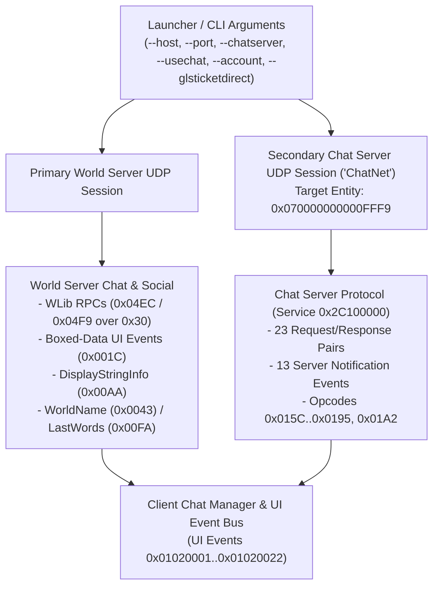
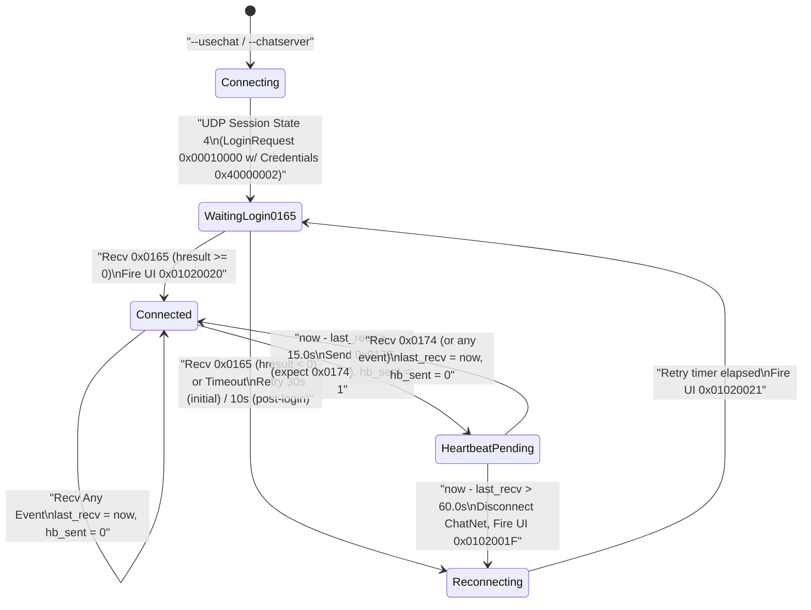

<!-- SPDX-License-Identifier: GPL-3.0-or-later -->

# Official In-World Play Messages Specification

| | |
|---|---|
| **Status** | Review (the 2026-10-20 acceptance by the orchestrating session is not an independent review; decision 0041) |
| **Last updated** | 2026-10-20 |
| **Author role** | Spec writer (dirty room) |
| **Reviewer** | Clean-room orchestrator (CLEAN_ROOM.md §5.3) |
| **Companion specs** | `docs/specs/official-session.md` (UDP transport, reliability, fragmentation, `TimeSync` `0x01000000`, and `NetBlob` framing); `docs/specs/official-messages-world.md` (`NetBlob` to inner event payload boundary §1.1–§1.3, compact wire archive encodings §2, character selection §3, world entry and `0xCC` state schemas §4, object lifecycle §5); `docs/specs/wlib.md` (`wlib.bin` bytecode and native package dispatch); `docs/specs/wstate.md` (WState object-graph bundles and native classes); `docs/specs/property-system.md` (master property dictionary and property sets); `docs/specs/string-table.md` (`StringInfo` resolution). |

---

## 1. Purpose and Scope <a id="s1-purpose"></a>

This specification defines the application-layer game messages exchanged after a character has entered the three-dimensional game world on an official server and is actively playing. It covers the three core in-world subsystems required by a third-party client:

1. **Player and remote entity movement (§4):** client movement step history packets (`0x24`), the 30-slot client-side prediction ring buffer and 4-step rolling transmission rules, server movement acknowledgments and position corrections (`0xCC`) including the complete `PlayerPhysics` boolean and enum state schema tables (`state_schema_id = 0x0000000C`), forced position and teleport events (`0xCE` and `0xBF`), modulo-256 teleport stamp synchronization across portal-space transitions, and remote entity path, autonomous motion-controller, animation-layer, and property-sync updates (`0x59`, `0xED`, `0xBD`, `0x6F`).
2. **Chat, emotes, and system messages (§5–§6):** the dual-connection messaging architecture comprising (a) game-server WLib remote procedure calls in classes `0x04EC` (chat, tells, user channels) and `0x04F9` (emotes) carried inside RPC envelope events `0x30`, `0x5F`, `0xC0`, `0xC9`, `0x50`, and `0x28`, (b) dedicated world-server system, broadcast, group-roster, and boxed-data chat events (`0xAA`, `0xFA`, `0x43`, `0xB3`, `0xFE`, `0x30000045`, `0x1C`, `0x10`–`0x17`, `0x72`), and (c) the dedicated Chat Server (`--chatserver` / `--usechat`) UDP connection, `0x40000002` ticket authentication, `0x00000165` login handshake, `0x0000017E`/`0x00000174` heartbeat state machine, and all 59 Chat Server events (`0x0000015C` through `0x00000195` and `0x000001A2`).
3. **Logout and character switch from the world (§7):** requesting and cancelling a timed logout to character selection via WLib class `0x051E` RPCs (`0x851E002F`, `0x851E0006`, `0x851E0037`, `0x851E000B`), server countdown and cancellation notifications (`0x851E0007`, `0x851E0003`, `0x851E000F`, `0x851E0012`, `0x851E0017`), in-world teardown back to the character selection screen (`0x6C` `CharacterSet`) via the exit-to-character-generation notice (`0x3000001B`–`0x30000043`), and full session termination.

### 1.1 Companion Specifications and Framing Boundary <a id="s1-1-boundaries"></a>

This specification builds directly on the framing and primitive definitions of its companion specifications:

- **Outer `NetBlob` transport framing ([docs/specs/official-session.md](file:///home/solarbaron/git/lotro-reimplementation/docs/specs/official-session.md) §5.6.3, §9.1; [docs/specs/official-messages-world.md](file:///home/solarbaron/git/lotro-reimplementation/docs/specs/official-messages-world.md) §1.1.1–§1.1.3):**
  - Every top-level game event on the World Server connection (and every Chat Server event on the secondary Chat Server UDP connection, §6.6) is transported inside a `NetBlob`.
  - The 32-bit numeric **`event_id` (opcode)** is carried in **Field 10 (`blobHeaderWord`, 4-tier VLE)** of the `NetBlob` fragment header on fragment 0 (`official-messages-world.md` §1.1.1).
  - The default target entity **64-bit `InstanceID`** (`u64 LE`) is carried in **Field 9 (`recipientId`)** of the `NetBlob` fragment header (omitted and defaulting to `0` when `DefaultRecipient` bit `0x40` of `blobFlags` is set; set to `0x070000000000FFF9` on outgoing Chat Server messages, §6.6.1).
  - Byte `0` of the reassembled `NetBlob` payload is **`envelopeFlags`** (`u8`: bit 0 `0x01` = `IsZlibCompressed`, bit 1 `0x02` = `HasRoutingHeader`; `0x00` in standard uncompressed client-to-server and server-to-client messages).
  - Immediately after `envelopeFlags` (and optional zlib decompression and optional routing header, `official-messages-world.md` §1.1.2), **inner offset `0x00`** of the inner event payload stream begins with the 1-byte base event header **`u8 base_flags = 0x00`** (`official-messages-world.md` §1.3). There is **no** redundant 4-byte opcode inside the inner event payload stream of a top-level `NetBlob`.
- **Character selection and world-entry lifecycle ([docs/specs/official-messages-world.md](file:///home/solarbaron/git/lotro-reimplementation/docs/specs/official-messages-world.md) §3–§4):**
  - On the character-selection screen, `0x6C` (`CharacterSet`, S→C) delivers the character list, `0x15` (`CharacterDeletedResult`, S→C) reports character deletion results, and `0x6F` (`SelectCharacter`, C→S) requests world entry for a chosen character (`official-messages-world.md` §3.1–§3.5). Once in the world, `0x6F` is also reused by the client to synchronize local player properties upon completing a portal-space transition (§4.5, §4.6.4).

### 1.2 Compliance Boundaries <a id="s1-2-compliance"></a>

Per `CLAUDE.md` and `docs/CLEAN_ROOM.md`, no anti-cheat, anti-tamper, account authentication, or access-control mechanism is bypassed by any message in this specification, and no cryptographic keys, certificates, hostnames, URLs, packet captures, account data, or player chat/names appear in this document.

---

## 2. Provenance <a id="s2-provenance"></a>

| ID | Confidence | Method | Source | Scope / Justification |
|---|---|---|---|---|
| `OBS-WLIB-BIN` | Confirmed | `OBS` (M1) | `client_gamelogic.dat` record `0x56000000` (`wlib.bin` chunks 1 and 16) in read-only game install | WLib class hierarchies, virtual slot indices, bytecode stubs, RPC function ID constants (`0x84ECxxxx`, `0x84F9xxxx`, `0x851Exxxx`), chat length limit constants (`1925`, `1155`, `385`), and native `0x008E` argument pack/unpack call sequences for chat, emotes, and logout. |
| `OBS-DAT-GL` | Confirmed | `OBS` (M1) | `client_gamelogic.dat` records `0x34000000` (`MasterProperty`), `0x07000029` (`ScriptTable`), `0x0Cxxxxxx` (`Scriptlet`), and `0x23000097` / `0x230000F8` (`EnumMapper`) in read-only game install | Exact deduplicated `bool_pids` (8 properties) and `enum_pids` (6 properties) lists for default `0xCC` movement `state_schema_id = 0x0000000C` (`12`, `Earth_ControlledSurface`) and sibling `PlayerPhysics` scripts (`0x10000E50`, `0x10000E51`) in `0x07000029`. |
| `OBS-DAT-EM` | Confirmed | `OBS` (M1) | `client_general.dat` `EnumMapper` records `0x23000026`, `0x23000027`, `0x2300003B`, `0x2300003C`, `0x230001A0`, `0x230001D2`, `0x230001E2`, `0x230002A8`, `0x230002A9`, and `0x2300032A` in read-only game install | Complete key-to-string tables for `ChatFont`, `ChatFontColor`, `ChatChannelType` (180 regional and world channels), `SecondaryChatChannelType`, `LogType` base, `WhoUIDisplayType`, `GuildReasonCode`, `ChatTextType` (`0x0000`–`0x002F`), and `GuildEvent`. |
| `BIN-MOVEMENT` | Confirmed | `BIN` (M4) | `x64/lotroclient64.exe` (`4906.0071.1794.4035`, `lotro_live`), SHA-256 `d22363eb9aff0fb599fd04b3efa9a1769d08da8af9d8f9b73121c12bfd7e21ee`, analysed via Ghidra `12.1.3_DEV` headless (client movement step history serializer and 30-slot prediction ring buffer, server movement correction serializer and `0x07` `ScriptTable` state-schema builder, entity position event and portal teleport stamp synchronization routines, full movement-state setter, waypoint path serializer, autonomous motion-controller serializer, and entity animation-layer serializer) | Wire layouts and bitmasks of movement events `0x24`, `0xCC`, `0xCE`, `0xBF`, `0x59`, `0xED`, `0xBD`, `0x6F`, `ActionPayload` wire fields, `0xCC` dynamic schema graph-walk rules, 30-slot prediction ring buffer layout, and modulo-256 teleport stamp state machine. M1–M2 were insufficient because movement event serializers, schema construction algorithms, and physics reconciliation logic reside solely in native executable code. |
| `BIN-WLIB-RPC` | Confirmed | `BIN` (M4) | `x64/lotroclient64.exe` (`4906.0071.1794.4035`, `lotro_live`), SHA-256 `d22363eb9aff0fb599fd04b3efa9a1769d08da8af9d8f9b73121c12bfd7e21ee`, analysed via Ghidra `12.1.3_DEV` headless (WLib RPC envelope serializers and dispatchers, 25-byte RPC correlation context serializer, native package `0x008E` argument frame stream and single-reference WState bundle writer/reader, and native package `0x00BF`/`0x0167` UI notice bridges) | Wire framing of WLib RPC envelopes (`0x30`, `0x5F`, `0xC0`, `0xC9`, `0x50`, `0x28`), 25-byte `RPCContext` layout, native package `0x008E` (`WLibArgFrame`) primitive and `ref(Utf16String)` / `ref(StringInfo)` wire layouts, and logout UI notice bridges. M1–M2 were insufficient because the wire encoding of `WLibArgFrame` and RPC envelope headers is implemented in native code. |
| `BIN-CHAT-SYS` | Confirmed | `BIN` (M4) | `x64/lotroclient64.exe` (`4906.0071.1794.4035`, `lotro_live`), SHA-256 `d22363eb9aff0fb599fd04b3efa9a1769d08da8af9d8f9b73121c12bfd7e21ee`, analysed via Ghidra `12.1.3_DEV` / `11.3.2` headless (command-line parser and GLS ticket refresher, secondary Chat Server transport and `0x40000002` credential builder, `0x00000165` login status handler, `0x0000017E`/`0x00000174` heartbeat state machine, 59 Chat Server event factories and serializers `0x0000015C`–`0x00000195` and `0x000001A2`, world-server boxed-data chat UI dispatchers, system notice serializers, and world-to-character-select teardown notice handlers) | Command-line switches (`--chatserver`, `--usechat`, `--authserverurl`), Chat Server authentication and keepalive state machine, polymorphic `ChatDescriptor` and `ChatObj` encodings, all 59 Chat Server event wire layouts, dual-path World Server vs. Chat Server routing, system message events (`0xAA`, `0xFA`, `0x43`, `0xB3`, `0xFE`, `0x30000045`, `0x1C`), and world teardown notices (`0x3000001B`–`0x30000043`). M1–M2 were insufficient because the Chat Server protocol and native notice serializers have no data-table representation or published specification. |

---

## 3. Common Wire Primitives and Conventions <a id="s3-primitives"></a>

All network event payloads in this specification are serialized with **archive flag bit 11 (`0x800`, compact/wire mode) set** and **bit 14 (`0x4000`, checkpointed property mode) clear** ([docs/specs/official-messages-world.md](file:///home/solarbaron/git/lotro-reimplementation/docs/specs/official-messages-world.md) §1.2). All fixed-width multi-byte integer and floating-point fields are little-endian (`LE`) unless explicitly marked big-endian (`BE`).

### 3.1 Summary of Shared Wire Primitives (`official-messages-world.md` §1.3, §2) <a id="s3-1-shared-primitives"></a>

The field tables in §4–§7 use the canonical primitive names defined in [docs/specs/official-messages-world.md](file:///home/solarbaron/git/lotro-reimplementation/docs/specs/official-messages-world.md) §1.3 and §2:

| Primitive Name | Wire Size | Encoding Summary (`official-messages-world.md` Reference) |
|---|---|---|
| `base_flags` | 1 byte (`u8`) | Base event header byte at **inner offset `0x00`** of every event payload stream (`0x00`; `official-messages-world.md` §1.3). |
| `bool8` | 1 byte (`u8`) | `0x00` = false, `0x01` = true; any value `0x02..0xFF` sets the archive error bit and rejects the event (`official-messages-world.md` §2.1). |
| `3-tier VLE` | 1, 2, or 4 bytes | 30-bit unsigned integer (`official-messages-world.md` §2.2.1): `0x00..0x7F` → 1 byte `b0`; `0x80..0x3FFF` → 2 bytes `((b0 & 0x3F) << 8) \| b1`; `0x4000..0x3FFFFFFF` → 4 bytes `((b0 & 0x3F) << 24) \| (b1 << 16) \| u16_le(b2, b3)`. |
| `4-tier VLE` | 1, 2, 4, or 5 bytes | Full 32-bit unsigned/signed integer (`official-messages-world.md` §2.2.2): `0x00..0x7F` → 1 byte; `0x80..0x3FFF` → 2 bytes; `0x4000..0x1FFFFFFF` → 4 bytes (`0xC0..0xDF` prefix); `0x20000000..0xFFFFFFFF` → 5 bytes (`0xE0` prefix + `u32 LE`). |
| `Prefixed UTF-16LE string` | Variable | `3-tier VLE` UTF-16 code-unit count $N$, followed by $N \times 2$ bytes of `u16 LE` code units (`official-messages-world.md` §2.3). |
| `Prefixed 8-bit string` | Variable | `3-tier VLE` byte count $N$, followed by $N$ raw 8-bit bytes (`official-messages-world.md` §2.3). |
| `Compact DID` | 2, 3, or 5 bytes | `u8 high_byte` (bits `24..31`) followed by `3-tier VLE low_24` (bits `0..23`) (`official-messages-world.md` §2.4.2). |
| `CompactPID` | 2 or 5 bytes | `u16 BE` for PIDs in `0x00000000..0x00003FFF` (`0x0000..0x3FFF`) and `0x10000000..0x10003FFF` (`0x4000..0x7FFF`), or `0x80` escape byte + `u32 LE` for all other PIDs (`official-messages-world.md` §2.4.3). |
| `Base wire Position` | 1 to 20 bytes | Wire `Position` without quaternion (`official-messages-world.md` §2.5.1):<br>1. `flags` (`u8`).<br>2. `region` (`u8`): written iff bit 0 (`0x01`) is set **and** bit 6 (`0x40`) is clear (defaults to `0` when bit 0 is clear; **elided on wire and defaults to `1`** when both bit 0 `0x01` and bit 6 `0x40` are set).<br>3. `block_x, block_y` (`u8, u8`): written iff bit 1 (`0x02`) is set (defaults to `0xFF, 0xFF` when clear).<br>4. `instance` (`u16 LE`): written iff bit 2 (`0x04`) is set (defaults to `0x0000` when clear).<br>5. `cell` (`u16 LE`): written iff bit 3 (`0x08`) is set **and** bit 7 (`0x80`) is clear (defaults to `0xFFFF` when bit 3 is clear; **elided on wire and defaults to `0x0000`** when both bit 3 `0x08` and bit 7 `0x80` are set).<br>6. `offset` (`3 × f32 LE` `x, y, z` in metres): written iff bit 4 (`0x10`) is set (defaults to `(0.0, 0.0, 0.0)` when clear). |
| `Full wire Position` | 1 to 36 bytes | `Base wire Position` followed, iff bit 5 (`0x20`) of `flags` is set, by `orientation` (`4 × f32 LE` scalar-first quaternion `(w, x, y, z)`; defaults to identity `(1.0, 0.0, 0.0, 0.0)` when bit 5 is clear; `official-messages-world.md` §2.5.1). |
| `Quantized 1-byte heading` | 1 byte (`u8`) | Horizontal yaw angle in $[0, 2\pi)$ radians (`official-messages-world.md` §2.5.2): $\text{radians} = (\text{raw\_angle} \times 2\pi / 256) \bmod 2\pi$. |
| `SignedNormalizedByte` | 1 byte (`i8`) | Quantized signed scalar in `[-1.0, 1.0]`: signed byte $b \in [-127, 127]$ mapped to $\text{clamp}(b / 127.0, -1.0, 1.0)$. |
| `Wire StringInfo` | Variable | `u8 mode` (`0x01` = `Prefixed UTF-16LE string` literal; else `u32 LE token_id` + `u32 LE table_did`), `bool8 has_authoring_strings` (+ 3 `Prefixed 8-bit string`s when `1`), `3-tier VLE arg_count` (**no** TSize hint byte on the wire), and `arg_count` wire argument entries (`official-messages-world.md` §2.6). |
| `Wire PropertySet` | Variable | `3-tier VLE count` (**no** TSize hint byte) followed by `count` pairs of `(CompactPID, PropertyValue)` (**no** duplicate `u32` hash key; `official-messages-world.md` §2.7.2). |

---

## 4. Player Movement and Remote Entity Motion <a id="s4-movement"></a>

### 4.1 Client Movement Prediction Ring Buffer and Step Transmission Rules <a id="s4-1-prediction-ring"></a>

Confirmed (`BIN-MOVEMENT`). The client maintains a fixed-size circular history buffer of recent local player movement steps to support client-side prediction and server reconciliation:

1. **Ring buffer geometry:** The prediction history buffer contains **30 slots** (`0..29`), each 144 (`0x90`) bytes in memory. The client tracks the active slot index `current_slot` in `0..29` and a monotonically increasing 32-bit unsigned step sequence counter `step_seq`.
2. **Advancing a step:** Whenever the local player's movement state advances (either because user input changes movement mode, direction, turn rate, or queued movement actions, or when the periodic physics step timer expires while moving), the client advances `current_slot = (current_slot + 1) % 30`, increments `step_seq` by `1`, and records the step parameters (`step_seq`, `move_mode`, `slot_flags`, `dir_x`, `dir_y`, `turn_rate`, optional movement action list, and optional `Wire PropertySet`) together with the predicted post-step world position and heading into `ring[current_slot]`.
3. **Constructing the step packet (`0x24`):** Each outgoing movement packet (`0x24`) carries a fixed rolling window of **4 consecutive historical steps** ordered from **oldest (`k = 0`) to newest (`k = 3`)**:
   - `steps[3]` (newest) is copied from `ring[current_slot]`.
   - `steps[2]` is copied from `ring[(current_slot + 29) % 30]`.
   - `steps[1]` is copied from `ring[(current_slot + 28) % 30]`.
   - `steps[0]` (oldest) is copied from `ring[(current_slot + 27) % 30]`.
   Redundantly transmitting the last 4 steps in every `0x24` packet allows the server to recover up to 3 dropped unreliable step datagrams without triggering a position rubber-band correction.
4. **Sequence reconstruction rule:** Only `steps[3].step_seq` (`newest_step_seq`) is written to the wire. A receiver reconstructs the sequence numbers of the three older slots as:
   - `steps[2].step_seq = (newest_step_seq >= 1) ? (newest_step_seq - 1) : 0`
   - `steps[1].step_seq = (newest_step_seq >= 2) ? (newest_step_seq - 2) : 0`
   - `steps[0].step_seq = (newest_step_seq >= 3) ? (newest_step_seq - 3) : 0`

### 4.2 Client Movement Step Event (`0x24`, Client → Server) <a id="s4-2-msg-0024"></a>

Confirmed (`BIN-MOVEMENT`; see also [docs/specs/official-messages-world.md](file:///home/solarbaron/git/lotro-reimplementation/docs/specs/official-messages-world.md) §5.5). Sent by the client in a `NetBlob` with `blobHeaderWord = 0x24` to report the local player's 4 most recent movement steps and current teleport stamp.

| Inner Offset | Size | Type | Field Name | Meaning / Units / Encoding |
|---|---|---|---|---|
| `0x00` | 1 | `u8` | `base_flags` | Base event header (`0x00`, §3.1). |
| `0x01` | 8 | `u64 LE` | `player_entity_id` | 64-bit `InstanceID` of the controlled player character. |
| `0x09` | 1 | `u8` | `teleport_stamp` | Current 8-bit teleport stamp held by the local player entity (see [§4.5](#s4-5-teleport-stamp)). |
| `0x0A` | 4 | `u32 LE` | `newest_step_seq` | Sequence number `steps[3].step_seq` of the newest step in the 4-step window. |
| `0x0E` | 4 | `u8[4]` | `move_mode[0..3]` | Movement mode byte for each of the 4 steps (`k = 0..3`, oldest to newest). |
| `0x12` | 4 | `u8[4]` | `slot_flags[0..3]` | Per-step content flags for `k = 0..3`: bit 0 (`0x01`) = step has movement actions; bit 4 (`0x10`) = step has an attached `Wire PropertySet`; bits `0x6E` (`0x02 \| 0x04 \| 0x08 \| 0x20 \| 0x40`) = auxiliary movement state flags. |
| `0x16` | 4 | `i8[4]` | `dir_x[0..3]` | `SignedNormalizedByte` (`[-127..127]` → `[-1.0..1.0]`) lateral/strafe input scalar for steps `k = 0..3`. |
| `0x1A` | 4 | `i8[4]` | `dir_y[0..3]` | `SignedNormalizedByte` (`[-127..127]` → `[-1.0..1.0]`) forward/backward input scalar for steps `k = 0..3`. |
| `0x1E` | 4 | `i8[4]` | `turn_rate[0..3]` | `SignedNormalizedByte` (`[-127..127]` → `[-1.0..1.0]`) yaw turn rate scalar for steps `k = 0..3`. |
| `0x22` | var | conditional | `slot_actions[0..3]` | **Present iff** `((slot_flags[0] \| slot_flags[1] \| slot_flags[2] \| slot_flags[3]) & 0x01) != 0`. When present, serialized for **all 4 steps** `k = 0..3` in order: `action_count_k` (`u8`), followed by `action_count_k` entries of `{ action_id: Compact DID, action_payload: ActionPayload (§4.2.1) }`. When bit 0 is clear in all 4 slots, 0 bytes are written. |
| var | var | conditional | `slot_props[0..3]` | Evaluated independently for each `k = 0..3`: if `(slot_flags[k] & 0x10) != 0`, a `Wire PropertySet` (§3.1) is serialized for step `k`; otherwise 0 bytes for step `k`. |
| var | 4 | `u32 LE` | `trailing_seq` | Trailing synchronization sequence word (`0` when unused). |

When no slot has bit `0x01` or bit `0x10` set in `slot_flags`, the inner event payload of `0x24` is a fixed **38 bytes** (`0x26`).

#### 4.2.1 `ActionPayload` Wire Layout <a id="s4-2-1-action-payload"></a>

Confirmed (`BIN-MOVEMENT`; see also [docs/specs/official-messages-world.md](file:///home/solarbaron/git/lotro-reimplementation/docs/specs/official-messages-world.md) §5.6.1). Every movement or entity action entry in `0x24` (when `slot_flags` bit 0 is set), `0xBD` (§4.6.3), and `0x75` / `0x5A` / `0xA8` (`official-messages-world.md` §5.6) encodes its parameters in wire mode (`0x800`) using the following sequential layout:

| Order | Field | Condition (in wire mode `0x800`) | Size (bytes) | Type | Meaning / Default when Omitted |
|---|---|---|---|---|---|
| 1 | `rate_byte` | Always present | 1 | `u8` | Quantized action speed/rate byte (`0..255`, converted to `f32` in memory; in non-wire mode this field is a 4-byte `f32 LE`). |
| 2 | `payload_flags` | Always present | 2 | `u16 LE` | Bitmask selecting optional action fields (`0x0001`, `0x0002`, `0x0008`, `0x0010`, `0x0020`, `0x0040`, `0x2000`, `0x4000`). |
| 3 | `blend_param` | Bit 6 (`0x0040`) of `payload_flags` set | 4 | `f32 LE` | Action blend / timing offset parameter (defaults to `0.0` when clear). |
| 4 | `sub_action_block` | Bit 13 (`0x2000`) of `payload_flags` set | 3 to 11 | `4-tier VLE` + `4-tier VLE` + `bool8` | Three fields in order: `sub_param` (`4-tier VLE`), `sub_code` (`4-tier VLE`), and `sub_flag` (`bool8`, `0x00` or `0x01`). |
| 5 | `target_a_id` | Bit 0 (`0x0001`) of `payload_flags` set | 8 | `u64 LE` (`InstanceID`) | Primary action target `InstanceID` (defaults to `0` when clear). |
| 6 | `target_b_id` | Bit 14 (`0x4000`) of `payload_flags` set | 8 | `u64 LE` (`InstanceID`) | Secondary action target `InstanceID` (defaults to `0` when clear). |
| 7 | `action_props` | Bit 1 (`0x0002`) of `payload_flags` set | 1+ | `Wire PropertySet` (§3.1) | Per-action property set (empty when clear). |
| 8 | `aux_word_a` | Bit 3 (`0x0008`) of `payload_flags` set | 1 to 5 | `4-tier VLE` | Auxiliary action integer A (defaults to `3` when clear). |
| 9 | `action_scale` | Bit 4 (`0x0010`) of `payload_flags` set | 4 | `f32 LE` | Action playback scale factor (defaults to `1.0` when clear). |
| 10 | `context_id` | Always present | 8 | `u64 LE` | 64-bit action context / correlation identifier. |
| 11 | `aux_word_b` | Bit 5 (`0x0020`) of `payload_flags` set | 1 to 5 | `4-tier VLE` | Auxiliary action integer B. |

### 4.3 Server Movement Correction and Portal Placement (`0xCC`, Server → Client) <a id="s4-3-msg-00cc"></a>

Confirmed (`BIN-MOVEMENT`, `OBS-DAT-GL`; cross-referenced with [docs/specs/official-messages-world.md](file:///home/solarbaron/git/lotro-reimplementation/docs/specs/official-messages-world.md) §4.3.1). Sent by the server in a `NetBlob` with `blobHeaderWord = 0xCC` to acknowledge a client movement step sequence number (or place the player during a portal transition) and provide the authoritative spatial state and physics property snapshot for the player entity.

| Inner Offset | Size | Type | Field Name | Meaning / Units / Encoding |
|---|---|---|---|---|
| `0x00` | 1 | `u8` | `base_flags` | Base event header (`0x00`). |
| `0x01` | 1 | `u8` | `pos_sync_flags` | Bitmask controlling optional fields: bit 0 (`0x01`) = boolean flag; bit 1 (`0x02`) = `vel_x` present; bit 2 (`0x04`) = `vel_y` present; bit 3 (`0x08`) = `vel_z` present; bit 4 (`0x10`) = `ang_vel_x` present; bit 5 (`0x20`) = `ang_vel_y` present; bit 6 (`0x40`) = `ang_vel_z` present; bit 7 (`0x80`) = explicit `state_schema_id` present. |
| `0x02` | 4 | `u32 LE` | `ack_step_seq` | Client `step_seq` being acknowledged or corrected by the server (or portal sequence/reason during world entry). |
| `0x06` | var | `Base wire Position` | `authoritative_pos` | Authoritative landblock/cell and local offset coordinates (§3.1, without quaternion). |
| var | 1 | `Quantized 1-byte heading` | `authoritative_yaw` | Authoritative horizontal heading (`0..255` → `[0, 2π)` radians, §3.1; or 4-byte heading/speed word in internal controller mode). |
| var | 1 | `u8` | `movement_mode` | Server movement mode/state byte. |
| var | 0..24 | `f32 LE` × `k` | `optional_kinematics` | Zero to six `f32 LE` values present in bit order for each set bit in `pos_sync_flags` bits `1..6`: `vel_x` (bit 1), `vel_y` (bit 2), `vel_z` (bit 3), `ang_vel_x` (bit 4), `ang_vel_y` (bit 5), `ang_vel_z` (bit 6). Missing components default to `0.0`. |
| var | 2, 3, or 5 | `Compact DID` | `anim_or_context_did` | `u8 high_byte` (bits `24..31`) + `3-tier VLE low_24` (bits `0..23`) (§3.1). |
| var | 0 or 4 | `u32 LE` | `state_schema_id` | **Present iff** `(pos_sync_flags & 0x80) != 0`. Identifies the `PlayerPhysics` script key (property `0x00000A9D` `Entity_PlayerPhysicsScript`, enum mapper `0x23000097` / `0x230000F8`). When bit 7 (`0x80`) is clear, `state_schema_id` defaults to **`0x0000000C`** (`12`, `Earth_ControlledSurface`). |
| var | `ceil(N_bool / 8)` | `u8[ceil(N_bool / 8)]` | `bool_state_bytes` | Raw bit-packed boolean property values for `state_schema_id` (packed LSB-first with **no** length prefix on the wire: bit `i` is `(bool_state_bytes[i >> 3] >> (i & 7)) & 1`, paired with `bool_pids[i]`). For default schema `0x0000000C` (`12`), `N_bool = 8` (**`1` byte**). |
| var | var (`N_enum` VLEs) | `3-tier VLE[N_enum]` | `enum_state_vles` | `N_enum` consecutive `3-tier VLE` (`1`, `2`, or `4` bytes each, §3.1, with **no** count prefix on the wire) values paired with `enum_pids[i]`. For default schema `0x0000000C` (`12`), `N_enum = 6` (**`6` `3-tier VLE`s**). |
| var | 4 | `u32 LE` | `extra_blob_size` | 4-byte unsigned integer byte length $N$ of `extra_blob` (not a VLE). Must satisfy $N \le \text{remaining\_bytes}$. |
| var | $N$ | `u8[N]` | `extra_blob` | Raw trailing physics state sub-archive bytes ($N$ bytes). |

#### 4.3.1 Complete `0xCC` State Schema Tables (`client_gamelogic.dat` `0x07000029`) <a id="s4-3-1-msg-00cc-schemas"></a>

Confirmed (`BIN-MOVEMENT`, `OBS-DAT-GL`; see [docs/specs/official-messages-world.md](file:///home/solarbaron/git/lotro-reimplementation/docs/specs/official-messages-world.md) §4.3.1). For any `state_schema_id`, the client constructs `(bool_pids[0..N_bool], enum_pids[0..N_enum])` by walking the pre-order depth-first closure of the entity's `0x07` `ScriptTable` graph (and referenced `0x0Cxxxxxx` `Scriptlet` records, node kind `19`), filtering for `Switch` (node kind `12`) and `When` (node kind `63`) nodes, and appending each node's condition Property ID (`0x000004AE` `SwitchScript_Property`) without duplicates to `bool_pids` if its base type in `0x34000000` is `21` (`Boolean`) or to `enum_pids` if its base type is `8` (`Enum`).

Across the entire player/avatar `0x07` `ScriptTable` closure (`150` tables rooted at `0x07000417` and `0x07000000`), only table **`0x07000029`** defines `PlayerPhysics` scripts:

| `state_schema_id` | Symbolic Name (`0x23000097` / `0x230000F8`) | Defining `0x07` Table | `N_bool` | `bool_state_bytes` Size | `N_enum` | `enum_state_vles` Count |
|---|---|---|---|---|---|---|
| `0x0000000C` (`12`) *(default when `pos_sync_flags & 0x80 == 0`)* | `Earth_ControlledSurface` | `0x07000029` | **`8`** | **`1` byte** | **`6`** | **`6` `3-tier VLE`s** (`6`–`24` bytes) |
| `0x10000E50` (`268439120`) | *(mounted/auxiliary physics script 1)* | `0x07000029` | **`0`** | **`0` bytes** | **`0`** | **`0` bytes** *(switches only on `0x000002E9` `Physics_Velocity`, Type 6 `Vector3`)* |
| `0x10000E51` (`268439121`) | *(mounted/auxiliary physics script 2)* | `0x07000029` | **`0`** | **`0` bytes** | **`0`** | **`0` bytes** *(switches only on `0x000002E9` `Physics_Velocity`, Type 6 `Vector3`)* |

##### Exact `bool_pids` Bit Table for Default Schema `0x0000000C` (`12`, `Earth_ControlledSurface`)

| Bit Index (`i`) | Bit Mask in `bool_state_bytes[0]` | Hex `PID` | Decimal `PID` | Type Code | Dictionary Name (`0x34000000`) |
|---|---|---|---|---|---|
| `0` | `0x01` (`1 << 0`) | `0x0000068A` | `1674` | `21` (`Boolean`) | `Movement_ActiveMovementFrozen` |
| `1` | `0x02` (`1 << 1`) | `0x10003EA0` | `268451488` | `21` (`Boolean`) | `Physics_OnSlide` |
| `2` | `0x04` (`1 << 2`) | `0x10006676` | `268461686` | `21` (`Boolean`) | `Physics_OnIce` |
| `3` | `0x08` (`1 << 3`) | `0x10004157` | `268452183` | `21` (`Boolean`) | `Mount_Movement_Use_RampUp_Controller` |
| `4` | `0x10` (`1 << 4`) | `0x10000ED8` | `268439256` | `21` (`Boolean`) | `Stealth_IsStealthed` |
| `5` | `0x20` (`1 << 5`) | `0x10001A27` | `268442151` | `21` (`Boolean`) | `ScriptSystem_IsHovering` |
| `6` | `0x40` (`1 << 6`) | `0x10000ED7` | `268439255` | `21` (`Boolean`) | `ScriptSystem_ActiveMovementBlocked` |
| `7` | `0x80` (`1 << 7`) | `0x10000443` | `268436547` | `21` (`Boolean`) | `Patrol_Flying` |

##### Exact `enum_pids` VLE Table for Default Schema `0x0000000C` (`12`, `Earth_ControlledSurface`)

| VLE Index (`i`) | Wire Encoding | Hex `PID` | Decimal `PID` | Type Code | Dictionary Name (`0x34000000`) |
|---|---|---|---|---|---|
| `0` | `3-tier VLE` (`1`, `2`, or `4` B) | `0x00000126` | `294` | `8` (`Enum`) | `WeenieType` |
| `1` | `3-tier VLE` (`1`, `2`, or `4` B) | `0x00000201` | `513` | `8` (`Enum`) | `Entity_Element` |
| `2` | `3-tier VLE` (`1`, `2`, or `4` B) | `0x00000687` | `1671` | `8` (`Enum`) | `Movement_MovementStyle` |
| `3` | `3-tier VLE` (`1`, `2`, or `4` B) | `0x1000136E` | `268440430` | `8` (`Enum`) | `Agent_ClassificationFilter` |
| `4` | `3-tier VLE` (`1`, `2`, or `4` B) | `0x100000FC` | `268435708` | `8` (`Enum`) | `Agent_Species` |
| `5` | `3-tier VLE` (`1`, `2`, or `4` B) | `0x10000469` | `268436585` | `8` (`Enum`) | `Combat_AnimationSet` |

#### 4.3.2 Server Reconciliation Algorithm (`0xCC`) <a id="s4-3-2-msg-00cc-reconcile"></a>

When the client receives `0xCC` for the local player:

1. It searches the 30-slot prediction ring buffer for a slot whose recorded `step_seq` equals `ack_step_seq`.
2. If a matching slot is found and its predicted position and `authoritative_pos` / `authoritative_yaw` lie within the engine's spatial tolerance, the client accepts the acknowledgment without snapping the visual camera or physics body.
3. If the spatial error exceeds tolerance, or if `ack_step_seq` is not found in the 30-slot window, the client rewinds the local player's physics component to `authoritative_pos` and `authoritative_yaw`, applies `optional_kinematics`, `bool_state_bytes`, and `enum_state_vles`, and replays any unacknowledged steps in the ring buffer with `step_seq > ack_step_seq`.

### 4.4 Forced Position and Teleport Events (`0xCE` and `0xBF`) <a id="s4-4-forced-pos"></a>

#### 4.4.1 Entity Position, Velocity, Attachment, and Teleport Event (`0xCE`, Server → Client) <a id="s4-4-1-msg-00ce"></a>

Confirmed (`BIN-MOVEMENT`; see also [docs/specs/official-messages-world.md](file:///home/solarbaron/git/lotro-reimplementation/docs/specs/official-messages-world.md) §5.4). Sent by the server in a `NetBlob` with `blobHeaderWord = 0xCE` to set or update the world position, attachment parent, linear velocity, or teleport stamp of an entity.

| Inner Offset | Size | Type | Field Name | Meaning / Units / Encoding |
|---|---|---|---|---|
| `0x00` | 1 | `u8` | `base_flags` | Base event header (`0x00`). |
| `0x01` | 1 | `u8` | `header_flags` | Presence bitmask: bit 0 (`0x01`) = `anim_state` present; bit 1 (`0x02`) = `interp_param_a` present (default `5`); bit 2 (`0x04`) = `interp_param_b` present (default `2`); bit 3 (`0x08`) = `teleport_stamp` present; bit 4 (`0x10`) = `vel_x` present; bit 5 (`0x20`) = `vel_y` present; bit 6 (`0x40`) = `vel_z` present. |
| `0x02` | 8 | `u64 LE` | `entity_id` | Target 64-bit `InstanceID`. |
| `0x0A` | 1 | `u8` | `mode_flags` | Spatial representation selector: bit 2 (`0x04`) = parented/mounted attachment; bit 3 (`0x08`) = extended attachment info (valid when bit 2 set); bit 4 (`0x10`) = full-rotation `Full wire Position` (omits the separate 1-byte heading) instead of `Base wire Position` + `Quantized 1-byte heading`. |
| var | 0 or 1 | `u8` | `teleport_stamp` | **Present iff** `(header_flags & 0x08) != 0`. Authoritative 8-bit teleport/sequence stamp for this position event. |
| var | 0..12 | `f32 LE` × `k` | `velocity` | Optional linear velocity components in m/s present in bit order: `vel_x` if `(header_flags & 0x10) != 0`; `vel_y` if `(header_flags & 0x20) != 0`; `vel_z` if `(header_flags & 0x40) != 0`. Default to `0.0` when omitted. |
| var | 0, 1, 2, or 4 | `3-tier VLE` | `anim_state` | **Present iff** `(header_flags & 0x01) != 0` (defaults to `0`). |
| var | var | branched | `spatial_payload` | Branched on `mode_flags`:<br>• **Case A — Parented (`(mode_flags & 0x04) != 0`):** `parent_id` (`u64 LE`), `attach_slot` (`3-tier VLE`), and if `(mode_flags & 0x08) != 0`: `attach_param` (`u32 LE`), `attach_sub` (`u8`), `attach_flag` (`bool8`).<br>• **Case B — Yaw-only world position (`(mode_flags & 0x04) == 0` and `(mode_flags & 0x10) == 0`):** `Base wire Position` (§3.1) followed by `heading` (`Quantized 1-byte heading` `u8`, §3.1).<br>• **Case C — Full-rotation world position (`(mode_flags & 0x04) == 0` and `(mode_flags & 0x10) != 0`):** `Full wire Position` (§3.1, includes 16-byte `(w, x, y, z)` quaternion when its internal `flags & 0x20` bit is set, without a trailing 1-byte heading). |
| var | 0 or 1 | `u8` | `interp_param_a` | **Present iff** `(header_flags & 0x02) != 0`; otherwise defaults to `5`. |
| var | 0 or 1 | `u8` | `interp_param_b` | **Present iff** `(header_flags & 0x04) != 0`; otherwise defaults to `2`. |

#### 4.4.2 Full Movement-State Setter (`0xBF`, Server → Client / Bidirectional) <a id="s4-4-2-msg-00bf"></a>

Confirmed (`BIN-MOVEMENT`). Directly replaces an entity's full movement state:

| Inner Offset | Size | Type | Field Name | Meaning / Units / Encoding |
|---|---|---|---|---|
| `0x00` | 1 | `u8` | `base_flags` | Base event header (`0x00`). |
| `0x01` | 1, 2, or 4 | `3-tier VLE` | `state_flags` | Movement state presence bitmask. |
| var | 0..36 | `Full wire Position` | `position` | **Present iff** `state_flags != 0`. Landblock/cell, local offset, and optional `(w, x, y, z)` quaternion (§3.1). |
| var | 0 or 12 | `3 × f32 LE` | `velocity_xzy` | **Present iff** `state_flags != 0` and `(state_flags & 0x04) != 0`. Three `f32 LE` velocity components `(vel_x, vel_z, vel_y)`. |
| var | 4 | `u32 LE` | `set_pos_flags` | Bitmask controlling how the physics component applies the state replacement. |

When applying `0xBF`, the physics component validates that each horizontal and vertical coordinate component lies within `[-100000.0, 100000.0]` metres; coordinates outside this range are rejected as out-of-bounds.

### 4.5 Teleport Stamp Synchronization State Machine <a id="s4-5-teleport-stamp"></a>

Confirmed (`BIN-MOVEMENT`). The client and server synchronize player teleports and portal-space transitions using an 8-bit unsigned `teleport_stamp` (`u8`) compared using **modulo-256 serial number arithmetic**:

1. **Modulo-256 ordering rule:** Given two 8-bit stamps `new_stamp` and `current_stamp`, `new_stamp` is considered **newer than or equal to** `current_stamp` if and only if:
   `((new_stamp - current_stamp) & 0xFF) < 0x80`
   Conversely, if `((new_stamp - current_stamp) & 0xFF) >= 0x80`, `new_stamp` is older than `current_stamp` and is ignored as stale.
2. **Entering portal space:** When the client's world-view controller receives an enter-portal-space notification carrying `(scene_id: u32, expected_stamp: u8, flags: u32)`:
   - The client compares `expected_stamp` against the local player entity's current `entity_stamp`.
   - If `entity_stamp` has not yet reached `expected_stamp` (`((expected_stamp - entity_stamp) & 0xFF) < 0x80` and `expected_stamp != entity_stamp`), the world-view controller sets `waiting_for_player_teleport = true` and records `expected_teleport_stamp = expected_stamp`.
   - While `waiting_for_player_teleport == true`, normal local step simulation is suspended while the client loads the destination terrain block and waits for the authoritative `0xCE` position event.
3. **Receiving `0xCE` for the local player:** When `0xCE` arrives for the local player entity with `(header_flags & 0x08) != 0`:
   - If `((msg.teleport_stamp - entity_stamp) & 0xFF) < 0x80`, the client updates `entity_stamp = msg.teleport_stamp`, snaps the player's cell and local position to `msg.spatial_payload`, and resets the 30-slot movement prediction ring buffer.
   - If `waiting_for_player_teleport == true` and `((msg.teleport_stamp - expected_teleport_stamp) & 0xFF) < 0x80`, the client clears `waiting_for_player_teleport = false`.
4. **Completing portal exit (`0xF4` and `0x6F`):** Once `waiting_for_player_teleport == false` and local landblock/scenery loading completes (or the portal-space loading timeout expires), the client exits portal space, sends `0xF4` (`PortalSpaceReady`, `official-messages-world.md` §4.3.1) and `0x6F` ([§4.6.4](#s4-6-4-msg-006f)) for the player entity, and resumes sending `0x24` step packets carrying the updated `entity_stamp`.

### 4.6 Remote Entity Movement, Motion, and Animation Updates <a id="s4-6-remote-motion"></a>

#### 4.6.1 Entity Path and Waypoint Interpolation (`0x59`, Server → Client) <a id="s4-6-1-msg-0059"></a>

Confirmed (`BIN-MOVEMENT`). Instructs the client to move an entity (typically an NPC or monster) along a sequence of world waypoints:

| Inner Offset | Size | Type | Field Name | Meaning / Units / Encoding |
|---|---|---|---|---|
| `0x00` | 1 | `u8` | `base_flags` | Base event header (`0x00`). |
| `0x01` | 4 | `u32 LE` | `path_type` | Interpolation mode / path controller type ID. |
| `0x05` | 8 | `u64 LE` | `entity_id` | 64-bit `InstanceID` of the moving NPC/entity. |
| `0x0D` | 2 | `u16 LE` | `path_flags` | Bit 0 (`0x0001`) = waypoint array present; bit 1 (`0x0002`) = `speed_param` float present. |
| var | 0 or 4 | `f32 LE` | `speed_param` | **Present iff** `(path_flags & 0x0002) != 0`. Movement speed or timing scalar. |
| var | 0 or 4 | `u32 LE` | `waypoint_count` | **Present iff** `(path_flags & 0x0001) != 0`. Number of waypoints $M$. Must satisfy $M \le \text{remaining\_bytes}$. |
| var | var | `Full wire Position[M]` | `waypoints` | **Present iff** `(path_flags & 0x0001) != 0`. $M$ consecutive `Full wire Position` records (§3.1) defining the path. |

#### 4.6.2 Autonomous Motion Controller Update (`0xED`, Server → Client) <a id="s4-6-2-msg-00ed"></a>

Confirmed (`BIN-MOVEMENT`). Delivers an autonomous motion controller update to the target entity identified by the enclosing `NetBlob`'s `recipientId` (`official-messages-world.md` §1.1.1). The payload uses the engine's polymorphic optional-typed-object framing:

| Inner Offset | Size | Type | Field Name | Meaning / Units / Encoding |
|---|---|---|---|---|
| `0x00` | 1 | `u8` | `base_flags` | Base event header (`0x00`). |
| `0x01` | 1 | `bool8` | `has_controller` | `0x00` = clear/no controller (no further bytes follow); `0x01` = a typed controller follows; `>= 0x02` fails the archive. |
| `0x02` | 0 or 16 | `u32 LE, u16 LE, u16 LE, u64 LE` | `controller_type_id` | **Present iff** `has_controller == 1`. 16-byte class identifier (GUID) of the motion controller type. If all 16 bytes are zero, the controller is cleared and **no body bytes follow**. |
| var | var | per controller type | `controller_body` | **Present iff** `has_controller == 1` and `controller_type_id` is non-zero. Five controller classes are registered in the client:<br>• **Type 1 (Composite binary controller):** `param_u64` (`u64 LE`, 8 B), `param_u32` (`u32 LE`, 4 B), followed recursively by two child optional-controller records (`bool8 has_child` + optional 16-byte `type_id` + child `body`).<br>• **Type 2 (Target entity controller):** `target_id` (`u64 LE` `InstanceID`, 8 B).<br>• **Type 3 (Game-clock timer controller):** `delta_seconds` (`f64 LE`, 8 B; sentinel `3.4028234663852886e38` denotes unset/`-1.0`, otherwise relative to the monotonic game clock as in `official-messages-world.md` §4.4).<br>• **Types 4 & 5 (Stateless marker controllers):** 0 body bytes. |

#### 4.6.3 Entity Animation and Action-Layer State Update (`0xBD`, Server → Client) <a id="s4-6-3-msg-00bd"></a>

Confirmed (`BIN-MOVEMENT`). Updates the active animation/action layers on the target entity identified by the enclosing `NetBlob`'s `recipientId` (`official-messages-world.md` §1.1.1):

| Inner Offset | Size | Type | Field Name | Meaning / Units / Encoding |
|---|---|---|---|---|
| `0x00` | 1 | `u8` | `base_flags` | Base event header (`0x00`). |
| `0x01` | 1, 2, or 4 | `3-tier VLE` | `layer_count` | Number of `ActionLayerEntry` records $K$ that follow. Must satisfy $K \le \text{remaining\_bytes}$. |
| var | var | `ActionLayerEntry[K]` | `layers` | $K$ sequential `ActionLayerEntry` records defined below. |

Each **`ActionLayerEntry`** inside `0xBD` has the following sequential layout:

| Order | Field | Size (bytes) | Type | Meaning |
|---|---|---|---|---|
| 1 | `action_did` | 2, 3, or 5 | `Compact DID` (§3.1) | `u8 high_byte` (bits `24..31`) + `3-tier VLE low_24` (bits `0..23`) identifying the animation/action DID. |
| 2 | `action_seq` | 1, 2, 4, or 5 | `4-tier VLE` (§3.1) | Action layer sequence number. |
| 3 | `action_payload` | 11+ | `ActionPayload` (§4.2.1) | Action rate, flags, optional target/property/scale parameters, and 64-bit context ID. |
| 4 | `layer_bitfield` | 1+ | Type 22 `Bitfield` (`official-messages-world.md` §2.7.1) | `3-tier VLE` bit count $b$, followed by $\lfloor(b+7)/32\rfloor$ `u32 LE` words and $(\lceil b/8\rceil \bmod 4)$ trailing bytes. |

#### 4.6.4 Client PropertySet Synchronization (`0x6F`, Client → Server) <a id="s4-6-4-msg-006f"></a>

Confirmed (`BIN-MOVEMENT`; see also [docs/specs/official-messages-world.md](file:///home/solarbaron/git/lotro-reimplementation/docs/specs/official-messages-world.md) §3.5). Sent by the client upon character selection (to enter the world) and again upon completing an in-world portal-space transition to synchronize a `Wire PropertySet` for the local player entity:

| Inner Offset | Size | Type | Field Name | Meaning / Units / Encoding |
|---|---|---|---|---|
| `0x00` | 1 | `u8` | `base_flags` | Base event header (`0x00`). |
| `0x01` | 8 | `u64 LE` | `entity_id` | 64-bit `InstanceID` of the local player character. |
| `0x09` | 1+ | `Wire PropertySet` | `properties` | Serialized `Wire PropertySet` (§3.1; `0x00` when empty). |

---

## 5. WLib RPC Envelope Events and `WLibArgFrame` Encoding <a id="s5-wlib-rpc"></a>

Confirmed (`BIN-WLIB-RPC`, `OBS-WLIB-BIN`). Higher-level gameplay actions on the World Server connection—including spatial chat, direct tells, emotes, user chat channel subscription requests, and world logout—are implemented as WLib remote procedure calls (RPCs) defined in `client_gamelogic.dat` record `0x56000000` (`wlib.bin`).

### 5.1 RPC Function Identifier Format <a id="s5-1-rpc-id"></a>

Every WLib RPC method is identified on the wire by a 32-bit unsigned integer `function_id` (`u32 LE`):

`function_id = 0x80000000 | (u32(class_id) << 16) | u32(method_index)`

where:
- Bit 31 (`0x80000000`) is always set.
- Bits `16..30` hold the 15-bit WLib `class_id` (for example, `0x04EC` for chat, `0x04F9` for emotes, `0x051E` for session/logout).
- Bits `0..15` hold the 16-bit method index within that class.

### 5.2 RPC Envelope Event IDs <a id="s5-2-rpc-envelopes"></a>

All WLib RPC invocations and replies travel as top-level `NetBlob` events using six `blobHeaderWord` event IDs (`0x30`, `0x5F`, `0xC0`, `0xC9`, `0x50`, and `0x28`).

#### 5.2.1 Fire-and-Forget RPC (`0x30`, Bidirectional) <a id="s5-2-1-msg-0030"></a>

Used for the vast majority of chat, emote, and logout RPCs in both directions (`Client → Server` and `Server → Client`).

| Inner Offset | Size | Type | Field Name | Meaning / Units / Encoding |
|---|---|---|---|---|
| `0x00` | 1 | `u8` | `base_flags` | Base event header (`0x00`, §3.1). |
| `0x01` | 4 | `u32 LE` | `function_id` | Target WLib RPC function ID (`0x80000000 \| (class_id << 16) \| method_index`). |
| `0x05` | 4 | `u32 LE` | `arg_frame_len` | Byte length $L$ of `arg_frame_bytes`. Must satisfy $L \le \text{remaining\_bytes}$. |
| `0x09` | $L$ | `u8[L]` | `arg_frame_bytes` | Serialized `WLibArgFrame` byte stream ([§5.3](#s5-3-arg-frame)). Empty ($L = 0$) for zero-argument RPCs. |

#### 5.2.2 Token-Tagged RPC (`0x5F`, Bidirectional) <a id="s5-2-2-msg-005f"></a>

Identical to `0x30` followed by a trailing 64-bit entity/routing token:

| Inner Offset | Size | Type | Field Name | Meaning / Units / Encoding |
|---|---|---|---|---|
| `0x00` | 1 | `u8` | `base_flags` | Base event header (`0x00`). |
| `0x01` | 4 | `u32 LE` | `function_id` | Target WLib RPC function ID. |
| `0x05` | 4 | `u32 LE` | `arg_frame_len` | Byte length $L$ of `arg_frame_bytes` ($L \le \text{remaining\_bytes} - 8$). |
| `0x09` | $L$ | `u8[L]` | `arg_frame_bytes` | Serialized `WLibArgFrame` byte stream. |
| `0x09 + L` | 8 | `u64 LE` | `routing_token` | 64-bit target entity or service token. |

#### 5.2.3 Request RPC Expecting Reply (`0xC0`, Bidirectional) and `RPCContext` <a id="s5-2-3-msg-00c0"></a>

Used when the caller awaits a correlated return value or status reply (`0xC9`, `0x50`, or `0x28`):

| Inner Offset | Size | Type | Field Name | Meaning / Units / Encoding |
|---|---|---|---|---|
| `0x00` | 1 | `u8` | `base_flags` | Base event header (`0x00`). |
| `0x01` | 4 | `u32 LE` | `function_id` | Target WLib RPC function ID. |
| `0x05` | 4 | `u32 LE` | `arg_frame_len` | Byte length $L$ of `arg_frame_bytes` ($L \le \text{remaining\_bytes} - 25$). |
| `0x09` | $L$ | `u8[L]` | `arg_frame_bytes` | Serialized `WLibArgFrame` byte stream. |
| `0x09 + L` | 25 | `RPCContext` | `rpc_context` | 25-byte correlation context structure defined below. |

The **25-byte `RPCContext`** structure has the following fixed layout:

| Relative Offset | Size | Type | Field Name | Meaning |
|---|---|---|---|---|
| `+0x00` | 1 | `u8` | `context_type` | Context dispatch tag (`0..10`). |
| `+0x01` | 8 | `u64 LE` | `caller_id` | Originating entity or client session ID. |
| `+0x09` | 4 | `u32 LE` | `request_id` | Correlation request sequence number. |
| `+0x0D` | 2 | `u16 LE` | `sub_id_a` | Routing sub-identifier A. |
| `+0x0F` | 2 | `u16 LE` | `sub_id_b` | Routing sub-identifier B. |
| `+0x11` | 8 | `u64 LE` | `target_id` | Target entity or service ID. |

#### 5.2.4 RPC Reply Envelopes (`0xC9`, `0x50`, and `0x28`) <a id="s5-2-4-rpc-replies"></a>

- **`0xC9` and `0x50` (RPC Value Reply):** `base_flags` (`u8` `0x00`), `rpc_context` (25 bytes), `arg_frame_len` (`u32 LE` $L$), `arg_frame_bytes` (`u8[L]`).
- **`0x28` (RPC Status/Error Reply):** `base_flags` (`u8` `0x00`), `rpc_context` (25 bytes), `status_code` (`u32 LE`), `error_code` (`u32 LE`).

### 5.3 `WLibArgFrame` Serialization (Native Package `0x008E`) <a id="s5-3-arg-frame"></a>

Confirmed (`BIN-WLIB-RPC`, `OBS-WLIB-BIN`). The `arg_frame_bytes` slice inside an RPC envelope is an archive stream initialized with **archive flag bit 11 (`0x800`, wire mode) set** and **bits 13 and 14 (`0x2000`, `0x4000`) clear**. Arguments are serialized **back-to-back without field tags or padding** in the exact order pushed by the WLib method stub using native package `0x008E`:

| Type Name in Spec | Native Write / Read ID | Wire Size | Wire Encoding |
|---|---|---|---|
| `i32` / `u32` | `0x008E0002` / `0x008E0007` | 4 bytes | 32-bit little-endian integer (`i32 LE` / `u32 LE`). |
| `i64` / `u64` | `0x008E0003` / `0x008E0008` | 8 bytes | 64-bit little-endian integer (`i64 LE` / `u64 LE`). |
| `f32` | `0x008E0004` / `0x008E0009` | 4 bytes | 32-bit IEEE 754 little-endian float (`f32 LE`). |
| `f64` | `0x008E0005` / `0x008E000A` | 8 bytes | 64-bit IEEE 754 little-endian double (`f64 LE`). |
| `ref(Utf16String)` | `0x008E0001` / `0x008E0006` | 1 byte (null) or $11 + \text{len}(\text{str})$ bytes | Single-object WState wire reference bundle (§5.3.1) whose root object is native class `225` (`0x00E1`, `Utf16String`). |
| `ref(StringInfo)` | `0x008E0001` / `0x008E0006` | 1 byte (null) or $10 + \text{len}(\text{Wire StringInfo})$ bytes | Single-object WState wire reference bundle (§5.3.2) whose root object is native class `199` (`0x00C7`, `StringInfo`). |

#### 5.3.1 Exact Byte Layout of `ref(Utf16String)` (Native Class `225` / `0x00E1`) <a id="s5-3-1-ref-utf16"></a>

Confirmed (`BIN-WLIB-RPC`). Because the `WLibArgFrame` archive has bits 13 (`0x2000`) and 14 (`0x4000`) clear, the `0x008E0001` / `0x008E0006` reference serializer uses the **compact class-table-free bundle mode** (omitting the `.dat` bundle's `u16 class_count` and class table, and preserving bit 28 `0x10000000` in the 4-byte item marker to distinguish native classes from script classes):

- **Null `ref(Utf16String)` (`0xFFFFFFFF`):** encoded as a single byte **`0x00`** (`item_count = 0`).
- **Non-null `ref(Utf16String)` with $N$ UTF-16 code units:**

| Relative Offset | Size (bytes) | Type | Value / Encoding | Meaning |
|---|---|---|---|---|
| `+0x00` | 1 | `3-tier VLE` | `0x01` | `item_count = 1` (one object in this reference bundle). |
| `+0x01` | 4 | `u32 LE` | `00 00 00 00` | `labels[0]`: bundle label of item 0 (canonically `0`; any `u32 != 0xFFFFFFFF` is accepted by the reader). |
| `+0x05` | 4 | `u32 LE` | `00 00 00 10` (`0x10000000`) | `items[0].marker`: **native embedded-object marker** (bit 28 `0x10000000` **must** be set so the class-table-free reader dispatches `class_index` to the native class registry rather than the script class table). |
| `+0x09` | 2 | `u16 LE` | `E1 00` (`0x00E1` = `225`) | `items[0].class_index`: native class `225` (`Utf16String`). |
| `+0x0B` | 1, 2, or 4 | `3-tier VLE` | $N$ | UTF-16 code-unit count $N$ of `Prefixed UTF-16LE string` (§3.1). |
| var | $2 \times N$ | `u16 LE[N]` | UTF-16LE code units | $N$ little-endian 16-bit code units (no null terminator). |

#### 5.3.2 Exact Byte Layout of `ref(StringInfo)` (Native Class `199` / `0x00C7`) <a id="s5-3-2-ref-stringinfo"></a>

Confirmed (`BIN-WLIB-RPC`). Uses the same compact class-table-free bundle framing as `ref(Utf16String)` followed by a **Wire `StringInfo`** (§3.1; `official-messages-world.md` §2.6):

- **Null `ref(StringInfo)` (`0xFFFFFFFF`):** encoded as a single byte **`0x00`** (`item_count = 0`).
- **Non-null `ref(StringInfo)`:**

| Relative Offset | Size (bytes) | Type | Value / Encoding | Meaning |
|---|---|---|---|---|
| `+0x00` | 1 | `3-tier VLE` | `0x01` | `item_count = 1`. |
| `+0x01` | 4 | `u32 LE` | `00 00 00 00` | `labels[0]`: bundle label of item 0 (`0`). |
| `+0x05` | 4 | `u32 LE` | `00 00 00 10` (`0x10000000`) | `items[0].marker`: native embedded-object marker (bit 28 set). |
| `+0x09` | 2 | `u16 LE` | `C7 00` (`0x00C7` = `199`) | `items[0].class_index`: native class `199` (`StringInfo`). |
| `+0x0B` | var | `Wire StringInfo` | `official-messages-world.md` §2.6 | `u8 mode` (`0x01` + `Prefixed UTF-16LE string`, or `u32 LE token_id` + `u32 LE table_did`), `bool8 has_authoring_strings` (+ 3 `Prefixed 8-bit string`s if `1`), `3-tier VLE arg_count` (no TSize hint byte), and `arg_count` wire argument entries. |

---

## 6. Chat, Emotes, System Messages, and the Chat Server (`ChatNet`) Protocol <a id="s6-chat"></a>

### 6.1 Dual-Connection Architecture, Command-Line Switches, and Ticket Refresh <a id="s6-1-chat-arch"></a>

Confirmed (`OBS-WLIB-BIN`, `OBS-DAT-EM`, `BIN-CHAT-SYS`). During active gameplay, the client operates two independent UDP sessions using the same underlying transport framing ([docs/specs/official-session.md](file:///home/solarbaron/git/lotro-reimplementation/docs/specs/official-session.md)):

1. **Primary World Server Connection:** Connects to `--host` (`-h`) and `--port` (`-p`). Carries simulation state, spatial chat (`/say`, `/shout`, `/emote`, NPC speech), WLib RPC calls (`0x04EC` and `0x04F9` over `0x30`), localized `StringInfo` system notices (`0xAA`, `0xFA`, `0x43`), boxed-data UI events (`0x1C`), and server-side authorization of regional/social chat channel membership.
2. **Secondary Chat Server Connection (`ChatNet`):** Connects to the dedicated Chat Server endpoint specified by `--chatserver <host:port>` when `--usechat` or `--chatserver` is active. Uses service type `0x2C100000`, local client service ID **`0x0600000000000418`**, server service ID **`0x0600000000000419`**, and destination entity ID **`0x070000000000FFF9`**. Carries multi-room text/data broadcasting (`0x0000016A` / `0x00000179`), direct entity-to-entity chat/data (`0x0000015C`, `0x0000018A`, `0x00000186`), custom user chat rooms (`/join`, `/leave`, `/1`–`/8`, `/chatwho`, `/invite`, `/kick`, `/leader`, `/passwd`), and server-pushed room membership notices (`0x0000018B` and `0x00000162`).



#### 6.1.1 Command-Line Arguments and Fallback Rules <a id="s6-1-1-cli-switches"></a>

Confirmed (`BIN-CHAT-SYS`). At startup, the client parses the following command-line arguments passed by the launcher ([docs/specs/official-login.md](file:///home/solarbaron/git/lotro-reimplementation/docs/specs/official-login.md)):

| CLI Switch | Short Alias | Type | Default | Semantics and Post-Parse Rules |
|---|---|---|---|---|
| `--account <name>` | `-a` | 8-bit string | `""` | Account/subscription name passed by the launcher; converted to UTF-16LE when constructing transport credentials. |
| `--franchise <name>` | `-f` | 8-bit string | `"LotRO"` | Franchise identifier string. |
| `--glsticketdirect <b64>` | `-z` | 8-bit string | `""` | Base64-encoded GLS session ticket passed directly on the command line. |
| `--glsticket <regkey>` | — | 8-bit string | `""` | Windows registry value name under `HKCU\Software\Turbine\LotRO` from which to load the Base64-encoded GLS ticket (and delete the registry value afterward) if `--glsticketdirect` was not supplied. |
| `--authserverurl <url>` | — | 8-bit string | `""` | GLS authentication SOAP endpoint URL used by the background ticket refresher (§6.1.2). |
| `--host <host>` | `-h` | 8-bit string | `""` | Primary World Server hostname or IPv4 address. |
| `--chatserver <host:port>` | — | 8-bit string | `""` | Chat Server `<host:port>` endpoint string. Providing `--chatserver` automatically sets `use_chat = 1`. |
| `--usechat` | — | `bool8` | `0` | Enables the Chat Server subsystem (`use_chat = 1`). **Fallback rule:** after parsing all switches, if `use_chat != 0` and `--chatserver` is empty, the client copies `--host` into `--chatserver`. |
| `--voiceoff` | — | `bool8` | `1` (voice on) | Voice subsystem is enabled (`1`) by default; passing `--voiceoff` sets it to `0`. |
| `--language <lang>` | — | 8-bit string | `"English"` | Client localization language. |

#### 6.1.2 Background GLS Ticket Refresher (`--authserverurl`) <a id="s6-1-2-ticket-refresh"></a>

Confirmed (`BIN-CHAT-SYS`). When both the Base64 GLS ticket (`--glsticketdirect` / `--glsticket`) and `--authserverurl` are non-empty at client initialization, the client instantiates a background ticket-refresh manager:

1. **SOAP Request:** Sends an HTTP `POST` request to the runtime URL in `--authserverurl` with headers `Content-Type: text/xml; charset=utf-8` and `SOAPAction: "http://www.turbine.com/SE/GLS/AccountHasUpdatedTickets"`. The SOAP XML body invokes `<tur:AccountHasUpdatedTickets>` containing `<tur:ticket>` set to the current Base64 GLS ticket string.
2. **SOAP Response:** Parses the XML response for `<AccountHasUpdatedTicketsResult>` (`true` or `false`) and, when `true`, extracts the updated Base64 ticket string from `<NewTicketResult>`.
3. **Credential Supply:** Whenever the client constructs credentials for the Chat Server connection (or a world-server referral), it queries the ticket-refresh manager for the newest Base64 ticket string, falling back to the initial command-line ticket if no refresh has occurred.

#### 6.1.3 Account-Level Binding and Dual-Path Routing by Feature <a id="s6-1-3-dual-routing"></a>

Confirmed (`BIN-CHAT-SYS`). The client does **not** send an explicit "bind character ID" packet over the Chat Server connection:

1. **Account-Level Authentication:** The client authenticates to the Chat Server using `--account` and the Base64-decoded GLS ticket (`Credentials` type `0x40000002`, §6.6.2).
2. **Server-Backend Room Provisioning:** When the player enters the world on the World Server, changes regions, or joins/leaves a fellowship, raid, or kinship, the World Server notifies the Chat Server on the backend (or responds to WLib RPCs in class `0x04EC`). The Chat Server then pushes **`0x0000018B`** (`395`, `ChatAddRoomNoticeEvent`, S→C) and **`0x00000162`** (`354`, `ChatRemoveRoomNoticeEvent`, S→C) over `ChatNet` containing a `ChatDescriptor` (`desc_type = 3` for server-managed rooms or `desc_type = 2` for user rooms).
3. **Client Room Directory:** Upon receiving `0x0000018B`, the client adds the room descriptor to its active room table and maps the server room's `ChatChannelType` (`0x2300003B`, §6.7.3) and `SecondaryChatChannelType` (`0x2300003C`, §6.7.2) to the corresponding `ChatTextType` (`0x230002A8`, §6.7.1).

The complete routing split across the two connections is:

| Feature / Slash Command | Transport | Outgoing Wire Mechanism | Incoming Wire Mechanism | Notes |
|---|---|---|---|---|
| **Spatial Say (`/say`, `/shout`)** | World Server | WLib RPC `0x00000030` (`0x04EC` method `0x84EC0027`, §6.3.1) | WLib RPC `0x84EC0026`/`0x84EC0028`, boxed-data event `0x0000001C` (§6.5.1), or `0x000000AA` (`DisplayStringInfo`) | Spatial range-limited chat handled by the World Server simulation. |
| **Emotes (`/emote`, `/<mood>`)** | World Server | WLib RPC `0x00000030` (`0x04F9` methods `0x84F9000C`, `0x84F9000D`, `0x84F90017`, §6.4) | WLib RPC `0x84F9000E`/`0x84F9000F`, `0x0000001C`, or `0x000000AA` | Triggers avatar animation and spatial emote text on the World Server. |
| **Direct Tell (`/tell <target> <msg>`)** | Dual (World Server + `ChatNet`) | World Server WLib RPC `0x84EC0019` **or** `ChatNet` `0x0000015C` (`ChatSendDataToNameRequestEvent`) / `0x0000018A` (`ChatSendDataToEntityRequestEvent`) | `ChatNet` `0x00000186` (`ChatRecvDataFromEntityEvent`), World Server WLib RPC `0x84EC0018`/`0x84EC001A`, or `0x0000001C` (UI event `0x0102000D`) | Both paths converge on `ChatTextType = 0x0006` (`Tell`). |
| **Regional, World, Trade, LFF, Advice, OOC, RP Channels** | `ChatNet` for messages; World Server for opt-in/out | `ChatNet` **`0x0000016A`** (`ChatSendDataToRoomRequestEvent`, `msg_type = 0x08020000` or `0x08040000`); World Server WLib RPC `0x04EC` for subscription | `ChatNet` **`0x0000018B`** (`ChatAddRoomNoticeEvent`) / **`0x00000162`** (`ChatRemoveRoomNoticeEvent`) for membership; **`0x00000179`** (`ChatRecvDataFromRoomEvent`) for messages | Uses `ChatDescriptor` with `desc_type = 3` (server-managed room). |
| **Fellowship (`/f`), Raid (`/ra`), Kinship (`/k`), Officer (`/o`) Chat** | Dual (`ChatNet` or World Server) | `ChatNet` **`0x0000016A`** (`ChatSendDataToRoomRequestEvent`) or World Server WLib RPC `0x84EC002A` | `ChatNet` **`0x00000179`** (`ChatRecvDataFromRoomEvent`) or World Server `0x0000001C` | Uses `desc_type = 3` when routed over `ChatNet`. |
| **User Chat Channels (`/join`, `/leave`, `/1`–`/8`, `/chatwho`, `/invite`, `/kick`, `/leader`, `/passwd`)** | `ChatNet` (plus `0x04EC` helpers) | `ChatNet` **`0x0000016E`** (`CreateRoom`), **`0x0000016F`** (`DestroyRoom`), **`0x00000177`** (`RoomEnter`), **`0x0000018E`** (`RoomLeave`), **`0x00000188`** (`SetRoomLeader`), **`0x00000183`** (`ChangePassword`), **`0x0000017F`** (`QueryRoom`), **`0x0000016D`** (`InviteToRoom`), **`0x00000189`** (`KickFromRoom`), **`0x0000016A`** (`SendDataToRoom`) | `ChatNet` responses (`0x0195`, `0x0166`, `0x017C`, `0x0160`, `0x018C`, `0x0180`, `0x016C`, `0x0190`, `0x0175`, `0x017A`) and notices (`0x0173`, `0x0179`, `0x0181`, `0x0187`, `0x0191`, `0x0192`) | Uses `ChatDescriptor` with `desc_type = 2` (user-created room). Mapped to `UserChat1`–`UserChat8` (`ChatTextType` `0x001C`–`0x001F`, `0x0027`–`0x002A`). |
| **Social Filter (`/anon`, `/LFG`) and `/who` Queries** | World Server | WLib RPC `0x00000030` (class `0x04EC` social query/filter methods) | World Server `0x0000001C` → UI events `0x01020001`–`0x01020015` | Handled by the World Server social directory. |
| **Server Broadcasts, MOTD, Shutdown Warnings, Combat/Loot Logs** | World Server | None (`S→C` only) | `0x0000001C`, `0x000000AA` (`DisplayStringInfo`), `0x000000FA` (`ServerLastWords`), `0x00000043` (`WorldName`), `0x30000045` (`AdminBroadcastText`) | Handled directly on the World Server connection. |

### 6.2 Client Text Length Limits <a id="s6-2-length-limits"></a>

Confirmed (`OBS-WLIB-BIN`). Before sending a chat or emote RPC, the client enforces the following maximum UTF-16 code-unit lengths (`wlib.bin` class `0x04EC` / `0x04F9` validation helpers):

| Message Category | Maximum UTF-16 Code Units | Behavior on Excess |
|---|---|---|
| Standard chat (`/say`, `/tell`, channel chat) | `1925` (`0x0785`) | Rejected locally before transmission with a localized error notice. |
| Custom emote text (`/emote <text>`) | `1155` (`0x0483`) | Rejected locally before transmission. |
| Restricted / trial / command-argument text | `385` (`0x0181`) | Rejected locally before transmission. |

### 6.3 Game-Server Chat WLib RPCs (Class `0x04EC`, Envelope `0x30`) <a id="s6-3-wlib-chat"></a>

Confirmed (`OBS-WLIB-BIN`, `BIN-WLIB-RPC`). All RPCs in class `0x04EC` travel inside `0x30` (`Fire-and-Forget RPC`, §5.2.1) on the World Server connection (`InterfaceId = 0x03`, `ServiceType = 0x0E`).

#### 6.3.1 Client → Server Chat RPCs (`0x84ECxxxx`) <a id="s6-3-1-chat-c2s"></a>

| `function_id` | WLib Caller Method | Operation | `WLibArgFrame` Arguments (in wire order) |
|---|---|---|---|
| `0x84EC0027` | `0x04EC0025` | **Send `/say` or spatial/typed chat** | 1. `chat_type` (`i32 LE` — e.g., `4` for `/say` or `ChatTextType` §6.7.1)<br>2. `text` (`ref(Utf16String)`, §5.3.1)<br>3. `flags` (`i32 LE` — `0` for normal player input) |
| `0x84EC0019` | `0x04EC001A` | **Send direct `/tell` by target name** | 1. `target_player_name` (`ref(Utf16String)`)<br>2. `text` (`ref(Utf16String)`) |
| `0x84EC002A` | `0x04EC0029` | **Send group/channel chat via World Server** | 1. `chat_type` (`i32 LE`)<br>2. `text` (`ref(Utf16String)`) |
| `0x84EC0017` | `0x04EC0018` | **Create / Join user channel (`/joinchannel`)** | 1. `channel_name` (`ref(Utf16String)`)<br>2. `password` (`ref(Utf16String)` — empty string if none) |
| `0x84EC0022` | `0x04EC0023` | **Leave user channel (`/leavechannel`)** | 1. `channel_name` (`ref(Utf16String)`) |
| `0x84EC002E` | `0x04EC002F` | **Send message to user channel by slot** | 1. `user_channel_slot` (`i32 LE` — `1..8`)<br>2. `text` (`ref(Utf16String)`) |
| `0x84EC002D` | `0x04EC0036` | **Send message to user channel by name** | 1. `channel_name` (`ref(Utf16String)`)<br>2. `text` (`ref(Utf16String)`) |
| `0x84EC0030` | `0x04EC0031` | **List subscribed user channels (`/listchannels`)** | *(empty `WLibArgFrame`, 0 bytes)* |
| `0x84EC0032` | `0x04EC0033` | **List members in user channel (`/chatwho`)** | 1. `channel_name` (`ref(Utf16String)`) |
| `0x84EC0034` | `0x04EC0035` | **Set or clear user channel password** | 1. `channel_name` (`ref(Utf16String)`)<br>2. `new_password` (`ref(Utf16String)`) |
| `0x84EC0039` | `0x04EC0038` | **Channel moderation / invite command** | 1. `cmd_type` (`i32 LE`)<br>2. `channel_name` (`ref(Utf16String)`)<br>3. `target_player_name` (`ref(Utf16String)`) |

#### 6.3.2 Server → Client Chat RPCs (`0x84ECxxxx`) <a id="s6-3-2-chat-s2c"></a>

| `function_id` | WLib Handler Slot | Operation | `WLibArgFrame` Arguments (in wire order) |
|---|---|---|---|
| `0x84EC0026` | `slot 589` (`0x04EC0028`) | **Receive spatial/typed chat (`/say`, `/shout`, NPC speech)** | 1. `chat_type` (`i32 LE`)<br>2. `sender_entity_id` (`u64 LE`)<br>3. `sender_display` (`ref(StringInfo)`, §5.3.2)<br>4. `message_body` (`ref(StringInfo)`)<br>5. `raw_text` (`ref(Utf16String)`, §5.3.1)<br>6. `extra_flags` (`i32 LE`) |
| `0x84EC0028` | `slot 594` (`0x04EC002B`) | **Receive formatted `StringInfo` chat line** | 1. `chat_type` (`i32 LE`)<br>2. `formatted_line` (`ref(StringInfo)`)<br>3. `raw_text` (`ref(Utf16String)`) |
| `0x84EC0018` | `slot 588` (`0x04EC001B`) | **Receive incoming `/tell` from player** | 1. `sender_name` (`ref(Utf16String)`)<br>2. `text` (`ref(Utf16String)`)<br>3. `sender_id_or_flags` (`u64 LE`)<br>4. `status_flags` (`i32 LE`) |
| `0x84EC001A` | `slot 590` (`0x04EC001C`) | **Receive outgoing `/tell` echo / delivery confirmation** | 1. `target_name` (`ref(Utf16String)`)<br>2. `text` (`ref(Utf16String)`)<br>3. `status_flags` (`i32 LE`) |
| `0x84EC0013` | `slot 584` (`0x04EC0014`) | **Receive localized system/chat notice** | 1. `message` (`ref(StringInfo)`)<br>2. `chat_type` (`i32 LE`) |
| `0x84EC0014` | `slot 585` (`0x04EC0015`) | **Receive localized system/chat notice with subcode** | 1. `message` (`ref(StringInfo)`)<br>2. `chat_type` (`i32 LE`)<br>3. `subcode` (`i32 LE`) |
| `0x84EC001D` | `slot 591` (`0x04EC001E`) | **Register / synchronize `ChatNet` room channel descriptor** | 1. `channel_category` (`i32 LE`)<br>2. `channel_id` (`u64 LE`)<br>3. `room_name` (`ref(Utf16String)`)<br>4. `display_label` (`ref(StringInfo)`)<br>5. `flags_a` (`i32 LE`)<br>6. `flags_b` (`i32 LE`) |
| `0x84EC0020` | `slot 592` (`0x04EC0021`) | **Unregister / remove `ChatNet` room channel** | 1. `channel_category` (`i32 LE`)<br>2. `channel_id` (`u64 LE`)<br>3. `reason_code` (`i32 LE`) |
| `0x84EC0024` | `slot 593` (`0x04EC0024`) | **User channel membership / status response** | 1. `status_code` (`i32 LE`)<br>2. `channel_name` (`ref(Utf16String)`)<br>3. `detail_info` (`ref(StringInfo)`) |

### 6.4 Emote WLib RPCs (Class `0x04F9`, Envelope `0x30`) <a id="s6-4-wlib-emote"></a>

Confirmed (`OBS-WLIB-BIN`, `BIN-WLIB-RPC`).

| Direction | `function_id` | WLib Method / Slot | Operation | `WLibArgFrame` Arguments (in wire order) |
|---|---|---|---|---|
| Client → Server | `0x84F9000C` | `0x04F9000E` | **Execute canned emote (`emote_id`)** | 1. `emote_id` (`u32 LE`)<br>2. `target_entity_id` (`u64 LE` — `0` if untargeted) |
| Client → Server | `0x84F9000D` | `0x04F9000F` | **Send custom text emote (`/emote <text>`)** | 1. `custom_text` (`ref(Utf16String)` — max 1155 code units) |
| Client → Server | `0x84F90013` | `0x04F90012` | **Query available emotes** | *(empty `WLibArgFrame`, 0 bytes)* |
| Client → Server | `0x84F90017` | `0x04F90016` | **Set mood / persistent emote state** | 1. `emote_id` (`u32 LE`)<br>2. `mode_flag` (`i32 LE`) |
| Server → Client | `0x84F9000E` | `slot 584` (`0x04F9000C`) | **Play emote animation / text on entity** | 1. `emote_id` (`u32 LE`)<br>2. `source_entity_id` (`u64 LE`)<br>3. `target_entity_id` (`u64 LE`) |
| Server → Client | `0x84F9000F` | `slot 585` (`0x04F9000D`) | **Display formatted emote line in chat** | 1. `emote_message` (`ref(StringInfo)`)<br>2. `source_entity_id` (`u64 LE`) |
| Server → Client | `0x84F90010` | `slot 586` (`0x04F90010`) | **Grant / revoke emote in player emote list** | 1. `emote_id` (`u32 LE`)<br>2. `granted_flag` (`i32 LE` — `1` = granted, `0` = revoked) |
| Server → Client | `0x84F90015` | `slot 587` (`0x04F90014`) | **Emote error / cooldown notice** | 1. `error_message` (`ref(StringInfo)`) |

### 6.5 Dedicated World-Server System, Broadcast, Roster, and Boxed-Data Chat Events <a id="s6-5-system-opcodes"></a>

Confirmed (`BIN-CHAT-SYS`; see also [docs/specs/official-messages-world.md](file:///home/solarbaron/git/lotro-reimplementation/docs/specs/official-messages-world.md) §3.4, §4.1, §4.4.3). In addition to WLib RPCs, the World Server sends system notices, shutdown warnings, administrative broadcasts, boxed-data chat UI events, and global channel/group roster updates:

| Event ID (`blobHeaderWord`) | Role | Inner Payload Layout (starting at inner offset `0x00`: `u8 base_flags = 0x00`) | Meaning |
|---|---|---|---|
| `0xAA` | `DisplayStringInfo` | `u8 base_flags` (`0x00`), `u64 LE chat_type_or_target_mask`, `Wire StringInfo message` (§3.1) | Formats a localized `StringInfo` token and routes it to the chat tabs selected by the 64-bit mask. |
| `0xFA` | `ServerLastWords` | `u8 base_flags` (`0x00`), `Wire StringInfo last_words` (§3.1) | Final server message displayed when the game world or connection is closing. |
| `0x43` | `WorldName` | `u8 base_flags` (`0x00`), `Wire StringInfo world_name` (§3.1) | Announces or updates the localized world/server display name. |
| `0xB3` / `0xFE` | `AccountBooted` / Kick Notice | `u8 base_flags` (`0x00`), `u32 LE reason_code`, `Wire StringInfo reason_text` (§3.1) | Administrative or duplicate-login kick notification with localized reason (`0xB3` on character/session layer; `0xFE` in gameplay notice table). |
| `0x30000045` | `AdminBroadcastText` | `u8 base_flags` (`0x00`), `Prefixed 8-bit string text` (§3.1), `u64 LE param_a`, `u64 LE param_b` | Raw administrative or server-wide text notice. |
| `0x1C` | `BoxedDataEvent` | `u8 base_flags` (`0x00`), `u32 LE ui_event_id`, `Wire PropertySet boxed_properties` (§6.5.1) | Delivers a property-bag UI event (`0x01020001`–`0x01020022`) to the client UI event bus. |

*(Global controller group/channel roster events `0x10`, `0x13`, `0x14`, `0x15`, `0x16`, `0x17`, and console text event `0x72` on the global event router are specified in [docs/specs/official-messages-world.md](file:///home/solarbaron/git/lotro-reimplementation/docs/specs/official-messages-world.md) §4.4.3.)*

#### 6.5.1 Chat UI Event IDs (`0x0102000C`–`0x01020022`) and Boxed-Data Property Keys <a id="s6-5-1-boxed-chat-ui"></a>

Confirmed (`BIN-CHAT-SYS`). Both World Server `0x1C` (`BoxedDataEvent`) messages and local `ChatNet` state transitions dispatch into the client UI event bus using the following UI event IDs and property keys:

| UI Event ID | Boxed-Data Property Keys (`PID` and Type) | Meaning |
|---|---|---|
| `0x0102000C` | `0x100000B1` (`ChatTextType` `u32`, §6.7.1), `0x100015D7` (`Prefixed UTF-16LE string` text), `0x10000914` (`Prefixed UTF-16LE string` sender name), `0x1000215A` (`u64` sender ID), `0x100039C7` (extra metadata blob) | Standard chat text line delivered to the chat window. |
| `0x0102000D` | `0x100000B1` (`ChatTextType` `u32`, `0x0006` = `Tell`), `0x100015D7` (`Prefixed UTF-16LE string` text), `0x1000090E` / `0x10000915` (`Prefixed UTF-16LE string` target/sender name), `0x1000133D` (`bool8` `is_outgoing`) | Direct `/tell` message (incoming or outgoing echo). |
| `0x01020016` | `0x100012F8` (`Prefixed UTF-16LE string` `room_name`), `0x10000A35` (`u32` `hresult`) | User chat room creation or join result (`CreateRoom` / `RoomEnter`). |
| `0x01020017` | `0x100012F8` (`Prefixed UTF-16LE string` `room_name`), `0x10000A35` (`u32` `hresult`) | User chat room destroy result (`DestroyRoom`). |
| `0x01020018` | `0x100012F8` (`Prefixed UTF-16LE string` `room_name`), `0x10000A35` (`u32` `hresult`) | User chat room leave result (`RoomLeave`). |
| `0x01020019` | `0x100012F8` (`Prefixed UTF-16LE string` `room_name`), `0x10000915` (`Prefixed UTF-16LE string` `player_name`), `0x10000A35` (`u32` `hresult`) | User chat room invite result (`InviteToRoom`). |
| `0x0102001A` | `0x100012F8` (`Prefixed UTF-16LE string` `room_name`), `0x10000915` (`Prefixed UTF-16LE string` `leader_name`), `0x100012FF` (array of `0x10000915` member names), `0x10000A35` (`u32` `hresult`) | User chat room `/chatwho` roster query result (`QueryRoom`). |
| `0x0102001B` | `0x100012F8` (`Prefixed UTF-16LE string` `room_name`), `0x10000915` (`Prefixed UTF-16LE string` `target_name`), `0x10000A35` (`u32` `hresult`) | User chat room `/kick` result (`KickFromRoom`). |
| `0x0102001C` | `0x100012F8` (`Prefixed UTF-16LE string` `room_name`), `0x10000915` (`Prefixed UTF-16LE string` `player_name`), `0x10002803` (`u32` `reason_code`) | Notification that a player entered or left a user chat room. |
| `0x0102001D` | `0x100012F8` (`Prefixed UTF-16LE string` `room_name`), `0x10000A35` (`u32` `hresult`) | User chat room `/passwd` change result (`ChangePassword`). |
| `0x0102001E` | `0x100012F8` (`Prefixed UTF-16LE string` `room_name`), `0x10000915` (`Prefixed UTF-16LE string` `new_leader`), `0x10000A35` (`u32` `hresult`) | User chat room `/leader` change result (`SetRoomLeader`). |
| `0x0102001F` | *(empty property set)* | Chat Server connection lost (`ChatDisconnected`). |
| `0x01020020` | *(empty property set)* | Chat Server connection established (`ChatConnected`). |
| `0x01020021` | `0x10000909` (`u32` `retry_seconds`) | Chat Server reconnecting (`ChatReconnecting`). |
| `0x01020022` | `0x100012F8` (`Prefixed UTF-16LE string` `room_name`), `0x10000915` (`Prefixed UTF-16LE string` `new_leader`) | Notification that room leadership changed (`RoomLeaderChanged`). |

---

### 6.6 Dedicated Chat Server (`ChatNet`) Transport, Authentication, Heartbeat, and 59-Event Protocol (`0x0000015C`–`0x00000195`, `0x000001A2`) <a id="s6-6-chatnet"></a>

Confirmed (`BIN-CHAT-SYS`).

#### 6.6.1 `ChatNet` Transport Configuration and Outgoing Envelope Parameters <a id="s6-6-1-chatnet-transport"></a>

The secondary `ChatNet` connection uses the exact same UDP session framing, checksums, sequence numbers, and `NetBlob` fragmentation layer as the primary World Server connection ([docs/specs/official-session.md](file:///home/solarbaron/git/lotro-reimplementation/docs/specs/official-session.md)), configured with the following fixed parameters:

| Parameter | Value | Meaning |
|---|---|---|
| Transport instance name | `"ChatNet"` | ASCII identifier passed to the secondary UDP session manager. |
| Target socket address | `--chatserver <host:port>` | Resolved at runtime from `--chatserver` (or `--host` when `--usechat` is set and `--chatserver` is empty, §6.1.1). |
| `session_type` | `0x00000005` (`5`) | Matches the World Server's `NetBlob` event stream type. |
| Service type | `0x2C100000` | Chat service registration identifier. |
| `CHAT_CLIENT_SERVICE_ID` | `0x0600000000000418` | Local client service ID. |
| `CHAT_SERVER_SERVICE_ID` | `0x0600000000000419` | Remote server counterpart service ID. |
| `CHAT_SERVER_ENTITY_ID` (`target_id`) | `0x070000000000FFF9` | Destination 64-bit entity ID (`recipientId`) stamped into every outgoing `ChatNet` message header and registered in the client's network router so messages addressed to `0x070000000000FFF9` route through `ChatNet`. |
| Outgoing `event_flags` | `0x00300400` | Bitmask (`0x00000400 \| 0x00100000 \| 0x00200000`) initialized on outgoing `ChatNet` events (bit 0 is `0`, so wire `base_flags` is `0x00`). |
| Outgoing `source_id` | `0x0000000000000000` | Populated by the transport/server. |
| Outgoing priority / channel | `5` | Standard `NetBlob` priority channel. |

#### 6.6.2 Authentication (`Credentials` Type `0x40000002`) and Login Handshake (`0x00000165`) <a id="s6-6-2-chatnet-auth"></a>

Whereas the primary World Server logon session authenticates using `Credentials` type `0x00000001`, the `ChatNet` connection authenticates during its UDP `LoginRequest` (`0x00010000`, `official-session.md` §6.3) using **`Credentials` type `0x40000002`**:

1. **Credential Construction:**
   - Converts the `--account` ASCII string to a UTF-16LE string (`account_wstr`).
   - If the current Base64 GLS ticket string (§6.1.2) is non-empty:
     - Sets the credential type to **`0x40000002`** and stores `account_wstr`.
     - Base64-decodes the ASCII GLS ticket string into a raw byte buffer (typically 108 raw bytes from a 144-character Base64 GLS ticket) and attaches that raw byte array to the credentials structure.
   - If the GLS ticket string is empty (local/development fallback):
     - Sets the credential type to **`0x00000001`** with `account_wstr` only.
2. **UDP Transport Connect:**
   - Transmits the UDP `LoginRequest` (`0x00010000`) carrying the constructed credentials to the `--chatserver` address.
3. **Application-Layer Login Status Gate (`0x00000165` / `357`, Server → Client):**
   - When the UDP transport reaches state `4` (connected), the client does **not** immediately mark `ChatNet` as logged in or ready. Instead, it waits for the Chat Server to send event **`0x00000165`** (`357`, `ChatLoginStatusEvent`, S→C):
     - Inner offset `0x00`: `u8 base_flags = 0x00`.
     - Inner offset `0x01`: `i32 LE hresult` (signed 32-bit status code).
   - If `hresult >= 0`:
     - Enables active traffic on `ChatNet` and marks the chat client both connected (`is_connected = 1`) and ready (`is_ready = 1`).
     - Initializes `last_recv_time` to the current monotonic clock and clears `heartbeat_sent = 0`.
     - Switches the active retry policy from the Initial Connect Policy to the Reconnect Policy (§6.6.3).
     - Fires UI event **`0x01020020`** (`ChatConnected`, §6.5.1).
   - If `hresult < 0` (or the connection attempt times out), transitions to the reconnecting state under the active retry policy.

#### 6.6.3 Connection Retry Policies and Heartbeat / Drop-Timeout State Machine (`0x0000017E` / `0x00000174`) <a id="s6-6-3-chatnet-heartbeat"></a>

The client configures two connection retry policies for `ChatNet`:

| Policy | Initial Delay | Max Retries | Retry Interval | Active Phase |
|---|---|---|---|---|
| **Initial Connect Policy** | `1000` ms (`1.0` s) | `0xFFFFFFFF` (unlimited) | `30000` ms (`30.0` s) | From client startup until the first successful `0x00000165` login (`hresult >= 0`). |
| **Reconnect Policy** | `1000` ms (`1.0` s) | `0xFFFFFFFF` (unlimited) | `10000` ms (`10.0` s) | After at least one successful `0x00000165` login. |

Whenever a reconnect timer is scheduled, the client fires UI event **`0x01020021`** (`ChatReconnecting`) with property `0x10000909` set to `retry_interval_ms / 1000` (`u32` seconds).

Once connected (`is_ready == 1`), the per-frame `ChatNet` tick enforces a two-threshold keepalive state machine governed by two configuration parameters:

| Parameter | Config Key | Default Value | Meaning |
|---|---|---|---|
| `ChatHeartbeatTimeMS` | `"ChatHeartbeatTimeMS"` | `15000` ms (`15.0` s) | Idle duration without receiving any `ChatNet` event before sending a heartbeat request (`0x0000017E`). |
| `ChatDropTimeoutMS` | `"ChatDropTimeoutMS"` | `60000` ms (`60.0` s) | Total idle duration (while `heartbeat_sent == 1`) before declaring the `ChatNet` session dead. |

**State Machine Rules:**

1. **On Any Received `ChatNet` Event:**
   - Sets `last_recv_time = now` (monotonic clock in seconds) and resets `heartbeat_sent = 0`.
2. **Idle Threshold (`now - last_recv_time > 15.0` s and `heartbeat_sent == 0`):**
   - Sends **`0x0000017E`** (`382`, `ChatHeartbeatRequestEvent`, C→S; 1-byte inner payload `0x00`), registers the response callback for paired event **`0x00000174`** (`372`, `ChatHeartbeatResponseEvent`, S→C), and sets `heartbeat_sent = 1`.
3. **Drop Timeout (`now - last_recv_time > 60.0` s and `heartbeat_sent == 1`):**
   - Clears `heartbeat_sent = 0` and `is_ready = 0`, tears down the `ChatNet` UDP session, fires UI event **`0x0102001F`** (`ChatDisconnected`), and schedules reconnection under the active retry policy (`10.0` s interval).



#### 6.6.4 `ChatNet` Common Wire Primitives and Composite Structures <a id="s6-6-4-chatnet-primitives"></a>

Every `ChatNet` event payload (`0x0000015C`–`0x00000195` and `0x000001A2`) is built from the following composite wire structures:

##### 1. Base Event Headers (`ChatEvent`, `ChatRequestEvent`, `ChatResponseEvent`)

| Base Category | Inner Offset | Size (bytes) | Type | Field Name | Meaning |
|---|---|---|---|---|---|
| **All `ChatNet` events** | `0x00` | 1 | `u8` | `base_flags` | Always `0x00` on the wire. |
| **Client → Server requests** *(21 of 23 requests; omitted in `0x0171` and `0x017E`)* | `0x01` | 4 | `u32 LE` | `ctx_id` | Client-assigned request correlation ID, echoed in the paired response event. |
| **Server → Client responses** *(all 23 responses)* | `0x01`<br>`0x05` | 4<br>4 | `u32 LE`<br>`i32 LE` | `ctx_id`<br>`hresult` | Correlation ID matching the request, followed by signed 32-bit `HRESULT` status (`>= 0` indicates success; default uninitialized sentinel is `0x8000FFFF`). |

##### 2. Polymorphic `ChatDescriptor` Structure

`ChatDescriptor` identifies a player entity, a user-created chat room, or a server-managed chat room:

| Relative Offset | Size (bytes) | Type | Field Name | Meaning / Encoding |
|---|---|---|---|---|
| `+0x00` | 4 | `u32 LE` | `presence_tag` | **`0x00000000`** if the descriptor is null/empty (0 further bytes follow; total size = 4 bytes); **`0x00000018`** (`24`) if non-null. Any other value is invalid. |
| `+0x04` | 0 or 4 | `u32 LE` | `desc_type` | **Present iff** `presence_tag == 0x00000018`. Polymorphic descriptor kind:<br>• `1` = Entity descriptor (player/avatar)<br>• `2` = User-created chat room descriptor<br>• `3` = Server-managed chat room descriptor |
| `+0x08` | 0 or 8 | `u64 LE` | `descriptor_id` | **Present iff** `presence_tag == 0x00000018`:<br>• For `desc_type == 1`: 64-bit entity/avatar ID.<br>• For `desc_type == 2`: 64-bit user room ID.<br>• For `desc_type == 3`: 64-bit composite server-room ID, where bits `0..47` (`descriptor_id & 0x0000FFFFFFFFFFFF`) hold the 48-bit room/channel identifier and bits `48..63` hold the high tag; the client splits this into `u32 channel_type` (low 32 bits, mapped via `0x2300003B`, §6.7.3) and `u32 secondary_type` (bits `48..63`, mapped via `0x2300003C`, §6.7.2). |
| `+0x10` | 0 or var | `Prefixed UTF-16LE string` | `name` | **Present iff** `presence_tag == 0x00000018`. `3-tier VLE` UTF-16 code-unit count $N$ followed by $N \times 2$ bytes of `u16 LE` code units (`entity_name` or `room_name`). |

##### 3. Container Encodings and Inner Chat Payload (`ChatObj`)

| Composite Type Name | Wire Layout |
|---|---|
| `ByteBuffer` (`SmartBuffer`) | `u32 LE byte_count` ($N$), followed by $N$ raw bytes (`u8[N]`). |
| `DescriptorList` (`List<ChatDescriptor>`) | `u32 LE count` ($N$), followed by $N$ serialized `ChatDescriptor` structures. |
| `DescriptorHashSet` (`HashSet<ChatDescriptor>`) | `u16 LE num_buckets`, `u32 LE count` ($N$), followed by $N$ serialized `ChatDescriptor` structures. |
| `U64List` (`List<u64>`) | `u32 LE count` ($N$), followed by $N$ `u64 LE` values. |
| `U64ToU32HashTable` (`HashTable<u64, u32>`) | `u16 LE num_buckets`, `u32 LE count` ($N$), followed by $N$ entries of `(u64 LE key, u32 LE value)`. |

When `msg_type == 0x08020000` in room or entity data events (`0x0000015C`, `0x0000016A`, `0x00000179`, `0x00000186`, `0x0000018A`), the `raw_data` `ByteBuffer` contains a serialized **`ChatObj`** with the following sequential layout:

| Order | Field Name | Size (bytes) | Type | Meaning / Encoding |
|---|---|---|---|---|
| 1 | `sender` | 4 or $17 + 2N$ | `ChatDescriptor` | Descriptor of the sending player/entity. |
| 2 | `text` | 1+ | `Prefixed UTF-16LE string` | Chat message text (`3-tier VLE` UTF-16 code-unit count + `u16 LE[]`). |
| 3 | `metadata_blob` | 4+ | `ByteBuffer` | `u32 LE` byte length + raw bytes carrying item links or formatting metadata (`00 00 00 00` when empty). |
| 4 | `extra_type` | 4 | `u32 LE` | Selects optional extra payload immediately following `extra_type`:<br>• `0`: 0 extra bytes.<br>• `1`: `u16 LE num_buckets` + `u32 LE count` + `count` entries of `(u64 LE key, ChatDescriptor desc, u32 LE flags)`.<br>• `2`: `Wire PropertySet` + `bool8 has_table` + (if `has_table != 0`: `u16 LE num_buckets` + `u32 LE count` + `count` entries of `(u64 LE key, ChatDescriptor desc)`). |
| 5 | `msg_flags` | 4 | `u32 LE` | Primary message flags word. |
| 6 | `msg_subflags` | 4 | `u32 LE` | Secondary message sub-flags word. |

*(When `msg_type == 0x08040000`, `raw_data` is decoded as a direct string buffer: UTF-8 bytes when the accompanying mode word is `2`, or UTF-16LE code units when `1`.)*

#### 6.6.5 Complete 59-Event `ChatNet` Catalogue (`0x0000015C`–`0x00000195` and `0x000001A2`) <a id="s6-6-5-chatnet-catalogue"></a>

Confirmed (`BIN-CHAT-SYS`). The client registers exactly **59** `ChatNet` event opcodes (**23 request/response pairs = 46 opcodes**, plus **13 unpaired server-to-client notification events**). Every event begins at inner offset `0x00` with **`u8 base_flags = 0x00`**, followed by the exact sequential fields listed below:

| Opcode (Hex) | Dec | Dir | Event Name | Paired Opcode | Wire Payload After `u8 base_flags (0x00)` | Functional Role |
|---|---|---|---|---|---|---|
| `0x0000015C` | 348 | C→S | `ChatSendDataToNameRequestEvent` | `0x0194` (404) | `u32 LE ctx_id`, `ChatDescriptor sender`, `ChatDescriptor target_name`, `u32 LE msg_type`, `ByteBuffer raw_data`, `bool8 delivery_flag` | Sends direct chat/data to a player identified by name. |
| `0x0000015D` | 349 | S→C | `ChatEntityDescriptorEvent` | — | `u32 LE notice_flags`, `ChatDescriptor entity_desc` | Notifies the client of an entity's `ChatDescriptor`. |
| `0x0000015E` | 350 | S→C | `ChatQueryTrackerResponseEvent` | `0x0193` (403) | `u32 LE ctx_id`, `i32 LE hresult`, `u64 LE tracker_id`, `U64ToU32HashTable map_a`, `U64ToU32HashTable map_b`, `U64ToU32HashTable map_c`, `U64List tracked_ids` | Returns tracker status maps and tracked ID list. |
| `0x0000015F` | 351 | S→C | `ChatAdminMoveRoomResponseEvent` | `0x017D` (381) | `u32 LE ctx_id`, `i32 LE hresult` | Status reply to administrative room move request. |
| `0x00000160` | 352 | S→C | `ChatRoomLeaveResponseEvent` | `0x018E` (398) | `u32 LE ctx_id`, `i32 LE hresult`, `u32 LE status_a`, `u32 LE status_b` | Completes a `/leave` request (`UI 0x01020018`). |
| `0x00000161` | 353 | C→S | `ChatUpdateRoomFlagsRequestEvent` | `0x0163` (355) | `u32 LE ctx_id`, `ChatDescriptor actor`, `ChatDescriptor room`, `u64 LE room_flags` | Requests a room flag mask update. |
| `0x00000162` | 354 | S→C | `ChatRemoveRoomNoticeEvent` | — | `u32 LE notice_flags`, `ChatDescriptor room` | Removes `room` from the client's active room directory. |
| `0x00000163` | 355 | S→C | `ChatUpdateRoomFlagsResponseEvent` | `0x0161` (353) | `u32 LE ctx_id`, `i32 LE hresult` | Status reply to `0x0161`. |
| `0x00000164` | 356 | S→C | `ChatRoomActionResponseEvent` | `0x0168` (360) | `u32 LE ctx_id`, `i32 LE hresult` | Status reply to `0x0168`. |
| `0x00000165` | 357 | S→C | `ChatLoginStatusEvent` | — | `i32 LE hresult` | Completes the `ChatNet` login handshake (§6.6.2; `UI 0x01020020` on `hresult >= 0`). |
| `0x00000166` | 358 | S→C | `ChatDestroyRoomResponseEvent` | `0x016F` (367) | `u32 LE ctx_id`, `i32 LE hresult` | Status reply to `0x016F` (`UI 0x01020017`). |
| `0x00000167` | 359 | C→S | `ChatSetRoomParamRequestEvent` | `0x018F` (399) | `u32 LE ctx_id`, `ChatDescriptor actor`, `ChatDescriptor room`, `u32 LE param_value` | Updates a 32-bit room parameter. |
| `0x00000168` | 360 | C→S | `ChatRoomActionRequestEvent` | `0x0164` (356) | `u32 LE ctx_id`, `ChatDescriptor actor`, `ChatDescriptor room` | Performs a generic two-descriptor room action. |
| `0x00000169` | 361 | S→C | `ChatGetRoomListResponseEvent` | `0x0171` (369) | `u32 LE ctx_id`, `i32 LE hresult`, `u32 LE meta_a`, `u32 LE meta_b`, `DescriptorHashSet rooms` | Returns the set of available chat rooms. |
| `0x0000016A` | 362 | C→S | `ChatSendDataToRoomRequestEvent` | `0x017A` (378) | `u32 LE ctx_id`, `ChatDescriptor sender`, `ChatDescriptor room` *(base service serializer; room message payload variant carries `u32 LE msg_type`, `ByteBuffer raw_data`, `bool8 delivery_flag` matching `0x015C`/`0x0179`)* | Sends a chat message or data buffer to `room`. |
| `0x0000016B` | 363 | S→C | `ChatQueryRoomInfoResponseEvent` | `0x0182` (386) | `u32 LE ctx_id`, `i32 LE hresult`, `u32 LE room_info_flags`, `DescriptorList members`, `DescriptorList moderators` | Returns room member and moderator descriptor lists (`UI 0x0102001A`). |
| `0x0000016C` | 364 | S→C | `ChatQueryRoomStatusResponseEvent` | `0x017F` (383) | `u32 LE ctx_id`, `i32 LE hresult`, `u32 LE status_a`, `u32 LE status_b` | Returns room status words for `/chatwho`. |
| `0x0000016D` | 365 | C→S | `ChatInviteToRoomRequestEvent` | `0x0190` (400) | `u32 LE ctx_id`, `ChatDescriptor sender`, `ChatDescriptor target` | Invites `target` to a user chat room (`/invite`). |
| `0x0000016E` | 366 | C→S | `ChatCreateRoomRequestEvent` | `0x0195` (405) | `u32 LE ctx_id`, `ChatDescriptor creator`, `ChatDescriptor room`, `ChatDescriptor password_or_extra`, `u32 LE create_flags_a`, `u32 LE create_flags_b` | Creates a user chat room (`/join`). |
| `0x0000016F` | 367 | C→S | `ChatDestroyRoomRequestEvent` | `0x0166` (358) | `u32 LE ctx_id`, `ChatDescriptor actor`, `ChatDescriptor room` | Destroys a user chat room. |
| `0x00000170` | 368 | C→S | `ChatQueryBuddyListRequestEvent` | `0x018D` (397) | `u32 LE ctx_id`, `ChatDescriptor entity` | Queries the chat buddy list for `entity`. |
| `0x00000171` | 369 | C→S | `ChatGetRoomListRequestEvent` | `0x0169` (361) | *(empty after `u8 base_flags = 0x00`; total 1 byte)* | Requests the room directory list. |
| `0x00000172` | 370 | S→C | `ChatRoomNameResolveEvent` | — | `u32 LE notice_flags`, `Prefixed UTF-16LE string name`, `u32 LE resolve_status` | Resolves a room name notification. |
| `0x00000173` | 371 | S→C | `ChatRoomClosedNoticeEvent` | — | `u32 LE notice_flags`, `Prefixed UTF-16LE string room_name` | Notifies the client that `room_name` was closed. |
| `0x00000174` | 372 | S→C | `ChatHeartbeatResponseEvent` | `0x017E` (382) | `u32 LE ctx_id`, `i32 LE hresult` | Heartbeat response resetting `last_recv_time = now` and `heartbeat_sent = 0` (§6.6.3). |
| `0x00000175` | 373 | S→C | `ChatKickFromRoomResponseEvent` | `0x0189` (393) | `u32 LE ctx_id`, `i32 LE hresult`, `DescriptorList kicked_entities` | Completes a `/kick` request (`UI 0x0102001B`). |
| `0x00000176` | 374 | C→S | `ChatBatchRoomOpRequestEvent` | `0x017B` (379) | `u32 LE ctx_id`, `ChatDescriptor actor`, `ChatDescriptor room`, `u32 LE count`, `u32 LE[count] values` | Sends a batch room operation with an array of 32-bit parameters. |
| `0x00000177` | 375 | C→S | `ChatRoomEnterRequestEvent` | `0x017C` (380) | `u32 LE ctx_id`, `ChatDescriptor entity`, `ChatDescriptor room`, `u32 LE enter_flags_a`, `u32 LE enter_flags_b` | Requests entry into an existing user chat room (`/join`). |
| `0x00000178` | 376 | C→S | `ChatModifySubscriptionRequestEvent` | `0x0185` (389) | `u32 LE ctx_id`, `ChatDescriptor subscriber`, `ChatDescriptor target` | Modifies subscription state between two descriptors. |
| `0x00000179` | 377 | S→C | `ChatRecvDataFromRoomEvent` | — | `u32 LE recv_flags`, `ChatDescriptor sender`, `ChatDescriptor target_room`, `u32 LE msg_type`, `ByteBuffer raw_data`, `bool8 is_echo` | Delivers an incoming room chat message or data buffer to the client (`UI 0x0102000C`). |
| `0x0000017A` | 378 | S→C | `ChatSendDataToRoomResponseEvent` | `0x016A` (362) | `u32 LE ctx_id`, `i32 LE hresult`, `u32 LE name_count`, `Prefixed UTF-16LE string[name_count] names`, `DescriptorHashSet descriptors` | Acknowledges room data transmission (`0x016A`). |
| `0x0000017B` | 379 | S→C | `ChatBatchRoomOpResponseEvent` | `0x0176` (374) | `u32 LE ctx_id`, `i32 LE hresult` | Status reply to `0x0176`. |
| `0x0000017C` | 380 | S→C | `ChatRoomEnterResponseEvent` | `0x0177` (375) | `u32 LE ctx_id`, `i32 LE hresult`, `Prefixed UTF-16LE string room_name`, `ChatDescriptor room_desc` | Completes a `/join` room entry request (`UI 0x01020016`). |
| `0x0000017D` | 381 | C→S | `ChatAdminMoveRoomRequestEvent` | `0x015F` (351) | `u32 LE ctx_id`, `ChatDescriptor desc_a`, `ChatDescriptor desc_b`, `ChatDescriptor desc_c`, `ChatDescriptor desc_d`, `u32 LE move_flags` | Administrative four-descriptor room move request. |
| `0x0000017E` | 382 | C→S | `ChatHeartbeatRequestEvent` | `0x0174` (372) | *(empty after `u8 base_flags = 0x00`; total 1 byte)* | Keepalive probe sent after `15.0` s of receive silence (§6.6.3). |
| `0x0000017F` | 383 | C→S | `ChatQueryRoomRequestEvent` | `0x016C` (364) | `u32 LE ctx_id`, `ChatDescriptor room`, `u32 LE query_flags_a`, `u32 LE query_flags_b` | Queries room status (`/chatwho`). |
| `0x00000180` | 384 | S→C | `ChatChangePasswordResponseEvent` | `0x0183` (387) | `u32 LE ctx_id`, `i32 LE hresult`, `u32 LE status_a`, `u32 LE status_b` | Completes a `/passwd` change request (`UI 0x0102001D`). |
| `0x00000181` | 385 | S→C | `ChatRoomMemberJoinedNoticeEvent` | — | `u32 LE notice_flags`, `Prefixed UTF-16LE string room_name`, `Prefixed UTF-16LE string player_name` | Notifies room members that `player_name` joined `room_name` (`UI 0x0102001C`). |
| `0x00000182` | 386 | C→S | `ChatQueryRoomInfoRequestEvent` | `0x016B` (363) | `u32 LE ctx_id`, `ChatDescriptor room` | Queries the full member/moderator roster of `room` (`/chatwho`). |
| `0x00000183` | 387 | C→S | `ChatChangePasswordRequestEvent` | `0x0180` (384) | `u32 LE ctx_id`, `ChatDescriptor actor`, `ChatDescriptor room`, `u32 LE pass_flags_a`, `u32 LE pass_flags_b` | Requests a user room password change (`/passwd`). |
| `0x00000184` | 388 | S→C | `ChatSendDataToEntityResponseEvent` | `0x018A` (394) | `u32 LE ctx_id`, `i32 LE hresult` | Acknowledges `0x018A` entity data delivery. |
| `0x00000185` | 389 | S→C | `ChatModifySubscriptionResponseEvent` | `0x0178` (376) | `u32 LE ctx_id`, `i32 LE hresult` | Status reply to `0x0178`. |
| `0x00000186` | 390 | S→C | `ChatRecvDataFromEntityEvent` | — | `u32 LE recv_flags`, `ChatDescriptor sender`, `ChatDescriptor target`, `ChatDescriptor extra`, `u32 LE msg_type`, `ByteBuffer raw_data` | Delivers a direct entity-to-entity message or `/tell` (`UI 0x0102000D`). |
| `0x00000187` | 391 | S→C | `ChatRoomStatusChangedNoticeEvent` | — | `u32 LE notice_flags`, `ChatDescriptor room`, `u32 LE new_status`, `u32 LE status_flags` | Notifies the client that `room`'s status/flags changed. |
| `0x00000188` | 392 | C→S | `ChatSetRoomLeaderRequestEvent` | `0x018C` (396) | `u32 LE ctx_id`, `ChatDescriptor room`, `ChatDescriptor new_leader`, `u32 LE leader_flags_a`, `u32 LE leader_flags_b` | Transfers user room leadership to `new_leader` (`/leader`). |
| `0x00000189` | 393 | C→S | `ChatKickFromRoomRequestEvent` | `0x0175` (373) | `u32 LE ctx_id`, `ChatDescriptor room`, `u32 LE kick_flags`, `ChatDescriptor target` | Kicks `target` from `room` (`/kick`). |
| `0x0000018A` | 394 | C→S | `ChatSendDataToEntityRequestEvent` | `0x0184` (388) | `u32 LE ctx_id`, `ChatDescriptor sender`, `ChatDescriptor target`, `ChatDescriptor extra` | Sends direct entity-addressed chat/control descriptors. |
| `0x0000018B` | 395 | S→C | `ChatAddRoomNoticeEvent` | — | `u32 LE notice_flags`, `ChatDescriptor room` | Server-pushed notice adding `room` (`desc_type = 3` or `2`) to the client's active room table (§6.1.3). |
| `0x0000018C` | 396 | S→C | `ChatSetRoomLeaderResponseEvent` | `0x0188` (392) | `u32 LE ctx_id`, `i32 LE hresult`, `u32 LE status_a`, `u32 LE status_b` | Completes a `/leader` change request (`UI 0x0102001E`). |
| `0x0000018D` | 397 | S→C | `ChatQueryBuddyListResponseEvent` | `0x0170` (368) | `u32 LE ctx_id`, `i32 LE hresult`, `DescriptorList buddies`, `U64List entity_ids` | Returns the queried buddy descriptor and entity ID lists. |
| `0x0000018E` | 398 | C→S | `ChatRoomLeaveRequestEvent` | `0x0160` (352) | `u32 LE ctx_id`, `ChatDescriptor entity`, `ChatDescriptor room` | Leaves user chat room `room` (`/leave`). |
| `0x0000018F` | 399 | S→C | `ChatSetRoomParamResponseEvent` | `0x0167` (359) | `u32 LE ctx_id`, `i32 LE hresult` | Status reply to `0x0167`. |
| `0x00000190` | 400 | S→C | `ChatInviteToRoomResponseEvent` | `0x016D` (365) | `u32 LE ctx_id`, `i32 LE hresult`, `DescriptorList invited_descriptors`, `u32 LE invite_flags` | Completes an `/invite` request (`UI 0x01020019`). |
| `0x00000191` | 401 | S→C | `ChatRoomLeaderChangedNoticeEvent` | — | `u32 LE notice_flags`, `Prefixed UTF-16LE string new_leader` | Notifies room members that leadership changed to `new_leader` (`UI 0x01020022`). |
| `0x00000192` | 402 | S→C | `ChatRoomMemberLeftNoticeEvent` | — | `u32 LE notice_flags`, `Prefixed UTF-16LE string room_name`, `Prefixed UTF-16LE string player_name`, `u32 LE leave_reason` | Notifies room members that `player_name` left or was kicked from `room_name` (`UI 0x0102001C`). |
| `0x00000193` | 403 | C→S | `ChatQueryTrackerRequestEvent` | `0x015E` (350) | `u32 LE ctx_id`, `ChatDescriptor entity`, `U64List tracked_ids` | Queries online/tracker status for `tracked_ids`. |
| `0x00000194` | 404 | S→C | `ChatSendDataToNameResponseEvent` | `0x015C` (348) | `u32 LE ctx_id`, `i32 LE hresult`, `ChatDescriptor sender`, `ChatDescriptor target`, `u32 LE delivery_status` | Completes a name-targeted message send (`0x015C`). |
| `0x00000195` | 405 | S→C | `ChatCreateRoomResponseEvent` | `0x016E` (366) | `u32 LE ctx_id`, `i32 LE hresult`, `Prefixed UTF-16LE string room_name` | Completes a user chat room creation request (`UI 0x01020016`). |
| `0x000001A2` | 418 | S→C | `ChatEntityOfflineNoticeEvent` | — | `u32 LE notice_flags`, `u64 LE entity_id` | Notifies the client that `entity_id` went offline on the Chat Server. |

---

### 6.7 Chat Enum Mappers in `client_general.dat` (`0x23XXXXXX`) <a id="s6-7-enum-mappers"></a>

Confirmed (`OBS-DAT-EM`). All chat channel types, text types, font sizes, font colors, kinship reason codes, and `/who` display types are defined in `EnumMapper` records (`0x23XXXXXX`) in `client_general.dat`. Each record begins with `u32 LE data_id`, `u8 flag`, `u32 LE base_enum_mapper_did`, `3-tier VLE entry_count`, and `entry_count` pairs of `(u32 LE enum_value, Prefixed 8-bit string name)`.

#### 6.7.1 `ChatTextType` (`0x230002A8`, Base `0x230002A9`) <a id="s6-7-1-chat-text-type"></a>

Record `0x230002A8` inherits 9 base entries (`0x0000`–`0x0008`) from `0x230002A9` and defines 39 derived entries (`0x0009`–`0x002F`), totaling **48** values (used in boxed-data key `0x100000B1` and WLib `0x04EC` `chat_type`):

| Value (Hex) | Dec | Source DID | Symbolic Name | Value (Hex) | Dec | Source DID | Symbolic Name |
|---|---|---|---|---|---|---|---|
| `0x0000` | 0 | `0x230002A9` | `Undef` | `0x0018` | 24 | `0x230002A8` | `Global` |
| `0x0001` | 1 | `0x230002A9` | `Error` | `0x0019` | 25 | `0x230002A8` | `Unfiltered` |
| `0x0002` | 2 | `0x230002A9` | `Combat` | `0x001A` | 26 | `0x230002A8` | `ServerMessage` |
| `0x0003` | 3 | `0x230002A9` | `Admin` | `0x001B` | 27 | `0x230002A8` | `RP` |
| `0x0004` | 4 | `0x230002A9` | `Standard` | `0x001C` | 28 | `0x230002A8` | `UserChat1` |
| `0x0005` | 5 | `0x230002A9` | `Say` | `0x001D` | 29 | `0x230002A8` | `UserChat2` |
| `0x0006` | 6 | `0x230002A9` | `Tell` | `0x001E` | 30 | `0x230002A8` | `UserChat3` |
| `0x0007` | 7 | `0x230002A9` | `Emote` | `0x001F` | 31 | `0x230002A8` | `UserChat4` |
| `0x0008` | 8 | `0x230002A9` | `Log` | `0x0020` | 32 | `0x230002A8` | `GuildMP` |
| `0x0009` | 9 | `0x230002A8` | `Localized1` | `0x0021` | 33 | `0x230002A8` | `EventBroadcast` |
| `0x000A` | 10 | `0x230002A8` | `Localized2` | `0x0022` | 34 | `0x230002A8` | `CombatPlayer` |
| `0x000B` | 11 | `0x230002A8` | `Fellowship` | `0x0023` | 35 | `0x230002A8` | `CombatEnemy` |
| `0x000C` | 12 | `0x230002A8` | `Guild` | `0x0024` | 36 | `0x230002A8` | `Loot` |
| `0x000D` | 13 | `0x230002A8` | `Officer` | `0x0025` | 37 | `0x230002A8` | `FellowLoot` |
| `0x000E` | 14 | `0x230002A8` | `Advancement` | `0x0026` | 38 | `0x230002A8` | `World` |
| `0x000F` | 15 | `0x230002A8` | `Auction` | `0x0027` | 39 | `0x230002A8` | `UserChat5` |
| `0x0010` | 16 | `0x230002A8` | `LFG` | `0x0028` | 40 | `0x230002A8` | `UserChat6` |
| `0x0011` | 17 | `0x230002A8` | `Advice` | `0x0029` | 41 | `0x230002A8` | `UserChat7` |
| `0x0012` | 18 | `0x230002A8` | `OOC` | `0x002A` | 42 | `0x230002A8` | `UserChat8` |
| `0x0013` | 19 | `0x230002A8` | `General` | `0x002B` | 43 | `0x230002A8` | `Leaderboard` |
| `0x0014` | 20 | `0x230002A8` | `Death` | `0x002C` | 44 | `0x230002A8` | `DEWorld` |
| `0x0015` | 21 | `0x230002A8` | `Quest` | `0x002D` | 45 | `0x230002A8` | `FRWorld` |
| `0x0016` | 22 | `0x230002A8` | `Narration` | `0x002E` | 46 | `0x230002A8` | `DEAuction` |
| `0x0017` | 23 | `0x230002A8` | `Raid` | `0x002F` | 47 | `0x230002A8` | `FRAuction` |

#### 6.7.2 `SecondaryChatChannelType` (`0x2300003C`), `ChatFont` (`0x23000026`), `ChatFontColor` (`0x23000027`), and Social Enum Mappers <a id="s6-7-2-secondary-and-social-enums"></a>

| EnumMapper DID | Property Key | Count | Complete Entries (`Hex (Dec): Name`) |
|---|---|---|---|
| `0x2300003C` (`SecondaryChatChannelType`) | `0x1000002F` | 4 | `0x0000 (0): Undef`, `0x0001 (1): MonsterPlayer`, `0x0002 (2): NormalPlayer`, `0x0003 (3): Neutral` |
| `0x23000026` (`ChatFont`) | `0x10000053` | 6 | `0x0000 (0): Small`, `0x0001 (1): Medium`, `0x0002 (2): Large`, `0x0003 (3): XLarge`, `0x0004 (4): XXLarge`, `0x0005 (5): XXXLarge` |
| `0x23000027` (`ChatFontColor`) | `0x10000078` | 9 | `0x0000 (0): White`, `0x0001 (1): Pink`, `0x0002 (2): Yellow`, `0x0003 (3): Grey`, `0x0004 (4): Green`, `0x0005 (5): Purple`, `0x0006 (6): Blue`, `0x0007 (7): Red`, `0x0008 (8): Brown` |
| `0x230001D2` (`WhoUIDisplayType`) | — | 4 | `0x0000 (0): Undef`, `0x0001 (1): Guild`, `0x0002 (2): Area`, `0x0003 (3): Quest` |
| `0x2300032A` (`GuildEvent`) | — | 2 | `0x0000 (0): Undef`, `0x0001 (1): LevelUp` |
| `0x230001A0` (`LogType` base) | — | 10 | `0x0000 (0): Undef`, `0x0001 (1): Heavy`, `0x0002 (2): Error`, `0x0003 (3): Admin`, `0x0004 (4): Collision`, `0x0006 (6): Housekeep`, `0x0007 (7): Critical`, `0x0008 (8): CSM`, `0x0009 (9): Verify`, `0x000A (10): Warning` |
| `0x230001E2` (`GuildReasonCode`) | — | 22 | `0x0000 (0): None`, `0x0001 (1): Updated_Name`, `0x0002 (2): LifespanRankUpdated`, `0x0003 (3): Removed_Expelled`, `0x0004 (4): Updated_Classes`, `0x0005 (5): Removed_Deleted`, `0x0006 (6): TimeExpired`, `0x0007 (7): Added`, `0x0008 (8): Created`, `0x0009 (9): Promoted`, `0x000A (10): Demoted`, `0x000B (11): NameChanged`, `0x000C (12): Updated_Fellowship`, `0x000D (13): Updated_Level`, `0x000E (14): Updated_Area`, `0x000F (15): LoggedOn`, `0x0010 (16): Disbanded`, `0x0011 (17): Removed_Quit`, `0x0012 (18): Disbanded_LowMemberCount`, `0x0013 (19): Updated_AFK`, `0x0014 (20): Updated_PlayerNote`, `0x0015 (21): Updated_PrimaryResidence` |

#### 6.7.3 `ChatChannelType` (`0x2300003B`, Property Key `0x1000000F`) <a id="s6-7-3-chat-channel-type"></a>

Record `0x2300003B` contains **180** entries mapping the low 32-bit `channel_type` of a server-room `ChatDescriptor` (`desc_type = 3`, §6.6.4) to global and regional channel identifiers:

- **Global / Cross-Region Channels:** `0x0000 (0): Undef`, `0x01FA (506): PVPLobby`, `0x020D (525): World`, `0x0238 (568): LFG`, `0x0239 (569): Trade`, `0x027A (634): FR_Trade`, `0x027B (635): DE_World`, `0x027C (636): FR_World`, `0x027D (637): DE_Trade`.
- **Regional Triplets (`_General`, `_OOC`, `_RP`):** Every region defines up to three channel IDs (`0x0002`–`0x0283`), from `Forochel` (`0x0002`, `0x0018`, `0x01CF`), `Angmar` (`0x000C`, `0x012A`, `0x01BF`), `Breeland` (`0x0095`, `0x0041`, `0x01B6`), `Shire` (`0x0094`, `0x00CE`, `0x01CD`), `EredLuin` (`0x01A1`, `0x010E`, `0x01C7`), and `Moria` (`0x01B7`, `0x01C9`, `0x01CA`) through `Umbar` (`0x0263`, `0x0262`, `0x025F`), `Ikorban` (`0x0267`, `0x0266`, `0x0265`), and `Draugargh` (`0x0283`, `0x0282`, `0x0281`). The client maps the suffix (`_General`, `_OOC`, `_RP`) or global channel ID to `ChatTextType` (`0x0013 General`, `0x0012 OOC`, `0x001B RP`, `0x0026 World`, `0x000F Auction`/`Trade`, `0x0010 LFG`, `0x002C DEWorld`, `0x002D FRWorld`, `0x002E DEAuction`, `0x002F FRAuction`).

---

## 7. Logout and Character Switch from the World <a id="s7-logout"></a>

Confirmed (`OBS-WLIB-BIN`, `BIN-WLIB-RPC`, `BIN-CHAT-SYS`). Exiting the active game world uses a cooperative server-timed state machine over WLib class `0x051E` (`0x30` RPC envelope) so the server can enforce combat/safety countdown timers before saving the character and returning the session to the character selection screen (`0x6C` `CharacterSet`).

### 7.1 WLib Class `0x051E` Logout RPCs (Envelope `0x30`) <a id="s7-1-logout-rpcs"></a>

| Direction | `function_id` | WLib Method / Slot | Native Bridge ID | Meaning and `WLibArgFrame` Layout |
|---|---|---|---|---|
| Client → Server | `0x851E002F` | `0x051E0030` | UI `/logout` | **Request Logout to Character Select.** Sent when the player initiates `/logout` or selects "Log Out" while no logout countdown is active. `WLibArgFrame`: **empty (`0` bytes)**. |
| Client → Server | `0x851E0006` | `0x051E0025` | UI cancel | **Cancel Logout Countdown.** Sent when the player cancels the logout dialog or performs an action that aborts logout while a countdown is active. `WLibArgFrame`: **empty (`0` bytes)**. |
| Client → Server | `0x851E0037` | `0x051E0038` | Session exit helper | **Immediate / Secondary World Exit Request.** `WLibArgFrame`: **empty (`0` bytes)**. |
| Client → Server | `0x851E000B` | `0x051E0027` | Session auxiliary | **Auxiliary Session State Acknowledge.** `WLibArgFrame`: **empty (`0` bytes)**. |
| Server → Client | `0x851E0007` | `slot 589` | `0x01670005` | **Logout Countdown Started / Status.** Sets client `logout_active = 1` and notifies the gameplay UI. `WLibArgFrame` (12 bytes):<br>1. `arg0` (`i32 LE` — countdown duration or status code)<br>2. `arg1` (`i32 LE` — reason/mode code)<br>3. `arg2` (`i32 LE` — flags) |
| Server → Client | `0x851E0003` | `slot 755` | `0x01670006` | **Logout Cancelled.** Clears client `logout_active = 0` and dismisses the logout countdown UI. `WLibArgFrame`: **empty (`0` bytes)**. |
| Server → Client | `0x851E000F` | `slot 665` | `0x01670001` | **Logout / Session Localized Notice.** Displays a localized session notice. `WLibArgFrame`:<br>1. `is_error_or_modal` (`i32 LE`)<br>2. `notice_text` (`ref(StringInfo)`, §5.3.2) |
| Server → Client | `0x851E0012` | `slot 710` | `0x01670009` | **Session Timestamp / Token Update.** Updates the session state timestamp/token. `WLibArgFrame` (8 bytes):<br>1. `session_value` (`u64 LE`) |
| Server → Client | `0x851E0017` | `slot 727` | Bytecode handler | **Session State Code Update.** `WLibArgFrame` (4 bytes):<br>1. `state_code` (`i32 LE`) |

### 7.2 World-to-Character-Select Transition vs. Full Quit <a id="s7-2-logout-state-machine"></a>

Confirmed (`BIN-CHAT-SYS`, `BIN-WLIB-RPC`). The client distinguishes between **logging out to character select** (keeping the authenticated session alive) and **quitting the game** (terminating the transport connection):

1. **Initiating Logout:**
   - When the user triggers **Log Out** while `logout_active == 0`, the client sends event `0x30` with `function_id = 0x851E002F` and a 0-byte `WLibArgFrame`.
2. **Countdown Phase:**
   - The server replies with event `0x30` (`function_id = 0x851E0007`, three `i32 LE` arguments). The client sets `logout_active = 1` and displays the countdown modal.
   - If the user cancels (or moves/acts), the client sends event `0x30` (`function_id = 0x851E0006`, 0-byte `WLibArgFrame`). The server confirms cancellation with event `0x30` (`function_id = 0x851E0003`, 0-byte `WLibArgFrame`), and the client resets `logout_active = 0`.
3. **Completion to Character Selection (`0x6C` `CharacterSet`):**
   - When the countdown reaches zero (or immediately in a rest area/instant logout), the server despawns the player entity from the world and sends world-teardown/session-transition notices in the `0x3000001B`–`0x30000043` range, firing the client's exit-to-character-generation UI transition.
   - Upon receiving this notice, the client destroys the in-world gameplay UI, unloads the 3D scene and entity table, and returns to the **Character Selection** state without closing the underlying UDP session. The server refreshes the character selection screen via event `0x6C` (`CharacterSet`, [docs/specs/official-messages-world.md](file:///home/solarbaron/git/lotro-reimplementation/docs/specs/official-messages-world.md) §3.1; whereas `0x15` is `CharacterDeletedResult` and `0x6F` is `SelectCharacter`), allowing the user to select another character and re-enter the world.
4. **Full Application Quit:**
   - If the user chooses **Exit Game / Quit**, the client may either complete the character logout countdown first or immediately invoke the transport-layer disconnect ([docs/specs/official-session.md](file:///home/solarbaron/git/lotro-reimplementation/docs/specs/official-session.md)) on both the World Server session and `ChatNet`, which closes the UDP sessions cleanly.

---

## 8. Neutral Domain Mapping (`crates/net`) <a id="s8-domain-mapping"></a>

In accordance with [docs/ARCHITECTURE.md](file:///home/solarbaron/git/lotro-reimplementation/docs/ARCHITECTURE.md) §19.1, [crates/net/src/session.rs](file:///home/solarbaron/git/lotro-reimplementation/crates/net/src/session.rs), [crates/net/src/domain.rs](file:///home/solarbaron/git/lotro-reimplementation/crates/net/src/domain.rs), and [crates/net/src/model.rs](file:///home/solarbaron/git/lotro-reimplementation/crates/net/src/model.rs), protocol adapters translate between the official wire messages specified above and Tessera's protocol-neutral `Command` and `Event` enums:

| Official Event / RPC | Direction | Neutral Domain Type (`crates/net/src/{session,domain,model}.rs`) | Adapter Notes |
|---|---|---|---|
| `0x24` (`ClientMovementStep`) | Client → Server | `Command::Move { location, heading, velocity }` | Adapter maintains the 30-slot prediction ring buffer and packs the 4 most recent slots (`seq-3..seq`) and current `teleport_stamp`. |
| `0xCC` (`PortalPlacement` / Ack) | Server → Client | `Event::EntityMoved { id, transform, velocity }` + `Event::LocationReport { id, location, heading, anchor, cause: LocationCause::Corrected }` | Reconciles `ack_step_seq` against the 30-slot ring buffer; decodes `bool_state_bytes` (`1` byte for schema `0x0C`) and `enum_state_vles` (`6` `3-tier VLE`s for schema `0x0C`); emits `EntityMoved` and `LocationReport(Corrected)` on divergence. |
| `0xCE` (`PositionEvent`) | Server → Client | `Event::EntityMoved { id, transform, velocity }` (+ `Event::LocationReport { cause: LocationCause::Teleported, .. }` when local player teleports) | Updates `teleport_stamp` using modulo-256 comparison (`(new - cur) & 0xFF < 0x80`); clears portal-space wait flag when `expected_stamp` is reached. |
| `0xBF` (`SetPosition`) | Server → Client | `Event::EntityMoved { id, transform, velocity }` | Enforces `[-100000.0, 100000.0]` coordinate bounds check. |
| `0x59` (`EntityPath`) | Server → Client | `Event::EntityMoved { id, transform, velocity }` (interpolated along waypoints) | Adapter interpolates remote entity movement across the `Full wire Position` waypoint list. |
| `0xED` (`MotionController`) | Server → Client | `Event::EntityMoved { id, transform, velocity }` (adapter motion state) | Updates autonomous motion controller state on the target `recipientId` entity. |
| `0xBD` (`AnimLayerState`) | Server → Client | *(Adapter animation-layer state on `recipientId` entity)* | Decodes `ActionLayerEntry` list and updates visual animation/stance layers. |
| `0x6F` (`SelectCharacter` / Sync) | Client → Server | `Command::EnterWorld { character }` (at char select) / *(Adapter portal-exit property sync)* | Sent upon character selection (`official-messages-world.md` §3.5) and after portal-space exit stamp convergence (§4.5). |
| `0x30` + `0x84EC0027` | Client → Server | `Command::Chat { channel: ChatChannel::Say \| ChatChannel::Yell, text }` | Enforces `<= 1925` UTF-16 code units; encodes `WLibArgFrame(i32, ref(Utf16String), i32)`. |
| `0x30` + `0x84EC0019` or `ChatNet` `0x15C` / `0x18A` | Client → Server | `Command::Chat { channel: ChatChannel::Tell { peer }, text }` | Enforces `<= 1925` UTF-16 code units; encodes `WLibArgFrame(ref(Utf16String), ref(Utf16String))` on World Server or `ChatDescriptor` + `ByteBuffer` on `ChatNet`. |
| `0x30` + `0x84EC0026` / `0x84EC0028` or `0x1C` (`0x0102000C`) | Server → Client | `Event::ChatMessage { channel: ChatChannel::Say \| ChatChannel::Yell, sender, text }` | Resolves `Wire StringInfo` / `Utf16String` from `WLibArgFrame` or `0x1C` boxed-data properties. |
| `0x30` + `0x84EC0018` / `0x84EC001A`, `0x1C` (`0x0102000D`), or `ChatNet` `0x186` | Server → Client | `Event::ChatMessage { channel: ChatChannel::Tell { peer }, sender, text }` | Decodes sender/target name and message text from `WLibArgFrame`, `0x1C`, or `ChatRecvDataFromEntityEvent`. |
| `ChatNet` `0x16E` / `0x177` and `0x18E` / `0x16F` (or `0x30` + `0x84EC0017` / `0x84EC0022`) | Client → Server | `Command::Social(SocialCommand::JoinChannel { name })` / `Command::Social(SocialCommand::LeaveChannel { name })` | Creates/enters or leaves a user chat room on `ChatNet` (or via World Server WLib RPC). |
| `ChatNet` `0x18B` / `0x17C` / `0x195` and `0x162` / `0x160` / `0x166` (or `0x30` + `0x84EC001D` / `0x84EC0020`) | Server → Client | `Event::Social(SocialEvent::ChannelJoined { channel })` / `Event::Social(SocialEvent::ChannelLeft { channel })` | Registers or removes active `ChatDescriptor` room entries (`desc_type = 3` or `2`). |
| `ChatNet` `0x16A` (`ChatSendDataToRoomRequestEvent`) | Client → Server | `Command::Chat { channel: ChatChannel::Fellowship \| ChatChannel::Named { name }, text }` | Sends room message (`ChatDescriptor` + `ChatObj` in `ByteBuffer`) to `0x070000000000FFF9` over `ChatNet`. |
| `ChatNet` `0x179` (`ChatRecvDataFromRoomEvent`) | Server → Client | `Event::ChatMessage { channel: ChatChannel::Fellowship \| ChatChannel::Named { name }, sender, text }` | Decodes sender `ChatDescriptor`, target room `ChatDescriptor`, and `ChatObj` text payload. |
| `0x30` + `0x84F9000C` / `0x84F9000D` | Client → Server | `Command::Chat { channel: ChatChannel::Emote, text }` | Custom emote text limited to `<= 1155` UTF-16 code units. |
| `0x30` + `0x84F9000E` / `0x84F9000F` | Server → Client | `Event::ChatMessage { channel: ChatChannel::Emote, sender, text }` | Triggers entity emote animation and/or localized emote chat line. |
| `0xAA`, `0xFA`, `0x43`, `0x30000045` | Server → Client | `Event::ChatMessage { channel: ChatChannel::System, sender: None, text }` | Resolves `Wire StringInfo` or `Prefixed 8-bit string` into a system chat line. |
| `0xB3` / `0xFE` (`AccountBooted`) | Server → Client | `Event::Disconnected { reason: DisconnectReason::ServerClosed(reason) }` | Resolves `Wire StringInfo` kick reason and transitions session to closed. |
| `0x30` + `0x851E002F` / `0x851E0006` | Client → Server | `Command::Disconnect` (or adapter logout-to-character-select command) | 0-byte `WLibArgFrame` inside `0x30`. |
| `0x30` + `0x851E0007` / `0x851E0003` | Server → Client | `Event::ChatMessage { channel: ChatChannel::System, sender: None, text }` (countdown status) | Notifies client of logout countdown start (`arg0, arg1, arg2`) or cancellation. |
| `0x3000001B`–`0x30000043` | Server → Client | `Event::Connected { characters }` / `Event::Character(CharacterEvent::CharacterInfo { .. })` (on subsequent `0x6C` `CharacterSet`) | Returns client from `InWorld` to character selection while keeping the transport connection open. |

---

## 9. Hostile-Input Validation and Testable Invariants <a id="s9-invariants"></a>

### 9.1 Hostile-Input Validation Rules (Untrusted Server / Network Payloads) <a id="s9-1-hostile-input"></a>

Every parser decoding messages in this specification must enforce the following bounds before allocating memory or mutating client state:

1. **Bounded length prefixes (`0xCC`, `0x59`, `0xBD`, `0x30`, `0x5F`, `0xC0`, `0xC9`, `0x50`, and `ChatNet` `ByteBuffer`, `DescriptorList`, `DescriptorHashSet`, `U64List`, `U64ToU32HashTable`):**
   - Any explicit `u32 LE` or `3-tier VLE` length/count field (`extra_blob_size`, `arg_frame_len`, `byte_count`, `waypoint_count`, `layer_count`, container `count`) must be checked against `remaining_bytes / min_element_wire_size` in the inner event slice **before** allocation (`2` bytes per UTF-16 code unit for `Prefixed UTF-16LE string`, `1` byte per element for `ByteBuffer`, `4` bytes per `ChatDescriptor` or `u32`, `8` bytes per `u64`, `12` bytes per `(u64, u32)` hash-table entry). If the required minimum byte count exceeds `remaining_bytes`, the parser must immediately return a truncation error without allocating.
   - When decoding `DescriptorHashSet` or `U64ToU32HashTable`, never pre-allocate hash buckets directly from the untrusted `u16 LE num_buckets` field without capping to the validated element count.
2. **`ChatDescriptor` and `ChatNet` opcode validation (`0x0000015C`–`0x00000195`, `0x000001A2`):**
   - Reject any `ChatDescriptor` whose `presence_tag` is neither `0x00000000` nor `0x00000018`, or whose `desc_type` (when `presence_tag == 0x00000018`) is outside `1..=3`.
   - Reject any `ChatNet` event whose `event_id` is outside `{0x0000015C..=0x00000195, 0x000001A2}`.
3. **Strict boolean and marker validation (`0xCE`, `0xED`, `0xBD`, `0x30`, `ChatNet`):**
   - Every `bool8` field (`has_controller` in `0xED`, `attach_flag` in `0xCE`, `sub_flag` in `ActionPayload`, `has_authoring_strings` in `Wire StringInfo`, `delivery_flag` / `is_echo` in `0x15C`/`0x179`, `has_table` in `ChatObj`) must be `0x00` or `0x01`; any byte `0x02..0xFF` must immediately fail the archive.
   - In `WLibArgFrame` reference bundles (§5.3.1–§5.3.2), `item_count` must be checked against `remaining_bytes / 4` before reading the `u32 LE` label array, and native object markers must have bit 28 (`0x10000000`) set.
4. **Coordinate finiteness and world bounds (`0xCC`, `0xCE`, `0xBF`, `0x59`):**
   - Every decoded `f32` position or velocity component must be finite (`!val.is_nan() && !val.is_infinite()`).
   - World coordinates in `0xBF` and `0xCE` must lie within `[-100000.0, 100000.0]` metres.
5. **Isolated `WLibArgFrame` sub-slice parsing (`0x30` et al.):**
   - When decoding an RPC envelope, the parser must slice exactly `arg_frame_bytes[0..arg_frame_len]` and pass only that bounded sub-slice to the `0x008E` argument reader so a malformed WState `ref` bundle cannot over-read into trailing envelope fields (such as `routing_token` in `0x5F` or `rpc_context` in `0xC0`).
6. **Outgoing chat length enforcement:**
   - Outgoing chat strings must be validated against the UTF-16 code-unit ceilings in [§6.2](#s6-2-length-limits) (`1925` for chat, `1155` for custom emotes, `385` for restricted inputs) prior to serialization.

### 9.2 Testable Invariants <a id="s9-2-testable-invariants"></a>

1. **4-Step Window Reconstruction Invariant (`0x24`):** Encoding a 4-step movement packet with `newest_step_seq = S` and decoding it back yields step sequence numbers `[max(0, S-3), max(0, S-2), max(0, S-1), S]` for slots `0..3`.
2. **Action List Omission Invariant (`0x24`):** When `(slot_flags[0] | slot_flags[1] | slot_flags[2] | slot_flags[3]) & 0x01 == 0` and `(slot_flags[k] & 0x10) == 0` for all `k in 0..3`, the inner event payload of `0x24` (starting at `u8 base_flags = 0x00`) is fixed at **38 bytes** (`0x26`).
3. **`0xCC` Default Schema `0x0000000C` Framing Invariant:** When `(pos_sync_flags & 0x80) == 0` in event `0xCC` (or when explicit `state_schema_id == 0x0000000C`), `bool_state_bytes` is exactly **1 byte** (`8` LSB-first boolean flags) and `enum_state_vles` is exactly **6 `3-tier VLE` values** (`6..24` bytes), followed immediately by the 4-byte `u32 LE extra_blob_size`. When `state_schema_id` is `0x10000E50` or `0x10000E51`, both `bool_state_bytes` and `enum_state_vles` are **0 bytes**.
4. **Modulo-256 Teleport Stamp Ordering Invariant:** For any `u8` stamp `cur`, `(cur.wrapping_add(d).wrapping_sub(cur)) < 0x80` holds for all forward deltas `d in 0..=127` (including wrap-around across `0xFF -> 0x00`, such as `cur = 0xFE, new = 0x02`, where `0x02u8.wrapping_sub(0xFE) == 4 < 0x80`) and is false for all backward deltas `d in 128..=255`.
5. **Zero-Argument WLib RPC Size Invariant (`0x30`):** Every zero-argument WLib RPC (`0x851E002F` Request Logout, `0x851E0006` Cancel Logout, `0x851E0003` Logout Cancelled, `0x84EC0030` List Channels, `0x84F90013` Query Emotes) carried in `0x30` has an inner event payload size of **9 bytes** (`1` `base_flags` + `4` `function_id` + `4` `arg_frame_len = 0`).
6. **`ChatNet` CLI Fallback, Credential Type, Handshake Gate, and Heartbeat Invariants (§6.1.1, §6.6.2, §6.6.3):**
   - If `--usechat` is set (or `--chatserver` is provided) and `--chatserver` is empty after argument parsing, the effective Chat Server endpoint string equals `--host`.
   - When a non-empty Base64 GLS ticket is provided, `ChatNet` credentials use type `0x40000002` with the UTF-16LE account string and the raw Base64-decoded ticket bytes; only when the ticket string is empty does it fall back to `0x00000001`.
   - `ChatNet` does not set `is_ready = 1` or fire UI event `0x01020020` upon UDP transport state `4` alone; it waits for event `0x00000165` (`ChatLoginStatusEvent`) with `hresult >= 0`.
   - With default timers, `ChatNet` transmits `0x0000017E` after `15.0` s of receive silence and disconnects with UI event `0x0102001F` after `60.0` s of receive silence while `heartbeat_sent == 1`.

---

## 10. Synthetic Test Vectors <a id="s10-test-vectors"></a>

All test vectors below are purely synthetic, constructed from the structural rules in this specification using made-up entity IDs and placeholder strings. Per [§1.1](#s1-1-boundaries) and `official-messages-world.md` §1.1.1–§1.1.2, each vector shows the **inner event payload stream starting at inner offset `0x00` (`u8 base_flags = 0x00`)**, after the outer `NetBlob` fragment header (`blobHeaderWord` = event ID) and `u8 envelopeFlags = 0x00`.

### 10.1 Test Vector 1: Client Movement Step Event (`0x24`, Stationary → Forward Walk) <a id="s10-1-tv-0024"></a>

- **Outer `NetBlob` header:** `blobHeaderWord = 0x24` (`1` byte `24`), `envelopeFlags = 0x00`.
- **Scenario:** `base_flags = 0x00`, player entity `0x0102030405060708`, `teleport_stamp = 0x07`, `newest_step_seq = 100` (`0x00000064`), `move_mode = [1, 1, 1, 1]`, `slot_flags = [0, 0, 0, 0]` (no actions, no property sets), `dir_x = [0, 0, 0, 0]`, `dir_y = [0, 0, 127, 127]` (`0.0` for steps `0..1`, `+1.0` forward for steps `2..3`), `turn_rate = [0, 0, 0, 0]`, `trailing_seq = 0`.
- **Inner payload length:** 38 bytes (`0x26`).
- **Hex bytes (inner offset `0x00..0x26`):**
  ```text
  00  08 07 06 05 04 03 02 01  07  64 00 00 00
  01 01 01 01  00 00 00 00  00 00 00 00  00 00 7F 7F
  00 00 00 00  00 00 00 00
  ```

### 10.2 Test Vector 2: `PositionEvent` (`0xCE`) with Wire `Position` Elision and Teleport Stamp Wrap-Around <a id="s10-2-tv-00ce"></a>

- **Outer `NetBlob` header:** `blobHeaderWord = 0xCE` (`2` bytes `80 CE`), `envelopeFlags = 0x00`.
- **Scenario:** Server teleports entity `0x0102030405060708` with `header_flags = 0x08` (`teleport_stamp` present, value `0x02` wrapping past `0xFE`), `mode_flags = 0x00` (yaw-only `Base wire Position` + `Quantized 1-byte heading`). Inside `Base wire Position` (§3.1, `official-messages-world.md` §2.5.1): `flags = 0xDB` (bits `0x01`, `0x02`, `0x08`, `0x10`, `0x40`, `0x80` set → `region = 1` elided on wire by bit `0x40`, `block_x = 10`, `block_y = 20`, `instance = 0` omitted, `cell = 0` elided on wire by bit `0x80`, `offset = (16.0, 32.0, 0.0)`), followed by `heading = 0x40` ($\pi/2$ rad).
- **Inner payload length:** 28 bytes (`0x1C`).
- **Hex bytes (inner offset `0x00..0x1C`):**
  ```text
  00  08  08 07 06 05 04 03 02 01  00  02
  DB  0A 14  00 00 80 41  00 00 00 42  00 00 00 00
  40
  ```

### 10.3 Test Vector 3: Request Logout to Character Select (`0x30` + `0x851E002F`) <a id="s10-3-tv-logout-req"></a>

- **Outer `NetBlob` header:** `blobHeaderWord = 0x30`, `envelopeFlags = 0x00`.
- **Scenario:** Client requests timed logout to character select (`base_flags = 0x00`, `function_id = 0x851E002F`, `arg_frame_len = 0`).
- **Inner payload length:** 9 bytes.
- **Hex bytes (inner offset `0x00..0x09`):**
  ```text
  00  2F 00 1E 85  00 00 00 00
  ```

### 10.4 Test Vector 4: Server Logout Countdown Started (`0x30` + `0x851E0007`) <a id="s10-4-tv-logout-countdown"></a>

- **Outer `NetBlob` header:** `blobHeaderWord = 0x30`, `envelopeFlags = 0x00`.
- **Scenario:** Server starts a 10-second logout countdown (`base_flags = 0x00`, `function_id = 0x851E0007`, `arg_frame_len = 12`, `arg0 = 10`, `arg1 = 0`, `arg2 = 1`).
- **Inner payload length:** 21 bytes (`0x15`).
- **Hex bytes (inner offset `0x00..0x15`):**
  ```text
  00  07 00 1E 85  0C 00 00 00
  0A 00 00 00  00 00 00 00  01 00 00 00
  ```

### 10.5 Test Vector 5: `ChatNet` Login Status (`0x0165`), Heartbeat Pair (`0x017E` / `0x0174`), and Add Room Notice (`0x018B`) <a id="s10-5-tv-chatnet"></a>

- **Vector 5a — `ChatLoginStatusEvent` (`0x00000165`, S→C, 5 bytes):**
  - `base_flags = 0x00`, `hresult = 0x00000000` (`S_OK`):
    ```text
    00  00 00 00 00
    ```
- **Vector 5b — `ChatHeartbeatRequestEvent` (`0x0000017E`, C→S, 1 byte) and `ChatHeartbeatResponseEvent` (`0x00000174`, S→C, 9 bytes):**
  - Request (`0x017E`): `00` (`base_flags = 0x00`).
  - Response (`0x0174`, `ctx_id = 0x0000002A`, `hresult = 0x00000000`):
    ```text
    00  2A 00 00 00  00 00 00 00
    ```
- **Vector 5c — `ChatAddRoomNoticeEvent` (`0x0000018B`, S→C, 32 bytes):**
  - Synthetic server room `"World"` (`channel_type = 0x020D` / `525`, `secondary_type = 0x0002` `NormalPlayer`, composite `descriptor_id = 0x000200000000020D`, `notice_flags = 0`, `presence_tag = 0x00000018`, `desc_type = 3`):
    ```text
    00  00 00 00 00
    18 00 00 00  03 00 00 00  0D 02 00 00 00 00 02 00
    05  57 00 6F 00 72 00 6C 00 64 00
    ```

### 10.6 Test Vector 6: Game-Server `/say "Hi"` WLib RPC (`0x30` + `0x84EC0027`) <a id="s10-6-tv-wlib-say"></a>

- **Outer `NetBlob` header:** `blobHeaderWord = 0x30`, `envelopeFlags = 0x00`.
- **Scenario:** Client sends `/say "Hi"` via `function_id = 0x84EC0027` (§6.3.1). Inside the 24-byte `WLibArgFrame` (§5.3, §5.3.1):
  1. `chat_type` (`i32 LE` = `4`): `04 00 00 00` (4 bytes).
  2. `text` (`ref(Utf16String)` for `"Hi"`, 16 bytes): `item_count = 0x01` (1 B), `labels[0] = 00 00 00 00` (4 B), `marker = 00 00 00 10` (`0x10000000` native object marker, 4 B), `class_index = E1 00` (`225` = `Utf16String`, 2 B), `char_count = 0x02` (1 B), `utf16_units = 48 00 69 00` (4 B).
  3. `flags` (`i32 LE` = `0`): `00 00 00 00` (4 bytes).
- **Inner payload length:** 33 bytes (`0x21`).
- **Hex bytes (inner offset `0x00..0x21`):**
  ```text
  00  27 00 EC 84  18 00 00 00
  04 00 00 00
  01  00 00 00 00  00 00 00 10  E1 00  02  48 00 69 00
  00 00 00 00
  ```

### 10.7 Test Vector 7: `PortalPlacement` / Server Movement Correction (`0xCC`) with Default Schema `0x0000000C` <a id="s10-7-tv-00cc"></a>

- **Outer `NetBlob` header:** `blobHeaderWord = 0xCC` (`2` bytes `80 CC`), `envelopeFlags = 0x00`.
- **Scenario:** Server acknowledges `ack_step_seq = 100` (`0x00000064`) with `pos_sync_flags = 0x00` (no velocity/omega components, bit 7 `0x80` clear so `state_schema_id` defaults to `0x0000000C` = `12` `Earth_ControlledSurface`). `authoritative_pos` (`Base wire Position`, §3.1) has `flags = 0xDB` (`region = 1` elided, `block_x = 10`, `block_y = 20`, `cell = 0` elided, `offset = (16.0, 32.0, 0.0)`), `authoritative_yaw = 0x40`, `movement_mode = 0x01`, `anim_or_context_did = 0x01000002` (`Compact DID`: `01 02`), `bool_state_bytes[0] = 0x00` (all 8 boolean properties false, §4.3.1), `enum_state_vles = [2, 1, 1, 0, 23, 1]` (6 single-byte `3-tier VLE`s: `WeenieType = 2`, `Entity_Element = 1`, `Movement_MovementStyle = 1`, `Agent_ClassificationFilter = 0`, `Agent_Species = 23` (`Man`), `Combat_AnimationSet = 1`), and `extra_blob_size = 0` (`00 00 00 00`).
- **Inner payload length:** 37 bytes (`0x25`).
- **Hex bytes (inner offset `0x00..0x25`):**
  ```text
  00  00  64 00 00 00
  DB  0A 14  00 00 80 41  00 00 00 42  00 00 00 00
  40  01  01 02
  00  02 01 01 00 17 01
  00 00 00 00
  ```

---

## 11. Implementer Notes <a id="s11-implementer-notes"></a>

1. **Minimal viable movement client:** A clean-room client entering the world for the first time must:
   - Process portal-space entry and `PositionEvent` (`0xCE`) / `PortalPlacement` (`0xCC`, decoding the 1-byte `bool_state_bytes` and 6 `3-tier VLE`s for default schema `0x0000000C`), adopt the server's `teleport_stamp` and coordinates, and send `0xF4` (`PortalSpaceReady`) and `0x6F` once portal exit completes.
   - Maintain the 30-slot movement ring buffer and transmit `0x24` containing the 4 most recent slots whenever input changes or on a periodic heartbeat while moving, echoing the latest `teleport_stamp`.
   - Handle `0xCC` acknowledgments by reconciling against the ring buffer.
2. **Independent `ChatNet` transport lifecycle and runtime endpoint discovery:**
   - Implement `ChatNet` as an independent UDP session instance so that a Chat Server timeout, disconnect (`UI 0x0102001F`), or `10.0`-second reconnect cycle never disrupts the active World Server session.
   - Never hardcode official Chat Server hostnames, IP addresses, or ports. Always obtain `<host:port>` at runtime from `--chatserver` (or fall back to `--host` when `--usechat` is active, §6.1.1).
   - Supporting `0x30` with WLib classes `0x04EC` and `0x04F9` plus system events `0xAA`, `0xFA`, and `0x1C` on the World Server connection together with `ChatNet` login (`0x0165`), heartbeat (`0x017E`/`0x0174`), room provisioning (`0x018B`/`0x0162`), room messaging (`0x016A`/`0x0179`), and user channel operations (`0x016E`/`0x0177`/`0x018E`) provides complete in-world chat compatibility.
3. **Minimal viable logout:** Sending `0x30` with `0x851E002F` (and `0x851E0006` on cancel), displaying the countdown upon `0x851E0007`, and transitioning the session state back to character selection (`0x6C` `CharacterSet`) on `0x3000001B`–`0x30000043` provides compliant world-to-character-select switching without dropping the UDP session.

---

## 12. Summary of Open Questions <a id="s12-open-questions"></a>

None (`0` open questions). All movement packets (`0x24`, `0xCC` including the complete `PlayerPhysics` boolean and enum state schemas in `0x07000029`, `0xCE`, `0xBF`, `0x59`, `0xED`, `0xBD`, `0x6F`), WLib RPC envelopes and `WLibArgFrame` bundles (`0x30`, `0x5F`, `0xC0`, `0xC9`, `0x50`, `0x28`), dedicated world-server chat and system events (`0xAA`, `0xFA`, `0x43`, `0xB3`, `0xFE`, `0x30000045`, `0x1C`), the secondary `ChatNet` connection (`--chatserver` / `--usechat`, `0x40000002` credentials, `0x00000165` login handshake, `0x0000017E`/`0x00000174` heartbeat, and all 59 `ChatNet` opcodes `0x0000015C`–`0x00000195` and `0x000001A2`), and world logout (`0x051E`) were confirmed from the local installation and client binary without encountering any anti-cheat, anti-tamper, or access-control circumvention stop condition.

---

## 13. Change Log <a id="s13-changelog"></a>

| Date | Author Role | Summary |
|---|---|---|
| 2026-10-20 | Spec writer (dirty room) | Initial draft and cross-spec reconciliation with `official-messages-world.md` and `official-session.md`: aligned inner event offset `0x00` to `u8 base_flags = 0x00`, reconciled wire `Position` elision and VLE/DID/PID naming, documented byte-exact layouts of `ActionPayload`, `0xED`, `0xBD`, `ref(Utf16String)`, and `ref(StringInfo)`, added `/say "Hi"` synthetic test vector, and aligned §8 with `crates/net/src/{session,domain,model}.rs`. |
| 2026-10-20 | Spec writer (dirty room) | Resolved the `0xCC` movement state-schema table (`state_schema_id = 0x0000000C` with `N_bool = 8` occupying `1` byte and `N_enum = 6` occupying `6` `3-tier VLE`s, plus `0x10000E50`/`0x10000E51` with `0` bools and `0` enums, cross-referencing `official-messages-world.md` §4.3.1), folded in the complete `--chatserver`/`--usechat` connection, `0x40000002` credential authentication, `0x00000165` login handshake, `0x0000017E`/`0x00000174` heartbeat state machine, `ChatDescriptor` and `ChatObj` primitives, all 59 `ChatNet` events (`0x0000015C`–`0x00000195`, `0x000001A2`), and `client_general.dat` chat enum mappers, bringing the specification to 0 open questions. |
| 2026-10-20 | Clean-room orchestrator (CLEAN_ROOM.md §5.3) | Reviewed against `docs/CLEAN_ROOM.md` §5.3 (0 open questions, 0 Ghidra addresses/symbols, synthetic test vectors only); marked `Accepted`. |
