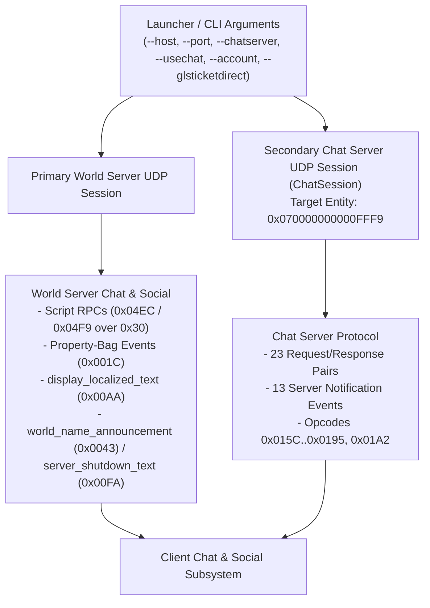
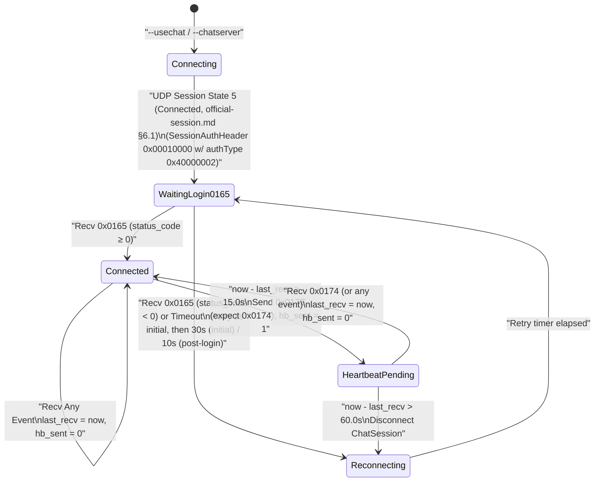

<!-- SPDX-License-Identifier: GPL-3.0-or-later -->

# Official In-World Play Messages Specification

| | |
|---|---|
| **Status** | **Accepted** (independent Stage 1 core pass 9 review, 2026-10-30; acceptance gated by decision 0042 items 4 & 8; 6 OPEN) |
| **Last updated** | 2026-10-30 |
| **Author role** | Spec writer (dirty room) |
| **Reviewer** | Codex / GPT-6, independent session; UUID unavailable (host does not expose it); task `/root/pass9_review_coordinator/review_world_play`; 2026-10-30; PASS. |
| **Review record** | Reviewed writer commit `b2cc48e0dcaac912c77b13d909ed8e5e9abf485a`. Full CLEAN_ROOM §5.3 checklist; world/play consistency, 256 heading roundtrips and all 256 half-step ties with ±1e-10 bounds, historical logs and OPEN count; sampled calendar/enum data and matching-backup binary clock constants. Source checks are sampled data/presence checks, not exhaustive binary re-derivation or a live session. Writer session ID not recorded (host unavailable); earlier reviewers’ checks are not adopted. |
| **Companion specs** | `docs/specs/official-login.md` (CLI switch intake, session hand-off, and `RefreshTicket` in-game GLS ticket refresh §4.1–§4.3); `docs/specs/official-session.md` (UDP transport, connection states `0`–`8`, `SessionAuthHeader` `0x00010000`, `ClockSyncHeader` `0x01000000`, and `FragmentedBlob` framing); `docs/specs/official-messages-world.md` (`FragmentedBlob` to inner event payload boundary §1.1–§1.3, compact wire encodings §2, character selection and `0x6F` §3, world entry and `0xCC` state schemas §4, object lifecycle and movement events `0xCE`/`0x24`/`ActionPayload` §5); `docs/specs/wlib.md` (script bytecode `0x56000000` and native package dispatch); `docs/specs/wstate.md` (`ScriptStateObject` object-graph bundles and native classes); `docs/specs/property-system.md` (master property dictionary and property tables); `docs/specs/string-table.md` (`LocalizedTokenText` resolution). |

---

## 1. Purpose and Scope <a id="s1-purpose"></a>

This specification defines the application-layer game messages exchanged after a character has entered the three-dimensional game world on an official server and is actively playing. It covers the three core in-world subsystems required by a third-party client:

1. **Player and remote entity movement (§4):** client movement step history packets (`0x24`, canonically laid out in [`docs/specs/official-messages-world.md`](official-messages-world.md) §5.5), the 4-step rolling transmission window, $15 \times 17$ planar movement grid (`move_state`), and sequence numbering rules, server movement acknowledgments and position corrections (`0xCC`, canonically laid out with its `0x07000029` state schemas in [`docs/specs/official-messages-world.md`](official-messages-world.md) §4.3.1), forced position and teleport events (`0xCE` in [`docs/specs/official-messages-world.md`](official-messages-world.md) §5.4, and `0xBF` in §4.4.2), modulo-256 teleport stamp and two-gate portal-space synchronization (`0x0000005E` `enter_portal_space`, `0x0000007C` `login_finished`, `0x000000C7` `portal_transition_complete`, and `0x000000F4` `portal_ready_ack`), and remote entity path, autonomous motion-controller, and animation-layer updates (`0x59`, `0xED`, `0xBD`).
2. **Chat, emotes, and system messages (§5–§6):** the dual-connection messaging architecture comprising (a) game-server script remote procedure calls in classes `0x04EC` (chat, tells, user channels) and `0x04F9` (emotes) carried inside script RPC envelope event `0x00000030` (`script_rpc_message`, [§5.2–§5.3](#s5-2-rpc-envelopes)), (b) dedicated world-server system, broadcast, and property-bag chat events (`0xAA`, `0xFA`, `0x43`, `0xB3`, `0x30000045`, `0x1C`), and (c) the dedicated Chat Server (`--chatserver` / `--usechat`) UDP connection (`ChatSession`), `SessionAuthHeader` (`0x00010000`) `authType = 0x40000002` ticket authentication, `0x00000165` login handshake, `0x0000017E`/`0x00000174` heartbeat state machine, and all 59 Chat Server events (`0x0000015C` through `0x00000195` and `0x000001A2`) in `ChatSession`'s separate opcode space.
3. **Logout and character switch from the world (§7):** requesting and cancelling a timed logout to character selection via script class `0x051E` RPCs (`0x851E002F`, `0x851E0006`, `0x851E0037`, `0x851E000B`), server countdown and cancellation notifications (`0x851E0007`, `0x851E0003`, `0x851E000F`, `0x851E0012`, `0x851E0017`), in-world teardown back to the character selection screen (`0x6C` `character_list_response`) via the 20 world-teardown notification opcodes in the `0x3000001B`–`0x30000043` band documented in [§7.2](#s7-2-logout-state-machine) (`0x3000001B`–`0x3000001D`, `0x30000022`–`0x30000025`, `0x3000002D`–`0x30000031`, `0x30000035`, `0x30000037`–`0x3000003B`, and `0x30000042`–`0x30000043`), and full session termination.

### 1.1 Companion Specifications and Framing Boundary <a id="s1-1-boundaries"></a>

This specification builds directly on the framing and primitive definitions of its companion specifications:

- **Outer `FragmentedBlob` transport framing ([docs/specs/official-session.md](official-session.md) §5.6.3, §9.1; [docs/specs/official-messages-world.md](official-messages-world.md) §1.1.1–§1.1.3):**
  - Every top-level game event on the World Server connection (and every Chat Server event on the secondary Chat Server UDP connection `ChatSession`, §6.6) is transported inside a `FragmentedBlob`.
  - The 32-bit numeric **`event_id` (opcode)** is carried in **Field 8a (`blobHeaderWord`, `VariableU32`)** of the `FragmentedBlob` fragment header on fragment 0 ([docs/specs/official-session.md](official-session.md) §5.6.3; [docs/specs/official-messages-world.md](official-messages-world.md) §1.1.1). The secondary `ChatSession` UDP connection uses its own application opcode space (`0x0000015C`–`0x00000195`, `0x000001A2`) that is separate from the primary login/world session opcode space (§6.6.1, §6.6.5). Only numeric opcodes, numeric property IDs, and numeric data/enum IDs travel on the wire; all `snake_case` or `PascalCase` names in this specification are clean-room descriptive labels.
  - The default target entity **64-bit `InstanceID`** (`u64 LE`) is carried in **Field 7 (`recipientId`)** of the `FragmentedBlob` fragment header (omitted on the wire and defaulting to `0x0000000000000002` when `DefaultRecipient` bit `0x40` of `blobFlags` is set, [docs/specs/official-session.md](official-session.md) §5.6.3; explicitly written as `0x070000000000FFF9` on outgoing Chat Server messages, §6.6.1).
  - Byte `0` of the reassembled `FragmentedBlob` payload is **`envelopeFlags`** (`u8`: bit 0 `0x01` = `IsZlibCompressed`, bit 1 `0x02` = `HasRoutingHeader`; `0x00` in standard uncompressed client-to-server and server-to-client messages; [docs/specs/official-session.md](official-session.md) §9.1).
  - Immediately after `envelopeFlags` (and optional zlib decompression and optional routing header, [docs/specs/official-session.md](official-session.md) §9.1 and [docs/specs/official-messages-world.md](official-messages-world.md) §1.1.2), **inner offset `0x00`** of the inner event payload stream of every in-world gameplay event and every `ChatSession` event begins with the 1-byte base event header **`u8 base_flags = 0x00`** ([docs/specs/official-messages-world.md](official-messages-world.md) §1.3). There is **no** redundant 4-byte opcode inside the inner event payload stream of a top-level `FragmentedBlob`.
- **Character selection and world-entry lifecycle ([docs/specs/official-messages-world.md](official-messages-world.md) §3–§4):**
  - On the character-selection screen, `0x6C` (`character_list_response`, S→C) delivers the character list, `0x15` (`character_delete_status`, S→C) reports character deletion results, and `0x0000006F` (`character_enter_world_request`, C→S) requests world entry for a chosen character both on initial logon and on the existing world UDP connection after returning from the world to character selection ([docs/specs/official-messages-world.md](official-messages-world.md) §3.1–§3.5, [§7.2](#s7-2-logout-state-machine)).

### 1.2 Compliance Boundaries <a id="s1-2-compliance"></a>

Per `CLAUDE.md` and `docs/CLEAN_ROOM.md`, no anti-cheat, anti-tamper, account authentication, or access-control mechanism is bypassed by any message in this specification, and no cryptographic keys, certificates, hostnames, URLs, packet captures, account data, or player chat/names appear in this document.


---

## 2. Provenance <a id="s2-provenance"></a>

| ID | Confidence | Method | Source | Scope / Justification |
|---|---|---|---|---|
| `OBS-WLIB-BIN` | Confirmed | `OBS` (M1) | `client_gamelogic.dat` record `0x56000000` in read-only game install | `client_gamelogic.dat` record `0x56000000` wire function IDs and documented method argument layouts, and argument signatures (`0x84ECxxxx`, `0x84F9xxxx`, `0x851Exxxx`), chat length limit constants (`1925`, `1155`, `385`), and `0x008E` wire argument types for chat, emotes, and logout. |
| `OBS-DAT-GL` | Confirmed | `OBS` (M1) | `client_gamelogic.dat` records `0x34000000` (master property dictionary), `0x07000029` (state-schema table), `0x0Cxxxxxx` (state-schema sub-records), and `0x23000097` / `0x230000F8` (enum mappers) in read-only game install | Exact deduplicated `bool_pids` (8 properties) and `enum_pids` (6 properties) lists for default `0xCC` movement `state_schema_id = 0x0000000C` (`12`, `surface_controlled_physics`) and sibling player-physics schemas (`0x10000E50`, `0x10000E51`) in `0x07000029` (`official-messages-world.md` §4.3.1), and Type 13 (`LocalizedTokenText`) definitions for `0x1C` event properties in `0x34000000`. |
| `OBS-DAT-EM` | Confirmed | `OBS` (M1) | `client_general.dat` enum-mapper records `0x23000026`, `0x23000027`, `0x2300003B`, `0x2300003C`, `0x230001A0`, `0x230001D2`, `0x230001E2`, `0x230002A8`, `0x230002A9`, and `0x2300032A` in read-only game install | Numeric key tables for chat font size, chat font color, regional and world channel types (180 entries), secondary channel types, log categories, `/who` display categories, kinship reason codes, chat text categories (`0x0000`–`0x002F`, including `5` Say, `6` Tell, `7` Emote, `11` Fellowship, `12` Kinship, `13` Officer, `19` Yell/Shout, `23` Raid, `27` RP, `38` World, and `28`–`31` / `39`–`42` UserChat1..8), and kinship event codes. |
| `BIN-MOVEMENT` | Confirmed | `BIN` (M4) | `x64/lotroclient64.exe` (`4906.0071.1794.4035`, `lotro_live`), SHA-256 `d22363eb9aff0fb599fd04b3efa9a1769d08da8af9d8f9b73121c12bfd7e21ee`, analysed via Ghidra `12.1.3_DEV` headless and `objdump` (portal/region transition and entity motion state wire payloads) | Wire layouts and bitmasks of movement events `0x24` (including the 256-entry $15 \times 17$ `move_state` planar grid, `slot_flags` bits `0x01`/`0x02`/`0x10`/`0x40`, and 1-byte quantized heading/pitch angles `axis_a`/`axis_b`/`axis_c`), `0xCC` (including `sync_flags` bit 0 `0x01` forced-sync vs step-ack, the history of the 30 most recent movement steps, and `0.15 m` / `1` quantized-unit reconciliation tolerances), `0xCE`, `0xBF`, `0x59` (`path_type` `1..3` and `speed_param` in `m/s`), `0xED`, `0xBD`, `ActionPayload` wire fields, `0xCC` `0x07000029` state-schema wire encoding rules, 4-step rolling movement windowing, and modulo-256 teleport stamp and two-gate portal-space synchronization (`0x0000005E` `enter_portal_space`, `0x0000007C` `login_finished`, `0x000000C7` `portal_transition_complete`, `30.0 s` loading timeout, and `0x000000F4` `portal_ready_ack`). M1–M2 were insufficient because portal/region transition and entity motion state wire payloads and state-schema wire ordering rules reside solely in native executable code. |
| `BIN-WLIB-RPC` | Confirmed | `BIN` (M4) | `x64/lotroclient64.exe` (`4906.0071.1794.4035`, `lotro_live`), SHA-256 `d22363eb9aff0fb599fd04b3efa9a1769d08da8af9d8f9b73121c12bfd7e21ee`, analysed via Ghidra `12.1.3_DEV` headless (opcode `0x00000030` wire envelope and `0x008E` `ScriptArgFrame` / `ScriptStateObject` wire payloads) | Wire framing of opcode `0x00000030` wire envelope (`script_rpc_message`, §5.2) and `0x008E` (`ScriptArgFrame`, §5.3) primitive and `ref_utf16_text` / `ref_localized_text` wire layouts. M1–M2 were insufficient because the wire encoding of `ScriptArgFrame` and opcode `0x00000030` wire envelope is implemented in native code. |
| `BIN-CHAT-SYS` | Confirmed | `BIN` (M4) | `x64/lotroclient64.exe` (`4906.0071.1794.4035`, `lotro_live`), SHA-256 `d22363eb9aff0fb599fd04b3efa9a1769d08da8af9d8f9b73121c12bfd7e21ee`, analysed via Ghidra `12.1.3_DEV` / `11.3.2` headless and `objdump` (secondary UDP chat session handshake and room/channel/voice event wire payloads, world-server system/chat event wire payloads, and world-teardown notification opcodes `0x3000001B`–`0x30000043`) | Chat command-line switches (`--chatserver`, `--usechat`, `--voiceoff`), secondary UDP chat session handshake (`SessionAuthHeader` `authType = 0x40000002`, `0x00000165`, `0x0000017E`/`0x00000174`, `5.0 s` bind-failure delay, and `1.0 s` initial / `30.0 s` or `10.0 s` retry intervals) and room/channel/voice event wire payloads (`ChatRoomDescriptor`, `ChatMessagePayload`, `/join` `0x016E` + `0x0177` sequence, and all 59 `ChatSession` event wire layouts `0x0000015C`–`0x00000195` and `0x000001A2`), dual-path World Server vs. Chat Server routing, system message events (`0xAA`, `0xFA`, `0x43`, `0xB3`, `0x30000045`, `0x1C`), and the 20 world-teardown notification opcodes `0x3000001B`–`0x30000043` returning the world UDP connection to character selection while keeping both the world UDP session and `ChatSession` open (§7.2). M1–M2 were insufficient because the secondary UDP chat session handshake and room/channel/voice event wire payloads and world-teardown notification opcodes have no data-table representation or published specification. |
| `P9` | Confirmed (owner policy; inherited behavior provenance) | Spec reconciliation | Decision 0042 item 10; BIN-MOVEMENT, BIN-CHAT-SYS; session §5.6.2/§6.2.1 | Documented RPC layouts versus OPEN generic signatures (§5.1); movement/ready/chat queues (§4.2, §4.5, §6.6.3), undecoded ticket (§6.1.1); no new binary or live observation claimed |

---

## 3. Common Wire Primitives and Conventions <a id="s3-primitives"></a>

All network event payloads in this specification use the compact wire encodings defined in [docs/specs/official-messages-world.md](official-messages-world.md) §1.2 and §2. All fixed-width multi-byte integer and floating-point fields are little-endian (`LE`) unless explicitly marked big-endian (`BE`).

### 3.1 Summary of Shared Wire Primitives (`official-messages-world.md` §1.3, §2) <a id="s3-1-shared-primitives"></a>

The field tables in §4–§7 use the canonical primitive names defined in [docs/specs/official-messages-world.md](official-messages-world.md) §1.3 and §2:

| Primitive Name | Wire Size | Encoding Summary (`official-messages-world.md` Reference) |
|---|---|---|
| `base_flags` | 1 byte (`u8`) | Base event header byte at **inner offset `0x00`** of every event payload stream (`0x00`; `official-messages-world.md` §1.3). |
| `bool8` | 1 byte (`u8`) | `0x00` = false, `0x01` = true; any value `0x02..0xFF` immediately fails the frame and rejects the event (`official-messages-world.md` §2.1). |
| `3-tier VLE` | 1, 2, or 4 bytes | 30-bit unsigned integer (`official-messages-world.md` §2.2.1): `0x00..0x7F` → 1 byte `b0`; `0x80..0x3FFF` → 2 bytes (low 6 bits of `b0` shifted left 8 bits, combined with `b1`); `0x4000..0x3FFFFFFF` → 4 bytes (low 6 bits of `b0` shifted left 24 bits, combined with `b1` shifted left 16 bits and `u16 LE(b2, b3)`). |
| `VariableU32` (4-tier VLE) | 1, 2, 4, or 5 bytes | Full 32-bit unsigned/signed integer (`official-messages-world.md` §2.2.2): `0x00..0x7F` → 1 byte; `0x80..0x3FFF` → 2 bytes; `0x4000..0x1FFFFFFF` → 4 bytes (`0xC0..0xDF` prefix); `0x20000000..0xFFFFFFFF` → 5 bytes (`0xE0` prefix + `u32 LE`). |
| `Prefixed UTF-16LE string` | Variable | `3-tier VLE` UTF-16 code-unit count $N$, followed by $N \times 2$ bytes of `u16 LE` code units (`official-messages-world.md` §2.3). |
| `Prefixed 8-bit string` | Variable | `3-tier VLE` byte count $N$, followed by $N$ raw 8-bit bytes (`official-messages-world.md` §2.3). |
| `Compact DID` | 2, 3, or 5 bytes | `u8 high_byte` (bits `24..31`) followed by `3-tier VLE low_24` (bits `0..23`) (`official-messages-world.md` §2.4.2). |
| `CompactPID` | 2 or 5 bytes | `u16 BE` for PIDs in `0x00000000..0x00003FFF` (`0x0000..0x3FFF`) and `0x10000000..0x10003FFF` (`0x4000..0x7FFF`), or `0x80` escape byte + `u32 LE` for all other PIDs (`official-messages-world.md` §2.4.3). |
| `Base wire Position` | 1 to 20 bytes | Wire `Position` without quaternion (`official-messages-world.md` §2.5.1):<br>1. `flags` (`u8`).<br>2. `region` (`u8`): written iff bit 0 (`0x01`) is set **and** bit 6 (`0x40`) is clear (defaults to `0` when bit 0 is clear; **elided on wire and defaults to `1`** when both bit 0 `0x01` and bit 6 `0x40` are set).<br>3. `block_x, block_y` (`u8, u8`): written iff bit 1 (`0x02`) is set (defaults to `0xFF, 0xFF` when clear).<br>4. `instance` (`u16 LE`): written iff bit 2 (`0x04`) is set (defaults to `0x0000` when clear).<br>5. `cell` (`u16 LE`): written iff bit 3 (`0x08`) is set **and** bit 7 (`0x80`) is clear (defaults to `0xFFFF` when bit 3 is clear; **elided on wire and defaults to `0x0000`** when both bit 3 `0x08` and bit 7 `0x80` are set).<br>6. `offset` (`3 × f32 LE` `x, y, z` in metres): written iff bit 4 (`0x10`) is set (defaults to `(0.0, 0.0, 0.0)` when clear). |
| `Full wire Position` | 1 to 36 bytes | `Base wire Position` followed, iff bit 5 (`0x20`) of `flags` is set, by `orientation` (`4 × f32 LE` scalar-first quaternion `(w, x, y, z)`; defaults to identity `(1.0, 0.0, 0.0, 0.0)` when bit 5 is clear; `official-messages-world.md` §2.5.1). |
| `Quantized 1-byte heading` | 1 byte (`u8`) | Quantized angle in $[0^\circ, 360^\circ)$ / $[0, 2\pi)$ radians (`official-messages-world.md` §2.5.2): $\text{radians} = (\text{raw\_angle} \times 2\pi / 256) \bmod 2\pi$ (encoding uses the rounding rule in world §2.5.2). For horizontal yaw (`0xCE` `heading`, `0xCC` `authoritative_yaw`, `0x24` `axis_a` and `axis_b`), `0x00` = $0^\circ$ (`+Y` north), `0x40` = $90^\circ$ (`-X` west), `0x80` = $180^\circ$ (`-Y` south), `0xC0` = $270^\circ$ (`+X` east), increasing counter-clockwise around `+Z` (up). |
| `SignedNormalizedByte` | 1 byte (`i8`) | Quantized signed scalar in `[-1.0, 1.0]`: signed byte $b \in [-127, 127]$ mapped to $\text{clamp}(b / 127.0, -1.0, 1.0)$ (`official-messages-world.md` §2.3.1). |
| `LocalizedTokenText` | Variable | `u8 mode` (`0x01` = `Prefixed UTF-16LE string` literal; else `u32 LE token_id` + `u32 LE table_did`), `bool8 has_authoring_strings` (+ 3 `Prefixed 8-bit string`s when `1`), `3-tier VLE arg_count` (**no** TSize hint byte on the wire), and `arg_count` wire argument entries (5-byte `(u8 kind, u32 LE var_id)` entry header with `var_id` used directly as the hash-table key, followed by `arg_payload`; `official-messages-world.md` §2.6). |
| `EncodedPropertyTable` | Variable | `3-tier VLE count` (**no** TSize hint byte) followed by `count` pairs of `(CompactPID, PropertyValue)` (**no** duplicate `u32` hash key; `official-messages-world.md` §2.7.2). |

---

## 4. Player Movement and Remote Entity Motion <a id="s4-movement"></a>

### 4.1 Movement Step Rolling Window, Planar Movement Grid (`move_state`), and Sequence Numbering <a id="s4-1-prediction-ring"></a>

Confirmed (`BIN-MOVEMENT`). Client movement packets (`0x24`, [`docs/specs/official-messages-world.md` §5.5](official-messages-world.md)) report a rolling window of recent local player movement steps so that the server can reconstruct the player's input timeline and acknowledge or reconcile movement via `0xCC`:

1. **Monotonic step sequence counter:** Each local player movement step is assigned a monotonically increasing 32-bit unsigned step sequence counter `step_seq` (`u32 LE`), incremented by `1` whenever the local player's movement state advances (either because user input changes planar movement direction, jump/walk flags, entity heading, or queued movement actions, or when the periodic `50` ms movement step timer expires while moving).
2. **4-step rolling window (`0x24`):** Each outgoing movement packet (`0x24`) carries a fixed rolling window of the **4 most recent consecutive movement steps** ordered from **oldest (`k = 0`) to newest (`k = 3`)**. Redundantly transmitting the last 4 steps in every `0x24` packet allows the server to recover up to 3 dropped unreliable step datagrams without triggering a position rubber-band correction.
3. **Sequence number reconstruction rule:** Only the sequence number of the newest step (`k = 3`), `newest_step_seq` (`u32 LE`), is written to the wire. A receiver reconstructs the sequence numbers of the three preceding steps (`k = 0, 1, 2`) by subtracting `3 - k` from `newest_step_seq` and clamping at `0`:
   - Step `k = 2` has sequence number $\max(\text{newest\_step\_seq} - 1, 0)$.
   - Step `k = 1` has sequence number $\max(\text{newest\_step\_seq} - 2, 0)$.
   - Step `k = 0` (oldest) has sequence number $\max(\text{newest\_step\_seq} - 3, 0)$.
4. **Per-slot `move_state[0..3]` ($15 \times 17$ planar movement grid index, `4 × u8` at inner offset `+0x0E..+0x11`):**
   - Each `move_state[k]` (`u8`) is an index (`0..255`) into a 256-entry `(forward_axis, strafe_axis)` planar movement grid (`official-messages-world.md` §5.5):
     - **`0x00` (`0`) and `0x80` (`128`)** both represent **stationary** (`forward_axis = 0.0`, `strafe_axis = 0.0`).
     - **Indices `1..255` (`0x01..0xFF`)** form a **$15 \times 17$ quantized 2D grid** (`15 × 17 = 255`): for $m = \text{move\_state} - 1 \in [0, 254]$, column $c = m \bmod 15 \in [0, 14]$ encodes normalized `forward_axis` in `[-1.0, +1.0]` ($c = \text{clamp}(\lfloor (\text{forward\_axis} + 1.0) \times 0.5 \times 15.0 \rfloor, 0, 14)$, center $c = 7 \implies 0.0$) and row $r = \lfloor m / 15 \rfloor \in [0, 16]$ encodes normalized `strafe_axis` (right-minus-left) in `[-1.0, +1.0]` ($r = \text{clamp}(\lfloor (\text{strafe\_axis} + 1.0) \times 0.5 \times 17.0 \rfloor, 0, 16)$, center $r = 8 \implies 0.0$), so:
       $$\text{move\_state} = 1 + 15 \cdot r + c$$
     - **Cardinal and diagonal `move_state` bytes:**
       - Stationary `(0.0, 0.0)` ($r = 8, c = 7$): **`0x80`** (`128`, or `0x00`).
       - Full forward `(+1.0, 0.0)` ($r = 8, c = 14$): **`0x87`** (`135`).
       - Full backward `(-1.0, 0.0)` ($r = 8, c = 0$): **`0x79`** (`121`).
       - Full strafe left `(0.0, -1.0)` ($r = 0, c = 7$): **`0x08`** (`8`).
       - Full strafe right `(0.0, +1.0)` ($r = 16, c = 7$): **`0xF8`** (`248`).
       - Forward + strafe left `(+1.0, -1.0)` ($r = 0, c = 14$): **`0x0F`** (`15`).
       - Forward + strafe right `(+1.0, +1.0)` ($r = 16, c = 14$): **`0xFF`** (`255`).
       - Backward + strafe left `(-1.0, -1.0)` ($r = 0, c = 0$): **`0x01`** (`1`).
       - Backward + strafe right `(-1.0, +1.0)` ($r = 16, c = 0$): **`0xF1`** (`241`).
5. **Per-slot `slot_flags[0..3]` (`4 × u8` at inner offset `+0x12..+0x15`):**
   - Bit 0 (`0x01`): queued `slot_actions` present for this slot.
   - Bit 1 (`0x02`): jump active during this step.
   - Bit 4 (`0x10`): per-slot `slot_props` (`EncodedPropertyTable`) present for this slot.
   - Bit 6 (`0x40`): walking (`1`, corresponding to `0x00000687 = 1`) vs running (`0`, corresponding to `0x00000687 = 2`).
   - Bits `2, 3, 5, 7` (mask `0xAC`): `OPEN` (`official-messages-world.md` §5.5).
6. **Per-slot `axis_a[0..3]`, `axis_b[0..3]`, and `axis_c[0..3]` (`3 × 4 × u8` at inner offsets `+0x16..+0x21`):**
   - Each byte is an unsigned 1-byte quantized angle (`Quantized 1-byte heading`, §3.1; the rounding rule in world §2.5.2 in $[0^\circ, 360^\circ)$):
     - `axis_a[0..3]` (`+0x16..+0x19`): local player entity horizontal heading / yaw angle.
     - `axis_b[0..3]` (`+0x1A..+0x1D`): camera horizontal heading / yaw angle.
     - `axis_c[0..3]` (`+0x1E..+0x21`): camera pitch angle.

### 4.2 Client Movement Step Event (`0x00000024` `client_physics_sync`, Client → Server) <a id="s4-2-msg-0024"></a>

Confirmed (`BIN-MOVEMENT`). The byte-for-byte wire layout of event `0x00000024` (`client_physics_sync`, C→S; a fixed **38 bytes** when no per-slot actions or property tables are attached) is canonically specified in [`docs/specs/official-messages-world.md` §5.5](official-messages-world.md). During active in-world play, the client populates and transmits `0x00000024` as follows:

1. **Send cadence (`20 Hz`) and what counts as moving:** While the local player is actively moving — defined as having non-zero planar movement (`move_state` neither `0x00` nor `0x80`), jump active (`slot_flags` bit 1 `0x02` set), a change in entity heading (`axis_a`) since the previous step, or pending `slot_actions` (`slot_flags` bit 0 `0x01`) / `slot_props` (`slot_flags` bit 4 `0x10`) — the client transmits `0x00000024` at a nominal **20 Hz** cadence (every `50` ms) and immediately whenever user movement input changes `move_state`, `slot_flags` (jump or walk/run), heading (`axis_a`), or queued actions. When the player transitions from moving to stationary (`move_state = 0x80` or `0x00` and jump clear), the client sends the stationary transition step immediately so the server stops dead-reckoning the avatar.
2. **Rolling 4-step history (`slot 0..3`):** The packet carries the 4 most recent movement steps ordered from oldest (`slot 0`) to newest (`slot 3`), with `sequence` (`u32 LE` at inner offset `+0x0A`) set to the newest step's sequence number `newest_step_seq` ([§4.1](#s4-1-prediction-ring)). Each slot records its planar movement grid byte (`move_state[0..3]`), control/content bitmask (`slot_flags[0..3]`), and 1-byte quantized angles (`axis_a[0..3]`, `axis_b[0..3]`, `axis_c[0..3]`, [§4.1](#s4-1-prediction-ring)).
3. **Teleport stamp (`header_byte` at `+0x09`):** Inner offset `+0x09` (`header_byte`, `u8`) carries the local player entity's current 8-bit `teleport_stamp` ([§4.5](#s4-5-teleport-stamp)) so the server can discard movement packets generated prior to a pending portal or teleport transition.

#### 4.2.1 `ActionPayload` Wire Layout <a id="s4-2-1-action-payload"></a>

Confirmed (`BIN-MOVEMENT`). The single canonical wire layout of `ActionPayload` (`11` to `56` bytes, plus variable-length `action_props` when bit `0x0002` is set; carried inside `0x00000075` client action execution command C→S, `0x0000005A` server action execution / start event S→C, `0x000000A8` server action event with bitfield S→C, `0x00000063` server action chain synchronization S→C, and `0x000000BD` `entity_anim_layer_state` entity animation and action-layer state S→C in [§4.6.3](#s4-6-3-msg-00bd), plus `0x00000024` `client_physics_sync` `slot_actions` C→S in [`docs/specs/official-messages-world.md` §5.5](official-messages-world.md)) is specified in [`docs/specs/official-messages-world.md` §5.6.1–§5.6.2](official-messages-world.md).

Outbound `0x24` uses queue 1 for continuous movement alone, or queue 3 with sequence group 5 when carrying a discrete movement action or state change (`BIN-MOVEMENT`; official-session.md §5.6.2).

### 4.3 Server Movement Correction and Portal Placement (`0x000000CC` `portal_position_sync`, Server → Client) <a id="s4-3-msg-00cc"></a>

Confirmed (`BIN-MOVEMENT`, `OBS-DAT-GL`). Sent by the server in a `FragmentedBlob` with `blobHeaderWord = 0x000000CC` (`portal_position_sync`) to acknowledge a client movement step sequence number (or place the player during a portal transition) and provide the authoritative spatial state and physics property snapshot for the player entity.

#### 4.3.1 Canonical `0x000000CC` Wire Layout and `0x07000029` State Schemas <a id="s4-3-1-msg-00cc-schemas"></a>

The complete byte-for-byte wire layout of `0x000000CC` (`portal_position_sync`) and its `client_gamelogic.dat` `0x07000029` player-physics state schema tables (including default `state_schema_id = 0x0000000C` `surface_controlled_physics` with `N_bool = 8` LSB-first bit-packed boolean flags in `1` byte and `N_enum = 6` consecutive `3-tier VLE` enum values, as well as `0x10000E50` and `0x10000E51` with `0` boolean and `0` enum bytes) are canonically specified in [`docs/specs/official-messages-world.md` §4.3.1](official-messages-world.md).

#### 4.3.2 Server Reconciliation Semantics, 30-Step History, and Tolerances (`0x000000CC`) <a id="s4-3-2-msg-00cc-reconcile"></a>

Confirmed (`BIN-MOVEMENT`). The client maintains a **history of the 30 most recent movement steps** recording the `step_seq`, predicted `Position`, and predicted `u8` heading of the 30 most recent local movement steps. When the client receives `0x000000CC` for the local player:

1. **Disambiguating `sequence_or_reason` (`u32 LE` at inner offset `+0x02`) via `sync_flags` bit 0 (`0x01`, [`docs/specs/official-messages-world.md` §4.3.1](official-messages-world.md)):**
   - When **bit 0 (`0x01`) of `sync_flags` is set**, `0x000000CC` is a **forced position / portal placement sync**: `sequence_or_reason` carries a numeric teleport reason code from enum mapper `0x2300038B` (`official-messages-world.md` §4.3.2). The client clears the history of the 30 most recent movement steps, adopts `authoritative_pos`, `authoritative_yaw`, the velocity components, `bool_state_bytes`, and `enum_state_vles` immediately, and updates the portal/teleport synchronization state ([§4.5](#s4-5-teleport-stamp)).
   - When **bit 0 (`0x01`) of `sync_flags` is clear**, `0x000000CC` is a **movement step acknowledgment**: `sequence_or_reason` is `ack_step_seq` (`u32 LE`), acknowledging all client movement steps up to and including `ack_step_seq`.
2. **Spatial and heading reconciliation tolerances (`sync_flags` bit 0 clear):**
   - If `ack_step_seq` is present in the history of the 30 most recent movement steps, the client compares the stored predicted position and heading for step `ack_step_seq` against `authoritative_pos` and `authoritative_yaw`:
     - **Position tolerance:** Euclidean distance **$\le 0.15\text{ m}$** (squared distance $\Delta x^2 + \Delta y^2 + \Delta z^2 \le 0.0225\text{ m}^2$ in the same landblock/cell).
     - **Heading tolerance:** absolute unsigned 8-bit yaw difference **$\le 1$ quantized unit** ($\approx 1.40625^\circ$, §3.1).
   - If both position and heading lie within tolerance, the client discards acknowledged history slots up to `ack_step_seq` without snapping the visual camera or physics body.
3. **Out-of-tolerance or out-of-window reconciliation:**
   - If `ack_step_seq` is **ahead of `newest_step_seq`** (or older than the 30 retained steps), the client clears the retained movement history, sets `newest_step_seq = ack_step_seq`, and snaps to `authoritative_pos` and `authoritative_yaw`.
   - If `ack_step_seq` is in the retained movement history but position or heading divergence exceeds tolerance (`> 0.15 m` or `> 1` quantized heading unit), the client resets the local player's position and heading at `ack_step_seq` to `authoritative_pos` and `authoritative_yaw`, applies the velocity components, `bool_state_bytes`, and `enum_state_vles`, and replays any unacknowledged movement steps in the ring buffer with `step_seq > ack_step_seq`.

### 4.4 Forced Position and Teleport Events (`0x000000CE` and `0x000000BF`) <a id="s4-4-forced-pos"></a>

#### 4.4.1 Entity Position, Velocity, Attachment, and Teleport Event (`0x000000CE` `position_update`, Server → Client) <a id="s4-4-1-msg-00ce"></a>

Confirmed (`BIN-MOVEMENT`). The byte-for-byte wire layout of event `0x000000CE` (`position_update`, S→C) is canonically specified in [`docs/specs/official-messages-world.md` §5.4](official-messages-world.md). In world-position mode with a 1-byte heading (`mode_flags` bits 2 `0x04` and 4 `0x10` both clear), the trailing `u8 heading` uses the `Quantized 1-byte heading` convention (§3.1; `0x00` = $0^\circ$ `+Y` north, increasing counter-clockwise around `+Z` up). When bit 3 (`0x08`) of `header_flags` is set on a `0x000000CE` event targeting the local player, the 1-byte `seq_byte` field carries the authoritative 8-bit `teleport_stamp` (`u8`) used by the teleport synchronization state machine in [§4.5](#s4-5-teleport-stamp).

#### 4.4.2 Full Movement-State Setter (`0x000000BF` `server_set_position` / `movement_physics_sync`, Server → Client / Bidirectional) <a id="s4-4-2-msg-00bf"></a> <a id="442-0x000000bf--movement_physics_sync-sc"></a>

Confirmed (`BIN-MOVEMENT`). Directly replaces an entity's full movement state (`6` to `57` bytes on the wire):

| Inner Offset | Size | Type | Field Name | Meaning / Units / Encoding |
|---|---|---|---|---|
| `0x00` | 1 | `u8` | `base_flags` | Base event header (`0x00`). |
| `0x01` | 1, 2, or 4 | `3-tier VLE` | `state_flags` | Movement state presence bitmask (non-zero gates `position`; bit 2 `0x04` gates `velocity_xzy`; unreferenced bits are `OPEN`, see below). |
| var | 0..36 | `Full wire Position` | `position` | **Present iff** `state_flags` is non-zero. Landblock/cell, local offset, and optional `(w, x, y, z)` quaternion (§3.1). |
| var | 0 or 12 | `3 × f32 LE` | `velocity_xzy` | **Present iff** `state_flags` is non-zero and bit 2 (`0x04`) of `state_flags` is set. Three `f32 LE` velocity components `(vel_x, vel_z, vel_y)`. |
| var | 4 | `u32 LE` | `set_pos_flags` | Trailing 32-bit position replacement flags word. |

Each horizontal and vertical coordinate component in `0x000000BF` must lie within `[-100000.0, 100000.0]` metres; coordinates outside this range are invalid and rejected as out-of-bounds.

> **OPEN ([§4.4.2](#442-0x000000bf--movement_physics_sync-sc), `0x000000BF` `server_set_position` `state_flags` unreferenced bits and `set_pos_flags` bit definitions):** While the variable-length wire layout (`6` to `57` bytes) of `0x000000BF` (`server_set_position`), the non-zero `state_flags` gate for `position`, and bit 2 (`0x04`) of `state_flags` gating `velocity_xzy` are confirmed (`BIN-MOVEMENT`), the meanings of the unreferenced bits of `state_flags` (bits other than bit 2 `0x04` and the non-zero gate for `position`) and the exact bit definitions of the trailing `u32 LE` `set_pos_flags` field are `OPEN`. A clean-room receiver gates `position` on `state_flags` being non-zero and `velocity_xzy` on bit 2 (`0x04`) of `state_flags` being set, and ignores the unreferenced bits of `state_flags` and `set_pos_flags`.

### 4.5 Teleport Stamp and Two-Gate Portal-Space Synchronization State Machine <a id="s4-5-teleport-stamp"></a>

Confirmed (`BIN-MOVEMENT`; see [`docs/specs/official-messages-world.md` §4.3.3](official-messages-world.md)). The client and server synchronize player teleports and portal-space transitions using an 8-bit unsigned `teleport_stamp` (`u8`) compared using **modulo-256 serial number arithmetic**, paired with a two-gate (`game_ready` and `client_ready`) portal-exit handshake:

1. **Modulo-256 ordering rule:** Given two 8-bit stamps `new_stamp` and `current_stamp`, `new_stamp` is considered **newer than or equal to** `current_stamp` if and only if the unsigned 8-bit difference `(new_stamp - current_stamp) mod 256` is strictly less than `128` (`0x80`). Conversely, if `(new_stamp - current_stamp) mod 256` is `128` (`0x80`) or greater, `new_stamp` is older than `current_stamp` and is ignored as stale.
2. **Expected portal stamp and placement waiting (`0x0000005E` and `0x000000CE`):**
   - A portal-space transition is explicitly started when the server sends event **`0x0000005E`** (`94`, `enter_portal_space`, S→C; `u8 base_flags = 0x00`, `u8 stamp`, `u32 LE scene_id`, [`docs/specs/official-messages-world.md` §4.3.3](official-messages-world.md)), which supplies the expected 8-bit teleport stamp `expected_stamp = stamp`, sets `game_ready = 0` and `client_ready = 0`, and compares `expected_stamp` against the local player entity's current `entity_stamp`.
   - If `entity_stamp` has not yet reached `expected_stamp` (`(expected_stamp - entity_stamp) mod 256` is non-zero and strictly less than `128`), the client waits for the player teleport carrying that expected stamp. If a local-player `0x000000CE` with `header_flags` bit 3 `0x08` set arrives with a newer `teleport_stamp` before `0x0000005E`, that received stamp becomes the expected and current entity stamp. The current entity stamp is echoed in client `0x00000024` field `teleport_stamp` (world §5.4–§5.5). A forced `0x000000CC` sync supplies the authoritative correction described in §4.3.2; its canonical world §4.3.1 layout carries no teleport stamp, so it supplies neither a new expected stamp nor a new current entity stamp.
   - While the current entity stamp has not reached the expected stamp under the modulo-256 ordering rule, normal local step simulation is suspended while the client loads the destination terrain block and waits for the authoritative `0x000000CE` position event.
3. **Receiving `0x000000CE` for the local player:** When `0x000000CE` arrives for the local player entity with bit 3 (`0x08`) of `header_flags` set:
   - If the received teleport stamp is newer than or equal to the current entity stamp under the modulo-256 ordering rule, the received stamp becomes the current entity stamp; the client snaps the player's cell and local position to the spatial payload in `0x000000CE`, and discards any unacknowledged movement step history prior to the teleport.
   - The wait for player placement ends when the current entity stamp reaches or passes the expected stamp under the modulo-256 ordering rule. An older received stamp does not end that wait.
4. **Two-gate portal exit and `0x000000F4` (`portal_ready_ack`, [`docs/specs/official-messages-world.md` §4.3.3](official-messages-world.md)):**
   - **Server gate (`game_ready`):** set to `1` when the client receives **`0x0000007C`** (`124`, `login_finished`, S→C; 1-byte inner payload `0x00`) on initial world entry, or **`0x000000C7`** (`199`, `portal_transition_complete`, S→C; 1-byte inner payload `0x00`) on an in-world portal/teleport transition.
   - **Client gate (`client_ready`):** set to `1` once the current entity stamp has reached or passed the expected stamp under the modulo-256 ordering rule and local landblock/scenery loading completes (or the **`30.0`-second** portal-space loading timeout expires).
   - Once **both** `game_ready` and `client_ready` are `1`, the client exits portal space, sends **`0x000000F4`** (`244`, `portal_ready_ack`, C→S; 1-byte inner payload `0x00`), and resumes sending `0x00000024` step packets carrying the updated `entity_stamp`.

Outbound `0xF4` uses queue 3 with sequence group 5 (`BIN-MOVEMENT`; official-session.md §5.6.2).

### 4.6 Remote Entity Movement, Motion, and Animation Updates <a id="s4-6-remote-motion"></a>

#### 4.6.1 Entity Path and Waypoint Interpolation (`0x00000059` `entity_spline_path`, Server → Client) <a id="s4-6-1-msg-0059"></a>

Confirmed (`BIN-MOVEMENT`). Instructs the client to move an entity (typically an NPC or monster) along a sequence of world waypoints:

| Inner Offset | Size | Type | Field Name | Meaning / Units / Encoding |
|---|---|---|---|---|
| `0x00` | 1 | `u8` | `base_flags` | Base event header (`0x00`). |
| `0x01` | 4 | `u32 LE` | `path_type` | Path interpolation mode: `1` = linear polyline path (piecewise-linear segments between consecutive waypoints), `2` = smooth spline/curve path, `3` = looping/patrol path. |
| `0x05` | 8 | `u64 LE` | `entity_id` | 64-bit `InstanceID` of the moving NPC/entity. |
| `0x0D` | 2 | `u16 LE` | `path_flags` | Bit 0 (`0x0001`) = waypoint array present; bit 1 (`0x0002`) = `speed_param` float present. |
| var | 0 or 4 | `f32 LE` | `speed_param` | **Present iff** bit 1 (`0x0002`) of `path_flags` is set. Movement speed along the waypoint path in **metres per second (`m/s`)**. |
| var | 0 or 4 | `u32 LE` | `waypoint_count` | **Present iff** bit 0 (`0x0001`) of `path_flags` is set. Number of waypoints $M$. Must satisfy $M \le \text{remaining\_bytes}$. |
| var | var | `Full wire Position[M]` | `waypoints` | **Present iff** bit 0 (`0x0001`) of `path_flags` is set. $M$ consecutive `Full wire Position` records (§3.1) defining the path. |

When `waypoint_count` $M \ge 2$ and `speed_param` $> 0$, the client advances the entity along the consecutive waypoint segments at `speed_param` metres per second (interpolating linearly between `waypoints[i]` and `waypoints[i+1]` over segment duration $\Delta t_i = \lVert \text{waypoints}[i+1] - \text{waypoints}[i] \rVert_2 / \text{speed\_param}$ for `path_type = 1`, or along the smooth spline through `waypoints[0..M-1]` for `path_type = 2`, and wrapping to `waypoints[0]` when `path_type = 3`), orienting the entity's horizontal yaw along the active segment tangent.

#### 4.6.2 Autonomous Motion Controller Update (`0x000000ED` `entity_motion_state` / `physics_controller_create`, Server → Client) <a id="s4-6-2-msg-00ed"></a>

Confirmed (`BIN-MOVEMENT`). Updates the autonomous motion controller state on the target entity identified by the enclosing `FragmentedBlob`'s `recipientId` ([`docs/specs/official-messages-world.md` §1.1.1](official-messages-world.md)):

| Inner Offset | Size | Type | Field Name | Meaning / Units / Encoding |
|---|---|---|---|---|
| `0x00` | 1 | `u8` | `base_flags` | Base event header (`0x00`). |
| `0x01` | 1 | `bool8` | `has_controller` | `0x00` = clear/no controller (no further bytes follow); `0x01` = a typed controller follows; `≥ 0x02` fails the archive. |
| `0x02` | 0 or 16 | `u32 LE, u16 LE, u16 LE, u64 LE` | `controller_type_id` | **Present iff** `has_controller` equals `1`. 16-byte class identifier (GUID) of the motion controller type. If all 16 bytes are zero, the controller is cleared and **no body bytes follow**. |
| var | var | per controller type | `controller_body` | **Present iff** `has_controller` equals `1` and `controller_type_id` is non-zero. Five controller wire formats are defined by `controller_type_id`:<br>• **Type 1 (Composite binary controller):** `param_u64` (`u64 LE`, 8 B), `param_u32` (`u32 LE`, 4 B), followed recursively by two child optional-controller records (`bool8 has_child` + optional 16-byte `type_id` + child `body`).<br>• **Type 2 (Target entity controller):** `target_id` (`u64 LE` `InstanceID`, 8 B).<br>• **Type 3 (Game-clock timer controller):** `delta_seconds` (`f64 LE`, 8 B; sentinel `3.4028234663852886e38` denotes unset/`-1.0`, otherwise relative to the monotonic game clock as in `official-messages-world.md` §4.4).<br>• **Types 4 & 5 (Stateless marker controllers):** 0 body bytes. |

> **OPEN ([§4.6.2](#s4-6-2-msg-00ed), `0x000000ED` `controller_type_id` GUID constants):** While the 16-byte `controller_type_id` GUID field and the 5 conditional payload structures (Types 1–5) of `0x000000ED` (`entity_motion_state` / `physics_controller_create`) are confirmed (`BIN-MOVEMENT`), the specific 16-byte GUID constants corresponding to each of the 5 controller types are `OPEN`. **Clean-room receiver rule:** because the five 16-byte `controller_type_id` GUID constants are `OPEN`, a clean-room receiver that receives `0x000000ED` with `has_controller` equal to `1` and a non-zero `controller_type_id` skips the remainder of the bounded event slice (`SubEventFrame` `payload_size` or `FragmentedBlob` payload) and ignores the controller update.

#### 4.6.3 Entity Animation and Action-Layer State Update (`0x000000BD` `entity_anim_layer_state`, Server → Client) <a id="s4-6-3-msg-00bd"></a>

Confirmed (`BIN-MOVEMENT`). Updates the active animation/action layers on the target entity identified by the enclosing `FragmentedBlob`'s `recipientId` (`official-messages-world.md` §1.1.1):

| Inner Offset | Size | Type | Field Name | Meaning / Units / Encoding |
|---|---|---|---|---|
| `0x00` | 1 | `u8` | `base_flags` | Base event header (`0x00`). |
| `0x01` | 1, 2, or 4 | `3-tier VLE` | `layer_count` | Number of `ActionLayerEntry` records $K$ that follow. Must satisfy $K \le \text{remaining\_bytes}$. |
| var | var | `ActionLayerEntry[K]` | `layers` | $K$ sequential `ActionLayerEntry` records defined below. |

Each **`ActionLayerEntry`** inside `0x000000BD` has the following sequential layout:

| Order | Field | Size (bytes) | Type | Meaning |
|---|---|---|---|---|
| 1 | `action_did` | 2, 3, or 5 | `Compact DID` (§3.1) | `u8 high_byte` (bits `24..31`) + `3-tier VLE low_24` (bits `0..23`) identifying the animation/action DID. |
| 2 | `action_seq` | 1, 2, 4, or 5 | `VariableU32` (§3.1) | Action layer sequence number. |
| 3 | `action_payload` | 1+ | `ActionPayload` (§4.2.1) | Action parameters encoded per [`docs/specs/official-messages-world.md` §5.6.2](official-messages-world.md). |
| 4 | `layer_bitfield` | 1+ | Type 22 `Bitfield` (`official-messages-world.md` §2.7.1) | `3-tier VLE` bit count $b$, followed by $\lfloor(b+7)/32\rfloor$ `u32 LE` words and $(\lceil b/8\rceil \bmod 4)$ trailing bytes. |

---

## 5. Script RPC Envelope Events and `ScriptArgFrame` Encoding <a id="s5-wlib-rpc"></a>

Confirmed (`BIN-WLIB-RPC`, `OBS-WLIB-BIN`). Higher-level gameplay actions on the World Server connection—including spatial chat, direct tells, emotes, user chat channel subscription requests, and world logout—are implemented as script remote procedure calls (RPCs) defined in `client_gamelogic.dat` record `0x56000000`.

### 5.1 RPC Function Identifier Format and Signature Sources (`0x56000000`) <a id="s5-1-rpc-id"></a>

Every script RPC method is identified on the wire by a 32-bit unsigned integer `function_id` (`u32 LE`) constructed by setting bit 31 (`0x80000000`), placing the 15-bit script `class_id` in bits `16..30`, and placing the 16-bit `method_index` (`fnum`) in bits `0..15`:

- Bit 31 (`0x80000000`) is always set.
- Bits `16..30` hold the 15-bit script `class_id` (`0x04EC` for chat/social, `0x04F9` for emotes, `0x051E` for session/logout).
- Bits `0..15` hold the 16-bit method index within that class.

**Documented layouts and runtime signatures ([decision 0042](../decisions/0042-m8-remediation-decisions.md) item 10):** The per-method argument layouts in §6.3, §6.4 and §7.1 are wire message layouts. Once Accepted, they may be implemented directly with this spec as the source. Other methods require a signature read from the user's install at runtime; no embedded signature table is permitted for them.

> **OPEN:** A complete functional procedure for deriving signatures of undocumented RPC methods from record `0x56000000` has not been specified. Until that procedure is Accepted, preserve or ignore an undocumented RPC payload without interpreting its arguments. The documented layouts in §6.3–§7.1 remain usable under decision 0042 item 10.

### 5.2 RPC Envelope Event `0x00000030` (`script_rpc_message`) <a id="s5-2-rpc-envelopes"></a>

Confirmed (`BIN-WLIB-RPC`). All play-subsystem chat (`0x04EC`), emote (`0x04F9`), and logout (`0x051E`) script RPCs in §6–§7 travel inside standard script RPC envelope event **`0x00000030`** (`script_rpc_message`, C→S and S→C) with the following inner payload layout:

| Inner Offset | Size | Type | Field Name | Meaning / Units / Encoding |
|---|---|---|---|---|
| `0x00` | `1` B | `u8` | `base_flags` | Base event serialization flags (`0x00` on the wire; [`docs/specs/official-messages-world.md` §1.3](official-messages-world.md)). |
| `0x01` | `4` B | `u32 LE` | `function_id` | 32-bit script RPC method identifier ([§5.1](#s5-1-rpc-id)). |
| `0x05` | `4` B | `u32 LE` | `arg_frame_len` | Byte length $L$ of `arg_frame`; must satisfy $L \le \text{remaining\_bytes}$. |
| `0x09` | $L$ B | `u8[L]` | `arg_frame` | `ScriptArgFrame` payload ([§5.3](#s5-3-arg-frame)). |

### 5.3 `ScriptArgFrame` Serialization (`0x008E`) <a id="s5-3-arg-frame"></a>

Confirmed (`BIN-WLIB-RPC`, `OBS-WLIB-BIN`). Arguments inside `arg_frame` are serialized sequentially with no per-argument wire type tag; the receiver reads them in the order defined by the method's `0x008E` native pack/unpack calls in `client_gamelogic.dat` record `0x56000000` ([`docs/specs/wlib.md`](wlib.md)):

| Native Pack (C→S) / Unpack (S→C) IDs (`0x56000000`) | Argument Kind | Wire Size | Wire Encoding |
|---|---|---|---|
| `0x008E0002` / `0x008E0007` | `i32` / `u32` | `4` bytes | `i32 LE` / `u32 LE` |
| `0x008E0003` / `0x008E0008` | `i64` / `u64` | `8` bytes | `i64 LE` / `u64 LE` |
| `0x008E0004` / `0x008E0009` | `f32` | `4` bytes | `f32 LE` |
| `0x008E0005` / `0x008E000A` | `f64` | `8` bytes | `f64 LE` |
| `0x008E0001` / `0x008E0006` | `ref` (`ScriptStateObject` bundle, [`docs/specs/wstate.md`](wstate.md)) | Variable (`1`+ bytes) | Begins with `VariableU32` node count `N` (§3.1; `1` byte `0x00` when null `N = 0`, or `1` byte `0x01` when `N = 1`), followed by `N × u32 LE` node label IDs (`node_ids[0] = 0x00000000`), and for each node `u32 LE node_flags` (`0x10000000` with bit 28 set for a binary state class), `u16 LE class_id`, and the class payload. |

The two `ScriptStateObject` reference argument types used across chat (`0x04EC`), emote (`0x04F9`), and logout (`0x051E`) RPCs are:

- **`ref_utf16_text` (`class_id = 0x00E1` = `225`):** Encoded via `0x008E0001` / `0x008E0006`: `VariableU32` node count `N = 0` (`0x00`, `1` byte) when null (`0xFFFFFFFF`), or `VariableU32` node count `N = 1` (`0x01`, `1` byte), `node_ids[0] = 0x00000000` (`u32 LE`), `node_flags = 0x10000000` (`u32 LE`, bit 28 set for a binary state class), `class_id = 0x00E1` (`u16 LE`), and the class payload (`Prefixed UTF-16LE string`, §3.1).
- **`ref_localized_text` (`class_id = 0x00C7` = `199`):** Encoded via `0x008E0001` / `0x008E0006`: `VariableU32` node count `N = 0` (`0x00`, `1` byte) when null (`0xFFFFFFFF`), or `VariableU32` node count `N = 1` (`0x01`, `1` byte), `node_ids[0] = 0x00000000` (`u32 LE`), `node_flags = 0x10000000` (`u32 LE`), `class_id = 0x00C7` (`u16 LE`), and the class payload (wire `LocalizedTokenText`, §3.1; [`docs/specs/official-messages-world.md` §2.6](official-messages-world.md)).

### 5.4 Play-Specific Script RPC Classes Summary <a id="s5-4-play-rpc-summary"></a>

The three script RPC classes in `client_gamelogic.dat` record `0x56000000` used by in-world play are:

| Script `class_id` | Paired Client Script Class | `function_id` Range | Envelope | Subsystem Specification |
|---|---|---|---|---|
| `0x04EC` (`1260`) | `0x0102` (`258`) | `0x84EC0005`–`0x84EC0088` | `0x00000030` | Spatial/channel chat, direct tells, ignore/friends social commands, and spam reporting ([§6.3](#s6-3-wlib-chat)). |
| `0x04F9` (`1273`) | `0x012A` (`298`) | `0x84F90002`–`0x84F90010` | `0x00000030` | Predefined and custom text emotes ([§6.4](#s6-4-wlib-emote)). |
| `0x051E` (`1310`) | `0x06C3` (`1731`) | `0x851E0003`–`0x851E0037` | `0x00000030` | Timed world logout request, cancellation, and countdown notifications ([§7.1](#s7-1-logout-rpcs)). |

---

## 6. Chat, Emotes, System Messages, and the Chat Server (`ChatSession`) Protocol <a id="s6-chat"></a>

### 6.1 Dual-Connection Architecture, Command-Line Switches, and Ticket Refresh <a id="s6-1-chat-arch"></a>

Confirmed (`OBS-WLIB-BIN`, `OBS-DAT-EM`, `BIN-CHAT-SYS`). During active gameplay, the client operates two independent UDP sessions using the same underlying transport framing ([docs/specs/official-session.md](official-session.md)):

1. **Primary World Server Connection:** Connects to `--host` (`-h`) and `--port` (`-p`). Carries simulation state, spatial chat (`/say`, `/shout`, `/emote`, NPC speech), script RPC calls (`0x04EC` and `0x04F9` over `0x30`), `LocalizedTokenText` system notices (`0xAA`, `0xFA`, `0x43`), property-bag events (`0x1C`), and server-side authorization of regional/social chat channel membership.
2. **Secondary Chat Server Connection (`ChatSession`):** Connects to the dedicated Chat Server endpoint specified by `--chatserver <host:port>` when `--usechat` or `--chatserver` is active, using destination entity ID **`0x070000000000FFF9`** in `FragmentedBlob` Field 7 (`recipientId`). Carries multi-room text/data broadcasting (`0x0000016A` / `0x00000179`), direct entity-to-entity chat/data (`0x0000015C`, `0x0000018A`, `0x00000186`), custom user chat rooms (`/join`, `/leave`, `/1`–`/8`, `/chatwho`, `/invite`, `/kick`, `/leader`, `/passwd`), and server-pushed room membership notices (`0x0000018B` and `0x00000162`).



#### 6.1.1 Command-Line Arguments and `ChatSession` Endpoint Fallback <a id="s6-1-1-cli-switches"></a>

Confirmed (`BIN-CHAT-SYS`). All login and session hand-off command-line switches (`-a` / `--account`, `-h` / `--host`, `-p` / `--port`, `--outport`, `-z` / `--glsticketdirect`, `--glsticket`, `--authserverurl`, `--glsticketlifetime`, `--language`, etc.) and ticket intake precedence rules are canonically specified in [`docs/specs/official-login.md` §4.1–§4.2](official-login.md). The three chat/voice switches that feed into `ChatSession` ([§6.6](#s6-6-chatsession)) are:

- **`--chatserver <host:port>`:** Specifies the Chat Server `<host:port>` endpoint string and enables the Chat Server subsystem (`use_chat = 1`).
- **`--usechat`:** Boolean flag enabling the Chat Server subsystem (`use_chat = 1`). **Fallback rule:** after parsing all command-line switches, if `use_chat` is non-zero and `--chatserver` is empty, the client copies `--host` into `--chatserver`.
- **`--voiceoff`:** Disables the voice subsystem (which otherwise defaults to enabled).

#### 6.1.2 In-Game GLS Ticket Refresh (`--authserverurl`) <a id="s6-1-2-ticket-refresh"></a>

Confirmed (`BIN-CHAT-SYS`). The in-game GLS ticket refresh state machine, half-life backoff schedule (`0.5 L`, `0.75 L`, `0.875 L`), and `RefreshTicket` SOAP 1.1 exchange against `--authserverurl` are canonically specified in [`docs/specs/official-login.md` §4.3](official-login.md). Whenever `ChatSession` constructs its `SessionAuthHeader` (`0x00010000`, `authType = 0x40000002`, [§6.6.2](#s6-6-2-chatsession-auth)) during initial connection or reconnection, it uses the current active GLS ticket maintained by the ticket intake and refresh subsystem of [`docs/specs/official-login.md` §4.1–§4.3](official-login.md).

#### 6.1.3 Account-Level Binding and Dual-Path Routing by Feature <a id="s6-1-3-dual-routing"></a>

Confirmed (`BIN-CHAT-SYS`). The client does **not** send an explicit "bind character ID" packet over the Chat Server connection:

1. **Account-Level Authentication:** The client authenticates to the Chat Server using `--account` and the undecoded ASCII Base64 GLS ticket inside `SessionAuthHeader` (`0x00010000`, `authType = 0x40000002`, [`docs/specs/official-session.md` §6.2.1](official-session.md); see [§6.6.2](#s6-6-2-chatsession-auth)).
2. **Server-Backend Room Provisioning:** When the player enters the world on the World Server, changes regions, or joins/leaves a fellowship, raid, or kinship, the World Server coordinates with the Chat Server on the backend (or responds to script RPCs in class `0x04EC`). The Chat Server then pushes **`0x0000018B`** (`395`, `chat_add_room_notice`, S→C) and **`0x00000162`** (`354`, `chat_remove_room_notice`, S→C) over `ChatSession` containing a `ChatRoomDescriptor` (`desc_type = 3` for server-managed rooms or `desc_type = 2` for user rooms).
3. **Client Room Directory:** Upon receiving `0x0000018B`, the client adds the room descriptor to its active room table and resolves the server room's primary channel type (`0x2300003B`, §6.7) and secondary channel type (`0x2300003C`, §6.7) to the corresponding chat text category (`0x230002A8`, §6.7).
4. **Persistence Across Return to Character Selection:** Because `ChatSession` is authenticated at the account level, it remains open and connected across a return from the game world to character selection ([§7.2](#s7-2-logout-state-machine)): the client clears the active player entity ID and server-managed character room bindings without disconnecting `ChatSession`, and only closes `ChatSession` on full application exit or transport timeout.

The complete routing split across the two connections is:

| Feature / Slash Command | Transport | Outgoing Wire Mechanism | Incoming Wire Mechanism | Notes |
|---|---|---|---|---|
| **Spatial Say (`/say`, `/shout`)** | World Server | Script RPC `0x00000030` (`0x04EC` method `0x84EC001B`, §6.3.1) | Script RPC `0x84EC0005` (§6.3.2), property-bag event `0x0000001C` (§6.5.1), or `0x000000AA` (`display_localized_text`) | Spatial range-limited chat handled by the World Server simulation (`chat_type = 5` for `/say`, `19` for `/shout` / `/yell`, §6.7). |
| **Emotes (`/emote`, `/<mood>`)** | World Server | Script RPC `0x00000030` (`0x04F9` methods `0x84F9000A`, `0x84F90008`, `0x84F90005`, `0x84F90007`, §6.4) | Script RPC `0x84F90002`/`0x84F90003`/`0x84F90006`/`0x84F90010`, `0x0000001C`, or `0x000000AA` | Triggers avatar animation and spatial emote text on the World Server (`chat_type = 7`, §6.7). |
| **Direct Tell (`/tell <target> <msg>`)** | Dual (World Server + `ChatSession`) | World Server script RPC `0x84EC000E` **or** `ChatSession` `0x0000015C` (`chat_send_data_to_name_req`) / `0x0000018A` (`chat_send_data_to_entity_req`) | `ChatSession` `0x00000186` (`chat_recv_data_from_entity`), World Server script RPC `0x84EC0049`/`0x84EC001A`, or `0x0000001C` (`event_code = 0x0102000D`) | Both paths converge on chat text category `0x0006` (`6`); client rejects disallowed incoming tells via `0x84EC004D` (`0x84EC002C` is out of scope per decision 0042 item 2 and is ignored and counted on receipt). |
| **Regional, World, Trade, LFF, Advice, OOC, RP Channels** | `ChatSession` for messages; World Server for opt-in/out | `ChatSession` **`0x0000016A`** (`chat_send_data_to_room_req`, `msg_type = 0x08020000` or `0x08040000`); World Server script RPC `0x84EC001B` / `0x84EC002A` | `ChatSession` **`0x0000018B`** (`chat_add_room_notice`) / **`0x00000162`** (`chat_remove_room_notice`) for membership; **`0x00000179`** (`chat_recv_data_from_room`) for messages | Uses `ChatRoomDescriptor` with `desc_type = 3` (server-managed room). |
| **Fellowship (`/f`), Raid (`/ra`), Kinship (`/k`), Officer (`/o`) Chat** | Dual (`ChatSession` or World Server) | `ChatSession` **`0x0000016A`** (`chat_send_data_to_room_req`) or World Server script RPC `0x84EC001B` | `ChatSession` **`0x00000179`** (`chat_recv_data_from_room`), World Server `0x84EC0005`, or `0x0000001C` | Uses `desc_type = 3` when routed over `ChatSession`, or `chat_type = 11` (`/f`), `23` (`/ra`), `12` (`/k`), `13` (`/o`) on the World Server (§6.7). |
| **User Chat Channels (`/join`, `/leave`, `/1`–`/8`, `/chatwho`, `/invite`, `/kick`, `/leader`, `/passwd`)** | `ChatSession` (plus `0x04EC` helpers) | `ChatSession` **`0x0000016E`** (`chat_create_room_req`), **`0x0000016F`** (`chat_destroy_room_req`), **`0x00000177`** (`chat_room_enter_req`), **`0x0000018E`** (`chat_room_leave_req`), **`0x00000188`** (`chat_set_room_leader_req`), **`0x00000183`** (`chat_change_password_req`), **`0x0000017F`** (`chat_query_room_req`), **`0x0000016D`** (`chat_invite_to_room_req`), **`0x00000189`** (`chat_kick_from_room_req`), **`0x0000016A`** (`chat_send_data_to_room_req`) | `ChatSession` responses (`0x0195`, `0x0166`, `0x017C`, `0x0160`, `0x018C`, `0x0180`, `0x016C`, `0x0190`, `0x0175`, `0x017A`) and notices (`0x0173`, `0x0179`, `0x0181`, `0x0187`, `0x0191`, `0x0192`) | Uses `ChatRoomDescriptor` with `desc_type = 2` (user-created room). Mapped to user chat slots `1..8` (chat text categories `0x001C`–`0x001F`, `0x0027`–`0x002A`). |
| **Ignore, Friends, Annotations, and Spam Reporting** | World Server | Script RPC `0x00000030` (`0x84EC0021`, `0x84EC004F`, `0x84EC0042`, `0x84EC003F`, `0x84EC005C`, `0x84EC005A`, `0x84EC0088`) | World Server `0x84EC001C`, `0x84EC001D`, `0x84EC0040`, `0x84EC0044`, and `0x0000001C` (`event_code` `0x01020001`–`0x01020015`) | Handled on the World Server (`0x04EC`). |
| **Server Broadcasts, MOTD, Shutdown Warnings, Combat/Loot Logs** | World Server | None (`S→C` only) | `0x0000001C`, `0x000000AA` (`display_localized_text`), `0x000000FA` (`server_shutdown_text`), `0x00000043` (`world_name_announcement`), `0x30000045` (`system_admin_text_notice`) | Handled on the World Server connection. Per [`docs/decisions/0042-m8-remediation-decisions.md`](../decisions/0042-m8-remediation-decisions.md) item 2, admin/GM messages are out of scope: Tessera never encodes or sends `0x30000045` (`system_admin_text_notice`), and if received from a server, ignores and counts it (acting on nothing). |

### 6.2 Client Text Length Limits <a id="s6-2-length-limits"></a>

Confirmed (`OBS-WLIB-BIN`). Before sending an outgoing chat or emote RPC, the client enforces the following maximum UTF-16 code-unit lengths:

| Message Category | Maximum UTF-16 Code Units | Behavior on Excess |
|---|---|---|
| Standard chat (`/say`, `/tell`, channel chat) | `1925` (`0x0785`) | Rejected locally before transmission with a localized error notice. |
| Custom emote text (`/emote <text>`) | `1155` (`0x0483`) | Rejected locally before transmission. |
| Restricted / trial / command-argument text | `385` (`0x0181`) | Rejected locally before transmission. |

### 6.3 Game-Server Chat Script RPCs (Class `0x04EC`, Envelope `0x30`) <a id="s6-3-wlib-chat"></a>

Confirmed (`OBS-WLIB-BIN`, `BIN-WLIB-RPC`). All RPCs in class `0x04EC` (`1260`, paired with client script class `0x0102`) travel inside `0x00000030` (`script_rpc_message`, §5.2) on the World Server connection. Class `0x04EC` defines **11** client-to-server `0x008E` pack methods and **11** server-to-client `0x008E` unpack methods. Per [§5.1](#s5-1-rpc-id) and [decision 0042](../decisions/0042-m8-remediation-decisions.md) item 10, the `ScriptArgFrame` argument lists below are verification facts for the `0x56000000` script archive on the reference installation.

#### 6.3.1 Client → Server Chat RPCs (`0x84ECxxxx`) <a id="s6-3-1-chat-c2s"></a>

| `function_id` | Operation | `ScriptArgFrame` Arguments (in wire order) |
|---|---|---|
| `0x84EC001B` | **Send `/say` or typed world/group chat** | 1. `flags` (`u32 LE` — `0` for normal player input)<br>2. `text` (`ref_utf16_text`, §5.3)<br>3. `chat_type` (`u32 LE` — chat text category §6.7, e.g., `5` for `/say`, `19` for `/shout` / `/yell`, `11` for `/fellowship`; rejects `1` and `2` locally) |
| `0x84EC000E` | **Send direct `/tell` by target name** | 1. `message_text` (`ref_utf16_text`)<br>2. `target_player_name` (`ref_utf16_text`) |
| `0x84EC0021` | **Add player to ignore list (`/ignore add`)** | 1. `target_player_name` (`ref_utf16_text`) |
| `0x84EC002A` | **Set communication filter / channel opt-in flag** | 1. `filter_or_mode_flag` (`u32 LE`) |
| `0x84EC0042` | **Set player annotation / dual-string social command** | 1. `arg0_text` (`ref_utf16_text`)<br>2. `arg1_text` (`ref_utf16_text`) |
| `0x84EC003F` | **Single-string social / friend command** | 1. `target_text` (`ref_utf16_text`) |
| `0x84EC004D` | **Notify server that incoming `/tell` was rejected by client filter** | 1. `sender_entity_id` (`u64 LE`) |
| `0x84EC004F` | **Remove player from ignore list (`/ignore remove`)** | 1. `target_entity_id` (`u64 LE`)<br>2. `target_player_name` (`ref_utf16_text`) |
| `0x84EC005A` | **Acknowledge / synchronize auto-gag state (`0x10006616`)** | *(empty `ScriptArgFrame`, 0 bytes)* |
| `0x84EC005C` | **Report player for chat spam (`0x10001C90` / `0x10003BD4`)** | 1. `reason_code` (`u32 LE` — e.g., `7`)<br>2. `spammer_entity_id` (`u64 LE`) |
| `0x84EC0088` | **Synchronize communication session state** | *(empty `ScriptArgFrame`, 0 bytes)* |

#### 6.3.2 Server → Client Chat RPCs (`0x84ECxxxx`) <a id="s6-3-2-chat-s2c"></a>

| `function_id` | Operation | `ScriptArgFrame` Arguments (in wire order) |
|---|---|---|
| `0x84EC0005` | **Receive spatial/typed chat (`/say`, `/f`, `/ra`, `/regional`, NPC speech) and overhead bubble** | 1. `flags` (`u32 LE`)<br>2. `sender_name` (`ref_utf16_text` / `ref_localized_text`)<br>3. `chat_type` (`u32 LE` — chat text category §6.7)<br>4. `message_text` (`ref_utf16_text` / `ref_localized_text`)<br>5. `sender_entity_id` (`u64 LE`) |
| `0x84EC000A` | **Receive entity-associated text notification** | 1. `text` (`ref_utf16_text` / `ref_localized_text`)<br>2. `entity_id` (`u64 LE`) |
| `0x84EC001A` | **Receive outgoing `/tell` echo / delivery status** | 1. `status_code` (`u32 LE` — `0x00000000` on successful `/tell` delivery, echoing the tell to the sender; non-zero `0x8004xxxx` error code when the target player is offline, unknown, or ignoring the sender)<br>2. `target_entity_id` (`u64 LE`)<br>3. `target_name` (`ref_utf16_text`)<br>4. `message_text` (`ref_utf16_text`) |
| `0x84EC001C` | **Receive friends / ignore list update status** | 1. `action_code` (`u32 LE`)<br>2. `player_name` (`ref_utf16_text`)<br>3. `status_code` (`u32 LE`) |
| `0x84EC001D` | **Synchronize friends / ignore social table** | 1. `social_table_ref` (`ScriptStateObject` reference bundle) |
| `0x84EC001E` | **Receive entity communication status notice** | 1. `text` (`ref_utf16_text` / `ref_localized_text`)<br>2. `entity_id` (`u64 LE`) |
| `0x84EC002C` | **Receive unfiltered / administrative incoming `/tell`** *(Normative rule per [`docs/decisions/0042-m8-remediation-decisions.md`](../decisions/0042-m8-remediation-decisions.md) item 2: admin/GM messages are out of scope; if `0x84EC002C` is received it is ignored and counted, never acted on.)* | 1. `message_text` (`ref_utf16_text`)<br>2. `sender_name` (`ref_utf16_text`)<br>3. `sender_entity_id` (`u64 LE`) |
| `0x84EC003B` | **Receive system/channel text notice with entity IDs** | 1. `message_text` (`ref_utf16_text` / `ref_localized_text`)<br>2. `entity_id_a` (`u64 LE`)<br>3. `entity_id_b` (`u64 LE`) |
| `0x84EC0040` | **Receive social annotation / state object update** | 1. `state_ref` (`ScriptStateObject` reference bundle) |
| `0x84EC0044` | **Receive social command status with two text references** | 1. `status_code` (`u32 LE`)<br>2. `text_a` (`ref_utf16_text` / `ref_localized_text`)<br>3. `text_b` (`ref_utf16_text` / `ref_localized_text`) |
| `0x84EC0049` | **Receive standard player incoming `/tell`** (subject to ignore list and `0x10001B6F` privacy filter; rejected tells trigger `0x84EC004D`) | 1. `message_text` (`ref_utf16_text`)<br>2. `sender_name` (`ref_utf16_text`)<br>3. `sender_entity_id` (`u64 LE`) |

### 6.4 Emote Script RPCs (Class `0x04F9`, Envelope `0x30`) <a id="s6-4-wlib-emote"></a>

Confirmed (`OBS-WLIB-BIN`, `BIN-WLIB-RPC`). Class `0x04F9` (`1273`, paired with client script class `0x012A`) defines **4** client-to-server `0x008E` pack methods and **4** server-to-client `0x008E` unpack methods. Per [§5.1](#s5-1-rpc-id) and [decision 0042](../decisions/0042-m8-remediation-decisions.md) item 10, the `ScriptArgFrame` argument lists below are verification facts for the `0x56000000` script archive on the reference installation:

| Direction | `function_id` | Operation | `ScriptArgFrame` Arguments (in wire order) |
|---|---|---|---|
| Client → Server | `0x84F9000A` | **Send custom text emote (`/emote <text>`)** | 1. `custom_text` (`ref_utf16_text` — max 1155 code units; checks properties `0x1000157F`, `0x10006616`, and `0x1000378A`) |
| Client → Server | `0x84F90008` | **Execute predefined emote on target entity** | 1. `target_entity_id` (`u64 LE` — within `0x10003BAE` max distance, default `30.0` m)<br>2. `emote_did` (`u32 LE` — emote definition `DID`, verified against `0x10000051` granted emotes) |
| Client → Server | `0x84F90005` | **Execute predefined emote (untargeted or by target name)** | 1. `target_name` (`ref_utf16_text` — empty/null if untargeted)<br>2. `emote_did` (`u32 LE`) |
| Client → Server | `0x84F90007` | **Execute predefined emote by ID** | 1. `emote_did` (`u32 LE`) |
| Server → Client | `0x84F90002` | **Broadcast targeted predefined emote animation and text** | 1. `source_name` (`ref_utf16_text` / `ref_localized_text`)<br>2. `target_name` (`ref_utf16_text` / `ref_localized_text`)<br>3. `source_entity_id` (`u64 LE`)<br>4. `emote_message` (`ref_localized_text`)<br>5. `emote_did` (`u32 LE`) |
| Server → Client | `0x84F90003` | **Broadcast untargeted predefined emote animation and text** | 1. `source_name` (`ref_utf16_text` / `ref_localized_text`)<br>2. `emote_message` (`ref_localized_text`)<br>3. `source_entity_id` (`u64 LE`)<br>4. `emote_did` (`u32 LE`) |
| Server → Client | `0x84F90006` | **Broadcast custom text emote** | 1. `source_name` (`ref_utf16_text` / `ref_localized_text`)<br>2. `custom_text` (`ref_utf16_text`)<br>3. `source_entity_id` (`u64 LE`) |
| Server → Client | `0x84F90010` | **Grant emote access to player** | 1. `emote_did` (`u32 LE`)<br>2. `player_entity_id` (`u64 LE`) |

### 6.5 Dedicated World-Server System, Broadcast, and Property-Bag Chat Events <a id="s6-5-system-opcodes"></a>

Confirmed (`BIN-CHAT-SYS`; see [`docs/specs/official-messages-world.md` §3.4 and §4.1](official-messages-world.md) for the single canonical wire layouts of `0x00000043`, `0x000000AA`, `0x000000FA`, and `0x000000B3`). In addition to script RPCs, the World Server sends system notices, shutdown warnings, administrative broadcasts, and property-bag chat events:

| Event ID (`blobHeaderWord`) | Descriptive Role | Canonical Wire Layout Reference (starting at inner offset `0x00`: `u8 base_flags = 0x00`) | Meaning |
|---|---|---|---|
| `0x000000AA` | `display_localized_text` | Canonically specified in [`docs/specs/official-messages-world.md` §4.1](official-messages-world.md) (`u8 base_flags (0x00) + u64 LE target_or_channel_mask + LocalizedTokenText message`, §3.1). | Displays a localized system/gameplay text message (`LocalizedTokenText`) associated with `target_or_channel_mask` (`official-messages-world.md` §4.1). |
| `0x000000FA` | `server_shutdown_text` | Canonically specified in [`docs/specs/official-messages-world.md` §4.1](official-messages-world.md) (`u8 base_flags (0x00) + LocalizedTokenText last_words`, §3.1). | Broadcasts the server's final shutdown/restart message before closing the world session (`official-messages-world.md` §4.1). |
| `0x00000043` | `world_name_announcement` | Canonically specified in [`docs/specs/official-messages-world.md` §4.1](official-messages-world.md) (`u8 base_flags (0x00) + LocalizedTokenText world_name`, §3.1). | Identifies the world name to display in the client UI upon connection/world entry (`official-messages-world.md` §4.1). |
| `0x000000B3` | `account_eviction_notice` | Canonically specified in [`docs/specs/official-messages-world.md` §3.4](official-messages-world.md) (`u8 base_flags (0x00) + u32 LE boot_reason + LocalizedTokenText reason_text`, §3.1). | Sent when the server disconnects or boots the account (`official-messages-world.md` §3.4; whereas `0x000000FE` is the session property-table update in [`docs/specs/official-messages-world.md` §5.8.1](official-messages-world.md)). |
| `0x30000045` | `system_admin_text_notice` | `u8 base_flags` (`0x00`), `Prefixed 8-bit string text` (§3.1), `u64 LE param_a`, `u64 LE param_b` | Administrative/CSR text notice. **Normative rule per [`docs/decisions/0042-m8-remediation-decisions.md`](../decisions/0042-m8-remediation-decisions.md) item 2:** admin/GM messages are out of scope; Tessera never encodes or sends `0x30000045`, and if received from a server, ignores and counts it (acting on nothing). |
| `0x0000001C` | `ui_property_event` | `u8 base_flags` (`0x00`), `u32 LE event_code`, `EncodedPropertyTable event_properties` (§6.5.1) | Delivers a 32-bit `event_code` (`0x01020001`–`0x01020022`) and its `EncodedPropertyTable` payload from the World Server. |

#### 6.5.1 Event `0x0000001C` (`ui_property_event`) Wire `event_code` and Property-Table Keys <a id="s6-5-1-boxed-chat-ui"></a>

Confirmed (`BIN-CHAT-SYS`, `OBS-DAT-EM`). On the wire, World Server event `0x0000001C` (`ui_property_event`) carries a 32-bit `event_code` (`u32 LE`) and an `EncodedPropertyTable` (§3.1; [`docs/specs/property-system.md` §10.4](property-system.md)). Every text or name property inside `event_properties` (`0x100015D7`, `0x10000914`, `0x1000090E`, `0x10000915`, `0x100012F8`, and `0x1000096B` / `0x10000C73` / `0x1000083F` in kinship/social notices) is a Type 13 (`LocalizedTokenText`, §3.1; [`docs/specs/official-messages-world.md` §2.6](official-messages-world.md)) property in `0x34000000`, serialized on the wire as a `LocalizedTokenText` value (whose mode `1` variant carries a `Prefixed UTF-16LE string` literal):

| Wire `event_code` | Property Keys (`PID` and Type) | Meaning |
|---|---|---|
| `0x0102000C` | `0x100000B1` (chat text category `u32`, §6.7), `0x100015D7` (`LocalizedTokenText` text), `0x10000914` (`LocalizedTokenText` sender name), `0x1000215A` (`u64` sender ID), `0x100039C7` (extra metadata blob) | Standard chat text line delivered to the chat window. |
| `0x0102000D` | `0x100000B1` (chat text category `u32`, `0x0006` = `6` for `/tell`), `0x100015D7` (`LocalizedTokenText` text), `0x1000090E` / `0x10000915` (`LocalizedTokenText` target/sender name), `0x1000133D` (`bool8` `is_outgoing`) | Direct `/tell` message (incoming or outgoing echo). |
| `0x01020016` | `0x100012F8` (`LocalizedTokenText` `room_name`), `0x10000A35` (`u32` `status_code`) | User chat room creation or join result (`chat_room_create_or_enter`). |
| `0x01020017` | `0x100012F8` (`LocalizedTokenText` `room_name`), `0x10000A35` (`u32` `status_code`) | User chat room destroy result (`chat_room_destroy`). |
| `0x01020018` | `0x100012F8` (`LocalizedTokenText` `room_name`), `0x10000A35` (`u32` `status_code`) | User chat room leave result (`chat_room_leave`). |
| `0x01020019` | `0x100012F8` (`LocalizedTokenText` `room_name`), `0x10000915` (`LocalizedTokenText` `player_name`), `0x10000A35` (`u32` `status_code`) | User chat room invite result (`chat_room_invite`). |
| `0x0102001A` | `0x100012F8` (`LocalizedTokenText` `room_name`), `0x10000915` (`LocalizedTokenText` `leader_name`), `0x100012FF` (array of `0x10000915` member names), `0x10000A35` (`u32` `status_code`) | User chat room `/chatwho` roster query result (`chat_room_query`). |
| `0x0102001B` | `0x100012F8` (`LocalizedTokenText` `room_name`), `0x10000915` (`LocalizedTokenText` `target_name`), `0x10000A35` (`u32` `status_code`) | User chat room `/kick` result (`chat_room_kick`). |
| `0x0102001C` | `0x100012F8` (`LocalizedTokenText` `room_name`), `0x10000915` (`LocalizedTokenText` `player_name`), `0x10002803` (`u32` `reason_code`) | Notification that a player entered or left a user chat room (`chat_room_member_change`). |
| `0x0102001D` | `0x100012F8` (`LocalizedTokenText` `room_name`), `0x10000A35` (`u32` `status_code`) | User chat room `/passwd` change result (`chat_room_change_password`). |
| `0x0102001E` | `0x100012F8` (`LocalizedTokenText` `room_name`), `0x10000915` (`LocalizedTokenText` `new_leader`), `0x10000A35` (`u32` `status_code`) | User chat room `/leader` change result (`chat_room_set_leader`). |
| `0x01020022` | `0x100012F8` (`LocalizedTokenText` `room_name`), `0x10000915` (`LocalizedTokenText` `new_leader`) | Notification that room leadership changed (`chat_room_leader_changed`). |

---

### 6.6 Dedicated Chat Server (`ChatSession`) Transport, Authentication, Heartbeat, and 59-Event Protocol (`0x0000015C`–`0x00000195`, `0x000001A2`) <a id="s6-6-chatsession"></a>

Confirmed (`BIN-CHAT-SYS`).

#### 6.6.1 `ChatSession` Transport Configuration and Outgoing Envelope Parameters <a id="s6-6-1-chatsession-transport"></a>

The secondary `ChatSession` connection (`--chatserver`) uses the same UDP session framing, checksums, sequence numbers, and `FragmentedBlob` fragmentation layer as the primary World Server connection ([docs/specs/official-session.md](official-session.md)), but operates in its own **separate application opcode space** (`0x0000015C`–`0x00000195` and `0x000001A2`): on `ChatSession`, `0x00000179` (`chat_recv_data_from_room`) and `0x00000186` (`chat_recv_data_from_entity`) are chat-server events beginning with `u8 base_flags = 0x00`, whereas on the primary login/world session connection ([docs/specs/official-session.md](official-session.md) §9.4.2) those numeric values are `MessageEnvelope` containers.

The `ChatSession` wire configuration parameters are:

| Parameter | Value | Meaning |
|---|---|---|
| Target socket address | `--chatserver <host:port>` | Resolved at runtime from `--chatserver` (or `--host` when `--usechat` is set and `--chatserver` is empty, §6.1.1). |
| `FragmentedBlob` Field 1 (`queueId`) | `2` (`ReliableOrdered`) | Outgoing `ChatSession` events are transmitted reliably on `queueId = 2` (`ReliableOrdered`, with per-queue `orderNum` sequencing; `queueId = 1` is `Unreliable` ephemeral, [`docs/specs/official-session.md` §5.6.2](official-session.md)). |
| `FragmentedBlob` Field 7 (`recipientId`) | `0x070000000000FFF9` (`u64 LE`) | Destination 64-bit entity ID (`recipientId`, [docs/specs/official-session.md](official-session.md) §5.6.3) stamped into every outgoing `ChatSession` fragment header on the wire. |
| Inner offset `0x00` (`base_flags`) | `0x00` (`u8`) | Every `ChatSession` event payload begins at inner offset `0x00` with `u8 base_flags = 0x00`. |
| Local socket bind / reconnect behavior | `5000` ms (`5.0` s) bind-retry delay | On local UDP socket creation or bind failure, `ChatSession` waits `5.0` s before retrying; on any reconnect attempt, it closes and tears down the previous UDP socket and session state before opening a fresh UDP socket and starting a new handshake. |

#### 6.6.2 Authentication (`SessionAuthHeader` `0x00010000`, `authType = 0x40000002`) and Login Handshake (`0x00000165`) <a id="s6-6-2-chatsession-auth"></a>

The single canonical specification of `SessionAuthHeader` (`0x00010000`) and its authentication block layout is [`docs/specs/official-session.md` §6.2.1](official-session.md#auth-block-layout). Consistently with [`docs/specs/official-session.md` §6.2–§6.2.1](official-session.md#session-auth):

1. **`SessionAuthHeader` Construction ([`docs/specs/official-session.md` §6.2–§6.2.1](official-session.md#session-auth)):**
   - On `ChatSession`, `netVersion` (`+0x00..+0x06`) is the 6-character ASCII string `"180804"` prefixed by 4-tier `VariableU32` `0x06` (`7` wire bytes). Whenever a GLS ticket (`--glsticketdirect` or `--glsticket`, §6.1.1–§6.1.2) is present, `ChatSession` sends `authType = 0x40000002` with `authFlags = 0x00000004` (`HasExtraBlob`), `accountOrTicketStr` set to the UTF-16LE `--account` string, and `extraBlob` set to `u32 LE extraBlobLen` followed immediately by a 4-tier `VariableU32` byte-length prefix $L_{\text{ticket}}$ and the $L_{\text{ticket}}$ raw ASCII Base64 characters of the GLS ticket string without Base64 decoding (so `extraBlobLen = 2 + L_ticket` for `144..256`-character Base64 tickets, e.g. `extraBlobLen = 146` = `0x00000092` for a 144-character Base64 ticket or `182..258` bytes for a `180..256`-character Base64 ticket, [`docs/specs/official-session.md` §6.2.1](official-session.md#auth-block-layout)).
   - Account-only mode (`authFlags = 0x00000000`, with `accountOrTicketStr` set to the UTF-16LE `--account` string) applies when neither a GLS ticket nor a password is supplied (session §6.2.1). No additional chat-authentication receiver alternative is specified here.
2. **UDP Transport Connect:**
   - Transmits the UDP `SessionAuthHeader` (`0x00010000`, [`docs/specs/official-session.md` §6.2.1](official-session.md#auth-block-layout)) carrying the constructed authentication block to the `--chatserver` address.
3. **Application-Layer Login Status Gate (`0x00000165` / `357`, Server → Client):**
   - When the UDP transport reaches **State `5` (`Connected`, [docs/specs/official-session.md](official-session.md) §6.1)**, the client does **not** immediately mark `ChatSession` as logged in or ready, and does **not** send any room-join (`0x0000016E` / `0x00000177`) or chat (`0x0000016A` / `0x0000015C`) requests before receiving `0x00000165`. Instead, it waits for the Chat Server to send event **`0x00000165`** (`357`, `chat_login_status`, S→C):
     - Inner offset `0x00`: `u8 base_flags = 0x00`.
     - Inner offset `0x01`: `i32 LE status_code` (signed 32-bit status code).
   - If `status_code` is non-negative (greater than or equal to `0`):
     - Enables active traffic on `ChatSession` and marks the chat client both connected (`is_connected = 1`) and ready (`is_ready = 1`).
     - Initializes `last_recv_time` to the current monotonic clock and clears `heartbeat_sent = 0`.
     - Switches the active retry policy from the Initial Connect Policy to the Reconnect Policy (§6.6.3).
   - If `status_code` is negative (less than `0`, or the connection attempt times out), transitions to the reconnecting state under the active retry policy.

#### 6.6.3 Connection Retry Policies and Heartbeat / Drop-Timeout State Machine (`0x0000017E` / `0x00000174`) <a id="s6-6-3-chatsession-heartbeat"></a>

The client configures two connection retry policies for `ChatSession`:

| Policy | Initial Delay | Max Retries | Retry Interval | Active Phase |
|---|---|---|---|---|
| **Initial Connect Policy** | `1000` ms (`1.0` s) | `0xFFFFFFFF` (unlimited) | `30000` ms (`30.0` s) | From client startup until the first successful `0x00000165` login (`status_code` non-negative). |
| **Reconnect Policy** | `1000` ms (`1.0` s) | `0xFFFFFFFF` (unlimited) | `10000` ms (`10.0` s) | After at least one successful `0x00000165` login. |

When an initial connection attempt fails or an established `ChatSession` disconnects, the first retry attempt fires after `Initial Delay` (`1000` ms = `1.0` s), and each subsequent retry attempt fires every `Retry Interval` (`30000` ms = `30.0` s under the Initial Connect Policy before the first successful `0x00000165` login, or `10000` ms = `10.0` s under the Reconnect Policy after at least one successful `0x00000165` login).

Once connected (`is_ready` equals `1`), the per-frame `ChatSession` tick enforces a two-threshold keepalive state machine governed by two timeout thresholds:

| Parameter | Default Value | Meaning |
|---|---|---|
| `heartbeat_interval_ms` | `15000` ms (`15.0` s) | Idle duration without receiving any `ChatSession` event before sending a heartbeat request (`0x0000017E`). |
| `drop_timeout_ms` | `60000` ms (`60.0` s) | Total idle duration (while `heartbeat_sent` equals `1`) before declaring the `ChatSession` dead. |

**State Machine Rules:**

1. **On Any Received `ChatSession` Event:**
   - Sets `last_recv_time = now` (monotonic clock in seconds) and resets `heartbeat_sent = 0`.
2. **Idle Threshold (`now - last_recv_time` exceeds `15.0` s and `heartbeat_sent` equals `0`):**
   - Sends **`0x0000017E`** (`382`, `chat_heartbeat_req`, C→S; 1-byte inner payload `0x00`), awaits paired response event **`0x00000174`** (`372`, `chat_heartbeat_resp`, S→C), and sets `heartbeat_sent = 1`.
3. **Drop Timeout (`now - last_recv_time` exceeds `60.0` s and `heartbeat_sent` equals `1`):**
   - Clears `heartbeat_sent = 0` and `is_ready = 0`, tears down the `ChatSession` UDP session, and schedules reconnection under the active retry policy (`1.0` s initial delay, then `10.0` s interval).



#### 6.6.4 `ChatSession` Common Wire Primitives and Composite Structures <a id="s6-6-4-chatsession-primitives"></a>

Every `ChatSession` event payload (`0x0000015C`–`0x00000195` and `0x000001A2`) is built from the following composite wire structures:

##### 1. Base Event Headers

| Base Category | Inner Offset | Size (bytes) | Type | Field Name | Meaning |
|---|---|---|---|---|---|
| **All `ChatSession` events** | `0x00` | 1 | `u8` | `base_flags` | Always `0x00` on the wire. |
| **Client → Server requests** *(21 of 23 requests; omitted in `0x0171` and `0x017E`)* | `0x01` | 4 | `u32 LE` | `ctx_id` | Client-assigned request correlation ID, echoed in the paired response event. |
| **Server → Client responses** *(all 23 responses)* | `0x01`<br>`0x05` | 4<br>4 | `u32 LE`<br>`i32 LE` | `ctx_id`<br>`status_code` | Correlation ID matching the request, followed by signed 32-bit status code (non-negative indicates success; default uninitialized sentinel is `0x8000FFFF`). |

##### 2. Tagged `ChatRoomDescriptor` Structure

`ChatRoomDescriptor` identifies a player entity, a user-created chat room, or a server-managed chat room:

| Relative Offset | Size (bytes) | Type | Field Name | Meaning / Encoding |
|---|---|---|---|---|
| `+0x00` | 4 | `u32 LE` | `presence_tag` | **`0x00000000`** if the descriptor is null/empty (0 further bytes follow; total size = 4 bytes); **`0x00000018`** (`24`) if non-null. Any other value is invalid. |
| `+0x04` | 0 or 4 | `u32 LE` | `desc_type` | **Present iff** `presence_tag` equals `0x00000018`. Descriptor kind:<br>• `1` = Entity descriptor (player/avatar)<br>• `2` = User-created chat room descriptor<br>• `3` = Server-managed chat room descriptor |
| `+0x08` | 0 or 8 | `u64 LE` | `descriptor_id` | **Present iff** `presence_tag` equals `0x00000018`:<br>• When `desc_type` equals `1`: 64-bit entity/avatar ID (`0` when not in world or when addressing by name).<br>• When `desc_type` equals `2`: 64-bit user room ID (`0` on client-originated create/enter requests by room name before the server assigns the room ID).<br>• When `desc_type` equals `3`: 64-bit composite server-room ID, where the low 48 bits (`bits 0..47`, masked with `0x0000FFFFFFFFFFFF`) hold the 48-bit room/channel identifier and the high 16 bits (`bits 48..63`) hold the high tag; the client splits this into `u32 channel_type` (low 32 bits, mapped via `0x2300003B`, §6.7) and `u32 secondary_type` (`bits 48..63`, mapped via `0x2300003C`, §6.7). |
| `+0x10` | 0 or var | `Prefixed UTF-16LE string` | `name` | **Present iff** `presence_tag` equals `0x00000018`. `3-tier VLE` UTF-16 code-unit count $N$ followed by $N \times 2$ bytes of `u16 LE` code units (`entity_name` or `room_name`). |

##### 3. Container Encodings and Inner Chat Payload (`ChatMessagePayload`)

| Composite Type Name | Wire Layout |
|---|---|
| `LengthPrefixedBytes` | `u32 LE byte_count` ($N$), followed by $N$ raw bytes (`u8[N]`). |
| `DescriptorList` | `u32 LE count` ($N$), followed by $N$ serialized `ChatRoomDescriptor` structures. |
| `DescriptorHashSet` | `u16 LE num_buckets`, `u32 LE count` ($N$), followed by $N$ serialized `ChatRoomDescriptor` structures. |
| `U64List` | `u32 LE count` ($N$), followed by $N$ `u64 LE` values. |
| `U64ToU32HashTable` | `u16 LE num_buckets`, `u32 LE count` ($N$), followed by $N$ entries of `(u64 LE key, u32 LE value)`. |

When `msg_type` equals `0x08020000` in room or entity data events (`0x0000015C`, `0x0000016A`, `0x00000179`, `0x00000186`, `0x0000018A`), the `raw_data` `LengthPrefixedBytes` contains a serialized **`ChatMessagePayload`** with the following sequential layout (on outgoing `0x0000016A` / `0x0000015C` requests, the client populates both the outer `sender` and the inner `ChatMessagePayload.sender` with `presence_tag = 0x00000018`, `desc_type = 1`, `descriptor_id` set to the local player's 64-bit `InstanceID` or `0` when not in world, and `name` set to the local player's character name, sets `msg_type = 0x08020000`, sets `msg_flags = 0x00000000` and `chat_mode_word = 0x00000000`, and sets trailing `delivery_flag = 0x01`):

| Order | Field Name | Size (bytes) | Type | Meaning / Encoding |
|---|---|---|---|---|
| 1 | `sender` | 4 or $17 + 2N$ | `ChatRoomDescriptor` | Descriptor of the sending player/entity (`desc_type = 1`). |
| 2 | `text` | 1+ | `Prefixed UTF-16LE string` | Chat message text (`3-tier VLE` UTF-16 code-unit count + `u16 LE[]`). |
| 3 | `metadata_blob` | 4+ | `LengthPrefixedBytes` | `u32 LE` byte length + raw bytes carrying item links or formatting metadata (`00 00 00 00` when empty). |
| 4 | `extra_type` | 4 | `u32 LE` | Selects optional extra payload immediately following `extra_type`:<br>• `0`: 0 extra bytes.<br>• `1`: `u16 LE num_buckets` + `u32 LE count` + `count` entries of `(u64 LE key, ChatRoomDescriptor desc, u32 LE flags)`.<br>• `2`: `EncodedPropertyTable` + `bool8 has_table` + (when `has_table` is non-zero: `u16 LE num_buckets` + `u32 LE count` + `count` entries of `(u64 LE key, ChatRoomDescriptor desc)`). |
| 5 | `msg_flags` | 4 | `u32 LE` | Primary message flags word (`0x00000000` on standard outgoing room messages). |
| 6 | `chat_mode_word` (`msg_subflags`) | 4 | `u32 LE` | Trailing 32-bit chat mode / sub-flags word (`0x00000000` on standard room messages). |

*(When `msg_type` equals `0x08040000`, `raw_data` carries a direct string buffer rather than a `ChatMessagePayload` header: UTF-8 bytes or UTF-16LE code units according to the receiver's raw-text mode).*

> **OPEN ([§6.6.4](#s6-6-4-chatsession-primitives), `ChatMessagePayload` `chat_mode_word` semantics):** While the trailing `u32 LE` field (`chat_mode_word`, observed as `0x00000000` on standard room messages) in `ChatMessagePayload` is confirmed on the wire (`BIN-CHAT-SYS`), its exact bit-flag or mode semantics when non-zero are `OPEN`.

#### 6.6.5 Complete 59-Event `ChatSession` Catalogue (`0x0000015C`–`0x00000195` and `0x000001A2`) <a id="s6-6-5-chatsession-catalogue"></a>

Confirmed (`BIN-CHAT-SYS`). As noted in [§1.1](#s1-1-boundaries) and [§6.6.1](#s6-6-1-chatsession-transport), the secondary `ChatSession` connection (`--chatserver`) uses its own **separate application opcode space** (`0x0000015C`–`0x00000195` and `0x000001A2`), distinct from the primary login/world session opcode space (where `0x00000179` and `0x00000186` are `MessageEnvelope` containers in [docs/specs/official-session.md](official-session.md) §9.4.2). The `ChatSession` protocol defines **59** event opcodes (**23 request/response pairs = 46 opcodes**, plus **13 unpaired server-to-client notification events**). Only the numeric 32-bit `event_id` travels in `blobHeaderWord` on the wire; the `snake_case` roles below are clean-room descriptive labels. Every event begins at inner offset `0x00` with **`u8 base_flags = 0x00`**, followed by the sequential fields listed below:

| Opcode (Hex) | Dec | Dir | Descriptive Role | Paired Opcode | Wire Payload After `u8 base_flags (0x00)` | Functional Role |
|---|---|---|---|---|---|---|
| `0x0000015C` | 348 | C→S | `chat_send_data_to_name_req` | `0x0194` (404) | `u32 LE ctx_id`, `ChatRoomDescriptor sender`, `ChatRoomDescriptor target_name`, `u32 LE msg_type`, `LengthPrefixedBytes raw_data`, `bool8 delivery_flag` | Sends direct chat/data to a player identified by name. |
| `0x0000015D` | 349 | S→C | `chat_entity_descriptor_notice` | — | `u32 LE notice_flags`, `ChatRoomDescriptor entity_desc` | Notifies the client of an entity's `ChatRoomDescriptor`. |
| `0x0000015E` | 350 | S→C | `chat_query_tracker_resp` | `0x0193` (403) | `u32 LE ctx_id`, `i32 LE status_code`, `u64 LE tracker_id`, `U64ToU32HashTable map_a`, `U64ToU32HashTable map_b`, `U64ToU32HashTable map_c`, `U64List tracked_ids` | Returns tracker status maps and tracked ID list. |
| `0x0000015F` | 351 | S→C | `chat_admin_move_room_resp` | `0x017D` (381) | `u32 LE ctx_id`, `i32 LE status_code` | Status reply to administrative room move request (`0x017D`). **Out of scope per [decision 0042](../decisions/0042-m8-remediation-decisions.md) item 2:** if received, a Tessera client ignores and counts this message and never acts on it. |
| `0x00000160` | 352 | S→C | `chat_room_leave_resp` | `0x018E` (398) | `u32 LE ctx_id`, `i32 LE status_code`, `u32 LE status_a`, `u32 LE status_b` | Completes a `/leave` request. |
| `0x00000161` | 353 | C→S | `chat_update_room_flags_req` | `0x0163` (355) | `u32 LE ctx_id`, `ChatRoomDescriptor actor`, `ChatRoomDescriptor room`, `u64 LE room_flags` | Requests a room flag mask update. |
| `0x00000162` | 354 | S→C | `chat_remove_room_notice` | — | `u32 LE notice_flags`, `ChatRoomDescriptor room` | Removes `room` from the client's active room directory. |
| `0x00000163` | 355 | S→C | `chat_update_room_flags_resp` | `0x0161` (353) | `u32 LE ctx_id`, `i32 LE status_code` | Status reply to `0x0161`. |
| `0x00000164` | 356 | S→C | `chat_room_action_resp` | `0x0168` (360) | `u32 LE ctx_id`, `i32 LE status_code` | Status reply to `0x0168`. |
| `0x00000165` | 357 | S→C | `chat_login_status` | — | `i32 LE status_code` | Completes the `ChatSession` login handshake (§6.6.2). |
| `0x00000166` | 358 | S→C | `chat_destroy_room_resp` | `0x016F` (367) | `u32 LE ctx_id`, `i32 LE status_code` | Status reply to `0x016F`. |
| `0x00000167` | 359 | C→S | `chat_set_room_param_req` | `0x018F` (399) | `u32 LE ctx_id`, `ChatRoomDescriptor actor`, `ChatRoomDescriptor room`, `u32 LE param_value` | Updates a 32-bit room parameter. |
| `0x00000168` | 360 | C→S | `chat_room_action_req` | `0x0164` (356) | `u32 LE ctx_id`, `ChatRoomDescriptor actor`, `ChatRoomDescriptor room` | Performs a generic two-descriptor room action. |
| `0x00000169` | 361 | S→C | `chat_get_room_list_resp` | `0x0171` (369) | `u32 LE ctx_id`, `i32 LE status_code`, `u32 LE meta_a`, `u32 LE meta_b`, `DescriptorHashSet rooms` | Returns the set of available chat rooms. |
| `0x0000016A` | 362 | C→S | `chat_send_data_to_room_req` | `0x017A` (378) | `u32 LE ctx_id`, `ChatRoomDescriptor sender`, `ChatRoomDescriptor room`, `u32 LE msg_type`, `LengthPrefixedBytes raw_data`, `bool8 delivery_flag` *(see `OPEN` below for alternative room-data wire layouts)* | Sends a chat message or data buffer to `room` (`msg_type = 0x08020000`, `delivery_flag = 0x01`, §6.6.4). |
| `0x0000016B` | 363 | S→C | `chat_query_room_info_resp` | `0x0182` (386) | `u32 LE ctx_id`, `i32 LE status_code`, `u32 LE room_info_flags`, `DescriptorList members`, `DescriptorList moderators` | Returns room member and moderator descriptor lists. |
| `0x0000016C` | 364 | S→C | `chat_query_room_status_resp` | `0x017F` (383) | `u32 LE ctx_id`, `i32 LE status_code`, `u32 LE status_a`, `u32 LE status_b` | Returns room status words for `/chatwho`. |
| `0x0000016D` | 365 | C→S | `chat_invite_to_room_req` | `0x0190` (400) | `u32 LE ctx_id`, `ChatRoomDescriptor sender`, `ChatRoomDescriptor target` | Invites `target` to a user chat room (`/invite`). |
| `0x0000016E` | 366 | C→S | `chat_create_room_req` | `0x0195` (405) | `u32 LE ctx_id`, `ChatRoomDescriptor creator`, `ChatRoomDescriptor room`, `ChatRoomDescriptor password_or_extra`, `u32 LE create_flags_a`, `u32 LE create_flags_b` | Creates a user chat room (`/join`; sent first with `room.desc_type = 2`, `room.descriptor_id = 0`, `room.name = <roomName>`, `create_flags_a = 0`, `create_flags_b = 0`, followed by `0x0177`). |
| `0x0000016F` | 367 | C→S | `chat_destroy_room_req` | `0x0166` (358) | `u32 LE ctx_id`, `ChatRoomDescriptor actor`, `ChatRoomDescriptor room` | Destroys a user chat room. |
| `0x00000170` | 368 | C→S | `chat_query_buddy_list_req` | `0x018D` (397) | `u32 LE ctx_id`, `ChatRoomDescriptor entity` | Queries the chat buddy list for `entity`. |
| `0x00000171` | 369 | C→S | `chat_get_room_list_req` | `0x0169` (361) | *(empty after `u8 base_flags = 0x00`; total 1 byte)* | Requests the room directory list. |
| `0x00000172` | 370 | S→C | `chat_room_name_resolve_notice` | — | `u32 LE notice_flags`, `Prefixed UTF-16LE string name`, `u32 LE resolve_status` | Resolves a room name notification. |
| `0x00000173` | 371 | S→C | `chat_room_closed_notice` | — | `u32 LE notice_flags`, `Prefixed UTF-16LE string room_name` | Notifies the client that `room_name` was closed. |
| `0x00000174` | 372 | S→C | `chat_heartbeat_resp` | `0x017E` (382) | `u32 LE ctx_id`, `i32 LE status_code` | Heartbeat response resetting `last_recv_time = now` and `heartbeat_sent = 0` (§6.6.3). |
| `0x00000175` | 373 | S→C | `chat_kick_from_room_resp` | `0x0189` (393) | `u32 LE ctx_id`, `i32 LE status_code`, `DescriptorList kicked_entities` | Completes a `/kick` request. |
| `0x00000176` | 374 | C→S | `chat_batch_room_op_req` | `0x017B` (379) | `u32 LE ctx_id`, `ChatRoomDescriptor actor`, `ChatRoomDescriptor room`, `u32 LE count`, `u32 LE[count] values` | Sends a batch room operation with an array of 32-bit parameters. |
| `0x00000177` | 375 | C→S | `chat_room_enter_req` | `0x017C` (380) | `u32 LE ctx_id`, `ChatRoomDescriptor entity`, `ChatRoomDescriptor room`, `u32 LE enter_flags_a`, `u32 LE enter_flags_b` | Requests entry into a user chat room (`/join`; sent after `0x016E` with `room.desc_type = 2`, `room.descriptor_id = 0`, `room.name = <roomName>`, `enter_flags_a = 0`, `enter_flags_b = 0`). |
| `0x00000178` | 376 | C→S | `chat_modify_subscription_req` | `0x0185` (389) | `u32 LE ctx_id`, `ChatRoomDescriptor subscriber`, `ChatRoomDescriptor target` | Modifies subscription state between two descriptors. |
| `0x00000179` | 377 | S→C | `chat_recv_data_from_room` | — | `u32 LE recv_flags`, `ChatRoomDescriptor sender`, `ChatRoomDescriptor target_room`, `u32 LE msg_type`, `LengthPrefixedBytes raw_data`, `bool8 is_echo` | Delivers an incoming room chat message or data buffer to the client. |
| `0x0000017A` | 378 | S→C | `chat_send_data_to_room_resp` | `0x016A` (362) | `u32 LE ctx_id`, `i32 LE status_code`, `u32 LE name_count`, `Prefixed UTF-16LE string[name_count] names`, `DescriptorHashSet descriptors` | Acknowledges room data transmission (`0x016A`). |
| `0x0000017B` | 379 | S→C | `chat_batch_room_op_resp` | `0x0176` (374) | `u32 LE ctx_id`, `i32 LE status_code` | Status reply to `0x0176`. |
| `0x0000017C` | 380 | S→C | `chat_room_enter_resp` | `0x0177` (375) | `u32 LE ctx_id`, `i32 LE status_code`, `Prefixed UTF-16LE string room_name`, `ChatRoomDescriptor room_desc` | Completes a `/join` room entry request (returning the server-assigned 64-bit `room_desc.descriptor_id`). |
| `0x0000017D` | 381 | C→S | `chat_admin_move_room_req` | `0x015F` (351) | `u32 LE ctx_id`, `ChatRoomDescriptor desc_a`, `ChatRoomDescriptor desc_b`, `ChatRoomDescriptor desc_c`, `ChatRoomDescriptor desc_d`, `u32 LE move_flags` | Administrative four-descriptor room move request. **Out of scope per [decision 0042](../decisions/0042-m8-remediation-decisions.md) item 2:** a Tessera client never sends this message. |
| `0x0000017E` | 382 | C→S | `chat_heartbeat_req` | `0x0174` (372) | *(empty after `u8 base_flags = 0x00`; total 1 byte)* | Keepalive probe sent after `15.0` s of receive silence (§6.6.3). |
| `0x0000017F` | 383 | C→S | `chat_query_room_req` | `0x016C` (364) | `u32 LE ctx_id`, `ChatRoomDescriptor room`, `u32 LE query_flags_a`, `u32 LE query_flags_b` | Queries room status (`/chatwho`). |
| `0x00000180` | 384 | S→C | `chat_change_password_resp` | `0x0183` (387) | `u32 LE ctx_id`, `i32 LE status_code`, `u32 LE status_a`, `u32 LE status_b` | Completes a `/passwd` change request. |
| `0x00000181` | 385 | S→C | `chat_room_member_joined_notice` | — | `u32 LE notice_flags`, `Prefixed UTF-16LE string room_name`, `Prefixed UTF-16LE string player_name` | Notifies room members that `player_name` joined `room_name`. |
| `0x00000182` | 386 | C→S | `chat_query_room_info_req` | `0x016B` (363) | `u32 LE ctx_id`, `ChatRoomDescriptor room` | Queries the full member/moderator roster of `room` (`/chatwho`). |
| `0x00000183` | 387 | C→S | `chat_change_password_req` | `0x0180` (384) | `u32 LE ctx_id`, `ChatRoomDescriptor actor`, `ChatRoomDescriptor room`, `u32 LE pass_flags_a`, `u32 LE pass_flags_b` | Requests a user room password change (`/passwd`). |
| `0x00000184` | 388 | S→C | `chat_send_data_to_entity_resp` | `0x018A` (394) | `u32 LE ctx_id`, `i32 LE status_code` | Acknowledges `0x018A` entity data delivery. |
| `0x00000185` | 389 | S→C | `chat_modify_subscription_resp` | `0x0178` (376) | `u32 LE ctx_id`, `i32 LE status_code` | Status reply to `0x0178`. |
| `0x00000186` | 390 | S→C | `chat_recv_data_from_entity` | — | `u32 LE recv_flags`, `ChatRoomDescriptor sender`, `ChatRoomDescriptor target`, `ChatRoomDescriptor extra`, `u32 LE msg_type`, `LengthPrefixedBytes raw_data` | Delivers a direct entity-to-entity message or `/tell`. |
| `0x00000187` | 391 | S→C | `chat_room_status_changed_notice` | — | `u32 LE notice_flags`, `ChatRoomDescriptor room`, `u32 LE new_status`, `u32 LE status_flags` | Notifies the client that `room`'s status/flags changed. |
| `0x00000188` | 392 | C→S | `chat_set_room_leader_req` | `0x018C` (396) | `u32 LE ctx_id`, `ChatRoomDescriptor room`, `ChatRoomDescriptor new_leader`, `u32 LE leader_flags_a`, `u32 LE leader_flags_b` | Transfers user room leadership to `new_leader` (`/leader`). |
| `0x00000189` | 393 | C→S | `chat_kick_from_room_req` | `0x0175` (373) | `u32 LE ctx_id`, `ChatRoomDescriptor room`, `u32 LE kick_flags`, `ChatRoomDescriptor target` | Kicks `target` from `room` (`/kick`). |
| `0x0000018A` | 394 | C→S | `chat_send_data_to_entity_req` | `0x0184` (388) | `u32 LE ctx_id`, `ChatRoomDescriptor sender`, `ChatRoomDescriptor target`, `ChatRoomDescriptor extra` | Sends direct entity-addressed chat/control descriptors. |
| `0x0000018B` | 395 | S→C | `chat_add_room_notice` | — | `u32 LE notice_flags`, `ChatRoomDescriptor room` | Server-pushed notice adding `room` (`desc_type = 3` or `2`) to the client's active room table (§6.1.3). |
| `0x0000018C` | 396 | S→C | `chat_set_room_leader_resp` | `0x0188` (392) | `u32 LE ctx_id`, `i32 LE status_code`, `u32 LE status_a`, `u32 LE status_b` | Completes a `/leader` change request. |
| `0x0000018D` | 397 | S→C | `chat_query_buddy_list_resp` | `0x0170` (368) | `u32 LE ctx_id`, `i32 LE status_code`, `DescriptorList buddies`, `U64List entity_ids` | Returns the queried buddy descriptor and entity ID lists. |
| `0x0000018E` | 398 | C→S | `chat_room_leave_req` | `0x0160` (352) | `u32 LE ctx_id`, `ChatRoomDescriptor entity`, `ChatRoomDescriptor room` | Leaves user chat room `room` (`/leave`). |
| `0x0000018F` | 399 | S→C | `chat_set_room_param_resp` | `0x0167` (359) | `u32 LE ctx_id`, `i32 LE status_code` | Status reply to `0x0167`. |
| `0x00000190` | 400 | S→C | `chat_invite_to_room_resp` | `0x016D` (365) | `u32 LE ctx_id`, `i32 LE status_code`, `DescriptorList invited_descriptors`, `u32 LE invite_flags` | Completes an `/invite` request. |
| `0x00000191` | 401 | S→C | `chat_room_leader_changed_notice` | — | `u32 LE notice_flags`, `Prefixed UTF-16LE string new_leader` | Notifies room members that leadership changed to `new_leader`. |
| `0x00000192` | 402 | S→C | `chat_room_member_left_notice` | — | `u32 LE notice_flags`, `Prefixed UTF-16LE string room_name`, `Prefixed UTF-16LE string player_name`, `u32 LE leave_reason` | Notifies room members that `player_name` left or was kicked from `room_name`. |
| `0x00000193` | 403 | C→S | `chat_query_tracker_req` | `0x015E` (350) | `u32 LE ctx_id`, `ChatRoomDescriptor entity`, `U64List tracked_ids` | Queries online/tracker status for `tracked_ids`. |
| `0x00000194` | 404 | S→C | `chat_send_data_to_name_resp` | `0x015C` (348) | `u32 LE ctx_id`, `i32 LE status_code`, `ChatRoomDescriptor sender`, `ChatRoomDescriptor target`, `u32 LE delivery_status` | Completes a name-targeted message send (`0x015C`). |
| `0x00000195` | 405 | S→C | `chat_create_room_resp` | `0x016E` (366) | `u32 LE ctx_id`, `i32 LE status_code`, `Prefixed UTF-16LE string room_name` | Completes a user chat room creation request. |
| `0x000001A2` | 418 | S→C | `chat_entity_offline_notice` | — | `u32 LE notice_flags`, `u64 LE entity_id` | Notifies the client that `entity_id` went offline on the Chat Server. |

> **OPEN ([§6.6.5](#s6-6-5-chatsession-catalogue), `0x0000016A` `chat_send_data_to_room_req` payload variant selector):** While alternative room-data wire layouts for `0x0000016A` (`Prefixed UTF-16LE string room_name + LengthPrefixedBytes data + u32 flag` and `u64 room_id + u64 target_id + LengthPrefixedBytes data`, alongside `u32 LE ctx_id`, `ChatRoomDescriptor sender`, `ChatRoomDescriptor room`, `u32 LE msg_type`, `LengthPrefixedBytes raw_data`, `bool8 delivery_flag`) exist in the binary (`BIN-CHAT-SYS`), the framing selector or context that distinguishes between the variants on the wire is `OPEN`.

> **OPEN ([§6.6.5](#s6-6-5-chatsession-catalogue), `ChatSession` response/notice flag and status words):** While the exact wire field types and sequential byte layouts of the `ChatSession` payloads (`0x0000015D`–`0x0000018F`) are confirmed (`BIN-CHAT-SYS`), the exact server-side status and flag bit semantics of `status_a`, `status_b`, `meta_a`, `meta_b`, `notice_flags`, `recv_flags`, and `room_info_flags` are not determined by static binary analysis alone and remain open pending live server observation under [decision 0034](../decisions/0034-official-server-compatibility.md).

---

### 6.7 Chat Enum Mappers in `client_general.dat` (`0x23XXXXXX`) <a id="s6-7-enum-mappers"></a> <a id="s6-7-1-chat-text-type"></a> <a id="s6-7-2-secondary-and-social-enums"></a> <a id="s6-7-3-chat-channel-type"></a>

Confirmed (`OBS-DAT-EM`). Only numeric `u32` enum integers travel on the wire; clean-room implementations read all chat and social enum tables at run time from the `0x23xxxxxx` enum-mapper records in `client_general.dat` (specifically `0x230002A8` with base `0x230002A9` for chat text categories in property `0x100000B1` and script `0x04EC` `chat_type`, `0x2300003B` for primary server-room channel types in property `0x1000000F`, `0x2300003C` for secondary channel types in property `0x1000002F`, `0x23000026` for chat font size in property `0x10000053`, `0x23000027` for chat font color in property `0x10000078`, `0x230001A0`, `0x230001D2`, `0x230001E2`, and `0x2300032A`) and localization string tables (`0x25xxxxxx` in `client_local_*.dat`), never hardcoding enum label tables in source code. The stored enum-mapper record layout is canonically specified in `records.md` §7.1: the data DID is followed by the base DID, then the names-table TSize hint and count. Read names, display text and base inheritance using that layout; do not treat the TSize hint as an independent leading flag.

The specific numeric enum values referenced by protocol validation rules, neutral domain channel routing (§8), or synthetic test vectors in this specification are:

- **Chat text category (`0x230002A8` / `0x230002A9`, `chat_type`):**
  - `1` (`0x0001`) and `2` (`0x0002`): locally rejected by outgoing `0x84EC001B` (§6.3.1).
  - `5` (`0x0005`): spatial Say (`/say`; used in Test Vector 6, §10.6).
  - `6` (`0x0006`): direct Tell (`/tell`; §6.1.3, §6.5.1).
  - `7` (`0x0007`): Emote (`/emote`).
  - `11` (`0x000B`): Fellowship chat (`/f` / `/fellowship`).
  - `12` (`0x000C`): Kinship chat (`/k`).
  - `13` (`0x000D`): Kinship Officer chat (`/o`).
  - `19` (`0x0013`): spatial Yell / Shout (`/shout` / `/yell`).
  - `23` (`0x0017`): Raid chat (`/ra`).
  - `27` (`0x001B`): Roleplay channel (`/rp`).
  - `28`–`31` (`0x001C`–`0x001F`) and `39`–`42` (`0x0027`–`0x002A`): user chat channel slots `1..4` and `5..8` (`/1`–`/8`), where each category corresponds to the user-created chat room (`desc_type = 2`) currently bound to that 1-based user channel slot (`1..8`, assigned in join order).
  - `38` (`0x0026`): World channel (`/world`).
- **Server-room `ChatRoomDescriptor` (`desc_type = 3`, §6.6.4) composite `descriptor_id`:** the low 32 bits carry the numeric primary `channel_type` from `0x2300003B` (e.g., `0x020D` = `525` in Test Vector 5c, §10.5) and bits `48..63` carry the numeric `secondary_type` from `0x2300003C` (e.g., `0x0002` = `2` in Test Vector 5c, §10.5).

---

## 7. Logout and Character Switch from the World <a id="s7-logout"></a>

Confirmed (`OBS-WLIB-BIN`, `BIN-WLIB-RPC`, `BIN-CHAT-SYS`). Exiting the active game world uses a cooperative server-timed state machine over script class `0x051E` (`0x30` RPC envelope) so the server can enforce combat/safety countdown timers before saving the character and returning the session to the character selection screen (`0x6C` `character_list_response`).

### 7.1 Script Class `0x051E` Logout RPCs (Envelope `0x30`) <a id="s7-1-logout-rpcs"></a>

Per [§5.1](#s5-1-rpc-id) and [decision 0042](../decisions/0042-m8-remediation-decisions.md) item 10, the `ScriptArgFrame` argument lists below are verification facts for the `0x56000000` script archive on the reference installation:

| Direction | `function_id` | Meaning and `ScriptArgFrame` Layout |
|---|---|---|
| Client → Server | `0x851E002F` | **Request Logout to Character Select.** Sent when the player initiates `/logout` or selects "Log Out" while no logout countdown is active. `ScriptArgFrame`: **empty (`0` bytes)**. |
| Client → Server | `0x851E0006` | **Cancel Logout Countdown.** Sent when the player cancels the logout dialog or performs an action that aborts logout while a countdown is active. `ScriptArgFrame`: **empty (`0` bytes)**. |
| Client → Server | `0x851E0037` | **Immediate / Secondary World Exit Request.** `ScriptArgFrame`: **empty (`0` bytes)**. |
| Client → Server | `0x851E000B` | **Auxiliary Session State Acknowledge.** `ScriptArgFrame`: **empty (`0` bytes)**. |
| Server → Client | `0x851E0007` | **Logout Countdown Started / Status.** Sets client `logout_active = 1`. `ScriptArgFrame` (12 bytes):<br>1. `arg0` (`i32 LE` — countdown duration or status code)<br>2. `arg1` (`i32 LE` — reason/mode code)<br>3. `arg2` (`i32 LE` — flags) |
| Server → Client | `0x851E0003` | **Logout Cancelled.** Clears client `logout_active = 0` and ends the active logout countdown. `ScriptArgFrame`: **empty (`0` bytes)**. |
| Server → Client | `0x851E000F` | **Logout / Session Localized Notice.** Delivers a localized session notice. `ScriptArgFrame`:<br>1. `is_error_or_modal` (`i32 LE`)<br>2. `notice_text` (`ref_localized_text`, §5.3) |
| Server → Client | `0x851E0012` | **Session Timestamp / Token Update.** Updates the session state timestamp/token. `ScriptArgFrame` (8 bytes):<br>1. `session_value` (`u64 LE`) |
| Server → Client | `0x851E0017` | **Session State Code Update.** `ScriptArgFrame` (4 bytes):<br>1. `state_code` (`i32 LE`) |

### 7.2 World-to-Character-Select Transition vs. Full Quit <a id="s7-2-logout-state-machine"></a>

Confirmed (`BIN-CHAT-SYS`, `BIN-WLIB-RPC`). The client distinguishes between **logging out to character select** (keeping the authenticated session alive) and **quitting the game** (terminating the transport connection):

1. **Initiating Logout:**
   - When the user triggers **Log Out** while `logout_active` equals `0`, the client sends event `0x30` with `function_id = 0x851E002F` and a 0-byte `ScriptArgFrame`.
2. **Countdown Phase:**
   - The server replies with event `0x30` (`function_id = 0x851E0007`, three `i32 LE` arguments). The client sets `logout_active = 1` and displays the countdown modal.
   - If the user cancels the logout dialog, starts local planar movement (`move_state` neither `0x00` nor `0x80`) or jumps (`slot_flags` bit 1 `0x02` set), or executes a skill/action (`0x75` or `0x24` `slot_actions`) while `logout_active` equals `1`, the client sends event `0x30` (`function_id = 0x851E0006`, 0-byte `ScriptArgFrame`) **once** (not resent on subsequent ticks while waiting for `0x851E0003`). The server confirms cancellation with event `0x30` (`function_id = 0x851E0003`, 0-byte `ScriptArgFrame`), and the client resets `logout_active = 0`.
3. **Completion to Character Selection (`0x6C` `character_list_response`):**
   - When the countdown reaches zero (or immediately in a rest area/instant logout), the server despawns the player entity from the world and sends one of the **20 world-teardown notification opcodes** in the `0x3000001B`–`0x30000043` band (`0x3000001B`–`0x3000001D`, `0x30000022`–`0x30000025`, `0x3000002D`–`0x30000031`, `0x30000035`, `0x30000037`–`0x3000003B`, and `0x30000042`–`0x30000043`), each carrying a 1-byte inner payload (`u8 base_flags = 0x00` at inner offset `0x00`), triggering the exit-to-character-selection state transition:

     | Event ID (`blobHeaderWord`) | Count | Direction | Inner Payload Layout (at inner offset `0x00`) | Meaning |
     |---|---|---|---|---|
     | `0x3000001B`–`0x3000001D`, `0x30000022`–`0x30000025`, `0x3000002D`–`0x30000031`, `0x30000035`, `0x30000037`–`0x3000003B`, `0x30000042`–`0x30000043` | 20 opcodes | S→C | `u8 base_flags = 0x00` (`1` byte total) | Signals world-to-character-selection teardown while keeping the authenticated UDP session open. |

   - Upon receiving this notice, the client unloads the active 3D world scene and entity table and returns to the **Character Selection** state while keeping **both** the primary World Server UDP connection and the secondary `ChatSession` UDP connection (§6.1.3) open in State `5` (`Connected`). The server refreshes the character selection screen via a replacement event `0x6C` (`character_list_response`, [`docs/specs/official-messages-world.md` §3.1 and §3.5](official-messages-world.md)) over that same primary World Server UDP connection, and selecting another character sends `0x0000006F` (`character_enter_world_request`, [`docs/specs/official-messages-world.md` §3.5](official-messages-world.md)) over that same primary World Server UDP connection to re-enter the world.
4. **Full Application Quit:**
   - If the user chooses **Exit Game / Quit**, the client may either complete the character logout countdown first or immediately invoke the transport-layer disconnect ([docs/specs/official-session.md](official-session.md)) on both the World Server session and `ChatSession`, which closes the UDP sessions cleanly.

---

## 8. Neutral Domain Mapping (`crates/net`) <a id="s8-domain-mapping"></a>

In accordance with [docs/ARCHITECTURE.md](../ARCHITECTURE.md) §19.1, [crates/net/src/session.rs](../../crates/net/src/session.rs), [crates/net/src/domain.rs](../../crates/net/src/domain.rs), and [crates/net/src/model.rs](../../crates/net/src/model.rs), protocol adapters translate between the official wire messages specified above and Tessera's protocol-neutral `Command` and `Event` enums:

| Official Event / RPC | Direction | Neutral Domain Type (`crates/net/src/{session,domain,model}.rs`) | Adapter Notes |
|---|---|---|---|
| `0x24` (`client_physics_sync`) | Client → Server | `Command::Move { location, heading, velocity }` | Adapter derives body-local `(forward_axis, strafe_axis)` in `[-1.0, +1.0]` from `velocity` and `heading`, quantizes them into `move_state` (`0x80` when stationary or `1 + 15 * r + c` on the $15 \times 17$ grid, §4.1), quantizes `heading` into `u8` `axis_a` / `axis_b` and pitch into `axis_c = 0x00` (§4.1), sets `slot_flags` (`0x02` jump, `0x40` walk), and packs the 4 most recent steps (`seq-3..seq`) and current `teleport_stamp` ([docs/specs/official-messages-world.md](official-messages-world.md) §5.5). |
| `0xCC` (`portal_position_sync` / Ack) | Server → Client | `Event::EntityMoved { id, transform, velocity }` + `Event::LocationReport { id, location, heading, anchor, cause: LocationCause::Corrected }` | Reconciles `ack_step_seq` against the 30-slot local step history (§4.3.2); decodes `bool_state_bytes` (`1` byte for schema `0x0C`) and `enum_state_vles` (`6` `3-tier VLE`s for schema `0x0C`); emits `EntityMoved` and `LocationReport(Corrected)` on divergence ([docs/specs/official-messages-world.md](official-messages-world.md) §4.3.1). |
| `0xCE` (`position_update`) | Server → Client | `Event::EntityMoved { id, transform, velocity }` (+ `Event::LocationReport { cause: LocationCause::Teleported, .. }` when local player teleports) | Updates `teleport_stamp` using modulo-256 comparison (`(new_stamp - cur_stamp) mod 256 < 128`); ends the placement wait when the current stamp reaches or passes the expected stamp under the modulo-256 ordering rule ([docs/specs/official-messages-world.md](official-messages-world.md) §5.4). |
| `0xBF` (`server_set_position`) | Server → Client | `Event::EntityMoved { id, transform, velocity }` | Enforces `[-100000.0, 100000.0]` coordinate bounds check. |
| `0x59` (`entity_spline_path`) | Server → Client | `Event::EntityMoved { id, transform, velocity }` (interpolated along waypoints) | Adapter interpolates remote entity movement across the `Full wire Position` waypoint list at `speed_param` m/s (§4.6.1). |
| `0xED` (`entity_motion_state`) | Server → Client | *(Adapter presentation state on `recipientId` entity; no-op in headless mode)* | Updates autonomous motion controller presentation state; never emits a spurious `Event::EntityMoved` (§4.6.2). |
| `0xBD` (`entity_anim_layer_state`) | Server → Client | *(Adapter animation-layer state on `recipientId` entity; no-op in headless mode)* | Decodes `ActionLayerEntry` list and updates visual animation/stance layers (§4.6.3). |
| `0x0000006F` (`character_enter_world_request`) | Client → Server | `Command::EnterWorld { character }` | Payload: `u8 base_flags (0x00) + u64 LE character_id + EncodedPropertyTable client_props`; sent over the active World Server UDP connection both on initial login and when re-entering the world after returning to character selection (§7.2, [docs/specs/official-messages-world.md](official-messages-world.md) §3.5). |
| `0x30` + `0x84EC001B` | Client → Server | `Command::Chat { channel: ChatChannel::Say \| ChatChannel::Yell \| ChatChannel::Fellowship, text }` | Enforces at most `1925` UTF-16 code units; encodes a `ScriptArgFrame` containing, in order, `u32` flags set to zero, a text reference, and `u32 chat_type` with `chat_type = 5` (`Say`), `19` (`Yell`), or `11` (`Fellowship`, §6.7). |
| `0x30` + `0x84EC000E` or `ChatSession` `0x15C` / `0x18A` | Client → Server | `Command::Chat { channel: ChatChannel::Tell { peer }, text }` | Enforces at most `1925` UTF-16 code units; encodes a `ScriptArgFrame` with the message text reference followed by the target text reference on World Server or `ChatRoomDescriptor` + `LengthPrefixedBytes` on `ChatSession`. |
| `0x30` + `0x84EC0005` or `0x1C` (`0x0102000C`) | Server → Client | `Event::ChatMessage { channel: ChatChannel::Say \| ChatChannel::Yell \| ChatChannel::Fellowship \| ChatChannel::Named { .. }, sender, text }` | Maps `chat_type` (`5` = `Say`, `19` = `Yell`, `11` = `Fellowship`, `28..31` / `39..42` = user channel slots `1..8`, §6.7) and resolves `LocalizedTokenText` / `ref_utf16_text` from `ScriptArgFrame` (`0x84EC0005`) or `0x1C` event properties. |
| `0x30` + `0x84EC0049` / `0x84EC001A`, `0x1C` (`0x0102000D`), or `ChatSession` `0x186` | Server → Client | `Event::ChatMessage { channel: ChatChannel::Tell { peer }, sender, text }` | Decodes message text, sender/target name, and entity ID from `ScriptArgFrame`, `0x1C`, or `chat_recv_data_from_entity` (`0x84EC002C` is out of scope per [decision 0042](../decisions/0042-m8-remediation-decisions.md) item 2 and is ignored and counted on receipt). |
| `ChatSession` `0x16E` + `0x177` and `0x18E` / `0x16F` | Client → Server | `Command::Social(SocialCommand::JoinChannel { name })` / `Command::Social(SocialCommand::LeaveChannel { name })` | Sends `0x0000016E` followed by `0x00000177` (`room.desc_type = 2`, `room.descriptor_id = 0`, `room.name = name`, flags `0`) to join a user chat room by name, or `0x0000018E` / `0x0000016F` to leave/destroy it (§6.6.5). |
| `ChatSession` `0x18B` / `0x17C` / `0x195` and `0x162` / `0x160` / `0x166` | Server → Client | `Event::Social(SocialEvent::ChannelJoined { channel })` / `Event::Social(SocialEvent::ChannelLeft { channel })` | Registers or removes active `ChatRoomDescriptor` room entries (`desc_type = 3` or `2`). |
| `ChatSession` `0x16A` (`chat_send_data_to_room_req`) | Client → Server | `Command::Chat { channel: ChatChannel::Fellowship \| ChatChannel::Named { name }, text }` | Sends room message (`ChatRoomDescriptor` + `ChatMessagePayload` in `LengthPrefixedBytes`, `msg_type = 0x08020000`, `delivery_flag = 0x01`) to `0x070000000000FFF9` over `ChatSession` (§6.6.4). |
| `ChatSession` `0x179` (`chat_recv_data_from_room`) | Server → Client | `Event::ChatMessage { channel: ChatChannel::Fellowship \| ChatChannel::Named { name }, sender, text }` | Decodes sender `ChatRoomDescriptor`, target room `ChatRoomDescriptor`, and `ChatMessagePayload` text payload. |
| `0x30` + `0x84F9000A` / `0x84F90008` / `0x84F90005` / `0x84F90007` | Client → Server | `Command::Chat { channel: ChatChannel::Emote, text }` | Custom emote text (`0x84F9000A`) limited to at most `1155` UTF-16 code units; predefined emotes pass `emote_did` via `0x84F90008` (when targeted to an `EntityId`), `0x84F90005` (when targeted by player name), or `0x84F90007` (when untargeted, §6.4). |
| `0x30` + `0x84F90002` / `0x84F90003` / `0x84F90006` | Server → Client | `Event::ChatMessage { channel: ChatChannel::Emote, sender, text }` | Triggers entity emote animation and/or localized/custom emote chat line. |
| `0xAA`, `0xFA`, `0x43` | Server → Client | `Event::ChatMessage { channel: ChatChannel::System, sender: None, text }` | Resolves `LocalizedTokenText` into a system chat line. *(Note: `0x30000045` `system_admin_text_notice` is an administrative/CSR notice and is out of scope per [`docs/decisions/0042-m8-remediation-decisions.md`](../decisions/0042-m8-remediation-decisions.md) item 2: Tessera never encodes or sends `0x30000045`, and if received from a server, ignores and counts it, acting on nothing.)* |
| `0xB3` (`account_eviction_notice`) | Server → Client | `Event::Disconnected { reason: DisconnectReason::ServerClosed(reason) }` | Resolves `LocalizedTokenText` kick reason and transitions session to closed. |
| `0x30` + `0x851E002F` / `0x851E0006` | Client → Server | `Command::LeaveWorld` (`0x851E002F` logout to character select; whereas `Command::Disconnect` closes the UDP sessions) | Sends 0-byte `ScriptArgFrame` inside `0x30` (§7.2). |
| `0x30` + `0x851E0007` / `0x851E0003` | Server → Client | `Event::ChatMessage { channel: ChatChannel::System, sender: None, text }` (countdown status) | Notifies client of logout countdown start (`arg0, arg1, arg2`) or cancellation. |
| `0x3000001B`–`0x3000001D`, `0x30000022`–`0x30000025`, `0x3000002D`–`0x30000031`, `0x30000035`, `0x30000037`–`0x3000003B`, `0x30000042`–`0x30000043` ([§7.2](#s7-2-logout-state-machine)) and replacement `0x6C` (`character_list_response`) | Server → Client | `Event::ReturnedToCharacterSelect` (on teardown opcode), followed by `Event::Character(CharacterEvent::CharacterRemoved { id })` and `Event::Character(CharacterEvent::CharacterInfo { .. })` (on replacement `0x6C`) | Receiving any of the 20 world-teardown opcodes transitions the session from `InWorld` to character selection and emits `Event::ReturnedToCharacterSelect` while keeping the World Server and `ChatSession` UDP connections open. When a replacement `0x6C` arrives while already past `Connecting`, the adapter never emits `Event::Connected`; instead it diffs the new character list against the previous list, emitting `CharacterRemoved` for any absent character ID and `CharacterInfo` for each character in the new `0x6C` ([docs/specs/official-messages-world.md](official-messages-world.md) §3.5). |

---

## 9. Hostile-Input Validation and Testable Invariants <a id="s9-invariants"></a>

### 9.1 Hostile-Input Validation Rules (Untrusted Server / Network Payloads) <a id="s9-1-hostile-input"></a>

Every parser decoding messages in this specification must enforce the following bounds before allocating memory or mutating client state:

1. **Bounded length prefixes (`0xCC`, `0x59`, `0xBD`, `0x30`, and `ChatSession` `LengthPrefixedBytes`, `DescriptorList`, `DescriptorHashSet`, `U64List`, `U64ToU32HashTable`):**
   - Any explicit `u32 LE` or `3-tier VLE` length/count field (`extra_blob_size`, `arg_frame_len`, `byte_count`, `waypoint_count`, `layer_count`, container `count`) must be checked against `remaining_bytes / min_element_wire_size` in the inner event slice **before** allocation (`2` bytes per UTF-16 code unit for `Prefixed UTF-16LE string`, `1` byte per element for `LengthPrefixedBytes`, `4` bytes per `ChatRoomDescriptor` or `u32`, `8` bytes per `u64`, `12` bytes per `(u64, u32)` hash-table entry). If the required minimum byte count exceeds `remaining_bytes`, the parser must immediately return a truncation error without allocating.
   - When decoding `DescriptorHashSet` or `U64ToU32HashTable`, never pre-allocate hash buckets directly from the untrusted `u16 LE num_buckets` field without capping to the validated element count.
2. **`ChatRoomDescriptor` and `ChatSession` opcode validation (`0x0000015C`–`0x00000195`, `0x000001A2`):**
   - Reject any `ChatRoomDescriptor` whose `presence_tag` is neither `0x00000000` nor `0x00000018`, or whose `desc_type` (when `presence_tag` equals `0x00000018`) is outside the inclusive range `1` through `3`.
   - Reject any `ChatSession` event whose `event_id` is outside the inclusive range `0x0000015C` through `0x00000195` and is not `0x000001A2`.
3. **Strict boolean and marker validation (`0xCE`, `0xED`, `0xBD`, `0x30`, `ChatSession`):**
   - Every `bool8` field (`has_controller` in `0xED`, `attach_flag` in `0xCE`, `sub_entry_flag` in `ActionPayload`, `has_authoring_strings` in `LocalizedTokenText`, `delivery_flag` / `is_echo` in `0x15C`/`0x179`, `has_table` in `ChatMessagePayload`) must be `0x00` or `0x01`; any byte in the range `0x02` through `0xFF` must immediately fail the archive.
   - In `ScriptArgFrame` `ScriptStateObject` reference bundles ([§5.2–§5.3](#s5-2-rpc-envelopes)), the `VariableU32` node count `N` must be checked against `remaining_bytes / 4` before reading the `N × u32 LE` `node_ids` array, and binary state classes must have bit 28 (`0x10000000`) of `u32 LE node_flags` set.
4. **Coordinate finiteness and world bounds (`0xCC`, `0xCE`, `0xBF`, `0x59`):**
   - Every decoded `f32` position or velocity component must be finite (neither `NaN` nor positive or negative infinity).
   - World coordinates in `0xBF` and `0xCE` must lie within `[-100000.0, 100000.0]` metres.
5. **Isolated `ScriptArgFrame` sub-slice parsing (`0x30`):**
   - When decoding an RPC envelope (`0x00000030`), the parser must slice exactly `arg_frame_len` bytes starting at `arg_frame` and pass only that bounded sub-slice to the `0x008E` argument reader ([§5.2–§5.3](#s5-2-rpc-envelopes)) so a malformed `ScriptStateObject` reference bundle cannot over-read beyond the `arg_frame` boundary.
6. **Outgoing chat length enforcement:**
   - Outgoing chat strings must be validated against the UTF-16 code-unit ceilings in [§6.2](#s6-2-length-limits) (`1925` for chat, `1155` for custom emotes, `385` for restricted inputs) prior to serialization.

### 9.2 Testable Invariants <a id="s9-2-testable-invariants"></a>

1. **4-Step Window Reconstruction Invariant (`0x24`):** Encoding a 4-step movement packet with `newest_step_seq = S` and decoding it back yields step sequence numbers `[max(0, S-3), max(0, S-2), max(0, S-1), S]` for slots `0` through `3` ([docs/specs/official-messages-world.md](official-messages-world.md) §5.5).
2. **Action List Omission Invariant (`0x24`):** When bit 0 (`0x01`) and bit 4 (`0x10`) are clear in all four `slot_flags` entries, the inner event payload of `0x24` (starting at `u8 base_flags = 0x00`) is fixed at **38 bytes** (`0x26`).
3. **`0xCC` Default Schema `0x0000000C` Framing Invariant:** When bit 7 (`0x80`) of `sync_flags` is clear in event `0xCC` (or when explicit `state_schema_id` equals `0x0000000C`), `bool_state_bytes` is **1 byte** (`8` LSB-first boolean flags) and `enum_state_vles` is **6 `3-tier VLE` values** (`6` to `24` bytes), followed immediately by the 4-byte `u32 LE extra_blob_size` ([docs/specs/official-messages-world.md](official-messages-world.md) §4.3.1). When `state_schema_id` is `0x10000E50` or `0x10000E51`, both `bool_state_bytes` and `enum_state_vles` are **0 bytes**.
4. **Modulo-256 Teleport Stamp Ordering Invariant:** For any `u8` stamp `cur`, `((new_stamp - cur) mod 256) < 128` holds for all forward deltas `d` in `0` through `127` (including wrap-around across `0xFF` to `0x00`, such as `cur = 0xFE, new_stamp = 0x02`, where `(0x02 - 0xFE) mod 256 = 4 < 128`) and is false for all backward deltas `d` in `128` through `255`.
5. **Zero-Argument Script RPC Size Invariant (`0x30`):** Every zero-argument script RPC (`0x851E002F` Request Logout, `0x851E0006` Cancel Logout, `0x851E0003` Logout Cancelled, `0x851E0037` Immediate Exit, `0x851E000B` Session Aux, `0x84EC005A` Auto-Gag Sync, `0x84EC0088` Comm Session Sync) carried in `0x30` has an inner event payload size of **9 bytes** (`1` `base_flags` + `4` `function_id` + `4` `arg_frame_len = 0`).
6. **`ChatSession` CLI Fallback, `SessionAuthHeader` `authType`, Handshake Gate, and Heartbeat Invariants (§6.1.1, §6.6.2, §6.6.3):**
   - If `--usechat` is set (or `--chatserver` is provided) and `--chatserver` is empty after argument parsing, the effective Chat Server endpoint string equals `--host`.
   - Whenever a GLS ticket (`--glsticketdirect` or `--glsticket`) is present, the `ChatSession` `SessionAuthHeader` (`0x00010000`, [`docs/specs/official-session.md` §6.2–§6.2.1](official-session.md#session-auth)) sends `netVersion = "180804"` (`VariableU32` `0x06` + `6` ASCII bytes), `authType = 0x40000002` with `authFlags = 0x00000004` (`HasExtraBlob`), `accountOrTicketStr` set to the UTF-16LE `--account` string, and `extraBlob` set to `u32 LE extraBlobLen` followed by a 4-tier `VariableU32` byte-length prefix $L_{\text{ticket}}$ and the $L_{\text{ticket}}$ raw ASCII Base64 characters of the GLS ticket string without Base64 decoding (`extraBlobLen = 2 + L_ticket` for `144..256`-character Base64 tickets, e.g. `extraBlobLen = 146` = `0x00000092` for a 144-character Base64 ticket or `182..258` bytes for a `180..256`-character Base64 ticket); account-only mode (`authFlags = 0x00000000`) applies when neither a GLS ticket nor a password is supplied, as in session §6.2.1.
   - `ChatSession` does not set `is_ready = 1` upon reaching UDP transport **State `5` (`Connected`, [docs/specs/official-session.md](official-session.md) §6.1)** alone; it waits for event `0x00000165` (`chat_login_status`) with a non-negative `status_code`.
   - With default timers, `ChatSession` transmits `0x0000017E` after `15.0` s of receive silence and disconnects after `60.0` s of receive silence while `heartbeat_sent` equals `1`.

---

## 10. Synthetic Test Vectors <a id="s10-test-vectors"></a>

All test vectors below are purely synthetic, constructed from the structural rules in this specification using made-up entity IDs and placeholder strings. Per [§1.1](#s1-1-boundaries) and [docs/specs/official-messages-world.md](official-messages-world.md) §1.1.1–§1.1.2, each vector shows the **inner event payload stream starting at inner offset `0x00` (`u8 base_flags = 0x00`)**, after the outer `FragmentedBlob` fragment header (`blobHeaderWord` = event ID) and `u8 envelopeFlags = 0x00`.

### 10.1 Test Vector 1: Client Movement Step Event (`0x24` `client_physics_sync`, Stationary → Forward Run) <a id="s10-1-tv-0024"></a>

- **Outer `FragmentedBlob` header:** `blobHeaderWord = 0x24` (`1` byte `24`), `envelopeFlags = 0x00`.
- **Scenario:** `base_flags = 0x00`, `entity_id = 0x0102030405060708`, `header_byte` (`teleport_stamp`) = `0x07`, `sequence = 100` (`0x00000064`), `move_state = [0x80, 0x80, 0x87, 0x87]` (`0x80` stationary for steps `0..1`, `0x87` = `135` full forward run `forward_axis = +1.0, strafe_axis = 0.0` at grid `(c = 14, r = 8)` for steps `2..3`, §4.1), `slot_flags = [0, 0, 0, 0]` (no jump/walk flags, no actions, no property tables), `axis_a = [0x40, 0x40, 0x40, 0x40]` (facing west `-X`, $90^\circ$ / $\pi/2$ rad counter-clockwise from `+Y` north), `axis_b = [0x40, 0x40, 0x40, 0x40]`, `axis_c = [0x00, 0x00, 0x00, 0x00]`, `trailer_u32 = 0`.
- **Inner payload length:** 38 bytes (`0x26`).
- **Hex bytes (inner offset `0x00..0x26`):**
  ```text
  00  08 07 06 05 04 03 02 01  07  64 00 00 00
  80 80 87 87  00 00 00 00  40 40 40 40  40 40 40 40
  00 00 00 00  00 00 00 00
  ```

### 10.2 Test Vector 2: `position_update` (`0xCE`) with Wire `Position` Elision and Teleport Stamp Wrap-Around <a id="s10-2-tv-00ce"></a>

- **Outer `FragmentedBlob` header:** `blobHeaderWord = 0xCE` (`2` bytes `80 CE`), `envelopeFlags = 0x00`.
- **Scenario:** Server teleports entity `0x0102030405060708` with `header_flags = 0x08` (`teleport_stamp` present, value `0x02` wrapping past `0xFE`), `mode_flags = 0x00` (yaw-only `Base wire Position` + `Quantized 1-byte heading`). Inside `Base wire Position` (§3.1, [docs/specs/official-messages-world.md](official-messages-world.md) §2.5.1): `flags = 0xDB` (bits `0x01`, `0x02`, `0x08`, `0x10`, `0x40`, `0x80` set → `region = 1` elided on wire by bit `0x40`, `block_x = 10`, `block_y = 20`, `instance = 0` omitted, `cell = 0` elided on wire by bit `0x80`, `offset = (16.0, 32.0, 0.0)`), followed by `heading = 0x40` ($\pi/2$ rad).
- **Inner payload length:** 28 bytes (`0x1C`).
- **Hex bytes (inner offset `0x00..0x1C`):**
  ```text
  00  08  08 07 06 05 04 03 02 01  00  02
  DB  0A 14  00 00 80 41  00 00 00 42  00 00 00 00
  40
  ```

### 10.3 Test Vector 3: Request Logout to Character Select (`0x30` + `0x851E002F`) <a id="s10-3-tv-logout-req"></a>

- **Outer `FragmentedBlob` header:** `blobHeaderWord = 0x30`, `envelopeFlags = 0x00`.
- **Scenario:** Client requests timed logout to character select (`base_flags = 0x00`, `function_id = 0x851E002F`, `arg_frame_len = 0`).
- **Inner payload length:** 9 bytes.
- **Hex bytes (inner offset `0x00..0x09`):**
  ```text
  00  2F 00 1E 85  00 00 00 00
  ```

### 10.4 Test Vector 4: Server Logout Countdown Started (`0x30` + `0x851E0007`) <a id="s10-4-tv-logout-countdown"></a>

- **Outer `FragmentedBlob` header:** `blobHeaderWord = 0x30`, `envelopeFlags = 0x00`.
- **Scenario:** Server starts a 10-second logout countdown (`base_flags = 0x00`, `function_id = 0x851E0007`, `arg_frame_len = 12`, `arg0 = 10`, `arg1 = 0`, `arg2 = 1`).
- **Inner payload length:** 21 bytes (`0x15`).
- **Hex bytes (inner offset `0x00..0x15`):**
  ```text
  00  07 00 1E 85  0C 00 00 00
  0A 00 00 00  00 00 00 00  01 00 00 00
  ```

### 10.5 Test Vector 5: `ChatSession` Login Status (`0x0165`), Heartbeat Pair (`0x017E` / `0x0174`), and Add Room Notice (`0x018B`) <a id="s10-5-tv-chatsession"></a>

- **Vector 5a — `chat_login_status` (`0x00000165`, S→C, 5 bytes):**
  - `base_flags = 0x00`, `status_code = 0x00000000` (success):
    ```text
    00  00 00 00 00
    ```
- **Vector 5b — `chat_heartbeat_req` (`0x0000017E`, C→S, 1 byte) and `chat_heartbeat_resp` (`0x00000174`, S→C, 9 bytes):**
  - Request (`0x017E`): `00` (`base_flags = 0x00`).
  - Response (`0x0174`, `ctx_id = 0x0000002A`, `status_code = 0x00000000`):
    ```text
    00  2A 00 00 00  00 00 00 00
    ```
- **Vector 5c — `chat_add_room_notice` (`0x0000018B`, S→C, 32 bytes):**
  - Synthetic server room `"World"` (`channel_type = 0x020D` / `525`, `secondary_type = 0x0002`, composite `descriptor_id = 0x000200000000020D`, `notice_flags = 0`, `presence_tag = 0x00000018`, `desc_type = 3`):
    ```text
    00  00 00 00 00
    18 00 00 00  03 00 00 00  0D 02 00 00 00 00 02 00
    05  57 00 6F 00 72 00 6C 00 64 00
    ```

### 10.6 Test Vector 6: Game-Server `/say "Hi"` Script RPC (`0x30` + `0x84EC001B`) <a id="s10-6-tv-wlib-say"></a>

- **Outer `FragmentedBlob` header:** `blobHeaderWord = 0x30`, `envelopeFlags = 0x00`.
- **Scenario:** Client sends `/say "Hi"` via `function_id = 0x84EC001B` (§6.3.1). Inside the 24-byte `ScriptArgFrame` ([§5.2–§5.3](#s5-2-rpc-envelopes)):
  1. `flags` (`u32 LE` = `0`): `00 00 00 00` (4 bytes).
  2. `text` (`ref_utf16_text` for `"Hi"`, 16 bytes, [§5.2–§5.3](#s5-2-rpc-envelopes)): `VariableU32` node count `N = 1` (`0x01` is the 1-byte `VariableU32` encoding of `N = 1`, 1 B), `node_ids[0] = 00 00 00 00` (`u32 LE = 0x00000000`, 4 B), `node_flags = 00 00 00 10` (`u32 LE = 0x10000000` for a binary state class, 4 B), `class_id = E1 00` (`u16 LE = 0x00E1` = `225`, UTF-16 string, 2 B), `char_count = 0x02` (1 B), `utf16_units = 48 00 69 00` (4 B).
  3. `chat_type` (`u32 LE` = `5` for `say`, §6.7): `05 00 00 00` (4 bytes).
- **Inner payload length:** 33 bytes (`0x21`).
- **Hex bytes (inner offset `0x00..0x21`):**
  ```text
  00  1B 00 EC 84  18 00 00 00
  00 00 00 00
  01  00 00 00 00  00 00 00 10  E1 00  02  48 00 69 00   # 01 = 1-byte VariableU32 encoding of N = 1
  05 00 00 00
  ```

### 10.7 Test Vector 7: `portal_position_sync` / Server Movement Correction (`0xCC`) with Default Schema `0x0000000C` <a id="s10-7-tv-00cc"></a>

- **Outer `FragmentedBlob` header:** `blobHeaderWord = 0xCC` (`2` bytes `80 CC`), `envelopeFlags = 0x00`.
- **Scenario:** Server acknowledges `ack_step_seq = 100` (`0x00000064`) with `sync_flags = 0x00` (no velocity/omega components, bit 7 `0x80` clear so `state_schema_id` defaults to `0x0000000C` = `12` `surface_controlled_physics`). `authoritative_pos` (`Base wire Position`, §3.1) has `flags = 0xDB` (`region = 1` elided, `block_x = 10`, `block_y = 20`, `cell = 0` elided, `offset = (16.0, 32.0, 0.0)`), `authoritative_yaw = 0x40`, `movement_mode = 0x01`, `anim_or_context_did = 0x01000002` (`Compact DID`: `01 02`), `bool_state_bytes[0] = 0x00` (all 8 boolean properties false, [docs/specs/official-messages-world.md](official-messages-world.md) §4.3.1), `enum_state_vles = [2, 1, 1, 0, 23, 1]` (6 single-byte `3-tier VLE`s: `0x00000126 = 2`, `0x00000201 = 1`, `0x00000687 = 1`, `0x1000136E = 0`, `0x100000FC = 23`, `0x10000469 = 1`), and `extra_blob_size = 0` (`00 00 00 00`).
- **Inner payload length:** 36 bytes (`0x24`).
- **Hex bytes (inner offset `0x00..0x23`):**
  ```text
  00  00  64 00 00 00
  DB  0A 14  00 00 80 41  00 00 00 42  00 00 00 00
  40  01  01 02
  00  02 01 01 00 17 01
  00 00 00 00
  ```

---

## 11. Implementer Notes <a id="s11-implementer-notes"></a>

1. **Minimal viable movement client:** A clean-room client entering the world for the first time must:
   - Process portal-space entry and `position_update` (`0xCE`) stamps/coordinates as in §4.5; process `portal_position_sync` (`0xCC`) authoritative coordinates and state as in §4.3.2 (1 byte of `bool_state_bytes` and 6 `3-tier VLE`s for default schema `0x0000000C`, no teleport-stamp field). Send `0x000000F4` (`portal_ready_ack`, world §4.3.3) only once the §4.5 portal-exit gates are satisfied.
   - Maintain a sliding window of recent movement steps and transmit `0x24` (`client_physics_sync`) containing the 4 most recent steps whenever input changes or on a periodic heartbeat while moving, echoing the latest `teleport_stamp`.
   - Handle `0xCC` acknowledgments by reconciling against the local step history.
2. **Independent `ChatSession` transport lifecycle and runtime endpoint discovery:**
   - Implement `ChatSession` as an independent UDP session instance with its own separate opcode table (`0x0000015C`–`0x00000195`, `0x000001A2`) so that a Chat Server timeout, disconnect, or `10.0`-second reconnect cycle never disrupts the active World Server session.
   - Never hardcode official Chat Server hostnames, IP addresses, or ports. Always obtain `<host:port>` at runtime from `--chatserver` (or fall back to `--host` when `--usechat` is active, §6.1.1).
   - Supporting `0x30` with script classes `0x04EC` and `0x04F9` plus system events `0xAA`, `0xFA`, and `0x1C` on the World Server connection together with `ChatSession` login (`0x0165`), heartbeat (`0x017E`/`0x0174`), room provisioning (`0x018B`/`0x0162`), room messaging (`0x016A`/`0x0179`), and user channel operations (`0x016E`/`0x0177`/`0x018E`) provides complete in-world chat compatibility.
3. **Minimal viable logout:** Sending `0x30` with `0x851E002F` (and `0x851E0006` on cancel), displaying the countdown upon `0x851E0007`, and transitioning the session state back to character selection (`0x6C` `character_list_response`) upon receiving any of the 20 world-teardown notification opcodes in the `0x3000001B`–`0x30000043` band (`0x3000001B`–`0x3000001D`, `0x30000022`–`0x30000025`, `0x3000002D`–`0x30000031`, `0x30000035`, `0x30000037`–`0x3000003B`, and `0x30000042`–`0x30000043`, [§7.2](#s7-2-logout-state-machine)) provides compliant world-to-character-select switching without dropping the UDP session.

---

## 12. Summary of Open Questions <a id="s12-open-questions"></a>

Six (`6`) non-blocking `OPEN` questions remain; the wire-semantics questions require live server observation under [decision 0034](../decisions/0034-official-server-compatibility.md):

1. **[§4.4.2](#442-0x000000bf--movement_physics_sync-sc) (`0x000000BF` `server_set_position` `state_flags` unreferenced bits and `set_pos_flags`):** While the variable-length wire layout (`6` to `57` bytes), the non-zero `state_flags` gate for `position`, bit 2 (`0x04`) of `state_flags` gating `velocity_xzy`, and the trailing `u32 LE` `set_pos_flags` field of `0x000000BF` (`server_set_position`) are confirmed (`BIN-MOVEMENT`), the unreferenced bits of `state_flags` (bits other than bit 2 `0x04` and the non-zero gate for `position`) and the individual server-side flag bit meanings of `set_pos_flags` remain `OPEN` (a clean-room receiver gates `position` on `state_flags` being non-zero and `velocity_xzy` on bit 2 (`0x04`) of `state_flags` being set, and ignores the unreferenced bits of `state_flags` and `set_pos_flags`).
2. **[§4.6.2](#s4-6-2-msg-00ed) (`0x000000ED` `entity_motion_state` / `physics_controller_create` `controller_type_id` GUID constants):** While the 16-byte `controller_type_id` GUID field and the 5 conditional payload structures (Types 1–5) of `0x000000ED` are confirmed (`BIN-MOVEMENT`), the specific 16-byte GUID constants corresponding to each of the 5 controller types are `OPEN`; because the five 16-byte `controller_type_id` GUID constants are `OPEN`, a clean-room receiver that receives `0x000000ED` with `has_controller` equal to `1` and a non-zero `controller_type_id` skips the remainder of the bounded event slice (`SubEventFrame` `payload_size` or `FragmentedBlob` payload) and ignores the controller update.
3. **[§6.6.4](#s6-6-4-chatsession-primitives) (`ChatMessagePayload` `chat_mode_word` semantics):** While the trailing `u32 LE` field (`chat_mode_word`, observed as `0x00000000` on standard room messages) in `ChatMessagePayload` is confirmed on the wire (`BIN-CHAT-SYS`), its exact bit-flag or mode semantics when non-zero are `OPEN`.
4. **[§6.6.5](#s6-6-5-chatsession-catalogue) (`0x0000016A` `chat_send_data_to_room_req` payload variant selector):** While alternative room-data wire layouts for `0x0000016A` (`Prefixed UTF-16LE string room_name + LengthPrefixedBytes data + u32 flag` and `u64 room_id + u64 target_id + LengthPrefixedBytes data`, alongside `u32 LE ctx_id`, `ChatRoomDescriptor sender`, `ChatRoomDescriptor room`, `u32 LE msg_type`, `LengthPrefixedBytes raw_data`, `bool8 delivery_flag`) exist in the binary (`BIN-CHAT-SYS`), the framing selector or context that distinguishes between the variants on the wire is `OPEN`.
5. **[§6.6.5](#s6-6-5-chatsession-catalogue) (`ChatSession` response/notice flag and status words):** The wire field types and sequential byte layouts of all 59 `ChatSession` events (`0x0000015C`–`0x00000195` and `0x000001A2`) are confirmed (`BIN-CHAT-SYS`), but the exact server-side bit/value semantics of `status_a`, `status_b`, `meta_a`, `meta_b`, `notice_flags`, `recv_flags`, and `room_info_flags` remain `OPEN`.

All other movement packets (`0x24`, `0xCC` including the player-physics boolean and enum state schemas in `0x07000029`, `0xCE`, `0x59`, `0xED`, `0xBD`), script RPC envelope `0x00000030` and `ScriptArgFrame` bundles, dedicated world-server chat and system events (`0xAA`, `0xFA`, `0x43`, `0xB3`, `0x30000045`, `0x1C`), the secondary `ChatSession` connection (`--chatserver` / `--usechat`, `SessionAuthHeader` `0x00010000` with `authType = 0x40000002`, `0x00000165` login handshake, `0x0000017E`/`0x00000174` heartbeat, and all 59 `ChatSession` opcodes), and world logout (`0x051E`) were confirmed from the local installation and client binary without encountering any anti-cheat, anti-tamper, or access-control circumvention stop condition.

6. **§5.1 undocumented RPC signatures:** A complete runtime derivation procedure remains OPEN. Decision 0042 item 10 permits the documented method layouts directly.

---

## 13. Change Log <a id="s13-changelog"></a>

| Date | Author Role | Summary |
|---|---|---|
| 2026-10-20 | Spec writer (dirty room) | Initial draft and cross-spec reconciliation with `official-messages-world.md` and `official-session.md`: aligned inner event offset `0x00` to `u8 base_flags = 0x00`, reconciled wire `Position` elision and VLE/DID/PID naming, documented byte-exact layouts of `ActionPayload`, `0xED`, `0xBD`, `ref_utf16_text`, and `ref_localized_text`, added `/say "Hi"` synthetic test vector, and aligned §8 with `crates/net/src/{session,domain,model}.rs`. |
| 2026-10-20 | Spec writer (dirty room) | Resolved the `0xCC` movement state-schema table (`state_schema_id = 0x0000000C` with `N_bool = 8` occupying `1` byte and `N_enum = 6` occupying `6` `3-tier VLE`s, plus `0x10000E50`/`0x10000E51` with `0` bools and `0` enums, cross-referencing `official-messages-world.md` §4.3.1), folded in the complete `--chatserver`/`--usechat` connection, `0x40000002` credential authentication, `0x00000165` login handshake, `0x0000017E`/`0x00000174` heartbeat state machine, `ChatRoomDescriptor` and `ChatMessagePayload` primitives, all 59 `ChatSession` events (`0x0000015C`–`0x00000195`, `0x000001A2`), and `client_general.dat` chat enum mappers, bringing the specification to 0 open questions. |
| 2026-10-20 | Clean-room orchestrator (CLEAN_ROOM.md §5.3) | Reviewed against `docs/CLEAN_ROOM.md` §5.3 (0 open questions, 0 Ghidra addresses/symbols, synthetic test vectors only); marked `Accepted`. |
| 2026-10-23 | Spec writer (dirty room) | Clean-room remediation screening under [decision 0041](../decisions/0041-incident-m8-spec-contamination.md) (`docs/m8-remediation.md` W3 / `C5`): removed in-memory prediction slot byte size from §4.1; replaced all vendor-internal C++ class names, archive type names, event dispatch names, and symbolic property/enum names with neutral wire-protocol terminology (`FragmentedBlob`, `VariableU32`, `LocalizedTokenText`, `EncodedPropertyTable`, `ScriptStateObject`, `ScriptArgFrame`, `RpcCorrelationContext`, `ChatSession`, `ChatRoomDescriptor`, `ChatMessagePayload`, `LengthPrefixedBytes`, and `snake_case` descriptive mnemonics); and stated explicitly that only numeric opcodes, numeric `PID`s, and numeric `DID`/enum keys travel on the wire. |
| 2026-10-23 | Independent reviewer (`a21d3e1e-3dd2-492c-9a44-0c96e2107eb0`, W4) | Independent `CLEAN_ROOM.md` §5.3 review under [decision 0041](../decisions/0041-incident-m8-spec-contamination.md) (`docs/m8-remediation.md` W4): verified 0 Ghidra addresses/symbols, 0 registers/stack offsets/virtual-dispatch slots/in-memory struct sizes, 0 client-internal C++ identifiers (including HTML anchor slugs), 0 `OPEN` callouts, and 0 secrets/live captures; spot-checked `x64/lotroclient64.exe` SHA-256, `0x07000029` / `0x34000000` movement state schema `0x0000000C`, `client_general.dat` enum mappers `0x230002A8` / `0x230002A9` / `0x2300003B` / `0x2300003C` / `0x23000026` / `0x23000027` / `0x230001E2`, all 59 `ChatSession` opcodes (`0x0000015C`–`0x00000195`, `0x000001A2`), and `client_gamelogic.dat` record `0x56000000` classes `0x051E`, `0x04EC`, and `0x04F9` (reconciling §6.1.3, §6.3, §6.4, §8, §9.2, and §10.6 to exact `0x56000000` method indices and `0x008E` argument order); marked `Accepted` (`Pass`). |
| 2026-10-23 | Spec writer (`e960b359-2849-4558-bb15-0b467a99ed50`, dirty room, remediation pass 2) | Second remediation pass (`docs/m8-remediation.md` §7 `B3`, `B4`, `N2`, `N6`, `N9`; [decision 0042](../decisions/0042-m8-remediation-decisions.md)): removed internal client movement history capacity, archive mode-flag bit numbers, and background ticket-refresh object descriptions (`B3`); aligned `FragmentedBlob` field numbers (`Field 7` `recipientId` defaulting to `0x0000000000000002`, `Field 8a` `blobHeaderWord`) with `official-session.md` §5.6.3 (`B4` items 2–3); replaced C/Rust bit-manipulation and method-call expressions with plain prose (`N2`); documented that the GLS SOAP XML namespace and `SOAPAction` string in §6.1.2 are protocol identifiers and never network endpoints (`N6`); and replaced all absolute file-URI links with repo-relative Markdown links (`N9`). Set status to `Review`. |
| 2026-10-23 | Independent reviewer (`f033e79b-34af-4992-b11e-fb7e3d28d961`, remediation pass 2) | Independent Pass 2 review (`CLEAN_ROOM.md` §5.3, `docs/m8-remediation.md` §7, [decision 0042](../decisions/0042-m8-remediation-decisions.md) item 7 — review only, zero body edits): verified resolution of `B1`, `B3`, `B4` items 1–2, `N2`, `N6`, and `N9`, 0 Ghidra addresses/symbols, 0 decompiler variables/registers/stack offsets/virtual-dispatch slots, 0 client-internal C++ identifiers or in-memory struct layouts, 0 `OPEN` callouts, and 0 secrets/live captures; spot-checked `x64/lotroclient64.exe` SHA-256 (`d22363eb9aff0fb599fd04b3efa9a1769d08da8af9d8f9b73121c12bfd7e21ee`) and CLI/SOAP strings, `client_gamelogic.dat` `0x56000000` script classes `0x04EC` (`0x84EC001B`, `0x84EC000E`, `0x84EC0005`, `0x84EC0049`, etc.), `0x04F9` (`0x84F9000A`, `0x84F90008`, `0x84F90005`, `0x84F90007`, `0x84F90002`, `0x84F90003`, `0x84F90006`, `0x84F90010`), and `0x051E` (`0x851E002F`, `0x851E0006`, `0x851E0037`, `0x851E000B`, `0x851E0007`, `0x851E0003`, `0x851E000F`, `0x851E0012`, `0x851E0017`), `0x34000000` / `0x07000029` movement state schema `0x0000000C` (8 `bool_pids` and 6 `enum_pids`), `client_general.dat` enum mappers (`0x230002A8`, `0x230002A9`, `0x2300003B`, `0x2300003C`, `0x23000026`, `0x23000027`, `0x230001A0`, `0x230001D2`, `0x230001E2`, `0x2300032A`), and synthetic test vectors §10.1–§10.7; marked `Accepted` (`Pass`). |
| 2026-10-24 | Spec writer (`c3312844-b4be-45f4-80bc-63fc0c829bb1`, dirty room, remediation pass 3) | Third remediation pass (`docs/m8-remediation.md` §8; [decision 0042](../decisions/0042-m8-remediation-decisions.md)): deduplicated movement wire tables (`0x24` `client_physics_sync`, `0xCC` `portal_position_sync`, `0xCE` `position_update`, `0x6F`), RPC envelope (`0x30`, `ScriptArgFrame` `0x008E`), and general CLI/SOAP ticket-refresh sections by cross-referencing their canonical definitions in `official-messages-world.md` and `official-login.md`; documented the separate `ChatSession` application opcode space (`0x0000015C`–`0x00000195`, `0x000001A2`); aligned `ChatSession` authentication and handshake to `SessionAuthHeader` (`0x00010000`, `authType = 0x40000002`) and UDP State `5` (`Connected`, `official-session.md` §6.1–§6.2); removed game-string region/channel names from §6.7.3, internal client architecture phrasing from §4.5/§4.6.2/§6.3/§6.6.1/§6.6.3/§6.6.5, and out-of-scope opcodes (`0xFE`, `0x10`–`0x17`, `0x72`, and `official-messages-world.md` §4.4.3 references); marked admin/GM messages (`0x84EC002C`, `0x0000015F`, `0x0000017D`) out of scope per decision 0042 item 2; added explicit `OPEN` callouts for `0x000000BF` `set_pos_flags` (§4.4.2) and `ChatSession` status/flag words (§6.6.5); and set status to `Review`. |
| 2026-10-24 | Spec writer (`ed3283ee-a5ea-4317-88d7-eb3bfda24c8b`, dirty room, remediation pass 3 pre-review audit fixes) | Pre-review audit writer fixes (`docs/m8-remediation.md` §9; [decision 0042](../decisions/0042-m8-remediation-decisions.md)): unified `0x0000006F` (`character_enter_world_request`, `official-messages-world.md` §3.5) as initial world entry only and removed all portal-exit/logout references and §4.6.4 (`0x000000F4` `portal_ready_ack` is the sole portal-exit client acknowledgment); aligned `base_flags` (`u8 = 0x00`, `official-messages-world.md` §1.3) in §5.2 and `ScriptStateObject` (`0x008E0001` / `0x008E0006` `ref`) `VariableU32` node count `N` across §5.3, §9.1, and §10.6 Test Vector 6; synchronized the `ActionPayload` carrier list in §4.2.1 with `official-messages-world.md` §5.6.1–§5.6.2; replaced contiguous `0x3000001B`–`0x30000043` range phrasing with the specific high-bit domain opcodes in the `0x3000001B`–`0x30000043` band (§1, §2, §7.2, §8, §11); removed non-wire service types, service IDs, and internal registration/component/UI-notice-bridge prose; aligned `ChatSession` `SessionAuthHeader` (`0x00010000`) to `official-session.md` §6.2.1 (`authType = 0x40000002`, `authFlags = 0x00000004` `HasExtraBlob`, `blobLen = 108`); added normative decision 0042 item 2 exclusion for `0x30000045` (`system_admin_text_notice`); replaced §6.7 enum label tables with runtime `.dat` lookup rules; corrected §10.7 Test Vector 7 length (`36` bytes `0x24`, `0x00..0x23`), `0xCC` cross-references (`official-messages-world.md` §4.3.1), and `0x000000BF` anchor/tag/size (`#442-0x000000bf--movement_physics_sync-sc`, `6` to `57` bytes, `BIN-MOVEMENT`); and added `OPEN` callouts for `0x000000ED` `controller_type_id` GUID constants (§4.6.2), `ChatMessagePayload` `chat_mode_word` (§6.6.4), and `0x0000016A` variant selection (§6.6.5), bringing total `OPEN` callouts to 5. |
| 2026-10-24 | Independent reviewer (`40391aa7-cd75-450f-a618-897ef8b0ed1d`, remediation pass 3) | Independent Pass 3 review (`CLEAN_ROOM.md` §5.3, `docs/m8-remediation.md` §8–§9, [decision 0042](../decisions/0042-m8-remediation-decisions.md) item 7 — review only, zero body edits): verified all `CLEAN_ROOM.md` §5.3 and `docs/m8-remediation.md` §8–§9 items (`0x0000006F` `character_enter_world_request` initial world entry only and `0x000000F4` `portal_ready_ack` portal exit; canonical `official-messages-world.md` cross-references for `0x24`, `ActionPayload` (`0x75`, `0x5A`, `0xA8`, `0x63`, `0xBD`, `0x24`), `0xCC` (§4.3.1), and `0xCE`; `0x30` `u8 base_flags = 0x00` and `ScriptStateObject` (`ref`) `VariableU32` node count `N`; `ChatSession` connection states `0`–`8`, `SessionAuthHeader` `0x00010000` `authType = 0x40000002` `HasExtraBlob` `0x04` 108-byte Base64-decoded GLS ticket (`official-session.md` §6.1–§6.2.1), and `RefreshTicket` (`official-login.md` §4.1–§4.3); decision 0042 item 2 ignore-and-count / never-send rules on `0x30000045`, `0x84EC002C`, `0x0000015F`, and `0x0000017D`; `0x000000BF` `BIN-MOVEMENT` 6–57 byte layout; 5 `OPEN` callouts in §4.4.2, §4.6.2, §6.6.4, §6.6.5, and §12; zero Ghidra addresses/symbols, registers, stack/vtable offsets, C++ identifiers, non-wire service IDs, internal UI notice IDs, enum label tables, or `file:///` links); spot-checked `x64/lotroclient64.exe` SHA-256 (`d22363eb9aff0fb599fd04b3efa9a1769d08da8af9d8f9b73121c12bfd7e21ee`) and CLI switch strings (`chatserver`, `usechat`, `voiceoff`, `glsticketdirect`, `authserverurl`), `client_gamelogic.dat` `0x56000000` classes `0x04EC` (`0x84EC001B`, `0x84EC000E`, `0x84EC0021`, `0x84EC002A`, `0x84EC0042`, `0x84EC003F`, `0x84EC004D`, `0x84EC004F`, `0x84EC005A`, `0x84EC005C`, `0x84EC0088`) and chat length limits (`1925`, `1155`, `385`), `0x04F9` (`0x84F9000A`, `0x84F90008`, `0x84F90005`, `0x84F90007`), `0x051E` (`0x851E002F`, `0x851E0006`, `0x851E0037`, `0x851E000B`), `0x07000029` state schemas (`0x0000000C`, `0x10000E50`, `0x10000E51`), `client_general.dat` enum mappers (`0x230002A8`, `0x230002A9`, `0x2300003B`, `0x2300003C`, `0x23000026`, `0x23000027`), and synthetic test vectors §10.1–§10.7 (including §10.6 `0x01` 1-byte `VariableU32` `N = 1` and §10.7 36-byte `0x24` `0x00..0x23`); marked `Accepted` (`Pass`). |
| 2026-10-24 | Spec writer (`bf91e2ab-3d69-4d2b-a98a-5ecbcaae3fbc`, dirty room, remediation pass 4 — Stage 1 core) | Stage 1 core remediation (`docs/m8-remediation.md` §10; [decision 0042](../decisions/0042-m8-remediation-decisions.md) items 8–9): removed all held gameplay-spec references and made §5.2 (`0x00000030` `script_rpc_message` wire layout), §5.3 (`ScriptArgFrame` `0x008E` and `ScriptStateObject` `ref_utf16_text` / `ref_localized_text` wire encodings), and §7.2 (18 world-teardown/session-transition S→C opcodes in the `0x3000001B`–`0x30000043` band, each `u8 base_flags = 0x00`) completely self-contained; removed `0x30000045` (`system_admin_text_notice`, ignored admin notice in §6.5) from logout-trigger lists (§1, §7.2); aligned default schema `0x0000000C` label to `surface_controlled_physics` (§2, §4.3.1, §10.7), `ActionPayload` wire size (`11` to `52` bytes plus variable-length `action_props`) and carrier descriptions in §4.2.1 to `official-messages-world.md` §5.5–§5.6.2, `0x000000BF` wire size range to `6` to `57` bytes (§4.4.2, §12), §6.5 system opcodes (`0xAA` `target_or_channel_mask`, `0xFA`, `0x43`, `0xB3` `boot_reason`) to `official-messages-world.md` §3.4 and §4.1, `0x0000016A` (`chat_send_data_to_room_req`) row and `LengthPrefixedBytes` naming in §6.6.5 and §12, and §10.1 Test Vector 1 `0x24` field names to `official-messages-world.md` §5.5; removed quoted internal numbers from §13; and set status to `Review`. |
| 2026-10-24 | Independent reviewer (`288f3a73-ed06-466d-97cc-3daf326bcce9`, remediation pass 4 — Stage 1 core) | Independent Pass 4 (Stage 1 core) review (`CLEAN_ROOM.md` §5.3, `docs/m8-remediation.md` §10, [decision 0042](../decisions/0042-m8-remediation-decisions.md) items 7–9 — review only, zero body edits): verified zero references to the held gameplay spec, self-contained §5.2–§5.3 (`0x00000030` `script_rpc_message` and `ScriptArgFrame` `0x008E` primitive and `ScriptStateObject` `ref` wire encodings) and §7.2 (18 world-teardown opcodes in the `0x3000001B`–`0x30000043` band, with `0x30000045` excluded from logout triggers and no broken section citations), cross-spec consistency with `official-messages-world.md` (`0x000000BF` `6` to `57` bytes, `0x000000AA` `target_or_channel_mask`, `ActionPayload` `11` to `52` bytes, `0xCC` schema `0x0000000C` `surface_controlled_physics`, and §10.1 Test Vector 1 `0x24` field names), complete `0x0000016A` (`chat_send_data_to_room_req`) field layout, 5 `OPEN` callouts, and zero internal identifiers, addresses, or quoted internal numbers in §13; spot-checked `x64/lotroclient64.exe` SHA-256 (`d22363eb9aff0fb599fd04b3efa9a1769d08da8af9d8f9b73121c12bfd7e21ee`), `client_gamelogic.dat` record `0x56000000` classes `0x04EC`, `0x04F9`, and `0x051E` plus chat length limits (`1925`, `1155`, `385`) and `0x07000029` state schema `0x0000000C`, `client_general.dat` enum mappers (`0x230002A8`, `0x230002A9`, `0x2300003B`, `0x2300003C`, `0x23000026`, `0x23000027`, `0x230001A0`, `0x230001D2`, `0x230001E2`, `0x2300032A`), and synthetic test vectors §10.1–§10.7; marked `Accepted` (`Pass`). |
| 2026-10-25 | Spec writer (`4a9cb71d-5f7e-4b8c-853e-073d0e4aa021`, dirty room, remediation pass 5 — Stage 1 core) | Stage 1 core remediation pass 5 (`docs/m8-remediation.md` §11 `B3`, `B5`, and non-blocking notes; [decision 0042](../decisions/0042-m8-remediation-decisions.md) items 4, 7–9): aligned `ChatSession` `SessionAuthHeader` (`0x00010000`) `authType` selection and `blobLen` formula with `official-session.md` §6.2.1 (`B3`, §6.6.2, §9.2); corrected the world-teardown notification opcode count in `0x3000001B`–`0x30000043` to `20 opcodes` (`3 + 4 + 5 + 1 + 5 + 2 = 20`) and the `ActionPayload` fixed-prefix maximum to `11 to 56 bytes` (`B5`, §1, §2, §4.2.1, §7.2, §11, §13); updated §2 Provenance descriptions to pure `.dat` record and wire-protocol scope wording; expanded the `0x000000BF` `OPEN` callout (§4.4.2, §12 item 1) to cover the unreferenced bits of `state_flags` alongside `set_pos_flags`; added the explicit clean-room receiver rule for `0x000000ED` (`entity_motion_state`) when `has_controller` equals `1` and `controller_type_id` is non-zero (§4.6.2, §12 item 2); removed vestigial anchors from §5.2; and aligned `sub_entry_flag` (§9.1) and `sync_flags` (§9.2, §10.7) with `official-messages-world.md`. Set status to `Review`. |
| 2026-10-25 | Independent reviewer (`Reviewer: 25ed04cc-c22b-4da9-9e9d-3f9bb8b1dc72`, Stage 1 core pass 5) | Independent Stage 1 core Pass 5 review (`CLEAN_ROOM.md` §5.3, `docs/m8-remediation.md` §11, [decision 0042](../decisions/0042-m8-remediation-decisions.md) items 7–9 — `review only, zero body edits`): verified all `CLEAN_ROOM.md` §5.3 checklist items and all `docs/m8-remediation.md` §11 items (`B3` deterministic `SessionAuthHeader` `0x00010000` `authType = 0x40000002` / `0x00000001` selection rule and variable `blobLen` in §6.6.2 & §9.2; `B5` `20` world-teardown opcodes in `0x3000001B`–`0x30000043` and `11 to 56 bytes` for `ActionPayload` in §1, §2, §4.2.1, §7.2, & §11; `0x000000BF` `state_flags` and `set_pos_flags` `OPEN` callout and receiver rule in §4.4.2 & §12; `0x000000ED` receiver rule in §4.6.2 & §12; vestigial anchors removed at §5.2; `sub_entry_flag` and `sync_flags` aligned in §9.1, §9.2, & §10.7; pure `.dat` record and wire-protocol scope wording in §2 Provenance; `5 OPEN` callouts total); spot-checked `x64/lotroclient64.exe` SHA-256 (`d22363eb9aff0fb599fd04b3efa9a1769d08da8af9d8f9b73121c12bfd7e21ee`) and CLI switch strings (`chatserver`, `usechat`, `voiceoff`, `glsticketdirect`, `authserverurl`), `client_gamelogic.dat` record `0x56000000` classes `0x04EC` (`0x84EC001B`, `0x84EC000E`, `0x84EC0021`, `0x84EC002A`, `0x84EC0042`, `0x84EC003F`, `0x84EC004D`, `0x84EC004F`, `0x84EC005A`, `0x84EC005C`, `0x84EC0088`), `0x04F9` (`0x84F9000A`, `0x84F90008`, `0x84F90005`, `0x84F90007`), and `0x051E` (`0x851E002F`, `0x851E0006`, `0x851E0037`, `0x851E000B`), `0x008E0001`–`0x008E000A` native call IDs, chat length limits (`1925`, `1155`, `385`), `0x07000029` state schema `0x0000000C`, `client_general.dat` enum mappers (`0x230002A8`, `0x230002A9`, `0x2300003B`, `0x2300003C`, `0x23000026`, `0x23000027`), and synthetic test vectors §10.1–§10.7; marked `Accepted` (`Pass`). |
| 2026-10-25 | Spec writer (`38afcada-724b-44bb-a844-95ef24c431b7`, dirty room, remediation pass 6 — Stage 1 core) | Stage 1 core remediation pass 6 (`docs/m8-remediation.md` §12 Blocking 2 and Notes 1, 2, 8; [decision 0042](../decisions/0042-m8-remediation-decisions.md) items 4, 7–9): restored the four `2026-10-24` Change Log rows (`ed3283ee-a5ea-4317-88d7-eb3bfda24c8b`, `40391aa7-cd75-450f-a618-897ef8b0ed1d`, `bf91e2ab-3d69-4d2b-a98a-5ecbcaae3fbc`, `288f3a73-ed06-466d-97cc-3daf326bcce9`) verbatim to their exact text at `9b31155`; stated explicitly in §4.5 step 2 that `expected_stamp` (`u8`) is supplied by server `0x000000CE` (`position_update`, `seq_byte` / `teleport_stamp`, `official-messages-world.md` §5.4) and echoed in client `0x00000024` (`client_physics_sync`, `header_byte` / `teleport_stamp`, `official-messages-world.md` §5.5); removed the non-existent `official-session.md` §10.1 test-vector citation in §6.6.2 and §9.2; and removed unreferenced alias anchors `s5-2-1-msg-0030`, `s5-3-1-ref-utf16`, and `s5-3-2-ref-localized-text` from §5.2–§5.3. Set status to `Review`. |
| 2026-10-25 | Independent reviewer (`Reviewer: b35b4f62-0feb-4286-b2d8-69d4f405beb6`, Stage 1 core pass 6) | Independent Stage 1 core Pass 6 review (`CLEAN_ROOM.md` §5.3, `docs/m8-remediation.md` §12, [decision 0042](../decisions/0042-m8-remediation-decisions.md) items 7–9 — `review only, zero body edits`): verified all `CLEAN_ROOM.md` §5.3 checklist items and all `docs/m8-remediation.md` §12 items (verbatim restoration of the four `2026-10-24` Change Log rows to `9b31155`; explicit statement in §4.5 step 2 that `expected_stamp` (`u8`) comes from `0x000000CE` `position_update` `seq_byte` / `teleport_stamp` in `official-messages-world.md` §5.4 and is echoed in `0x00000024` `client_physics_sync` `header_byte` / `teleport_stamp` in `official-messages-world.md` §5.5; removal of the non-existent `official-session.md` §10.1 synthetic test-vector citation in §6.6.2 and §9.2; removal of unreferenced alias anchors `s5-2-1-msg-0030`, `s5-3-1-ref-utf16`, and `s5-3-2-ref-localized-text` from §5.2–§5.3; zero Ghidra addresses/symbols, decompiler variables, registers, stack/vtable offsets, C++ identifiers, C/Rust operators in prose, enum label tables, or `file:///` links; `5 OPEN` callouts total); spot-checked `x64/lotroclient64.exe` SHA-256 (`d22363eb9aff0fb599fd04b3efa9a1769d08da8af9d8f9b73121c12bfd7e21ee`) and CLI switch strings (`chatserver`, `usechat`, `voiceoff`, `glsticketdirect`, `authserverurl`), `client_gamelogic.dat` record `0x56000000` classes `0x04EC` (`0x84EC001B`, `0x84EC000E`, `0x84EC0021`, `0x84EC002A`, `0x84EC0042`, `0x84EC003F`, `0x84EC004D`, `0x84EC004F`, `0x84EC005A`, `0x84EC005C`, `0x84EC0088`), `0x04F9` (`0x84F9000A`, `0x84F90008`, `0x84F90005`, `0x84F90007`), and `0x051E` (`0x851E002F`, `0x851E0006`, `0x851E0037`, `0x851E000B`), `0x008E0001`–`0x008E000A` native call IDs, chat length limits (`1925`, `1155`, `385`), `0x07000029` state schemas (`0x0000000C`, `0x10000E50`, `0x10000E51`), `client_general.dat` enum mappers (`0x230002A8`, `0x230002A9`, `0x2300003B`, `0x2300003C`, `0x23000026`, `0x23000027`), and synthetic test vectors §10.1–§10.7; marked `Accepted` (`Pass`). |
| 2026-10-25 | Spec writer (`e0a90b15-7c74-477f-af82-fe24284a82ef`, dirty room, remediation pass 7 — Stage 1 core) | Stage 1 core remediation pass 7 (`docs/m8-remediation.md` §13 Blocking 1 and Base64 padding note; [decision 0042](../decisions/0042-m8-remediation-decisions.md) items 4, 7–9): restated §4.5 step 2 so that `expected_stamp` (`u8`) in server `0x000000CE` (`position_update` field `seq_byte` / `teleport_stamp`) is present when bit 3 (`0x08`) of `header_flags` is set (matching `official-messages-world.md` §5.4 row 5 and §4.5 step 3, and echoed in client `0x00000024` `client_physics_sync` field `header_byte` / `teleport_stamp`, `official-messages-world.md` §5.5); and clarified Base64-decoded GLS ticket `blobLen` padding bounds (`up to 108 bytes` / `106..108 bytes` and `up to 135..192 bytes` / `133..192 bytes` depending on `'='` padding) in §6.6.2 and §9.2. Set status to `Review`. |
| 2026-10-25 | Independent reviewer (`Reviewer: 2a632aec-4250-47d2-b153-2e6d2f5fc1aa`, Stage 1 core pass 7) | Independent Stage 1 core Pass 7 review (`CLEAN_ROOM.md` §5.3, `docs/m8-remediation.md` §13 Blocking 1, [decision 0042](../decisions/0042-m8-remediation-decisions.md) items 7–9 — `review only, zero body edits`): verified all `CLEAN_ROOM.md` §5.3 checklist items and `docs/m8-remediation.md` §13 items (§4.5 step 2 states that `expected_stamp` (`u8`) is carried in server `0x000000CE` `position_update` field `seq_byte` / `teleport_stamp` when bit 3 (`0x08`) of `header_flags` is set, matching `official-messages-world.md` §5.4 row 5 and §4.5 step 3, and echoed in client `0x00000024` `client_physics_sync` field `header_byte` / `teleport_stamp`, `official-messages-world.md` §5.5; §6.6.2 and §9.2 use `"up to"` for Base64-decoded GLS ticket `blobLen` bounds with `'='` padding (`106..108` / `133..192` bytes); `5 OPEN` callouts total; zero Ghidra addresses/symbols, decompiler variables, registers, stack/vtable offsets, C++ identifiers, or secrets/live captures); spot-checked `x64/lotroclient64.exe` SHA-256 (`d22363eb9aff0fb599fd04b3efa9a1769d08da8af9d8f9b73121c12bfd7e21ee`) and CLI switch strings (`chatserver`, `usechat`, `voiceoff`, `glsticketdirect`, `authserverurl`), `client_gamelogic.dat` record `0x56000000` classes `0x04EC` (`0x84EC001B`, `0x84EC000E`, `0x84EC0021`, `0x84EC002A`, `0x84EC0042`, `0x84EC003F`, `0x84EC004D`, `0x84EC004F`, `0x84EC005A`, `0x84EC005C`, `0x84EC0088`), `0x04F9` (`0x84F9000A`, `0x84F90008`, `0x84F90005`, `0x84F90007`), and `0x051E` (`0x851E002F`, `0x851E0006`, `0x851E0037`, `0x851E000B`), `0x008E0001`–`0x008E000A` native call IDs, chat length limits (`1925`, `1155`, `385`), `0x07000029` state schemas (`0x0000000C`, `0x10000E50`, `0x10000E51`), `client_general.dat` enum mappers (`0x230002A8`, `0x230002A9`, `0x2300003B`, `0x2300003C`, `0x23000026`, `0x23000027`, `0x230001A0`, `0x230001D2`, `0x230001E2`, `0x2300032A`), and synthetic test vectors §10.1–§10.7; marked `Accepted` (`Pass`). |
| 2026-10-30 | Spec writer (`c0194bf2-43a9-4f65-a6c2-3e421509c2f7`, dirty room, remediation pass 8 — Stage 1 core) | Stage 1 core remediation pass 8 (`docs/m8-plan.md` S1 #2, #4, #5, #6, #7, #8 and `docs/m8-remediation.md` §15; [decision 0042](../decisions/0042-m8-remediation-decisions.md) item 10): documented `0x24` `move_state` $15 \times 17$ grid quantization (`0x80` stationary, `1 + 15 * r + c`), `u8` heading/camera axes `axis_a`/`axis_b`/`axis_c`, `slot_flags` (`0x02` jump, `0x40` walk), and 20 Hz cadence trigger (§4.1, §4.2, §8, §10.1); documented the 30-slot movement history ring buffer, `0xCC` `sync_flags` bit 0 (`0x01`) disambiguation (`ack_step_seq` vs teleport reason from `0x2300038B`), future-ack snap rule, and $\le 0.15\text{ m}$ ($0.0225\text{ m}^2$) / $\le 1$ quantized heading unit tolerances (§4.3.2); specified 1-byte heading reference (`0x00` = $0^\circ$ `+Y` north, `0x40` = $90^\circ$ `-X` west, `0x80` = $180^\circ$ `-Y` south, `0xC0` = $270^\circ$ `+X` east, counter-clockwise around `+Z` up, §3.1, §4.4.1) and the 5-byte `(u8 kind, u32 LE var_id)` `LocalizedTokenText` wire argument header (§3.1); documented portal-space wait triggers (`0x0000005E` `enter_portal_space`, or `0x000000CC` with `sync_flags` bit 0 `0x01` set / `0x000000CE` with `header_flags` bit 3 `0x08` set), `expected_stamp` propagation, and two-gate (`0x0000007C` / `0x000000C7` `game_ready` plus `client_ready` with a `30.0`-second loading timeout) exit sending `0x000000F4` (§4.5); specified `0x59` `path_type` (`1..3`), `speed_param` (`m/s`), and linear interpolation (§4.6.1) and headless no-op behavior for `0xED`/`0xBD` (§4.6.2, §4.6.3, §8); reconciled §5.1 and §6.3–§7.1 with runtime `0x56000000` script-archive decoding (`0x008E0001`–`0x008E0005` pack vs `0x008E0006`–`0x008E000A` unpack in classes `0x04EC`, `0x04F9`, `0x051E`); specified `0x84EC001A` `status_code` (§6.3.2), `0x1C` Type 13 `LocalizedTokenText` properties (§6.5.1), `ChatSession` `queueId = 2` (`ReliableOrdered`), `SessionAuthHeader` (`0x00010000`) `netVersion = "180804"` and `VariableU32`-prefixed raw ASCII Base64 ticket `extraBlob` (`official-session.md` §6.2.1, §6.6.2, §9.2), `0x165` readiness gate, retry intervals, `0x16A` sender/flags, and `/join` `0x16E` + `0x177` sequence (§6.6.1–§6.6.5); added numeric `chat_type` values for Fellowship (`11`) and Yell (`19`) plus user channel slots `28..31` / `39..42` (§6.7, §8); and documented world-to-character-select persistence (`ChatSession` and World UDP session stay open, `Command::LeaveWorld`, `Event::ReturnedToCharacterSelect`, one-shot `0x851E0006` logout cancel, and replacement `0x6C` diffing, §6.1.3, §7.2, §8). Set status to `Review`. |
| 2026-10-30 | Writer: Codex (GPT-6), pass 9; session ID not recorded (not exposed by the host) | Imported the pass-8 writer facts; corrected §6.1.1 undecoded ticket and §6.6.3 queue; stated movement and ready queues in §4.2/§4.5; reconciled §5.1 with decision 0042 item 10, retaining documented wire layouts and adding an OPEN for undocumented runtime signatures; removed bytecode call-sequence framing and movement storage implementation details. |
| 2026-10-30 | Writer: Codex (GPT-6), pass 9 follow-up; same session ID not recorded | §6.7 delegates stored enum-mapper layout and inheritance to records §7.1, keeping base DID before the names-table TSize. Source OBS-DAT-EM; no new numeric category values. |
| 2026-10-30 | Codex (GPT-6), pass-9 writer continuation; same session ID not recorded | Remediation §17: §3.1/§4.2 use world §2.5.2 rounding; §4.5 defines the placement wait entirely by the expected and current stamps; §6.6.2/§9.2 remove the extra chat authentication alternative; §8 describes argument order in prose. No review claimed; status remains Review. |
| 2026-10-30 | Codex (GPT-6), pass-9 writer continuation; same session ID not recorded | Further §17 consistency: §4.5 derives stamp changes only from the canonical 0x5E/0xCE fields; 0xCC correction follows §4.3.2 and supplies no stamp. §8 uses the same observable wait condition and prose argument order for Tell. Existing BIN-MOVEMENT and world §4.3.1/§5.4 provenance; no new observation or review claimed. |
| 2026-10-30 | Codex (GPT-6), pass-9 writer continuation; same session ID not recorded | §11 owner-verification scenario now distinguishes 0xCE stamped position updates from 0xCC authoritative correction/state without a teleport-stamp field, citing canonical §4.3.2/§4.5 and world §4.3.3. No new observation or review claimed. |
| 2026-10-30 | Reviewer: Codex / GPT-6, independent session; task `/root/pass9_review_coordinator/review_world_play`; UUID unavailable | PASS on writer commit `b2cc48e0dcaac912c77b13d909ed8e5e9abf485a`, gated by decision 0042 items 4 & 8; 6 OPEN. Full CLEAN_ROOM §5.3 checklist; world/play consistency, 256 heading roundtrips and all 256 half-step ties with ±1e-10 bounds, historical logs and OPEN count; sampled calendar/enum data and matching-backup binary clock constants. Source sampling only; no exhaustive binary re-derivation or live session. Writer session ID unavailable. Review metadata only; prior history retained. |
