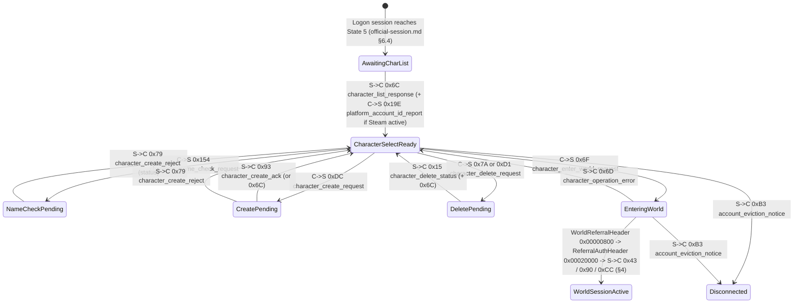

<!-- SPDX-License-Identifier: GPL-3.0-or-later -->

# Official world-session message layer: common encodings, character selection, world entry and object lifecycle

| | |
|---|---|
| **Status** | **Accepted** (re-accepted on independent Stage 1 core pass 7 review, 2026-10-25; acceptance gated by decision 0042 items 4 & 8; 9 OPEN) |
| **Last updated** | 2026-10-25 |
| **Author role** | Spec writer (dirty room) |
| **Reviewer** | `eb6cb6a5-3201-48b2-8777-7291cf0a772d` (independent session, Stage 1 core pass 7, 2026-10-25; `CLEAN_ROOM.md` §5.3 **Pass** — review only, zero body edits) |
| **Companion specs** | `docs/specs/official-session.md` (UDP datagram transport, reliability, fragmentation, post-handshake connection sequence and `FragmentedBlob` envelope); `docs/specs/official-login.md` (account authentication and world-server login ticket); `docs/specs/property-system.md` (§2–§5 stored property dictionary and values, §10 wire encoding cross-reference); `docs/specs/records.md` (§1 primitives, §2 DID prefixes, §4 tokenized text descriptors, §7 enum mappers); `docs/specs/coordinates.md` (§5–§7 and §11 landblock/cell coordinate frames and rotations); `docs/specs/string-table.md` (§9 tokenized text resolution); `docs/specs/tessera-protocol.md` (Tessera's own M7 wire protocol and neutral domain model). |

## Purpose

This specification defines the serialized event payloads exchanged between the LOTRO client and an official logon or world server after the UDP transport session (`docs/specs/official-session.md`) and login authentication (`docs/specs/official-login.md`) are established. It gives a clean-room implementer of an official-protocol adapter in `crates/compat` / `crates/net` what is needed to:

- bridge the exact byte boundary between a reassembled `FragmentedBlob` transport payload (`docs/specs/official-session.md` §5.6.3 and §9.1) and the inner game-event payload stream, including numeric event opcode dispatch, target entity `InstanceID` routing, optional routing headers, and sub-event batching (§1);
- encode and decode the **compact (wire) format** used by network event payloads, and understand every difference between wire encodings and the stored `.dat` record encodings of `docs/specs/records.md` and `docs/specs/property-system.md` (§1.2, §2);
- decode the character-selection list, validate and create characters, delete characters, handle character/account errors, and request world entry for a selected character (§3);
- process world-entry announcements, player session start, portal-space loading transitions, client-ready acknowledgements, and game-clock synchronization (§4);
- process area-of-interest (AOI) compound batches, entity creation and despawn, missing-entity queries, entity position/velocity/attachment replication, client physics/movement updates, client action commands, visual-appearance updates, and live property updates (§5);
- translate official world-session events and commands to and from Tessera's protocol-neutral domain types (`CharacterEvent`, `CharacterCommand`, `Event`, `Command`) in `crates/net/src/domain.rs` and `crates/net/src/session.rs` (§6);
- enforce hostile-input bounds and verify decoders against synthetic test vectors (§7).

In accordance with `CLAUDE.md` and `docs/CLEAN_ROOM.md`, this specification contains no cryptographic keys, certificates, hostnames, URLs, endpoints, packet captures, account data, or player data.

---

## Provenance

How sources are marked:

- **Confirmed**: verified against both the read-only `.dat` archives of the user's installation (`OBS`) and the client executable (`BIN`), or verified in the `.dat` archives alone where the fact is purely data-driven.
- **BIN**: verified from a read-only copy of the client executable under method M4 ([decision 0011](../decisions/0011-standing-m4-authorisation.md) and [decision 0034](../decisions/0034-official-server-compatibility.md)).
- **Reported**: taken from published third-party research (`PUB-LS`, `PUB-LT`) and not independently confirmed in the current client binary.

**Uniform wire-level labelling and runtime PID resolution rule:** Only numeric event opcodes (`event_id` / `blobHeaderWord`), numeric property IDs (`PID`s, encoded on the wire as `CompactPID`), and numeric `DID`/enum keys travel on the wire; no symbolic event name, class name, or property name string is ever transmitted in a packet. All event names (`snake_case`), field names, and struct names in this specification (`base_flags`, `CompactPID`, `character_list_response`, `aoi_enter_batch`, `advancement_level`, and so on) are invented Tessera descriptive labels. At run time: (1) **generic wire decoding is 100% dictionary-driven from `.dat` records** — when decoding any `EncodedPropertyTable` on the wire, the parser decodes each `CompactPID` to a 32-bit numeric `PID` and looks up that numeric `PID` in `client_gamelogic.dat` record `0x34000000` at run time to obtain its wire type code (`1..=22`), enum/child `data` DID, and flags (so the Type Code and Enum/Target DID columns in §3.1.3, §3.2.5, §4.4.2, and §5.2.4 are verification facts from `0x34000000` and are not duplicated in a separate hand-written type-lookup table), `0x000000CC` state schemas (`bool_pids` and `enum_pids`) are constructed at run time from `0x07000029` and `0x0Cxxxxxx` (§4.3.1), and calendar parameters are read at run time by byte offset from `0x35000000` (§4.4.2); and (2) **protocol adapters match specific numeric `u32` `PID` constants to populate Tessera domain fields** — to populate or encode Tessera's neutral domain structs in §6 (`CharacterSummary`, `CharacterCreateRequest`, `WorldClockState`, `SpawnedEntity`), the protocol adapter matches the specific protocol-level numeric 32-bit `PID` constants documented in §3.1.3, §3.2.5, §4.4.2, and §5.2.4 (permitted numeric protocol constants under [decision 0012](../decisions/0012-numeric-constants.md) as amended by [decision 0034](../decisions/0034-official-server-compatibility.md) §2 item 4) in the decoded `(u32 PID -> PropertyValue)` map, without ever embedding symbolic property name strings from `0x34000000` or enum label strings from `0x23xxxxxx` in source code.

Source abbreviations:

| Key | Source |
|---|---|
| OBS | Read-only observation of the user's LOTRO installation (`client_gamelogic.dat` and `client_general.dat`), 2026-10-20: master property dictionary `0x34000000` (all 27,546 property definitions, type codes 1–22, and `data` mapper references), game-time calendar definition `0x35000000` in `client_general.dat` (`180` bytes, resolved from directory `0x0F000002` key `0x96`), player physics script table `0x07000029` and `0x0Cxxxxxx` scriptlets in `client_gamelogic.dat` (yielding the exact 8 boolean `PID`s and 6 enum `PID`s for `0xCC` `state_schema_id = 0x0000000C` surface-movement state and 0 boolean/enum `PID`s for `0x10000E50` and `0x10000E51`), and enum mappers `0x2300000A` (agent genus), `0x2300000B` (species/race), `0x2300000C` (subspecies), `0x2300000D` (alignment), `0x2300000E` (character class), `0x2300000F` (classification filter), `0x23000010` (sex), `0x23000011` (nationality/origin), `0x23000046` (property operation), `0x23000050` (combat state), `0x2300008A` (appearance key), `0x23000091` (entity type), `0x23000097` / `0x230000F8` (player physics script), `0x230000B1` (client language), `0x230000BF` (character availability error), `0x230000C4` (billing role), `0x230000C9` (entity category), `0x230000D0` (UI element message), `0x230000E8` (world day type), `0x230000EF` / `0x230001B7` (character-generation type), `0x23000123` (life state), `0x23000174` (entity creation type), `0x2300027F` (resource sets), `0x23000291` (property response type), `0x23000307` (account type), `0x23000348` (advanced character start tier), `0x2300038B` (teleport reason), `0x23000400` (character class bitfield), `0x23000404` (character-generation sort), and `0x28000008` (region DID map). |
| BIN | **M4 analysis ([decision 0011](../decisions/0011-standing-m4-authorisation.md), [decision 0034](../decisions/0034-official-server-compatibility.md)).** Read-only copy of `x64/lotroclient64.exe` from the user's installation, file version `4906.0071.1794.4035` (build string `Sun Sep 27 14:35:50 2026 : RELEASE`), SHA-256 `d22363eb9aff0fb599fd04b3efa9a1769d08da8af9d8f9b73121c12bfd7e21ee`, analysed with Ghidra `12.1.3` (`analyzeHeadless`) on 2026-10-20. **Questions:** (1) how wire event encodings differ from stored `.dat` record encodings; (2) the wire encodings of 3-tier, 4-tier (`VariableU32`) and 16-bit VLEs, strings, `SignedNormalizedByte`, `CompactPID`, compact `DID`, wire `Position`, `LocalizedTokenText`, property values (all 22 types), `EncodedPropertyTable`, and `EntityAppearanceDesc`; (3) the current numeric event IDs, directions, field layouts, and exact numeric property IDs (`PID`s) read and written by the client for character list/create/delete/select/error (`0x6C`, `0x154`, `0xDC`, `0x93`, `0x79`, `0x7A`, `0xD1`, `0x15`, `0x6D`, `0xB3`, `0x6F`, `0x19E`), world entry and portal transitions (`0x43`, `0xAA`, `0xFA`, `0x90`, `0xCC` including its `0x07` script-table + `0x0C` scriptlet state-schema traversal for `0x0C`, `0xC7`, `0x153`, `0xF4`), network clock synchronization (`ClockSyncHeader` `0x01000000` latency-compensated 5-tier slew and `0x35000000` calendar progression), and object lifecycle, movement, actions (`ActionPayload` wire layout, `0x75`, `0x5A`, `0xA8`, `0xA7`, `0x86`, `0x63`, `0xBD`, `0x39`, `0x60`), visual updates and property updates (`0x0D`, `0x4C`, `0x98`, `0x52`, `0x40`, `0xD0`, `0xCE`, `0x24`, `0x89`, `0xFE`, `0x149`, `0xB0`, `0x88`, `0x92`, `0x76`, `0x0E`, `0xE7`, `0x146`, `0x147`, `0x148`, `0x14A`, `0x8E`); (4) the exact byte-by-byte framing boundary between reassembled `FragmentedBlob` payloads (`official-session.md` §5.6.3, §9.1) and the inner event payload stream, including how `blobHeaderWord`, `recipientId`, `envelopeFlags`, the optional routing header, and `0x0D`/`0x4C` sub-event frames are serialized and dispatched, and how the post-handshake session transitions into `0x6C` (`character_list_response`), `0x19E` (`platform_account_id_report`), and world referral (`0x6F`). **Why M1–M2 were not enough:** M1 `.dat` files use stored record encodings and contain no network event payloads; M2 sources (`PUB-LS`, `PUB-LT`) target 2007–2008 client builds whose event IDs have shifted (for example, character creation was `0x104` in `PUB-LS` and is `0xDC` in build `4906.0071.1794.4035`) and do not document the wire `EncodedPropertyTable`, `LocalizedTokenText`, `Position` elision, `0xCC` state schema, `ActionPayload`, or `FragmentedBlob` routing-header rules; no packet captures exist on this machine. Anti-cheat, anti-tamper, code-signing, and patcher routines were not inspected. |
| PUB-LS | Public third-party research repository `lotro-server` (studied in the dirty room for historical event IDs and protocol concepts only; no code or identifiers copied). |
| PUB-LT | Public third-party research repository `LOTRO-Tools` (studied in the dirty room for historical event IDs and enum mappings only). |

| # | Fact | Source(s) | Mark |
|---|---|---|---|
| E0 | Top-level game events carry their 32-bit numeric event ID directly in Field 8a (`blobHeaderWord`, `VariableU32`) of the `FragmentedBlob` fragment header (`official-session.md` §5.6.3) and carry their default target entity `InstanceID` (`u64 LE`) in Field 7 (`recipientId`, omitted on the wire and defaulting to `0x0000000000000002` when `DefaultRecipient` bit `0x40` of `blobFlags` is set). Inside the reassembled `FragmentedBlob` payload (`official-session.md` §9.1), byte 0 is `envelopeFlags` (`bit 0 = IsZlibCompressed`, `bit 1 = HasRoutingHeader`); after optional zlib decompression (when bit 0 is set) and optional routing-header decoding (when bit 1 is set), offset 0 of the inner event payload stream (`u8 base_flags = 0x00`) begins immediately (§1.1.1–§1.1.3) | BIN | BIN |
| E1 | Structural differences between compact wire event encodings and stored `.dat` record encodings (§1.2) | BIN | BIN |
| E2 | Every serialized event payload begins at inner offset `0` with a 1-byte base event header (`u8` `base_flags`, value `0x00`) before the event-specific fields (§1.3) | BIN | BIN |
| E3 | 3-tier VLE (up to 30 bits, 1/2/4 bytes), 4-tier `VariableU32` (full 32 bits, 1/2/4/5 bytes with `0xE0` prefix, `official-session.md` §5.6.1), and 16-bit VLE (1/2/3/4 bytes) layouts (§2.2) | BIN; `property-system.md` C1 (3-tier) | Confirmed (3-tier); BIN (4-tier, 16-bit) |
| E4 | Prefixed UTF-16LE string (3-tier VLE code-unit count + `2*N` bytes), prefixed 8-bit string (3-tier VLE byte count + `N` bytes), and `SignedNormalizedByte` (`i8` in `[-127..127]` mapped to `[-1.0..1.0]`) layouts (§2.3) | BIN; `records.md` §1.4 | Confirmed (strings); BIN (`SignedNormalizedByte`) |
| E5 | `CompactPID` wire layout: 2-byte big-endian form for PIDs in `0x00000000..0x00003FFF` and `0x10000000..0x10003FFF`, or 5-byte escape (`0x80` + `u32 LE`) for all other PIDs (§2.4.3) | BIN | BIN |
| E6 | Compact `DID` / Enum wire layout: `u8` high byte (bits 24..31) followed by 3-tier VLE of the low 24 bits (§2.4.2) | BIN | BIN |
| E7 | `Position` wire layout: when both bit 0 (`0x01`) and bit 6 (`0x40`) of `flags` are set, the `u8` region byte is elided on the wire and defaults to `1`; when both bit 3 (`0x08`) and bit 7 (`0x80`) of `flags` are set, the `u16 LE` cell field is elided on the wire and defaults to `0` (§2.5.1) | BIN; `property-system.md` V4, V11, C10 | BIN (wire elision); Confirmed (flags) |
| E8 | Quantized 1-byte heading (`u8`, `0..255` mapping `[0, 2π)` radians) used in `0xCE` and `0xCC` (§2.5.2) | BIN | BIN |
| E9 | `LocalizedTokenText` wire layout: omits the TSize hint byte before the argument count (empty argument table is `00`, not `01 00`), and argument kinds 6 and 7 encode their integer payload on the wire as `u8 is_32bit` followed by either `u64 LE` (`0x00`) or a 4-tier `VariableU32` (`0x01`) (§2.6) | BIN; `property-system.md` C4, C11–C16 | BIN |
| E10 | Property value wire encodings across all 22 property types (`property-system.md` §3): Type 8 (`Enum`) and Type 10 (`Property ID`) use Compact `DID` (`u8` + 3-tier VLE); Type 15 (`Int`) uses 4-tier `VariableU32`; Type 17 (`Position`) uses wire `Position` elision; Type 13 (`LocalizedTokenText`) uses wire `LocalizedTokenText`; Type 11 (`Struct`) and Type 12 (`Array`) use `EncodedPropertyTable` / `CompactPID`; all other types (including Type 20 `DID reference`) match their stored `.dat` encoding (§2.7.1) | BIN; `property-system.md` §3–§4, §10 | BIN (wire differences); Confirmed (stored) |
| E11 | `EncodedPropertyTable` wire layout: omits the TSize hint byte and omits the duplicate `u32` table key; starts with a 3-tier VLE property count followed by `(CompactPID, PropertyValue)` pairs (§2.7.2) | BIN | BIN |
| E12 | `EntityAppearanceDesc` bitmask-driven layout (`flags` bits `0x01`, `0x02`, `0x20`, `0x40`, `0x80`, `0x100`, `0x200`, `0x400`) (§2.8) | BIN | BIN |
| C1 | Event `0x6C` (`character_list_response`, S→C): `u8` `0x00`, character array (`u32 LE` count + `CharacterSummaryEntry` entries), and account-level `EncodedPropertyTable` (`account_props` PIDs in §3.1.3) (§3.1) | BIN; OBS (`0x34000000`); PUB-LS | BIN; Confirmed (PIDs) |
| C2 | `CharacterSummaryEntry` layout (`u64 LE` ID, UTF-16LE name, `u32 LE` status/world, `public_props` and `private_props` `EncodedPropertyTable`s, `u32 LE` field, `EntityAppearanceDesc`, four `u32 LE` fields, and `u64 LE` field) and exact character-screen numeric `PID`s read from `public_props` and `private_props` (§3.1.2, §3.1.3) | BIN; OBS (`0x34000000`) | BIN; Confirmed (PIDs) |
| C3 | Event `0x154` (C→S character name check): `u8` `0x00` + UTF-16LE name (§3.2.1) | BIN | BIN |
| C4 | Event `0xDC` (C→S character creation / modification in build `4906.0071.1794.4035`; reported as `0x104` in `PUB-LS`): `u8` `0x00`, `EncodedPropertyTable` (`creation_props` PIDs in §3.2.5), UTF-16LE name, `u8` character type, two `bool8` flags, `u32 LE` field (§3.2.2, §3.2.5) | BIN; OBS (`0x34000000`); PUB-LS (historical `0x104`) | BIN; Confirmed (PIDs) |
| C5 | Event `0x93` (`character_create_ack`, S→C): `u8` `0x00` + `CharacterSummaryEntry` (§3.2.3) | BIN; PUB-LS | BIN |
| C6 | Event `0x79` (`character_create_reject`, S→C): `u8` `0x00` + `u32 LE` error code + `u32 LE` name-rejection code (§3.2.4) | BIN; PUB-LS | BIN |
| C7 | Character creation enums in `client_gamelogic.dat`: `0x2300000B` (species/race), `0x2300000E` (character class), `0x23000010` (sex/gender), `0x23000011` (nationality/origin), `0x230000EF`/`0x230001B7` (character-generation type), and `creation_props` numeric property IDs (§3.2.5) | OBS; BIN | Confirmed |
| C8 | Events `0x7A` (`character_delete_request`, C→S), `0xD1` (`monster_character_delete_request`, C→S), and `0x15` (`character_delete_status`, S→C) (§3.3) | BIN; PUB-LS (`0x7A`, `0x15`) | BIN |
| C9 | Events `0x6D` (`character_operation_error`, S→C), `0xB3` (`account_eviction_notice`, S→C), and `0x19E` (`platform_account_id_report`, C→S) (§3.4) | BIN; PUB-LS (`0x6D`, `0xB3`) | BIN |
| C10 | Event `0x6F` (`character_enter_world_request`, C→S): `u8` `0x00` + `u64 LE` character ID + `EncodedPropertyTable` (§3.5) | BIN; PUB-LS | BIN |
| W1 | Events `0x43` (`world_name_announcement`, S→C), `0xAA` (`display_localized_text`, S→C), and `0xFA` (`server_shutdown_text`, S→C) (§4.1) | BIN; PUB-LS | BIN |
| W2 | Event `0x90` (`player_session_ready`, S→C): `u8` `0x00` + `u64 LE` player entity ID + `EncodedPropertyTable` (§4.2) | BIN; PUB-LS | BIN |
| W3 | Portal-space and teleport events: `0xCC` (`portal_position_sync`, S→C, including its `0x07000029` script-table + `0x0Cxxxxxx` scriptlet traversal yielding the 8 boolean `PID`s = 1 wire byte and 6 enum `PID`s = 6 3-tier VLEs for `state_schema_id = 0x0000000C`, and 0 boolean/enum `PID`s for `0x10000E50` and `0x10000E51`), `0xC7` (`portal_transition_complete`, S→C), `0x153` (`portal_state_notice`, S→C), `0xF4` (`portal_ready_ack`, C→S), and `0x2300038B` (teleport-reason enum) (§4.3) | BIN; OBS (`0x07000029`, `0x0Cxxxxxx`, `0x34000000`, `0x23000097`, `0x2300038B`); PUB-LS (`0xF4`) | BIN; Confirmed (`0x07000029`, `0x2300038B`, `0x34000000`) |
| W4 | Network clock synchronization (`ClockSyncHeader` `0x01000000` `f64 LE` server timestamp, latency-compensated seeding, forward snap, and 5-tier downward slew for excess $\ge 0.015$ s without backward jumps) and in-game day-cycle clock (`0x35000000` in `client_general.dat` resolved via `0x0F000002` key `0x96`: `11160.0` s day length, `360` days/year, `0.25` dawn, `0.80` dusk; world properties `0x000001EF` `world_time_offset`, `0x000006CC` `world_time_dilation`, `0x00000682` `world_present_time_of_day`, `0x000001F0` `world_is_night`, and `0x00000235` `world_day_type`) (§4.4) | BIN; OBS (`client_general.dat` `0x35000000`, `0x0F000002`, `0x34000000`, `0x230000E8`) | BIN; Confirmed (DIDs, `0x35000000` layout & PIDs) |
| O1 | Compound AOI batch events `0x0D` (`aoi_enter_batch`, S→C) and `0x4C` (`sub_event_batch`, S→C): `u8` `0x00` + 4-tier `VariableU32` sub-event count + framed sub-event entries (+ trailing `u8 entry_batch_tail_flag` on `0x0D`) (§5.1) | BIN; PUB-LS (`0x0D`, `0x4C`) | BIN |
| O2 | Entity creation event `0x98` (S→C), initial property sub-event `0x52` (S→C), `0x23000174` (entity creation type enum), `0x23000091` (entity type enum), and core world entity numeric `PID`s (`0x34000000`) (§5.2) | BIN; OBS (`0x34000000`, `0x23000174`, `0x23000091`); PUB-LS (`0x98`, `0x52`) | BIN; Confirmed (enums & PIDs) |
| O3 | Entity deletion event `0x40` (S→C, `u8` `0x00` payload; target ID in outer `FragmentedBlob` envelope) and missing-entity request `0xD0` (C→S, `u8` `0x00` + `u64 LE` entity ID) (§5.3) | BIN; PUB-LS (`0x40`, `0xD0`) | BIN |
| O4 | Entity position/velocity/attachment/teleport-stamp replication event `0xCE` (S→C) (§5.4) | BIN | BIN |
| O5 | Client movement/physics command `0x24` (C→S, 4-slot rolling history buffer with `teleport_stamp` and `SignedNormalizedByte` inputs) (§5.5) | BIN; PUB-LS (`0x24`) | BIN |
| O6 | `ActionPayload` wire layout (`11` to `56` bytes, plus variable-length `action_props` `EncodedPropertyTable` when bit `0x0002` is set), client action command `0x75` (C→S), and server action events `0x5A`, `0xA8`, `0xA7`, `0x86`, `0x63`, `0xBD`, `0x39`, `0x60` (S→C) (§5.6; `official-messages-play.md` §4.2.1, §4.6.3) | BIN | BIN |
| O7 | Visual-description update event `0x89` (S→C) (§5.7) | BIN | BIN |
| O8 | Live property update events (`0xFE`, `0x149`, `0xB0`, `0x88`, `0x92`, `0x76`, `0x0E`, `0xE7`, `0x146`, `0x147`, `0x148`, `0x14A`), predicted property acknowledgement `0x8E` (C→S), and enums `0x23000046` (property-operation enum) and `0x23000291` (property-response-type enum) (§5.8) | BIN; OBS (`0x23000046`, `0x23000291`) | BIN; Confirmed (enums) |

---

## 1. Framing boundary, wire vs stored encodings and event header

### 1.1 Exact byte boundary between `official-session.md` (`FragmentedBlob`) and inner event payloads (BIN)

This specification covers the **world-session message layer**: the inner event payloads carried inside a `FragmentedBlob` after fragment reassembly (`docs/specs/official-session.md` §5.6.3 and §9.1).

- **Authentication and world-server handoff (`docs/specs/official-login.md` and `docs/specs/official-session.md` §6):** credential authentication, world-queue ticketing, and the UDP session handshake (`SessionAuthHeader` `0x00010000`, `ConnectChallengeHeader` `0x00040000`, `ConnectAcceptHeader` `0x00080000`, `WorldReferralHeader` `0x00000800`, and `ReferralAuthHeader` `0x00020000`) belong to those companion specifications.

#### 1.1.1 How `FragmentedBlob` fragment header fields map to event ID and target `InstanceID` (BIN)

Every top-level game event sent or received over a logon or world session is transported as a `FragmentedBlob` (`official-session.md` §5.6.3). Only numeric 32-bit `event_id` values travel on the wire; symbolic event names never appear in packets. Two fields in the `FragmentedBlob` fragment header (on fragment 0) supply the event's dispatch metadata before the reassembled payload is inspected (E0, BIN):

| `FragmentedBlob` Header Field (`official-session.md` §5.6.3) | Wire Type | Role in the Game-Event Layer |
|---|---|---|
| **Field 7: `recipientId`** (present on wire when `blobFlags` bit 6 `0x40` `DefaultRecipient` is clear; omitted when bit 6 is set) | `u64 LE` (8 bytes) | **Target entity `InstanceID`.** When `DefaultRecipient` (`0x40`) is set on the wire, `recipientId` is omitted and defaults to `0x0000000000000002` (the default session recipient, `official-session.md` §5.6.3). When `DefaultRecipient` (`0x40`) is clear, the 8-byte `recipientId` carries the 64-bit `InstanceID` of the target entity for entity-scoped events (such as `0x40` entity despawn, `0x52` entity property-table update, `0x88`/`0x92` single-property update, `0x0E`/`0xE7` property removal, and `0x89` visual update). |
| **Field 8a: `blobHeaderWord`** (present on fragment 0 when `blobFlags` bit 7 `0x80` `OmitChunkInfo` is clear) | `VariableU32` (`official-session.md` §5.6.1, §5.6.3; §2.2.2) | **Top-level numeric `event_id` (`u32`).** For every top-level game event (`0x6C`, `0x6F`, `0xDC`, `0x75`, `0x24`, `0x0D`, `0x40`, `0x4C`, `0x90`, `0xCC`, `0xCE`, etc.), `blobHeaderWord` is the 32-bit numeric event ID on the wire. On the client-to-server send path, fragment 0 places the outgoing event's 32-bit numeric event ID into Field 8a (`blobHeaderWord`, `official-session.md` §5.6.3). |

#### 1.1.2 From reassembled `FragmentedBlob` payload (`official-session.md` §9.1) to offset 0 of the inner event stream (BIN)

Once all fragments (`0 .. numFrags - 1`) of a `FragmentedBlob` have been concatenated in order into a single byte buffer, [`docs/specs/official-session.md`](official-session.md) §9.1 is the single canonical specification of the `MessageEnvelope` header at the start of that reassembled buffer (E0, BIN):

1. **`envelopeFlags` (`u8` at byte `0`) and optional zlib decompression (`envelopeFlags & 0x01`, `IsZlibCompressed`):** decoded according to [`docs/specs/official-session.md`](official-session.md) §9.1 (`u32 LE uncompressedLen` $\le 0x02000000$ followed by an RFC 1950 zlib stream when bit `0x01` is set; raw uncompressed body starting at byte `1` when bit `0x01` is clear).
2. **Optional `RoutingHeader` (`envelopeFlags & 0x02`, `HasRoutingHeader`):** when bit `0x02` of `envelopeFlags` is set, the variable-length `RoutingHeader` at the start of the uncompressed body (`routingFlags` `u16 LE`, optional fields `routingField0..routingField3`, and 2-byte alignment pad) is decoded strictly according to [`docs/specs/official-session.md`](official-session.md) §9.1. When bit `0x02` is clear, no routing header is present and the active target `InstanceID` is `recipientId` from `FragmentedBlob` Field 7 (§1.1.1).
3. **Inner event payload stream (`inner offset 0`):** immediately after `envelopeFlags` (and any zlib decompression and optional `RoutingHeader` specified in [`docs/specs/official-session.md`](official-session.md) §9.1), **inner offset `0` (`u8 base_flags = 0x00`, §1.3)** of the event payload for `blobHeaderWord` (`event_id`) begins, followed at inner offset `1` by the event-specific fields defined in §3–§5 of this specification.

On the client-to-server send path, an outgoing `MessageEnvelope` begins with `envelopeFlags = 0x00` (uncompressed, no routing header) followed immediately by the serialized inner event payload starting with `u8 base_flags = 0x00` ([`docs/specs/official-session.md`](official-session.md) §9.1).

> **OPEN:** While the receiver rule for `envelopeFlags` bit 0 (`0x01`, decompressing the remaining envelope payload with `zlib` after the 4-byte `u32 LE` uncompressed length prefix) is confirmed (`BIN`, [`docs/specs/official-session.md`](official-session.md) §9.1), the exact byte-length threshold at which a sender elects to compress an outbound `MessageEnvelope` is `OPEN` (a clean-room client may leave outbound client-to-server `MessageEnvelope` payloads uncompressed with bit 0 `0x01` clear).

#### 1.1.3 Top-level events vs batched sub-events (`0x0D` and `0x4C`) and cross-reference to `official-session.md` §9.4 (BIN)

Game events arrive in two ways (E0, O1, BIN):

1. **Directly as a top-level `FragmentedBlob`:** `blobHeaderWord` (`FragmentedBlob` Field 8a) is the numeric event ID itself (`0x6C`, `0x90`, `0xCE`, `0x40`, etc.), and the uncompressed body (after `envelopeFlags` and any optional routing header, [`docs/specs/official-session.md`](official-session.md) §9.1) is that single event's inner payload starting at `u8 base_flags = 0x00`.
2. **Bundled inside a batch event (`0x0D` `aoi_enter_batch` or `0x4C` `sub_event_batch`, §5.1):** `blobHeaderWord` of the outer `FragmentedBlob` is `0x0000000D` (`13`) or `0x0000004C` (`76`). After the outer `0x0D`/`0x4C` event's own `u8 base_flags = 0x00` byte, the payload contains a 4-tier `VariableU32` `sub_event_count` followed by `sub_event_count` framed sub-events (`sub_event_id` 4-tier `VariableU32` + `u32 LE payload_size` + `payload_size` bytes when `sub_event_id` is non-zero; §5.1). Each sub-event's `payload_size` slice starts **directly at inner offset 0 (`u8 base_flags = 0x00`)** with **no inner `envelopeFlags` byte and no inner routing header**, and inherits the outer `FragmentedBlob`'s target `InstanceID`.
   *(Cross-reference to [`docs/specs/official-session.md`](official-session.md) §9.4:* §5.1 of this specification is the single canonical specification of world sub-event batches `0x0D` (`aoi_enter_batch`) and `0x4C` (`sub_event_batch`), referenced from [`docs/specs/official-session.md`](official-session.md) §9.4.1; transport-level container `0x00000186` (`EnvelopeBatchContainer`) is specified in [`docs/specs/official-session.md`](official-session.md) §9.4.2.)*

#### 1.1.4 Post-handshake transition into character selection (`0x6C`, `0x19E`) and world referral (`0x6F`) (BIN)

The transition between the transport handshake (`official-session.md` §6) and the character/world message layer (§3–§4) proceeds as follows (E0, C1, C9, C10, BIN):

1. **Logon connection establishment (`official-session.md` §6.1–§6.4):** the client sends `SessionAuthHeader` (`0x00010000`) with the account credentials and ticket from `official-login.md`, receives `ConnectChallengeHeader` (`0x00040000`), replies with `ConnectAcceptHeader` (`0x00080000`), and enters State `5` (`Connected`) on receipt of the first subsequent server packet.
2. **Post-handshake version exchange (`official-session.md` §9.3), initial character list delivery (`0x6C` `character_list_response`, S→C), and platform ID report (`0x19E`, C→S):** once the logon connection is in State `5`, the server and client complete the session version exchange (`VersionRequestMessage` `0x0000012F` $\rightarrow$ `ClientVersionMessage` `0x0000012C` $\rightarrow$ `VersionStatusMessage` `0x0000012D`, followed optionally by zero or more `LoginQueueStatusMessage` `0x00000130` messages while the account is in a login queue and omitted when there is no queue, so `VersionStatusMessage` `0x0000012D` may be followed directly by `0x0000006C` `character_list_response`; documented in `official-session.md` §9.3), after which the server sends event **`0x6C`** (`character_list_response`, §3.1) without requiring any additional game-event request from the client. When the client processes the `account_props` `EncodedPropertyTable` inside `0x6C`, it checks whether the Steam client API is active; if running under Steam, the client immediately sends event **`0x19E`** (`platform_account_id_report`, §3.4) carrying the 64-bit platform user ID.
3. **Character selection (`0x6F`, C→S) and world-server handoff (`official-session.md` §6.5):** when the user selects a character and sends event **`0x6F`** (`character_enter_world_request`, §3.5), the server validates the selection (replying with `0x6D` `character_operation_error` on failure) and, when transferring the session to a world server, sends a transport-layer `WorldReferralHeader` (`0x00000800`, 18 bytes) containing the 64-bit `referralCookie` and the target world server's IPv4 address and UDP port. The client opens a new connection to the world server on the same UDP socket, completes the `ReferralAuthHeader` (`0x00020000`) $\rightarrow$ `ConnectChallengeHeader` (`0x00040000`) $\rightarrow$ `ConnectAcceptHeader` (`0x00080000`) handshake (`official-session.md` §6.5), and then receives the world-entry events (`0x43` `world_name_announcement`, `0x90` `player_session_ready`, `0x0D`/`0x4C` AOI batches, `0xCC` `portal_position_sync`, and `0xC7` `portal_transition_complete`, §4).

### 1.2 Summary of wire event encodings vs stored `.dat` record encodings (BIN)

Network event payloads use a compact wire format that differs from the stored `.dat` resource record formats of [`docs/specs/records.md`](records.md) and [`docs/specs/property-system.md`](property-system.md) §2–§5 in the following ways (E1, BIN; see §2.4–§2.7 and [`docs/specs/property-system.md`](property-system.md) §10 for complete byte tables):

| Construct | Stored `.dat` Record Encoding | Network Event Wire Encoding |
|---|---|---|
| **Property ID (`PID`)** | 4-byte `u32 LE` (preceded by an identical 4-byte `u32 LE` hash key in table-form property sets; `property-system.md` §5.2). | **`CompactPID`** (§2.4.3): 2-byte big-endian form for PIDs in `0x00000000..0x00003FFF` and `0x10000000..0x10003FFF`, or 5-byte `0x80` + `u32 LE` escape for all other PIDs, with no preceding duplicate hash key. |
| **Property table (`PropertySet` / `EncodedPropertyTable`)** | `u8` TSize bucket-hint byte + 3-tier VLE count + `(u32 LE key, u32 LE pid, PropertyValue)` entries (`property-system.md` §5). | **`EncodedPropertyTable`** (§2.7.2): 3-tier VLE count + `(CompactPID, PropertyValue)` entries (no TSize hint byte and no duplicate `u32 LE` key). |
| **Property values (Types `8`, `10`, `11`, `12`, `13`, `15`, `17`)** | Fixed-width `u32 LE` / `i32 LE` for Types `8`, `10`, `15`; stored property set / array / tokenized text / position for Types `11`, `12`, `13`, `17`. | Compact `DID` (`u8` + 3-tier VLE) for Types `8` (`Enum`) and `10` (`PropertyId`); `EncodedPropertyTable` for Type `11` (`Struct`); `CompactPID` element headers for Type `12` (`Array`); wire `LocalizedTokenText` for Type `13`; 4-tier `VariableU32` for Type `15` (`Int`); wire `Position` elision for Type `17` (`Position`). The remaining 15 property types have identical wire and stored encodings (§2.7.1). |
| **Tokenized text (`StringInfo` / `LocalizedTokenText`)** | TSize `u8` hint byte before `arg_count`; argument kinds `6` and `7` carry a fixed 8-byte integer (`property-system.md` §17.4). | Omits the TSize `u8` hint byte before `arg_count`; argument kinds `6` and `7` carry `u8 is_32bit` followed by either `u64 LE` (`0x00`) or 4-tier `VariableU32` (`0x01`) (§2.6). |
| **World `Position`** | Always writes the 1-byte `region` when bit `0x01` of `flags` is set and the 2-byte `cell` when bit `0x08` of `flags` is set (`property-system.md` §4.6). | Elides the 1-byte `region` (defaulting to `1`) when both bits `0x01` and `0x40` of `flags` are set, and elides the 2-byte `cell` (defaulting to `0x0000`) when both bits `0x08` and `0x80` of `flags` are set (§2.5.1). |
| **Boolean validation (`bool8`)** | `0x00` = false, `0x01` = true (`> 1` invalid). | Any byte value `0x02..0xFF` in a `bool8` field or truncated input immediately fails the event frame (§2.1, §7.1). |

### 1.3 Base event payload header (BIN)

Every world and gameplay event payload in this specification begins at inner offset `0` with a single byte `u8 base_flags = 0x00`, followed at inner offset `1` by the event-specific fields (E2, BIN):

| Offset | Size | Type | Value | Meaning |
|---|---|---|---|---|
| 0 | 1 | `u8` | `0x00` | `base_flags`. Always `0x00` on the wire. All event-specific fields immediately follow at offset 1. |

---

## 2. Common value encodings (wire vs stored)

All fixed-width multi-byte integers and IEEE 754 floating-point numbers are **little-endian** unless explicitly marked big-endian (`u16 BE` in `CompactPID` and the high byte of multi-byte VLEs).

### 2.1 Fixed-width scalars and booleans (Confirmed)

| Type | Size (bytes) | Encoding | Wire vs stored |
|---|---|---|---|
| `u8` / `i8` | 1 | Unsigned / two's-complement signed 8-bit integer | Identical |
| `bool8` | 1 | `0x00` = false, `0x01` = true. Any value `0x02..0xFF` immediately fails the frame and aborts decoding. | Identical |
| `u16 LE` / `i16 LE` | 2 | Little-endian 16-bit integer | Identical |
| `u32 LE` / `i32 LE` | 4 | Little-endian 32-bit integer | Identical (except Type 15 `Int` properties, which use 4-tier `VariableU32` on the wire; §2.7.1) |
| `u64 LE` / `i64 LE` | 8 | Little-endian 64-bit integer | Identical |
| `f32 LE` | 4 | IEEE 754 binary32, little-endian | Identical |
| `f64 LE` | 8 | IEEE 754 binary64, little-endian | Identical |

### 2.2 Variable-length integers (VLE) (Confirmed / BIN)

Three distinct variable-length unsigned integer encodings appear in stored records and wire messages (E3, BIN). Implementers must not confuse them:

#### 2.2.1 3-tier VLE (30-bit unsigned, 1 / 2 / 4 bytes)

Used for string lengths, `EncodedPropertyTable` property counts, `LocalizedTokenText` argument counts, Compact `DID` low-24-bit payloads, and Type 22 bitfield bit counts. There is **no `0xE0` 5-byte escape** in this encoding (`property-system.md` §17.1):

| Value range | Encoded size | First byte `b0` | Remaining bytes | Reconstructed value |
|---|---|---|---|---|
| `0x00000000..0x0000007F` | 1 byte | `0x00..0x7F` | none | `b0` |
| `0x00000080..0x00003FFF` | 2 bytes | `0x80..0xBF` (`0x80` combined with bits 8..13) | `u8 b1` (bits 0..7) | Low 6 bits of `b0` shifted left 8 bits, combined with `b1` |
| `0x00004000..0x3FFFFFFF` | 4 bytes | `0xC0..0xFF` (`0xC0` combined with bits 24..29) | `u8 b1` (bits 16..23), `u16 LE w2` (bits 0..15) | Low 6 bits of `b0` shifted left 24 bits, combined with `b1` shifted left 16 bits and `w2` |

Values of `0x40000000` and above cannot be represented by the writer.

#### 2.2.2 4-tier `VariableU32` (full 32-bit unsigned, 1 / 2 / 4 / 5 bytes)

Defined canonically in [`docs/specs/official-session.md`](official-session.md) §5.6.1 (`1`, `2`, `4`, or `5` bytes) and used on the wire for **`FragmentedBlob` header fields (`seqGroup`, `fragIndex`, `numFrags`, `blobHeaderWord`, `fragDataLen` in [`docs/specs/official-session.md`](official-session.md) §5.6.3)**, **Type 15 (`Int`) property values**, **`LocalizedTokenText` integer arguments (kinds 6 and 7)** when the 32-bit flag is set, **compound event (`0x0D` / `0x4C`) counts and sub-event IDs**, and **`ActionPayload` integer fields (§5.6.2)**. Unlike the 3-tier VLE, first byte `b0` equal to `0xE0` selects a 5-byte form (`b0` values in `0xE1..0xFF` are invalid and rejected; [`docs/specs/official-session.md`](official-session.md) §5.6.1):

| Value range | Encoded size | First byte `b0` | Remaining bytes | Reconstructed value |
|---|---|---|---|---|
| `0x00000000..0x0000007F` | 1 byte | `0x00..0x7F` | none | `b0` |
| `0x00000080..0x00003FFF` | 2 bytes | `0x80..0xBF` (`0x80` combined with bits 8..13) | `u8 b1` (bits 0..7) | Low 6 bits of `b0` shifted left 8 bits, combined with `b1` |
| `0x00004000..0x1FFFFFFF` | 4 bytes | `0xC0..0xDF` (`0xC0` combined with bits 24..28) | `u8 b1` (bits 16..23), `u16 LE w2` (bits 0..15) | Low 5 bits of `b0` shifted left 24 bits, combined with `b1` shifted left 16 bits and `w2` |
| `0x20000000..0xFFFFFFFF` | 5 bytes | `0xE0` (`0xE1..0xFF` rejected as invalid; [`official-session.md`](official-session.md) §5.6.1) | `u32 LE d1` | Full 32-bit value `d1` |

The 5-byte `0xE0` prefix encodes any 32-bit value in `0x20000000..0xFFFFFFFF`, including `blobHeaderWord` opcodes `0x3000001B`–`0x30000043` and `0x40000001`–`0x40000002` ([`docs/specs/official-session.md`](official-session.md) §5.6.1, §5.6.3) as well as negative signed 32-bit integers (`0x80000000..0xFFFFFFFF` in two's complement).

#### 2.2.3 16-bit VLE (16-bit unsigned, 1 / 2 / 3 / 4 bytes)

Used on the wire for the `null_field_a` header field of null sub-events (`sub_event_id` zero) inside compound events (`0x0D` and `0x4C`, §5.1):

| Value range | Writer size | First byte `b0` | Remaining bytes | Reader behavior |
|---|---|---|---|---|
| `0x0000..0x007F` | 1 byte | `0x00..0x7F` | none | Returns `b0`. |
| `0x0080..0x3FFF` | 2 bytes | `0x80..0xBF` (`0x80` combined with bits 8..13) | `u8 b1` (bits 0..7) | Returns low 6 bits of `b0` shifted left 8 bits, combined with `b1`. |
| `0x4000..0xFFFF` | 4 bytes | `0xC0` | `u8 0x00`, `u16 LE w2` | If `b0` is in `0xC0..0xDF`, reads and discards 1 byte `b1` and reads `u16 LE w2`, returning `w2`. If `b0` is in `0xE0..0xFF`, reads `u16 LE w1` directly (3 bytes total) and returns `w1`. |

### 2.3 Strings and normalized signed bytes (Confirmed / BIN)

Strings on the wire use the same two length-prefixed formats as `.dat` records (`records.md` §1.4; E4, BIN):

| String type | Length prefix | Payload | Notes |
|---|---|---|---|
| **Prefixed UTF-16LE string** | 3-tier VLE (§2.2.1) code-unit count $N$ | $N \times 2$ bytes of UTF-16LE code units | Used for character names and literal `LocalizedTokenText` text. Not null-terminated. *(Note: World/play event and property UTF-16LE strings (`Prefixed UTF-16LE string`) use this 3-tier VLE (§2.2.1) code-unit count prefix, whereas session/transport UTF-16LE strings (`AccountString` in `SessionAuthHeader` and strings in `0x0000012E`/`0x00000130`) use the 4-tier `VariableU32` (§2.2.2) code-unit count prefix; see [`docs/specs/official-session.md`](official-session.md) §5.6.1 & §6.2.1.)* |
| **Prefixed 8-bit string (Pascal string)** | 3-tier VLE (§2.2.1) byte count $N$ | $N$ raw bytes (Latin-1 / Windows-1252) | Used for Type 1 (`String`) properties, `LocalizedTokenText` authoring strings, and internal identifiers. Not null-terminated. |

#### 2.3.1 `SignedNormalizedByte` (`i8`) (BIN)

A `SignedNormalizedByte` encodes a unit-interval floating-point scalar $x \in [-1.0, 1.0]$ in a single two's-complement signed byte `i8` $b \in [-127, 127]$ (used for the `axis_a`, `axis_b`, and `axis_c` movement step input arrays in event `0x24`, §5.5; E4, O5, BIN):

- **Decoding:** $\text{value} = \text{clamp}(b / 127.0,\; -1.0,\; 1.0)$ (so `b = -128` or `-127` decodes to `-1.0`, `b = 0` decodes to `0.0`, and `b = 127` decodes to `1.0`).
- **Encoding:** clamp $\text{value}$ to $[-1.0, 1.0]$, multiply by $127.0$, and round toward zero to `i8` in $[-127, 127]$.

### 2.4 Identifiers: `InstanceID`, `DID`, Compact `DID`, and `CompactPID`

#### 2.4.1 64-bit `InstanceID` (Confirmed)

Entity and character instance identifiers (`InstanceID`) are serialized as 8-byte little-endian unsigned integers (`u64 LE`). An `InstanceID` of `0` (`0x0000000000000000`) denotes the null/invalid instance.

#### 2.4.2 32-bit `DID` and Compact `DID` / Enum (BIN)

In stored `.dat` records, 32-bit Data IDs (`DID`, Type 20), 32-bit property ID values (`PropertyID`, Type 10), and 32-bit enum keys (`Enum`, Type 8) are serialized as 4-byte `u32 LE` values.

On **the wire**, Type 8 (`Enum`) property values, Type 10 (`PropertyID`) property values, and action/context `DID`s in events `0x24`, `0x5A`, `0x75`, `0x86`, `0xA7`, `0xA8`, `0xBD`, and `0xCC` use the **Compact `DID` / Enum** encoding (E6, BIN):

| Order | Field | Size | Type | Meaning |
|---|---|---|---|---|
| 1 | `high_byte` | 1 | `u8` | Bits 24..31 of the 32-bit value. (For a `DID`, this is the resource type prefix such as `0x25` or `0x70`; for small enum keys or property IDs below `0x01000000`, this is `0x00`; for `0x1000xxxx` enum keys or property IDs, this is `0x10`.) |
| 2 | `low_24` | 1, 2, or 4 | 3-tier VLE (§2.2.1) | Bits 0..23 of the 32-bit value (masked to 24 bits). |

The 32-bit value is reconstructed by placing `high_byte` in bits 24..31 and `low_24` in bits 0..23. Total encoded size is 2 bytes (when `low_24` is at most `0x7F`), 3 bytes (when `low_24` is in `0x80..0x3FFF`), or 5 bytes (when `low_24` is `0x4000` or above). *(Note: Type 20 `DID reference` property values remain 4-byte `u32 LE` values even on the wire; §2.7.1.)*

#### 2.4.3 Compact Property ID (`CompactPID`) (BIN)

In stored `.dat` records, a property ID (`PID`) is always a 4-byte `u32 LE` (preceded in table-form property sets by an identical 4-byte `u32 LE` hash key; `property-system.md` §5.2).

On **the wire**, every numeric 32-bit property ID in an `EncodedPropertyTable`, array element, or single-property update event is encoded as a **`CompactPID`** (2 or 5 bytes) with **no preceding hash key** (E5, BIN; [`docs/specs/property-system.md`](property-system.md) §10.2):

| PID range | Encoded size | Layout |
|---|---|---|
| `0x00000000..0x00003FFF` (high 16 bits equal `0x0000` and low 16 bits below `0x4000`) | 2 bytes | Big-endian `u16 BE` of the low 14 bits: byte 0 (`b0` in `0x00..0x3F`) holds bits 8..13 (bits 6 and 7 clear), byte 1 holds bits 0..7. |
| `0x10000000..0x10003FFF` (high 16 bits equal `0x1000` and low 16 bits below `0x4000`) | 2 bytes | Big-endian `u16 BE` of the low 14 bits with bit 14 (`0x4000`) set: byte 0 (`b0` in `0x40..0x7F`) holds `0x40` combined with bits 8..13 (bit 7 clear), byte 1 holds bits 0..7. |
| All other 32-bit PIDs (including any PID with low 16 bits at or above `0x4000` or high 16 bits not in `{0x0000, 0x1000}`) | 5 bytes | Escape byte `0x80` (`b0` equal to `0x80`) followed by the full 32-bit property ID as a 4-byte little-endian `u32 LE`. First bytes `0x81..0xFF` (any byte with bit 7 `0x80` set and any low bit `0x01..0x7F` non-zero, covering `0x81..0xBF` as well as `0xC0..0xFF`) are never emitted by a conformant writer and are rejected as malformed under Tessera's hostile-input hardening rule (below). |

**Reader rules for `CompactPID` ([`docs/specs/property-system.md`](property-system.md) §10.2):**
1. Read the first byte `b0`.
2. If `b0` equals `0x80`, read a 4-byte `u32 LE` property ID and return it. (In self-framing checkpointed property tables, §2.7.3, bits 16..23 of the 32-bit word carry the 8-bit property type code and are cleared when recovering the `PID`; in normal network events, the 32-bit value is the `PID` unchanged.)
3. If `b0` is in `0x81..0xFF` (any byte with bit 7 `0x80` set and any low bit `0x01..0x7F` non-zero, covering `0x81..0xBF` as well as `0xC0..0xFF`), reject the `CompactPID` and fail the frame as malformed. While the official client binary tests only whether `b0` equals `0x80` (falling through to the 2-byte `u16 BE` branch otherwise), no conformant writer ever emits a `CompactPID` with first byte `0x81..0xFF`, so rejecting first bytes `0x81..0xFF` as malformed is a **Tessera hostile-input hardening rule** (shared with [`docs/specs/property-system.md`](property-system.md) §10.2 and §7.1).
4. Otherwise (`b0` is in `0x00..0x7F`), read a second byte `b1` to form a 16-bit big-endian word (`b0` as high byte, `b1` as low byte).
5. If bit 6 (`0x40`) of `b0` is set (`b0` in `0x40..0x7F`), take the low 14 bits (mask `0x3FFF`) and add `0x10000000`; otherwise (`b0` in `0x00..0x3F`) return the 16-bit word directly (`0x0000..0x3FFF`).

Notice that `PID` zero (the null entry) encodes in 2 bytes as `00 00`.

### 2.5 Positions, orientations and landblock/cell coordinates

#### 2.5.1 `Position` wire vs stored layout (BIN)

A `Position` value (`PropertyValue` Type 17, or the embedded position in movement/portal/landblock events `0xCE`, `0xCC`, `0x146`, `0x147`, `0x148`) starts with a 1-byte `flags` bitmask (`property-system.md` §4.6).

In **stored `.dat` records**, `flags` bits `0x40` and `0x80` are informational flag bits set by the writer when `region` is `1` (`0x40`) and `cell` is `0` (`0x80`), while the payload bytes for `region` (`u8`) and `cell` (`u16 LE`) are still written whenever bits `0x01` and `0x08` are set.

On **the wire**, bits `0x40` and `0x80` **suppress (elide) the wire bytes** of `region` and `cell` (E7, BIN):

| Order | Field | Condition to read/write bytes on the wire | Size (bytes) | Type | Default when elided or absent |
|---|---|---|---|---|---|
| 1 | `flags` | Always present | 1 | `u8` | — |
| 2 | `region` | Bit 0 (`0x01`) set **AND** bit 6 (`0x40`) clear | 1 | `u8` | If bit 0 (`0x01`) is clear: `0`. If both bit 0 (`0x01`) and bit 6 (`0x40`) are set: **`1` (no byte on wire)**. |
| 3 | `block_x`, `block_y` | Bit 1 (`0x02`) set | 2 | `u8`, `u8` | `0xFF`, `0xFF` (`-1`, `-1`) when bit 1 (`0x02`) is clear. |
| 4 | `instance` | Bit 2 (`0x04`) set | 2 | `u16 LE` | `0x0000` when bit 2 (`0x04`) is clear. |
| 5 | `cell` | Bit 3 (`0x08`) set **AND** bit 7 (`0x80`) clear | 2 | `u16 LE` | If bit 3 (`0x08`) is clear: `0xFFFF`. If both bit 3 (`0x08`) and bit 7 (`0x80`) are set: **`0x0000` (no bytes on wire)**. |
| 6 | `offset` (`x, y, z`) | Bit 4 (`0x10`) set | 12 | `3 × f32 LE` | `(0.0, 0.0, 0.0)` metres inside the landblock/cell (`coordinates.md` §5–§7). |
| 7 | `orientation` (`w, x, y, z`) | **Only in full `Position` (Property Type 17, or `0xCE` when `mode_flags` bit 4 `0x10` is set, §5.4)** when bit 5 (`0x20`) of `flags` is set. (Base `Position` in `0xCE` when `mode_flags` bit 4 `0x10` is clear, `0xCC`, and `0x146`–`0x148` stops after `offset`.) | 16 | `4 × f32 LE` | Identity quaternion `(1.0, 0.0, 0.0, 0.0)` (`property-system.md` §4.6). |

**Comparison of stored vs wire `Position` size:** for a typical outdoor position in Region 1 (`region = 1`, `cell = 0`, non-zero `(x, y, z)`, identity orientation), `flags` is `0xDB` (bits `0x01`, `0x02`, `0x08`, `0x10`, `0x40`, and `0x80` set). In a `.dat` file this position is **18 bytes** (`flags` + 1-byte region + 2-byte block + 2-byte cell + 12-byte offset); on the wire it is **15 bytes** (`flags` + 2-byte block + 12-byte offset), because bit `0x40` elides the 1-byte region and bit `0x80` elides the 2-byte cell.

#### 2.5.2 Quantized 1-byte heading (`u8`) (BIN)

Where an event carries a base `Position` (without the 16-byte quaternion) plus a horizontal yaw/heading (events `0xCE` when bits 2 and 4 of `mode_flags` are clear, and `0xCC`), the heading is serialized immediately after the base `Position` as a single byte `u8 raw_angle` (E8, BIN):

- **Decoding:** $\text{angle\_radians} = \left(\text{raw\_angle} \times \frac{2\pi}{256}\right) \bmod 2\pi$ in $[0, 2\pi)$.
- **Encoding:** multiply $\text{angle\_radians} / (2\pi)$ by $256.0$, add $0.5$, floor to an integer, and keep the low 8 bits (`0x00..0xFF`).

### 2.6 `LocalizedTokenText` on the wire vs stored (BIN)

In stored `.dat` records, a tokenized text descriptor (`LocalizedTokenText`, property type 13 in `property-system.md` §4.8 and §17.4) has `u8 mode`, token+table or UTF-16LE literal, `u8 has_authoring_strings`, optional 3 Pascal strings, and a TSize argument table starting with `u8 hint` + 3-tier VLE `count`.

On **the wire**, `LocalizedTokenText` changes the argument table framing and the encoding of integer arguments (E9, BIN):

| Order | Field | Size | Type | Wire vs stored behavior |
|---|---|---|---|---|
| 1 | `mode` | 1 | `u8` | Identical: `0x01` = literal UTF-16LE string; any other byte (`0x00`, `0x02`, etc.) = table reference (`property-system.md` §17.4). |
| 2a | `literal` (when `mode` is `1`) | var | Prefixed UTF-16LE string (§2.3) | Identical. |
| 2b | `token_id`, `table_did` (when `mode` is not `1`) | 8 | `u32 LE`, `u32 LE` | Identical: 4-byte token ID followed by 4-byte string-table DID (`0x25xxxxxx`). |
| 3 | `has_authoring_strings` | 1 | `bool8` (`u8`) | Identical: `0x00` or `0x01` (any value above `1` fails). |
| 4 | `authoring_strings` (when `has_authoring_strings` is `1`) | var | 3 × Prefixed 8-bit string (§2.3) | Identical: symbolic token name, source-language text, authoring comment. |
| 5 | `arg_count` | 1, 2, or 4 | 3-tier VLE (§2.2.1) | **Wire difference #1:** on the wire, there is **no TSize `u8` hint byte** before `arg_count`. An empty argument table on the wire is a single byte `0x00` (so a reference `LocalizedTokenText` with no authoring strings and no arguments ends with the two bytes `00 00`, whereas in `.dat` files it ends with the three bytes `00 01 00`). |
| 6 | `arguments` | var | `arg_count` entries | **Wire difference #2:** each entry begins with the per-argument key prefix (`arg_key`), followed by the 6-byte argument value header (`u16 LE` kind, `u32 LE` variable ID) and the kind-specific payload below. |

> **OPEN:** While the `arg_count = 0` (`u8 = 0x00`) case and the per-argument kind selector and value payloads (`K = 1..7` below) in wire `LocalizedTokenText` are confirmed (`BIN`), the exact width and semantics of the per-argument key prefix (`arg_key`) when `arg_count > 0` are `OPEN`.

**Wire argument value payloads by kind (`K = 1..7`) (E9, BIN):**

| Kind `K` | Meaning | Payload after the common 6-byte argument value header (`u16 LE kind`, `u32 LE var_id`) on the wire |
|---|---|---|
| `1` | Nested `LocalizedTokenText` | Recursive wire `LocalizedTokenText` (§2.6). |
| `2` | Float (`f64`) with precision | `f64 LE` (8 bytes) + `u16 LE` decimal places (2 bytes) = 10 bytes (identical to stored; `property-system.md` §17.4.1). |
| `3` | Float (`f64`) with format options | `f64 LE` (8 bytes) + `u16 LE` decimal places (2 bytes) + `u8` `format_flags` (1 byte) + `u16 LE` `radix` (2 bytes) = 13 bytes (identical to stored). |
| `4` | Fixed integer / pair | 10-byte (`u64 LE` + `u16 LE`) or 8-byte (`i64 LE`) fixed integer form (`property-system.md` §17.4.1). |
| `5` | Fixed integer with format options | 13-byte (`u64 LE` + `u16 LE` + `u8` `format_flags` + `u16 LE` `radix`) or 11-byte (`i64 LE` + `u8` + `u16 LE`) form. |
| `6` | Compact wire integer | **Wire difference #3:** `u8 is_32bit` (`0x00` or `0x01`; any other value fails). When `is_32bit` is `0x00`, followed by `u64 LE` (8 bytes). When `is_32bit` is `0x01` (selected by the writer when the unsigned value is below `0x7FFFFFFF`), followed by a **4-tier `VariableU32`** (§2.2.2, 1/2/4/5 bytes) of the low 32 bits. (In stored `.dat` records, Kind 6 is an unconditional 8-byte `u64 LE` / `i64 LE`.) |
| `7` | Compact wire integer with format options | Same compact integer as Kind 6 (`u8 is_32bit` + `u64 LE` or 4-tier `VariableU32`), followed by `u8 format_flags` (1 byte) + `u16 LE radix` (2 bytes). |
| `0`, `>= 8` | Unrecognized kind | No value bytes (not even the 6-byte value header). |

### 2.7 Property values and `EncodedPropertyTable` on the wire vs stored (BIN)

#### 2.7.1 Property value encoding table (all 22 property types)

Every property value is decoded by looking up its numeric 32-bit `PID` in the master property dictionary (`DID 0x34000000`, `property-system.md` §2) to obtain its property type code (`1..22` in `property-system.md` §3). Across the 22 property types, **fifteen types have the exact same byte layout on the wire as in `.dat` records**, and **seven types use a compact encoding on the wire** (E10, BIN; `property-system.md` §10.3):

| Type code (`property-system.md` §3) | Name | Stored `.dat` encoding | Wire encoding | Wire vs stored |
|---|---|---|---|---|
| `1` | `String` (8-bit) | Prefixed 8-bit string: 3-tier VLE byte count + bytes (§2.3) | Prefixed 8-bit string: 3-tier VLE byte count + bytes (§2.3) | Identical |
| `2` | `String token` | `u32 LE` (4 bytes) | `u32 LE` (4 bytes) | Identical |
| `3` | `Waveform` | `u32 LE` subtype; when `subtype` is `1`, one `f32 LE` (4 B); otherwise ten `f32 LE` (40 B), plus when `subtype` is `10`: `f32 LE` period, `bool8` loop, `u32 LE` count ($\le$ remaining), and `count × (f32 LE, f32 LE)` (`property-system.md` §4.2) | Same as stored | Identical |
| `4` | `Timestamp` | `f64 LE` (8 bytes; `3.4028234663852886e38` = "no time"; else relative to game clock unless definition flag `0x10` is set, in which case absolute) | `f64 LE` (8 bytes; same relative/absolute rule, §4.4) | Identical |
| `5` | `TriState` | `u8` (`0` = false, `1` = true, `255` = undefined) | `u8` (`0` = false, `1` = true, `255` = undefined) | Identical |
| `6` | `Vector3` | `3 × f32 LE` (`x, y, z`, 12 bytes) | `3 × f32 LE` (`x, y, z`, 12 bytes) | Identical |
| `7` | `InstanceId` (`IID`) | `u64 LE` (8 bytes) | `u64 LE` (8 bytes) | Identical |
| `8` | `Enum` | `u32 LE` (4 bytes) | **Compact `DID` / Enum** (§2.4.2): `u8 high_byte` + 3-tier VLE `low_24` (2, 3, or 5 bytes) | **Different** |
| `9` | `Float` | `f32 LE` (4 bytes) | `f32 LE` (4 bytes) | Identical |
| `10` | `PropertyId` | `u32 LE` (4 bytes; `data = 0x34000000`) | **Compact `DID` / Property ID** (§2.4.2): `u8 high_byte` + 3-tier VLE `low_24` (2, 3, or 5 bytes) | **Different** |
| `11` | `Struct` | Stored property set (TSize `u8 hint` + 3-tier VLE `count` + `(u32 LE key, u32 LE pid, PropertyValue)`) | **`EncodedPropertyTable`** (§2.7.2): 3-tier VLE `count` + `(CompactPID, PropertyValue)` (no TSize hint byte, no duplicate `u32` key) | **Different** |
| `12` | `Array` | `u32 LE` `count` ($\le$ remaining bytes), followed by `count` elements of `(u32 LE pid, PropertyValue)` (when `pid` is `0`, 4-byte null element with no value) | `u32 LE` `count` ($\le$ remaining bytes), followed by `count` elements of **`(CompactPID, PropertyValue)`** (when `CompactPID` is `0`, 2-byte `00 00` null element with no value) | **Different (element PID is `CompactPID`)** |
| `13` | `LocalizedTokenText` | Stored tokenized text (`property-system.md` §17.4) | **Wire `LocalizedTokenText`** (§2.6) | **Different** |
| `14` | `Bitfield64` | `u64 LE` (8 bytes) | `u64 LE` (8 bytes) | Identical |
| `15` | `Int` | `i32 LE` (4 bytes) | **4-tier `VariableU32`** (§2.2.2, 1, 2, 4, or 5 bytes) | **Different** |
| `16` | `Color` | `u32 LE` (4 bytes: B, G, R, A; `property-system.md` §4.7) | `u32 LE` (4 bytes: B, G, R, A) | Identical |
| `17` | `Position` | Stored `Position` (`property-system.md` §4.6) | **Wire `Position`** (§2.5.1: `region` byte elided when bit `0x40` is set; `cell` `u16` elided when bit `0x80` is set) | **Different** |
| `18` | `Bitfield32` | `u32 LE` (4 bytes) | `u32 LE` (4 bytes) | Identical |
| `19` | `Int64` | `u64 LE` / `i64 LE` (8 bytes) | `u64 LE` / `i64 LE` (8 bytes) | Identical |
| `20` | `DID reference` (`DID` with DB type) | `u32 LE` (4 bytes; even on the wire, Type 20 values are 4-byte `u32 LE`) | `u32 LE` (4 bytes) | Identical |
| `21` | `Boolean` | `bool8` (`u8`, `0x00` or `0x01`, fails on `> 1`) | `bool8` (`u8`, `0x00` or `0x01`, fails on `> 1`) | Identical |
| `22` | `Bitfield` (variable width) | 3-tier VLE bit count $b$, followed by $\lfloor(b+7)/32\rfloor$ `u32 LE` words and $(\lceil b/8\rceil \bmod 4)$ trailing bytes (`property-system.md` §4.4) | Same as stored | Identical |

#### 2.7.2 `EncodedPropertyTable` wire layout (BIN)

A top-level or nested wire property table (`EncodedPropertyTable`) is significantly more compact than a stored `.dat` property set (`property-system.md` §5, §10.2):

| Order | Field | Size | Type | Meaning |
|---|---|---|---|---|
| 1 | `count` | 1, 2, or 4 | 3-tier VLE (§2.2.1) | Number of properties $N$ in the table. Must satisfy $N \le \text{remaining\_bytes}$ (tighter bound: $N \le \lfloor\text{remaining\_bytes} / 2\rfloor$, since the smallest entry is a 2-byte null `CompactPID` `00 00`). **There is no `u8` TSize bucket-hint byte before `count`.** |
| 2 | `entries` | var | $N \times \text{Entry}$ | $N$ property entries, each encoded as a single `(CompactPID, PropertyValue)` pair below. **There is no duplicate `u32 LE` table key.** |

Each **single property entry** (`Entry`) in an `EncodedPropertyTable`, in a Type 12 `Array`, or in a single-property network event (`0x88`, `0x92`, `0xB0`, `0x147`, `0x149`) is encoded as:

| Order | Field | Size | Type | Meaning |
|---|---|---|---|---|
| 1 | `pid` | 2 or 5 | `CompactPID` (§2.4.3) | The numeric 32-bit property ID. |
| 2 | `value` | var (0 when `pid` is `0`) | `PropertyValue` (§2.7.1) | Present when `pid` is non-zero. Decoded on the wire according to the property type of `pid` in the master property dictionary `0x34000000`. When `pid` is `0`, no value bytes follow. |

An empty `EncodedPropertyTable` on the wire is the single byte `0x00`.

#### 2.7.3 Self-framing checkpointed property-table layout (BIN)

Although standard network events use the unframed `EncodedPropertyTable` layout of §2.7.2, a self-framing checkpointed property-table variant also exists (used only for versioned/checkpointed property blobs):
1. `count` is a 4-byte `u32 LE` (instead of a 3-tier VLE).
2. Each entry writes `CompactPID` with the 8-bit property type code placed in bits 16..23 of the PID (forcing the 5-byte `0x80` + `u32 LE` form whenever the type code is non-zero), followed by a `u32 LE` `value_byte_len`, followed by `value_byte_len` bytes of the property value. On read, if the PID is unknown in the local dictionary or the inner reader does not consume `value_byte_len` bytes, the reader advances to the end of the `value_byte_len` slice and continues without failing the frame.

### 2.8 `EntityAppearanceDesc` layout (BIN)

`EntityAppearanceDesc` describes the visual model, scale, animation/appearance table, and equipment/part overrides of a character or entity. It appears in `CharacterSummaryEntry` (§3.1.2) and in event `0x89` (§5.7). Its layout is controlled by a leading `u32 LE` `flags` bitmask (E12, BIN):

| Order | Field | Condition | Size (bytes) | Type | Meaning |
|---|---|---|---|---|---|
| 1 | `flags` | Always present | 4 | `u32 LE` | Bitmask of present sections (`0x000007E3` valid bits). |
| 2 | `base_model` | Bit 0 (`0x0001`) set | 4 or 8 | `u32 LE` (+ conditional `u32 LE`) | First `u32 LE` `model_a`; when the high byte of `model_a` (`bits 24..31`) indicates a paired resource reference, a second `u32 LE` `model_b` follows. |
| 3 | `secondary_did` | Bit 1 (`0x0002`) set | 4 | `u32 LE` | Secondary appearance or rig DID/flag word. |
| 4 | `scale` | Bit 5 (`0x0020`) set | 12 | `3 × f32 LE` | Scale vector `(sx, sy, sz)`. Defaults to `(1.0, 1.0, 1.0)` when bit `0x0020` is clear. |
| 5 | `param_a` | Bit 6 (`0x0040`) set | 4 | `f32 LE` | Scalar appearance parameter A. Defaults to `1.0` when clear. |
| 6 | `tint_entries` | Bit 7 (`0x0080`) set | `4 + 20 × N` | `u32 LE count` + $N$ records | `u32 LE count` ($\le$ remaining bytes), followed by `count` 20-byte records, each consisting of five `u32 LE` words: `slot`, `key`, `color_bgra`, `field_d`, and `field_e`. |
| 7 | `primary_part` | Bit 8 (`0x0100`) set | var | `PartEntry` (below) | Single appearance part descriptor. |
| 8 | `part_map` | Bit 9 (`0x0200`) set | var | TSize map of `(u32 LE key, PartEntry)` | `u8 hint` (0–22) + 3-tier VLE `count` + `count` entries of `(u32 LE key, PartEntry)`. (Retains the `u8` TSize hint byte even on the wire.) |
| 9 | `param_b` | Bit 10 (`0x0400`) set | 4 | `f32 LE` | Scalar appearance parameter B. Defaults to `1.0` when clear. |

> **OPEN:** While the wire framing and field sizes of `EntityAppearanceDesc` are confirmed (`BIN`), the exact bit test on the high byte of `model_a` (`bits 24..31`) that gates `model_b` and the rendering semantics of `secondary_did`, `tint_entries` (`field_d`, `field_e`), `param_a`, and `param_b` are `OPEN`.

Each **`PartEntry`** (used in rows 7 and 8 above) has the following layout (BIN):

| Order | Field | Condition | Size (bytes) | Type | Meaning |
|---|---|---|---|---|---|
| 1 | `part_flags` | Always present | 4 | `u32 LE` | Sub-bitmask (`0x01`, `0x02`, `0x04`, `0x08`, `0x20`). |
| 2 | `part_id_1` | Bit 0 (`0x01`) set | 4 | `u32 LE` | Part DID / identifier 1. |
| 3 | `part_id_2` | Bit 1 (`0x02`) set | 4 | `u32 LE` | Part DID / identifier 2. |
| 4 | `part_id_3` | Bit 2 (`0x04`) set | 4 | `u32 LE` | Part DID / identifier 3. |
| 5 | `part_id_4` | Bit 3 (`0x08`) set | 4 | `u32 LE` | Part DID / identifier 4. |
| 6 | `sub_map` | Bit 5 (`0x20`) set | var | `u32 LE count` + entries | `u32 LE count`, followed by `count` entries of `(u32 LE sub_key, SubPartTable)`, where `SubPartTable` is a TSize table of `(u32 LE k, u32 LE v1, u32 LE v2)`. |

---

## 3. Character list, creation, deletion and selection

### 3.1 Character list delivery: `0x6C` (`character_list_response`, S→C) (BIN)

After the logon-server connection reaches State `5` (`Connected`, §1.1.4), and again after character creation or deletion when the server refreshes the character screen, the server sends event **`0x6C`** (`character_list_response`) to deliver the account's character list and account-level properties (C1, BIN).

#### 3.1.1 Event `0x6C` payload layout

| Offset | Field | Size | Type | Meaning |
|---|---|---|---|---|
| 0 | `base_flags` | 1 | `u8` | `0x00` (§1.3). |
| 1 | `char_count` | 4 | `u32 LE` | Number of `CharacterSummaryEntry` records $C$ that follow. Must satisfy $C \le \text{remaining\_bytes}$. |
| 5 | `characters` | var | $C \times \text{CharacterSummaryEntry}$ | Array of $C$ character descriptors (§3.1.2). |
| var | `account_props` | var | `EncodedPropertyTable` (§2.7.2) | Account-level and character-screen properties (such as available character slots, account billing/subscription flags, monster-play unlocks, and last-played character metadata). |

#### 3.1.2 `CharacterSummaryEntry` layout (BIN)

Each `CharacterSummaryEntry` element in `0x6C` (`character_list_response`) and `0x93` (`character_create_ack`) has the following sequential layout (C2, BIN):

| Order | Field | Size (bytes) | Type | Meaning |
|---|---|---|---|---|
| 1 | `character_id` | 8 | `u64 LE` (`InstanceID`) | Persistent 64-bit character instance ID. |
| 2 | `name` | 1+ | Prefixed UTF-16LE string (§2.3) | Character display name. |
| 3 | `status_or_world` | 4 | `u32 LE` | Character status / world-assignment code. |
| 4 | `public_props` | 1+ | `EncodedPropertyTable` (§2.7.2) | Primary character summary property table (race/nationality, class, sex, level, current area/landblock DID, equipment/title summary properties). |
| 5 | `private_props` | 1+ | `EncodedPropertyTable` (§2.7.2) | Secondary character property table. |
| 6 | `metadata_a` | 4 | `u32 LE` | 32-bit character metadata word A. |
| 7 | `visual_desc` | 4+ | `EntityAppearanceDesc` (§2.8) | 3D character-screen appearance descriptor. |
| 8 | `metadata_b` | 4 | `u32 LE` | 32-bit character metadata word B. |
| 9 | `metadata_c` | 4 | `u32 LE` | 32-bit character metadata word C (default `0xFFFFFFFF`). |
| 10 | `metadata_d` | 4 | `u32 LE` | 32-bit character metadata word D. |
| 11 | `metadata_e` | 4 | `u32 LE` | 32-bit character metadata word E (default `0xFFFFFFFF`). |
| 12 | `timestamp_or_meta` | 8 | `u64 LE` | 64-bit character metadata/timestamp field (always present on the wire). |

#### 3.1.3 Character and account property IDs in `0x6C` and `0x93` (BIN, OBS)

All Property IDs (`PID`) below are decoded using the master property dictionary `0x34000000` in `client_gamelogic.dat` (`property-system.md` §2.3) and `EncodedPropertyTable` framing (§2.7.2). Only the numeric 32-bit `PID` travels on the wire (as a `CompactPID`); the `snake_case` labels in the second column are invented Tessera descriptive mnemonics.

**Normative runtime architecture rule ([decision 0012](../decisions/0012-numeric-constants.md), [decision 0034](../decisions/0034-official-server-compatibility.md) §2 item 4):** (1) **Generic wire decoding is 100% dictionary-driven from `.dat` records at run time:** when decoding any `EncodedPropertyTable` on the wire, the parser decodes each `CompactPID` to a 32-bit numeric `PID` and looks up that numeric `PID` in `client_gamelogic.dat` record `0x34000000` at run time to obtain its wire type code (`1..=22`), enum/child `data` DID, and flags (so the `Type Code` and `Enum / Target DID` columns below are verification facts from `0x34000000` and are not duplicated in a separate hand-written type-lookup table). (2) **Protocol adapters match specific numeric `u32` `PID` constants to populate Tessera domain fields:** to populate `CharacterSummary` in §6 from the decoded `(u32 PID -> PropertyValue)` map, the protocol adapter matches the specific protocol-level numeric 32-bit `PID` constants documented below (such as `0x100000FC` race, `0x10001089` class, `0x10000A50` sex, `0x10001190` origin, and `0x10001011` level — permitted numeric protocol constants under [decision 0012](../decisions/0012-numeric-constants.md) as amended by [decision 0034](../decisions/0034-official-server-compatibility.md) §2 item 4), without ever embedding symbolic property name strings from `0x34000000` or enum label strings from `0x23xxxxxx` in source code.

##### `CharacterSummaryEntry.public_props` and `CharacterSummaryEntry.private_props` Property IDs

`CharacterSummaryEntry.public_props` and `CharacterSummaryEntry.private_props` carry the following character-selection numeric `PID`s on the wire (C2, C7, BIN, OBS):

| Hex `PID` | Descriptive Mnemonic (non-wire) | Type Code (§2.7.1) | Enum / Target `DID` | Meaning |
|---|---|---|---|---|
| `0x0000062F` | `character_type` | `8` (`Enum`) | `0x230000EF` | Character category (`1` = `free_peoples`, `2` = `monster_player`, `4` = `session_player`). |
| `0x100000FC` | `agent_species` | `8` (`Enum`) | `0x2300000B` | Playable race / species (§3.2.5). |
| `0x10001461` | `agent_subspecies` | `8` (`Enum`) | `0x2300000C` | Subspecies classification. |
| `0x10000CBE` | `agent_genus` | `18` (`Bitfield32`) | `0x2300000A` | Creature genus bitmask. |
| `0x1000069B` | `agent_alignment` | `8` (`Enum`) | `0x2300000D` | Alignment (`1` = good / Free Peoples, `2` = evil / Monster Play). |
| `0x10001089` | `agent_class` | `8` (`Enum`) | `0x2300000E` | Character class (§3.2.5). |
| `0x10000A50` | `sex` | `8` (`Enum`) | `0x23000010` | Character sex (`0x1000` = male, `0x2000` = female). |
| `0x10001190` | `nationality` | `8` (`Enum`) | `0x23000011` | Heritage / origin region (§3.2.5). |
| `0x10001011` | `advancement_level` | `15` (`Int`) | — | Character advancement level (`i32`, 4-tier `VariableU32` on wire). |
| `0x1000663B` | `chargen_character_level` | `15` (`Int`) | — | Character-screen level summary (`i32`, 4-tier `VariableU32` on wire). |
| `0x10006647` | `chargen_character_class_text` | `13` (`LocalizedTokenText`) | — | Localized character-screen class display string. |
| `0x1000664B` | `chargen_character_last_update_time` | `4` (`Timestamp`) | — | Character-screen last update timestamp (`f64 LE`). |
| `0x10003884` | `chargen_character_has_data` | `21` (`Boolean`) | — | Non-zero (`1`) when the character descriptor is populated. |
| `0x10005F96` | `chargen_character_availability_error` | `8` (`Enum`) | `0x230000BF` | Reason code if the character cannot currently log in. |
| `0x10000983` | `area_current_area` | `20` (`DID reference`) | DBType `0x45` | Current area `DID` where the character is located. |
| `0x100011A1` | `area_territory` | `20` (`DID reference`) | DBType `0x45` | Current territory `DID`. |
| `0x10001494` | `area_region` | `20` (`DID reference`) | DBType `0x45` | Current region `DID`. |
| `0x100003FE` | `area_region_id` | `8` (`Enum`) | `0x28000008` | Numeric region identifier enum. |
| `0x00000198` | `area_name` | `13` (`LocalizedTokenText`) | — | Localized current area name. |
| `0x0000001B` | `physics_current_position` | `17` (`Position`) | — | Current world position (landblock, cell, local coordinates). |
| `0x000005A3` | `physics_last_valid_position` | `17` (`Position`) | — | Last valid world position. |
| `0x00000090` | `block_x` | `15` (`Int`) | — | Landblock X coordinate. |
| `0x100010F8` | `surname` | `13` (`LocalizedTokenText`) | — | Character surname. |
| `0x1000088B` | `title_active_title_did` | `20` (`DID reference`) | DBType `0x45` | Active title `DID`. |
| `0x1000119C` | `title_active_title_string` | `13` (`LocalizedTokenText`) | — | Active title localized text. |
| `0x10000A05` | `pedigree_title` | `20` (`DID reference`) | DBType `0x45` | Pedigree / lineage title `DID`. |
| `0x1000122B` | `pedigree_generation` | `15` (`Int`) | — | Pedigree generation number. |
| `0x00000609` | `entity_creation_date` | `19` (`Int64`) | — | 64-bit entity creation timestamp. |
| `0x100002C3` | `time_character_birth_time` | `15` (`Int`) | — | Character birth timestamp (seconds). |
| `0x1000135A` | `time_login_timestamp` | `15` (`Int`) | — | Current/most recent login timestamp (seconds). |
| `0x100016F2` | `time_last_login_timestamp` | `15` (`Int`) | — | Previous login timestamp (seconds). |
| `0x100000F0` | `time_last_logout_timestamp` | `15` (`Int`) | — | Last logout timestamp (seconds). |
| `0x100000F1` | `time_total_in_game_time` | `15` (`Int`) | — | Cumulative in-game time played (seconds). |
| `0x10000578` | `glory_rank` | `15` (`Int`) | — | PvMP Glory / Infamy rank (`i32`). |
| `0x100005C6` | `character_name_credits` | `15` (`Int`) | — | Per-character rename credits. |
| `0x100047B9` | `character_advanced_start_tier` | `8` (`Enum`) | `0x23000348` | Advanced character start tier. |
| `0x1000680C` | `character_previous_race` | `8` (`Enum`) | `0x2300000B` | Previous race prior to a race change. |
| `0x10006810` | `character_previous_gender` | `8` (`Enum`) | `0x23000010` | Previous sex prior to a race/gender change. |
| `0x0000047F` | `phys_obj` | `20` (`DID reference`) | DBType `0x39` (`0x47`) | Base physics/appearance object `DID`. |
| `0x0000054F` | `appearance_instance_list` | `12` (`Array`) | Child `0x00000157` | Array of appearance-key entries (`0x00000157`, Type `11` `Struct` containing `0x0000000A` `appearance_key` Type `8` `0x2300008A`, `0x000000A4` `appearance_apr_file` Type `20` DBType `0x4E`, `0x00000289` `appearance_modifier` Type `9` `Float`, `0x00000B18` `appearance_apr_toggle_file` Type `20` DBType `0x4E`, and `0x00000B19` `appearance_toggle_property` Type `10` `PropertyId`). |
| `0x1000128A` | `character_appearance_info` | `11` (`Struct`) | — | Composite character appearance metadata struct. |
| `0x10000E77` | `eq_slot_head` | `7` (`InstanceId`) | — | Equipped head item `InstanceID`. |
| `0x1000082B` | `eq_slot_shoulder` | `7` (`InstanceId`) | — | Equipped shoulder item `InstanceID`. |
| `0x10000B9C` | `eq_slot_back` | `7` (`InstanceId`) | — | Equipped back/cloak item `InstanceID`. |
| `0x10000489` | `eq_slot_chest` | `7` (`InstanceId`) | — | Equipped chest item `InstanceID`. |
| `0x10001327` | `eq_slot_gloves` | `7` (`InstanceId`) | — | Equipped gloves item `InstanceID`. |
| `0x1000056C` | `eq_slot_legs` | `7` (`InstanceId`) | — | Equipped legs item `InstanceID`. |
| `0x10000488` | `eq_slot_boots` | `7` (`InstanceId`) | — | Equipped boots item `InstanceID`. |
| `0x100001B4` | `eq_slot_weapon_primary` | `7` (`InstanceId`) | — | Equipped main-hand weapon `InstanceID`. |
| `0x100001B3` | `eq_slot_weapon_secondary` | `7` (`InstanceId`) | — | Equipped off-hand weapon/shield `InstanceID`. |
| `0x1000082A` | `eq_slot_weapon_ranged` | `7` (`InstanceId`) | — | Equipped ranged weapon `InstanceID`. |
| `0x1000105B` | `eq_slot_craft_tool` | `7` (`InstanceId`) | — | Equipped crafting tool `InstanceID`. |
| `0x1000240B` | `eq_slot_class_item` | `7` (`InstanceId`) | — | Equipped class slot item `InstanceID`. |
| `0x1000039A` | `eq_slot_pocket_1` | `7` (`InstanceId`) | — | Equipped pocket item `InstanceID`. |
| `0x100001B5` | `eq_slot_earring_1` | `7` (`InstanceId`) | — | Equipped left earring `InstanceID`. |
| `0x10000298` | `eq_slot_earring_2` | `7` (`InstanceId`) | — | Equipped right earring `InstanceID`. |
| `0x1000121E` | `eq_slot_necklace` | `7` (`InstanceId`) | — | Equipped necklace `InstanceID`. |
| `0x10000D83` | `eq_slot_bracelet_1` | `7` (`InstanceId`) | — | Equipped left bracelet `InstanceID`. |
| `0x10000E76` | `eq_slot_bracelet_2` | `7` (`InstanceId`) | — | Equipped right bracelet `InstanceID`. |
| `0x10000E75` | `eq_slot_ring_1` | `7` (`InstanceId`) | — | Equipped left ring `InstanceID`. |
| `0x10000F7F` | `eq_slot_ring_2` | `7` (`InstanceId`) | — | Equipped right ring `InstanceID`. |
| `0x10004E0B` | `eq_slot_mounted` | `7` (`InstanceId`) | — | Equipped bridle / mount item `InstanceID`. |

##### `0x6C` `account_props` Property IDs

The `account_props` `EncodedPropertyTable` at the end of `0x6C` (`character_list_response`, §3.1.1) carries account-wide character-selection and subscription properties (C1, C7, BIN, OBS):

| Hex `PID` | Descriptive Mnemonic (non-wire) | Type Code (§2.7.1) | Enum / Child `PID` | Meaning |
|---|---|---|---|---|
| `0x00000747` | `account_game_account_name` | `13` (`LocalizedTokenText`) | — | Subscription / game-account display name. |
| `0x000003F7` | `account_billing_name` | `13` (`LocalizedTokenText`) | — | Account billing identifier string. |
| `0x0000018A` | `account_auth_ticket` | `1` (`String`) | — | Account authentication ticket string. |
| `0x100038A6` | `account_iid` | `7` (`InstanceId`) | — | 64-bit account `InstanceID`. |
| `0x10003866` | `billing_player_account_type` | `8` (`Enum`) | `0x23000307` | Subscription tier (`1` = free / F2P, `2` = premium, `3` = VIP / subscriber, `4` = lifetime). |
| `0x000001D6` | `account_billing_roles` | `22` (`Bitfield`) | `0x230000C4` | Variable-width bitfield of account billing tokens / expansion entitlements. |
| `0x10004A69` | `account_billing_token_overrides` | `22` (`Bitfield`) | `0x230000C4` | Variable-width bitfield of overridden billing tokens. |
| `0x000001D7` | `account_client_language` | `8` (`Enum`) | `0x230000B1` | Account client language enum. |
| `0x00000499` | `account_num_characters_allowed` | `15` (`Int`) | — | Total character slots allowed on this server (`i32`). |
| `0x0000066B` | `account_num_characters_allowed_for_type` | `12` (`Array`) | Child `0x00000680` | Array of per-type character slot structs (`0x00000680`, Type `11` `Struct` containing `0x000001A6` `max_characters` Type `15` `Int` and `0x0000062F` `character_type` Type `8` `Enum` `0x230000EF`). |
| `0x000007C4` | `account_available_resource_sets` | `22` (`Bitfield`) | `0x2300027F` | Bitfield of available content/resource sets. |
| `0x000007C8` | `account_loaded_resource_sets` | `22` (`Bitfield`) | `0x2300027F` | Bitfield of loaded content/resource sets. |
| `0x10001731` | `account_monster_play_available` | `21` (`Boolean`) | — | Non-zero (`1`) if Monster Play is unlocked on the account. |
| `0x10001B45` | `account_player_left_monster_play_timestamp` | `4` (`Timestamp`) | — | Cooldown timestamp when the player last left a PvMP zone (`f64 LE`). |
| `0x100028FA` | `account_outfit_system_available` | `21` (`Boolean`) | — | Non-zero (`1`) if cosmetic outfit slots are unlocked. |
| `0x100029ED` | `account_tutorial_skip` | `21` (`Boolean`) | — | Non-zero (`1`) if the account is eligible to skip the starter tutorial. |
| `0x10003885` | `character_last_used` | `7` (`InstanceId`) | — | `InstanceID` of the last played Free Peoples character. |
| `0x10004118` | `character_last_used_mp` | `7` (`InstanceId`) | — | `InstanceID` of the last played Monster Play character. |
| `0x10003878` | `char_select_available_characters_array` | `12` (`Array`) | Child `0x10003875` | Array of available-character entries (`0x10003875`, Type `11` `Struct` containing `0x10003877` `available_character_iid` Type `7` `InstanceId` and `0x10003879` `available_character_is_available` Type `21` `Boolean`). |
| `0x10003876` | `char_select_display_available_characters_dialog` | `21` (`Boolean`) | — | Non-zero (`1`) if the character-slot activation dialog must be shown. |
| `0x10003B36` | `character_account_name_credits` | `15` (`Int`) | — | Account-level character rename credits. |
| `0x10003B64` | `character_account_name_credits_array` | `12` (`Array`) | Child `0x10003B63` | Array of per-character rename credit entries (`0x10003B63`, Type `7` `InstanceId`). |
| `0x10006809` | `account_race_change_credits` | `15` (`Int`) | — | Account-level race change credits. |
| `0x10001914` | `housing_account_house_owner` | `7` (`InstanceId`) | — | `InstanceID` of the character owning the account's standard house. |
| `0x1000641B` | `housing_account_premium_house_owners_array` | `12` (`Array`) | — | Array of premium house ownership entries (`0x1000641D` `premium_house_owner_iid` Type `7` `InstanceId` and `0x10006420` `premium_house_owner_address` Type `19` `Int64`). |

### 3.2 Character creation and name validation

#### 3.2.1 Name validation request: `0x154` (`character_name_check_request`, C→S) (BIN)

Before or during character creation, the client can test whether a proposed character name is valid and available by sending event **`0x154`** (C3, BIN):

| Offset | Field | Size | Type | Meaning |
|---|---|---|---|---|
| 0 | `base_flags` | 1 | `u8` | `0x00` (§1.3). |
| 1 | `name` | 1+ | Prefixed UTF-16LE string (§2.3) | Proposed character name. |

#### 3.2.2 Character creation / modification request: `0xDC` (`character_create_request`, C→S) (BIN)

When the user submits a newly created (or modified) character, the client sends event **`0xDC`** (C4, BIN).

> **Historical note (`PUB-LS`):** In 2007–2008 client builds studied by `PUB-LS`, character creation used event ID `0x104`. In current client build `4906.0071.1794.4035`, the character creation/modification event is **`0xDC`**.

| Order | Field | Size | Type | Meaning |
|---|---|---|---|---|
| 1 | `base_flags` | 1 | `u8` | `0x00` (§1.3). |
| 2 | `creation_props` | 1+ | `EncodedPropertyTable` (§2.7.2) | Character-generation properties (§3.2.5): race/species, class, sex, nationality/origin region, body/face morph sliders, hair/skin/eye color properties, and avatar appearance entries. |
| 3 | `name` | 1+ | Prefixed UTF-16LE string (§2.3) | Requested character name. |
| 4 | `char_gen_type` | 1 | `u8` | Character-generation type (enum `0x230000EF`: `1` = `free_peoples`, `2` = `monster_player`, `4` = `session_player`). |
| 5 | `flag_a` | 1 | `bool8` (`u8`) | Boolean creation option flag A (`0x00` or `0x01`; e.g., skip tutorial / veteran status). |
| 6 | `flag_b` | 1 | `bool8` (`u8`) | Boolean creation option flag B (`0x00` or `0x01`). |
| 7 | `creation_param` | 4 | `u32 LE` | 32-bit creation parameter (default `0`). |

#### 3.2.3 Character creation success: `0x93` (`character_create_ack`, S→C) (BIN)

When character creation succeeds, the server replies with event **`0x93`** (`character_create_ack`), carrying the complete `CharacterSummaryEntry` of the newly created character (C5, BIN):

| Offset | Field | Size | Type | Meaning |
|---|---|---|---|---|
| 0 | `base_flags` | 1 | `u8` | `0x00` (§1.3). |
| 1 | `character` | var | `CharacterSummaryEntry` (§3.1.2) | Descriptor of the newly created character. |

#### 3.2.4 Character creation / name error: `0x79` (`character_create_reject`, S→C) (BIN)

When character creation or name validation (`0x154` or `0xDC`) fails (or when `0x154` completes with a name-validation status code), the server sends event **`0x79`** (`character_create_reject`) (C6, BIN):

| Offset | Field | Size | Type | Meaning |
|---|---|---|---|---|
| 0 | `base_flags` | 1 | `u8` | `0x00` (§1.3). |
| 1 | `result_code` | 4 | `u32 LE` | General character-generation error/status code. |
| 5 | `name_error_code` | 4 | `u32 LE` | Specific name-validation rejection code. |

#### 3.2.5 `0xDC` `creation_props` Property IDs and enum mappers in `client_gamelogic.dat` (BIN, OBS)

When constructing `creation_props` for `0xDC` (`character_create_request`), the client populates the core character-generation selection properties and copies the customized avatar properties from the preview entity while explicitly removing numeric `PID`s `0x10001284` (`overhead_quest_icons`) and `0x10000EDE` (`overhead_other_icons`) (C4, C7, BIN, OBS). Only numeric `PID`s and numeric enum keys travel on the wire; the snake_case labels below are non-wire descriptive mnemonics.

**Normative runtime architecture rule ([decision 0012](../decisions/0012-numeric-constants.md), [decision 0034](../decisions/0034-official-server-compatibility.md) §2 item 4):** (1) **Generic wire decoding is 100% dictionary-driven from `.dat` records at run time:** when encoding or decoding any `EncodedPropertyTable` on the wire, each numeric 32-bit `PID` is looked up in `client_gamelogic.dat` record `0x34000000` at run time to obtain its wire type code (`1..=22`), enum/child `data` DID, and flags (so the `Type Code` and `Enum / Target DID` columns below are verification facts from `0x34000000` and are not duplicated in a separate hand-written type-lookup table). (2) **Protocol adapters match specific numeric `u32` `PID` constants to populate Tessera domain fields:** to encode `creation_props` from `CharacterCreateRequest` in §6, the protocol adapter uses the specific protocol-level numeric 32-bit `PID` constants documented below (such as `0x0000062F` character category, `0x100000FC` race, `0x10001089` class, `0x10000A50` sex, and `0x10001190` origin — permitted numeric protocol constants under [decision 0012](../decisions/0012-numeric-constants.md) as amended by [decision 0034](../decisions/0034-official-server-compatibility.md) §2 item 4), without ever embedding symbolic property name strings from `0x34000000` or enum label strings from `0x23xxxxxx` in source code.

| Hex `PID` | Descriptive Mnemonic (non-wire) | Type Code (§2.7.1) | Enum / Target `DID` | Role in `creation_props` |
|---|---|---|---|---|
| `0x0000062F` | `character_type` | `8` (`Enum`) | `0x230000EF` | Character category (`1` = `free_peoples`, `2` = `monster_player`, `4` = `session_player`). |
| `0x100000FC` | `agent_species` | `8` (`Enum`) | `0x2300000B` | Selected playable race / species. |
| `0x10001089` | `agent_class` | `8` (`Enum`) | `0x2300000E` | Selected character class. |
| `0x10000A50` | `sex` | `8` (`Enum`) | `0x23000010` | Selected sex (`0x1000` = male, `0x2000` = female). |
| `0x10001190` | `nationality` | `8` (`Enum`) | `0x23000011` | Selected heritage / origin region. |
| `0x00000A94` | `entity_is_transient_unique` | `21` (`Boolean`) | — | Set to `1` (`0x01`) on newly generated character property tables. |
| `0x10000DE0` | `character_monster_play_session` | `20` (`DID reference`) | DBType `0x45` | Session-play template `DID` (when `char_gen_type = 4`). |
| `0x10000BEF` | `character_monster_play_player_iid` | `7` (`InstanceId`) | — | Linked Free Peoples character `InstanceID` for Monster Play / Session Play creation. |
| `0x00000B45` | `chargen_convert_iid` | `7` (`InstanceId`) | — | Target character `InstanceID` when modifying/converting an existing character. |
| `0x0000047F` | `phys_obj` | `20` (`DID reference`) | DBType `0x39` (`0x47`) | Avatar base physics/appearance object `DID`. |
| `0x0000054F` | `appearance_instance_list` | `12` (`Array`) | Child `0x00000157` | Selected head, hair, beard, body, and starter outfit appearance entries (`0x00000157`). |
| `0x10006DB5` | `avatar_mesh_head` | `9` (`Float`) | — | Avatar head mesh morph slider (`f32 LE`). |
| `0x1000739D` | `avatar_mesh_ears` | `9` (`Float`) | — | Avatar ear mesh morph slider (`f32 LE`). |
| `0x10000DB4` | `avatar_bone_scale` | `9` (`Float`) | — | Avatar body proportion / build scale (`f32 LE`). |
| `0x1000703D` | `avatar_height` | `9` (`Float`) | — | Avatar height slider (`f32 LE`). |
| `0x100069B7` | `avatar_bone_slider_values` | `1` (`String`) | — | Serialized bone-slider configuration string. |
| `0x100001E0` | `avatar_color_skin` | `16` (`Color`) | — | Skin color (`u32 LE` BGRA). |
| `0x10000595` | `avatar_color_hair` | `16` (`Color`) | — | Hair color (`u32 LE` BGRA). |
| `0x100003BA` | `avatar_color_eyes` | `16` (`Color`) | — | Eye color (`u32 LE` BGRA). |
| `0x100066D9` | `avatar_color_lips` | `16` (`Color`) | — | Lip color (`u32 LE` BGRA). |
| `0x1000612A` | `avatar_color_warpaint` | `16` (`Color`) | — | Facepaint / warpaint color (`u32 LE` BGRA). |
| `0x10000596` | `avatar_texture_mouth` | `15` (`Int`) | — | Mouth texture variant index (`i32`). |
| `0x10000AF7` | `avatar_texture_eyebrows` | `15` (`Int`) | — | Eyebrows texture variant index (`i32`). |
| `0x10000941` | `avatar_texture_eyes` | `15` (`Int`) | — | Eyes texture variant index (`i32`). |
| `0x10000850` | `avatar_texture_scar` | `15` (`Int`) | — | Primary facial scar index (`i32`). |
| `0x10001C92` | `avatar_texture_scar_2` | `15` (`Int`) | — | Secondary facial scar index (`i32`). |
| `0x10005F84` | `avatar_texture_facepaint` | `15` (`Int`) | — | Facepaint pattern index (`i32`). |
| `0x10006D85` | `avatar_texture_wrinkles` | `15` (`Int`) | — | Facial wrinkles index (`i32`). |
| `0x10006D86` | `avatar_texture_complexion` | `15` (`Int`) | — | Skin complexion index (`i32`). |
| `0x100073A9` | `avatar_texture_eyeshadow` | `15` (`Int`) | — | Eyeshadow index (`i32`). |
| `0x100073A0` | `avatar_texture_jewelry` | `15` (`Int`) | — | Facial/hair jewelry index (`i32`). |
| `0x10006D84` | `avatar_texture_stubble` | `15` (`Int`) | — | Facial stubble index (`i32`). |
| `0x10000CB0` | `avatar_texture_wrinkles_eye` | `15` (`Int`) | — | Eye-wrinkle texture index (`i32`). |
| `0x10000DB5` | `avatar_texture_wrinkles_mouth` | `15` (`Int`) | — | Mouth-wrinkle texture index (`i32`). |
| `0x10000EA7` | `avatar_texture_nose` | `15` (`Int`) | — | Nose texture index (`i32`). |
| `0x1000739B` | `avatar_texture_hair_decoration` | `15` (`Int`) | — | Hair decoration index (`i32`). |

The enum mappers in `client_gamelogic.dat` define the valid numeric domain codes used in `creation_props` and `public_props`; only the numeric enum keys listed below are used directly by protocol logic, while all playable race, heritage/origin, and class numeric keys and their display/enum labels are read at run time from the `0x23xxxxxx` `.dat` enum-mapper records (`records.md` §7) in `client_gamelogic.dat` (C7, OBS):

- **`0x230000EF` / `0x230001B7` (character-generation type for `0x0000062F` `character_type` and `0xDC` `char_gen_type`):** `0` (undefined), `1` (Free Peoples character, deleted via `0x7A`), `2` (Monster Play character, deleted via `0xD1`), `4` (session-play character, using `0x10000DE0`). Display/enum labels are read from `0x230000EF` / `0x230001B7` at run time.
- **`0x23000010` (sex/gender for `0x10000A50` `sex`):** `0` (undefined), `4096` (`0x1000`), `8192` (`0x2000`), `268435456` (`0x10000000`). Display/enum labels are read from `0x23000010` at run time.
- **`0x2300000B` (species/race for `0x100000FC` `agent_species`), `0x23000011` (heritage/origin region for `0x10001190` `nationality`), and `0x2300000E` (character class for `0x10001089` `agent_class`):** all valid numeric keys and display/enum labels are read at run time from `0x2300000B`, `0x23000011`, and `0x2300000E` in `client_gamelogic.dat`.

### 3.3 Character deletion: `0x7A`, `0xD1` (C→S) and `0x15` (S→C) (BIN)

The client has two distinct character-deletion request events depending on whether the character is a Free Peoples character or a Monster Play character (C8, BIN):

| Event ID | Direction | Descriptive Label | Payload layout |
|---|---|---|---|
| `0x7A` | C→S | `character_delete_request` (Free Peoples) | `u8` `0x00` (`base_flags`) + `u64 LE` `character_id` (9 bytes total). |
| `0xD1` | C→S | `monster_character_delete_request` | `u8` `0x00` (`base_flags`) + `u64 LE` `character_id` (9 bytes total). |
| `0x15` | S→C | `character_delete_status` | `u8` `0x00` (`base_flags`) + `u64 LE` `character_id` + `i32 LE` `result_code` (13 bytes total). |

### 3.4 Character and account errors: `0x6D`, `0xB3` (S→C) and `0x19E` (C→S) (BIN)

| Event ID | Direction | Descriptive Label | Payload layout |
|---|---|---|---|
| `0x6D` | S→C | `character_operation_error` | `u8` `0x00` (`base_flags`) + `u32 LE` `error_code` (5 bytes total). Sent when character selection, loading, or character-screen operations fail. |
| `0xB3` | S→C | `account_eviction_notice` | `u8` `0x00` (`base_flags`) + `u32 LE` `boot_reason` + wire `LocalizedTokenText` (§2.6) `reason_text`. Sent when the server disconnects or boots the account. |
| `0x19E` | C→S | `platform_account_id_report` | `u8` `0x00` (`base_flags`) + `u64 LE` `platform_id` (9 bytes total). Sent by the client after processing `0x6C` (`character_list_response`) when running under Steam integration (§1.1.4). |

### 3.5 Character selection / world entry request: `0x6F` (`character_enter_world_request`, C→S) (BIN)

When the user selects a character from the `0x6C` character list and requests world entry, the client sends event **`0x6F`** (C10, BIN):

| Offset | Field | Size | Type | Meaning |
|---|---|---|---|---|
| 0 | `base_flags` | 1 | `u8` | `0x00` (§1.3). |
| 1 | `character_id` | 8 | `u64 LE` (`InstanceID`) | The 64-bit `character_id` chosen from `CharacterSummaryEntry`. |
| 9 | `client_props` | 1+ | `EncodedPropertyTable` (§2.7.2) | Client session/entry property table (initialized empty `0x00` unless client-side entry properties are attached). |

### 3.6 Character-screen state machine

---

## 4. World entry, portal space and session synchronization

### 4.1 World announcement and display messages: `0x43`, `0xAA`, `0xFA` (S→C) (BIN)

These events deliver `LocalizedTokenText` messages during world entry, gameplay, and shutdown. This section (§4.1) is the single canonical wire specification of `0x43` (`world_name_announcement`), `0xAA` (`display_localized_text`), and `0xFA` (`server_shutdown_text`) (referenced from [`docs/specs/official-messages-play.md`](official-messages-play.md) §6.5; W1, BIN):

| Event ID | Direction | Descriptive Label | Payload layout | Meaning |
|---|---|---|---|---|
| `0x43` | S→C | `world_name_announcement` | `u8` `0x00` (`base_flags`) + wire `LocalizedTokenText` (§2.6) `world_name` | Identifies the world name to display in the client UI upon connection/world entry. |
| `0xAA` | S→C | `display_localized_text` | `u8` `0x00` (`base_flags`) + `u64 LE` `target_or_channel_mask` + wire `LocalizedTokenText` (§2.6) `message` | Formats and displays a localized system/gameplay text message (`LocalizedTokenText`) associated with the 64-bit target entity or chat-channel selector `target_or_channel_mask` (see also [`docs/specs/official-messages-play.md`](official-messages-play.md) §6.5). |
| `0xFA` | S→C | `server_shutdown_text` | `u8` `0x00` (`base_flags`) + wire `LocalizedTokenText` (§2.6) `last_words` | Broadcasts the server's final shutdown/restart message before closing the world session. |

### 4.2 Player session start: `0x90` (`player_session_ready`, S→C) (BIN)

When the server commits the selected character into the game world, it sends event **`0x90`** (`player_session_ready`) (W2, BIN):

| Offset | Field | Size | Type | Meaning |
|---|---|---|---|---|
| 0 | `base_flags` | 1 | `u8` | `0x00` (§1.3). |
| 1 | `player_id` | 8 | `u64 LE` (`InstanceID`) | The active player avatar's 64-bit `InstanceID`. |
| 9 | `session_props` | 1+ | `EncodedPropertyTable` (§2.7.2) | Session-start property table initializing the active player session properties. |

### 4.3 Portal space transitions, world loading and client readiness (BIN / Confirmed)

During initial world entry and whenever the avatar teleports or crosses into a new instance/interior ("portal space"), the client transitions through a portal loading state so that terrain landblocks (`client_cell_1.dat` / `client_surface.dat`), static meshes, and surrounding AOI entities can load before the loading screen is dismissed (W3, BIN).

#### 4.3.1 Portal and teleport events (`0xCC`, `0xC7`, `0x153`, `0xF4`) and `0xCC` state schema tables

| Event ID | Direction | Descriptive Label / Role | Payload layout |
|---|---|---|---|
| `0xCC` | S→C | `portal_position_sync` (portal / teleport placement and physics state sync) | `u8` `0x00` (`base_flags`), followed by: (1) `u8` `sync_flags` (`bit 0 = sync_bit_0`, `bits 1..6 = vel/omega presence`, `bit 7 = explicit state_schema_id`); (2) `u32 LE` `sequence_or_reason`; (3) base wire `Position` (§2.5.1, without quaternion); (4) `u8` quantized heading (§2.5.2); (5) `u8` `movement_mode`; (6) up to six conditional `f32 LE` velocity/angular-velocity components selected by `sync_flags` bits `0x02..0x40` (`0x02` = `vel_x`, `0x04` = `vel_y`, `0x08` = `vel_z`, `0x10` = `ang_vel_x`, `0x20` = `ang_vel_y`, `0x40` = `ang_vel_z`; each defaults to `0.0` when its bit is clear); (7) Compact `DID` (§2.4.2) `anim_or_context_did`; (8) conditional `u32 LE` `state_schema_id` (`0x00000A9D` `player_physics_script`, read only when bit 7 `0x80` of `sync_flags` is set; defaults to **`0x0000000C`** = `12` surface-movement state when bit `0x80` is clear); (9a) `ceil(N_bool / 8)` raw bit-packed boolean state bytes (packed LSB-first with no length prefix; **`1` byte** for default schema `0x0C`); (9b) `N_enum` consecutive 3-tier VLE (§2.2.1) enum state values (no count prefix; **`6` VLEs** for default schema `0x0C`); (10) `u32 LE` `extra_blob_size` (4-byte unsigned integer, not a VLE); and (11) `byte[extra_blob_size]` trailing sub-archive bytes. |
| `0xC7` (`199`) | S→C | `portal_transition_complete` | `u8` `0x00` (`base_flags`) only (1 byte total). Signals the client to exit portal space and begin final scene activation. |
| `0x153` (`339`) | S→C | `portal_state_notice` | `u8` `0x00` (`base_flags`) only (1 byte total). Updates the client's portal-space transition state. |
| `0xF4` (`244`) | C→S | `portal_ready_ack` (Client Ready) | `u8` `0x00` (`base_flags`) only (1 byte total). Sent by the client once it finishes loading the destination landblock/cell and is ready to render the world and receive live gameplay updates. |

> **OPEN:** While `sync_flags` bit 0 (`0x01`, `sync_bit_0`) is decoded from byte `+0x01` of event `0xCC` (`BIN`), the exact semantic effect of `sync_flags` bit 0 (`0x01`) is not determinable from static analysis alone and remains `OPEN`.

##### `0xCC` dynamic state schema construction algorithm (W3, BIN, OBS)

Each `state_schema_id` corresponds to a player-physics script key (enum mapper `0x23000097` / `0x230000F8`, stored on entities in property `0x00000A9D` `player_physics_script`, defaulting to `0x0000000C` = `12` surface-movement state). The client builds the schema entry `(state_schema_id, bool_pids[0..N_bool], enum_pids[0..N_enum])` on demand from `client_gamelogic.dat` as follows:
1. Resolve the entity's `0x07` script-table closure (for player/avatar entities, rooted at `0x07000417` and global root `0x07000000`, spanning 150 `0x07` tables, of which table **`0x07000029`** defines the player-physics scripts).
2. Perform a pre-order depth-first traversal of the script's root nodes, output-port child nodes, and any referenced `0x0Cxxxxxx` scriptlet records (node kind `19` = `0x13`).
3. At each visited node, inspect the node kind: only node kinds **`12` (`0x0C`, switch node)** and **`63` (`0x3F`, conditional when node)** are accepted; all other node kinds are ignored.
4. Read the node's condition Property ID (`0x000004AE` `switch_script_property`) and look up its base property type in `0x34000000`:
   - If the property type is **`21` (`Boolean`)**, append the `PID` to `bool_pids` if it is not already present in `bool_pids`.
   - If the property type is **`8` (`Enum`)**, append the `PID` to `enum_pids` if it is not already present in `enum_pids`.
   - Any other property type (such as Type `6` `Vector3` for `0x000002E9` `physics_velocity`) is ignored.

##### Complete resolved `0xCC` state schemas in `client_gamelogic.dat` (`0x07000029`) (Confirmed)

**Normative runtime architecture rule ([decision 0012](../decisions/0012-numeric-constants.md), [decision 0034](../decisions/0034-official-server-compatibility.md) §2 item 4):** At run time, `0x000000CC` state schemas (`bool_pids` and `enum_pids`) are constructed dynamically from `0x07000029` and `0x0Cxxxxxx` in `client_gamelogic.dat` using the 4-step traversal algorithm above and looking up each `0x000004AE` condition `PID`'s property type (`21` Boolean or `8` Enum) in `0x34000000`. The resolved `bool_pids` and `enum_pids` tables below are verification facts from `0x07000029` and `0x34000000` for testing and are not duplicated in a separate hand-written schema table.

Across the entire player/avatar `0x07` script-table closure in `client_gamelogic.dat`, only three player-physics script schemas exist (W3, OBS):

| `state_schema_id` | Descriptive Mnemonic (non-wire) | Defining `0x07` Table | `N_bool` | Boolean Wire Bytes (`ceil(N_bool / 8)`) | `N_enum` | Enum Wire Values (`N_enum` 3-tier VLEs) |
|---|---|---|---|---|---|---|
| `0x0000000C` (`12`) *(default when `sync_flags` bit `0x80` is clear)* | `surface_controlled_physics` | `0x07000029` | **`8`** | **`1` byte** | **`6`** | **`6` 3-tier VLEs** (`6`–`24` bytes) |
| `0x10000E50` (`268439120`) | `mounted_auxiliary_physics_1` | `0x07000029` | **`0`** | **`0` bytes** | **`0`** | **`0` bytes** *(only switches on `0x000002E9` `physics_velocity`, Type 6 `Vector3`)* |
| `0x10000E51` (`268439121`) | `mounted_auxiliary_physics_2` | `0x07000029` | **`0`** | **`0` bytes** | **`0`** | **`0` bytes** *(only switches on `0x000002E9` `physics_velocity`, Type 6 `Vector3`)* |

*(Only the numeric `state_schema_id` travels on the wire when `sync_flags` bit `0x80` is set; clean-room implementations resolve enum tables `0x23000097` and `0x230000F8` at run time from `client_gamelogic.dat`.)*

##### Exact `bool_pids` table for default schema `0x0000000C` (`12`, `surface_controlled_physics`) (Confirmed)

For `state_schema_id = 0x0000000C`, `N_bool = 8`, occupying **exactly 1 byte** on the wire (`bool_state_bytes[0]`), packed LSB-first (bit `i` is bit `i` of byte 0):

| Bit Index (`i`) | Bit Mask in `bool_state_bytes[0]` | Hex `PID` | Decimal `PID` | Type Code (§2.7.1) | Descriptive Mnemonic (non-wire) |
|---|---|---|---|---|---|
| `0` | `0x01` | `0x0000068A` | `1674` | `21` (`Boolean`) | `movement_active_movement_frozen` |
| `1` | `0x02` | `0x10003EA0` | `268451488` | `21` (`Boolean`) | `physics_on_slide` |
| `2` | `0x04` | `0x10006676` | `268461686` | `21` (`Boolean`) | `physics_on_ice` |
| `3` | `0x08` | `0x10004157` | `268452183` | `21` (`Boolean`) | `mount_movement_use_ramp_up_controller` |
| `4` | `0x10` | `0x10000ED8` | `268439256` | `21` (`Boolean`) | `stealth_is_stealthed` |
| `5` | `0x20` | `0x10001A27` | `268442151` | `21` (`Boolean`) | `script_is_hovering` |
| `6` | `0x40` | `0x10000ED7` | `268439255` | `21` (`Boolean`) | `script_active_movement_blocked` |
| `7` | `0x80` | `0x10000443` | `268436547` | `21` (`Boolean`) | `patrol_flying` |

##### Exact `enum_pids` table for default schema `0x0000000C` (`12`, `surface_controlled_physics`) (Confirmed)

Immediately following `bool_state_bytes[0]`, `N_enum = 6` consecutive **3-tier VLEs** (§2.2.1, `1`, `2`, or `4` bytes each, with no count prefix) are read from the wire in the following exact order:

| VLE Index (`i`) | Encoding | Hex `PID` | Decimal `PID` | Type Code (§2.7.1) | Descriptive Mnemonic (non-wire) |
|---|---|---|---|---|---|
| `0` | 3-tier VLE (`1`, `2`, or `4` B) | `0x00000126` | `294` | `8` (`Enum`) | `entity_category` |
| `1` | 3-tier VLE (`1`, `2`, or `4` B) | `0x00000201` | `513` | `8` (`Enum`) | `entity_element` |
| `2` | 3-tier VLE (`1`, `2`, or `4` B) | `0x00000687` | `1671` | `8` (`Enum`) | `movement_style` |
| `3` | 3-tier VLE (`1`, `2`, or `4` B) | `0x1000136E` | `268440430` | `8` (`Enum`) | `agent_classification_filter` |
| `4` | 3-tier VLE (`1`, `2`, or `4` B) | `0x100000FC` | `268435708` | `8` (`Enum`) | `agent_species` |
| `5` | 3-tier VLE (`1`, `2`, or `4` B) | `0x10000469` | `268436585` | `8` (`Enum`) | `combat_animation_set` |

#### 4.3.2 Teleport-reason enum (`0x2300038B` in `client_gamelogic.dat`) (Confirmed)

Enum mapper `0x2300038B` in `client_gamelogic.dat` defines the numeric reason codes (`0`..`13`) for portal and teleport transitions (OBS). Only numeric enum keys travel on the wire; clean-room implementations resolve enum tables at run time from the corresponding `0x2300038B` record in `client_gamelogic.dat` (`records.md` §7).

#### 4.3.3 World-entry and portal sequence

1. The client sends **`0x6F`** (`character_enter_world_request`, C→S) with the chosen `character_id` (and follows the `WorldReferralHeader` `0x00000800` $\rightarrow$ `ReferralAuthHeader` `0x00020000` handoff if redirected to a world server, §1.1.4).
2. The server sends **`0x43`** (`world_name_announcement`, S→C) and **`0x90`** (`player_session_ready`, S→C) with the player's `InstanceID` and session `EncodedPropertyTable`.
3. The server sends AOI entity creation and placement events (**`0x0D`** / **`0x4C`** compound batches containing **`0x98`** entity creation, **`0x52`** initial property tables, and **`0xCE`** / **`0xCC`** placement) and signals **`0xC7`** (`portal_transition_complete`, S→C).
4. The client loads the required landblock/cell records for the player's `Position`, spawns the local player entity, and sends **`0xF4`** (`portal_ready_ack`, C→S).

### 4.4 Time of day and game clock synchronization (`NetworkClockSync`) (BIN, OBS)

Two coupled time representations govern world session timing: a **slewed monotonic network clock (`NetworkClockSync`)** (`f64` seconds) used for protocol timestamps and Type 4 (`Timestamp`) properties, and a **world calendar / day-night cycle (`WorldCalendarConfig`)** defined by record **`0x35000000`** in `client_general.dat` (resolved via directory `0x0F000002` key `0x96`) (W4, BIN, OBS).

#### 4.4.1 Network clock synchronization (`ClockSyncHeader` `0x01000000`), 5-tier slew and Type 4 `Timestamp` properties

1. **Transport `ClockSyncHeader` (`0x01000000`) payload and latency-compensated target time:**
   - The server seeds the client's network clock during the UDP handshake (`ConnectChallengeHeader` `0x00040000`, `official-session.md` §6.3) and continuously synchronizes it via **transport packet header control flag `0x01000000` (`ClockSyncHeader`)** (`official-session.md` §8.1), whose wire payload is a single 8-byte **`f64 LE` `server_time`** in seconds.
   - When `ClockSyncHeader` (`0x01000000`) arrives at local monotonic timer reading $t_{\text{recv}}$ (in seconds), the latency-compensated target server time at local monotonic time $t_{\text{now}}$ is:
     $$\text{target} = \text{server\_time} + (t_{\text{now}} - t_{\text{recv}})$$
2. **Monotonic snap-forward and 5-tier downward slew rule:**
   - **Client behind server (`target > synced_time` or forced sync):** monotonicity is preserved by jumping forward. The client immediately snaps `synced_time = target`, sets `clock_offset = target - raw_elapsed`, and resets `slew_rate = 0.0`, `slew_debt = 0.0`, and `prev_server_time = 0.0`.
   - **Client ahead of server (`target <= synced_time`):** to guarantee that `synced_time` never moves backward, the clock never snaps backward. Let $\text{excess} = \text{synced\_time} - \text{target} \ge 0$:
     - If $\text{excess} < 0.015\text{ s}$ (`15 ms` threshold), the discrepancy is ignored and `slew_rate`, `slew_debt`, and `prev_server_time` are zeroed.
     - If $\text{excess} \ge 0.015\text{ s}$, `slew_debt` is set to `excess` and the base `slew_rate` is chosen from five threshold tiers (multiples of `0.015` s):

| Excess Range ($\text{synced\_time} - \text{target}$) | Multiple of `0.015` s | Base `slew_rate` (seconds slewed per second elapsed) |
|---|---|---|
| $[0.000, 0.015)\text{ s}$ | $[0, 1)$ | `0.0` (no slew) |
| $[0.015, 0.030)\text{ s}$ | $[1, 2)$ | `0.00025` (`0.025%`) |
| $[0.030, 0.060)\text{ s}$ | $[2, 4)$ | `0.0025` (`0.25%`) |
| $[0.060, 0.120)\text{ s}$ | $[4, 8)$ | `0.01` (`1.0%`) |
| $[0.120, 0.240)\text{ s}$ | $[8, 16)$ | `0.025` (`2.5%`) |
| $\ge 0.240\text{ s}$ | $\ge 16$ | `0.05` (`5.0%`) |

     - **Drift-rate boost:** if `prev_server_time > 0.0` and $\text{excess} / (\text{target} - \text{prev\_server\_time}) > \text{slew\_rate}$, an additional `0.0002` (`0.02%`) is added to `slew_rate`. Then `prev_server_time` is updated to `target`.
     - **Per-frame advancement:** on each frame with local hardware delta $\Delta t = \text{new\_raw} - \text{raw\_elapsed}$, if `slew_debt > 0.0`, the client bleeds off $\text{step} = \min(\text{slew\_debt}, \Delta t \times \text{slew\_rate})$ from both `slew_debt` and `clock_offset`, and sets `synced_time = raw_elapsed + clock_offset`.
3. **Type 4 (`Timestamp`) property encoding (§2.7.1):**
   - On the wire, relative Type 4 (`Timestamp`) property values are transmitted as an offset in seconds relative to `synced_time` (the writer subtracts `synced_time` from the property timestamp; the reader adds `synced_time` to the wire value). In stored `.dat` records or for `absolute_timestamp` definitions (`0x10` flag), the raw value is read/written without adding or subtracting `synced_time`.

#### 4.4.2 In-game calendar and day-night cycle (`0x35000000` in `client_general.dat`) (Confirmed)

Key `0x96` (`150`) in directory `0x0F000002` resolves to record **`0x35000000` in `client_general.dat`** (`180` bytes), which defines the in-game calendar and day-night cycle (W4, BIN, OBS).

**Normative runtime architecture rule ([decision 0012](../decisions/0012-numeric-constants.md), [decision 0034](../decisions/0034-official-server-compatibility.md) §2 item 4):** (1) **Calendar parameters and property definitions are loaded from `.dat` records at run time:** clean-room implementation code reads calendar parameters (`day_length_seconds`, `days_per_year`, `calendar_epoch_offset`, `base_year`, `dusk_threshold`, `dawn_threshold`, `tod_phases`, `months`, `era_string_token`) at run time by byte offset from `0x35000000` in `client_general.dat` (the values in the `Verification Value` column below are verification facts from `0x35000000` for testing), and decodes world property updates using `0x34000000` in `client_gamelogic.dat`. (2) **Protocol adapters match specific numeric `u32` `PID` constants to populate Tessera domain fields:** to update world clock state from session property tables (`0x90`, `0xFE`, `0xB0`, `0x149`), the protocol adapter matches the specific numeric 32-bit `PID` constants `0x000001EF` (`world_time_offset`) and `0x000006CC` (`world_time_dilation`) documented below (permitted numeric protocol constants under [decision 0012](../decisions/0012-numeric-constants.md) as amended by [decision 0034](../decisions/0034-official-server-compatibility.md) §2 item 4) in the decoded `(u32 PID -> PropertyValue)` map, without ever embedding symbolic property name strings from `0x34000000` or enum label strings from `0x230000E8` in source code.

| Offset | Size (bytes) | Type | Verification Value in `client_general.dat` | Meaning |
|---|---|---|---|---|
| `0x00` | 4 | `u32 LE` | `0x35000000` | Record `DID` (`0x35000000`). |
| `0x04` | 4 | `f32 LE` | `11160.0` (`0x462E6000`) | `day_length_seconds`: duration of one in-game day (verification value `11,160.0` s = `3` hours `6` minutes = `186` minutes). |
| `0x08` | 4 | `i32 LE` | `360` (`0x00000168`) | `days_per_year`: number of in-game days per calendar year (verification value `360`). |
| `0x0C` | 8 | `f64 LE` | `3600.0` (`0x40AC200000000000`) | `calendar_epoch_offset`: additive calendar epoch offset in seconds (verification value `3600.0` s). |
| `0x14` | 4 | `i32 LE` | `34` (`0x00000022`) | `base_year`: base calendar year offset (verification value `34`). |
| `0x18` | 4 | `f32 LE` | `0.80` (`0x3F4CCCCD`) | `dusk_threshold`: normalized time-of-day fraction $[0.0, 1.0]$ at which night begins (verification value `0.80`). |
| `0x1C` | 4 | `f32 LE` | `0.25` (`0x3E800000`) | `dawn_threshold`: normalized time-of-day fraction $[0.0, 1.0]$ at which day begins (verification value `0.25`). |
| `0x20` | 4 | `u32 LE` | `4` | `tod_phase_count`: number of time-of-day display phases (verification value `4`). |
| `0x24` | 32 | `4 × (f32 LE, u32 LE)` | `(0.0, 0x0FB4F8C4)`, `(0.25, 0x0004A8DE)`, `(0.50, 0x0005565E)`, `(0.75, 0x05AC59C4)` | `tod_phases`: `tod_phase_count` pairs of `(f32 start_fraction, u32 string_token)` sorted by `start_fraction`. |
| `0x44` | 4 | `u32 LE` | `1` | `aux_token_count`: count of 4-byte auxiliary calendar tokens (verification value `1`). |
| `0x48` | 4 | `u32 LE` | `0x0004A8C6` | `aux_tokens[0]`: auxiliary calendar string token (verification value `0x0004A8C6`). |
| `0x4C` | 4 | `u32 LE` | `12` | `month_count`: number of months in the calendar year (verification value `12`). |
| `0x50` | 96 | `12 × (u32 LE, u32 LE)` | `(0, 0x0465AB01)`, `(30, 0x0465AB02)`, `(60, 0x0465AB03)`, `(90, 0x0465AB04)`, `(120, 0x0465AB05)`, `(150, 0x0465AB06)`, `(180, 0x0465AB07)`, `(210, 0x0465AB08)`, `(240, 0x0465AB09)`, `(270, 0x0465AB10)`, `(300, 0x0465AB11)`, `(330, 0x0465AB12)` | `months`: `month_count` pairs of `(u32 start_day_of_year, u32 month_string_token)` (each month spans 30 days in `client_general.dat`). In record `0x35000000` (`OBS`), the 12 month entries store string-table token IDs `0x0465AB01`–`0x0465AB09` for months 1–9 and `0x0465AB10`–`0x0465AB12` for months 10–12; clean-room implementations read `0x35000000` from the `.dat` archive at run time. |
| `0xB0` | 4 | `u32 LE` | `0x005FB893` | `era_string_token`: calendar era string token (verification value `0x005FB893`). |

Two server-controlled world properties and three derived world calendar properties govern the in-game day-night cycle (W4, BIN, OBS):

| Hex `PID` | Descriptive Mnemonic (non-wire) | Type Code (§2.7.1) | Enum `DID` | Role in World Calendar |
|---|---|---|---|---|
| `0x000001EF` | `world_time_offset` | `9` (`Float`) | — | Server-controlled additive world time offset in seconds (default `0.0`). |
| `0x000006CC` | `world_time_dilation` | `9` (`Float`) | — | Server-controlled multiplicative world time dilation factor (default `1.0`). |
| `0x00000682` | `world_present_time_of_day` | `9` (`Float`) | — | Derived normalized fraction $[0.0, 1.0]$ of the current in-game day (updated in steps of `0.01`). |
| `0x000001F0` | `world_is_night` | `21` (`Boolean`) | — | Derived boolean flag using `dawn_threshold` and `dusk_threshold` from `0x35000000` (verification values `0.25` and `0.80` in `client_general.dat`): `0` (daytime) when $\text{dawn\_threshold} \le \text{world\_present\_time\_of\_day} < \text{dusk\_threshold}$; `1` (nighttime) when $\text{world\_present\_time\_of\_day} < \text{dawn\_threshold}$ or $\ge \text{dusk\_threshold}$. |
| `0x00000235` | `world_day_type` | `8` (`Enum`) | `0x230000E8` | Derived day-type enum recomputed at each calendar day rollover. |

On each update tick (using the runtime calendar fields `day_length_seconds`, `days_per_year`, `calendar_epoch_offset`, `base_year`, `dawn_threshold`, and `dusk_threshold` loaded from `0x35000000` in `client_general.dat`, where the verification values observed in `client_general.dat` are `11160.0`, `360`, `3600.0`, `34`, `0.25`, and `0.80`):
1. Let $T_{\text{raw}} = \text{synced\_time} + \text{world\_time\_offset}$.
2. Integrate dilated time from the previous tick: $T_{\text{dilated}} \leftarrow T_{\text{dilated}} + \text{world\_time\_dilation} \times (T_{\text{raw}} - T_{\text{raw,prev}})$ (seeded at initialization to $T_{\text{raw}}$).
3. Compute $\text{world\_present\_time\_of\_day} = (T_{\text{dilated}} - T_{\text{day\_start}}) / \text{day\_length\_seconds}$ (verification $\text{day\_length\_seconds} = 11160.0$).
4. At initialization and whenever $\text{world\_present\_time\_of\_day} > 1.0$, advance the calendar day using $T_{\text{cal}} = T_{\text{dilated}} + \text{calendar\_epoch\_offset}$ (verification $\text{calendar\_epoch\_offset} = 3600.0$) and $L_{\text{year}} = \text{days\_per\_year} \times \text{day\_length\_seconds}$ (verification `360` $\times$ `11160.0` $= 4,017,600.0\text{ s}$):
   - $\text{year\_index} = \lfloor T_{\text{cal}} / L_{\text{year}} \rfloor$, $\text{calendar\_year} = \text{year\_index} + \text{base\_year}$ (verification $\text{base\_year} = 34$).
   - $T_{\text{rem}} = T_{\text{cal}} - \text{year\_index} \times L_{\text{year}}$.
   - $\text{day\_of\_year} = \lfloor T_{\text{rem}} / \text{day\_length\_seconds} \rfloor \in [0, \text{days\_per\_year} - 1]$ (verification $[0, 359]$).
   - $T_{\text{day\_start}} = T_{\text{dilated}} - (T_{\text{rem}} - \text{day\_of\_year} \times \text{day\_length\_seconds})$.

---

## 5. Object lifecycle (entity object table), movement, actions and property updates

Live world entities in an active world session are indexed by their 64-bit `InstanceID`.

### 5.1 Compound area-of-interest batches: `0x0D` (`aoi_enter_batch`) and `0x4C` (`sub_event_batch`) (S→C) (BIN)

When an entity enters the player's area of interest (or when multiple sub-events for an entity must be applied atomically, such as `0x98` entity creation followed by `0x52` initial properties and `0xCE` initial position), the server bundles a sequence of sub-events into a single compound event **`0x0D`** (`aoi_enter_batch`) or **`0x4C`** (`sub_event_batch`) (O1, BIN). This section is the single canonical specification of `0x0D` and `0x4C` (referenced from [`docs/specs/official-session.md`](official-session.md) §9.4.1):

| Order | Field | Condition | Size (bytes) | Type | Meaning |
|---|---|---|---|---|---|
| 1 | `base_flags` | Always present | 1 | `u8` | `0x00` (§1.3). |
| 2 | `sub_event_count` | Always present | 1, 2, 4, or 5 | `VariableU32` (4-tier VLE, §2.2.2) | Number of bundled sub-event entries $M$. Must satisfy $M \le \text{remaining\_bytes}$ (tighter bound: $M \le \lfloor\text{remaining\_bytes} / 4\rfloor$). |
| 3 | `sub_events` | Always present | var | $M \times \text{SubEventFrame}$ | $M$ framed sub-event entries (table below), deserialized and dispatched in order. |
| 4 | `entry_batch_tail_flag` | Present on standalone wire `0x0D` (`aoi_enter_batch`); **absent on `0x4C` (`sub_event_batch`)** | 0 or 1 | `u8` | Trailing 1-byte entry-batch completion flag on `0x0D` (`aoi_enter_batch`) when sent directly as a top-level `0x0D` message; `0x4C` (`sub_event_batch`) ends immediately after the $M$-th `SubEventFrame` and applies its non-null sub-events in order to the target entity. |

Each **`SubEventFrame`** inside `0x0D` or `0x4C` begins with `sub_event_id` (`VariableU32`) and branches on whether `sub_event_id` is non-zero (O1, BIN):

| Order | Field | Condition | Size (bytes) | Type | Meaning |
|---|---|---|---|---|---|
| 1 | `sub_event_id` | Always present | 1, 2, 4, or 5 | `VariableU32` (4-tier VLE, §2.2.2) | Numeric event ID of the inner event (for example, `0x98`, `0x52`, `0xCE`, `0x89`), or `0` for a null sub-event entry. |
| 2a | `payload_size` | `sub_event_id` is non-zero | 4 | `u32 LE` | Exact byte length $L$ of `payload`. Must satisfy $L \le \text{remaining\_bytes}$. |
| 3a | `payload` | `sub_event_id` is non-zero | $L$ | `byte[L]` | Inner event payload of length $L$ bytes, beginning directly at offset 0 (`u8 base_flags = 0x00`, §1.3) with no inner `envelopeFlags` byte and no inner routing header (§1.1.3), and inheriting the enclosing `0x0D`/`0x4C` event's target `InstanceID`. |
| 2b | `null_field_a` | `sub_event_id` equals `0` | 1, 2, 3, or 4 | 16-bit VLE (§2.2.3) | 16-bit word A read for a null sub-event slot (`sub_event_id` equals `0`). |
| 3b | `null_field_b` | `sub_event_id` equals `0` | 2 | `u16 LE` | 16-bit word B read for a null sub-event slot (`sub_event_id` equals `0`). |

> **OPEN:** When `sub_event_id` equals `0` inside `0x0D` or `0x4C`, the wire deserializer reads a 16-bit VLE (`null_field_a`, §2.2.3) followed by a `u16 LE` (`null_field_b`) (`BIN`), but the server-side condition that produces a null sub-event slot and the semantic meaning of `null_field_a` and `null_field_b` are not determinable from the client binary alone and remain `OPEN`.

Because every non-null `SubEventFrame` carries an explicit `u32 LE payload_size`, the client can skip an unrecognized `sub_event_id` (or isolate a decoding failure) without losing framing of subsequent sub-events in the batch.

### 5.2 Entity creation (`0x98`) and initial property set (`0x52`) (S→C) (BIN)

#### 5.2.1 Entity creation event: `0x98` (S→C)

Event **`0x98`** instantiates a world entity in the active world state (O2, BIN):

| Offset | Field | Size (bytes) | Type | Meaning |
|---|---|---|---|---|
| 0 | `base_flags` | 1 | `u8` | `0x00` (§1.3). |
| 1 | `template_did` | 4 | `u32 LE` (`DID`) | Template game-object Data ID (typically a `0x70xxxxxx` script state object (`ScriptStateObject`) game-object DID from `client_gamelogic.dat` whose baseline property set is at `DID + 0x09000000` = `0x79xxxxxx`; `property-system.md` §6.2). |
| 5 | `entity_id` | 8 | `u64 LE` (`InstanceID`) | Runtime 64-bit `InstanceID` of the spawned entity. |

#### 5.2.2 Entity initial / full property-set sub-event: `0x52` (S→C)

Event **`0x52`** delivers an `EncodedPropertyTable` to be applied to the target entity (either bundled immediately after `0x98` inside an `0x0D` `aoi_enter_batch` compound event or sent as a top-level `FragmentedBlob` with the entity's `InstanceID` in `recipientId`) (O2, BIN):

| Offset | Field | Size (bytes) | Type | Meaning |
|---|---|---|---|---|
| 0 | `base_flags` | 1 | `u8` | `0x00` (§1.3). |
| 1 | `properties` | 1+ | `EncodedPropertyTable` (§2.7.2) | Dynamic property overrides merged onto the entity's baseline template properties. |

#### 5.2.3 Entity creation classification (`0x23000174`) and entity category (`0x23000091`) (Confirmed)

Enum mapper **`0x23000174`** (keys `0`..`8`) in `client_gamelogic.dat` defines entity creation classification codes, and enum mapper **`0x23000091`** (38 keys) defines entity category codes (OBS). Only numeric enum keys travel on the wire; clean-room implementations resolve enum tables at run time from the corresponding `0x23000174` and `0x23000091` records in `client_gamelogic.dat` (`records.md` §7).

#### 5.2.4 Core world entity Property IDs (`0x98` template + `0x52` / `0x88` / `0x92` updates) (BIN, OBS)

An entity spawned via `0x98` + `0x52` (or updated via `0x88` / `0x92`, §5.8.1) carries the following core world-entity numeric `PID`s in its merged `EncodedPropertyTable` (O2, C7, BIN, OBS). Only the numeric 32-bit `PID` and numeric value travel on the wire; the descriptive roles below are invented Tessera mnemonics.

**Normative runtime architecture rule ([decision 0012](../decisions/0012-numeric-constants.md), [decision 0034](../decisions/0034-official-server-compatibility.md) §2 item 4):** (1) **Generic wire decoding is 100% dictionary-driven from `.dat` records at run time:** when decoding any `EncodedPropertyTable` or single-property update (`0x52`, `0x88`, `0x92`) on the wire, the parser decodes each `CompactPID` to a 32-bit numeric `PID` and looks up that numeric `PID` in `client_gamelogic.dat` record `0x34000000` at run time to obtain its wire type code (`1..=22`), enum/child `data` DID, and flags (so the `Type Code` and `Enum / Target DID` columns below are verification facts from `0x34000000` and are not duplicated in a separate hand-written type-lookup table). (2) **Protocol adapters match specific numeric `u32` `PID` constants to populate Tessera domain fields:** to populate Tessera's neutral entity domain structs (`Event::EntitySpawned`, `Event::PropertiesUpdated` in §6) from the decoded `(u32 PID -> PropertyValue)` map, the protocol adapter matches the specific protocol-level numeric 32-bit `PID` constants documented below (such as `0x00000354` display name, `0x100000FC` race, `0x10001089` class, `0x10000A50` sex, `0x10001190` origin, `0x10001011` level, `0x100012D2`/`0x100008BB` morale, and `0x10000340`/`0x10000520` power — permitted numeric protocol constants under [decision 0012](../decisions/0012-numeric-constants.md) as amended by [decision 0034](../decisions/0034-official-server-compatibility.md) §2 item 4), without ever embedding symbolic property name strings from `0x34000000` or enum label strings from `0x23xxxxxx` in source code.

| Hex `PID` | Descriptive Role | Type Code (§2.7.1) | Enum / Target `DID` | Meaning |
|---|---|---|---|---|
| `0x00000354` | `entity_display_name` | `13` (`LocalizedTokenText`) | — | Entity display name (`LocalizedTokenText`, §2.6). |
| `0x100010F8` | `entity_surname` | `13` (`LocalizedTokenText`) | — | Player / NPC surname (`LocalizedTokenText`). |
| `0x1000119C` | `active_title_text` | `13` (`LocalizedTokenText`) | — | Active title text displayed beneath the entity's name. |
| `0x1000088B` | `active_title_did` | `20` (`DID reference`) | DBType `0x45` | Active title `DID`. |
| `0x00000126` | `object_category_code` | `8` (`Enum`) | `0x230000C9` | Core engine object category code. |
| `0x100000FC` | `agent_species_code` | `8` (`Enum`) | `0x2300000B` | Entity species / race code (§3.2.5). |
| `0x10001461` | `agent_subspecies_code` | `8` (`Enum`) | `0x2300000C` | Entity subspecies code. |
| `0x10000CBE` | `agent_genus_mask` | `18` (`Bitfield32`) | `0x2300000A` | Entity genus bitmask. |
| `0x1000069B` | `agent_alignment_code` | `8` (`Enum`) | `0x2300000D` | Entity alignment code (resolved at run time from `0x2300000D`). |
| `0x10001089` | `agent_class_code` | `8` (`Enum`) | `0x2300000E` | Entity class code (§3.2.5). |
| `0x100004C0` | `agent_classification_did` | `20` (`DID reference`) | DBType `0x45` | Monster / NPC difficulty classification `DID`. |
| `0x1000136E` | `agent_rank_tier_code` | `8` (`Enum`) | `0x2300000F` | Monster / NPC rank tier code (resolved at run time from `0x2300000F`). |
| `0x10000A50` | `agent_gender_code` | `8` (`Enum`) | `0x23000010` | Entity sex code (§3.2.5). |
| `0x10001190` | `agent_origin_code` | `8` (`Enum`) | `0x23000011` | Entity heritage / origin code (§3.2.5). |
| `0x100014EA` | `is_npc_agent_flag` | `21` (`Boolean`) | — | Non-zero (`1`) for NPC/monster agents, `0` for player avatars. |
| `0x10000F53` | `is_inanimate_prop_flag` | `21` (`Boolean`) | — | Non-zero (`1`) for inanimate interactive objects/props. |
| `0x10001011` | `advancement_base_level` | `15` (`Int`) | — | Base character / creature level (`i32 LE`). |
| `0x100054BD` | `apparent_effective_level` | `15` (`Int`) | — | Effective displayed level (`i32 LE`). |
| `0x100053AB` | `scaled_instance_level` | `15` (`Int`) | — | Scaled instance/skirmish level (`i32 LE`). |
| `0x100012D2` | `current_morale` | `9` (`Float`) | — | Current Morale / Health (`f32 LE`). |
| `0x100008BB` | `max_morale` | `9` (`Float`) | — | Maximum Morale / Health (`f32 LE`). |
| `0x100015FF` | `cached_max_morale` | `9` (`Float`) | — | Cached maximum Morale / Health (`f32 LE`). |
| `0x10003F81` | `temporary_morale` | `9` (`Float`) | — | Current temporary Morale bubble (`f32 LE`). |
| `0x10004064` | `max_temporary_morale` | `9` (`Float`) | — | Maximum temporary Morale bubble (`f32 LE`). |
| `0x10000340` | `current_power` | `9` (`Float`) | — | Current Power (`f32 LE`). |
| `0x10000520` | `max_power` | `9` (`Float`) | — | Maximum Power (`f32 LE`). |
| `0x100015FE` | `cached_max_power` | `9` (`Float`) | — | Cached maximum Power (`f32 LE`). |
| `0x10003F82` | `temporary_power` | `9` (`Float`) | — | Current temporary Power (`f32 LE`). |
| `0x10004065` | `max_temporary_power` | `9` (`Float`) | — | Maximum temporary Power (`f32 LE`). |
| `0x100005D6` | `entity_life_state_code` | `8` (`Enum`) | `0x23000123` | Entity life state code (resolved at run time from `0x23000123`). |
| `0x10000C6E` | `in_combat_posture_flag` | `21` (`Boolean`) | — | Non-zero (`1`) when the entity is in active combat posture. |
| `0x10000DC8` | `combat_state_mask` | `18` (`Bitfield32`) | `0x23000050` | Combat state bitmask. |
| `0x0000034F` | `selected_target_entity_id` | `7` (`InstanceId`) | — | Currently selected target's 64-bit `InstanceID`. |
| `0x0000047F` | `physics_appearance_did` | `20` (`DID reference`) | DBType `0x39` (`0x47`) | Base physics/appearance object `DID`. |
| `0x0000054F` | `instance_appearance_list` | `12` (`Array`) | Child `0x00000157` | Instance-specific appearance entry array. |
| `0x000006C3` | `class_appearance_list` | `12` (`Array`) | Child `0x00000157` | Template/class appearance entry array. |

### 5.3 Entity deletion (`0x40`, S→C) and missing-entity request (`0xD0`, C→S) (BIN)

| Event ID | Direction | Descriptive Role | Payload layout |
|---|---|---|---|
| `0x40` | S→C | `entity_despawn` (Entity deletion / leave AOI) | `u8` `0x00` (`base_flags`) only (1 byte total). The target entity's 64-bit `InstanceID` is carried in the enclosing `FragmentedBlob`'s `recipientId` field (§1.1.1). Removes the entity from the active world state. |
| `0xD0` | C→S | `missing_entity_query` | `u8` `0x00` (`base_flags`) + `u64 LE` `entity_id` (9 bytes total). Sent by the client when it receives a movement (`0xCE`) or property update for an `InstanceID` not currently present in the active world state. |

### 5.4 Server-to-client entity position, velocity and attachment replication: `0xCE` (S→C) (BIN)

Event **`0xCE`** (`position_update`) is the single canonical server-to-client replication message for entity position, orientation, linear velocity, or parent-bone attachment (O4, BIN; see `official-messages-play.md` §4.4.1 for movement interpolation and attachment semantics):

| Order | Field | Condition | Size (bytes) | Type | Meaning |
|---|---|---|---|---|---|
| 1 | `base_flags` | Always present | 1 | `u8` | `0x00` (§1.3). |
| 2 | `header_flags` | Always present | 1 | `u8` | Bitmask controlling optional fields (`0x01`, `0x02`, `0x04`, `0x08`, `0x10`, `0x20`, `0x40`). |
| 3 | `entity_id` | Always present | 8 | `u64 LE` (`InstanceID`) | The 64-bit `InstanceID` of the moving/replicated entity. |
| 4 | `mode_flags` | Always present | 1 | `u8` | Placement mode bitmask: bit 2 (`0x04`) selects parent-attachment mode vs world-position mode; bit 3 (`0x08`) selects extended attachment data; bit 4 (`0x10`) selects full wire `Position` (with optional 3D quaternion) vs base wire `Position` + 1-byte heading in world-position mode. |
| 5 | `seq_byte` (`teleport_stamp`) | Bit 3 (`0x08`) of `header_flags` set | 1 | `u8` | 8-bit `teleport_stamp` / sequence stamp echoed in client `0x00000024` `header_byte` (§5.5; [`docs/specs/official-messages-play.md`](official-messages-play.md) §4.5). |
| 6 | `vel_x` | Bit 4 (`0x10`) of `header_flags` set | 4 | `f32 LE` | Linear velocity X component in m/s (defaults to `0.0` when clear). |
| 7 | `vel_y` | Bit 5 (`0x20`) of `header_flags` set | 4 | `f32 LE` | Linear velocity Y component in m/s (defaults to `0.0` when clear). |
| 8 | `vel_z` | Bit 6 (`0x40`) of `header_flags` set | 4 | `f32 LE` | Linear velocity Z component in m/s (defaults to `0.0` when clear). |
| 9 | `anim_state` | Bit 0 (`0x01`) of `header_flags` set | 1, 2, or 4 | 3-tier VLE (§2.2.1) | Optional movement/animation state ID (defaults to `0` when clear). |
| 10a | `position` + `heading` | Bit 2 (`0x04`) of `mode_flags` clear **AND** bit 4 (`0x10`) of `mode_flags` clear | var + 1 | Base wire `Position` (§2.5.1, no quaternion) + `u8` quantized heading (§2.5.2) | World landblock/cell position and 1-byte horizontal yaw angle (`angle_deg = heading * 360.0 / 256.0`). |
| 10b | `position` (full wire `Position`) | Bit 2 (`0x04`) of `mode_flags` clear **AND** bit 4 (`0x10`) of `mode_flags` set | var | Full wire `Position` (§2.5.1, including 16-byte `(w, x, y, z)` quaternion when `Position.flags` bit 5 `0x20` is set) | World landblock/cell position with full 3D orientation (omits the separate 1-byte `heading`). |
| 10c | `parent_id` + `attach_slot` (+ extended attachment fields) | Bit 2 (`0x04`) of `mode_flags` set | 8 + VLE (+ 6 when bit 3 `0x08` of `mode_flags` is set) | `u64 LE parent_id` + 3-tier VLE `attach_slot` (+ `u32 LE attach_param`, `u8 attach_sub`, `bool8 attach_flag` when bit 3 `0x08` of `mode_flags` is set) | Attaches the entity to `parent_id` at slot/bone `attach_slot`. |
| 11 | `interp_param_a` | Bit 1 (`0x02`) of `header_flags` set | 1 | `u8` | Interpolation/physics parameter A (defaults to `5` when bit `0x02` is clear). |
| 12 | `interp_param_b` | Bit 2 (`0x04`) of `header_flags` set | 1 | `u8` | Interpolation/physics parameter B (defaults to `2` when bit `0x04` is clear). |

> **OPEN:** While the wire presence and default values (`5` and `2`) of `interp_param_a` (gated by `header_flags` bit 1 `0x02`) and `interp_param_b` (gated by `header_flags` bit 2 `0x04`) in event `0x000000CE` (`position_update`) are confirmed (`BIN`), their exact client interpolation/physics semantics are `OPEN` (a clean-room sender leaves bits 1 and 2 clear or sends defaults `5` and `2`; a clean-room receiver reads and stores or ignores them).

### 5.5 Client-to-server movement and physics command: `0x24` (C→S) (BIN)

Event **`0x24`** (`client_physics_sync`) is the single canonical client-to-server movement and control history message (O5, BIN; see `official-messages-play.md` §4.1–§4.2 for the rolling-window state machine and `teleport_stamp` echo rules). To mask packet loss over UDP, each `0x24` packet carries a **4-slot rolling window** of input ticks (`slot 0 = seq - 3`, `slot 1 = seq - 2`, `slot 2 = seq - 1`, `slot 3 = seq`, clamped at `0`):

| Order | Field | Condition | Size (bytes) | Type | Meaning |
|---|---|---|---|---|---|
| 1 | `base_flags` | Always present | 1 | `u8` | `0x00` (§1.3). |
| 2 | `entity_id` | Always present | 8 | `u64 LE` (`InstanceID`) | Local controlled entity ID. |
| 3 | `header_byte` (`teleport_stamp`) | Always present | 1 | `u8` | 8-bit `teleport_stamp` echoing the `teleport_stamp` (`seq_byte`) from the most recent server `0x000000CE` (`position_update`, §5.4; [`docs/specs/official-messages-play.md`](official-messages-play.md) §4.5). |
| 4 | `sequence` | Always present | 4 | `u32 LE` | Current movement tick sequence number (slot 3). Slots 0..2 correspond to `max(0, sequence - 3)`..`max(0, sequence - 1)`. |
| 5 | `move_state[4]` | Always present | 4 | `4 × u8` | Movement state byte (`move_mode` / stance code) for each of the 4 history slots (0..3). |
| 6 | `slot_flags[4]` | Always present | 4 | `4 × u8` | Per-slot content bitmask for each of the 4 slots (0..3): bit 0 (`0x01`) indicates queued actions; bit 4 (`0x10`) indicates a per-slot `EncodedPropertyTable`; bits `1, 2, 3, 5, 6, 7` (mask `0xEE`) are `OPEN` (see below). |
| 7 | `axis_a[4]` | Always present | 4 | `i8[4]` (`SignedNormalizedByte[4]`, §2.3.1) | Signed normalized lateral / strafe input axis in `[-127, 127]` (`[-1.0, 1.0]`) for slots 0..3 (`official-messages-play.md` §4.1). |
| 8 | `axis_b[4]` | Always present | 4 | `i8[4]` (`SignedNormalizedByte[4]`, §2.3.1) | Signed normalized forward / backward input axis in `[-127, 127]` (`[-1.0, 1.0]`) for slots 0..3 (`official-messages-play.md` §4.1). |
| 9 | `axis_c[4]` | Always present | 4 | `i8[4]` (`SignedNormalizedByte[4]`, §2.3.1) | Signed normalized yaw / turn input axis in `[-127, 127]` (`[-1.0, 1.0]`) for slots 0..3 (`official-messages-play.md` §4.1). |
| 10 | `slot_actions[4]` | Any slot $i \in 0..3$ has bit 0 (`0x01`) of `slot_flags[i]` set | var | For $i = 0..3$: `u8 count` + `count × (CompactDID, ActionPayload)` | If **any** of the 4 slots has bit `0x01` set in `slot_flags`, all 4 slots serialize a `u8 action_count` followed by `action_count` entries of `(CompactDID action_id (§2.4.2), ActionPayload (§5.6.2))`. |
| 11 | `slot_props` | Per slot $i \in 0..3$ where bit 4 (`0x10`) of `slot_flags[i]` is set | var | `EncodedPropertyTable` (§2.7.2) | Per-slot property table, present only for slots whose `slot_flags[i]` has bit `0x10` set. |
| 12 | `trailer_u32` | Always present | 4 | `u32 LE` | 32-bit movement trailer word. |

When no slot has bit `0x01` or `0x10` set in `slot_flags`, an event `0x24` payload is a fixed **38 bytes** (`1 + 8 + 1 + 4 + 4 + 4 + 4 + 4 + 4 + 4`).

> **OPEN:** While the wire layout, byte sizes, and presence conditions of `slot_flags[4]` and `trailer_u32` in event `0x24` are confirmed (`BIN`), the exact domain meanings of `slot_flags` bits `1, 2, 3, 5, 6, 7` (mask `0xEE`) and the semantic role of `trailer_u32` are `OPEN` (a clean-room sender sets `trailer_u32` to `0x00000000` and leaves bits `1, 2, 3, 5, 6, 7` — mask `0xEE`, i.e. all bits other than bit 0 `0x01` and bit 4 `0x10` — of `slot_flags[0..3]` clear (`0`); a clean-room receiver ignores bits `1, 2, 3, 5, 6, 7` of `slot_flags` and ignores `trailer_u32`).

### 5.6 Client action command (`0x75`, C→S), server action events (`0x5A`, `0xA8`, `0xA7`, `0x86`, `0x63`, `0xBD`, `0x39`, `0x60`, S→C), and `ActionPayload` (BIN)

#### 5.6.1 Action lifecycle event table

| Event ID | Direction | Role | Payload layout after `u8 base_flags = 0x00` |
|---|---|---|---|
| `0x75` | C→S | Client action execution command | `u64 LE` `entity_id` + Compact `DID` (§2.4.2) `action_id` + `ActionPayload` (§5.6.2). |
| `0x5A` | S→C | Server action execution / start event | Compact `DID` (§2.4.2) `action_id` + `VariableU32` (4-tier VLE, §2.2.2) `action_seq` + `ActionPayload` (§5.6.2). |
| `0xA8` | S→C | Server action event with bitfield | Same as `0x5A`, followed by a variable-length bitfield (`Type 22` encoding: 3-tier VLE bit count + packed words/bytes, §2.7.1). |
| `0xA7` | S→C | Server action step completion | Compact `DID` (§2.4.2) `action_id` + `VariableU32` (4-tier VLE, §2.2.2) `action_seq` + `f64 LE` `completion_timestamp`. |
| `0x86` | S→C | Server action cancellation / termination | Compact `DID` (§2.4.2) `action_id` + `VariableU32` (4-tier VLE, §2.2.2) `action_seq` + `u32 LE` `reason_code`. |
| `0x63` | S→C | Server action chain synchronization | `u8` `chain_mode` + `VariableU32` `count_a` $\times$ (`CompactDID` `action_id` + `VariableU32` `action_seq` + `ActionPayload`) + `VariableU32` `count_b` $\times$ (`CompactDID` `action_id` + `VariableU32` `action_seq` + `f64 LE` `timestamp` + `bool8` `flag`). |
| `0xBD` | S→C | Entity animation and action-layer state (`entity_anim_layer_state`, `official-messages-play.md` §4.6.3) | 3-tier VLE `layer_count` $\times$ `ActionLayerEntry` (`CompactDID` `action_did` + `VariableU32` `action_seq` + `ActionPayload` + Type 22 `Bitfield`). |
| `0x39` | S→C | Entity action queue enable/disable | `bool8` (`u8`) `enabled`. |
| `0x60` | S→C | Entity action state reset | Empty after `u8 base_flags = 0x00` (1 byte total). |

#### 5.6.2 `ActionPayload` wire layout (`0x75`, `0x24`, `0x5A`, `0xA8`, `0x63`, `0xBD`) (BIN)

Every `ActionPayload` instance inside `0x00000075` (C→S), `0x00000024` `slot_actions` (C→S, §5.5), `0x0000005A` (S→C), `0x000000A8` (S→C), `0x00000063` (S→C), and `0x000000BD` (`ActionLayerEntry`, S→C; `official-messages-play.md` §4.2.1, §4.6.3) has the following single canonical sequential wire layout (mandatory fields `action_mode` `1` B + `action_flags` `2` B + `timestamp` `8` B total `11` bytes minimum, and up to `45` non-table optional bytes — `scalar_param` `4` B + `sub_action_id` `5` B + `sub_entry_id` `5` B + `sub_entry_flag` `1` B + `target_id_a` `8` B + `target_id_b` `8` B + `state_code` `5` B + `speed_or_scale` `4` B + `aux_index` `5` B — for a total of `56` bytes before `action_props`: `11` to `56` bytes, plus variable-length `action_props` `EncodedPropertyTable` when bit `0x0002` is set; O6, BIN):

| Order | Field | Condition | Size (bytes) | Type | Meaning |
|---|---|---|---|---|---|
| 1 | `action_mode` | Always present | 1 | `u8` | Action execution mode / priority code (defaults to `10` = `0x0A` when constructed). |
| 2 | `action_flags` | Always present | 2 | `u16 LE` | Bitmask controlling which optional fields follow (`0x0001`, `0x0002`, `0x0008`, `0x0010`, `0x0020`, `0x0040`, `0x2000`, `0x4000`). |
| 3 | `scalar_param` | Bit 6 (`0x0040`) of `action_flags` set | 4 | `f32 LE` | Optional floating-point action parameter (defaults to `0.0` when clear). |
| 4a | `sub_action_id` | Bit 13 (`0x2000`) of `action_flags` set | 1, 2, 4, or 5 | `VariableU32` (4-tier VLE, §2.2.2) | Optional sub-action / skill identifier. |
| 4b | `sub_entry_id` | Bit 13 (`0x2000`) of `action_flags` set | 1, 2, 4, or 5 | `VariableU32` (4-tier VLE, §2.2.2) | Optional sub-action entry identifier. |
| 4c | `sub_entry_flag` | Bit 13 (`0x2000`) of `action_flags` set | 1 | `bool8` (`u8`) | Optional sub-action boolean flag (`0x00` or `0x01`). |
| 5 | `target_id_a` | Bit 0 (`0x0001`) of `action_flags` set | 8 | `u64 LE` (`InstanceID`) | Primary target entity `InstanceID` (defaults to `0` when clear). |
| 6 | `target_id_b` | Bit 14 (`0x4000`) of `action_flags` set | 8 | `u64 LE` (`InstanceID`) | Secondary / item / source entity `InstanceID` (defaults to `0` when clear). |
| 7 | `action_props` | Bit 1 (`0x0002`) of `action_flags` set | 1+ | `EncodedPropertyTable` (§2.7.2) | Optional per-action parameter `EncodedPropertyTable`. |
| 8 | `state_code` | Bit 3 (`0x0008`) of `action_flags` set | 1, 2, 4, or 5 | `VariableU32` (4-tier VLE, §2.2.2) | Action state code (defaults to `3` when clear). |
| 9 | `speed_or_scale` | Bit 4 (`0x0010`) of `action_flags` set | 4 | `f32 LE` | Action animation speed / time-scale multiplier (defaults to `1.0` when clear). |
| 10 | `timestamp` | Always present | 8 | `f64 LE` | Action network timestamp in seconds (§4.4.1). |
| 11 | `aux_index` | Bit 5 (`0x0020`) of `action_flags` set | 1, 2, 4, or 5 | `VariableU32` (4-tier VLE, §2.2.2) | Optional auxiliary index (defaults to `0xFFFFFFFF` when clear). |

*(Note: On the wire, bit 2 `0x0004` of `action_flags` is always clear; only stored `.dat` action descriptors ever set bit `0x0004` to include an extra 4-byte `u32 LE` word between `action_props` and `state_code`.)*

> **OPEN:** While the wire offsets, `VariableU32` encodings, default values (`3` and `0xFFFFFFFF`), and `action_flags` presence bits (`0x0008` and `0x0020`) of `state_code` and `aux_index` in `ActionPayload` are confirmed (`BIN`), their exact animation/stance domain semantics are `OPEN`.

### 5.7 Visual appearance updates: `0x89` (S→C) (BIN)

Event **`0x89`** updates an existing entity's `EntityAppearanceDesc` in the active world state (for example, when an entity equips or unequips gear or changes visual state) (O7, BIN):

| Offset | Field | Size (bytes) | Type | Meaning |
|---|---|---|---|---|
| 0 | `base_flags` | 1 | `u8` | `0x00` (§1.3). |
| 1 | `visual_desc` | 4+ | `EntityAppearanceDesc` (§2.8) | Updated visual appearance descriptor. The target entity's `InstanceID` is carried in the enclosing `FragmentedBlob`'s `recipientId` field (§1.1.1). |

### 5.8 Live property updates, landblock property events and predicted property acknowledgement (BIN / Confirmed)

#### 5.8.1 Property update event table (BIN)

Fifteen property-update events add, modify, remove, or acknowledge properties on entities (via the enclosing `FragmentedBlob`'s `recipientId`), the session property table, or landblocks (O8, BIN):

| Event ID | Direction | Target scope | Payload layout after `u8 base_flags = 0x00` |
|---|---|---|---|
| `0x52` | S→C | Entity (`FragmentedBlob` `recipientId`) | `EncodedPropertyTable` (§2.7.2). Bulk property-table update on an entity. |
| `0xFE` | S→C | Session property table | `EncodedPropertyTable` (§2.7.2). Bulk property-table update on the session property table. |
| `0x88` | S→C | Entity (`FragmentedBlob` `recipientId`) | Single property entry (§2.7.2): `CompactPID` + `PropertyValue`. Sets or updates one property on the target entity. |
| `0x92` | S→C | Entity (`FragmentedBlob` `recipientId`) | Single property entry (§2.7.2): `CompactPID` + `PropertyValue`. Sets or updates one property on the target entity. |
| `0xB0` | S→C | Session property table | Single property entry (§2.7.2): `CompactPID` + `PropertyValue`. |
| `0x149` | S→C | Session property table | Single property entry (§2.7.2): `CompactPID` + `PropertyValue`. |
| `0x0E` | S→C | Entity (`FragmentedBlob` `recipientId`) | `u32 LE` `property_id` (4 bytes). Removes/clears `property_id` on the target entity. |
| `0xE7` | S→C | Entity (`FragmentedBlob` `recipientId`) | `u32 LE` `property_id` (4 bytes). Removes/clears `property_id` on the target entity. |
| `0x76` | S→C | Session property table | `u32 LE` `property_id` (4 bytes). Removes/clears `property_id` on the session property table. |
| `0x14A` | S→C | Session property table | `u32 LE` `property_id` (4 bytes). Removes/clears `property_id` on the session property table. |
| `0x9F` | S→C | Entity (`FragmentedBlob` `recipientId`) | Prefixed 8-bit string (§2.3). |
| `0x146` | S→C | Landblock | Base wire `Position` (§2.5.1, landblock/cell coordinate) + `u8` `flag` + `EncodedPropertyTable` (§2.7.2). |
| `0x147` | S→C | Landblock | Base wire `Position` (§2.5.1) + single property entry (`CompactPID` + `PropertyValue`, §2.7.2). |
| `0x148` | S→C | Landblock | Base wire `Position` (§2.5.1) + `u32 LE` `property_id` (4 bytes). |
| `0x8E` | C→S / S→C | Predicted property acknowledgement | `u32 LE` `property_id` + `u32 LE` `sequence` (default `0xFFFFFFFF`). Sent or received to acknowledge and reconcile predicted property changes. |

> **OPEN:** While the wire payload of event `0x0000009F` (`u8 base_flags = 0x00` + `Prefixed 8-bit string`, §2.3) is confirmed (`BIN`), its exact gameplay semantics on the target entity are `OPEN` (a clean-room receiver decodes the `Prefixed 8-bit string` and ignores the event).

#### 5.8.2 Property operation codes (`0x23000046`) and predicted-property response codes (`0x23000291`) (Confirmed)

Enum mapper **`0x23000046`** (keys `0`..`5`) in `client_gamelogic.dat` defines property operation codes, and enum mapper **`0x23000291`** (keys `0`..`3`) defines response and reconciliation codes for predicted properties (OBS). Only numeric enum keys travel on the wire; clean-room implementations resolve enum tables at run time from the corresponding `0x23000046` and `0x23000291` records in `client_gamelogic.dat` (`records.md` §7).

---

## 6. Mapping to Tessera neutral domain types

In accordance with `docs/ARCHITECTURE.md` §19.1, `crates/net/src/domain.rs`, and `crates/net/src/session.rs`, Tessera's application and world layers consume only protocol-neutral domain events and commands (`CharacterEvent`, `CharacterCommand`, `Event`, `Command`). An official-protocol adapter translates official world-session events as follows:

| Official Event ID | Direction | Official Payload Summary | Tessera Neutral Domain Type (`crates/net/src/domain.rs`) | Mapping Notes |
|---|---|---|---|---|
| `0x6C` (`character_list_response`) | S→C | `CharacterSummaryEntry[]` + account `EncodedPropertyTable` | `CharacterEvent::CharacterList(Vec<CharacterSummary>)` | Map each `CharacterSummaryEntry` (`character_id`, `name`, `public_props` §3.1.3, `visual_desc`) to `CharacterSummary`. |
| `0x154` (`character_name_check_request`) | C→S | UTF-16LE `name` | *(Adapter helper / pre-create name check)* | Optional pre-check before `CharacterCommand::CreateCharacter`. |
| `0xDC` (`character_create_request`) | C→S | `EncodedPropertyTable` + UTF-16LE `name` + `char_gen_type` + flags | `CharacterCommand::CreateCharacter(CharacterCreateRequest)` | Populate `creation_props` (§3.2.5) from `CharacterCreateRequest` (race, class, sex, origin, appearance) and set `char_gen_type = 1` (`free_peoples`). |
| `0x93` (`character_create_ack`) | S→C | `CharacterSummaryEntry` | `CharacterEvent::CharacterCreated(CharacterSummary)` | Convert `CharacterSummaryEntry` (§3.1.2–§3.1.3) to `CharacterSummary`. |
| `0x79` (`character_create_reject`) | S→C | `u32 result_code`, `u32 name_error_code` | `CharacterEvent::CharacterError { code, .. }` | Surface creation/name rejection in character-creation UI. |
| `0x7A` / `0xD1` (`character_delete_request` / `monster_character_delete_request`) | C→S | `u64 character_id` | `CharacterCommand::DeleteCharacter(CharacterId)` | Use `0x7A` for Free Peoples characters and `0xD1` for Monster Play characters. |
| `0x15` (`character_delete_status`) | S→C | `u64 character_id`, `i32 result_code` | `CharacterEvent::CharacterDeleted(CharacterId)` (when `result_code` is `0`) or `CharacterEvent::CharacterError` | Refresh character list on success. |
| `0x6D` (`character_operation_error`) | S→C | `u32 error_code` | `CharacterEvent::CharacterError` | Character selection/screen error. |
| `0xB3` (`account_eviction_notice`) | S→C | `u32 boot_reason` + `LocalizedTokenText` | `Event::Disconnected` / session termination | Resolve `LocalizedTokenText` reason and close session. |
| `0x6F` (`character_enter_world_request`) | C→S | `u64 character_id` + `EncodedPropertyTable` | `CharacterCommand::SelectCharacter(CharacterId)` | Initiates transition from character screen to world entry (and `WorldReferralHeader` `0x00000800` handoff, §1.1.4). |
| `0x43` (`world_name_announcement`) | S→C | `LocalizedTokenText world_name` | Session metadata (`world_name`) | Resolved via `string-table.md` §9. |
| `0x90` (`player_session_ready`) | S→C | `u64 player_id` + `EncodedPropertyTable` | `Event::WorldEntered { entity_id, .. }` (paired with initial `0xCC`/`0xCE` position) | Binds local player `EntityId` (`InstanceID`) and initial session properties. |
| `0xCC` / `0xC7` / `0xF4` | S→C / C→S | `portal_position_sync` (`0xCC`), `portal_transition_complete` (`0xC7`), `portal_ready_ack` (`0xF4`) | `Event::WorldEntered` / `Event::EntityMoved` + automatic C→S `0xF4` once landblock loads | Adapter emits `0xF4` (`0x00`) when local landblock/scene readiness completes. |
| `0x0D` (`aoi_enter_batch`) / `0x4C` (`sub_event_batch`) | S→C | Framed sub-event batch | Unpacked in order into `Event::EntitySpawned`, `Event::PropertiesUpdated`, `Event::EntityMoved` | Unpack each `SubEventFrame` using `payload_size` framing (§5.1). |
| `0x98` + `0x52` | S→C | `u32 template_did`, `u64 entity_id` + `EncodedPropertyTable` | `Event::EntitySpawned { entity_id, template_did, properties, .. }` | Merge `0x52` `EncodedPropertyTable` (§5.2.4) over template `0x70xxxxxx` $\rightarrow$ `0x79xxxxxx` baseline properties. |
| `0x40` (`entity_despawn`) | S→C | `u8 0x00` (entity ID in `FragmentedBlob` `recipientId`) | `Event::EntityDespawned { entity_id }` | Removes entity from world state. |
| `0xD0` (`missing_entity_query`) | C→S | `u64 entity_id` | *(Adapter-internal missing-entity query)* | Sent automatically by adapter if `0xCE` or property update references an unknown `InstanceID`. |
| `0xCE` | S→C | `entity_id`, velocity, wire `Position` + heading (or parent attachment) | `Event::EntityMoved { entity_id, position, yaw, velocity }` | Convert landblock/cell + local offset + 1-byte heading (or full quaternion) to `WorldPos` (`coordinates.md`). |
| `0x24` | C→S | 4-slot rolling movement history | `Command::Move { .. }` | Adapter maintains the 4-slot rolling tick window (`seq-3..seq`) from local `Command::Move` inputs. |
| `0x75` / `0x5A` / `0xA8` / `0xA7` / `0x86` / `0x63` / `0xBD` | C→S / S→C | `entity_id`, Compact `DID` `action_id`, `ActionPayload` (§5.6.2) | `Command::Interact` / action events | Canonical `ActionPayload` wire layout in §5.6.2 (`0xBD` `ActionLayerEntry` in `official-messages-play.md` §4.6.3). |
| `0x89` | S→C | `EntityAppearanceDesc` | Entity appearance update | Updates equipment/visual overrides on entity. |
| `0x52`, `0x88`, `0x92`, `0xFE`, `0xB0`, `0x149`, `0x0E`, `0xE7`, `0x76`, `0x14A` | S→C | `EncodedPropertyTable`, `(CompactPID, PropertyValue)`, or `u32 property_id` | `Event::PropertiesUpdated` | Updates or removes properties in live `EncodedPropertyTable` (§5.2.4, §5.8.1). |

---

## 7. Hostile-input bounds, testable invariants and synthetic test vectors

### 7.1 Hostile-input bounds and reader invariants

Because network event payloads arrive from an external socket, a clean-room decoder must treat every byte as untrusted and enforce the following invariants:

1. **No pre-allocation beyond remaining bytes:** every count read from a packet (`char_count` in `0x6C`, `sub_event_count` and `payload_size` in `0x0D`/`0x4C`, `extra_blob_size` in `0xCC`, `count` in `EncodedPropertyTable`, `Array`, `LocalizedTokenText` argument tables, `EntityAppearanceDesc` tint/part tables, `0x24` `slot_actions` counts, `0x63` `count_a`/`count_b`, and string/bitfield lengths) must be checked against the remaining unread bytes in the current frame before allocating memory:
   - `EncodedPropertyTable` count $N$: require $N \le \lfloor\text{remaining\_bytes} / 2\rfloor$ (smallest entry is a 2-byte null `CompactPID` `00 00`).
   - Type 12 `Array` count $N$: require $N \le \lfloor\text{remaining\_bytes} / 2\rfloor$ on the wire.
   - Prefixed UTF-16LE string length $N$: require $N \le \lfloor\text{remaining\_bytes} / 2\rfloor$.
   - Prefixed 8-bit string length $N$: require $N \le \text{remaining\_bytes}$.
   - Type 22 `Bitfield` bit count $b$: require $\lceil b / 8 \rceil \le \text{remaining\_bytes}$ before allocating (`property-system.md` C7).
   - Compound event (`0x0D` / `0x4C`) `sub_event_count` $M$: require $M \le \lfloor\text{remaining\_bytes} / 4\rfloor$, and for each non-null sub-event require `payload_size` $\le \text{remaining\_bytes}$ and slice the sub-event reader strictly to `payload_size` bytes.
   - Portal placement (`0xCC`) `extra_blob_size` (`u32 LE`): require `extra_blob_size` $\le \text{remaining\_bytes}$.
2. **Recursion depth bound:** nested `EncodedPropertyTable` (Type 11 `Struct` and Type 12 `Array`) and nested `LocalizedTokenText` (argument Kind 1) decoding must enforce a maximum nesting depth of **16 levels** (`property-system.md` §5.3).
3. **Strict boolean check:** any `bool8` field (`Type 21` property, `LocalizedTokenText` `has_authoring_strings`, `Waveform` subtype-10 loop byte, `0xDC` `flag_a`/`flag_b`, `ActionPayload` `sub_entry_flag`, or `LocalizedTokenText` Kind 6/7 `is_32bit`) with byte value `2` or above must immediately fail the frame.
4. **Dictionary-driven property decoding:** a standard wire `EncodedPropertyTable` carries no per-property byte length. If a `CompactPID` is not present in `0x34000000`, the decoder cannot determine the value's length and must fail the current event frame cleanly without panicking.

### 7.2 Synthetic test vectors (no real account or server data)

#### Vector 1: `VariableU32` (4-tier VLE) vs 3-tier VLE
- Unsigned `0x0000007F` (127):
  - 3-tier VLE and `VariableU32`: `7F` (1 byte).
- Unsigned `0x00000100` (256):
  - 3-tier VLE and `VariableU32`: `81 00` (2 bytes).
- Unsigned `0x00012345`:
  - 3-tier VLE and `VariableU32`: `C0 01 45 23` (4 bytes: `b0 = 0xC0`, `b1 = 0x01`, `w2 = 0x2345` LE).
- Signed `-1` (`0xFFFFFFFF` as 32-bit unsigned) in a Type 15 `Int` property on the wire (`VariableU32`):
  - `E0 FF FF FF FF` (5 bytes: `0xE0` prefix followed by `0xFFFFFFFF` LE).

#### Vector 2: `CompactPID`
- `PID = 0x0000002A` (high 16 bits `0x0000`, low below `0x4000`):
  - Wire bytes (2 bytes, big-endian): `00 2A`.
- `PID = 0x10000BBB` (high 16 bits `0x1000`, low `0x0BBB` below `0x4000`):
  - Wire bytes (2 bytes, big-endian with bit `0x40` in byte 0): `4B BB` (`0x4BBB`).
- `PID = 0x10004567` (low 16 bits `0x4000` or above):
  - Wire bytes (5 bytes, `0x80` escape + `u32 LE`): `80 67 45 00 10`.

#### Vector 3: Compact `DID` / Enum (Type 8 and Type 10 on the wire)
- `DID = 0x25000011` (`high_byte = 0x25`, `low_24 = 0x000011`):
  - Wire bytes (2 bytes): `25 11`.
- `Enum = 0x00001000` (`male` in `0x23000010`; `high_byte = 0x00`, `low_24 = 0x001000`):
  - Wire bytes (3 bytes): `00 90 00` (`0x00` high byte, then 2-byte VLE `90 00`).

#### Vector 4: `EncodedPropertyTable` vs Stored Property Table
Using the synthetic dictionary of `property-system.md` §14.1 (`0x10000BBB` = Type 15 `Int` with value `7`; `0x10000AAA` = Type 11 `Struct` containing `0x10000CCC` = Type 21 `Bool` with value `true`):
- **In stored `.dat` form (`property-system.md` §14.1):** 33 bytes (excluding the 4-byte record DID).
- **In wire form:** **10 bytes total**:
  - `02` — 3-tier VLE property count = 2 (no TSize hint byte)
  - `4B BB` — `CompactPID` for `0x10000BBB` (no duplicate key)
  - `07` — `VariableU32` for Type 15 `Int` value `7` (1 byte instead of 4)
  - `4A AA` — `CompactPID` for `0x10000AAA` (Type 11 `Struct`)
  - `01` — nested `EncodedPropertyTable` count = 1 (no TSize hint byte)
  - `4C CC` — `CompactPID` for `0x10000CCC`
  - `01` — `bool8` value `true`

#### Vector 5: Wire `Position` vs Stored `Position`
Using the synthetic position of `property-system.md` §14.2: Region 1, landblock `(0x10, 0x20)`, cell `0`, offset `(10.0, 20.0, 30.5)`, identity orientation:
- **In stored `.dat` form:** 18 bytes (`DB 01 10 20 00 00 00 00 20 41 00 00 A0 41 00 00 F4 41`).
- **In wire form:** **15 bytes** (`DB 10 20 00 00 20 41 00 00 A0 41 00 00 F4 41`):
  - `DB` — `flags` (bits `0x01`, `0x02`, `0x08`, `0x10`, `0x40`, and `0x80` set)
  - *(region byte elided because bit `0x40` of `flags` is set; reader sets `region = 1`)*
  - `10 20` — `block_x = 0x10`, `block_y = 0x20`
  - *(cell `u16` elided because bit `0x80` of `flags` is set; reader sets `cell = 0`)*
  - `00 00 20 41` — `x = 10.0` (`f32 LE`)
  - `00 00 A0 41` — `y = 20.0` (`f32 LE`)
  - `00 00 F4 41` — `z = 30.5` (`f32 LE`)

#### Vector 6: `LocalizedTokenText` (wire form)
A table-reference `LocalizedTokenText` referencing token `0x00000011` in string table `0x25000001` with no authoring strings and no arguments:
- **In stored `.dat` form (`property-system.md` §17.4.1):** 12 bytes (`00 11 00 00 00 01 00 00 25 00 01 00`).
- **In wire form:** **11 bytes** (`00 11 00 00 00 01 00 00 25 00 00` — the TSize hint byte `01` is omitted before the `00` argument count).

#### Vector 7: Reassembled `FragmentedBlob` + Events `0x6F` (`character_enter_world_request`), `0x7A` (`character_delete_request`), and `0xF4` (`portal_ready_ack`)
- **Reassembled `FragmentedBlob` payload for `0x6F` (`character_enter_world_request`, C→S, `blobHeaderWord = 0x6F`, `DefaultRecipient` set)** for synthetic character ID `0x0102030405060708` with an empty client `EncodedPropertyTable`:
  - `00` (`envelopeFlags = 0x00`: uncompressed, no routing header) + `00 08 07 06 05 04 03 02 01 00` (10-byte inner event payload: `u8 base_flags = 0x00`, `u64 LE character_id`, `u8 count = 0x00`) = **11 bytes total in the `FragmentedBlob` payload**.
- **Inner event payload for `0x7A` (`character_delete_request`, C→S)** for synthetic character ID `0x0102030405060708`:
  - `00 08 07 06 05 04 03 02 01` (9 bytes).
- **Inner event payload for `0xF4` (`portal_ready_ack`, C→S)**:
  - `00` (1 byte).

#### Vector 8: Event `0xCC` State Schema Section for Default Schema `0x0000000C` (`surface_controlled_physics`)
When bit 7 (`0x80`) of `sync_flags` is clear (`state_schema_id = 0x0000000C`), the 11-byte sequence `11 02 01 03 00 04 01 00 00 00 00` immediately after `anim_or_context_did` decodes as (§4.3.1):
- `11` (`0b00010001`) — `bool_state_bytes[0]` (`N_bool = 8`): bit 0 (`0x0000068A` `movement_active_movement_frozen`) = `true`, bit 4 (`0x10000ED8` `stealth_is_stealthed`) = `true`, and bits `1, 2, 3, 5, 6, 7` = `false`.
- `02 01 03 00 04 01` — `N_enum = 6` 1-byte 3-tier VLEs: `0x00000126` (`entity_category`) = `2`, `0x00000201` (`entity_element`) = `1`, `0x00000687` (`movement_style`) = `3`, `0x1000136E` (`agent_classification_filter`) = `0`, `0x100000FC` (`agent_species`) = `4`, `0x10000469` (`combat_animation_set`) = `1`.
- `00 00 00 00` — `extra_blob_size` = `0` (`u32 LE`), followed by `0` bytes of `extra_blob`.

---

## 8. Open questions (summary)

Nine non-blocking questions remain `OPEN` (and any unrecognized top-level event opcodes — whose `FragmentedBlob` payloads are self-framed by transport fragment reassembly, §1.1 — are logged and ignored by a clean-room receiver):

1. **Outbound `MessageEnvelope` zlib compression threshold (§1.1.2):** while the receiver rule for `envelopeFlags` bit 0 (`0x01`, decompressing the remaining envelope payload with `zlib` after the 4-byte `u32 LE` uncompressed length prefix) is confirmed (`BIN`), the exact byte-length threshold at which a sender elects to compress an outbound `MessageEnvelope` is `OPEN` (a clean-room client may leave outbound client-to-server `MessageEnvelope` payloads uncompressed with bit 0 `0x01` clear).
2. **`LocalizedTokenText` per-argument key prefix (`arg_key`) when `arg_count > 0` (§2.6):** while the `arg_count = 0` (`u8 = 0x00`) case and the per-argument kind selector and value payloads (`K = 1..7`) are confirmed (`BIN`), the exact width and semantics of the per-argument key prefix (`arg_key`) when `arg_count > 0` are `OPEN`.
3. **`EntityAppearanceDesc` `model_b` high-byte gate and rendering parameters (§2.8):** while the wire framing and field sizes of `EntityAppearanceDesc` are confirmed (`BIN`), the exact bit test on the high byte of `model_a` (`bits 24..31`) that gates `model_b` and the rendering semantics of `secondary_did`, `tint_entries` (`field_d`, `field_e`), `param_a`, and `param_b` are `OPEN`.
4. **`0xCC` `sync_flags` bit 0 (`0x01`, `sync_bit_0`, §4.3.1):** semantic effect of `sync_flags` bit 0 (`0x01`, which gates no additional wire bytes in `0xCC`).
5. **Null sub-event metadata fields in `0x0D` / `0x4C` (§5.1):** server-side condition that produces a slot where `sub_event_id` equals `0` inside `0x0D` / `0x4C` and the semantic meaning of `null_field_a` (16-bit VLE) and `null_field_b` (`u16 LE`).
6. **`0x000000CE` (`position_update`) `interp_param_a` and `interp_param_b` (§5.4):** while the wire presence and default values (`5` and `2`) of `interp_param_a` (gated by `header_flags` bit 1 `0x02`) and `interp_param_b` (gated by `header_flags` bit 2 `0x04`) are confirmed (`BIN`), their exact client interpolation/physics semantics are `OPEN` (a clean-room sender leaves bits 1 and 2 clear or sends defaults `5` and `2`; a clean-room receiver reads and stores or ignores them).
7. **`0x24` `slot_flags` bits `1, 2, 3, 5, 6, 7` and `trailer_u32` (§5.5):** exact domain meanings of `slot_flags` bits `1, 2, 3, 5, 6, 7` (mask `0xEE`) and the semantic role of `trailer_u32` in `0x24` (`client_physics_sync`) (a clean-room sender sets `trailer_u32` to `0x00000000` and leaves bits `1, 2, 3, 5, 6, 7` — mask `0xEE`, i.e. all bits other than bit 0 `0x01` and bit 4 `0x10` — of `slot_flags[0..3]` clear (`0`); a clean-room receiver ignores bits `1, 2, 3, 5, 6, 7` of `slot_flags` and ignores `trailer_u32`).
8. **`ActionPayload` `state_code` and `aux_index` (§5.6.2):** exact animation/stance domain semantics of `state_code` (present when `action_flags` bit 3 `0x0008` is set) and `aux_index` (present when `action_flags` bit 5 `0x0020` is set).
9. **`0x0000009F` entity string event (§5.8.1):** while the wire payload of `0x0000009F` (`u8 base_flags = 0x00` + `Prefixed 8-bit string`, §2.3) is confirmed (`BIN`), its exact gameplay semantics on the target entity are `OPEN` (a clean-room receiver decodes the `Prefixed 8-bit string` and ignores the event).

---

## 9. Change log

| Date | Sections | Change |
|---|---|---|
| 2026-10-20 | all (§1–§9) | Initial draft (`m8-msg-world`, [decision 0034](../decisions/0034-official-server-compatibility.md)): common wire encodings (`CompactPID`, Compact `DID`, 3-tier/`VariableU32`/16-bit VLEs, wire `Position` elision, `LocalizedTokenText`, wire `PropertyValue` and `EncodedPropertyTable`, `EntityAppearanceDesc`), character selection/creation/deletion (`0x6C`, `0x154`, `0xDC`, `0x93`, `0x79`, `0x7A`, `0xD1`, `0x15`, `0x6D`, `0xB3`, `0x6F`, `0x19E`), world entry and portal transitions (`0x43`, `0xAA`, `0xFA`, `0x90`, `0xCC`, `0xC7`, `0x153`, `0xF4`), object lifecycle and movement/property updates (`0x0D`, `0x4C`, `0x98`, `0x52`, `0x40`, `0xD0`, `0xCE`, `0x24`, `0x75`, `0x5A`, `0xA8`, `0x89`, `0xFE`..`0x14A`, `0x8E`), domain mapping table, hostile-input bounds, and synthetic test vectors. |
| 2026-10-20 | Provenance, §1.1, §2–§8 | Review revision: resolved and removed §1.1 OPEN #1 and OPEN #2 by documenting the exact byte boundary from `FragmentedBlob` (`official-session.md` §5.6.3, §9.1–§9.2) and post-handshake sequence (`official-session.md` §6) to inner event payloads (`E0`, §1.1.1–§1.1.4); refined §5.1 `SubEventFrame` conditional layout (non-zero vs zero `sub_event_id`); removed all decompiler addresses, symbol names, struct offsets, C/Rust expressions, and third-party C++ identifiers per `docs/CLEAN_ROOM.md` §5.3. |
| 2026-10-20 | Provenance, §2.4.2, §2.7.1, §3.1.3, §3.2.5, §4.3.1, §4.4, §5.2.4, §5.6, §7.2, §8 | Self-containment revision: unified all 22 property type codes (`1..22`) with `property-system.md` §3; added exact hex `PID` tables for `CharacterSummaryEntry.public_props`/`private_props` and `0x6C` `account_props` (§3.1.3), `0xDC` `creation_props` and species/origin enum mappers (§3.2.5), and core world entity properties (`0x98` + `0x52`, §5.2.4); documented the `0xCC` `0x07000029` state-schema table + `0x0Cxxxxxx` state-schema record traversal algorithm and the exact 8 boolean `PID`s (`1` byte) and 6 enum `PID`s (`6` 3-tier VLEs) for `state_schema_id = 0x0000000C` (`surface_controlled_physics`) plus `0x10000E50` and `0x10000E51` (§4.3.1, Vector 8); resolved §4.4 OPEN with `ClockSyncHeader` (`0x01000000`) latency-compensated seeding and 5-tier downward slew and the 180-byte `0x35000000` (`WorldCalendarConfig`) calendar record in `client_general.dat`; resolved §5.6 OPEN with `ActionPayload` wire layout and companion action events (`0xA7`, `0x86`, `0x63`, `0x39`, `0x60`). |
| 2026-10-23 | Header, Provenance, §1–§9 | Clean-room remediation screening under [decision 0041](../decisions/0041-incident-m8-spec-contamination.md) (`docs/m8-remediation.md` W3 / `C4`): replaced all vendor-internal C++ class names, archive type names, event dispatch names, and symbolic property/enum names with neutral wire-protocol terminology (`FragmentedBlob`, `MessageEnvelope`, `VariableU32`, `LocalizedTokenText`, `EncodedPropertyTable`, `EntityAppearanceDesc`, `CharacterSummaryEntry`, `NetworkClockSync`, `ClockSyncHeader`, `WorldCalendarConfig`, and `snake_case` descriptive mnemonics) and stated explicitly that only numeric opcodes, numeric `PID`s, and numeric `DID`/enum keys travel on the wire. |
| 2026-10-23 | Header, §9 | Independent W4 review (`Reviewer: c15822ee-4ee3-4d3e-8c3f-595c95266e01`, `CLEAN_ROOM.md` §5.3 result: **Pass**; status moved to **Accepted**). Verified zero decompiler addresses/symbols, register or frame references, in-memory layouts, forbidden internal C++ class/struct/function names, open questions, secrets/keys/hostnames/captures, or anti-cheat material; spot-checked `x64/lotroclient64.exe` SHA-256 (`d22363eb9aff0fb599fd04b3efa9a1769d08da8af9d8f9b73121c12bfd7e21ee`), the 180-byte `0x35000000` (`WorldCalendarConfig`) record in `client_general.dat` (§4.4.2), all 164 property ID table rows (including character summary/creation PIDs, `0xCC` state schema `0x0000000C` 8 boolean and 6 enum PIDs, world calendar PIDs, and vitals/entity PIDs) against master property dictionary `0x34000000` in `client_gamelogic.dat` (type codes `1..=22` and enum mapper DIDs), and all 8 synthetic test vectors in §7.2. |
| 2026-10-23 | Header, Provenance, §1.1–§1.3, §2.2, §2.4–§2.8, §3.1.2, §4.4, §5.1, §5.6.2, §7–§9 | Second remediation pass (`pass2-w3-world-play-prop`, session `e960b359-2849-4558-bb15-0b467a99ed50`, `docs/m8-remediation.md` §7 `B1`, `B3`, `B4` items 1–5, `N3`, `N10`, and [decision 0042](../decisions/0042-m8-remediation-decisions.md)): removed internal client archive stream mode-flag bits and event-factory/constructor/member-write descriptions, stating wire vs stored encoding differences directly; aligned `FragmentedBlob` field numbers (Field 7 `recipientId` defaulting to `0x0000000000000002` when `DefaultRecipient` bit `0x40` is set, Field 8a `blobHeaderWord`) with `official-session.md` §5.6.3; linked §1.1.2 to `official-session.md` §9.1 as the single canonical specification of `MessageEnvelope` and `RoutingHeader`; removed `FragmentedBlob` header fields from §2.2.3 (16-bit VLE); consolidated §5.1 as the single canonical specification of `0x0D` (`aoi_enter_batch`, including trailing `u8 entry_batch_tail_flag`) and `0x4C` (`sub_event_batch`); added `OPEN` callouts in §4.4.3 and §5.1 (`N3`); reset status to **Review** pending independent Pass 2 review. |
| 2026-10-23 | Header, §9 | Independent remediation pass 2 review (`Reviewer: 856892dd-b105-44a0-befd-821295c1f831`, `CLEAN_ROOM.md` §5.3 and `docs/m8-remediation.md` §7 result: **Pass** — review only, zero body edits; status moved to **Accepted** with 2 `OPEN`). Verified `B1`, `B3`, `B4` items 1–5, and `N3` resolutions, zero Ghidra addresses/symbols, zero decompiler variable names, zero registers/stack offsets/vtable slots, zero client-internal C++ identifiers or in-memory struct layouts, and zero `file:///` or `docs/LEGAL.md` links; spot-checked `x64/lotroclient64.exe` SHA-256 (`d22363eb9aff0fb599fd04b3efa9a1769d08da8af9d8f9b73121c12bfd7e21ee`), PE version `4906.0071.1794.4035`, `NetworkClockSync` 5-tier slew constants (`0.015`, `0.00025`, `0.0025`, `0.01`, `0.025`, `0.05`, `0.0002`), and `WorldCalendarConfig` fallback `[value removed under §11]` (§4.4.1–§4.4.2), the 180-byte `0x35000000` calendar configuration record in `client_general.dat` (§4.4.2), all 27,546 property definitions in master property dictionary `0x34000000` and all 172 PID table rows across §3.1.3, §3.2.5, §4.3.1, §4.4.2, and §5.2.4 plus enum mappers `0x2300038B`, `0x23000174`, `0x23000046`, and `0x23000291` in `client_gamelogic.dat`, and all 8 synthetic test vectors in §7.2. |
| 2026-10-24 | Header, Provenance, §1.1, §2.2.2, §2.3.1, §2.5.1, §3.2.5, §3.3, §3.5, §3.6, §4.1, §4.2, §4.3, §4.4, §5.3–§5.8, §6–§9 | Third remediation pass (`pass3-w2-world`, session `7aa0951a-c68e-4c56-a650-a34b46cf46fa`, `docs/m8-remediation.md` §8 `B2-a..B2-f`, `N1` items 2 & 4, `N3`, `N4`, `N6`, and [decision 0042](../decisions/0042-m8-remediation-decisions.md)): aligned `FragmentedBlob` Field 8a (`OmitChunkInfo` / `blobHeaderWord`, removing obsolete Field 8b references), `RoutingHeader` (`routingFlags` `u16 LE` + `routingField0..routingField3` + 2-byte pad), `VariableU32` cross-references (`seqGroup`, `fragIndex`, `numFrags`, `blobHeaderWord`, `fragDataLen`), and handshake/version-exchange header names (`SessionAuthHeader`, `ReferralAuthHeader`, `ConnectChallengeHeader`, `ConnectAcceptHeader`, `WorldReferralHeader`, `VersionRequestMessage`, `ClientVersionMessage`, `VersionStatusMessage`, `LoginQueueStatusMessage`) with `official-session.md`; defined `SignedNormalizedByte` (`i8` in `[-127, 127]` $\rightarrow$ `[-1.0, 1.0]`, §2.3.1); consolidated `0xCE` (§5.4), `0x24` (§5.5), and `ActionPayload` (§5.6.2) as the single canonical wire specifications (deleting competing §4.4.3 global controller table and §5.6.3 extended action descriptor table); replaced hardcoded character-creation race/class/origin string label list in §3.2.5 with numeric enum keys and runtime `0x23xxxxxx` `.dat` enum-mapper lookup; removed remaining client-internal registration/pipeline prose; added explicit `OPEN` callouts in §4.3.1 (`0xCC` `sync_flags` bit 0 `0x01`), §5.5 (`0x24` `slot_flags` mask `0x6E` and `trailer_u32`), and §5.6.2 (`ActionPayload` `state_code` and `aux_index`); reset status to **Review** pending independent Pass 3 review. |
| 2026-10-24 | Provenance, §1.1.2, §2.2.2, §2.6, §2.8, §3.1.3, §4.3.1–§4.4.2, §5.1, §5.2.3–§5.2.4, §5.6.1–§5.6.2, §5.8.2, §6, §7.2, §8, §9 | Pass 3 pre-review audit writer fixes (`pass3b-w2-world`, session `038c082b-018b-4b93-b2eb-e27ea4be2b9e`, `docs/m8-remediation.md` §9): unified the wire-level labelling policy across M8 message specs (Provenance, §3.1.3); added explicit `OPEN` callouts for outbound `MessageEnvelope` zlib compression threshold (§1.1.2), `LocalizedTokenText` per-argument key prefix `arg_key` when `arg_count > 0` (§2.6), and `EntityAppearanceDesc` `model_b` high-byte gate and rendering parameters (§2.8) and listed them in §8 (7 `OPEN` items total); aligned `VariableU32` 5-byte tier (`b0` equal to `0xE0`, rejecting `0xE1..0xFF`, and covering `blobHeaderWord` opcodes `0x3000001B`–`0x30000043` and `0x40000001`–`0x40000002` as well as negative signed 32-bit values in `0x80000000..0xFFFFFFFF`, §2.2.2) with `official-session.md` §5.6.1; reconciled the `ActionPayload` carrier opcode list (`0x75`, `0x24`, `0x5A`, `0xA8`, `0x63`, `0xBD`, §5.6.1–§5.6.2, §6) with `official-messages-play.md` §4.2.1; updated `ClockSyncHeader` citation to `official-session.md` §8.1 (§4.4.1); removed remaining internal pipeline/handler prose (§4.4.1, §4.4.2, §5.2.4) and C-style equality operators in §5.1 / §8; corrected `0x35000000` month string token IDs (`0x0465AB01`–`0x0465AB09` and `0x0465AB10`–`0x0465AB12`, §4.4.2) and removed the BCD-style guess; replaced enum label tables in §4.3.2 (`0x2300038B`), §5.2.3 (`0x23000174` / `0x23000091`), and §5.8.2 (`0x23000046` / `0x23000291`) with runtime `.dat` resolution statements; aligned §7.2 Vector 8 property labels with §4.3.1 schema `0x0000000C` tables. |
| 2026-10-24 | Header, §9 | Independent remediation pass 3 review (`Reviewer: 85005cdc-c106-4409-bc36-da1d31d27825`, `CLEAN_ROOM.md` §5.3 and `docs/m8-remediation.md` §8–§9 result: **Pass** — review only, zero body edits; status moved to **Accepted** with 7 `OPEN`, acceptance gated by [decision 0042](../decisions/0042-m8-remediation-decisions.md) item 4). Verified all `docs/m8-remediation.md` §8 and §9 resolutions, zero Ghidra addresses/symbols, zero decompiler variable names, zero registers/stack offsets/vtable slots, zero client-internal C++ identifiers or in-memory struct layouts, zero handler/registration/pipeline prose, zero C/Rust equality operators in prose, and zero enum label tables; spot-checked `x64/lotroclient64.exe` SHA-256 (`d22363eb9aff0fb599fd04b3efa9a1769d08da8af9d8f9b73121c12bfd7e21ee`), `NetworkClockSync` 5-tier slew constants (`0.015`, `0.00025`, `0.0025`, `0.01`, `0.025`, `0.05`, `0.0002`), and `WorldCalendarConfig` fallback `[value removed under §11]` (§4.4.1–§4.4.2), the 180-byte `0x35000000` calendar configuration record and directory `0x0F000002` key `0x96` in `client_general.dat` (§4.4.2), all 27,546 property definitions in master property dictionary `0x34000000` (`2,534,594` B) and all 178 PID table rows across §3.1.3, §3.2.5, §4.3.1 (`0x0000000C` 8 boolean and 6 enum PIDs), §4.4.2, and §5.2.4 plus script table `0x07000029` and enum mappers `0x2300038B`, `0x23000174`, `0x23000091`, `0x23000046`, and `0x23000291` in `client_gamelogic.dat`, and all 8 synthetic test vectors in §7.2. |
| 2026-10-24 | Header, Provenance, §3.1.3, §3.2.5, §4.1, §4.3.1, §4.4.2, §5.2.4, §5.5, §5.6.2, §9 | Stage 1 core remediation pass 4 (`stage1-w2-world`, session `264deacc-73e6-4508-bb8c-df9e3714bd4a`, `docs/m8-remediation.md` §10 and [decision 0042](../decisions/0042-m8-remediation-decisions.md) items 8–9): established §4.1 as the single canonical wire specification of `0x43` (`world_name_announcement`), `0xAA` (`display_localized_text` with 8-byte `u64 LE target_or_channel_mask`), and `0xFA` (`server_shutdown_text`) (referenced from `official-messages-play.md` §6.5); added the normative runtime rule ([decision 0012](../decisions/0012-numeric-constants.md)) to §3.1.3, §3.2.5, §4.3.1, §4.4.2, and §5.2.4 marking the tabulated PID lists, `0x07000029` state-schema PIDs, and `0x35000000` calendar values as verification/reference values loaded dynamically at run time from the `.dat` archives, and expressed the §4.4.2 calendar update-tick equations in terms of the runtime `0x35000000` fields; aligned `0x24` `header_byte` (`teleport_stamp`) and the `trailer_u32` `OPEN` callout in §5.5; corrected the `ActionPayload` wire byte size range in Provenance `O6` and §5.6.2 (`11` bytes mandatory minimum to `52` bytes with all non-table optional fields present, plus variable-length `action_props` `EncodedPropertyTable`); audited §9 Change Log to remove quoted internal mode-flag values and contradicted field names; reset status to **Review** pending independent Stage 1 core review. |
| 2026-10-24 | Header, §9 | Independent remediation pass 4 — Stage 1 core review (`Reviewer: e0a5cb26-334b-46c3-8e06-3614811c1eca`, `CLEAN_ROOM.md` §5.3 and `docs/m8-remediation.md` §10 result: **Pass** — review only, zero body edits; status moved to **Accepted** with 7 `OPEN`, acceptance gated by [decision 0042](../decisions/0042-m8-remediation-decisions.md) items 4 & 8). Verified zero links or references to `official-messages-gameplay.md`, cross-spec consistency with `official-messages-play.md` on `0xAA` (`display_localized_text` with `target_or_channel_mask` in §4.1), `0xCC` schema `0x0000000C` (`surface_controlled_physics` in §4.3.1), `0x24` (`header_byte` `teleport_stamp` and `trailer_u32` in §5.5), and `ActionPayload` (`11` to `52` bytes before `action_props` in §5.6.2), explicit runtime `.dat` loading rules per [decision 0012](../decisions/0012-numeric-constants.md) on the PID tables (§3.1.3, §3.2.5, §5.2.4), `0x07000029` state-schema tables (§4.3.1), and `0x35000000` calendar parameters (§4.4.2), and zero quoted removed internal values in §9; spot-checked `x64/lotroclient64.exe` SHA-256 (`d22363eb9aff0fb599fd04b3efa9a1769d08da8af9d8f9b73121c12bfd7e21ee`), the 180-byte `0x35000000` calendar record in `client_general.dat` (§4.4.2), master property dictionary `0x34000000` (`2,534,594` B) and script table `0x07000029` (`22,312` B, schemas `0x0000000C`, `0x10000E50`, `0x10000E51`) in `client_gamelogic.dat`, and all 8 synthetic test vectors in §7.2. |
| 2026-10-25 | Header, Provenance, §2.3, §2.4.3, §3.1.3, §3.2.5, §3.4, §3.5, §4.1, §4.3.1, §4.4.2, §5.2.4, §5.4, §5.5, §5.6.2, §5.8.1, §8, §9 | Stage 1 core remediation pass 5 (`pass5-w3-world`, session `41b0f4d7-8715-4d46-b80f-626563b2e2f6`, `docs/m8-remediation.md` §11): corrected `ActionPayload` wire byte size range in Provenance `O6`, §5.6.2, and §9 to `11..56` bytes (`11` mandatory bytes + up to `45` non-table optional bytes = `56` bytes before `action_props`, `B5`); removed pre-load calendar fallback value from §4.4.2 and §9; noted in §2.3 that world/play `Prefixed UTF-16LE string` uses the 3-tier VLE (§2.2.1) code-unit count prefix whereas session/transport UTF-16LE strings (`official-session.md` §5.6.1 & §6.2.1) use `VariableU32` (§2.2.2); stated explicitly in §2.4.3 (`CompactPID`) that first bytes `0x81..0xFF` are rejected as invalid (`property-system.md` §10.2); added explicit `OPEN` callouts for `0x000000CE` (`position_update`) `interp_param_a`/`interp_param_b` (§5.4) and `0x0000009F` entity string event (§5.8.1) and listed them in §8 (9 `OPEN` items total); aligned §5.5 (`0x00000024` `header_byte` `teleport_stamp`) with `official-messages-play.md` §4.4.4 by stating that it echoes the `teleport_stamp` (`seq_byte`) from the most recent server `0x000000CE` (`position_update`); removed bare unspecified notification opcode notes in §3.4 and §4.1 and recorded in §8 that unrecognized top-level event opcodes are logged and ignored; reconciled Provenance, §3.1.3, §3.2.5, §4.3.1, §4.4.2, and §5.2.4 to state the two-part runtime PID architecture rule (100% dictionary-driven wire decoding from `0x34000000` / `0x07000029` / `0x35000000` at run time, paired with protocol-adapter matching on the documented numeric `u32` `PID` constants per [decision 0012](../decisions/0012-numeric-constants.md) and [decision 0034](../decisions/0034-official-server-compatibility.md) §2 item 4 without embedding symbolic `.dat` property or enum names); replaced trademarked UI strings in §3.1.3 and §3.5 with neutral prose; reset status to **Review** pending independent Pass 5 review. |
| 2026-10-25 | Header, §9 | Independent Stage 1 core pass 5 review (`Reviewer: c2d28819-ada6-4a19-aa21-26edbba5f249`, `CLEAN_ROOM.md` §5.3 and `docs/m8-remediation.md` §11 result: **Pass** — review only, zero body edits; status moved to **Accepted** with 9 `OPEN`, acceptance gated by [decision 0042](../decisions/0042-m8-remediation-decisions.md) items 4 & 8). Verified all `docs/m8-remediation.md` §11 resolutions (`ActionPayload` `11` to `56` bytes before `action_props`, `CompactPID` invalid first-byte range `0x81..0xFF`, 3-tier VLE vs `VariableU32` UTF-16LE string prefix note in §2.3, `0x000000CE` `interp_param_a`/`interp_param_b` `OPEN` in §5.4 & §8, `0x00000024` `teleport_stamp` echoing `0x000000CE` in §5.5, `0x0000009F` `OPEN` and receiver rule in §5.8.1 & §8, removal of bare unspecified opcode parentheticals, consistent two-part runtime `.dat` dictionary decoding and numeric `PID` adapter matching rule in Provenance, §3.1.3, §3.2.5, §4.3.1, §4.4.2, and §5.2.4, removal of pre-load calendar fallback value, and removal of trademarked UI strings), zero Ghidra addresses/symbols, zero decompiler variable names, zero registers/stack offsets/vtable slots, zero client-internal C++ identifiers or memory layouts, zero C/Rust operators in prose, zero enum label tables, and zero `file:///` links; spot-checked `x64/lotroclient64.exe` SHA-256 (`d22363eb9aff0fb599fd04b3efa9a1769d08da8af9d8f9b73121c12bfd7e21ee`) and `NetworkClockSync` 5-tier slew constants (`0.015`, `0.00025`, `0.0025`, `0.01`, `0.025`, `0.05`, `0.0002`) (§4.4.1), the 180-byte `0x35000000` calendar configuration record in `client_general.dat` (§4.4.2), master property dictionary `0x34000000` (`2,534,594` B) and script table `0x07000029` (`22,316` B raw / `22,312` B body, schemas `0x0000000C`, `0x10000E50`, `0x10000E51`) in `client_gamelogic.dat` (§4.3.1), and all 8 synthetic test vectors in §7.2. |
| 2026-10-25 | Header, §1.1.4, §5.5, §8, §9 | Stage 1 core remediation pass 6 (`pass6-w3-world`, session `a07d616c-b2ca-4f12-afa1-b261f1565e32`, `docs/m8-remediation.md` §12): restored the `2026-10-23` Pass 2 reviewer (`856892dd-b105-44a0-befd-821295c1f831`), `2026-10-24` Pass 3 reviewer (`85005cdc-c106-4409-bc36-da1d31d27825`), and `2026-10-24` Pass 4 writer (`264deacc-73e6-4508-bb8c-df9e3714bd4a`) and reviewer (`e0a5cb26-334b-46c3-8e06-3614811c1eca`) Change Log rows in §9 to their `9b31155` text (with the removed pre-load calendar fallback marked `[value removed under §11]` in the Pass 2 and Pass 3 review rows); corrected the `official-messages-play.md` section citation in §5.5 (`header_byte` `teleport_stamp`) to §4.5; added explicit clean-room sender and receiver rules for `0x24` `slot_flags` bits `1, 2, 3, 5, 6, 7` (mask `0xEE`) and `trailer_u32` in §5.5 and §8 item 7; stated explicitly in §1.1.4 that `LoginQueueStatusMessage` (`0x00000130`) is optional and omitted when there is no login queue; reset status to **Review** pending independent Pass 6 review. |
| 2026-10-25 | Header, §9 | Independent Stage 1 core pass 6 review (`Reviewer: 1f3a190e-df7a-43e5-a0a7-6eed77016a5b`, `CLEAN_ROOM.md` §5.3 and `docs/m8-remediation.md` §12 result: **Pass** — review only, zero body edits; status moved to **Accepted** with 9 `OPEN`, acceptance gated by [decision 0042](../decisions/0042-m8-remediation-decisions.md) items 4 & 8). Verified all `docs/m8-remediation.md` §12 resolutions (`CompactPID` invalid first-byte range `0x81..0xFF` matching `property-system.md` §10.2 in §2.4.3, optional `LoginQueueStatusMessage` `0x00000130` omitted when no login queue is active in §1.1.4, `official-messages-play.md` §4.5 citation for `header_byte` `teleport_stamp` in §5.5, explicit clean-room sender and receiver rules for `0x24` `slot_flags` bits `1, 2, 3, 5, 6, 7` mask `0xEE` and `trailer_u32` in §5.5 & §8 item 7, and restoration of the `2026-10-23` and `2026-10-24` Change Log rows in §9 to their `9b31155` text with `[value removed under §11]`), zero Ghidra addresses/symbols, zero decompiler variable names, zero registers/stack offsets/vtable slots, zero client-internal C++ identifiers or memory layouts, zero pre-load calendar fallback literal, zero C/Rust operators in prose, zero enum label tables, and zero `file:///` links; spot-checked `x64/lotroclient64.exe` SHA-256 (`d22363eb9aff0fb599fd04b3efa9a1769d08da8af9d8f9b73121c12bfd7e21ee`) and `NetworkClockSync` 5-tier slew constants (`0.015`, `0.00025`, `0.0025`, `0.01`, `0.025`, `0.05`, `0.0002`) (§4.4.1), the 180-byte `0x35000000` calendar configuration record in `client_general.dat` (§4.4.2), master property dictionary `0x34000000` (`2,534,594` B, `27,546` definitions) and all 178 PID table rows across §3.1.3, §3.2.5, §4.3.1, §4.4.2, and §5.2.4 plus script table `0x07000029` (`22,316` B raw / `22,312` B body, schemas `0x0000000C`, `0x10000E50`, `0x10000E51`) and enum mappers `0x2300038B`, `0x23000174`, `0x23000091`, `0x23000046`, and `0x23000291` in `client_gamelogic.dat` / `client_general.dat`, and all 8 synthetic test vectors in §7.2. |
| 2026-10-25 | Header, §2.4.3, §5.4, §5.5, §8, §9 | Stage 1 core remediation pass 7 (`pass7-w3-world`, session `0fa89d0d-b63a-4d65-a422-c928b386c11f`, `docs/m8-remediation.md` §13): clarified in §2.4.3 (`CompactPID`) that while the official client binary tests only whether the first byte equals `0x80` (falling through to the 2-byte `u16 BE` branch otherwise), no conformant writer ever emits a `CompactPID` with first byte `0x81..0xFF`, so rejecting first bytes `0x81..0xFF` as malformed is a Tessera hostile-input hardening rule (shared with `docs/specs/property-system.md` §10.2 and §7.1); replaced the non-existent `official-messages-play.md` §4.4.4 citation in §5.4 row 5 (`seq_byte` `teleport_stamp`) with `official-messages-play.md` §4.5; extended the `0x24` `slot_flags[4]` `OPEN` mask from `0x6E` (`bits 1, 2, 3, 5, 6`) to `0xEE` (`bits 1, 2, 3, 5, 6, 7`) in §5.5 row 6, the §5.5 `OPEN` callout, and §8 item 7 so bit 7 (`0x80`) is explicitly included alongside bits `1, 2, 3, 5, 6`; reset status to **Review** pending independent Pass 7 review. |
| 2026-10-25 | Header, §9 | Independent Stage 1 core pass 7 review (`Reviewer: eb6cb6a5-3201-48b2-8777-7291cf0a772d`, `CLEAN_ROOM.md` §5.3 and `docs/m8-remediation.md` §13 result: **Pass** — review only, zero body edits; status moved to **Accepted** with 9 `OPEN`, acceptance gated by [decision 0042](../decisions/0042-m8-remediation-decisions.md) items 4 & 8). Verified all `docs/m8-remediation.md` §13 resolutions (`official-messages-play.md` §4.5 citation for `seq_byte` `teleport_stamp` in §5.4 row 5 with zero `§4.4.4` occurrences in §1–§8, `0x24` `slot_flags` `OPEN` bits `1, 2, 3, 5, 6, 7` mask `0xEE` in §5.5 row 6, the §5.5 `OPEN` callout, and §8 item 7, and §2.4.3 `CompactPID` stating that rejecting first bytes `0x81..0xFF` is a Tessera hostile-input hardening rule matching `property-system.md` §10.2), zero Ghidra addresses/symbols, zero decompiler variable names, zero registers/stack offsets/vtable slots, zero client-internal C++ identifiers or memory layouts, zero pre-load calendar fallback literal, zero C/Rust operators in prose, zero enum label tables, and zero `file:///` links; spot-checked `x64/lotroclient64.exe` SHA-256 (`d22363eb9aff0fb599fd04b3efa9a1769d08da8af9d8f9b73121c12bfd7e21ee`) and `NetworkClockSync` 5-tier slew constants (`0.015`, `0.00025`, `0.0025`, `0.01`, `0.025`, `0.05`, `0.0002`) (§4.4.1), the 180-byte `0x35000000` calendar configuration record in `client_general.dat` (§4.4.2), master property dictionary `0x34000000` (`2,534,594` B, `27,546` definitions) and script table `0x07000029` (`22,316` B raw / `22,312` B body, schemas `0x0000000C`, `0x10000E50`, `0x10000E51`) in `client_gamelogic.dat` (§4.3.1), and all 8 synthetic test vectors in §7.2. |
