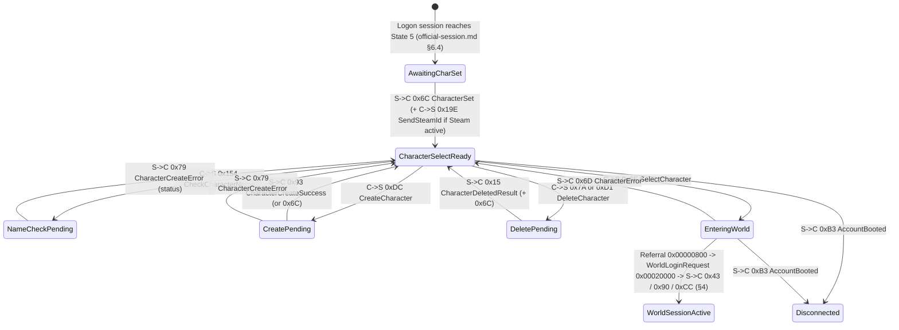

<!-- SPDX-License-Identifier: GPL-3.0-or-later -->

# Official world-session message layer: common encodings, character selection, world entry and object lifecycle

| | |
|---|---|
| **Status** | Accepted |
| **Last updated** | 2026-10-20 |
| **Author role** | Spec writer (dirty room) |
| **Reviewer** | Clean-room orchestrator (`CLEAN_ROOM.md` §5.3) |
| **Companion specs** | `docs/specs/official-session.md` (UDP datagram transport, reliability, fragmentation, post-handshake connection sequence and `NetBlob` envelope); `docs/specs/official-login.md` (account authentication and world-server login ticket); `docs/specs/property-system.md` (§2–§5 stored property dictionary and values, §10 wire encoding cross-reference); `docs/specs/records.md` (§1 primitives, §2 DID prefixes, §4 StringInfo, §7 EnumMapper); `docs/specs/coordinates.md` (§5–§7 and §11 landblock/cell coordinate frames and rotations); `docs/specs/string-table.md` (§9 StringInfo resolution); `docs/specs/tessera-protocol.md` (Tessera's own M7 wire protocol and neutral domain model). |

## Purpose

This specification defines the serialized event payloads exchanged between the LOTRO client and an official logon or world server after the UDP transport session (`docs/specs/official-session.md`) and login authentication (`docs/specs/official-login.md`) are established. It gives a clean-room implementer of an official-protocol adapter in `crates/net` what is needed to:

- bridge the exact byte boundary between a reassembled `NetBlob` transport payload (`docs/specs/official-session.md` §5.6.3 and §9.1) and the inner game-event payload stream, including event opcode dispatch, target entity `InstanceID` routing, optional routing headers, and sub-event batching (§1);
- encode and decode the **compact (wire) archive format** used by network event payloads, and understand every difference between wire encodings and the stored `.dat` record encodings of `docs/specs/records.md` and `docs/specs/property-system.md` (§1.2, §2);
- decode the character-selection list, validate and create characters, delete characters, handle character/account errors, and request world entry for a selected character (§3);
- process world-entry announcements, player session start, portal-space loading transitions, client-ready acknowledgements, and game-clock synchronization (§4);
- process area-of-interest (AOI) compound batches, entity creation and despawn, missing-entity queries, entity position/velocity/attachment replication, client physics/movement updates, client action commands, visual-appearance updates, and live property updates (§5);
- translate official world-session events and commands to and from Tessera's protocol-neutral domain types (`CharacterEvent`, `CharacterCommand`, `Event`, `Command`) in `crates/net/src/domain.rs` and `crates/net/src/session.rs` (§6);
- enforce hostile-input bounds and verify decoders against synthetic test vectors (§7).

In accordance with `CLAUDE.md` and `docs/CLEAN_ROOM.md`, this specification contains no cryptographic keys, certificates, hostnames, URLs, endpoints, packet captures, account data, or player data.

---

## Provenance

How sources are marked:

- **Confirmed**: verified against both the read-only `.dat` archives of the user's installation (`OBS`) and the client executable (`BIN`), or verified in the `.dat` archives alone where the fact is purely data-driven.
- **BIN**: verified from a read-only copy of the client executable under method M4 ([decision 0011](../decisions/0011-standing-m4-authorisation.md) and [decision 0034](../decisions/0034-official-server-compatibility.md)).
- **Reported**: taken from published third-party research (`PUB-LS`, `PUB-LT`) and not independently confirmed in the current client binary.

Field and event labels in this specification (`base_flags`, `CompactPID`, `CharacterSet`, `EnterAOI`, and so on) are neutral descriptive labels chosen for this document or enum strings read from `client_gamelogic.dat` `0x23` enum-mapper records (`OBS`).

Source abbreviations:

| Key | Source |
|---|---|
| OBS | Read-only observation of the user's LOTRO installation (`client_gamelogic.dat` and `client_general.dat`), 2026-10-20: master property dictionary `0x34000000` (all 27,546 property definitions, names, type codes 1–22, and `data` mapper references), `GameTime` calendar definition `0x35000000` in `client_general.dat` (`180` bytes, resolved from directory `0x0F000002` key `0x96`), player physics script table `0x07000029` and `0x0Cxxxxxx` scriptlets in `client_gamelogic.dat` (yielding the exact 8 boolean `PID`s and 6 enum `PID`s for `0xCC` `state_schema_id = 0x0000000C` `Earth_ControlledSurface` and 0 boolean/enum `PID`s for `0x10000E50` and `0x10000E51`), and enum mappers `0x2300000A` (agent genus), `0x2300000B` (species/race), `0x2300000C` (subspecies), `0x2300000D` (alignment), `0x2300000E` (character class), `0x2300000F` (classification filter), `0x23000010` (sex), `0x23000011` (nationality/origin), `0x23000046` (property operation), `0x23000050` (combat state), `0x2300008A` (appearance key), `0x23000091` (entity type), `0x23000097` / `0x230000F8` (player physics script), `0x230000B1` (client language), `0x230000BF` (character availability error), `0x230000C4` (billing role), `0x230000C9` (weenie type), `0x230000D0` (UI element message), `0x230000E8` (world day type), `0x230000EF` / `0x230001B7` (character-generation type), `0x23000123` (life state), `0x23000174` (entity creation type), `0x2300027F` (resource sets), `0x23000291` (property response type), `0x23000307` (account type), `0x23000348` (advanced character start tier), `0x2300038B` (teleport reason), `0x23000400` (character class bitfield), `0x23000404` (character-generation sort), and `0x28000008` (region DID map). |
| BIN | **M4 analysis ([decision 0011](../decisions/0011-standing-m4-authorisation.md), [decision 0034](../decisions/0034-official-server-compatibility.md)).** Read-only copy of `x64/lotroclient64.exe` from the user's installation, file version `4906.0071.1794.4035` (build string `Sun Sep 27 14:35:50 2026 : RELEASE`), SHA-256 `d22363eb9aff0fb599fd04b3efa9a1769d08da8af9d8f9b73121c12bfd7e21ee`, analysed with Ghidra `12.1.3` (`analyzeHeadless`) on 2026-10-20. **Questions:** (1) how network event archives differ from stored `.dat` archives (archive flag bit 11 `0x800` and bit 14 `0x4000`); (2) the wire encodings of 3-tier, 4-tier and 16-bit VLEs, strings, `CompactPID`, compact `DID`, `Position`, `StringInfo`, `PropertyValue` (all 22 types), `PropertySet`, and `VisualDesc`; (3) the current event IDs, directions, field layouts, and exact property IDs (`PID`s) read and written by the client for character list/create/delete/select/error (`0x6C`, `0x154`, `0xDC`, `0x93`, `0x79`, `0x7A`, `0xD1`, `0x15`, `0x6D`, `0xB3`, `0x6F`, `0x19E`), world entry and portal transitions (`0x43`, `0xAA`, `0xFA`, `0x90`, `0xCC` including its `0x07` `ScriptTable` + `0x0C` `Scriptlet` state-schema traversal for `0x0C` `Earth_ControlledSurface`, `0xC7`, `0x153`, `0xF4`), network clock synchronization (`TimeSync` `0x01000000` 3-stage latency-compensated 5-tier slew, `GameTime` `0x35000000` calendar progression, and global controller events `0x10`..`0xFF`), and object lifecycle, movement, actions (`ActionPayload` wire layouts, `0x75`, `0x5A`, `0xA8`, `0xA7`, `0x86`, `0x63`, `0x39`, `0x60`, `0xCD`), visual updates and property updates (`0x0D`, `0x4C`, `0x98`, `0x52`, `0x40`, `0xD0`, `0xCE`, `0x24`, `0x89`, `0xFE`, `0x149`, `0xB0`, `0x88`, `0x92`, `0x76`, `0x0E`, `0xE7`, `0x146`, `0x147`, `0x148`, `0x14A`, `0x8E`); (4) the exact byte-by-byte framing boundary between reassembled `NetBlob` payloads (`official-session.md` §5.6.3, §9.1) and the inner event payload stream, including how `blobHeaderWord`, `recipientId`, `envelopeFlags`, the optional routing header, and `0x0D`/`0x4C` sub-event frames are serialized and dispatched, and how the post-handshake session transitions into `0x6C` (`CharacterSet`), `0x19E` (`SendSteamId`), and world referral (`0x6F`). **Why M1–M2 were not enough:** M1 `.dat` files never set archive flag bit 11 (`0x800`) and contain no network event payloads; M2 sources (`PUB-LS`, `PUB-LT`) target 2007–2008 client builds whose event IDs have shifted (for example, character creation was `0x104` in `PUB-LS` and is `0xDC` in build `4906.0071.1794.4035`) and do not document the wire-mode `PropertySet`, `StringInfo`, `Position` elision, `0xCC` state schema, `ActionPayload`, or `NetBlob` routing-header rules; no packet captures exist on this machine. Anti-cheat, anti-tamper, code-signing, and patcher routines were not inspected. |
| PUB-LS | Public third-party research repository `lotro-server` (studied in the dirty room for historical event IDs and protocol concepts only; no code or identifiers copied). |
| PUB-LT | Public third-party research repository `LOTRO-Tools` (studied in the dirty room for historical event IDs and enum mappings only). |

| # | Fact | Source(s) | Mark |
|---|---|---|---|
| E0 | Top-level game events carry their 32-bit numeric event ID directly in Field 10 (`blobHeaderWord`, 4-tier VLE) of the `NetBlob` fragment header (`official-session.md` §5.6.3) and carry their default target entity `InstanceID` (`u64 LE`) in Field 9 (`recipientId`, omitted and defaulting to `0` when `DefaultRecipient` bit `0x40` of `blobFlags` is set). Inside the reassembled `NetBlob` payload (`official-session.md` §9.1), byte 0 is `envelopeFlags` (`bit 0 = IsZlibCompressed`, `bit 1 = HasRoutingHeader`); after optional zlib decompression (when bit 0 is set) and optional routing-header decoding (when bit 1 is set), offset 0 of the inner event payload stream (`u8 base_flags = 0x00`) begins immediately (§1.1.1–§1.1.3) | BIN | BIN |
| E1 | Network event serialization sets archive flag bit 11 (`0x800`, compact/wire mode) and leaves bit 14 (`0x4000`, checkpointed property mode) clear; `.dat` record serialization leaves both bits clear (§1.2) | BIN | BIN |
| E2 | Every serialized event payload begins with a 1-byte base event header (`u8` `base_flags`, value `0x00`) before the event-specific fields (§1.3) | BIN | BIN |
| E3 | 3-tier VLE (up to 30 bits, 1/2/4 bytes), 4-tier VLE (full 32 bits, 1/2/4/5 bytes with `0xE0` prefix), and 16-bit VLE (1/2/3/4 bytes) layouts (§2.2) | BIN; `property-system.md` C1 (3-tier) | Confirmed (3-tier); BIN (4-tier, 16-bit) |
| E4 | Prefixed UTF-16LE string (3-tier VLE code-unit count + `2*N` bytes) and prefixed 8-bit string (3-tier VLE byte count + `N` bytes) layouts (§2.3) | BIN; `records.md` §1.4 | Confirmed |
| E5 | `CompactPID` layout in wire mode (`0x800`): 2-byte big-endian form for PIDs in `0x00000000..0x00003FFF` and `0x10000000..0x10003FFF`, or 5-byte escape (`0x80` + `u32 LE`) for all other PIDs (§2.4.3) | BIN | BIN |
| E6 | Compact `DID` / Enum layout in wire mode (`0x800`): `u8` high byte (bits 24..31) followed by 3-tier VLE of the low 24 bits (§2.4.2) | BIN | BIN |
| E7 | `Position` wire layout (`0x800`): when both bit 0 (`0x01`) and bit 6 (`0x40`) of `flags` are set, the `u8` region byte is elided on the wire and defaults to `1`; when both bit 3 (`0x08`) and bit 7 (`0x80`) of `flags` are set, the `u16 LE` cell field is elided on the wire and defaults to `0` (§2.5.1) | BIN; `property-system.md` V4, V11, C10 | BIN (wire elision); Confirmed (flags) |
| E8 | Quantized 1-byte heading (`u8`, `0..255` mapping `[0, 2π)` radians) used in `0xCE` and `0xCC` (§2.5.2) | BIN | BIN |
| E9 | `StringInfo` wire layout (`0x800`): omits the TSize hint byte before the argument count (empty argument table is `00`, not `01 00`), and argument kinds 6 and 7 encode their integer payload on the wire as `u8 is_32bit` followed by either `u64 LE` (`0x00`) or a 4-tier VLE (`0x01`) (§2.6) | BIN; `property-system.md` C4, C11–C16 | BIN |
| E10 | `PropertyValue` wire encodings across all 22 property types (`property-system.md` §3): Type 8 (`Enum`) and Type 10 (`Property ID`) use Compact `DID` (`u8` + 3-tier VLE); Type 15 (`Int`) uses 4-tier VLE; Type 17 (`Position`) uses wire `Position` elision; Type 13 (`StringInfo`) uses wire `StringInfo`; Type 11 (`Struct`) and Type 12 (`Array`) use wire `PropertySet` / `CompactPID`; all other types (including Type 20 `DID reference`) match their stored `.dat` encoding (§2.7.1) | BIN; `property-system.md` §3–§4, §10 | BIN (wire differences); Confirmed (stored) |
| E11 | `PropertySet` wire layout (`0x800` set, `0x4000` clear): omits the TSize hint byte and omits the duplicate `u32` table key; starts with a 3-tier VLE property count followed by `(CompactPID, PropertyValue)` pairs (§2.7.2) | BIN | BIN |
| E12 | `VisualDesc` bitmask-driven layout (`flags` bits `0x01`, `0x02`, `0x20`, `0x40`, `0x80`, `0x100`, `0x200`, `0x400`) (§2.8) | BIN | BIN |
| C1 | Event `0x6C` (`CharacterSet`, S→C): `u8` `0x00`, character array (`u32 LE` count + `CharDesc` entries), and account-level wire `PropertySet` (`account_props` PIDs in §3.1.3) (§3.1) | BIN; OBS (`0x34000000`); PUB-LS | BIN; Confirmed (PIDs) |
| C2 | `CharDesc` layout (`u64 LE` ID, UTF-16LE name, `u32 LE` status/world, `public_props` and `private_props` wire `PropertySet`s, `u32 LE` field, `VisualDesc`, four `u32 LE` fields, and `u64 LE` field) and exact character-screen `PID`s read from `public_props` and `private_props` (§3.1.2, §3.1.3) | BIN; OBS (`0x34000000`) | BIN; Confirmed (PIDs) |
| C3 | Event `0x154` (C→S character name check): `u8` `0x00` + UTF-16LE name (§3.2.1) | BIN | BIN |
| C4 | Event `0xDC` (C→S character creation / modification in build `4906.0071.1794.4035`; reported as `0x104` in `PUB-LS`): `u8` `0x00`, wire `PropertySet` (`creation_props` PIDs in §3.2.5), UTF-16LE name, `u8` character type, two `bool8` flags, `u32 LE` field (§3.2.2, §3.2.5) | BIN; OBS (`0x34000000`); PUB-LS (historical `0x104`) | BIN; Confirmed (PIDs) |
| C5 | Event `0x93` (`CharacterCreateSuccess`, S→C): `u8` `0x00` + `CharDesc` (§3.2.3) | BIN; PUB-LS | BIN |
| C6 | Event `0x79` (`CharacterCreateError`, S→C): `u8` `0x00` + `u32 LE` error code + `u32 LE` name-rejection code (§3.2.4) | BIN; PUB-LS | BIN |
| C7 | Character creation enums in `client_gamelogic.dat`: `0x2300000B` (`SpeciesType`), `0x2300000E` (`CharacterClassType`), `0x23000010` (`SexType`), `0x23000011` (`NationalityType`), `0x230000EF`/`0x230001B7` (`CharGenCharacterType`), and `creation_props` property IDs (§3.2.5) | OBS; BIN | Confirmed |
| C8 | Events `0x7A` (C→S delete character), `0xD1` (C→S delete monster-play character), and `0x15` (`CharacterDeletedResult`, S→C) (§3.3) | BIN; PUB-LS (`0x7A`, `0x15`) | BIN |
| C9 | Events `0x6D` (`CharacterError`, S→C), `0xB3` (`AccountBooted`, S→C), and `0x19E` (C→S Steam platform ID) (§3.4) | BIN; PUB-LS (`0x6D`, `0xB3`) | BIN |
| C10 | Event `0x6F` (`SelectCharacter`, C→S): `u8` `0x00` + `u64 LE` character ID + wire `PropertySet` (§3.5) | BIN; PUB-LS | BIN |
| W1 | Events `0x43` (`WorldName`, S→C), `0xAA` (`DisplayStringInfo`, S→C), and `0xFA` (`ServerLastWords`, S→C) (§4.1) | BIN; PUB-LS | BIN |
| W2 | Event `0x90` (`PlayerSessionStart`, S→C): `u8` `0x00` + `u64 LE` player entity ID + wire `PropertySet` (§4.2) | BIN; PUB-LS | BIN |
| W3 | Portal-space and teleport events: `0xCC` (S→C portal/teleport position & transition, including its `0x07000029` `ScriptTable` + `0x0Cxxxxxx` `Scriptlet` traversal yielding the 8 boolean `PID`s = 1 wire byte and 6 enum `PID`s = 6 3-tier VLEs for `state_schema_id = 0x0000000C` `Earth_ControlledSurface`, and 0 boolean/enum `PID`s for `0x10000E50` and `0x10000E51`), `0xC7` (`PortalSpaceExit`, S→C), `0x153` (S→C portal state notification), `0xF4` (`PortalSpaceReady`, C→S), and `0x2300038B` (`TeleportReason`) (§4.3) | BIN; OBS (`0x07000029`, `0x0Cxxxxxx`, `0x34000000`, `0x23000097`, `0x2300038B`); PUB-LS (`0xF4`) | BIN; Confirmed (`0x07000029`, `0x2300038B`, `0x34000000`) |
| W4 | Network clock synchronization (`TimeSync` `0x01000000` `f64 LE` server timestamp, 3-stage latency-compensated seeding, forward snap, and 5-tier downward slew for excess $\ge 0.015$ s without backward jumps), in-game day-cycle clock (`0x35000000` in `client_general.dat` resolved via `0x0F000002` key `0x96`: `11160.0` s day length, `360` days/year, `0.25` dawn, `0.80` dusk; world properties `0x000001EF` `World_TimeOffset`, `0x000006CC` `World_TimeDilation`, `0x00000682` `World_PresentTimeOfDay`, `0x000001F0` `World_IsNight`, and `0x00000235` `World_DayType`), and global controller events (`0x10`..`0xFF`, including `0x17`, `0x18`, `0x63`, `0x72`) (§4.4) | BIN; OBS (`client_general.dat` `0x35000000`, `0x0F000002`, `0x34000000`, `0x230000E8`) | BIN; Confirmed (DIDs, `0x35000000` layout & PIDs) |
| O1 | Compound AOI batch events `0x0D` (`EnterAOI`, S→C) and `0x4C` (`EventBatch`, S→C): `u8` `0x00` + 4-tier VLE sub-event count + framed sub-event entries (§5.1) | BIN; PUB-LS (`0x0D`, `0x4C`) | BIN |
| O2 | Entity creation event `0x98` (S→C), initial property sub-event `0x52` (S→C), `0x23000174` (`EntityCreationType`), `0x23000091` (`EntityType`), and core world entity `PID`s (`0x34000000`) (§5.2) | BIN; OBS (`0x34000000`, `0x23000174`, `0x23000091`); PUB-LS (`0x98`, `0x52`) | BIN; Confirmed (enums & PIDs) |
| O3 | Entity deletion event `0x40` (S→C, `u8` `0x00` payload; target ID in outer `NetBlob` envelope) and missing-entity request `0xD0` (C→S, `u8` `0x00` + `u64 LE` entity ID) (§5.3) | BIN; PUB-LS (`0x40`, `0xD0`) | BIN |
| O4 | Entity position/velocity/attachment replication event `0xCE` (S→C) (§5.4) | BIN | BIN |
| O5 | Client movement/physics command `0x24` (C→S, 4-slot rolling history buffer) (§5.5) | BIN; PUB-LS (`0x24`) | BIN |
| O6 | `ActionPayload` wire layouts (archive `ActionPayload` and extended entity/global action descriptor with `ActionTargetEntry`, `ActionContext`, `ActionMotionItem`, `ActionBallisticInfo`, and `ActionSkillDetail`), client action command `0x75` (C→S), server action events `0x5A`, `0xA8`, `0xA7`, `0x86`, `0x63`, `0x39`, `0x60` (S→C), and global action broadcast `0xCD` (§5.6) | BIN | BIN |
| O7 | Visual-description update event `0x89` (S→C) (§5.7) | BIN | BIN |
| O8 | Live property update events (`0xFE`, `0x149`, `0xB0`, `0x88`, `0x92`, `0x76`, `0x0E`, `0xE7`, `0x146`, `0x147`, `0x148`, `0x14A`), predicted property acknowledgement `0x8E` (C→S), and enums `0x23000046` (`PropertyOp`) and `0x23000291` (`PropertyResponseType`) (§5.8) | BIN; OBS (`0x23000046`, `0x23000291`) | BIN; Confirmed (enums) |

---

## 1. Framing boundary, archive flags and event header

### 1.1 Exact byte boundary between `official-session.md` (`NetBlob`) and inner event payloads (BIN)

This specification covers the **world-session message layer**: the inner event payloads produced and consumed by the client's event registry after `NetBlob` fragment reassembly (`docs/specs/official-session.md` §5.6.3 and §9.1).

- **Authentication and world-server handoff (`docs/specs/official-login.md` and `docs/specs/official-session.md` §6):** credential authentication, world-queue ticketing, and the UDP session handshake (`LoginRequest` `0x00010000`, `ConnectRequest` `0x00040000`, `ConnectResponse` `0x00080000`, `Referral` `0x00000800`, and `WorldLoginRequest` `0x00020000`) belong to those companion specifications.

#### 1.1.1 How `NetBlob` fragment header fields map to event ID and target `InstanceID` (BIN)

Every top-level game event sent or received over a logon or world session is transported as a `NetBlob` (`official-session.md` §5.6.3). Two fields in the `NetBlob` fragment header (on fragment 0) supply the event's dispatch metadata before the reassembled payload is inspected (E0, BIN):

| `NetBlob` Header Field (`official-session.md` §5.6.3) | Wire Type | Role in the Game-Event Layer |
|---|---|---|
| **Field 9: `recipientId`** (present on wire when `blobFlags` bit 6 `0x40` `DefaultRecipient` is clear; omitted when bit 6 is set) | `u64 LE` (8 bytes) | **Target entity `InstanceID`.** When `DefaultRecipient` (`0x40`) is set on the wire, `recipientId` defaults to `0` (the default session recipient). When `DefaultRecipient` (`0x40`) is clear, the 8-byte `recipientId` carries the 64-bit `InstanceID` of the target entity for entity-scoped events (such as `0x40` entity despawn, `0x52` entity property-set update, `0x88`/`0x92` single-property update, `0x0E`/`0xE7` property removal, and `0x89` visual update). |
| **Field 10: `blobHeaderWord`** (present on fragment 0 when `blobFlags` bit 7 `0x80` `OmitOpcodeAndChannel` is clear) | 4-tier VLE (§2.2.2, 1/2/4/5 bytes) | **Top-level numeric `event_id` (`u32`).** For every top-level game event (`0x6C`, `0x6F`, `0xDC`, `0x75`, `0x24`, `0x0D`, `0x40`, `0x4C`, `0x90`, `0xCC`, `0xCE`, etc.), `blobHeaderWord` is the 32-bit event ID looked up directly in the client's global event factory. On the client-to-server send path, the client copies the outgoing event's 32-bit event ID directly into `blobHeaderWord` and writes the event's channel category (`0` when unpopulated) into Field 11 (`channelWord`). |

#### 1.1.2 From reassembled `NetBlob` payload (`official-session.md` §9.1) to offset 0 of the inner event stream (BIN)

Once all fragments (`0 .. fragCount - 1`) of a `NetBlob` have been concatenated in order into a single byte buffer, the client's `NetMessage` event dispatcher processes that buffer in the following exact byte-by-byte sequence to reach offset 0 (`u8 base_flags = 0x00`, §1.3) of the inner event payload stream (E0, BIN):

| Step | Byte Offset in Reassembled `NetBlob` | Condition | Size (bytes) | Type | Meaning and Action |
|---|---|---|---|---|---|
| 1 | `0` | Always present | 1 | `u8` | **`envelopeFlags`** (`official-session.md` §9.1). Bit 0 (`0x01`) = `IsZlibCompressed`; bit 1 (`0x02`) = `HasRoutingHeader`. |
| 2a | `1..` | Bit 0 (`0x01`) of `envelopeFlags` clear | `N - 1` | `u8[]` | **Uncompressed body** starts immediately at byte `1` of the reassembled `NetBlob`. |
| 2b | `1..5`, `5..` | Bit 0 (`0x01`) of `envelopeFlags` set | `4 + comp_len` | `u32 LE` + zlib stream | Bytes `1..5` hold `uncompressedLen` (`u32 LE`, rejected if above `0x02000000` / 32 MiB); bytes `5..` hold an RFC 1950 zlib stream that inflates to `uncompressedLen` bytes (`official-session.md` §9.1). That inflated buffer becomes the **uncompressed body** (starting at uncompressed offset `0`). |
| 3a | Uncompressed offset `0` | Bit 1 (`0x02`) of `envelopeFlags` clear (`HasRoutingHeader` clear — standard case) | 0 | — | **No routing header is present.** Uncompressed offset `0` is directly **offset `0` (`u8 base_flags = 0x00`, §1.3)** of the inner event payload stream. The active target entity `InstanceID` is `recipientId` from `NetBlob` Field 9 (§1.1.1). |
| 3b | Uncompressed offset `0..R` | Bit 1 (`0x02`) of `envelopeFlags` set (`HasRoutingHeader` set) | `R` (even) | `RoutingHeader` | A variable-length **routing header** (table below) occupies bytes `0..R` of the uncompressed body. Immediately after the routing header (and its 1-byte even-alignment pad if the routing header length was odd), **offset `0` (`u8 base_flags = 0x00`, §1.3)** of the inner event payload stream begins at uncompressed offset `R`. |
| 4 | Inner offset `0..` | Always | var | Inner event payload | The event factory constructs the event object registered for `blobHeaderWord` (`event_id`), sets archive flag bit 11 (`0x800`, wire mode), and invokes the event's serializer/deserializer starting at inner offset `0` (`u8 base_flags = 0x00`, §1.3). Finally, unless `routingFlags` bit 0 (`0x01`) supplied a multi-recipient routing table, the dispatcher writes the active target `InstanceID` (`recipientId` from `NetBlob` Field 9, or the explicit override from `routingFlags` bit 2 `0x04`) into the event object's target `InstanceID` field. |

When bit 1 (`0x02`) of `envelopeFlags` (`HasRoutingHeader`) is set, the **routing header** at the start of the uncompressed body has the following sequential layout (E0, BIN):

| Order | Field | Condition | Size (bytes) | Type | Meaning |
|---|---|---|---|---|---|
| 1 | `routingFlags` | Always present when `HasRoutingHeader` is set | 1 | `u8` | Bitmask controlling optional routing blocks (`0x01`, `0x02`, `0x04`, `0x08`). |
| 2 | `dest_table` | Bit 0 (`0x01`) of `routingFlags` set | var | 4-tier VLE `count` + entries | Multi-destination routing table: 4-tier VLE `count` ($\le$ remaining bytes), followed by `count` entries, each consisting of a 1-, 2-, or 4-byte VLE prefix, a `u32 LE` word, and a `u64 LE` destination ID. |
| 3 | `sender_addr_block` | Bit 1 (`0x02`) of `routingFlags` set | 28 | `3 × u64 LE` + `u32 LE` | 28-byte sender/routing address block. |
| 4 | `override_target_id` | Bit 2 (`0x04`) of `routingFlags` set | 8 | `u64 LE` (`InstanceID`) | Explicit target entity `InstanceID` that overrides `recipientId` from `NetBlob` Field 9. |
| 5 | `extra_words` | Bit 3 (`0x08`) of `routingFlags` set | `4 + 4 × K` | `u32 BE count` + `K × u32 LE` | Big-endian `u32` word count $K$ (rejected if $K > 0x72$), followed by $K$ little-endian `u32 LE` words. |
| 6 | `align_pad` | Total bytes read in steps 1–5 is odd | 1 | `u8` (`0x00`) | 2-byte alignment pad: if the routing header consumed an odd number of bytes, 1 zero byte (`0x00`) is read and verified (non-zero fails the archive). |

On the client-to-server send path, the client writes `envelopeFlags = 0x00` (uncompressed, no routing header) followed immediately by the serialized inner event payload starting with `u8 base_flags = 0x00` (or `envelopeFlags = 0x01` + `u32 LE uncompressedLen` + zlib stream if the serialized payload exceeds the compression threshold and shrinks under zlib).

#### 1.1.3 Top-level events vs batched sub-events (`0x0D` and `0x4C`) and reconciliation with `official-session.md` §9.2 (BIN)

Game events arrive in two ways (E0, O1, BIN):

1. **Directly as a top-level `NetBlob`:** `blobHeaderWord` (`NetBlob` Field 10) is the event ID itself (`0x6C`, `0x90`, `0xCE`, `0x40`, etc.), and the uncompressed body (after `envelopeFlags` and any optional routing header) is that single event's inner payload starting at `u8 base_flags = 0x00`.
2. **Bundled inside a batch event (`0x0D` `EnterAOI` or `0x4C` `EventBatch`, §5.1):** `blobHeaderWord` of the outer `NetBlob` is `0x0000000D` (`13`) or `0x0000004C` (`76`). After the outer `0x0D`/`0x4C` event's own `u8 base_flags = 0x00` byte, the payload contains a 4-tier VLE `sub_event_count` followed by `sub_event_count` framed sub-events (`sub_event_id` 4-tier VLE + `u32 LE payload_size` + `payload_size` bytes when `sub_event_id` is non-zero). Each sub-event's `payload_size` slice starts **directly at inner offset 0 (`u8 base_flags = 0x00`)** with **no inner `envelopeFlags` byte and no inner routing header**, and inherits the outer `NetBlob`'s target `InstanceID`.
   *(Cross-reference note on `official-session.md` §9.2:* the sub-message container layout described in `official-session.md` §9.2 — a VLE sub-message count followed by `(subMessageId VLE, u32 LE subPayloadLen, subPayload)` entries — is the exact wire layout of events **`0x0000004C`** (`76`) and **`0x0D`** (`13`) in §5.1 of this specification. Event `0x00000186` (`390`) in the client's event factory is a separate 20-byte gameplay/UI event consisting of `u8 base_flags = 0x00`, `u64 LE`, `u64 LE`, and `u32 LE`.)*

#### 1.1.4 Post-handshake transition into character selection (`0x6C`, `0x19E`) and world referral (`0x6F`) (BIN)

The transition between the transport handshake (`official-session.md` §6) and the character/world message layer (§3–§4) proceeds as follows (E0, C1, C9, C10, BIN):

1. **Logon connection establishment (`official-session.md` §6.1–§6.4):** the client sends `LoginRequest` (`0x00010000`) with the account credentials and ticket from `official-login.md`, receives `ConnectRequest` (`0x00040000`), replies with `ConnectResponse` (`0x00080000`), and enters State `5` (`Connected`) on receipt of the first subsequent server packet.
2. **Post-handshake version exchange (`official-session.md` §9.3), initial character list delivery (`0x6C` `CharacterSet`, S→C), and Steam ID report (`0x19E`, C→S):** once the logon connection is in State `5`, the server and client complete the `CNetLayer` version exchange (`0x0000012F` `ReqVersionSend` $\rightarrow$ `0x0000012C` `VersionSend` $\rightarrow$ `0x0000012D` `VersionResult` and `0x00000130` `LogonUpdate`, documented in `official-session.md` §9.3), after which the server sends event **`0x6C`** (`CharacterSet`, §3.1) without requiring any additional game-event request from the client. When the client processes the `account_props` `PropertySet` inside `0x6C`, it checks whether the Steam client API is active; if running under Steam, the client immediately sends event **`0x19E`** (`SendSteamId`, §3.4) carrying the 64-bit Steam user ID.
3. **Character selection (`0x6F`, C→S) and world-server handoff (`official-session.md` §6.5):** when the user selects a character and sends event **`0x6F`** (`SelectCharacter`, §3.5), the server validates the selection (replying with `0x6D` `CharacterError` on failure) and, when transferring the session to a world server, sends a transport-layer `Referral` (`0x00000800`, 18 bytes) containing the 64-bit `referralCookie` and the target world server's IPv4 address and UDP port. The client opens a new connection to the world server on the same UDP socket, completes the `WorldLoginRequest` (`0x00020000`) $\rightarrow$ `ConnectRequest` (`0x00040000`) $\rightarrow$ `ConnectResponse` (`0x00080000`) handshake (`official-session.md` §6.5), and then receives the world-entry events (`0x43` `WorldName`, `0x90` `PlayerSessionStart`, `0x0D`/`0x4C` AOI batches, `0xCC`, and `0xC7` `PortalSpaceExit`, §4).

### 1.2 Archive mode flags: stored vs wire vs checkpointed (BIN)

The LOTRO client uses a single polymorphic archive abstraction for both `.dat` resource records and network event payloads. An archive carries a 32-bit mode-flags word whose bits select the serialization rules (E1, BIN):

| Bit | Mask | Name | Value in `.dat` records | Value in network events | Meaning |
|---|---|---|---|---|---|
| 0 | `0x0001` | `is_writing` | `0` (read) / `1` (write) | `0` (read) / `1` (write) | Direction of the archive operation (`0` = deserializing from bytes, `1` = serializing to bytes). |
| 2 | `0x0004` | `has_failed` | `0` (ok) / `1` (error) | `0` (ok) / `1` (error) | Sticky error bit set when a reader encounters truncated input or an invalid byte (such as a `bool8` above `1`). Once set, subsequent reads become no-ops and the event is rejected. |
| 11 | `0x0800` | `is_compact` (wire mode) | `0` | `1` | **Wire/compact mode.** When `1`, switches `PropertySet`, `PropertyValue` (types 8, 10, 11, 12, 14, 15, 17), `StringInfo`, and `Position` to their compact network encodings (§2.4–§2.7; `property-system.md` §10). |
| 14 | `0x4000` | `is_checkpointed` | `0` | `0` | **Versioned/checkpointed property mode.** When `1`, wraps every property value in a `PropertySet` with a `u32 LE` byte length and embeds the property type in bits 16..23 of `CompactPID` (§2.7.3). Normal network events and `.dat` records both leave this bit `0`. |

### 1.3 Base event payload header (BIN)

Every registered event serializer and deserializer in this specification begins by calling the base event serializer, which reads or writes a single byte at the start of the event's inner payload stream (E2, BIN):

| Offset | Size | Type | Value | Meaning |
|---|---|---|---|---|
| 0 | 1 | `u8` | `0x00` | `base_flags`. Always initialized to `0x00` by the event base class constructor. All event-specific fields immediately follow at offset 1. |

---

## 2. Common value encodings (wire vs stored)

All fixed-width multi-byte integers and IEEE 754 floating-point numbers are **little-endian** unless explicitly marked big-endian (`u16 BE` in `CompactPID` and the high byte of multi-byte VLEs).

### 2.1 Fixed-width scalars and booleans (Confirmed)

| Type | Size (bytes) | Encoding | Wire vs stored |
|---|---|---|---|
| `u8` / `i8` | 1 | Unsigned / two's-complement signed 8-bit integer | Identical |
| `bool8` | 1 | `0x00` = false, `0x01` = true. Any value `0x02..0xFF` sets the archive error bit and aborts decoding. | Identical |
| `u16 LE` / `i16 LE` | 2 | Little-endian 16-bit integer | Identical |
| `u32 LE` / `i32 LE` | 4 | Little-endian 32-bit integer | Identical (except Type 15 `Int` properties, which use 4-tier VLE on the wire; §2.7.1) |
| `u64 LE` / `i64 LE` | 8 | Little-endian 64-bit integer | Identical |
| `f32 LE` | 4 | IEEE 754 binary32, little-endian | Identical |
| `f64 LE` | 8 | IEEE 754 binary64, little-endian | Identical |

### 2.2 Variable-length integers (VLE) (Confirmed / BIN)

The client uses three distinct variable-length unsigned integer encodings (E3, BIN). Implementers must not confuse them:

#### 2.2.1 3-tier VLE (30-bit unsigned, 1 / 2 / 4 bytes)

Used for string lengths, `PropertySet` property counts, `StringInfo` argument counts, Compact `DID` low-24-bit payloads, and Type 22 bitfield bit counts. There is **no `0xE0` 5-byte escape** in this encoding (`property-system.md` §17.1):

| Value range | Encoded size | First byte `b0` | Remaining bytes | Reconstructed value |
|---|---|---|---|---|
| `0x00000000..0x0000007F` | 1 byte | `0x00..0x7F` | none | `b0` |
| `0x00000080..0x00003FFF` | 2 bytes | `0x80..0xBF` (`0x80` combined with bits 8..13) | `u8 b1` (bits 0..7) | Low 6 bits of `b0` shifted left 8 bits, combined with `b1` |
| `0x00004000..0x3FFFFFFF` | 4 bytes | `0xC0..0xFF` (`0xC0` combined with bits 24..29) | `u8 b1` (bits 16..23), `u16 LE w2` (bits 0..15) | Low 6 bits of `b0` shifted left 24 bits, combined with `b1` shifted left 16 bits and `w2` |

Values of `0x40000000` and above cannot be represented by the writer.

#### 2.2.2 4-tier VLE (full 32-bit unsigned, 1 / 2 / 4 / 5 bytes)

Used on the wire for **NetBlob `blobHeaderWord` opcodes** (§1.1.1), **Type 15 (`Int`) property values**, **`StringInfo` integer arguments (kinds 6 and 7)** when the 32-bit flag is set, and **compound event (`0x0D` / `0x4C`) counts and sub-event IDs**. Unlike the 3-tier VLE, first bytes `0xE0..0xFF` select a 5-byte form:

| Value range | Encoded size | First byte `b0` | Remaining bytes | Reconstructed value |
|---|---|---|---|---|
| `0x00000000..0x0000007F` | 1 byte | `0x00..0x7F` | none | `b0` |
| `0x00000080..0x00003FFF` | 2 bytes | `0x80..0xBF` (`0x80` combined with bits 8..13) | `u8 b1` (bits 0..7) | Low 6 bits of `b0` shifted left 8 bits, combined with `b1` |
| `0x00004000..0x1FFFFFFF` | 4 bytes | `0xC0..0xDF` (`0xC0` combined with bits 24..28) | `u8 b1` (bits 16..23), `u16 LE w2` (bits 0..15) | Low 5 bits of `b0` shifted left 24 bits, combined with `b1` shifted left 16 bits and `w2` |
| `0x20000000..0xFFFFFFFF` | 5 bytes | `0xE0` (reader accepts `0xE0..0xFF`) | `u32 LE d1` | Full 32-bit value `d1` |

Note that negative signed 32-bit integers (`0x80000000..0xFFFFFFFF` in two's complement) fall into the 5-byte `0xE0` tier on the wire.

#### 2.2.3 16-bit VLE (16-bit unsigned, 1 / 2 / 3 / 4 bytes)

Used for the `NetBlob` fragment header fields (`ephemeralPort`, `fragIndex`, `fragCount`, `channelWord`) and for the `null_field_a` header field of null sub-events (`sub_event_id` zero) inside compound events (`0x0D` and `0x4C`, §5.1):

| Value range | Writer size | First byte `b0` | Remaining bytes | Reader behavior |
|---|---|---|---|---|
| `0x0000..0x007F` | 1 byte | `0x00..0x7F` | none | Returns `b0`. |
| `0x0080..0x3FFF` | 2 bytes | `0x80..0xBF` (`0x80` combined with bits 8..13) | `u8 b1` (bits 0..7) | Returns low 6 bits of `b0` shifted left 8 bits, combined with `b1`. |
| `0x4000..0xFFFF` | 4 bytes | `0xC0` | `u8 0x00`, `u16 LE w2` | If `b0` is in `0xC0..0xDF`, reads and discards 1 byte `b1` and reads `u16 LE w2`, returning `w2`. If `b0` is in `0xE0..0xFF`, reads `u16 LE w1` directly (3 bytes total) and returns `w1`. |

### 2.3 Strings (Confirmed)

Strings on the wire use the same two length-prefixed formats as `.dat` records (`records.md` §1.4; E4, BIN):

| String type | Length prefix | Payload | Notes |
|---|---|---|---|
| **Prefixed UTF-16LE string** | 3-tier VLE (§2.2.1) code-unit count $N$ | $N \times 2$ bytes of UTF-16LE code units | Used for character names and literal `StringInfo` text. Not null-terminated. |
| **Prefixed 8-bit string (Pascal string)** | 3-tier VLE (§2.2.1) byte count $N$ | $N$ raw bytes (Latin-1 / Windows-1252) | Used for Type 1 (`String`) properties, `StringInfo` authoring strings, and internal identifiers. Not null-terminated. |

### 2.4 Identifiers: `InstanceID`, `DID`, Compact `DID`, and `CompactPID`

#### 2.4.1 64-bit `InstanceID` (Confirmed)

Entity and character instance identifiers (`InstanceID`) are serialized as 8-byte little-endian unsigned integers (`u64 LE`). An `InstanceID` of `0` (`0x0000000000000000`) denotes the null/invalid instance.

#### 2.4.2 32-bit `DID` and Compact `DID` / Enum (BIN)

In stored `.dat` records (bit 11 clear), 32-bit Data IDs (`DID`, Type 20), 32-bit property ID values (`PropertyID`, Type 10), and 32-bit enum keys (`Enum`, Type 8) are serialized as 4-byte `u32 LE` values.

In **wire mode (bit 11 set, `0x800`)**, Type 8 (`Enum`) property values, Type 10 (`PropertyID`) property values, and action/context `DID`s in events `0x24`, `0x5A`, `0x75`, `0x86`, `0xA7`, `0xA8`, and `0xCC` use the **Compact `DID` / Enum** encoding (E6, BIN):

| Order | Field | Size | Type | Meaning |
|---|---|---|---|---|
| 1 | `high_byte` | 1 | `u8` | Bits 24..31 of the 32-bit value. (For a `DID`, this is the resource type prefix such as `0x25` or `0x70`; for small enum keys or property IDs below `0x01000000`, this is `0x00`; for `0x1000xxxx` enum keys or property IDs, this is `0x10`.) |
| 2 | `low_24` | 1, 2, or 4 | 3-tier VLE (§2.2.1) | Bits 0..23 of the 32-bit value (masked to 24 bits). |

The 32-bit value is reconstructed by placing `high_byte` in bits 24..31 and `low_24` in bits 0..23. Total encoded size is 2 bytes (when `low_24` is at most `0x7F`), 3 bytes (when `low_24` is in `0x80..0x3FFF`), or 5 bytes (when `low_24` is `0x4000` or above). *(Note: Type 20 `DID reference` property values remain 4-byte `u32 LE` values even in wire mode; §2.7.1.)*

#### 2.4.3 Compact Property ID (`CompactPID`) (BIN)

In stored `.dat` records (bit 11 clear), a property ID (`PID`) is always a 4-byte `u32 LE` (preceded in table-form property sets by an identical 4-byte `u32 LE` hash key; `property-system.md` §5.2).

In **wire mode (bit 11 set, `0x800`)**, every property ID in a `PropertySet`, array element, or single-property update event is encoded as a **`CompactPID`** (2 or 5 bytes) with **no preceding hash key** (E5, BIN):

| PID range | Encoded size | Layout |
|---|---|---|
| `0x00000000..0x00003FFF` (high 16 bits equal `0x0000` and low 16 bits below `0x4000`) | 2 bytes | Big-endian `u16 BE` of the low 14 bits: byte 0 holds bits 8..13 (bits 6 and 7 clear), byte 1 holds bits 0..7. |
| `0x10000000..0x10003FFF` (high 16 bits equal `0x1000` and low 16 bits below `0x4000`) | 2 bytes | Big-endian `u16 BE` of the low 14 bits with bit 14 (`0x4000`) set: byte 0 holds `0x40` combined with bits 8..13, byte 1 holds bits 0..7. |
| All other 32-bit PIDs (including any PID with low 16 bits `>= 0x4000` or high 16 bits not in `{0x0000, 0x1000}`) | 5 bytes | Escape byte `0x80` followed by the full 32-bit property ID as a 4-byte little-endian `u32 LE`. |

**Reader rules for `CompactPID`:**
1. Read the first byte `b0`.
2. If `b0` equals `0x80`, read a 4-byte `u32 LE` property ID and return it. (When archive flag bit 14 `0x4000` is set, bits 16..23 are cleared with mask `0xFF00FFFF`; in normal network events bit 14 is clear, so the 32-bit value is returned unchanged.)
3. Otherwise (`b0` is not `0x80`), read a second byte `b1` to form a 16-bit big-endian word (`b0` as high byte, `b1` as low byte).
4. If bit 6 (`0x40`) of `b0` is set, take the low 14 bits (mask `0x3FFF`) and add `0x10000000`; otherwise return the 16-bit word directly (`0x0000..0x3FFF`).

Notice that `PID` zero (the null entry) encodes in 2 bytes as `00 00`.

### 2.5 Positions, orientations and landblock/cell coordinates

#### 2.5.1 `Position` wire vs stored layout (BIN)

A `Position` value (`PropertyValue` Type 17, or the embedded position in movement/portal/landblock events `0xCE`, `0xCC`, `0x146`, `0x147`, `0x148`) starts with a 1-byte `flags` bitmask (`property-system.md` §4.6).

In **stored `.dat` mode (bit 11 clear)**, `flags` bits `0x40` and `0x80` are informational flag bits set by the writer when `region` is `1` (`0x40`) and `cell` is `0` (`0x80`), while the payload bytes for `region` (`u8`) and `cell` (`u16 LE`) are still written whenever bits `0x01` and `0x08` are set.

In **wire mode (bit 11 set, `0x800`)**, bits `0x40` and `0x80` **suppress (elide) the wire bytes** of `region` and `cell` (E7, BIN):

| Order | Field | Condition to read/write bytes on the wire (bit 11 set) | Size (bytes) | Type | Default when elided or absent |
|---|---|---|---|---|---|
| 1 | `flags` | Always present | 1 | `u8` | — |
| 2 | `region` | Bit 0 (`0x01`) set **AND** bit 6 (`0x40`) clear | 1 | `u8` | If bit 0 (`0x01`) is clear: `0`. If both bit 0 (`0x01`) and bit 6 (`0x40`) are set: **`1` (no byte on wire)**. |
| 3 | `block_x`, `block_y` | Bit 1 (`0x02`) set | 2 | `u8`, `u8` | `0xFF`, `0xFF` (`-1`, `-1`) when bit 1 (`0x02`) is clear. |
| 4 | `instance` | Bit 2 (`0x04`) set | 2 | `u16 LE` | `0x0000` when bit 2 (`0x04`) is clear. |
| 5 | `cell` | Bit 3 (`0x08`) set **AND** bit 7 (`0x80`) clear | 2 | `u16 LE` | If bit 3 (`0x08`) is clear: `0xFFFF`. If both bit 3 (`0x08`) and bit 7 (`0x80`) are set: **`0x0000` (no bytes on wire)**. |
| 6 | `offset` (`x, y, z`) | Bit 4 (`0x10`) set | 12 | `3 × f32 LE` | `(0.0, 0.0, 0.0)` metres inside the landblock/cell (`coordinates.md` §5–§7). |
| 7 | `orientation` (`w, x, y, z`) | **Only in full `Position` (Property Type 17)** when bit 5 (`0x20`) is set. (Base `Position` in `0xCE`, `0xCC`, `0x146`–`0x148` stops after `offset`.) | 16 | `4 × f32 LE` | Identity quaternion `(1.0, 0.0, 0.0, 0.0)` (`property-system.md` §4.6). |

**Comparison of stored vs wire `Position` size:** for a typical outdoor position in Region 1 (`region = 1`, `cell = 0`, non-zero `(x, y, z)`, identity orientation), `flags` is `0xDB` (bits `0x01`, `0x02`, `0x08`, `0x10`, `0x40`, and `0x80` set). In a `.dat` file this position is **18 bytes** (`flags` + 1-byte region + 2-byte block + 2-byte cell + 12-byte offset); on the wire it is **15 bytes** (`flags` + 2-byte block + 12-byte offset), because bit `0x40` elides the 1-byte region and bit `0x80` elides the 2-byte cell.

#### 2.5.2 Quantized 1-byte heading (`u8`) (BIN)

Where an event carries a base `Position` (without the 16-byte quaternion) plus a horizontal yaw/heading (events `0xCE` when bits 2 and 4 of `mode_flags` are clear, and `0xCC`), the heading is serialized immediately after the base `Position` as a single byte `u8 raw_angle` (E8, BIN):

- **Decoding:** $\text{angle\_radians} = \left(\text{raw\_angle} \times \frac{2\pi}{256}\right) \bmod 2\pi$ in $[0, 2\pi)$.
- **Encoding:** multiply $\text{angle\_radians} / (2\pi)$ by $256.0$, add $0.5$, floor to an integer, and keep the low 8 bits (`0x00..0xFF`).

### 2.6 `StringInfo` on the wire vs stored (BIN)

In stored `.dat` records (bit 11 clear), a `StringInfo` follows `property-system.md` §17.4 (`u8 mode`, token+table or UTF-16LE literal, `u8 has_authoring_strings`, optional 3 Pascal strings, and a TSize argument table starting with `u8 hint` + 3-tier VLE `count`).

In **wire mode (bit 11 set, `0x800`)**, the client's `StringInfo` serializer changes the argument table framing and the encoding of integer arguments (E9, BIN):

| Order | Field | Size | Type | Wire vs stored behavior |
|---|---|---|---|---|
| 1 | `mode` | 1 | `u8` | Identical: `0x01` = literal UTF-16LE string; any other byte (`0x00`, `0x02`, etc.) = table reference (`property-system.md` §17.4). |
| 2a | `literal` (when `mode` is `1`) | var | Prefixed UTF-16LE string (§2.3) | Identical. |
| 2b | `token_id`, `table_did` (when `mode` is not `1`) | 8 | `u32 LE`, `u32 LE` | Identical: 4-byte token ID followed by 4-byte string-table DID (`0x25xxxxxx`). |
| 3 | `has_authoring_strings` | 1 | `bool8` (`u8`) | Identical: `0x00` or `0x01` (any value above `1` fails). |
| 4 | `authoring_strings` (when `has_authoring_strings` is `1`) | var | 3 × Prefixed 8-bit string (§2.3) | Identical: symbolic token name, source-language text, authoring comment. |
| 5 | `arg_count` | 1, 2, or 4 | 3-tier VLE (§2.2.1) | **Wire difference #1:** in wire mode (`0x800`), there is **no TSize `u8` hint byte** before `arg_count`. An empty argument table on the wire is a single byte `0x00` (so a reference `StringInfo` with no authoring strings and no arguments ends with the two bytes `00 00`, whereas in `.dat` files it ends with the three bytes `00 01 00`). |
| 6 | `arguments` | var | `arg_count` entries | **Wire difference #2:** each entry begins with a `u32 LE` variable-hash key and a `u16 LE` (or `u8`) kind selector, followed by the common 6-byte argument value header (`u16 LE` kind, `u32 LE` variable ID) and the kind-specific payload below. |

**Wire argument value payloads by kind (`K = 1..7`) (E9, BIN):**

| Kind `K` | Meaning | Payload after the common 6-byte argument value header (`u16 LE kind`, `u32 LE var_id`) in wire mode (bit 11 set) |
|---|---|---|
| `1` | Nested `StringInfo` | Recursive wire-mode `StringInfo` (§2.6). |
| `2` | Float (`f64`) with precision | `f64 LE` (8 bytes) + `u16 LE` decimal places (2 bytes) = 10 bytes (identical to stored; `property-system.md` §17.4.1). |
| `3` | Float (`f64`) with format options | `f64 LE` (8 bytes) + `u16 LE` decimal places (2 bytes) + `u8` `format_flags` (1 byte) + `u16 LE` `radix` (2 bytes) = 13 bytes (identical to stored). |
| `4` | Fixed integer / pair | 10-byte (`u64 LE` + `u16 LE`) or 8-byte (`i64 LE`) fixed integer form (`property-system.md` §17.4.1). |
| `5` | Fixed integer with format options | 13-byte (`u64 LE` + `u16 LE` + `u8` `format_flags` + `u16 LE` `radix`) or 11-byte (`i64 LE` + `u8` + `u16 LE`) form. |
| `6` | Compact wire integer | **Wire difference #3:** `u8 is_32bit` (`0x00` or `0x01`; any other value fails). When `is_32bit` is `0x00`, followed by `u64 LE` (8 bytes). When `is_32bit` is `0x01` (selected by the writer when the unsigned value is below `0x7FFFFFFF`), followed by a **4-tier VLE** (§2.2.2, 1/2/4/5 bytes) of the low 32 bits. (In stored mode with bit 11 clear, Kind 6 is an unconditional 8-byte `u64 LE` / `i64 LE`.) |
| `7` | Compact wire integer with format options | Same compact integer as Kind 6 (`u8 is_32bit` + `u64 LE` or 4-tier VLE), followed by `u8 format_flags` (1 byte) + `u16 LE radix` (2 bytes). |
| `0`, `>= 8` | Unrecognized kind | No value bytes (not even the 6-byte value header). |

### 2.7 `PropertyValue` and `PropertySet` on the wire vs stored (BIN)

#### 2.7.1 `PropertyValue` encoding table (all 22 property types)

Every property value is decoded by looking up its 32-bit `PID` in the master property dictionary (`DID 0x34000000`, `property-system.md` §2) to obtain its property type code (`1..22` in `property-system.md` §3). Across the 22 property types, **fifteen types have the exact same byte layout on the wire as in `.dat` records**, and **seven types use a compact encoding when archive flag bit 11 (`0x800`) is set** (E10, BIN; `property-system.md` §10.3):

| Type code (`property-system.md` §3) | Name | Stored `.dat` encoding (bit 11 clear) | Wire encoding (bit 11 set) | Wire vs stored |
|---|---|---|---|---|
| `1` | `String` (8-bit) | Prefixed 8-bit string: 3-tier VLE byte count + bytes (§2.3) | Prefixed 8-bit string: 3-tier VLE byte count + bytes (§2.3) | Identical |
| `2` | `String token` | `u32 LE` (4 bytes) | `u32 LE` (4 bytes) | Identical |
| `3` | `Waveform` | `u32 LE` subtype; when `subtype` is `1`, one `f32 LE` (4 B); otherwise ten `f32 LE` (40 B), plus when `subtype` is `10`: `f32 LE` period, `bool8` loop, `u32 LE` count ($\le$ remaining), and `count × (f32 LE, f32 LE)` (`property-system.md` §4.2) | Same as stored | Identical |
| `4` | `Timestamp` | `f64 LE` (8 bytes; `3.4028234663852886e38` = "no time"; else relative to game clock unless definition flag `0x10` is set, in which case absolute) | `f64 LE` (8 bytes; same relative/absolute rule, §4.4) | Identical |
| `5` | `TriState` | `u8` (`0` = false, `1` = true, `255` = undefined) | `u8` (`0` = false, `1` = true, `255` = undefined) | Identical |
| `6` | `Vector3` | `3 × f32 LE` (`x, y, z`, 12 bytes) | `3 × f32 LE` (`x, y, z`, 12 bytes) | Identical |
| `7` | `InstanceId` (`IID`) | `u64 LE` (8 bytes) | `u64 LE` (8 bytes) | Identical |
| `8` | `Enum` | `u32 LE` (4 bytes) | **Compact `DID` / Enum** (§2.4.2): `u8 high_byte` + 3-tier VLE `low_24` (2, 3, or 5 bytes) | **Different** |
| `9` | `Float` | `f32 LE` (4 bytes) | `f32 LE` (4 bytes) | Identical |
| `10` | `PropertyId` | `u32 LE` (4 bytes; `data = 0x34000000`) | **Compact `DID` / Property ID** (§2.4.2): `u8 high_byte` + 3-tier VLE `low_24` (2, 3, or 5 bytes) | **Different** |
| `11` | `Struct` | Stored `PropertySet` (TSize `u8 hint` + 3-tier VLE `count` + `(u32 LE key, u32 LE pid, PropertyValue)`) | **Wire `PropertySet`** (§2.7.2): 3-tier VLE `count` + `(CompactPID, PropertyValue)` (no TSize hint byte, no duplicate `u32` key) | **Different** |
| `12` | `Array` | `u32 LE` `count` ($\le$ remaining bytes), followed by `count` elements of `(u32 LE pid, PropertyValue)` (when `pid` is `0`, 4-byte null element with no value) | `u32 LE` `count` ($\le$ remaining bytes), followed by `count` elements of **`(CompactPID, PropertyValue)`** (when `CompactPID` is `0`, 2-byte `00 00` null element with no value) | **Different (element PID is `CompactPID`)** |
| `13` | `StringInfo` | Stored `StringInfo` (`property-system.md` §17.4) | **Wire `StringInfo`** (§2.6) | **Different** |
| `14` | `Bitfield64` | `u64 LE` (8 bytes) | `u64 LE` (8 bytes) | Identical |
| `15` | `Int` | `i32 LE` (4 bytes) | **4-tier VLE** (§2.2.2, 1, 2, 4, or 5 bytes) | **Different** |
| `16` | `Color` | `u32 LE` (4 bytes: B, G, R, A; `property-system.md` §4.7) | `u32 LE` (4 bytes: B, G, R, A) | Identical |
| `17` | `Position` | Stored `Position` (`property-system.md` §4.6) | **Wire `Position`** (§2.5.1: `region` byte elided when bit `0x40` is set; `cell` `u16` elided when bit `0x80` is set) | **Different** |
| `18` | `Bitfield32` | `u32 LE` (4 bytes) | `u32 LE` (4 bytes) | Identical |
| `19` | `Int64` | `u64 LE` / `i64 LE` (8 bytes) | `u64 LE` / `i64 LE` (8 bytes) | Identical |
| `20` | `DID reference` (`DID` with DB type) | `u32 LE` (4 bytes; even on the wire, Type 20 values are 4-byte `u32 LE`) | `u32 LE` (4 bytes) | Identical |
| `21` | `Boolean` | `bool8` (`u8`, `0x00` or `0x01`, fails on `> 1`) | `bool8` (`u8`, `0x00` or `0x01`, fails on `> 1`) | Identical |
| `22` | `Bitfield` (variable width) | 3-tier VLE bit count $b$, followed by $\lfloor(b+7)/32\rfloor$ `u32 LE` words and $(\lceil b/8\rceil \bmod 4)$ trailing bytes (`property-system.md` §4.4) | Same as stored | Identical |

#### 2.7.2 `PropertySet` wire layout (bit 11 set, bit 14 clear) (BIN)

A top-level or nested `PropertySet` on the wire is significantly more compact than a stored `.dat` property set (`property-system.md` §5, §10.2):

| Order | Field | Size | Type | Meaning |
|---|---|---|---|---|
| 1 | `count` | 1, 2, or 4 | 3-tier VLE (§2.2.1) | Number of properties $N$ in the set. Must satisfy $N \le \text{remaining\_bytes}$ (tighter bound: $N \le \lfloor\text{remaining\_bytes} / 2\rfloor$, since the smallest entry is a 2-byte null `CompactPID` `00 00`). **There is no `u8` TSize bucket-hint byte before `count`.** |
| 2 | `entries` | var | $N \times \text{Entry}$ | $N$ property entries, each encoded as a single `(CompactPID, PropertyValue)` pair below. **There is no duplicate `u32 LE` table key.** |

Each **single property entry** (`Entry`) in a wire `PropertySet`, in a Type 12 `Array`, or in a single-property network event (`0x88`, `0x92`, `0xB0`, `0x147`, `0x149`) is encoded as:

| Order | Field | Size | Type | Meaning |
|---|---|---|---|---|
| 1 | `pid` | 2 or 5 | `CompactPID` (§2.4.3) | The property ID. |
| 2 | `value` | var (0 when `pid` is `0`) | `PropertyValue` (§2.7.1) | Present when `pid` is non-zero. Decoded according to the property type of `pid` in the master property dictionary `0x34000000`, with archive flag bit 11 (`0x800`) set. When `pid` is `0`, no value bytes follow. |

An empty `PropertySet` on the wire is the single byte `0x00`.

#### 2.7.3 Checkpointed `PropertySet` layout (bit 14 set, `0x4000`) (BIN)

Although normal network events leave archive flag bit 14 (`0x4000`) clear, the client's `PropertySet` serializer supports a self-framing checkpoint mode when bit 14 is set. In that mode:
1. `count` is a 4-byte `u32 LE` (instead of a 3-tier VLE).
2. Each entry writes `CompactPID` with the 8-bit property type code placed in bits 16..23 of the PID (forcing the 5-byte `0x80` + `u32 LE` form whenever the type code is non-zero), followed by a `u32 LE` `value_byte_len`, followed by `value_byte_len` bytes of the `PropertyValue`. On read, if the PID is unknown in the local dictionary or the inner reader does not consume `value_byte_len` bytes, the reader advances to the end of the `value_byte_len` slice and continues without failing the archive.

### 2.8 `VisualDesc` / appearance descriptor layout (BIN)

`VisualDesc` describes the visual model, scale, animation/appearance table, and equipment/part overrides of a character or entity. It appears in `CharDesc` (§3.1.2) and in event `0x89` (§5.7). Its layout is controlled by a leading `u32 LE` `flags` bitmask (E12, BIN):

| Order | Field | Condition | Size (bytes) | Type | Meaning |
|---|---|---|---|---|---|
| 1 | `flags` | Always present | 4 | `u32 LE` | Bitmask of present sections (`0x000007E3` valid bits). |
| 2 | `base_model` | Bit 0 (`0x0001`) set | 4 or 8 | `u32 LE` (+ conditional `u32 LE`) | First `u32 LE` `model_a`; when the high byte of `model_a` (`bits 24..31`) indicates a paired resource reference, a second `u32 LE` `model_b` follows. |
| 3 | `secondary_did` | Bit 1 (`0x0002`) set | 4 | `u32 LE` | Secondary appearance or rig DID/flag word. |
| 4 | `scale` | Bit 5 (`0x0020`) set | 12 | `3 × f32 LE` | Scale vector `(sx, sy, sz)`. Defaults to `(1.0, 1.0, 1.0)` when bit `0x0020` is clear. |
| 5 | `param_a` | Bit 6 (`0x0040`) set | 4 | `f32 LE` | Scalar appearance parameter A. Defaults to `1.0` when clear. |
| 6 | `tint_entries` | Bit 7 (`0x0080`) set | `4 + 20 × N` | `u32 LE count` + $N$ records | `u32 LE count` ($\le$ remaining bytes), followed by `count` 20-byte records, each consisting of five `u32 LE` words: `slot`, `key`, `color_bgra`, `field_d`, and `field_e`. |
| 7 | `primary_part` | Bit 8 (`0x0100`) set | var | `PartEntry` (below) | Single appearance part descriptor. |
| 8 | `part_map` | Bit 9 (`0x0200`) set | var | TSize map of `(u32 LE key, PartEntry)` | `u8 hint` (0–22) + 3-tier VLE `count` + `count` entries of `(u32 LE key, PartEntry)`. (Uses TSize even when bit 11 `0x800` is set.) |
| 9 | `param_b` | Bit 10 (`0x0400`) set | 4 | `f32 LE` | Scalar appearance parameter B. Defaults to `1.0` when clear. |

Each **`PartEntry`** (used in rows 7 and 8 above) has the following layout (BIN):

| Order | Field | Condition | Size (bytes) | Type | Meaning |
|---|---|---|---|---|---|
| 1 | `part_flags` | Always present | 4 | `u32 LE` | Sub-bitmask (`0x01`, `0x02`, `0x04`, `0x08`, `0x20`). |
| 2 | `part_id_1` | Bit 0 (`0x01`) set | 4 | `u32 LE` | Part DID / identifier 1. |
| 3 | `part_id_2` | Bit 1 (`0x02`) set | 4 | `u32 LE` | Part DID / identifier 2. |
| 4 | `part_id_3` | Bit 2 (`0x04`) set | 4 | `u32 LE` | Part DID / identifier 3. |
| 5 | `part_id_4` | Bit 3 (`0x08`) set | 4 | `u32 LE` | Part DID / identifier 4. |
| 6 | `sub_map` | Bit 5 (`0x20`) set | var | `u32 LE count` + entries | `u32 LE count`, followed by `count` entries of `(u32 LE sub_key, SubPartTable)`, where `SubPartTable` is a TSize table of `(u32 LE k, u32 LE v1, u32 LE v2)`. |

---

## 3. Character list, creation, deletion and selection

### 3.1 Character list delivery: `0x6C` (`CharacterSet`, S→C) (BIN)

After the logon-server connection reaches State `5` (`Connected`, §1.1.4), and again after character creation or deletion when the server refreshes the character screen, the server sends event **`0x6C`** (`CharacterSet`) to deliver the account's character list and account-level properties (C1, BIN).

#### 3.1.1 Event `0x6C` payload layout

| Offset | Field | Size | Type | Meaning |
|---|---|---|---|---|
| 0 | `base_flags` | 1 | `u8` | `0x00` (§1.3). |
| 1 | `char_count` | 4 | `u32 LE` | Number of `CharDesc` records $C$ that follow. Must satisfy $C \le \text{remaining\_bytes}$. |
| 5 | `characters` | var | $C \times \text{CharDesc}$ | Array of $C$ character descriptors (§3.1.2). |
| var | `account_props` | var | Wire `PropertySet` (§2.7.2) | Account-level and character-screen properties (such as available character slots, account billing/subscription flags, monster-play unlocks, and last-played character metadata). |

#### 3.1.2 `CharDesc` layout (BIN)

Each `CharDesc` element in `0x6C` (`CharacterSet`) and `0x93` (`CharacterCreateSuccess`) has the following sequential layout (C2, BIN):

| Order | Field | Size (bytes) | Type | Meaning |
|---|---|---|---|---|
| 1 | `character_id` | 8 | `u64 LE` (`InstanceID`) | Persistent 64-bit character instance ID. |
| 2 | `name` | 1+ | Prefixed UTF-16LE string (§2.3) | Character display name. |
| 3 | `status_or_world` | 4 | `u32 LE` | Character status / world-assignment code. |
| 4 | `public_props` | 1+ | Wire `PropertySet` (§2.7.2) | Primary character summary property set (race/nationality, class, sex, level, current area/landblock DID, equipment/title summary properties). |
| 5 | `private_props` | 1+ | Wire `PropertySet` (§2.7.2) | Secondary character property set. |
| 6 | `metadata_a` | 4 | `u32 LE` | 32-bit character metadata word A. |
| 7 | `visual_desc` | 4+ | `VisualDesc` (§2.8) | 3D character-screen appearance descriptor. |
| 8 | `metadata_b` | 4 | `u32 LE` | 32-bit character metadata word B. |
| 9 | `metadata_c` | 4 | `u32 LE` | 32-bit character metadata word C (default `0xFFFFFFFF`). |
| 10 | `metadata_d` | 4 | `u32 LE` | 32-bit character metadata word D. |
| 11 | `metadata_e` | 4 | `u32 LE` | 32-bit character metadata word E (default `0xFFFFFFFF`). |
| 12 | `timestamp_or_meta` | 8 | `u64 LE` | 64-bit character metadata/timestamp field. Present whenever archive flag bit 14 (`0x4000`) is clear (always present on the wire). |

#### 3.1.3 Character and account property IDs in `0x6C` and `0x93` (BIN, OBS)

All Property IDs (`PID`) below are decoded using the master property dictionary `0x34000000` in `client_gamelogic.dat` (`property-system.md` §2.3) and wire `PropertySet` framing (§2.7.2).

##### `CharDesc.public_props` and `CharDesc.private_props` Property IDs

The character-selection UI and character-descriptor handlers query the following exact `PID`s from `CharDesc.public_props` and `CharDesc.private_props` (C2, C7, BIN, OBS):

| Hex `PID` | Dictionary Name (`0x34000000`) | Type Code (§2.7.1) | Enum / Target `DID` | Meaning |
|---|---|---|---|---|
| `0x0000062F` | `CharacterType` | `8` (`Enum`) | `0x230000EF` | Character category (`1` = `FreePeoples`, `2` = `MonsterPlayer`, `4` = `SessionPlayer`). |
| `0x100000FC` | `Agent_Species` | `8` (`Enum`) | `0x2300000B` | Playable race / species (`SpeciesType`, §3.2.5). |
| `0x10001461` | `Agent_Subspecies` | `8` (`Enum`) | `0x2300000C` | Subspecies classification. |
| `0x10000CBE` | `Agent_Genus` | `18` (`Bitfield32`) | `0x2300000A` | Creature genus bitmask. |
| `0x1000069B` | `Agent_Alignment` | `8` (`Enum`) | `0x2300000D` | Alignment (`AlignmentType`: `1` = `Good` / Free Peoples, `2` = `Evil` / Monster Play). |
| `0x10001089` | `Agent_Class` | `8` (`Enum`) | `0x2300000E` | Character class (`ClassType`, §3.2.5). |
| `0x10000A50` | `Sex` | `8` (`Enum`) | `0x23000010` | Character sex (`GenderType`: `0x1000` = `Male`, `0x2000` = `Female`). |
| `0x10001190` | `Nationality` | `8` (`Enum`) | `0x23000011` | Heritage / origin region (`NationalityType`, §3.2.5). |
| `0x10001011` | `Advancement_Level` | `15` (`Int`) | — | Character advancement level (`i32 LE`). |
| `0x1000663B` | `CharGen_Character_Level` | `15` (`Int`) | — | Character-screen level summary (`i32 LE`). |
| `0x10006647` | `CharGen_Character_Class` | `13` (`StringInfo`) | — | Localized character-screen class display string. |
| `0x1000664B` | `CharGen_Character_LastUpdateTime` | `4` (`Timestamp`) | — | Character-screen last update timestamp (`f64 LE`). |
| `0x10003884` | `CharGen_CharacterHasData` | `21` (`Boolean`) | — | Non-zero (`1`) when the character descriptor is populated. |
| `0x10005F96` | `CharGen_CharacterAvailabilityError` | `8` (`Enum`) | `0x230000BF` | Reason code if the character cannot currently log in. |
| `0x10000983` | `Area_CurrentArea` | `20` (`DID reference`) | DBType `0x45` | Current area `DID` where the character is located. |
| `0x100011A1` | `Area_Territory` | `20` (`DID reference`) | DBType `0x45` | Current territory `DID`. |
| `0x10001494` | `Area_Region` | `20` (`DID reference`) | DBType `0x45` | Current region `DID`. |
| `0x100003FE` | `Area_RegionID` | `8` (`Enum`) | `0x28000008` | Numeric region identifier enum. |
| `0x00000198` | `Area_Name` | `13` (`StringInfo`) | — | Localized current area name. |
| `0x0000001B` | `Physics_CurrentPosition` | `17` (`Position`) | — | Current world position (landblock, cell, local coordinates). |
| `0x000005A3` | `Physics_LastValidPosition` | `17` (`Position`) | — | Last valid world position. |
| `0x00000090` | `BlockX` | `15` (`Int`) | — | Landblock X coordinate. |
| `0x100010F8` | `Surname` | `13` (`StringInfo`) | — | Character surname. |
| `0x1000088B` | `Title_ActiveTitleDID` | `20` (`DID reference`) | DBType `0x45` | Active title `DID`. |
| `0x1000119C` | `Title_ActiveTitleString` | `13` (`StringInfo`) | — | Active title localized text. |
| `0x10000A05` | `Pedigree_Title` | `20` (`DID reference`) | DBType `0x45` | Pedigree / lineage title `DID`. |
| `0x1000122B` | `Pedigree_Generation` | `15` (`Int`) | — | Pedigree generation number. |
| `0x00000609` | `Entity_CreationDate` | `19` (`Int64`) | — | 64-bit entity creation timestamp. |
| `0x100002C3` | `Time_CharacterBirthTime` | `15` (`Int`) | — | Character birth timestamp (seconds). |
| `0x1000135A` | `Time_LoginTimeStamp` | `15` (`Int`) | — | Current/most recent login timestamp (seconds). |
| `0x100016F2` | `Time_LastLoginTimeStamp` | `15` (`Int`) | — | Previous login timestamp (seconds). |
| `0x100000F0` | `Time_LastLogoutTimeStamp` | `15` (`Int`) | — | Last logout timestamp (seconds). |
| `0x100000F1` | `Time_TotalInGameTime` | `15` (`Int`) | — | Cumulative in-game time played (seconds). |
| `0x10000578` | `Glory_GloryRank` | `15` (`Int`) | — | PvMP Glory / Infamy rank (`i32 LE`). |
| `0x100005C6` | `Character_NameCredits` | `15` (`Int`) | — | Per-character rename credits. |
| `0x100047B9` | `Character_AdvancedCharacterStart_Tier` | `8` (`Enum`) | `0x23000348` | Valar / advanced character start tier. |
| `0x1000680C` | `Character_PreviousRace` | `8` (`Enum`) | `0x2300000B` | Previous race prior to a race change. |
| `0x10006810` | `Character_PreviousGender` | `8` (`Enum`) | `0x23000010` | Previous sex prior to a race/gender change. |
| `0x0000047F` | `PhysObj` | `20` (`DID reference`) | DBType `0x39` (`0x47`) | Base physics/appearance object `DID`. |
| `0x0000054F` | `Appearance_InstanceList` | `12` (`Array`) | Child `0x00000157` | Array of `Appearance_KeyInfo` (`0x00000157`, Type `11` `Struct` containing `0x0000000A` `Appearance_Key` Type `8` `0x2300008A`, `0x000000A4` `Appearance_AprFile` Type `20` DBType `0x4E`, `0x00000289` `Appearance_Modifier` Type `9` `Float`, `0x00000B18` `Appearance_AprToggleFile` Type `20` DBType `0x4E`, and `0x00000B19` `Appearance_ToggleProperty` Type `10` `PropertyId`). |
| `0x1000128A` | `Character_AppearanceInfo` | `11` (`Struct`) | — | Composite character appearance metadata struct. |
| `0x10000E77` | `Inventory_SlotCache_Eq_Head` | `7` (`InstanceId`) | — | Equipped head item `InstanceID`. |
| `0x1000082B` | `Inventory_SlotCache_Eq_Shoulder` | `7` (`InstanceId`) | — | Equipped shoulder item `InstanceID`. |
| `0x10000B9C` | `Inventory_SlotCache_Eq_Back` | `7` (`InstanceId`) | — | Equipped back/cloak item `InstanceID`. |
| `0x10000489` | `Inventory_SlotCache_Eq_Chest` | `7` (`InstanceId`) | — | Equipped chest item `InstanceID`. |
| `0x10001327` | `Inventory_SlotCache_Eq_Gloves` | `7` (`InstanceId`) | — | Equipped gloves item `InstanceID`. |
| `0x1000056C` | `Inventory_SlotCache_Eq_Legs` | `7` (`InstanceId`) | — | Equipped legs item `InstanceID`. |
| `0x10000488` | `Inventory_SlotCache_Eq_Boots` | `7` (`InstanceId`) | — | Equipped boots item `InstanceID`. |
| `0x100001B4` | `Inventory_SlotCache_Eq_Weapon_Primary` | `7` (`InstanceId`) | — | Equipped main-hand weapon `InstanceID`. |
| `0x100001B3` | `Inventory_SlotCache_Eq_Weapon_Secondary` | `7` (`InstanceId`) | — | Equipped off-hand weapon/shield `InstanceID`. |
| `0x1000082A` | `Inventory_SlotCache_Eq_Weapon_Ranged` | `7` (`InstanceId`) | — | Equipped ranged weapon `InstanceID`. |
| `0x1000105B` | `Inventory_SlotCache_Eq_CraftTool` | `7` (`InstanceId`) | — | Equipped crafting tool `InstanceID`. |
| `0x1000240B` | `Inventory_SlotCache_Eq_Class` | `7` (`InstanceId`) | — | Equipped class slot item `InstanceID`. |
| `0x1000039A` | `Inventory_SlotCache_Eq_Pocket1` | `7` (`InstanceId`) | — | Equipped pocket item `InstanceID`. |
| `0x100001B5` | `Inventory_SlotCache_Eq_Earring1` | `7` (`InstanceId`) | — | Equipped left earring `InstanceID`. |
| `0x10000298` | `Inventory_SlotCache_Eq_Earring2` | `7` (`InstanceId`) | — | Equipped right earring `InstanceID`. |
| `0x1000121E` | `Inventory_SlotCache_Eq_Necklace` | `7` (`InstanceId`) | — | Equipped necklace `InstanceID`. |
| `0x10000D83` | `Inventory_SlotCache_Eq_Bracelet1` | `7` (`InstanceId`) | — | Equipped left bracelet `InstanceID`. |
| `0x10000E76` | `Inventory_SlotCache_Eq_Bracelet2` | `7` (`InstanceId`) | — | Equipped right bracelet `InstanceID`. |
| `0x10000E75` | `Inventory_SlotCache_Eq_Ring1` | `7` (`InstanceId`) | — | Equipped left ring `InstanceID`. |
| `0x10000F7F` | `Inventory_SlotCache_Eq_Ring2` | `7` (`InstanceId`) | — | Equipped right ring `InstanceID`. |
| `0x10004E0B` | `Inventory_SlotCache_Eq_Mounted` | `7` (`InstanceId`) | — | Equipped bridle / mount item `InstanceID`. |

##### `0x6C` `account_props` Property IDs

The `account_props` `PropertySet` at the end of `0x6C` (`CharacterSet`, §3.1.1) carries account-wide character-selection and subscription properties (C1, C7, BIN, OBS):

| Hex `PID` | Dictionary Name (`0x34000000`) | Type Code (§2.7.1) | Enum / Child `PID` | Meaning |
|---|---|---|---|---|
| `0x00000747` | `Account_GameAccountName` | `13` (`StringInfo`) | — | Subscription / game-account display name. |
| `0x000003F7` | `Account_BillingName` | `13` (`StringInfo`) | — | Account billing identifier string. |
| `0x0000018A` | `Account_AuthTicket` | `1` (`String`) | — | Account authentication ticket string (`Prefixed UTF-16LE`). |
| `0x100038A6` | `Account_IID` | `7` (`InstanceId`) | — | 64-bit account `InstanceID`. |
| `0x10003866` | `Billing@Player.AccountType` | `8` (`Enum`) | `0x23000307` | Subscription tier (`1` = `Free` / F2P, `2` = `Premium`, `3` = `VIP` / Subscriber, `4` = `Lifetime`). |
| `0x000001D6` | `Account_BillingRoles` | `22` (`Bitfield`) | `0x230000C4` | Variable-width bitfield of account billing tokens / expansion entitlements. |
| `0x10004A69` | `Account_BillingTokenOverrides` | `22` (`Bitfield`) | `0x230000C4` | Variable-width bitfield of overridden billing tokens. |
| `0x000001D7` | `Account_ClientLanguage` | `8` (`Enum`) | `0x230000B1` | Account client language enum. |
| `0x00000499` | `Account_NumCharactersAllowed` | `15` (`Int`) | — | Total character slots allowed on this server (`i32 LE`). |
| `0x0000066B` | `Account_NumCharactersAllowedForType` | `12` (`Array`) | Child `0x00000680` | Array of `NumCharactersAllowedStruct` (`0x00000680`, Type `11` `Struct` containing `0x000001A6` `MaxCharacters` Type `15` `Int` and `0x0000062F` `CharacterType` Type `8` `Enum` `0x230000EF`). |
| `0x000007C4` | `Account_AvailableResourceSets` | `22` (`Bitfield`) | `0x2300027F` | Bitfield of available content/resource sets. |
| `0x000007C8` | `Account_LoadedResourceSets` | `22` (`Bitfield`) | `0x2300027F` | Bitfield of loaded content/resource sets. |
| `0x10001731` | `Account_MonsterPlay_Available` | `21` (`Boolean`) | — | Non-zero (`1`) if Monster Play is unlocked on the account. |
| `0x10001B45` | `Account_PlayerLeftMonsterPlayArea_TimeStamp` | `4` (`Timestamp`) | — | Cooldown timestamp when the player last left a PvMP zone (`f64 LE`). |
| `0x100028FA` | `Account_Outfit_System_Available` | `21` (`Boolean`) | — | Non-zero (`1`) if cosmetic outfit slots are unlocked. |
| `0x100029ED` | `Account_Tutorial_Skip` | `21` (`Boolean`) | — | Non-zero (`1`) if the account is eligible to skip the starter tutorial. |
| `0x10003885` | `Character_LastUsed` | `7` (`InstanceId`) | — | `InstanceID` of the last played Free Peoples character. |
| `0x10004118` | `Character_LastUsed_MP` | `7` (`InstanceId`) | — | `InstanceID` of the last played Monster Play character. |
| `0x10003878` | `CharSelect_Account_AvailableCharacters_Array` | `12` (`Array`) | Child `0x10003875` | Array of `CharSelect_Account_AvailableCharacter_Entry` (`0x10003875`, Type `11` `Struct` containing `0x10003877` `CharSelect_Account_AvailableCharacter_IID` Type `7` `InstanceId` and `0x10003879` `CharSelect_Account_AvailableCharacter_IsAvailable` Type `21` `Boolean`). |
| `0x10003876` | `CharSelect_Account_DisplayAvailableCharactersDialog` | `21` (`Boolean`) | — | Non-zero (`1`) if the character-slot activation dialog must be shown. |
| `0x10003B36` | `Character_Account_NameCredits` | `15` (`Int`) | — | Account-level character rename credits. |
| `0x10003B64` | `Character_Account_NameCredits_Array` | `12` (`Array`) | Child `0x10003B63` | Array of `Character_Account_NameCredit_ForCharacter` (`0x10003B63`, Type `7` `InstanceId`). |
| `0x10006809` | `Account_RaceChangeCredits` | `15` (`Int`) | — | Account-level race change credits. |
| `0x10001914` | `HousingSystem_AccountHouseOwner` | `7` (`InstanceId`) | — | `InstanceID` of the character owning the account's standard house. |
| `0x1000641B` | `HousingSystem_AccountPremiumHouseOwners_Array` | `12` (`Array`) | — | Array of premium house ownership entries (`0x1000641D` `HousingSystem_AccountPremiumHouseOwner_IID` Type `7` `InstanceId` and `0x10006420` `HousingSystem_AccountPremiumHouseOwner_HouseAddress` Type `19` `Int64`). |

### 3.2 Character creation and name validation

#### 3.2.1 Name validation request: `0x154` (`CheckCharacterName`, C→S) (BIN)

Before or during character creation, the client can test whether a proposed character name is valid and available by sending event **`0x154`** (C3, BIN):

| Offset | Field | Size | Type | Meaning |
|---|---|---|---|---|
| 0 | `base_flags` | 1 | `u8` | `0x00` (§1.3). |
| 1 | `name` | 1+ | Prefixed UTF-16LE string (§2.3) | Proposed character name. |

#### 3.2.2 Character creation / modification request: `0xDC` (`CreateCharacter`, C→S) (BIN)

When the user submits a newly created (or modified) character, the client sends event **`0xDC`** (C4, BIN).

> **Historical note (`PUB-LS`):** In 2007–2008 client builds studied by `PUB-LS`, character creation used event ID `0x104`. In current client build `4906.0071.1794.4035`, the character creation/modification event is **`0xDC`**.

| Order | Field | Size | Type | Meaning |
|---|---|---|---|---|
| 1 | `base_flags` | 1 | `u8` | `0x00` (§1.3). |
| 2 | `creation_props` | 1+ | Wire `PropertySet` (§2.7.2) | Character-generation properties (§3.2.5): race/species, class, sex, nationality/origin region, body/face morph sliders, hair/skin/eye color properties, and avatar appearance entries. |
| 3 | `name` | 1+ | Prefixed UTF-16LE string (§2.3) | Requested character name. |
| 4 | `char_gen_type` | 1 | `u8` | Character-generation type (`CharGenCharacterType` enum `0x230000EF`: `1` = `FreePeoples`, `2` = `MonsterPlayer`, `4` = `SessionPlayer`). |
| 5 | `flag_a` | 1 | `bool8` (`u8`) | Boolean creation option flag A (`0x00` or `0x01`; e.g., skip tutorial / veteran status). |
| 6 | `flag_b` | 1 | `bool8` (`u8`) | Boolean creation option flag B (`0x00` or `0x01`). |
| 7 | `creation_param` | 4 | `u32 LE` | 32-bit creation parameter (default `0`). |

#### 3.2.3 Character creation success: `0x93` (`CharacterCreateSuccess`, S→C) (BIN)

When character creation succeeds, the server replies with event **`0x93`** (`CharacterCreateSuccess`), carrying the complete `CharDesc` of the newly created character (C5, BIN):

| Offset | Field | Size | Type | Meaning |
|---|---|---|---|---|
| 0 | `base_flags` | 1 | `u8` | `0x00` (§1.3). |
| 1 | `character` | var | `CharDesc` (§3.1.2) | Descriptor of the newly created character. |

#### 3.2.4 Character creation / name error: `0x79` (`CharacterCreateError`, S→C) (BIN)

When character creation or name validation (`0x154` or `0xDC`) fails (or when `0x154` completes with a name-validation status code), the server sends event **`0x79`** (`CharacterCreateError`) (C6, BIN):

| Offset | Field | Size | Type | Meaning |
|---|---|---|---|---|
| 0 | `base_flags` | 1 | `u8` | `0x00` (§1.3). |
| 1 | `result_code` | 4 | `u32 LE` | General character-generation error/status code. |
| 5 | `name_error_code` | 4 | `u32 LE` | Specific name-validation rejection code. |

#### 3.2.5 `0xDC` `creation_props` Property IDs and enum mappers in `client_gamelogic.dat` (BIN, OBS)

When constructing `creation_props` for `0xDC` (`CreateCharacter`), the client populates the core character-generation selection properties and copies the customized avatar properties from the preview entity while explicitly removing `0x10001284` (`GOP_OverheadQuestIcons`) and `0x10000EDE` (`GOP_OverheadOtherIcons`) (C4, C7, BIN, OBS):

| Hex `PID` | Dictionary Name (`0x34000000`) | Type Code (§2.7.1) | Enum / Target `DID` | Role in `creation_props` |
|---|---|---|---|---|
| `0x0000062F` | `CharacterType` | `8` (`Enum`) | `0x230000EF` | Character category (`1` = `FreePeoples`, `2` = `MonsterPlayer`, `4` = `SessionPlayer`). |
| `0x100000FC` | `Agent_Species` | `8` (`Enum`) | `0x2300000B` | Selected playable race / species (`SpeciesType`). |
| `0x10001089` | `Agent_Class` | `8` (`Enum`) | `0x2300000E` | Selected character class (`ClassType`). |
| `0x10000A50` | `Sex` | `8` (`Enum`) | `0x23000010` | Selected sex (`GenderType`: `0x1000` = `Male`, `0x2000` = `Female`). |
| `0x10001190` | `Nationality` | `8` (`Enum`) | `0x23000011` | Selected heritage / origin region (`NationalityType`). |
| `0x00000A94` | `Entity_IsTransientUnique` | `21` (`Boolean`) | — | Set to `1` (`0x01`) on newly generated character property sets. |
| `0x10000DE0` | `Character_MonsterPlaySession` | `20` (`DID reference`) | DBType `0x45` | Session-play template `DID` (when `char_gen_type = 4`). |
| `0x10000BEF` | `Character_MonsterPlayPlayerIID` | `7` (`InstanceId`) | — | Linked Free Peoples character `InstanceID` for Monster Play / Session Play creation. |
| `0x00000B45` | `CharGen_ConvertIID` | `7` (`InstanceId`) | — | Target character `InstanceID` when modifying/converting an existing character. |
| `0x0000047F` | `PhysObj` | `20` (`DID reference`) | DBType `0x39` (`0x47`) | Avatar base physics/appearance object `DID`. |
| `0x0000054F` | `Appearance_InstanceList` | `12` (`Array`) | Child `0x00000157` | Selected head, hair, beard, body, and starter outfit appearance entries (`Appearance_KeyInfo`). |
| `0x10006DB5` | `AC_Mesh_Head` | `9` (`Float`) | — | Avatar head mesh morph slider (`f32 LE`). |
| `0x1000739D` | `AC_Mesh_Ears` | `9` (`Float`) | — | Avatar ear mesh morph slider (`f32 LE`). |
| `0x10000DB4` | `AC_BoneScale_Test` | `9` (`Float`) | — | Avatar body proportion / build scale (`f32 LE`). |
| `0x1000703D` | `AC_Avatar_Height` | `9` (`Float`) | — | Avatar height slider (`f32 LE`). |
| `0x100069B7` | `AC_BoneSlider_Value_Array` | `1` (`String`) | — | Serialized bone-slider configuration string (`Prefixed UTF-16LE`). |
| `0x100001E0` | `AC_Color_Skin` | `16` (`Color`) | — | Skin color (`4 × f32 LE` RGBA). |
| `0x10000595` | `AC_Color_Hair` | `16` (`Color`) | — | Hair color (`4 × f32 LE` RGBA). |
| `0x100003BA` | `AC_Color_Eyes` | `16` (`Color`) | — | Eye color (`4 × f32 LE` RGBA). |
| `0x100066D9` | `AC_Color_Lips` | `16` (`Color`) | — | Lip color (`4 × f32 LE` RGBA). |
| `0x1000612A` | `AC_Color_WarPaint` | `16` (`Color`) | — | Facepaint / warpaint color (`4 × f32 LE` RGBA). |
| `0x10000596` | `AC_Texture_Mouth` | `15` (`Int`) | — | Mouth texture variant index (`i32 LE`). |
| `0x10000AF7` | `AC_Texture_Eyebrows` | `15` (`Int`) | — | Eyebrows texture variant index (`i32 LE`). |
| `0x10000941` | `AC_Texture_Eyes` | `15` (`Int`) | — | Eyes texture variant index (`i32 LE`). |
| `0x10000850` | `AC_Texture_Scar` | `15` (`Int`) | — | Primary facial scar index (`i32 LE`). |
| `0x10001C92` | `AC_Texture_Scar2` | `15` (`Int`) | — | Secondary facial scar index (`i32 LE`). |
| `0x10005F84` | `AC_Texture_Facepaint` | `15` (`Int`) | — | Facepaint pattern index (`i32 LE`). |
| `0x10006D85` | `AC_Texture_Wrinkles` | `15` (`Int`) | — | Facial wrinkles index (`i32 LE`). |
| `0x10006D86` | `AC_Texture_Complexion` | `15` (`Int`) | — | Skin complexion index (`i32 LE`). |
| `0x100073A9` | `AC_Texture_Eyeshadow` | `15` (`Int`) | — | Eyeshadow index (`i32 LE`). |
| `0x100073A0` | `AC_Texture_Jewelry` | `15` (`Int`) | — | Facial/hair jewelry index (`i32 LE`). |
| `0x10006D84` | `AC_Texture_Stubble` | `15` (`Int`) | — | Facial stubble index (`i32 LE`). |
| `0x10000CB0` | `AC_Texture_WrinklesEye` | `15` (`Int`) | — | Eye-wrinkle texture index (`i32 LE`). |
| `0x10000DB5` | `AC_Texture_WrinklesMouth` | `15` (`Int`) | — | Mouth-wrinkle texture index (`i32 LE`). |
| `0x10000EA7` | `AC_Texture_Nose` | `15` (`Int`) | — | Nose texture index (`i32 LE`). |
| `0x1000739B` | `AC_Texture_Hair_Decoration` | `15` (`Int`) | — | Hair decoration index (`i32 LE`). |

The enum mappers in `client_gamelogic.dat` define the valid domain codes used in `creation_props` and `public_props` (C7, OBS):

- **`0x230000EF` / `0x230001B7` (`CharGenCharacterType`):** `0` = `Undef`, `1` = `FreePeoples`, `2` = `MonsterPlayer`, `4` = `SessionPlayer`.
- **`0x2300000B` (`SpeciesType`, playable races for `0x100000FC` `Agent_Species`):** includes `23` = `Man`, `65` = `Elf`, `73` = `Dwarf`, `81` = `Hobbit`, `114` = `Beorning`, `117` = `HighElf`, `120` = `StoutAxeDwarf`, `125` = `RiverHobbit` (plus monster-play species `6` = `Orc`, `7` = `Troll`, `12` = `Spider`, `27` = `Uruk`, `66` = `Warg`).
- **`0x23000010` (`GenderType`, for `0x10000A50` `Sex`):** `0` = `Undef`, `4096` (`0x1000`) = `Male`, `8192` (`0x2000`) = `Female`, `268435456` (`0x10000000`) = `Things`.
- **`0x23000011` (`NationalityType`, heritage / origin region for `0x10001190` `Nationality`):** `1` = `BreeLand`, `2` = `Dale`, `3` = `Gondor`, `4` = `Rohan`, `5` = `Lindon`, `6` = `Lorien`, `7` = `Mirkwood`, `8` = `Rivendell`, `9` = `Edhellond`, `10` = `BlueMountains`, `11` = `IronHills`, `12` = `LonelyMountain`, `13` = `RedMountains`, `14` = `WhiteMountains`, `15` = `Fallohides`, `16` = `Harfoots`, `17` = `Stoors`, `18` = `Mordor`, `19` = `Isengard`, `26` = `Angmar`, `27` = `ValesOfAnduin`, `29` = `Beleriand`, `30` = `Imladris`, `31` = `Nargothrond`, `32` = `Gondolin`, `33` = `Ossiriand`, `35` = `MordorMountain`, `36` = `Lyndelby`.
- **`0x2300000E` (`ClassType`, 61 keys for `0x10001089` `Agent_Class`):**
  - Free Peoples classes: `23` = `Guardian`, `24` = `Captain`, `31` = `Minstrel`, `40` = `Burglar`, `162` = `Hunter`, `172` = `Champion`, `185` = `LoreMaster`, `193` = `RuneKeeper`, `194` = `Warden`, `214` = `Beorning`, `215` = `Brawler`, `216` = `Mariner`.
  - Monster Play classes: `52` = `Warleader`, `71` = `Reaver`, `126` = `Stalker`, `127` = `Weaver`, `128` = `Defiler`, `179` = `Blackarrow`, `217` = `Sorceress`.

### 3.3 Character deletion: `0x7A`, `0xD1` (C→S) and `0x15` (S→C) (BIN)

The client has two distinct character-deletion request events depending on whether the character is a Free Peoples character or a Monster Play character (C8, BIN):

| Event ID | Direction | Name / Role | Payload layout |
|---|---|---|---|
| `0x7A` | C→S | `DeleteCharacter` (Free Peoples) | `u8` `0x00` (`base_flags`) + `u64 LE` `character_id` (9 bytes total). |
| `0xD1` | C→S | `DeleteMonsterPlayCharacter` | `u8` `0x00` (`base_flags`) + `u64 LE` `character_id` (9 bytes total). |
| `0x15` | S→C | `CharacterDeletedResult` | `u8` `0x00` (`base_flags`) + `u64 LE` `character_id` + `i32 LE` `result_code` (13 bytes total). |

### 3.4 Character and account errors: `0x6D`, `0xB3` (S→C) and `0x19E` (C→S) (BIN)

| Event ID | Direction | Name / Role | Payload layout |
|---|---|---|---|
| `0x6D` | S→C | `CharacterError` | `u8` `0x00` (`base_flags`) + `u32 LE` `error_code` (5 bytes total). Sent when character selection, loading, or character-screen operations fail. |
| `0xB3` | S→C | `AccountBooted` | `u8` `0x00` (`base_flags`) + `u32 LE` `boot_reason` + wire `StringInfo` (§2.6) `reason_text`. Sent when the server disconnects or boots the account. |
| `0x19E` | C→S | `SendSteamId` | `u8` `0x00` (`base_flags`) + `u64 LE` `steam_id` (9 bytes total). Sent by the client after processing `0x6C` (`CharacterSet`) when running under Steam integration (§1.1.4). |

*(Note: the client's character-event table also registers S→C events `0x54`, `0x6B`, and `0xCF` for character transfer, rename, and account notifications.)*

### 3.5 Character selection / world entry request: `0x6F` (`SelectCharacter`, C→S) (BIN)

When the user selects a character from the `0x6C` character list and clicks "Enter Middle-earth", the client sends event **`0x6F`** (C10, BIN):

| Offset | Field | Size | Type | Meaning |
|---|---|---|---|---|
| 0 | `base_flags` | 1 | `u8` | `0x00` (§1.3). |
| 1 | `character_id` | 8 | `u64 LE` (`InstanceID`) | The 64-bit `character_id` chosen from `CharDesc`. |
| 9 | `client_props` | 1+ | Wire `PropertySet` (§2.7.2) | Client session/entry property set (initialized empty `0x00` unless client-side entry properties are attached). |

### 3.6 Character-screen state machine

---

## 4. World entry, portal space and session synchronization

### 4.1 World announcement and display messages: `0x43`, `0xAA`, `0xFA` (S→C) (BIN)

These events deliver localized `StringInfo` messages during world entry, gameplay, and shutdown (W1, BIN):

| Event ID | Direction | Name | Payload layout | Meaning |
|---|---|---|---|---|
| `0x43` | S→C | `WorldName` | `u8` `0x00` + wire `StringInfo` (§2.6) `world_name` | Identifies the world name to display in the client UI upon connection/world entry. |
| `0xAA` | S→C | `DisplayStringInfo` | `u8` `0x00` + `u64 LE` `target_id` + wire `StringInfo` (§2.6) `message` | Displays a localized system/gameplay text message (`StringInfo`) associated with `target_id`. |
| `0xFA` | S→C | `ServerLastWords` | `u8` `0x00` + wire `StringInfo` (§2.6) `last_words` | Broadcasts the server's final shutdown/restart message before closing the world session. |

*(Companion UI/world notification events registered in the same table are `0xFB`, `0xFC`, `0x158`, and `0x15B`.)*

### 4.2 Player session start: `0x90` (`PlayerSessionStart`, S→C) (BIN)

When the server commits the selected character into the game world, it sends event **`0x90`** (`PlayerSessionStart`) (W2, BIN):

| Offset | Field | Size | Type | Meaning |
|---|---|---|---|---|
| 0 | `base_flags` | 1 | `u8` | `0x00` (§1.3). |
| 1 | `player_id` | 8 | `u64 LE` (`InstanceID`) | The active player avatar's 64-bit `InstanceID`. |
| 9 | `session_props` | 1+ | Wire `PropertySet` (§2.7.2) | Session-start property set passed to the client player-session manager. |

### 4.3 Portal space transitions, world-view loading and client readiness (BIN / Confirmed)

During initial world entry and whenever the avatar teleports or crosses into a new instance/interior ("portal space"), the client's world-view controller transitions through a portal loading state so that terrain landblocks (`client_cell_1.dat` / `client_surface.dat`), static meshes, and surrounding AOI entities can load before the loading screen is dismissed (W3, BIN).

#### 4.3.1 Portal and teleport events (`0xCC`, `0xC7`, `0x153`, `0xF4`) and `0xCC` state schema tables

| Event ID | Direction | Name / Role | Payload layout |
|---|---|---|---|
| `0xCC` | S→C | `PortalPlacement` (portal / teleport placement and physics state sync) | `u8` `0x00` (`base_flags`), followed by: (1) `u8` `pos_sync_flags` (`bit 0 = flag_60`, `bits 1..6 = vel/omega presence`, `bit 7 = explicit state_schema_id`); (2) `u32 LE` `sequence_or_reason`; (3) base wire `Position` (§2.5.1, without quaternion); (4) `u8` quantized heading (§2.5.2, or 4-byte heading/speed word in the internal controller descriptor); (5) `u8` `movement_mode`; (6) up to six conditional `f32 LE` velocity/angular-velocity components selected by `pos_sync_flags` bits `0x02..0x40` (`0x02` = `vel_x`, `0x04` = `vel_y`, `0x08` = `vel_z`, `0x10` = `ang_vel_x`, `0x20` = `ang_vel_y`, `0x40` = `ang_vel_z`; each defaults to `0.0` when its bit is clear); (7) Compact `DID` (§2.4.2) `anim_or_context_did`; (8) conditional `u32 LE` `state_schema_id` (`0x00000A9D` `Entity_PlayerPhysicsScript`, read only when bit 7 `0x80` of `pos_sync_flags` is set; defaults to **`0x0000000C`** = `12` `Earth_ControlledSurface` when bit `0x80` is clear); (9a) `ceil(N_bool / 8)` raw bit-packed boolean state bytes (packed LSB-first with no length prefix; **`1` byte** for default schema `0x0C`); (9b) `N_enum` consecutive 3-tier VLE (§2.2.1) enum state values (no count prefix; **`6` VLEs** for default schema `0x0C`); (10) `u32 LE` `extra_blob_size` (4-byte unsigned integer, not a VLE); and (11) `byte[extra_blob_size]` trailing sub-archive bytes. |
| `0xC7` (`199`) | S→C | `PortalSpaceExit` | `u8` `0x00` (`base_flags`) only (1 byte total). Instructs the client's world-view controller to exit portal space and begin final scene activation. |
| `0x153` (`339`) | S→C | `PortalSpaceState` | `u8` `0x00` (`base_flags`) only (1 byte total). Updates the world-view controller's portal-space transition state. |
| `0xF4` (`244`) | C→S | `PortalSpaceReady` (Client Ready) | `u8` `0x00` (`base_flags`) only (1 byte total). Sent by the client once the world-view controller finishes loading the destination landblock/cell and the client is ready to render the world and receive live gameplay updates. |

##### `0xCC` dynamic state schema construction algorithm (W3, BIN, OBS)

Each `state_schema_id` corresponds to a `PlayerPhysics` script key (enum mapper `0x23000097` / `0x230000F8`, stored on entities in property `0x00000A9D` `Entity_PlayerPhysicsScript`, defaulting to `0x0000000C` = `12` `Earth_ControlledSurface`). The client builds the schema entry `(state_schema_id, bool_pids[0..N_bool], enum_pids[0..N_enum])` on demand from `client_gamelogic.dat` as follows:
1. Resolve the entity's `0x07` `ScriptTable` closure (for player/avatar entities, rooted at `0x07000417` and global root `0x07000000`, spanning 150 `0x07` tables, of which table **`0x07000029`** defines the `PlayerPhysics` scripts).
2. Perform a pre-order depth-first traversal of the script's root nodes, output-port child nodes, and any referenced `0x0Cxxxxxx` `Scriptlet` records (node kind `19` = `0x13` `Scriptlet`).
3. At each visited node, inspect the node kind: only node kinds **`12` (`0x0C`, `Switch`)** and **`63` (`0x3F`, `When`)** are accepted; all other node kinds are ignored.
4. Read the node's condition Property ID (`0x000004AE` `SwitchScript_Property`) and look up its base property type in `0x34000000`:
   - If the property type is **`21` (`Boolean`)**, append the `PID` to `bool_pids` if it is not already present in `bool_pids`.
   - If the property type is **`8` (`Enum`)**, append the `PID` to `enum_pids` if it is not already present in `enum_pids`.
   - Any other property type (such as Type `6` `Vector3` for `0x000002E9` `Physics_Velocity`) is ignored.

##### Complete resolved `0xCC` state schemas in `client_gamelogic.dat` (`0x07000029`) (Confirmed)

Across the entire player/avatar `0x07` `ScriptTable` closure in `client_gamelogic.dat`, only three `PlayerPhysics` script schemas exist (W3, OBS):

| `state_schema_id` | Symbolic Name (`0x23000097` / `0x230000F8`) | Defining `0x07` Table | `N_bool` | Boolean Wire Bytes (`ceil(N_bool / 8)`) | `N_enum` | Enum Wire Values (`N_enum` 3-tier VLEs) |
|---|---|---|---|---|---|---|
| `0x0000000C` (`12`) *(default when `pos_sync_flags` bit `0x80` is clear)* | `Earth_ControlledSurface` | `0x07000029` | **`8`** | **`1` byte** | **`6`** | **`6` 3-tier VLEs** (`6`–`24` bytes) |
| `0x10000E50` (`268439120`) | *(mounted/auxiliary physics script 1)* | `0x07000029` | **`0`** | **`0` bytes** | **`0`** | **`0` bytes** *(only switches on `0x000002E9` `Physics_Velocity`, Type 6 `Vector3`)* |
| `0x10000E51` (`268439121`) | *(mounted/auxiliary physics script 2)* | `0x07000029` | **`0`** | **`0` bytes** | **`0`** | **`0` bytes** *(only switches on `0x000002E9` `Physics_Velocity`, Type 6 `Vector3`)* |

##### Exact `bool_pids` table for default schema `0x0000000C` (`12`, `Earth_ControlledSurface`) (Confirmed)

For `state_schema_id = 0x0000000C`, `N_bool = 8`, occupying **exactly 1 byte** on the wire (`bool_state_bytes[0]`), packed LSB-first (bit `i` is bit `i` of byte 0):

| Bit Index (`i`) | Bit Mask in `bool_state_bytes[0]` | Hex `PID` | Decimal `PID` | Type Code (§2.7.1) | Dictionary Name (`0x34000000`) |
|---|---|---|---|---|---|
| `0` | `0x01` | `0x0000068A` | `1674` | `21` (`Boolean`) | `Movement_ActiveMovementFrozen` |
| `1` | `0x02` | `0x10003EA0` | `268451488` | `21` (`Boolean`) | `Physics_OnSlide` |
| `2` | `0x04` | `0x10006676` | `268461686` | `21` (`Boolean`) | `Physics_OnIce` |
| `3` | `0x08` | `0x10004157` | `268452183` | `21` (`Boolean`) | `Mount_Movement_Use_RampUp_Controller` |
| `4` | `0x10` | `0x10000ED8` | `268439256` | `21` (`Boolean`) | `Stealth_IsStealthed` |
| `5` | `0x20` | `0x10001A27` | `268442151` | `21` (`Boolean`) | `ScriptSystem_IsHovering` |
| `6` | `0x40` | `0x10000ED7` | `268439255` | `21` (`Boolean`) | `ScriptSystem_ActiveMovementBlocked` |
| `7` | `0x80` | `0x10000443` | `268436547` | `21` (`Boolean`) | `Patrol_Flying` |

##### Exact `enum_pids` table for default schema `0x0000000C` (`12`, `Earth_ControlledSurface`) (Confirmed)

Immediately following `bool_state_bytes[0]`, `N_enum = 6` consecutive **3-tier VLEs** (§2.2.1, `1`, `2`, or `4` bytes each, with no count prefix) are read from the wire in the following exact order:

| VLE Index (`i`) | Encoding | Hex `PID` | Decimal `PID` | Type Code (§2.7.1) | Dictionary Name (`0x34000000`) |
|---|---|---|---|---|---|
| `0` | 3-tier VLE (`1`, `2`, or `4` B) | `0x00000126` | `294` | `8` (`Enum`) | `WeenieType` |
| `1` | 3-tier VLE (`1`, `2`, or `4` B) | `0x00000201` | `513` | `8` (`Enum`) | `Entity_Element` |
| `2` | 3-tier VLE (`1`, `2`, or `4` B) | `0x00000687` | `1671` | `8` (`Enum`) | `Movement_MovementStyle` |
| `3` | 3-tier VLE (`1`, `2`, or `4` B) | `0x1000136E` | `268440430` | `8` (`Enum`) | `Agent_ClassificationFilter` |
| `4` | 3-tier VLE (`1`, `2`, or `4` B) | `0x100000FC` | `268435708` | `8` (`Enum`) | `Agent_Species` |
| `5` | 3-tier VLE (`1`, `2`, or `4` B) | `0x10000469` | `268436585` | `8` (`Enum`) | `Combat_AnimationSet` |

#### 4.3.2 `TeleportReason` enum (`0x2300038B` in `client_gamelogic.dat`) (Confirmed)

Enum mapper `0x2300038B` defines the server's reason codes for portal/teleport transitions (OBS):

| Key | Name |
|---|---|
| `0` | `Undef` |
| `1` | `Portal` |
| `2` | `Recall` |
| `3` | `GM` |
| `4` | `Resurrect` |
| `5` | `Follow` |
| `6` | `Summon` |
| `7` | `Housing` |
| `8` | `Instance` |
| `9` | `SessionPlay` |
| `10` | `ViaPoint` |
| `11` | `Script` |
| `12` | `MonsterPlay` |
| `13` | `FastTravel` |

#### 4.3.3 World-entry and portal sequence

1. The client sends **`0x6F`** (`SelectCharacter`, C→S) with the chosen `character_id` (and follows the `Referral` `0x00000800` $\rightarrow$ `WorldLoginRequest` `0x00020000` handoff if redirected to a world server, §1.1.4).
2. The server sends **`0x43`** (`WorldName`, S→C) and **`0x90`** (`PlayerSessionStart`, S→C) with the player's `InstanceID` and session `PropertySet`.
3. The server sends AOI entity creation and placement events (**`0x0D`** / **`0x4C`** compound batches containing **`0x98`** entity creation, **`0x52`** initial property sets, and **`0xCE`** / **`0xCC`** placement) and signals **`0xC7`** (`PortalSpaceExit`, S→C).
4. The client loads the required landblock/cell records for the player's `Position`, spawns the local player entity in the world-view controller, and sends **`0xF4`** (`PortalSpaceReady`, C→S).

### 4.4 Time of day, game clock synchronization and global controller events (BIN, OBS)

The client maintains two coupled time representations: a **smoothed monotonic network clock** (`f64` seconds) used for protocol timestamps and Type 4 (`Timestamp`) properties, and a **world calendar / day-night cycle (`GameTime`)** driven by record **`0x35000000`** in `client_general.dat` (resolved via directory `0x0F000002` key `0x96`) (W4, BIN, OBS).

#### 4.4.1 Network clock synchronization (`TimeSync` `0x01000000`), 5-tier slew and Type 4 `Timestamp` properties

1. **Transport `TimeSync` (`0x01000000`) payload and 3-stage latency-compensated seeding:**
   - The server seeds the client's network clock during the UDP handshake (`ConnectRequest` `0x00040000`, `official-session.md` §6.3) and continuously synchronizes it via **transport packet header control flag `0x01000000` (`TimeSync`)** (`official-session.md` §5.3), whose wire payload is a single 8-byte **`f64 LE` `server_time`** in seconds.
   - **Stage 1 (UDP packet receipt):** when `TimeSync` (`0x01000000`) is parsed, the transport layer records `server_time` (`f64 LE`) and the local monotonic hardware timer reading $t_{\text{recv}}$ in seconds.
   - **Stage 2 (control queue dispatch):** when the control message is dequeued at local hardware time $t_{\text{dispatch}}$, the client compensates for internal queueing delay by staging `pending_server_time` $= (t_{\text{dispatch}} - t_{\text{recv}}) + \text{server\_time}$ and `pending_receipt_raw` $= t_{\text{dispatch}}$.
   - **Stage 3 (per-frame clock update):** on the next frame tick at local hardware time $t_{\text{now}}$, the client computes the target server time at the current instant:
     $$\text{target} = (t_{\text{now}} - \text{pending\_receipt\_raw}) + \text{pending\_server\_time}$$
2. **Monotonic snap-forward and 5-tier downward slew rule:**
   - **Client behind server (`target > synced_time` or forced sync):** monotonicity is preserved by jumping forward. The client immediately snaps `synced_time = target`, sets `clock_offset = target - raw_elapsed`, and resets `slew_rate = 0.0`, `slew_debt = 0.0`, and `prev_server_time = 0.0`.
   - **Client ahead of server (`target <= synced_time`):** to guarantee that `synced_time` never moves backward, the clock never snaps backward. Let $\text{excess} = \text{synced\_time} - \text{target} \ge 0$:
     - If $\text{excess} < 0.015\text{ s}$ (`15 ms` threshold), the discrepancy is ignored and `slew_rate`, `slew_debt`, and `prev_server_time` are zeroed.
     - If $\text{excess} \ge 0.015\text{ s}$, `slew_debt` is set to `excess` and the base `slew_rate` is chosen from five threshold tiers (multiples of `0.015` s):

| Excess Range ($\text{synced\_time} - \text{target}$) | Multiple of `0.015` s | Base `slew_rate` (seconds slewed per second elapsed) |
|---|---|---|
| $[0.000, 0.015)\text{ s}$ | $[0, 1)$ | `0.0` (no slew) |
| $[0.015, 0.030)\text{ s}$ | $[1, 2)$ | `0.00025` (`0.025%`) |
| $[0.030, 0.060)\text{ s}$ | $[2, 4)$ | `0.0025` (`0.25%`) |
| $[0.060, 0.120)\text{ s}$ | $[4, 8)$ | `0.01` (`1.0%`) |
| $[0.120, 0.240)\text{ s}$ | $[8, 16)$ | `0.025` (`2.5%`) |
| $\ge 0.240\text{ s}$ | $\ge 16$ | `0.05` (`5.0%`) |

     - **Drift-rate boost:** if `prev_server_time > 0.0` and $\text{excess} / (\text{pending\_server\_time} - \text{prev\_server\_time}) > \text{slew\_rate}$, an additional `0.0002` (`0.02%`) is added to `slew_rate`. Then `prev_server_time` is updated to `pending_server_time`.
     - **Per-frame advancement:** on each frame with local hardware delta $\Delta t = \text{new\_raw} - \text{raw\_elapsed}$, if `slew_debt > 0.0`, the client bleeds off $\text{step} = \min(\text{slew\_debt}, \Delta t \times \text{slew\_rate})$ from both `slew_debt` and `clock_offset`, and sets `synced_time = raw_elapsed + clock_offset`.
3. **Type 4 (`Timestamp`) property encoding (§2.7.1):**
   - On the wire (`0x800` set), relative Type 4 (`Timestamp`) property values are transmitted as an offset in seconds relative to `synced_time` (the writer subtracts `synced_time` from the property timestamp; the reader adds `synced_time` to the wire value). In non-wire archive mode (`0x800` clear) or for `absolute_timestamp` definitions (`0x10` flag), the raw value is read/written without adding or subtracting `synced_time`.

#### 4.4.2 In-game calendar and day-night cycle (`GameTime` `0x35000000` in `client_general.dat`) (Confirmed)

At startup, the `GameTime` subsystem resolves key `0x96` (`150`) in directory `0x0F000002` to record **`0x35000000` in `client_general.dat`** (`180` bytes), which defines the Middle-earth calendar and day-night cycle (W4, BIN, OBS):

| Offset | Size (bytes) | Type | Value in `client_general.dat` | Meaning |
|---|---|---|---|---|
| `0x00` | 4 | `u32 LE` | `0x35000000` | Record `DID` (`0x35000000`). |
| `0x04` | 4 | `f32 LE` | `11160.0` (`0x462E6000`) | `day_length_seconds`: duration of one in-game day (`3` hours `6` minutes = `186` minutes = `11,160.0` s; fallback default before load is `100,000.0` s). |
| `0x08` | 4 | `i32 LE` | `360` (`0x00000168`) | `days_per_year`: number of in-game days per calendar year (`360`). |
| `0x0C` | 8 | `f64 LE` | `3600.0` (`0x40AC200000000000`) | `calendar_epoch_offset`: additive calendar epoch offset in seconds (`3600.0` s). |
| `0x14` | 4 | `i32 LE` | `34` (`0x00000022`) | `base_year`: base calendar year offset (`34`). |
| `0x18` | 4 | `f32 LE` | `0.80` (`0x3F4CCCCD`) | `dusk_threshold`: normalized time-of-day fraction $[0.0, 1.0]$ at which night begins (`0.80`). |
| `0x1C` | 4 | `f32 LE` | `0.25` (`0x3E800000`) | `dawn_threshold`: normalized time-of-day fraction $[0.0, 1.0]$ at which day begins (`0.25`). |
| `0x20` | 4 | `u32 LE` | `4` | `tod_phase_count`: number of time-of-day display phases (`4`). |
| `0x24` | 32 | `4 × (f32 LE, u32 LE)` | `(0.0, 0x0FB4F8C4)`, `(0.25, 0x0004A8DE)`, `(0.50, 0x0005565E)`, `(0.75, 0x05AC59C4)` | `tod_phases`: 4 pairs of `(f32 start_fraction, u32 string_token)` sorted by `start_fraction`. |
| `0x44` | 4 | `u32 LE` | `1` | `aux_token_count`: count of 4-byte auxiliary calendar tokens (`1`). |
| `0x48` | 4 | `u32 LE` | `0x0004A8C6` | `aux_tokens[0]`: auxiliary calendar string token (`0x0004A8C6`). |
| `0x4C` | 4 | `u32 LE` | `12` | `month_count`: number of months in the calendar year (`12`). |
| `0x50` | 96 | `12 × (u32 LE, u32 LE)` | `(0, 0x05465AB1)`, `(30, 0x05465AB2)`, `(60, 0x05465AB3)`, `(90, 0x05465AB4)`, `(120, 0x05465AB5)`, `(150, 0x05465AB6)`, `(180, 0x05465AB7)`, `(210, 0x05465AB8)`, `(240, 0x05465AB9)`, `(270, 0x0465AB10)`, `(300, 0x0465AB11)`, `(330, 0x0465AB12)` | `months`: 12 pairs of `(u32 start_day_of_year, u32 month_string_token)` (each month spans 30 days). |
| `0xB0` | 4 | `u32 LE` | `0x005FB893` | `era_string_token`: calendar era string token (`0x005FB893`). |

`GameTime` listens to two server-controlled world properties and updates three computed world properties (W4, BIN, OBS):

| Hex `PID` | Dictionary Name (`0x34000000`) | Type Code (§2.7.1) | Enum `DID` | Role in `GameTime` |
|---|---|---|---|---|
| `0x000001EF` | `World_TimeOffset` | `9` (`Float`) | — | Server-controlled additive world time offset in seconds (default `0.0`). |
| `0x000006CC` | `World_TimeDilation` | `9` (`Float`) | — | Server-controlled multiplicative world time dilation factor (default `1.0`). |
| `0x00000682` | `World_PresentTimeOfDay` | `9` (`Float`) | — | Computed normalized fraction $[0.0, 1.0]$ of the current in-game day; broadcasts a world property change notification whenever it changes by more than `0.01`. |
| `0x000001F0` | `World_IsNight` | `21` (`Boolean`) | — | Computed boolean flag: `0` (daytime) when $0.25 \le \text{World\_PresentTimeOfDay} < 0.80$; `1` (nighttime) when $\text{World\_PresentTimeOfDay} < 0.25$ or $\ge 0.80$. |
| `0x00000235` | `World_DayType` | `8` (`Enum`) | `0x230000E8` | Computed day-type enum recomputed at each calendar day rollover. |

On each update tick:
1. Let $T_{\text{raw}} = \text{synced\_time} + \text{World\_TimeOffset}$.
2. Integrate dilated time from the previous tick: $T_{\text{dilated}} \leftarrow T_{\text{dilated}} + \text{World\_TimeDilation} \times (T_{\text{raw}} - T_{\text{raw,prev}})$ (seeded at initialization to $T_{\text{raw}}$).
3. Compute $\text{World\_PresentTimeOfDay} = (T_{\text{dilated}} - T_{\text{day\_start}}) / 11160.0$.
4. At initialization and whenever $\text{World\_PresentTimeOfDay} > 1.0$, advance the calendar day using $T_{\text{cal}} = T_{\text{dilated}} + 3600.0$ and $L_{\text{year}} = 360 \times 11160.0 = 4,017,600.0\text{ s}$:
   - $\text{year\_index} = \lfloor T_{\text{cal}} / L_{\text{year}} \rfloor$, $\text{calendar\_year} = \text{year\_index} + 34$.
   - $T_{\text{rem}} = T_{\text{cal}} - \text{year\_index} \times L_{\text{year}}$.
   - $\text{day\_of\_year} = \lfloor T_{\text{rem}} / 11160.0 \rfloor \in [0, 359]$.
   - $T_{\text{day\_start}} = T_{\text{dilated}} - (T_{\text{rem}} - \text{day\_of\_year} \times 11160.0)$.

#### 4.4.3 Global controller event dispatch table (`0x10`..`0xFF`) (BIN)

In addition to the archive-serialized `NetBlob` event factory (§1.1), the client registers a 22-entry **Global Event Handler** for global group/channel roster management, server console messages, global controller state, and entity-targeted action/physics forwarding (W4, BIN):

| Event Opcode | Payload Layout (after `u32 LE` event opcode) | Purpose / Behavior |
|---|---|---|
| `0x00000010` | `u32 LE` `val_a` + `u32 LE` `val_b` + `u32 LE` `count` + `count × u64 LE` `members` + Prefixed UTF-16LE string `name` | Global group/channel roster update. |
| `0x00000013` | `u32 LE` `count` (at most `32`) + `count ×` (`u32 LE` `field_a` + `u32 LE` `field_b` + Prefixed UTF-16LE string `name` + `u32 LE` `n` (at most `32`) + `n × u64 LE` `members`) | Batch channel/group roster state synchronization. |
| `0x00000014` | `u32 LE` `val_a` + `u32 LE` `val_b` + `u64 LE` `entity_id` | Global group/channel member join/status event. |
| `0x00000015` | `u32 LE` `val_a` + `u32 LE` `val_b` + `u64 LE` `entity_id` | Global group/channel member removal/status event. |
| `0x00000016` | `u32 LE` `val_a` + `u32 LE` `val_b` + Prefixed UTF-16LE string `text` + `u32 LE` `val_c` | Global group/channel string parameter update. |
| `0x00000017` | `u32 LE` `count` (at most `32`) + `count ×` (`u32 LE` `field_a` + `u32 LE` `field_b` + Prefixed UTF-16LE string `text` + `u64 LE` `id`) | Batch group/channel metadata update. |
| `0x00000018` | `u64 LE` `id` + `u8` `flag` | Global controller entity flag notification. |
| `0x00000063` | Empty (`0` bytes) | Clears/resets global controller state. |
| `0x00000072` | Prefixed 8-bit string `text` + `u32 LE` `flags` | Appends a newline and dispatches a server/console text message. |
| `0x00000076` | `u64 LE` `target_id` + `u32 LE` `param` | Global controller target parameter notification. |
| `0x0000008A` | Wire `PropertySet` (§2.7.2) | Applies a property-set update to the client controller. |
| `0x0000009B` | `u64 LE` `entity_id` + wire `PropertySet` (§2.7.2) | Applies an entity link descriptor to the client controller. |
| `0x000000B1` | `u32 LE` `val` | Updates a 32-bit parameter on the client controller. |
| `0x000000B2` | Empty (`0` bytes) | Triggers a client controller state notification. |
| `0x000000C7` | `u64 LE` `entity_id` + wire `Position` (§2.5.1) + `u8` `flag` | Updates physics/movement position and flag for `entity_id`. |
| `0x000000CD` | Compact `DID` (§2.4.2) + `u64 LE` `entity_id` + extended `ActionPayload` (§5.6.3) + `u32 LE` `count` + `count × u64 LE` `extra_targets` | Global entity-targeted action broadcast (§5.6.3). |
| `0x000000DC` | `u32 LE` `mode` + `u64 LE` `target_id` | Activates autonomous/mount/attachment mode on the local player physics controller. |
| `0x000000DF` | `u32 LE` `param` | Deactivates autonomous/mount/attachment mode on the local player physics controller. |
| `0x000000FB` | `u8` `flag` | Updates a boolean physics flag on the local player physics controller. |
| `0x000000FC` | `u32 LE` `count` + `count ×` (`u32 LE` `key` + `EffectDesc`) | Synchronizes the global world effect table. |
| `0x000000FE` | Empty (`0` bytes) | Notifies the client controller. |
| `0x000000FF` | `u64 LE` `player_entity_id` | Global player-session start notification. |

---

## 5. Object lifecycle (entity object table), movement, actions and property updates

The client's object-maintenance subsystem (the **object table**) manages the table of live world entities indexed by 64-bit `InstanceID`.

### 5.1 Compound area-of-interest batches: `0x0D` (`EnterAOI`) and `0x4C` (`EventBatch`) (S→C) (BIN)

When an entity enters the player's area of interest (or when multiple sub-events for an entity must be applied atomically, such as `0x98` entity creation followed by `0x52` initial properties and `0xCE` initial position), the server bundles a sequence of sub-events into a single compound event **`0x0D`** (`EnterAOI`) or **`0x4C`** (`EventBatch`) (O1, BIN). Both events share the exact same wire format:

| Order | Field | Size (bytes) | Type | Meaning |
|---|---|---|---|---|
| 1 | `base_flags` | 1 | `u8` | `0x00` (§1.3). |
| 2 | `sub_event_count` | 1, 2, 4, or 5 | 4-tier VLE (§2.2.2) | Number of bundled sub-event entries $M$. Must satisfy $M \le \text{remaining\_bytes}$ (tighter bound: $M \le \lfloor\text{remaining\_bytes} / 4\rfloor$). |
| 3 | `sub_events` | var | $M \times \text{SubEventFrame}$ | $M$ framed sub-event entries (table below), deserialized and dispatched in order. |

Each **`SubEventFrame`** inside `0x0D` or `0x4C` begins with `sub_event_id` (4-tier VLE) and branches on whether `sub_event_id` is non-zero (O1, BIN):

| Order | Field | Condition | Size (bytes) | Type | Meaning |
|---|---|---|---|---|---|
| 1 | `sub_event_id` | Always present | 1, 2, 4, or 5 | 4-tier VLE (§2.2.2) | Numeric event ID of the inner event (for example, `0x98`, `0x52`, `0xCE`, `0x89`), or `0` for a null sub-event entry. |
| 2a | `payload_size` | `sub_event_id` non-zero | 4 | `u32 LE` | Exact byte length $L$ of `payload`. Must satisfy $L \le \text{remaining\_bytes}$. |
| 3a | `payload` | `sub_event_id` non-zero | $L$ | `byte[L]` | Inner event payload of length $L$ bytes, beginning directly at offset 0 (`u8 base_flags = 0x00`, §1.3) with no inner `envelopeFlags` byte and no inner routing header (§1.1.3). Decoded by looking up `sub_event_id` in the event registry with archive flag bit 11 (`0x800`) set, and inheriting the enclosing `0x0D`/`0x4C` event's target `InstanceID`. |
| 2b | `null_field_a` | `sub_event_id` is `0` | 1, 2, 3, or 4 | 16-bit VLE (§2.2.3) | 16-bit metadata word A for a null sub-event slot. |
| 3b | `null_field_b` | `sub_event_id` is `0` | 2 | `u16 LE` | 16-bit metadata word B for a null sub-event slot. |

Because every non-null `SubEventFrame` carries an explicit `u32 LE payload_size`, the client can skip an unrecognized `sub_event_id` (or isolate a decoding failure) without losing framing of subsequent sub-events in the batch.

### 5.2 Entity creation (`0x98`) and initial property set (`0x52`) (S→C) (BIN)

#### 5.2.1 Entity creation event: `0x98` (S→C)

Event **`0x98`** instantiates a world entity in the client's object table (O2, BIN):

| Offset | Field | Size (bytes) | Type | Meaning |
|---|---|---|---|---|
| 0 | `base_flags` | 1 | `u8` | `0x00` (§1.3). |
| 1 | `template_did` | 4 | `u32 LE` (`DID`) | Template game-object Data ID (typically a `0x70xxxxxx` WState game-object DID from `client_gamelogic.dat` whose baseline property set is at `DID + 0x09000000` = `0x79xxxxxx`; `property-system.md` §6.2). |
| 5 | `entity_id` | 8 | `u64 LE` (`InstanceID`) | Runtime 64-bit `InstanceID` of the spawned entity. |

#### 5.2.2 Entity initial / full property-set sub-event: `0x52` (S→C)

Event **`0x52`** delivers a wire `PropertySet` to be applied to the target entity (either bundled immediately after `0x98` inside an `0x0D` `EnterAOI` compound event or sent as a top-level `NetBlob` with the entity's `InstanceID` in `recipientId`) (O2, BIN):

| Offset | Field | Size (bytes) | Type | Meaning |
|---|---|---|---|---|
| 0 | `base_flags` | 1 | `u8` | `0x00` (§1.3). |
| 1 | `properties` | 1+ | Wire `PropertySet` (§2.7.2) | Dynamic property overrides merged onto the entity's baseline template properties. |

#### 5.2.3 `EntityCreationType` (`0x23000174`) and `EntityType` (`0x23000091`) (Confirmed)

Enum mapper **`0x23000174`** (`EntityCreationType`) in `client_gamelogic.dat` defines how an entity creation is classified (OBS):

| Key | Name |
|---|---|
| `0` | `Undef` |
| `1` | `EnteringWorld` |
| `2` | `Respawning` |
| `3` | `Teleporting` |
| `4` | `Summoned` |
| `5` | `Created` |
| `6` | `EnteringArea` |
| `7` | `Appearing` |
| `8` | `Loading` |

Enum mapper **`0x23000091`** (`EntityType`, 38 keys) classifies the entity kind (`1` = `Object`, `2` = `Player`, `3` = `Monster`, `4` = `NPC`, `9` = `Item`, `17` = `Portal`, `20` = `Landmark`, `25` = `Mount`, `37` = `fellowship`, etc.; OBS).

#### 5.2.4 Core world entity Property IDs (`0x98` template + `0x52` / `0x88` / `0x92` updates) (BIN, OBS)

When an entity is spawned via `0x98` + `0x52` (or updated via `0x88` / `0x92`, §5.8.1), the client's world entity and UI subsystems query the following exact `PID`s from the entity's merged `PropertySet` (O2, C7, BIN, OBS):

| Hex `PID` | Dictionary Name (`0x34000000`) | Type Code (§2.7.1) | Enum / Target `DID` | Meaning |
|---|---|---|---|---|
| `0x00000354` | `Name` | `13` (`StringInfo`) | — | Entity display name (`StringInfo`, §2.6). |
| `0x100010F8` | `Surname` | `13` (`StringInfo`) | — | Player / NPC surname (`StringInfo`). |
| `0x1000119C` | `Title_ActiveTitleString` | `13` (`StringInfo`) | — | Active title text displayed beneath the entity's name. |
| `0x1000088B` | `Title_ActiveTitleDID` | `20` (`DID reference`) | DBType `0x45` | Active title `DID`. |
| `0x00000126` | `WeenieType` | `8` (`Enum`) | `0x230000C9` | Core engine object category (`WeenieType`). |
| `0x100000FC` | `Agent_Species` | `8` (`Enum`) | `0x2300000B` | Entity species / race (`SpeciesType`). |
| `0x10001461` | `Agent_Subspecies` | `8` (`Enum`) | `0x2300000C` | Entity subspecies (`SubspeciesType`). |
| `0x10000CBE` | `Agent_Genus` | `18` (`Bitfield32`) | `0x2300000A` | Entity genus bitmask (`GenusType`). |
| `0x1000069B` | `Agent_Alignment` | `8` (`Enum`) | `0x2300000D` | Entity alignment (`AlignmentType`: `1` = `Good`, `2` = `Evil`, `3` = `Neutral`). |
| `0x10001089` | `Agent_Class` | `8` (`Enum`) | `0x2300000E` | Entity class (`ClassType`, §3.2.5). |
| `0x100004C0` | `Agent_Classification` | `20` (`DID reference`) | DBType `0x45` | Monster / NPC difficulty classification `DID`. |
| `0x1000136E` | `Agent_ClassificationFilter` | `8` (`Enum`) | `0x2300000F` | Monster / NPC rank tier (`Swarm`, `Normal`, `Signature`, `Elite`, `EliteMaster`, `Nemesis`, `ArchNemesis`). |
| `0x10000A50` | `Sex` | `8` (`Enum`) | `0x23000010` | Entity sex (`GenderType`). |
| `0x10001190` | `Nationality` | `8` (`Enum`) | `0x23000011` | Entity heritage / origin (`NationalityType`). |
| `0x100014EA` | `AI_KungFu_IsNPC` | `21` (`Boolean`) | — | Non-zero (`1`) for NPC/monster agents, `0` for player avatars. |
| `0x10000F53` | `NPC_IsInanimate` | `21` (`Boolean`) | — | Non-zero (`1`) for inanimate interactive objects/props. |
| `0x10001011` | `Advancement_Level` | `15` (`Int`) | — | Base character / creature level (`i32 LE`). |
| `0x100054BD` | `Apparent_Level` | `15` (`Int`) | — | Effective displayed level (`i32 LE`). |
| `0x100053AB` | `LevelScaling_ScaledLevel` | `15` (`Int`) | — | Scaled instance/skirmish level (`i32 LE`). |
| `0x100012D2` | `Health_CurrentLevel` | `9` (`Float`) | — | Current Morale / Health (`f32 LE`). |
| `0x100008BB` | `Health_MaxLevel` | `9` (`Float`) | — | Maximum Morale / Health (`f32 LE`). |
| `0x100015FF` | `Health_MaxLevel_Cached` | `9` (`Float`) | — | Cached maximum Morale / Health (`f32 LE`). |
| `0x10003F81` | `Health_Temporary` | `9` (`Float`) | — | Current temporary Morale bubble (`f32 LE`). |
| `0x10004064` | `Health_Temporary_Max` | `9` (`Float`) | — | Maximum temporary Morale bubble (`f32 LE`). |
| `0x10000340` | `Power_CurrentLevel` | `9` (`Float`) | — | Current Power (`f32 LE`). |
| `0x10000520` | `Power_MaxLevel` | `9` (`Float`) | — | Maximum Power (`f32 LE`). |
| `0x100015FE` | `Power_MaxLevel_Cached` | `9` (`Float`) | — | Cached maximum Power (`f32 LE`). |
| `0x10003F82` | `Power_Temporary` | `9` (`Float`) | — | Current temporary Power (`f32 LE`). |
| `0x10004065` | `Power_Temporary_Max` | `9` (`Float`) | — | Maximum temporary Power (`f32 LE`). |
| `0x100005D6` | `LifeState` | `8` (`Enum`) | `0x23000123` | Entity life state (`Alive`, `Dead`, `Incapacitated`, etc.). |
| `0x10000C6E` | `Combat_Violent` | `21` (`Boolean`) | — | Non-zero (`1`) when the entity is in active combat posture. |
| `0x10000DC8` | `CombatState_Param_State` | `18` (`Bitfield32`) | `0x23000050` | Combat state bitmask (`CombatState`). |
| `0x0000034F` | `Entity_Selection` | `7` (`InstanceId`) | — | Currently selected target's 64-bit `InstanceID`. |
| `0x0000047F` | `PhysObj` | `20` (`DID reference`) | DBType `0x39` (`0x47`) | Base physics/appearance object `DID`. |
| `0x0000054F` | `Appearance_InstanceList` | `12` (`Array`) | Child `0x00000157` | Instance-specific appearance entry array (`Appearance_KeyInfo`). |
| `0x000006C3` | `Appearance_ClassList` | `12` (`Array`) | Child `0x00000157` | Template/class appearance entry array (`Appearance_KeyInfo`). |

### 5.3 Entity deletion (`0x40`, S→C) and missing-entity request (`0xD0`, C→S) (BIN)

| Event ID | Direction | Name / Role | Payload layout |
|---|---|---|---|
| `0x40` | S→C | `DeleteEntity` (Entity deletion / Leave AOI) | `u8` `0x00` (`base_flags`) only (1 byte total). The target entity's 64-bit `InstanceID` is carried in the enclosing `NetBlob`'s `recipientId` field (§1.1.1). Removes the entity from the client's object table. |
| `0xD0` | C→S | `QueryMissingEntity` | `u8` `0x00` (`base_flags`) + `u64 LE` `entity_id` (9 bytes total). Sent by the client when it receives a movement (`0xCE`) or property update for an `InstanceID` not currently present in the object table. |

### 5.4 Server-to-client entity position, velocity and attachment replication: `0xCE` (S→C) (BIN)

Event **`0xCE`** is the primary server-to-client replication message for entity position, orientation, linear velocity, or parent-bone attachment (O4, BIN):

| Order | Field | Condition | Size (bytes) | Type | Meaning |
|---|---|---|---|---|---|
| 1 | `base_flags` | Always present | 1 | `u8` | `0x00` (§1.3). |
| 2 | `header_flags` | Always present | 1 | `u8` | Bitmask controlling optional fields (`0x01`, `0x02`, `0x04`, `0x08`, `0x10`, `0x20`, `0x40`). |
| 3 | `entity_id` | Always present | 8 | `u64 LE` (`InstanceID`) | The 64-bit `InstanceID` of the moving/replicated entity. |
| 4 | `mode_flags` | Always present | 1 | `u8` | Placement mode bitmask: bit 2 (`0x04`) selects parent-attachment mode vs world-position mode; bit 3 (`0x08`) selects extended attachment data; bit 4 (`0x10`) omits heading in world-position mode. |
| 5 | `seq_byte` | Bit 3 (`0x08`) of `header_flags` set | 1 | `i8` / `u8` | Sequence/state byte. |
| 6 | `vel_x` | Bit 4 (`0x10`) of `header_flags` set | 4 | `f32 LE` | Linear velocity X component in m/s (defaults to `0.0` when clear). |
| 7 | `vel_y` | Bit 5 (`0x20`) of `header_flags` set | 4 | `f32 LE` | Linear velocity Y component in m/s (defaults to `0.0` when clear). |
| 8 | `vel_z` | Bit 6 (`0x40`) of `header_flags` set | 4 | `f32 LE` | Linear velocity Z component in m/s (defaults to `0.0` when clear). |
| 9 | `anim_state` | Bit 0 (`0x01`) of `header_flags` set | 1, 2, or 4 | 3-tier VLE (§2.2.1) | Optional movement/animation state ID (defaults to `0` when clear). |
| 10a | `position` + `heading` | Bit 2 (`0x04`) of `mode_flags` clear **AND** bit 4 (`0x10`) of `mode_flags` clear | var + 1 | Base wire `Position` (§2.5.1, no quaternion) + `u8` quantized heading (§2.5.2) | World landblock/cell position and 1-byte horizontal yaw angle. |
| 10b | `position` only | Bit 2 (`0x04`) of `mode_flags` clear **AND** bit 4 (`0x10`) of `mode_flags` set | var | Base wire `Position` (§2.5.1, no quaternion) | World landblock/cell position without heading update. |
| 10c | `parent_id` + `slot` (+ `attach_data`) | Bit 2 (`0x04`) of `mode_flags` set | 8 + VLE (+ var) | `u64 LE parent_id` + 3-tier VLE `attach_slot` (+ extended attachment block when bit 3 `0x08` of `mode_flags` is set) | Attaches the entity to `parent_id` at slot/bone `attach_slot`. |
| 11 | `interp_param_a` | Bit 1 (`0x02`) of `header_flags` set | 1 | `u8` | Interpolation/physics parameter A (defaults to `5` when bit `0x02` is clear). |
| 12 | `interp_param_b` | Bit 2 (`0x04`) of `header_flags` set | 1 | `u8` | Interpolation/physics parameter B (defaults to `2` when bit `0x04` is clear). |

### 5.5 Client-to-server movement and physics command: `0x24` (C→S) (BIN)

Event **`0x24`** transmits the local player's movement input and control history from client to server (O5, BIN). To mask packet loss over UDP, each `0x24` packet carries a **4-slot rolling window** of input ticks (`slot 0 = seq - 3`, `slot 1 = seq - 2`, `slot 2 = seq - 1`, `slot 3 = seq`, clamped at `0`):

| Order | Field | Condition | Size (bytes) | Type | Meaning |
|---|---|---|---|---|---|
| 1 | `base_flags` | Always present | 1 | `u8` | `0x00` (§1.3). |
| 2 | `entity_id` | Always present | 8 | `u64 LE` (`InstanceID`) | Local controlled entity ID. |
| 3 | `header_byte` | Always present | 1 | `u8` | Movement packet flags. |
| 4 | `sequence` | Always present | 4 | `u32 LE` | Current movement tick sequence number (slot 3). Slots 0..2 correspond to `max(0, sequence - 3)`..`max(0, sequence - 1)`. |
| 5 | `move_state[4]` | Always present | 4 | `4 × u8` | Movement state byte for each of the 4 history slots (0..3). |
| 6 | `slot_flags[4]` | Always present | 4 | `4 × u8` | Per-slot content bitmask for each of the 4 slots (0..3): bit 0 (`0x01`) indicates queued actions; bit 4 (`0x10`) indicates a per-slot `PropertySet`. |
| 7 | `axis_a[4]` | Always present | 4 | `4 × u8` | Quantized movement/turn axis A for slots 0..3. |
| 8 | `axis_b[4]` | Always present | 4 | `4 × u8` | Quantized movement/turn axis B for slots 0..3. |
| 9 | `axis_c[4]` | Always present | 4 | `4 × u8` | Quantized movement/turn axis C for slots 0..3. |
| 10 | `slot_actions[4]` | Any slot $i \in 0..3$ has bit 0 (`0x01`) of `slot_flags[i]` set | var | For $i = 0..3$: `u8 count` + `count × (CompactDID, ActionPayload)` | If **any** of the 4 slots has bit `0x01` set in `slot_flags`, all 4 slots serialize a `u8 action_count` followed by `action_count` entries of `(CompactDID action_id (§2.4.2), ActionPayload (§5.6.2))`. |
| 11 | `slot_props` | Per slot $i \in 0..3$ where bit 4 (`0x10`) of `slot_flags[i]` is set | var | Wire `PropertySet` (§2.7.2) | Per-slot property set, present only for slots whose `slot_flags[i]` has bit `0x10` set. |
| 12 | `trailer_u32` | Always present | 4 | `u32 LE` | 32-bit movement trailer word. |

When no slot has bit `0x01` or `0x10` set in `slot_flags`, an event `0x24` payload is a fixed **38 bytes** (`1 + 8 + 1 + 4 + 4 + 4 + 4 + 4 + 4 + 4`).

### 5.6 Client action command (`0x75`, C→S), server action events (`0x5A`, `0xA8`, `0xA7`, `0x86`, `0x63`, `0x39`, `0x60`, `0xCD`, S→C), and `ActionPayload` (BIN)

#### 5.6.1 Action lifecycle event table

| Event ID | Direction | Role | Payload layout after `u8 base_flags = 0x00` |
|---|---|---|---|
| `0x75` | C→S | Client action execution command | `u64 LE` `entity_id` + Compact `DID` (§2.4.2) `action_id` + `ActionPayload` (§5.6.2). |
| `0x5A` | S→C | Server action execution / start event | Compact `DID` (§2.4.2) `action_id` + 4-tier VLE (§2.2.2) `action_seq` + `ActionPayload` (§5.6.2). |
| `0xA8` | S→C | Server action event with bitfield | Same as `0x5A`, followed by a variable-length bitfield (`Type 22` encoding: 3-tier VLE bit count + packed words/bytes, §2.7.1). |
| `0xA7` | S→C | Server action step completion | Compact `DID` (§2.4.2) `action_id` + 4-tier VLE (§2.2.2) `action_seq` + `f64 LE` `completion_timestamp`. |
| `0x86` | S→C | Server action cancellation / termination | Compact `DID` (§2.4.2) `action_id` + 4-tier VLE (§2.2.2) `action_seq` + `u32 LE` `reason_code`. |
| `0x63` | S→C | Server action chain synchronization | `u8` `chain_mode` + 4-tier VLE `count_a` $\times$ (`CompactDID` `action_id` + 4-tier VLE `action_seq` + `ActionPayload`) + 4-tier VLE `count_b` $\times$ (`CompactDID` `action_id` + 4-tier VLE `action_seq` + `f64 LE` `timestamp` + `bool8` `flag`). |
| `0x39` | S→C | Entity action queue enable/disable | `bool8` (`u8`) `enabled`. |
| `0x60` | S→C | Entity action state reset | Empty after `u8 base_flags = 0x00` (1 byte total). |

#### 5.6.2 Archive `ActionPayload` wire layout (`0x75`, `0x24`, `0x5A`, `0xA8`, `0x63`) (BIN)

Every archive `ActionPayload` instance inside `0x75` (C→S), `0x24` `slot_actions` (C→S, §5.5), `0x5A` (S→C), `0xA8` (S→C), and `0x63` (S→C) has the following sequential wire layout when archive flag bit 11 (`0x800`) is set (O6, BIN):

| Order | Field | Condition | Size (bytes) | Type | Meaning |
|---|---|---|---|---|---|
| 1 | `action_mode` | Always present | 1 | `u8` | Action execution mode / priority code (defaults to `10` = `0x0A` when constructed). |
| 2 | `flags` | Always present | 2 | `u16 LE` | Bitmask controlling which optional fields follow (`0x0001`, `0x0002`, `0x0008`, `0x0010`, `0x0020`, `0x0040`, `0x2000`, `0x4000`). |
| 3 | `scalar_param` | Bit 6 (`0x0040`) of `flags` set | 4 | `f32 LE` | Optional floating-point action parameter (defaults to `0.0` when clear). |
| 4a | `sub_action_id` | Bit 13 (`0x2000`) of `flags` set | 1, 2, 4, or 5 | 4-tier VLE (§2.2.2) | Optional sub-action / skill identifier. |
| 4b | `sub_entry_id` | Bit 13 (`0x2000`) of `flags` set | 1, 2, 4, or 5 | 4-tier VLE (§2.2.2) | Optional sub-action entry identifier. |
| 4c | `sub_entry_flag` | Bit 13 (`0x2000`) of `flags` set | 1 | `bool8` (`u8`) | Optional sub-action boolean flag (`0x00` or `0x01`). |
| 5 | `target_id_a` | Bit 0 (`0x0001`) of `flags` set | 8 | `u64 LE` (`InstanceID`) | Primary target entity `InstanceID` (defaults to `0` when clear). |
| 6 | `target_id_b` | Bit 14 (`0x4000`) of `flags` set | 8 | `u64 LE` (`InstanceID`) | Secondary / item / source entity `InstanceID` (defaults to `0` when clear). |
| 7 | `action_props` | Bit 1 (`0x0002`) of `flags` set | 1+ | Wire `PropertySet` (§2.7.2) | Optional per-action parameter `PropertySet`. |
| 8 | `state_code` | Bit 3 (`0x0008`) of `flags` set | 1, 2, 4, or 5 | 4-tier VLE (§2.2.2) | Action state code (defaults to `3` when clear). |
| 9 | `speed_or_scale` | Bit 4 (`0x0010`) of `flags` set | 4 | `f32 LE` | Action animation speed / time-scale multiplier (defaults to `1.0` when clear). |
| 10 | `timestamp` | Always present | 8 | `f64 LE` | Action network timestamp in seconds (§4.4.1). |
| 11 | `aux_index` | Bit 5 (`0x0020`) of `flags` set | 1, 2, 4, or 5 | 4-tier VLE (§2.2.2) | Optional auxiliary index (defaults to `0xFFFFFFFF` when clear). |

*(Note: In non-wire archive mode when bit 11 `0x800` is clear, an additional `u32 LE` field is serialized between `action_props` and `state_code` when bit 2 `0x0004` of `flags` is set; on the wire, bit `0x0004` is forced clear and that field is never transmitted.)*

#### 5.6.3 Extended entity/global action descriptor (`0xCD` and entity action router) (BIN)

In the entity action router and global broadcast event `0xCD` (§4.4.3), the client also supports an extended action descriptor gated by a 16-bit `u16 LE` `flags` word (O6, BIN):

| Step | Field | Condition (`flags` bit) | Size (bytes) | Type | Meaning |
|---|---|---|---|---|---|
| 1 | `flags` | Always present | 2 | `u16 LE` | 16-bit presence bitmask (`bits 0..14`; bits `11..14` (`0x0800..0x4000`) also encode boolean action flags directly in `flags`). |
| 2 | `action_id` | Always present | 1, 2, or 4 | 3-tier VLE (§2.2.1) | Action/animation identifier. |
| 3 | `action_sequence_or_type` | Always present | 1, 2, or 4 | 3-tier VLE (§2.2.1) | Secondary action token/index. |
| 4 | `timestamp_start` | Always present | 4 | `f32 LE` | Relative start timestamp in seconds; decoded to client time by adding `synced_time` (§4.4.1). |
| 5 | `timestamp_end` | Bit 0 (`0x0001`) set | 0 or 4 | `f32 LE` | Relative end timestamp in seconds (adds `synced_time`); defaults to `timestamp_start` when bit `0x0001` is clear. |
| 6 | `action_speed_or_scale` | Bit 1 (`0x0002`) set | 0 or 4 | `f32 LE` | Speed/scale multiplier; defaults to `1.0` when bit `0x0002` is clear. |
| 7 | `target_entity_id` | Bit 2 (`0x0004`) set | 0 or 8 | `u64 LE` (`InstanceID`) | Primary target `InstanceID` (defaults to `0` when clear). |
| 8 | `secondary_entity_id` | Bit 3 (`0x0008`) set | 0 or 8 | `u64 LE` (`InstanceID`) | Secondary/source `InstanceID` (defaults to `0` when clear). |
| 9 | `target_list` | Bit 4 (`0x0010`) set | 0 or var | `u32 LE count` + `count × ActionTargetEntry` | Each `ActionTargetEntry` is `12` bytes: `u64 LE target_id` + `u32 LE target_result_flags`. |
| 10 | `action_context` | Bit 5 (`0x0020`) set | 0 or 20 | `ActionContext` | `20` bytes: `u64 LE context_entity_id` + `u32 LE context_did_0` + `u32 LE context_did_1` + `u32 LE context_value`. |
| 11 | `motion_chain` | Bit 6 (`0x0040`) set | 0 or var | `u32 LE count` + `count × ActionMotionItem` | Each `ActionMotionItem` (`4`–`21` bytes) consists of `u8 item_flags`, 3-tier VLE `motion_id`, 3-tier VLE `motion_tier_or_group`, and up to five conditional fields gated by `item_flags`: bit `0x01` = 3-tier VLE `param_a` (default `0`), bit `0x02` = 3-tier VLE `param_b` (default `0`), bit `0x04` = `f32 LE scale` (default `1.0`), bit `0x08` = `f32 LE weight` (default `1.0`), bit `0x10` = `f32 LE blend` (default `-1.0`). |
| 12 | `ballistic_info` | Bit 7 (`0x0080`) set | 0 or var | `ActionBallisticInfo` | `u8 ballistic_flags`, optional wire `Position` (bit `0x01`), optional `3 × f32 LE` velocity vector (bit `0x02`), optional `u32 LE impact_id` (bit `0x04`), unconditional `f32 LE flight_duration`, and unconditional `f32 LE arc_height_or_gravity`. |
| 13 | `skill_detail` | Bit 8 (`0x0100`) set | 0 or `8`–`12` | `ActionSkillDetail` | `u32 LE skill_did` + `u8 detail_flags` + optional `u32 LE optional_param` (when bit `0x01` of `detail_flags` is set) + 3-tier VLE `skill_level_or_stage`. |
| 14 | `property_bag` | Bit 9 (`0x0200`) set | 0 or var | Wire `PropertySet` (§2.7.2) | Optional property set. |
| 15 | `extra_did_or_token` | Bit 10 (`0x0400`) set | 0 or 4 | `u32 LE` | Optional 4-byte identifier (defaults to `0` when clear). |

When `flags = 0x0000` and both 3-tier VLEs fit in 1 byte (`< 0x80`), this descriptor is **8 bytes** (`2 + 1 + 1 + 4`). In entity-scoped dispatch, opcodes `0x24`, `0x5A`, and `0xA8` carry this descriptor directly, opcode `0x75` appends `u8 mode_flag`, and global opcode `0xCD` (§4.4.3) frames `CompactDID` + `u64 LE entity_id` + descriptor + `u32 LE count` + `count × u64 LE extra_targets`.

### 5.7 Visual appearance updates: `0x89` (S→C) (BIN)

Event **`0x89`** updates an existing entity's `VisualDesc` in the object table (for example, when an entity equips or unequips gear or changes visual state) (O7, BIN):

| Offset | Field | Size (bytes) | Type | Meaning |
|---|---|---|---|---|
| 0 | `base_flags` | 1 | `u8` | `0x00` (§1.3). |
| 1 | `visual_desc` | 4+ | `VisualDesc` (§2.8) | Updated visual appearance descriptor. The target entity's `InstanceID` is carried in the enclosing `NetBlob`'s `recipientId` field (§1.1.1). |

### 5.8 Live property updates, landblock property events and predicted property acknowledgement (BIN / Confirmed)

#### 5.8.1 Property update event table (BIN)

The client registers fifteen property-maintenance events that add, modify, remove, or acknowledge properties on entities (via the enclosing `NetBlob`'s `recipientId`), the session property manager, or landblocks (O8, BIN):

| Event ID | Direction | Target scope | Payload layout after `u8 base_flags = 0x00` |
|---|---|---|---|
| `0x52` | S→C | Entity (`NetBlob` `recipientId`) | Wire `PropertySet` (§2.7.2). Bulk property-set update on an entity. |
| `0xFE` | S→C | Session property manager | Wire `PropertySet` (§2.7.2). Bulk property-set update on the session property manager. |
| `0x88` | S→C | Entity (`NetBlob` `recipientId`) | Single property entry (§2.7.2): `CompactPID` + `PropertyValue`. Sets or updates one property on the target entity. |
| `0x92` | S→C | Entity (`NetBlob` `recipientId`) | Single property entry (§2.7.2): `CompactPID` + `PropertyValue`. Sets or updates one property on the target entity. |
| `0xB0` | S→C | Session property manager | Single property entry (§2.7.2): `CompactPID` + `PropertyValue`. |
| `0x149` | S→C | Session property manager | Single property entry (§2.7.2): `CompactPID` + `PropertyValue`. |
| `0x0E` | S→C | Entity (`NetBlob` `recipientId`) | `u32 LE` `property_id` (4 bytes). Removes/clears `property_id` on the target entity. |
| `0xE7` | S→C | Entity (`NetBlob` `recipientId`) | `u32 LE` `property_id` (4 bytes). Removes/clears `property_id` on the target entity. |
| `0x76` | S→C | Session property manager | `u32 LE` `property_id` (4 bytes). Removes/clears `property_id` on the session property manager. |
| `0x14A` | S→C | Session property manager | `u32 LE` `property_id` (4 bytes). Removes/clears `property_id` on the session property manager. |
| `0x9F` | S→C | Entity (`NetBlob` `recipientId`) | Prefixed 8-bit string (§2.3). |
| `0x146` | S→C | Landblock | Base wire `Position` (§2.5.1, landblock/cell coordinate) + `u8` `flag` + wire `PropertySet` (§2.7.2). |
| `0x147` | S→C | Landblock | Base wire `Position` (§2.5.1) + single property entry (`CompactPID` + `PropertyValue`, §2.7.2). |
| `0x148` | S→C | Landblock | Base wire `Position` (§2.5.1) + `u32 LE` `property_id` (4 bytes). |
| `0x8E` | C→S / S→C | Predicted property acknowledgement | `u32 LE` `property_id` + `u32 LE` `sequence` (default `0xFFFFFFFF`). Sent by the client and handled on receipt to reconcile predicted property changes. |

#### 5.8.2 `PropertyOp` (`0x23000046`) and `PropertyResponseType` (`0x23000291`) (Confirmed)

Enum mapper **`0x23000046`** (`PropertyOp`) in `client_gamelogic.dat` defines the property operation codes (OBS):

| Key | Name |
|---|---|
| `0` | `Undef` |
| `1` | `Set` |
| `2` | `Adjust` |
| `3` | `Clear` |
| `4` | `Delete` |
| `5` | `Publish` |

Enum mapper **`0x23000291`** (`PropertyResponseType`) in `client_gamelogic.dat` defines the response/reconciliation codes for predicted properties (OBS):

| Key | Name |
|---|---|
| `0` | `Undef` |
| `1` | `Acknowledge` |
| `2` | `Correct` |
| `3` | `Reject` |

---

## 6. Mapping to Tessera neutral domain types

In accordance with `docs/ARCHITECTURE.md` §19.1, `crates/net/src/domain.rs`, and `crates/net/src/session.rs`, Tessera's application and world layers consume only protocol-neutral domain events and commands (`CharacterEvent`, `CharacterCommand`, `Event`, `Command`). An official-protocol adapter translates official world-session events as follows:

| Official Event ID | Direction | Official Payload Summary | Tessera Neutral Domain Type (`crates/net/src/domain.rs`) | Mapping Notes |
|---|---|---|---|---|
| `0x6C` (`CharacterSet`) | S→C | `CharDesc[]` + account `PropertySet` | `CharacterEvent::CharacterList(Vec<CharacterSummary>)` | Map each `CharDesc` (`character_id`, `name`, `public_props` §3.1.3, `visual_desc`) to `CharacterSummary`. |
| `0x154` (`CheckCharacterName`) | C→S | UTF-16LE `name` | *(Adapter helper / pre-create name check)* | Optional pre-check before `CharacterCommand::CreateCharacter`. |
| `0xDC` (`CreateCharacter`) | C→S | `PropertySet` + UTF-16LE `name` + `char_gen_type` + flags | `CharacterCommand::CreateCharacter(CharacterCreateRequest)` | Populate `creation_props` (§3.2.5) from `CharacterCreateRequest` (race, class, sex, origin, appearance) and set `char_gen_type = 1` (`FreePeoples`). |
| `0x93` (`CharacterCreateSuccess`) | S→C | `CharDesc` | `CharacterEvent::CharacterCreated(CharacterSummary)` | Convert `CharDesc` (§3.1.2–§3.1.3) to `CharacterSummary`. |
| `0x79` (`CharacterCreateError`) | S→C | `u32 result_code`, `u32 name_error_code` | `CharacterEvent::CharacterError { code, .. }` | Surface creation/name rejection in character-creation UI. |
| `0x7A` / `0xD1` (`DeleteCharacter`) | C→S | `u64 character_id` | `CharacterCommand::DeleteCharacter(CharacterId)` | Use `0x7A` for Free Peoples characters and `0xD1` for Monster Play characters. |
| `0x15` (`CharacterDeletedResult`) | S→C | `u64 character_id`, `i32 result_code` | `CharacterEvent::CharacterDeleted(CharacterId)` (when `result_code` is `0`) or `CharacterEvent::CharacterError` | Refresh character list on success. |
| `0x6D` (`CharacterError`) | S→C | `u32 error_code` | `CharacterEvent::CharacterError` | Character selection/screen error. |
| `0xB3` (`AccountBooted`) | S→C | `u32 boot_reason` + `StringInfo` | `Event::Disconnected` / session termination | Resolve `StringInfo` reason and close session. |
| `0x6F` (`SelectCharacter`) | C→S | `u64 character_id` + `PropertySet` | `CharacterCommand::SelectCharacter(CharacterId)` | Initiates transition from character screen to world entry (and `Referral` `0x00000800` handoff, §1.1.4). |
| `0x43` (`WorldName`) | S→C | `StringInfo world_name` | Session metadata (`world_name`) | Resolved via `string-table.md` §9. |
| `0x90` (`PlayerSessionStart`) | S→C | `u64 player_id` + `PropertySet` | `Event::WorldEntered { entity_id, .. }` (paired with initial `0xCC`/`0xCE` position) | Binds local player `EntityId` (`InstanceID`) and initial session properties. |
| `0xCC` / `0xC7` / `0xF4` | S→C / C→S | `PortalPlacement` (`0xCC`), `PortalSpaceExit` (`0xC7`), `PortalSpaceReady` (`0xF4`) | `Event::WorldEntered` / `Event::EntityMoved` + automatic C→S `0xF4` once landblock loads | Adapter emits `0xF4` (`0x00`) when local landblock/scene readiness completes. |
| `0x0D` (`EnterAOI`) / `0x4C` (`EventBatch`) | S→C | Framed sub-event batch | Unpacked in order into `Event::EntitySpawned`, `Event::PropertiesUpdated`, `Event::EntityMoved` | Unpack each `SubEventFrame` using `payload_size` framing (§5.1). |
| `0x98` + `0x52` | S→C | `u32 template_did`, `u64 entity_id` + wire `PropertySet` | `Event::EntitySpawned { entity_id, template_did, properties, .. }` | Merge `0x52` wire `PropertySet` (§5.2.4) over template `0x70xxxxxx` $\rightarrow$ `0x79xxxxxx` baseline properties. |
| `0x40` (`DeleteEntity`) | S→C | `u8 0x00` (entity ID in `NetBlob` `recipientId`) | `Event::EntityDespawned { entity_id }` | Removes entity from world state. |
| `0xD0` (`QueryMissingEntity`) | C→S | `u64 entity_id` | *(Adapter-internal missing-entity query)* | Sent automatically by adapter if `0xCE` or property update references an unknown `InstanceID`. |
| `0xCE` | S→C | `entity_id`, velocity, wire `Position` + heading (or parent attachment) | `Event::EntityMoved { entity_id, position, yaw, velocity }` | Convert landblock/cell + local offset + 1-byte heading to `WorldPos` (`coordinates.md`). |
| `0x24` | C→S | 4-slot rolling movement history | `Command::Move { .. }` | Adapter maintains the 4-slot rolling tick window (`seq-3..seq`) from local `Command::Move` inputs. |
| `0x75` / `0x5A` / `0xA8` / `0xA7` / `0x86` / `0xCD` | C→S / S→C | `entity_id`, Compact `DID` `action_id`, `ActionPayload` (§5.6.2–§5.6.3) | `Command::Interact` / action events | Full `ActionPayload` wire layouts in §5.6.2–§5.6.3. |
| `0x89` | S→C | `VisualDesc` | Entity appearance update | Updates equipment/visual overrides on entity. |
| `0x52`, `0x88`, `0x92`, `0xFE`, `0xB0`, `0x149`, `0x0E`, `0xE7`, `0x76`, `0x14A` | S→C | `PropertySet`, `(CompactPID, PropertyValue)`, or `u32 property_id` | `Event::PropertiesUpdated` | Updates or removes properties in live `PropertySet` (§5.2.4, §5.8.1). |

---

## 7. Hostile-input bounds, testable invariants and synthetic test vectors

### 7.1 Hostile-input bounds and reader invariants

Because network event payloads arrive from an external socket, a clean-room decoder must treat every byte as untrusted and enforce the following invariants:

1. **No pre-allocation beyond remaining bytes:** every count read from a packet (`char_count` in `0x6C`, `sub_event_count` and `payload_size` in `0x0D`/`0x4C`, `extra_blob_size` in `0xCC`, `count` in wire `PropertySet`, `Array`, `StringInfo` argument tables, `VisualDesc` tint/part tables, `ActionPayload` target/motion lists, and string/bitfield lengths) must be checked against the remaining unread bytes in the current frame before allocating memory:
   - Wire `PropertySet` count $N$: require $N \le \lfloor\text{remaining\_bytes} / 2\rfloor$ (smallest entry is a 2-byte null `CompactPID` `00 00`).
   - Type 12 `Array` count $N$: require $N \le \lfloor\text{remaining\_bytes} / 2\rfloor$ in wire mode (`0x800`).
   - Prefixed UTF-16LE string length $N$: require $N \le \lfloor\text{remaining\_bytes} / 2\rfloor$.
   - Prefixed 8-bit string length $N$: require $N \le \text{remaining\_bytes}$.
   - Type 22 `Bitfield` bit count $b$: require $\lceil b / 8 \rceil \le \text{remaining\_bytes}$ before allocating (`property-system.md` C7).
   - Compound event (`0x0D` / `0x4C`) `sub_event_count` $M$: require $M \le \lfloor\text{remaining\_bytes} / 4\rfloor$, and for each non-null sub-event require `payload_size` $\le \text{remaining\_bytes}$ and slice the sub-event reader strictly to `payload_size` bytes.
   - Portal placement (`0xCC`) `extra_blob_size` (`u32 LE`): require `extra_blob_size` $\le \text{remaining\_bytes}$.
2. **Recursion depth bound:** nested `PropertySet` (Type 11 `Struct` and Type 12 `Array`) and nested `StringInfo` (argument Kind 1) decoding must enforce a maximum nesting depth of **16 levels** (`property-system.md` §5.3).
3. **Strict boolean check:** any `bool8` field (`Type 21` property, `StringInfo` `has_authoring_strings`, `Waveform` subtype-10 loop byte, `0xDC` `flag_a`/`flag_b`, `ActionPayload` `sub_entry_flag`, or `StringInfo` Kind 6/7 `is_32bit`) with byte value `2` or above must immediately fail the frame.
4. **Dictionary-driven property decoding:** a wire `PropertySet` (with bit 14 `0x4000` clear) carries no per-property byte length. If a `CompactPID` is not present in `0x34000000`, the decoder cannot determine the value's length and must fail the current event frame cleanly without panicking.

### 7.2 Synthetic test vectors (no real account or server data)

#### Vector 1: 4-tier VLE vs 3-tier VLE
- Unsigned `0x0000007F` (127):
  - 3-tier and 4-tier VLE: `7F` (1 byte).
- Unsigned `0x00000100` (256):
  - 3-tier and 4-tier VLE: `81 00` (2 bytes).
- Unsigned `0x00012345`:
  - 3-tier and 4-tier VLE: `C0 01 45 23` (4 bytes: `b0 = 0xC0`, `b1 = 0x01`, `w2 = 0x2345` LE).
- Signed `-1` (`0xFFFFFFFF` as 32-bit unsigned) in a Type 15 `Int` property on the wire (4-tier VLE):
  - `E0 FF FF FF FF` (5 bytes: `0xE0` prefix followed by `0xFFFFFFFF` LE).

#### Vector 2: `CompactPID`
- `PID = 0x0000002A` (high 16 bits `0x0000`, low below `0x4000`):
  - Wire bytes (2 bytes, big-endian): `00 2A`.
- `PID = 0x10000BBB` (high 16 bits `0x1000`, low `0x0BBB` below `0x4000`):
  - Wire bytes (2 bytes, big-endian with bit `0x40` in byte 0): `4B BB` (`0x4BBB`).
- `PID = 0x10004567` (low 16 bits `0x4000` or above):
  - Wire bytes (5 bytes, `0x80` escape + `u32 LE`): `80 67 45 00 10`.

#### Vector 3: Compact `DID` / Enum (Type 8 and Type 10 on the wire)
- `DID = 0x25000011` (`high_byte = 0x25`, `low_24 = 0x000011`):
  - Wire bytes (2 bytes): `25 11`.
- `Enum = 0x00001000` (`Male` in `0x23000010`; `high_byte = 0x00`, `low_24 = 0x001000`):
  - Wire bytes (3 bytes): `00 90 00` (`0x00` high byte, then 2-byte VLE `90 00`).

#### Vector 4: Wire `PropertySet` vs Stored `PropertySet`
Using the synthetic dictionary of `property-system.md` §14.1 (`0x10000BBB` = Type 15 `Int` with value `7`; `0x10000AAA` = Type 11 `Struct` containing `0x10000CCC` = Type 21 `Bool` with value `true`):
- **In stored `.dat` form (`property-system.md` §14.1):** 33 bytes (excluding the 4-byte record DID).
- **In wire form (bit 11 set):** **10 bytes total**:
  - `02` — 3-tier VLE property count = 2 (no TSize hint byte)
  - `4B BB` — `CompactPID` for `0x10000BBB` (no duplicate key)
  - `07` — 4-tier VLE for Type 15 `Int` value `7` (1 byte instead of 4)
  - `4A AA` — `CompactPID` for `0x10000AAA` (Type 11 `Struct`)
  - `01` — nested wire `PropertySet` count = 1 (no TSize hint byte)
  - `4C CC` — `CompactPID` for `0x10000CCC`
  - `01` — `bool8` value `true`

#### Vector 5: Wire `Position` vs Stored `Position`
Using the synthetic position of `property-system.md` §14.2: Region 1, landblock `(0x10, 0x20)`, cell `0`, offset `(10.0, 20.0, 30.5)`, identity orientation:
- **In stored `.dat` form:** 18 bytes (`DB 01 10 20 00 00 00 00 20 41 00 00 A0 41 00 00 F4 41`).
- **In wire form (bit 11 set):** **15 bytes** (`DB 10 20 00 00 20 41 00 00 A0 41 00 00 F4 41`):
  - `DB` — `flags` (bits `0x01`, `0x02`, `0x08`, `0x10`, `0x40`, and `0x80` set)
  - *(region byte elided because bit `0x40` of `flags` is set; reader sets `region = 1`)*
  - `10 20` — `block_x = 0x10`, `block_y = 0x20`
  - *(cell `u16` elided because bit `0x80` of `flags` is set; reader sets `cell = 0`)*
  - `00 00 20 41` — `x = 10.0` (`f32 LE`)
  - `00 00 A0 41` — `y = 20.0` (`f32 LE`)
  - `00 00 F4 41` — `z = 30.5` (`f32 LE`)

#### Vector 6: Wire `StringInfo`
A table-reference `StringInfo` referencing token `0x00000011` in string table `0x25000001` with no authoring strings and no arguments:
- **In stored `.dat` form (`property-system.md` §17.4.1):** 12 bytes (`00 11 00 00 00 01 00 00 25 00 01 00`).
- **In wire form (bit 11 set):** **11 bytes** (`00 11 00 00 00 01 00 00 25 00 00` — the TSize hint byte `01` is omitted before the `00` argument count).

#### Vector 7: Reassembled `NetBlob` + Events `0x6F` (`SelectCharacter`), `0x7A` (`DeleteCharacter`), and `0xF4` (`PortalSpaceReady`)
- **Reassembled `NetBlob` payload for `0x6F` (`SelectCharacter`, C→S, `blobHeaderWord = 0x6F`, `DefaultRecipient` set)** for synthetic character ID `0x0102030405060708` with an empty client `PropertySet`:
  - `00` (`envelopeFlags = 0x00`: uncompressed, no routing header) + `00 08 07 06 05 04 03 02 01 00` (10-byte inner event payload: `u8 base_flags = 0x00`, `u64 LE character_id`, `u8 count = 0x00`) = **11 bytes total in the `NetBlob` payload**.
- **Inner event payload for `0x7A` (`DeleteCharacter`, C→S)** for synthetic character ID `0x0102030405060708`:
  - `00 08 07 06 05 04 03 02 01` (9 bytes).
- **Inner event payload for `0xF4` (`PortalSpaceReady`, C→S)**:
  - `00` (1 byte).

#### Vector 8: Event `0xCC` State Schema Section for Default Schema `0x0000000C` (`Earth_ControlledSurface`)
When bit 7 (`0x80`) of `pos_sync_flags` is clear (`state_schema_id = 0x0000000C`), the 11-byte sequence `11 02 01 03 00 04 01 00 00 00 00` immediately after `anim_or_context_did` decodes as (§4.3.1):
- `11` (`0b00010001`) — `bool_state_bytes[0]` (`N_bool = 8`): bit 0 (`0x0000068A` `Movement_ActiveMovementFrozen`) = `true`, bit 4 (`0x10000ED8` `Stealth_IsStealthed`) = `true`, and bits `1, 2, 3, 5, 6, 7` = `false`.
- `02 01 03 00 04 01` — `N_enum = 6` 1-byte 3-tier VLEs: `0x00000126` (`WeenieType`) = `2`, `0x00000201` (`Entity_Element`) = `1`, `0x00000687` (`Movement_MovementStyle`) = `3`, `0x1000136E` (`Agent_ClassificationFilter`) = `0`, `0x100000FC` (`Agent_Species`) = `4`, `0x10000469` (`Combat_AnimationSet`) = `1`.
- `00 00 00 00` — `extra_blob_size` = `0` (`u32 LE`), followed by `0` bytes of `extra_blob`.

---

## 8. Open questions (summary)

None. All character-selection, character-creation, world-entry, portal-transition, game-clock, entity-lifecycle, movement, action, and property-update layouts and Property IDs required for clean-room implementation are specified above.

---

## 9. Change log

| Date | Sections | Change |
|---|---|---|
| 2026-10-20 | all (§1–§9) | Initial draft (`m8-msg-world`, [decision 0034](../decisions/0034-official-server-compatibility.md)): archive wire-mode flag (`0x800`), common wire encodings (`CompactPID`, Compact `DID`, 3-tier/4-tier/16-bit VLEs, wire `Position` elision, wire `StringInfo`, wire `PropertyValue` and `PropertySet`, `VisualDesc`), character selection/creation/deletion (`0x6C`, `0x154`, `0xDC`, `0x93`, `0x79`, `0x7A`, `0xD1`, `0x15`, `0x6D`, `0xB3`, `0x6F`, `0x19E`), world entry and portal transitions (`0x43`, `0xAA`, `0xFA`, `0x90`, `0xCC`, `0xC7`, `0x153`, `0xF4`), object lifecycle and movement/property updates (`0x0D`, `0x4C`, `0x98`, `0x52`, `0x40`, `0xD0`, `0xCE`, `0x24`, `0x75`, `0x5A`, `0xA8`, `0x89`, `0xFE`..`0x14A`, `0x8E`), domain mapping table, hostile-input bounds, and synthetic test vectors. |
| 2026-10-20 | Provenance, §1.1, §2–§8 | Review revision: resolved and removed §1.1 OPEN #1 and OPEN #2 by documenting the exact byte boundary from `NetBlob` (`official-session.md` §5.6.3, §9.1–§9.2) and post-handshake sequence (`official-session.md` §6) to inner event payloads (`E0`, §1.1.1–§1.1.4); refined §5.1 `SubEventFrame` conditional layout (non-zero vs zero `sub_event_id`); removed all decompiler addresses, symbol names, struct offsets, C/Rust expressions, and third-party C++ identifiers per `docs/CLEAN_ROOM.md` §5.3. |
| 2026-10-20 | Provenance, §2.4.2, §2.7.1, §3.1.3, §3.2.5, §4.3.1, §4.4, §5.2.4, §5.6, §7.2, §8 | Self-containment revision: unified all 22 property type codes (`1..22`) with `property-system.md` §3; added exact hex `PID` tables for `CharDesc.public_props`/`private_props` and `0x6C` `account_props` (§3.1.3), `0xDC` `creation_props` and `SpeciesType`/`NationalityType` enum mappers (§3.2.5), and core world entity properties (`0x98` + `0x52`, §5.2.4); documented the `0xCC` `0x07000029` `ScriptTable` + `0x0Cxxxxxx` `Scriptlet` traversal algorithm and the exact 8 boolean `PID`s (`1` byte) and 6 enum `PID`s (`6` 3-tier VLEs) for `state_schema_id = 0x0000000C` (`Earth_ControlledSurface`) plus `0x10000E50` and `0x10000E51` (§4.3.1, Vector 8); resolved §4.4 OPEN with `TimeSync` (`0x01000000`) 3-stage latency-compensated seeding and 5-tier downward slew, the 180-byte `0x35000000` (`GameTime`) calendar record in `client_general.dat`, and the 22 global controller events (`0x10`..`0xFF`); resolved §5.6 OPEN with both `ActionPayload` wire layouts, sub-structures, and companion action events (`0xA7`, `0x86`, `0x63`, `0x39`, `0x60`, `0xCD`). |

