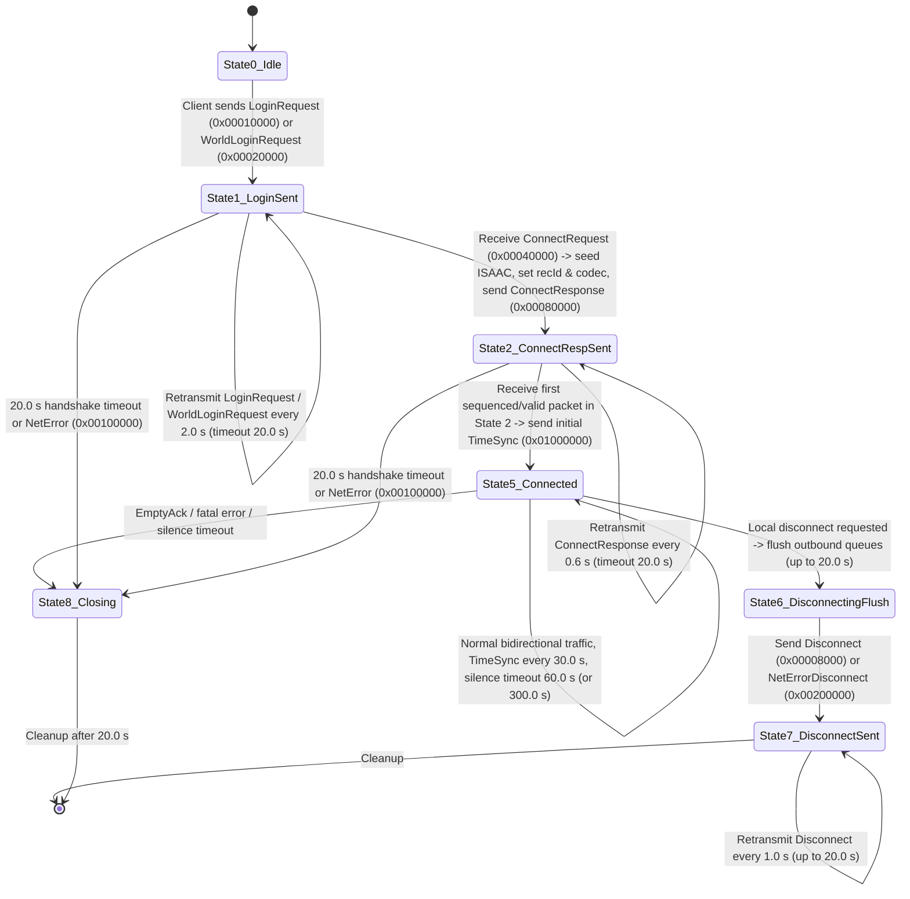

<!-- SPDX-License-Identifier: GPL-3.0-or-later -->

# Official Server Session and Transport Layer

| Field | Value |
|---|---|
| **Status** | `Revised` (changed after its 2026-10-20 review; re-review required, decision 0041) |
| **Last updated** | `2026-10-20` |
| **Author role** | Spec writer (dirty room) |
| **Reviewer** | Independent clean-room review (2026-10-20; passed CLEAN_ROOM.md §5.3) |
| **Implements into** | `crates/compat` (`tessera-compat::session`) |
| **Companion specs** | [`docs/specs/official-login.md`](official-login.md), [`docs/specs/official-messages-world.md`](official-messages-world.md), [`docs/specs/official-messages-play.md`](official-messages-play.md) |

---

## 1. Purpose 

This specification defines the UDP session and transport layer used by the official *The Lord of the Rings Online* (LOTRO) 64-bit client (`lotroclient64.exe`) when communicating with official login, world, and chat servers under Milestone M8 ([decision 0034](../decisions/0034-official-server-compatibility.md)).

It covers:

1. **UDP transport and socket lifecycle** — socket creation, non-blocking configuration, send-buffer sizing, deterministic local port computation, runtime endpoint resolution, single-socket connection multiplexing, and datagram/fragment size limits.
2. **Datagram wire framing and `ProtoHeader` layout** — the 2-byte wire prefix, `.dat`-backed `CompressionDictionary` bit-tree wire compression (`0x0E010000` / `0x0E010001`), the 20-byte big-endian `ProtoHeader`, header/payload checksum calculation, and the ordered optional header sections.
3. **Reliability, fragmentation, and flow control** — cumulative acknowledgements, negative acknowledgements (NAKs), retransmit rejections, sequence windows, variable-length `NetBlob` fragment headers, fragment reassembly, delivery queues, and flow-control headers.
4. **Session handshake and server referral** — the complete state machine from initial `LoginRequest` through `ConnectRequest` and `ConnectResponse` to the established session, login-to-world server `Referral` and `WorldLoginRequest`, server switching, and error/refusal reporting.
5. **Encryption, obfuscation, and integrity** — `LoginRequest` authentication-block framing (unencrypted at runtime; dormant 3DES-CBC + RSA-OAEP-SHA1 library code), per-blob payload encryption, directional ISAAC PRNG payload-checksum masking on sequenced packets, and runtime `CompressionDictionary` codec negotiation.
6. **Keep-alive, time synchronization, latency probes, and disconnect** — periodic `TimeSync`, `EchoRequest` / `EchoResponse` round-trip measurement, silence timeouts, and graceful versus error disconnects.
7. **Upper-layer message envelope (`NetMessage`)** — how reassembled `NetBlob` payloads frame post-handshake session/version messages (`0x0000012C`..`0x00000130`), individual world/gameplay events (`0x6C`, `0x6F`, `0x40`, `0x52`, `0x89`, `0xCE`, `0x24`, etc., starting with `u8 base_flags = 0x00` at inner offset `0`), entity batch containers (`0x0000000D` / `0x0000004C`), and `CNetLayer`/`ChatNet` envelope containers (`0x00000186` / `0x00000179`).
8. **Testable invariants, hostile-input rules, and synthetic test vectors** — receiver validation rules and self-contained test vectors constructed purely from synthetic inputs.

Pre-session launcher authentication (HTTPS SOAP credentials exchange, GLS ticket acquisition, world queue polling, and command-line hand-off to the client) is specified in [`docs/specs/official-login.md`](official-login.md).

---

## 2. Provenance 

| ID | Method | Source | Question Answered | Why M1–M2 Were Insufficient | Confidence |
|---|---|---|---|---|---|
| `OBS-01` | M1 (Observation) | Local read-only Steam install of LOTRO (`lotroclient64.exe`, file version `4906.0071.1794.4035`, `UserPreferences.ini` keys) | Client build version, presence of `Net.BindInterface` and `Net.ComputeUniquePort` configuration keys | N/A (M1 primary observation) | Confirmed |
| `OBS-02` | M1 (Observation) | Local read-only `client_general.dat` (`0x28000000` root `DataIdMap` key `0x00000003` -> `0x28000010` `COMPRESSIONDICTIONARY` -> `0x0E010000` `Client2Server`, `0x0E010001` `Server2Client`, `0x0E010002` `Server2ClientDeferred`) | Exact on-disk byte layout, UUIDs, redirect DID links, node counts (`32,743` and `32,249`), and full binary-tree round-trip verification of all `16,372` and `16,125` leaves in `0x0E010000` and `0x0E010001` | N/A (M1 primary observation of `.dat` records paired with `BIN-02`) | Confirmed |
| `PUB-01` | M2 (Published research) | Related Turbine engine transport documentation (Asheron's Call 1 `ProtoHeader` / `NetBlob` / ISAAC checksum-XOR architecture in public emulator documentation) | High-level conceptual model of Turbine's UDP transport (bitmask optional headers, 436-byte fragment payloads, ISAAC checksum masking, four delivery queues) | Related-engine analogue only; LOTRO differs in header endianness, wire prefixing, compact variable-length fragment headers, and handshake layouts | Confirmed (where verified by `BIN-01..08`) |
| `BIN-01` | M4 (Static RE) | `lotroclient64.exe` (build `4906.0071.1794.4035`, SHA-256 `d22363eb9aff0fb599fd04b3efa9a1769d08da8af9d8f9b73121c12bfd7e21ee`), Ghidra `12.1.3_DEV` headless decompiler | UDP socket setup, `FIONBIO`, `SO_SNDBUF` binary search, local port formula, single-socket connection demultiplexing, and `EngineClientNet` / `ChatNet` instances | No public LOTRO specification documents socket buffer negotiation, port derivation, or connection demultiplexing | Confirmed |
| `BIN-02` | M4 (Static RE) | `lotroclient64.exe` (same binary and SHA-256 as `BIN-01`), Ghidra `12.1.3_DEV` headless decompiler | 2-byte datagram wire prefix (`0x0000` vs non-zero recipient ID), runtime loading and bit-stream encoding/decoding of `CompressionDictionary` `.dat` plugins (`0x10000002 -> 0x0E010000` and `0x10000001 -> 0x0E010002 -> 0x0E010001`), 20-byte big-endian `ProtoHeader` layout, registered optional-header flags mask `0x0F7FFB00` (`0x0F7FFB06` with low-byte internal flags), and `0xBADD70DD` checksum algorithm | LOTRO's wire prefix, `.dat`-backed bit-tree codec, big-endian `ProtoHeader`, and bitmask validation are not documented in M1–M2 sources and differ from AC1 | Confirmed |
| `BIN-03` | M4 (Static RE) | `lotroclient64.exe` (same binary and SHA-256 as `BIN-01`), Ghidra `12.1.3_DEV` headless decompiler | Exact byte layouts and bit ordering of all 18 registered optional headers (`0x00000100` through `0x08000000`), including `LoginRequest` (`"180804"`), `ConnectRequest` (44 B), `ConnectResponse` (28 B), `Referral` (18 B), and `WorldLoginRequest` (8 B) | No public LOTRO documentation gives the exact byte layouts or endianness of optional headers | Confirmed |
| `BIN-04` | M4 (Static RE) | `lotroclient64.exe` (same binary and SHA-256 as `BIN-01`), Ghidra `12.1.3_DEV` headless decompiler | Reliability mechanics: `PakAck` (`0x00004000`), `Nak` (`0x00001000`, max 114 entries), `EmptyAck` (`0x00002000`, max 114 entries), sequence window limits (`0x7FFF` and `160,000`), and `Flow` header (`0x08000000`) | Window thresholds, NAK batching limits, and per-field endianness within reliability headers are only present in binary logic | Confirmed |
| `BIN-05` | M4 (Static RE) | `lotroclient64.exe` (same binary and SHA-256 as `BIN-01`), Ghidra `12.1.3_DEV` headless decompiler | Compact variable-length `NetBlob` fragment header encoding, 2-byte alignment padding, `PackedDWORD` variable-length integer encoding, 436-byte fragment chunking, max 20 fragments per packet, and 28,566,720-byte max blob size | LOTRO replaced AC1's fixed 16-byte fragment header with a variable-length prefix-coded header not documented in public sources | Confirmed |
| `BIN-06` | M4 (Static RE) | `lotroclient64.exe` (same binary and SHA-256 as `BIN-01`), Ghidra `12.1.3_DEV` headless decompiler | Session state machine (`0..8`), retransmission intervals (`0.6 s`, `1.0 s`, `2.0 s`), connection/disconnect timeouts (`20.0 s`, `60.0 s`, `300.0 s`), `TimeSync` (`30.0 s`), `EchoRequest` / `EchoResponse`, and `NetError` codes | Exact state numbers, timer constants (IEEE-754 doubles in `.rdata`), and error code mappings require binary inspection | Confirmed |
| `BIN-07` | M4 (Static RE) | `lotroclient64.exe` (same binary and SHA-256 as `BIN-01`), Ghidra `12.1.3_DEV` headless decompiler | Verification of all callers of `CNetLayer::Initialize` confirming that the RSA public-key buffer is always initialized empty (`0` bytes) and `authFlags` bit `0` (`0x01`) is never set at runtime (alongside the dormant `3des` CBC + `rsa_encrypt_key_ex` OAEP-SHA1 code path), per-blob encryption flag (`0x08`), and directional ISAAC checksum PRNG seeding and consumption | Runtime initialization of `authFlags`, cryptographic parameter strings, padding rules, and ISAAC seed assignment (`aa = bb = cc = seed`, `flag = 1`) are not in M1–M2 | Confirmed |
| `BIN-08` | M4 (Static RE) | `lotroclient64.exe` (same binary and SHA-256 as `BIN-01`), Ghidra `12.1.3_DEV` headless decompiler | Reassembled `NetBlob` to `NetMessage` envelope boundary (`envelopeFlags` bits `0x01` zlib and `0x02` routing header), in-memory `msgFlags` (`0x00300400`/`0x00300500`) vs wire `u8 base_flags = 0x00`, post-handshake `VersionSend` (`0x0000012C`..`0x00000130`, `"netver:1; didver:..."`), world entity batches (`0x0000000D` / `0x0000004C`), and `CNetLayer`/`ChatNet` containers (`0x00000186` / `0x00000179`) | Envelope framing, routing headers, post-handshake version negotiation, and the exact boundary into `official-messages-world.md` are not documented in public LOTRO sources | Confirmed |

---

## 3. Transport and Socket Layer 

### 3.1 Socket Creation and Options 

Each network subsystem instance creates a single IPv4 datagram socket with the following parameters (`BIN-01`):

| Parameter | Value | Meaning |
|---|---|---|
| Address family | `2` (`AF_INET`) | IPv4 internet protocols |
| Socket type | `2` (`SOCK_DGRAM`) | Connectionless, unreliable datagrams |
| Protocol | `0` (default for `SOCK_DGRAM`, i.e. `IPPROTO_UDP = 17`) | UDP |
| Non-blocking mode | `FIONBIO` (`0x8004667E`) set to `1` | Non-blocking socket I/O; receive loops poll until `WSAEWOULDBLOCK` / `EAGAIN` |
| Send buffer (`SO_SNDBUF`) | Target `131,072` bytes (`0x20000`) | Queried via `getsockopt(SOL_SOCKET, SO_SNDBUF)`. If the current buffer size is less than `131,072` bytes, the client performs a binary search with `setsockopt(SOL_SOCKET, SO_SNDBUF)` over the range `[current_size, 131072]` (halving the step until the interval width is `<= 1`) to configure the largest send buffer the operating system accepts up to `131,072` bytes |

### 3.2 Local Bind Address and Port Selection 

Before binding the UDP socket, the client resolves the local IPv4 interface and UDP port (`OBS-01`, `BIN-01`):

1. **Local IPv4 address**:
   - The client checks the command-line/configuration XML parameter `localaddress` and the `UserPreferences.ini` setting `Net.BindInterface`.
   - If a non-empty interface specification is provided (either an IPv4 prefix or `address/mask` CIDR notation), the client enumerates local host IPv4 addresses and selects the first non-loopback address matching `(addr & mask) == (spec_addr & mask)`.
   - If no interface specification is configured, the client selects the first non-loopback local IPv4 address (i.e. not `127.0.0.1` / `0x0100007F` in network byte order), or `0.0.0.0` (`INADDR_ANY`) if enumeration fails.
2. **Local UDP port**:
   - The client checks the configuration parameter `localport` (default `0`) and the boolean preference `Net.ComputeUniquePort` (default `true` / `1`).
   - **Case A — Explicit base port (`localport != 0`)**: The client attempts to `bind()` to `localport + k` for `k = 0, 1, ..., 11` (up to `12` consecutive ports) on the selected local IPv4 address, stopping at the first successful `bind()`.
   - **Case B — Computed unique port (`localport == 0` and `Net.ComputeUniquePort == true` and local IPv4 address `!= 0.0.0.0`)**: Let `ip_be` be the 32-bit local IPv4 address in network byte order interpreted as a 32-bit unsigned integer on the host. For attempt index `k` starting at `0` (while `k < 12`), the candidate port is:
     `candidate_port = (ip_be % 0xFA07) + (256 * k)`
     If `candidate_port <= 0x03FF` (`1023`), `k` is incremented by `1` so the port lies above the privileged port range (`>= 1024`). The client attempts `bind()` with `candidate_port` (in big-endian `sockaddr_in.sin_port`), incrementing `k` on failure for up to `12` attempts.
   - **Case C — Wildcard fallback**: If neither Case A nor Case B succeeds (or if `Net.ComputeUniquePort` is `false`), the client calls `bind()` with port `0` (allowing the OS to assign an ephemeral port), falling back to `INADDR_ANY` (`0.0.0.0:0`) if interface-specific binding fails.

### 3.3 Runtime Resolution of Remote Endpoints 

No official server hostname, IPv4 address, or port is hardcoded in the session protocol (`BIN-01`, `BIN-03`):

- **Initial login/world server endpoint**: Passed to the client at startup via the launcher command-line/configuration parameters `serveraddress` and `serverport` (or the bracketed `<localHost:remoteHost:port>` address string syntax), as specified in [`docs/specs/official-login.md`](official-login.md).
- **World server hand-off (`Referral`, `0x00000800`)**: During an active login-server session, the server sends a `Referral` optional header containing an 8-byte `sockaddr_in` structure (IPv4 address and UDP port) and an 8-byte referral cookie for the target world server (see [Section 6.5](#referral-flow)).
- **Logon server update (`LogonServerAddr`, `0x00000200`)**: A server packet may carry an 8-byte `sockaddr_in` updating the stored logon server address.
- **Chat server endpoint**: Provided to the `ChatNet` subsystem via an in-band game message once the world session is established.

### 3.4 Single-Socket Multiplexing and Subsystem Instances 

The client instantiates separate `CClientNet` managers for game traffic (`EngineClientNet`) and chat traffic (`ChatNet`) (`BIN-01`). Within each `CClientNet` instance, a **single non-blocking UDP socket** multiplexes all active and pending `CConnection` sessions (for example, when transitioning from a login server connection to a referred world server connection):

- **Connection table**: Active connections are stored in a hash table indexed by the connection's 16-bit local recipient ID (`localRecId`, assigned from a rotating counter in the range `0x0100 .. 0xFEFF`, i.e. `id - 0x0100 < 65000`).
- **Incoming datagram demultiplexing**:
  1. When a UDP datagram arrives via `recvfrom()`, the receiver first extracts the 16-bit `recId` from the packet header.
  2. If `recId >= 0x0100` (`recId - 0x0100 < 65000`), the receiver looks up the `CConnection` by `localRecId == recId` in the connection hash table. If found, it also verifies that the packet's source IPv4 address and UDP port (`sockaddr_in`) match the connection's remote peer address.
  3. If `recId < 0x0100` (e.g., `0x0000` during the initial `ConnectRequest` before the server knows the client's `localRecId`) or if the ID lookup misses, the receiver iterates over the active connections to find one whose remote `(IPv4, port)` matches the datagram's source `sockaddr_in`.
  4. If no matching connection exists, the datagram is rejected and discarded.

### 3.5 Datagram, Fragment, and Reassembly Size Constants 

| Constant | Hex | Decimal | Scope and Meaning | Provenance |
|---|---|---|---|---|
| `MAX_DATAGRAM_BUF` | `0xFF7C` | `65,404` B | Size of the per-socket raw UDP receive/send staging buffer | `BIN-01` |
| `MIN_DATAGRAM_BYTES` | `0x0016` | `22` B | Minimum valid UDP datagram length (`2` B wire prefix + `20` B `ProtoHeader`) | `BIN-02` |
| `PROTO_HEADER_BYTES` | `0x0014` | `20` B | Fixed size of `ProtoHeader` | `BIN-02` |
| `MAX_PACKET_BLOB_BUDGET` | `0x01D0` | `464` B | Maximum byte budget for `NetBlob` fragments (headers + payloads) assembled into a single outgoing packet, and maximum single fragment payload accepted by the receiver (`< 0x01D1`) | `BIN-05` |
| `MAX_BLOB_FRAG_PAYLOAD` | `0x01B4` | `436` B | Maximum payload slice placed in a single `NetBlob` fragment when splitting an outgoing `NetBlob`; also the stride (`fragIndex * 436`) used during reassembly | `BIN-05` |
| `MAX_FRAGS_PER_PACKET` | `0x0014` | `20` | Maximum number of `NetBlob` fragments permitted in a single UDP packet | `BIN-05` |
| `MAX_NETBLOB_BYTES` | `0x01B3E4C0` | `28,566,720` B | Architectural ceiling on a reassembled `NetBlob` payload size in the client (`65,520 * 436` bytes) | `BIN-05` |
| `MAX_ZLIB_UNCOMPRESSED_BYTES` | `0x02000000` | `33,554,432` B | Hard ceiling (`32 MiB`) enforced by the client's `NetMessage` zlib envelope unpacker | `BIN-08` |
| `MAX_NAK_ENTRIES` | `0x0072` | `114` | Maximum number of sequence numbers carried in a single `Nak` (`0x00001000`) or `EmptyAck` (`0x00002000`) optional header (`4 + 114 * 4 = 460` bytes) | `BIN-04` |
| `DEFAULT_MAX_CONCURRENT_BLOBS` | `0x0040` | `64` | Default upper bound on concurrent incomplete multi-fragment `NetBlob` reassembly entries per connection in `tessera_compat::session` | Normative defensive bound |
| `DEFAULT_MAX_REASSEMBLY_BLOB_BYTES` | `0x00100000` | `1,048,576` B | Default per-blob reassembly memory limit (`1 MiB`, configurable up to `MAX_NETBLOB_BYTES`) in `tessera_compat::session` | Normative defensive bound |
| `DEFAULT_MAX_DECOMPRESSED_MESSAGE_BYTES` | `0x00400000` | `4,194,304` B | Default decompressed `NetMessage` envelope size limit (`4 MiB`, configurable up to `MAX_ZLIB_UNCOMPRESSED_BYTES`) in `tessera_compat::session` | Normative defensive bound |
| `DEFAULT_MAX_CONTAINER_DEPTH` | `0x0008` | `8` | Default maximum recursion depth when unpacking nested batch containers (`0x00000186` / `0x00000179` or `0x0000000D` / `0x0000004C`) | Normative defensive bound |

---

## 4. Packet Framing and Checksum 

### 4.1 Two-Byte Datagram Wire Prefix and `.dat`-Backed Bit-Tree Compression 

Every UDP datagram transmitted or received on the wire begins with a 2-byte big-endian unsigned integer prefix (`wirePrefix`) ahead of the packet body (`BIN-02`):

| Offset | Size | Type | Byte Order | Field | Meaning |
|---|---|---|---|---|---|
| `0x00` | `2` | `u16` | Big-endian | `wirePrefix` | `0x0000` if the remainder of the datagram is unencoded; non-zero (`0x0001..0xFFFF`) if the datagram was processed by the connection's negotiated `CompressionDictionary` bit-tree plugin, in which case `wirePrefix` is the big-endian `recId` field of `ProtoHeader` (`remoteRecId` on send, `localRecId` on receive) |
| `0x02` | `N - 2` | `u8[]` | Byte stream | `wireBody` | Either the raw 20-byte `ProtoHeader` + `pakSize` payload (when `wirePrefix == 0x0000`), or the `CompressionDictionary`-encoded representation of bytes `0x02..end` of `[ProtoHeader \| Payload]` (when `wirePrefix != 0x0000`) |

#### 4.1.1 Unencoded Mode (`wirePrefix == 0x0000`)

When `wirePrefix == 0x0000`:
- All out-of-band / unsequenced control packets sent via the immediate-send path (`LoginRequest`, `WorldLoginRequest`, `ConnectResponse`, `Disconnect`, `NetErrorDisconnect`, `TimeSync`, `PakAck`, `Nak`, `EmptyAck`), as well as any packet sent on a connection where no `CompressionDictionary` plugin was negotiated (`codecUuid` all zeros in `ConnectRequest`) or while `remoteRecId == 0`, use `wirePrefix = 0x0000` (`BIN-02`, `BIN-03`).
- On receive, if bytes `0..1` are `0x0000`, the receiver copies bytes `2..N` directly into the packet staging buffer without bit-tree decompression (`BIN-02`).

#### 4.1.2 `CompressionDictionary`-Encoded Mode (`wirePrefix != 0x0000`)

When a connection has a negotiated `CompressionDictionary` plugin (`conn->codecPlugin != NULL`, attached during `ConnectRequest` `0x00040000` when `codecUuid` matches a registered `.dat` dictionary; see [Section 7.4](#per-connection-codec)):
- **On send (`BIN-02`)**: For normal sequenced data packets (once `remoteRecId != 0` and no handshake/system-only header flags are present), the sender places `remoteRecId` in big-endian byte order into bytes `0..1` of the UDP datagram (`wirePrefix`) and invokes the connection's `CompressionDictionary::Compress` method on the remainder of the packet starting at byte `2` of `ProtoHeader` (i.e. `ProtoHeader.pakSize` onward, length `18 + pakSize`), writing the encoded output into datagram bytes `2..end`.
- **On receive (`BIN-02`)**: When a UDP datagram arrives with `wirePrefix != 0x0000`, `wirePrefix` (`u16` BE) is the target connection's `localRecId`. The receiver looks up the active `CConnection` with `localRecId == wirePrefix` (falling back to source `sockaddr_in` matching if needed). If the connection has a non-null `codecPlugin`, the receiver invokes `CompressionDictionary::Decompress` on datagram bytes `2..N` (`wireBody`) and prepends the 2-byte big-endian `wirePrefix` as bytes `0..1` (`ProtoHeader.recId`) of the reconstructed packet (`[wirePrefix | decompressedBytes]`). If decompression fails, the datagram is rejected and discarded.

#### 4.1.3 Runtime Loading and Binary Layout of `COMPRESSION_DICTIONARY` `.dat` Records (`0x0E010000`–`0x0E010002`)

There are **no** static bit-tree wire compression tables in `lotroclient64.exe`. Instead, before initializing `EngineClientNet`, the client loads two `CompressionDictionary` plugin objects at runtime from **`client_general.dat`** (`OBS-02`, `BIN-02`):

1. **Runtime discovery via `DataIdMap` `0x28000000` -> `0x28000010` (`OBS-02`, `BIN-02`)**:
   - The client looks up root key `0x00000003` (`COMPRESSIONDICTIONARY`) in the root `DataIdMap` (`0x28000000` in `client_general.dat`; see [`docs/specs/records.md`](records.md) §8.2), which resolves to `DataIdMap` **`0x28000010`**.
   - `DataIdMap` `0x28000010` contains three non-zero entries (`OBS-02`):

| `0x28000010` Key | Label in `0x28000010` | Target DID | Redirect DID at `+0x20` | Effective Dictionary Record | Role at Runtime (`BIN-02`) |
|---|---|---|---|---|---|
| `0x10000001` | `Server2ClientDeferred` | `0x0E010002` | `0x0E010001` | `0x0E010001` (`214,953` B) | Loaded second at client startup (`0x10000001 -> 0x0E010002 -> 0x0E010001`) and registered in `CNetLayer`'s codec table |
| `0x10000002` | `Client2Server` | `0x0E010000` | `0x00000000` | `0x0E010000` (`218,247` B) | Loaded first at client startup (`0x10000002 -> 0x0E010000`), registered in `CNetLayer`'s codec table, and set as the client's preferred `codecUuid` |
| `0x10000003` | `Server2Client` | `0x0E010001` | `0x0E010001` | `0x0E010001` (`214,953` B) | Target of `0x0E010002`'s redirect link (`0x0E010001`) |

   - When loading a dictionary for sub-map key `k` (`0x10000002` or `0x10000001`), the loader first loads the `COMPRESSION_DICTIONARY` record (`DB type 0x01`) for the target DID (`0x0E010000` or `0x0E010002`). If that record's `redirectDid` field at offset `0x20` is non-zero (`0x0E010001`), the loader replaces it by loading the `COMPRESSION_DICTIONARY` record for `redirectDid` (`0x0E010001`) and parses that target record (`BIN-02`).

2. **Exact binary layout of `0x0E010000`–`0x0E010002` in `client_general.dat` (`OBS-02`, `BIN-02`)**:
   Each `0x0E0100xx` record has a 44-byte (`0x2C`) header (with no leading DID prologue; see [`docs/specs/misc-records.md`](misc-records.md) §11) followed by an `m`-byte body:

| Offset | Size | Type | Byte Order | Field | Meaning and Observed Values (`OBS-02`, `BIN-02`) |
|---|---|---|---|---|---|
| `0x00` | `16` | `u8[16]` | Mixed-endian GUID | `formatUuid` | Dictionary format UUID: `8d 87 95 e7 33 c6 1c 47 83 15 c3 db be ad 2f aa` (`{E795878D-C633-471C-8315-C3DBBEAD2FAA}`) in all three records. The loader rejects any record whose `formatUuid` does not match this 16-byte constant. |
| `0x10` | `16` | `u8[16]` | Mixed-endian GUID | `codecUuid` | Per-dictionary wire codec UUID copied into the plugin object (`+0x08..0x17`) and matched against `ConnectRequest.codecUuid` (`0x0E010000` has one UUID; `0x0E010001` and `0x0E010002` share a second UUID). |
| `0x20` | `4` | `u32` | Little-endian | `redirectDid` | `0x00000000` in `0x0E010000`; `0x0E010001` in `0x0E010001` and `0x0E010002`. If non-zero, the plugin loader loads `redirectDid` as the effective dictionary record. |
| `0x24` | `4` | `u32` | Little-endian | `version` | Format version: `1` in `0x0E010000` and `0x0E010001`; `0` in stub record `0x0E010002`. The parser requires `version == 1`. |
| `0x28` | `4` | `u32` | Little-endian | `bodyLen` (`m`) | Byte length of the serialized dictionary body that follows (`218,203` in `0x0E010000`; `214,909` in `0x0E010001`; `0` in `0x0E010002`). |
| `0x2C` | `m` | `u8[m]` | Byte stream | `body` | Serialized bit-tree node table (layout below), consumed with `0` leftover bytes in both `0x0E010000` and `0x0E010001`. |

3. **Bit-tree `body` layout (`offset 0x2C .. 0x2C + m`, `OBS-02`, `BIN-02`)**:
   - Begins with `nodeCount` (`u32 LE`): `32,743` in `0x0E010000` (`16,372` leaves + `16,371` internal branch nodes) and `32,249` in `0x0E010001` (`16,125` leaves + `16,124` internal branch nodes).
   - Followed immediately by `nodeCount` sequential node definitions (`index = 0 .. nodeCount - 1`). **Invariant (`OBS-02`, `BIN-02`)**: all leaf nodes (`isLeaf != 0`) precede all internal branch nodes (`isLeaf == 0`), and the **first internal branch node** (`index = 16,372` in `0x0E010000`, `index = 16,125` in `0x0E010001`) is the root of the decoding binary tree (`rootNodeIndex`):
     - Each node begins with `isLeaf` (`u8`, `1` = leaf node, `0` = internal branch node).
     - **When `isLeaf != 0` (leaf node)**:
       1. `symbolLen` (`u8`): number of uncompressed bytes represented by this leaf (`1 .. 4` in both dictionaries; all `256` single-byte symbols `0x00..0xFF` are present as leaves, plus multi-byte sequences of length `2..4` whose `(symbolLen - 1)`-byte prefix is already a leaf node).
       2. `symbolBytes` (`u8[symbolLen]`): the raw `symbolLen` uncompressed byte sequence emitted when decoding reaches this leaf.
       3. `codeBitLen` (`u8`): bit length of the leaf's Huffman codeword (`1 .. 27` in `0x0E010000`; `1 .. 26` in `0x0E010001`).
       4. `codewordBytes` (`u8[(codeBitLen >> 3) + 1]`): the leaf's codeword stored in little-endian byte order (zero-extended to a 32-bit unsigned integer `codeword`, consumed LSB-first from bit `0` to bit `codeBitLen - 1`).
     - **When `isLeaf == 0` (internal branch node)**:
       1. `child0Index1Based` (`u16 LE`): **1-based** node index (`0` = null; `k` in `1 .. nodeCount` points to `node[k - 1]`) taken when the next input bit is `0`.
       2. `child1Index1Based` (`u16 LE`): **1-based** node index (`0` = null; `k` in `1 .. nodeCount` points to `node[k - 1]`) taken when the next input bit is `1`.

4. **Exact bit-stream compression and decompression algorithm on `wireBody` (`BIN-02`)**:
   - **4-bit header at the start of `wireBody` (bits `0..3` of byte `0` of `wireBody`, i.e. byte `2` of the UDP datagram)**:
     - Bit `0` (`wireBody[0] & 1`): `isCompressed`.
     - Bits `1..3` (`(wireBody[0] >> 1) & 7`): `unusedTrailingBits` (`0 .. 7`), the number of unused high bits in the final byte of `wireBody`.
   - **Decompression (`CompressionDictionary::Decompress`, `BIN-02`)**:
     - If `isCompressed == 0` (`(wireBody[0] & 1) == 0`): the encoder used literal fallback; the decoder verifies `wireBody.len >= 1` and copies `wireBody[1 .. end]` verbatim as the `18 + pakSize` decompressed bytes.
     - If `isCompressed == 1` (`(wireBody[0] & 1) == 1`):
       1. Let `validBitEnd = (wireBody.len * 8) - unusedTrailingBits`, and initialize the bit cursor to `bitPos = 4` (immediately after the 4-bit header, reading bits LSB-first within each byte: bit `b` of `wireBody` is `(wireBody[b >> 3] >> (b & 7)) & 1`).
       2. While `bitPos != validBitEnd`:
          - Set `cur = rootNodeIndex` (the first internal branch node).
          - Repeat while `node[cur].isLeaf == 0`:
            - If `bitPos >= validBitEnd`, fail with `0x81940002` (truncated bit stream).
            - Read `bit = (wireBody[bitPos >> 3] >> (bitPos & 7)) & 1` and increment `bitPos += 1`.
            - Advance `cur` to `node[cur].child0Index1Based - 1` (if `bit == 0`) or `node[cur].child1Index1Based - 1` (if `bit == 1`).
          - Append `node[cur].symbolBytes[0 .. symbolLen - 1]` to the decompressed output buffer.
   - **Compression (`CompressionDictionary::Compress`, `BIN-02`)**:
     - Reserves 4 bits at the start of the output bit stream (`bitPos = 4`).
     - At each uncompressed input offset `pos` (`0 .. inputLen - 1`), walks the 256-way byte prefix trie for up to `min(4, inputLen - pos)` bytes to select the longest matching leaf node `L`, writes `L.codeword`'s low `L.codeBitLen` bits LSB-first into the output bit stream, and advances `pos += L.symbolLen`.
     - Let `totalBytes = (bitPos + 7) >> 3`. If `totalBytes <= inputLen + 1`, writes `unusedTrailingBits = (totalBytes * 8) - bitPos` into bits `1..3` and `1` into bit `0` of `wireBody[0]` (`wireBody[0] |= ((unusedTrailingBits << 1) | 1)`). Otherwise (if compression did not reduce the size below `inputLen + 2`), writes `wireBody[0] = 0x00` followed by the `inputLen` raw input bytes (`BIN-02`).

### 4.2 Twenty-Byte `ProtoHeader` Layout 

After wire decompression (so that bytes `0..19` form the full header), every packet begins with a 20-byte (`0x14`) `ProtoHeader`. **All multi-byte integer fields in `ProtoHeader` are stored in big-endian (network) byte order on the wire** (`BIN-02`):

| Offset | Size | Type | Byte Order | Field | Meaning |
|---|---|---|---|---|---|
| `0x00` | `2` | `u16` | Big-endian | `recId` | Recipient session/connection ID (`0x0000` before session ID assignment; `>= 0x0100` once assigned) |
| `0x02` | `2` | `u16` | Big-endian | `pakSize` | Byte length of the packet payload immediately following this 20-byte header (`0 .. 65,382`). Must equal `decoded_packet_len - 20` |
| `0x04` | `4` | `u32` | Big-endian | `flags` | Bitmask of optional headers and packet flags. Wire bits outside `0x0F7FFB00` (`0x0F7FFB06` including low-byte internal flags) are undefined and cause immediate packet rejection |
| `0x08` | `4` | `u32` | Big-endian | `seqNum` | Packet sequence number (`0` for unsequenced handshake packets prior to `ConnectRequest`; `>= 2` for sequenced packets; for unsequenced packets sent after session setup, carries the last assigned outgoing `seqNum` without setting `0x02000000`) |
| `0x0C` | `4` | `u32` | Big-endian | `checksum` | 32-bit packet checksum (`headerChecksum + payloadChecksum`, with `payloadChecksum` XOR-masked by the directional ISAAC PRNG when `flags & 0x02000000` is set) |
| `0x10` | `1` | `u8` | Byte | `iteration` | Routing / referral iteration byte (high byte of the big-endian `u16` at `0x10`) |
| `0x11` | `1` | `u8` | Byte | `table` | Server routing table index (low byte of the big-endian `u16` at `0x10`) |
| `0x12` | `2` | `u16` | Big-endian | `time` | 16-bit millisecond tick delta (`(GetTickCount() - netStartTick) mod 65536`) |

### 4.3 `ProtoHeader` Flags Bitmask (`0x0F7FFB00` / `0x0F7FFB06`) 

The client's optional-header registry registers exactly **18** header flag bits in bits `8..27` (`0x00000100`, `0x00000200`, `0x00000800`, `0x00001000`, `0x00002000`, `0x00004000`, `0x00008000`, `0x00010000`, `0x00020000`, `0x00040000`, `0x00080000`, `0x00100000`, `0x00200000`, `0x00400000`, `0x01000000`, `0x02000000`, `0x04000000`, and `0x08000000`), whose union is **`0x0F7FFB00`** (`BIN-02`, `BIN-03`). Together with the two low-byte internal packet flags (`0x00000002` and `0x00000004`), the full valid `ProtoHeader.flags` mask is **`0x0F7FFB06`**: if `(flags & ~0x0F7FFB06) != 0` (or `(flags & 0xF08004FF) != 0` on wire headers where bits `0..7` are zero) or `pakSize > 0xFF7B`, the packet is immediately rejected (`BIN-02`). In particular, bits `10` (`0x00000400`), `23` (`0x00800000`), and `28..31` (`0xF0000000`) are undefined and rejected, whereas bit `15` (`0x00008000`, `Disconnect`) **is** a registered, valid flag bit (`BIN-02`, `BIN-03`).

When multiple optional header bits are set in `flags`, their corresponding header structures appear consecutively at the start of the packet payload (offset `0x14`) in **strict ascending bit order** (`0x00000100` first, `0x08000000` last), followed by `NetBlob` fragments if and only if `0x04000000` (`HasNetBlobs`) is set (`BIN-02`, `BIN-03`):

| Flag Bit (Host `u32`) | Bit Index | Name | Direction | Payload Size (Bytes) | Description |
|---|---|---|---|---|---|
| `0x00000100` | `8` | `ServerSwitch` | Server -> Client | `8` | Notification of server switch (`u32` LE sequence/ID, `u32` LE switch type) |
| `0x00000200` | `9` | `LogonServerAddr` | Server -> Client | `8` | `sockaddr_in` (IPv4 address and port) of logon server |
| `0x00000800` | `11` | `Referral` | Server -> Client | `18` | World-server hand-off (`u64` LE cookie, 8-byte `sockaddr_in`, `u16` LE server ID) |
| `0x00001000` | `12` | `Nak` | Bidirectional | `4 + 4 * N` | Negative acknowledgement / retransmission request (`u32` LE count `N <= 114`, then `N` `u32` LE sequence numbers) |
| `0x00002000` | `13` | `EmptyAck` | Bidirectional | `4 + 4 * N` | Reject retransmit / dropped sequence numbers (`u32` LE count `N <= 114`, then `N` `u32` LE sequence numbers) |
| `0x00004000` | `14` | `PakAck` | Bidirectional | `4` | Cumulative sequence acknowledgement (`u32` **big-endian** highest contiguous sequence number) |
| `0x00008000` | `15` | `Disconnect` | Bidirectional | `0` | Graceful disconnect notification (no optional header payload bytes) |
| `0x00010000` | `16` | `LoginRequest` | Client -> Server | Variable | Initial login handshake (`"180804"` version string + length-prefixed auth block) |
| `0x00020000` | `17` | `WorldLoginRequest` | Client -> Server | `8` | Initial world-server handshake carrying the 8-byte `u64` LE referral cookie |
| `0x00040000` | `18` | `ConnectRequest` | Server -> Client | `44` (`0x2C`) | Server session parameters, ISAAC seeds, connection IDs, and 16-byte codec UUID |
| `0x00080000` | `19` | `ConnectResponse` | Client -> Server | `28` (`0x1C`) | Client confirmation of session parameters and 16-byte codec UUID |
| `0x00100000` | `20` | `NetError` | Server -> Client | `8` | Non-fatal or handshake network error (`u32` LE error ID, `u32` LE error parameter) |
| `0x00200000` | `21` | `NetErrorDisconnect` | Bidirectional | `8` | Fatal disconnect with error reason (`u32` LE error ID, `u32` LE error parameter) |
| `0x00400000` | `22` | `CiceroControl` | Client -> Server only | `4` (`u32` LE) | Registered in the optional-header table (4-byte `u32` LE header), but masked out / rejected if received by a client connection |
| `0x01000000` | `24` | `TimeSync` | Bidirectional | `8` | Network time synchronization (`f64` IEEE-754 LE timestamp in seconds) |
| `0x02000000` | `25` | `EchoRequest` / `EncryptedChecksum` | Bidirectional | `4` (as optional header) / `0` (as checksum flag) | Dual role: (1) indicates that `seqNum` is an active sequenced packet whose payload checksum is XOR-masked with the directional ISAAC PRNG; (2) when serialized as an optional header in the `0x02000000` slot on client-to-server probes, carries a 4-byte `f32` LE local client timer elapsed value |
| `0x04000000` | `26` | `EchoResponse` / `HasNetBlobs` | Bidirectional | `8` (as optional header) / `0` (as blob flag) | Dual role: (1) indicates that one or more `NetBlob` fragments follow the optional headers; (2) when serialized in the optional-header pass if bit 26 is set in the optional-header mask, carries `f32` LE echoed client timer + `f32` LE server processing delta |
| `0x08000000` | `27` | `Flow` | Bidirectional | `6` | Flow-control rate report (`u32` LE bytes sent delta, `u16` LE interval in milliseconds) |

> **Important distinction on bits `25` (`0x02000000`) and `26` (`0x04000000`)** (`BIN-02`, `BIN-03`):
> In the outgoing packet builder (`BIN-03`), the `ProtoHeader.flags` field is the bitwise OR of:
> - `optHeaderMask`: the bitwise OR of the type masks of all attached optional header objects (`0x00000100` through `0x08000000`, which may include an `EchoRequest` optional header with mask `0x02000000` or an `EchoResponse` optional header with mask `0x04000000`).
> - `0x04000000` (`HasNetBlobs`), added whenever the packet carries at least one `NetBlob` fragment (`numFrags != 0`).
> - `0x02000000` (`EncryptedChecksum`), added whenever the packet is a sequenced/reliable packet.
>
> On receive (`BIN-03`), the connection's optional-header parser only parses optional header bytes for bits in `ProtoHeader.flags & 0x093FFB00` (i.e. it masks **out** bits `22` `0x00400000`, `25` `0x02000000`, and `26` `0x04000000` when iterating over received optional headers). Then, if `(ProtoHeader.flags & 0x04000000) != 0`, the remaining bytes after the optional headers are parsed as `NetBlob` fragments.
> Consequently, on receive, bits `0x02000000` and `0x04000000` in `ProtoHeader.flags` act purely as the **`EncryptedChecksum` flag** and **`HasNetBlobs` flag**, respectively.

### 4.4 Checksum Calculation Algorithm 

Packet integrity is verified using a 32-bit word-summing checksum primitive (`CalcChecksum`, `BIN-02`):

#### 4.4.1 `CalcChecksum(buf, len)` Primitive

Given a byte buffer `buf[0 .. len - 1]` of length `len` (`u32`):

1. Initialize 32-bit unsigned accumulator `acc = 0`.
2. Let `num_words = len >> 2` (number of complete 4-byte words). For `i = 0 .. num_words - 1`, read the 32-bit **little-endian** unsigned integer `w = u32_le(buf + 4 * i)` and compute:
   `acc = (acc + w) mod 2^32`.
3. Let `rem = len & 3` (number of trailing bytes, `0..3`).
   - If `rem == 0`: return `acc` immediately.
   - If `rem != 0`:
     - Initialize 32-bit unsigned `tail = 0` and shift count `s = 24`.
     - For `j = 0 .. rem - 1`:
       `tail = tail | (uint32_t(buf[4 * num_words + j]) << s)`
       `s = s - 8`
     - Add `tail` and `(len << 16)` to `acc`:
       `acc = (acc + tail + ((len << 16) mod 2^32)) mod 2^32`.
     - Return `acc` (`u32`).

*Note on trailing byte order in Step 3 (`BIN-02`)*: Whereas full 4-byte words in Step 2 are read as **little-endian** `u32` values, trailing bytes (`rem = 1, 2, 3`) in Step 3 are packed into `tail` starting from the **most significant byte** (`bits 24..31` first, then `16..23`, then `8..15`), and `len << 16` is added if and only if `rem != 0` (`(len & 3) != 0`):
- If `(len & 3) == 0`: `CalcChecksum` is simply the `mod 2^32` sum of the `len / 4` little-endian `u32` words.
- If `(len & 3) != 0`: `CalcChecksum` is the `mod 2^32` sum of the `len / 4` little-endian `u32` words, plus `tail` (where trailing byte `0` is at `<< 24`, trailing byte `1` at `<< 16`, trailing byte `2` at `<< 8`), plus `(len << 16)`.

#### 4.4.2 Header Checksum and Payload Checksum

To compute or verify the 32-bit `ProtoHeader.checksum` field (`BIN-02`):

1. **Header checksum (`hdrSum`)**:
   - Form the 20-byte wire `ProtoHeader` (with all fields in big-endian wire byte order), and set bytes `0x0C..0x0F` (`checksum`) to the 4-byte sequence `BA DD 70 DD` (i.e. big-endian `0xBADD70DD`, which is `0xDD70DDBA` when read as a little-endian `u32`).
   - Compute `hdrSum = CalcChecksum(wireHeader[0..20], 20)`. Because `20` is a multiple of `4`, `hdrSum` is the `mod 2^32` sum of the five little-endian `u32` words of `wireHeader`.
2. **Payload checksum (`payloadSum`)**:
   - On **receive**: `payloadSum = CalcChecksum(payload[0..pakSize], pakSize)` over the entire `pakSize` bytes following the 20-byte `ProtoHeader`.
   - On **send**: `payloadSum` is accumulated by summing `CalcChecksum` over each attached optional header buffer plus `CalcChecksum(fragHeader) + CalcChecksum(fragPayload)` for each attached `NetBlob` fragment (modulo `2^32`).
3. **Combining and ISAAC XOR masking**:
   - If `(flags & 0x02000000) == 0` (unsequenced packet):
     `totalSum = (hdrSum + payloadSum) mod 2^32`
     The wire `ProtoHeader.checksum` field at offset `0x0C..0x0F` is written as `totalSum` in **big-endian** byte order.
   - If `(flags & 0x02000000) != 0` (sequenced packet):
     Let `xorMask` (`u32`) be the 32-bit word drawn from the connection's directional ISAAC PRNG for this packet's `seqNum` (outgoing PRNG on send, incoming PRNG on receive; see [Section 7.3](#isaac-checksum)).
     `maskedPayloadSum = payloadSum ^ xorMask`
     `totalSum = (hdrSum + maskedPayloadSum) mod 2^32`
     The wire `ProtoHeader.checksum` field at offset `0x0C..0x0F` is written as `totalSum` in **big-endian** byte order.
   - On **receive** of a packet with `(flags & 0x02000000) != 0`:
     The receiver reads `wireTotalSum = u32_be(wireHeader + 0x0C)`, computes `hdrSum` (with `BA DD 70 DD` at `0x0C..0x0F`), recovers `maskedPayloadSum = (wireTotalSum - hdrSum) mod 2^32`, unmasks `unmaskedPayloadSum = maskedPayloadSum ^ xorMask`, and verifies that `((hdrSum + unmaskedPayloadSum) mod 2^32) == ((hdrSum + CalcChecksum(payload, pakSize)) mod 2^32)`. If they differ, the packet is rejected and dropped (`BIN-02`).

---

## 5. Reliability, Fragmentation, and Flow Control 

### 5.1 Sequence Numbers and Windows 

Each `CConnection` maintains two 32-bit sequence counters (`BIN-04`):

- **Outgoing sequence number (`sendSeqNum`)**:
  - Initialized to `1` before the first sequenced packet is sent.
  - Pre-incremented (`sendSeqNum + 1`) when assigning a sequence number to each new outgoing sequenced packet (`flags & 0x02000000`), so the first sequenced packet transmitted on a connection has `seqNum = 2`.
  - If incrementing wraps to `0`, it advances to `1` (or `2`) so `seqNum` is never `0` for a sequenced packet.
  - Unsequenced packets (`(flags & 0x02000000) == 0`) do not increment `sendSeqNum`; their `ProtoHeader.seqNum` field is set to `0` (for initial handshake packets) or the current value of `sendSeqNum` without setting `0x02000000`.
- **Incoming expected sequence number (`recvSeqExpected`)**:
  - Initialized to `1` when the `CConnection` is constructed (`BIN-01`).
  - When a packet arrives with `seqNum`, the receiver enforces two window checks (`BIN-04`):
    1. `seqNum <= recvSeqExpected + 0x7FFF` (maximum lookahead window of `32,767` packets).
    2. The count of tracked missing sequence numbers must not exceed `160,000`.
    If either check fails, the packet is rejected immediately before checksum unmasking.
  - On the sender side, if the count of unacknowledged sent packets in the retransmit table exceeds `0x1FBC4` (`130,004`) or the sequence span exceeds `0x7FFFFFFF`, the connection is terminated with internal error `0x00CD0B73` (`WSAENOBUFS` / buffer overflow, mapped to `0x8004100F`) (`BIN-04`).

### 5.2 Cumulative Acknowledgements (`PakAck`, `0x00004000`) 

| Offset | Size | Type | Byte Order | Field | Meaning |
|---|---|---|---|---|---|
| `0x00` | `4` | `u32` | **Big-endian** | `ackSeqNum` | Highest contiguous `seqNum` received by the sender of this `PakAck` |

- **Generation (`BIN-04`)**: During each connection maintenance tick, if the connection has no missing sequence numbers in its gap tree (`missingCount == 0`) and at least `2.0` seconds have elapsed since the last `PakAck` / `Nak` transmission, the receiver sends an unsequenced packet with `flags = 0x00004000` carrying `recvSeqExpected` in **big-endian** byte order.
- **Processing (`BIN-04`)**: When a peer receives `PakAck(ackSeqNum)`, it byte-swaps `ackSeqNum` from big-endian to host order and removes all sent packets with `seqNum <= ackSeqNum` (modulo 32-bit signed sequence comparison) from its outbound retransmission hash table.

### 5.3 Negative Acknowledgements (`Nak`, `0x00001000`) 

| Offset | Size | Type | Byte Order | Field | Meaning |
|---|---|---|---|---|---|
| `0x00` | `4` | `u32` | Little-endian | `count` | Number of missing sequence numbers `N` (`1 <= N <= 114`) |
| `0x04` | `4 * N` | `u32[N]` | Little-endian | `seqNums` | Array of `N` missing sequence numbers requested for retransmission |

- **Gap detection (`BIN-04`)**: When a sequenced packet arrives with `seqNum > recvSeqExpected + 1`, for every skipped sequence number `s` in `(recvSeqExpected + 1) .. (seqNum - 1)`:
  1. The receiver advances the incoming ISAAC checksum PRNG once for `s` and records an entry `(seqNum = s, savedPrngMask)` in its red-black gap tree.
  2. When `s` later arrives out of order, the receiver looks up `s` in the gap tree, uses `savedPrngMask` to unmask `s`'s payload checksum, and removes `s` from the gap tree.
- **Transmission (`BIN-04`)**: While `missingCount > 0`, every `0.6` seconds the receiver traverses up to `114` (`0x72`) entries in its gap tree and sends a `Nak` (`0x00001000`) optional header listing their sequence numbers.
- **Processing (`BIN-04`)**: When a peer receives `Nak(count, seqNums[])`:
  - If `count > 114` (`0x72`), the packet is rejected as malformed (`0x80004005`).
  - For each requested `s` in `seqNums`:
    - First, all sent packets in the retransmit table with sequence number strictly less than the first NAKed sequence number (`seqNums[0]`) are implicitly acknowledged and freed (`BIN-04`).
    - If `s` is still present in the sender's retransmit table and still holds at least one deliverable fragment/header, `s` is queued for retransmission (reusing its originally assigned `seqNum` and saved outgoing ISAAC mask `xorMask`, with an updated header checksum).
    - If `s` is no longer present or its unreliable fragments have expired, `s` is appended to the sender's outbound `EmptyAck` (`0x00002000`) queue (`BIN-04`).

### 5.4 Retransmit Rejection (`EmptyAck`, `0x00002000`) 

| Offset | Size | Type | Byte Order | Field | Meaning |
|---|---|---|---|---|---|
| `0x00` | `4` | `u32` | Little-endian | `count` | Number of unrecoverable sequence numbers `N` (`1 <= N <= 114`) |
| `0x04` | `4 * N` | `u32[N]` | Little-endian | `seqNums` | Array of `N` sequence numbers that the sender will not retransmit |

- **Generation (`BIN-04`)**: On each connection tick, up to `114` (`0x72`) sequence numbers accumulated in the connection's dropped-sequence queue are packed into an `EmptyAck` (`0x00002000`) optional header and transmitted.
- **Processing (`BIN-04`)**: When a receiver gets `EmptyAck(count, seqNums[])` (with `count <= 114`), it removes each listed sequence number `s` from its missing-packet gap tree and advances `recvSeqExpected` across any newly contiguous prefix so the gap no longer stalls acknowledgements.

### 5.5 Flow Control (`Flow`, `0x08000000`) 

| Offset | Size | Type | Byte Order | Field | Meaning |
|---|---|---|---|---|---|
| `0x00` | `4` | `u32` | Little-endian | `bytesReceivedDelta` | Number of raw wire bytes received by the sender of this header since its previous `Flow` header |
| `0x04` | `2` | `u16` | Little-endian | `intervalMs` | Elapsed time in milliseconds (`(uint16_t)(elapsed_sec * 1000.0)`) over which `bytesReceivedDelta` was measured |

- **Generation (`BIN-03`, `BIN-04`)**: Attached to an outgoing packet when at least `1/3` second (`0.3333333333333333` s) has elapsed since the last `Flow` header was sent and at least `1,400` bytes (`0x578`) have been received in that window.

### 5.6 `NetBlob` Fragmentation, Delivery Queues, and Reassembly 

All upper-layer game messages are encapsulated in `NetBlob` objects, sliced into fragments of at most `436` (`0x1B4`) payload bytes, and carried after the optional headers in packets that have `ProtoHeader.flags & 0x04000000` (`HasNetBlobs`) set (`BIN-05`).

#### 5.6.1 `PackedDWORD` Variable-Length Integer Encoding

Both `NetBlob` fragment headers and upper-layer game messages use a big-endian prefix-coded unsigned integer format (`PackedDWORD`, `BIN-05`, `BIN-08`):

| Value Range | Encoded Size | First Byte Prefix | Wire Layout |
|---|---|---|---|
| `0x00000000 .. 0x0000007F` | `1` byte | `0xxxxxxx` (`(b0 & 0x80) == 0`) | `b0 = (uint8_t)val` |
| `0x00000080 .. 0x00003FFF` | `2` bytes | `10xxxxxx` (`(b0 & 0xC0) == 0x80`) | `b0 = (uint8_t)((val >> 8) \| 0x80)` `b1 = (uint8_t)(val & 0xFF)` |
| `0x00004000 .. 0x1FFFFFFF` (up to `0x3FFFFFFF` in 30-bit contexts) | `4` bytes | `110xxxxx` (`(b0 & 0xE0) == 0xC0`, or `(b0 & 0xC0) == 0xC0` in 30-bit contexts) | `b0 = (uint8_t)((val >> 24) \| 0xC0)` `b1 = (uint8_t)((val >> 16) & 0xFF)` `b2..b3 = u16_le(val & 0xFFFF)` (**little-endian** 16-bit low word!) |
| `0x20000000 .. 0xFFFFFFFF` (in 32-bit batch-message contexts) | `5` bytes | `11100000` (`b0 == 0xE0`) | `b0 = 0xE0` `b1..b4 = u32_le(val)` (**little-endian** 32-bit word!) |

*Implementer caution (`BIN-05`, `BIN-08`)*: Notice the hybrid endianness of `PackedDWORD` in the 4-byte case: the high 14/13 bits are placed in `b0` (bits `24..29` + `0xC0`) and `b1` (bits `16..23`), whereas the low 16 bits (`val & 0xFFFF`) are read and written as a single 16-bit native **little-endian** word (`b2 = val & 0xFF`, `b3 = (val >> 8) & 0xFF`)! In the `NetBlob` fragment header helper, only the 1-, 2-, and 4-byte forms are used (covering `0 .. 0x3FFFFFFF`); in the batch message container, the 5-byte `0xE0` form is used for 32-bit values `>= 0x20000000`.

#### 5.6.2 Delivery Queues (`queueId`)

Every `NetBlob` belongs to one of four delivery queues (`queueId` in `1..4`, stored in bits `0..6` of the first byte of the fragment header) (`BIN-05`):

| `queueId` | Name | `orderNum` Sentinel | Reliability & Ordering Semantics |
|---|---|---|---|
| `1` | `Unreliable` (Ephemeral) | `0xFFFF` (`-1`) | Unreliable, unordered. Unfragmented blobs have `blobId = 0`; fragmented unreliable blobs (`numFrags > 1`) assign a non-zero 16-bit `blobId` from a dedicated counter so fragments can be reassembled (`BIN-05`). |
| `2` | `ReliableOrdered` | `0xFFFE` (`-2` in internal setup; carries per-queue `u16` `orderNum` on wire) | Reliable and delivered in strict `orderNum` sequence. |
| `3` | `Sequenced` (Latest-only) | Carries `seqGroup` (`u16`) and `orderNum` (`u16`) | Unreliable / latest-only within a sequence group `seqGroup`; older `orderNum` blobs in the same `seqGroup` are superseded. |
| `4` | `ReliableUnordered` | `0xFFFD` (`-3` in internal setup; carries `orderNum` and `blobId`) | Reliable retransmission at the fragment/packet level; delivered as soon as reassembly completes. |

#### 5.6.3 Compact Variable-Length `NetBlob` Fragment Header Layout

Unlike Asheron's Call 1 (which used a fixed 16-byte header), LOTRO serializes each `NetBlob` fragment header using a compact variable-length format padded to an **even number of bytes** (`BIN-05`):

| Order | Condition | Size | Type | Field | Meaning |
|---|---|---|---|---|---|
| 1 | Always | `1` | `u8` | `queueAndOpt` | Bits `0..6` (`queueAndOpt & 0x7F`): `queueId` (`1..4`). Bit `7` (`0x80`): `hasTotalSizeWord` — if set, field 6 (`extWord`, `u16` LE) is present |
| 2 | Always | `1` | `u8` | `blobFlags` | Bit `0` (`0x01`): `HasAttachment` (if set, a 28-byte attachment header follows the fragment header; see below). Bit `3` (`0x08`): `EncryptedBlob` (payload is 3DES-CBC encrypted with the session cipher; see [Section 7.2](#per-blob-encryption)). Bit `4` (`0x10`): `IsFragmented` (`numFrags > 1`; if clear, `fragIndex = 0` and `numFrags = 1`). Bit `6` (`0x40`): `DefaultRecipient` (if set, `recipientId` is the default `0x0000000000000002` and field 7 is omitted). Bit `7` (`0x80`): `OmitChunkInfo` (if clear, fields 8a and 8b are present) |
| 3a | `queueId == 3` | `1, 2, or 4` | `PackedDWORD` | `seqGroup` | 16-bit sequence group ID (if `queueId != 3`, defaults to `0`) |
| 3b | `queueId` in `{2, 3, 4}` | `2` | `u16` LE | `orderNum` | Per-queue ordering number (if `queueId == 1`, defaults to `0xFFFF`) |
| 4 | `queueId` in `{2, 4}` OR (`queueId == 1` and `(blobFlags & 0x10) != 0`) | `2` | `u16` LE | `blobId` | 16-bit blob identifier used to key the reassembly table (otherwise defaults to `0`) |
| 5a | `(blobFlags & 0x10) != 0` | `1, 2, or 4` | `PackedDWORD` | `fragIndex` | Zero-based fragment index (`0 .. numFrags - 1`). If `(blobFlags & 0x10) == 0`, `fragIndex = 0` |
| 5b | `(blobFlags & 0x10) != 0` | `1, 2, or 4` | `PackedDWORD` | `numFrags` | Total number of fragments in this `NetBlob` (`>= 2`). Receiver **must reject** the packet (`0x80004005`) if `numFrags <= fragIndex`! If `(blobFlags & 0x10) == 0`, `numFrags = 1` |
| 6 | `(queueAndOpt & 0x80) != 0` | `2` | `u16` LE | `extWord` | Optional 16-bit extension word (defaults to `0` when bit 7 of `queueAndOpt` is clear) |
| 7 | `(blobFlags & 0x40) == 0` | `8` | `u64` LE | `recipientId` | Explicit 64-bit recipient ID (when `(blobFlags & 0x40) != 0`, defaults to `0x0000000000000002`) |
| 8a | `(blobFlags & 0x80) == 0` AND `fragIndex == 0` | `1, 2, or 4` | `PackedDWORD` | `blobHeaderWord` | 32-bit upper-layer message opcode / header word, transmitted only in fragment `0` |
| 8b | `(blobFlags & 0x80) == 0` | `1, 2, or 4` | `PackedDWORD` | `fragDataLen` | Byte length of this fragment's payload slice (`0 .. 436`, or up to `464`). Receiver **must reject** (`0x80004005`) if `fragDataLen >= 0x01D1` (`465`) |
| 9 | `(header_bytes_so_far & 1) != 0` | `1` | `u8` | `alignPad` | Zero pad byte (`0x00`) appended whenever the serialized length of fields 1–8b is odd, ensuring the fragment header is always an **even number of bytes**. On receive, if `alignPad != 0x00`, the receiver **must reject** the packet (`0x80004005`) |
| 10 | `(blobFlags & 0x01) != 0` | `28` | Struct | `attachment` | Present only when the fragment attachment bit is set: three `u64` LE words (`24` B) followed by one `u32` LE word (`4` B) (`BIN-05`) |

Immediately following the padded fragment header (and optional 28-byte attachment), the packet contains `fragDataLen` bytes of fragment payload (`BIN-05`). If `ProtoHeader.pakSize` has remaining bytes after `fragDataLen`, the next `NetBlob` fragment header begins immediately at the next byte, up to a maximum of `20` (`0x14`) fragments per packet (`BIN-05`).

#### 5.6.4 Fragmentation and Reassembly Rules

- **Splitting (`BIN-05`)**:
  - Given a `NetBlob` payload of `L` bytes:
    - If `L == 0`, `numFrags = 1` with `fragDataLen = 0`.
    - If `L > 0`, `numFrags = ceil(L / 436)`. Fragment `i` (`0 <= i < numFrags - 1`) carries `436` (`0x1B4`) bytes from offset `i * 436`; the final fragment `numFrags - 1` carries the remaining `L - (numFrags - 1) * 436` bytes (`1 .. 436`).
- **Reassembly (`BIN-05`)**:
  - When a fragment arrives on a connection, the receiver validates:
    1. `(numFrags - 1) * 436 + fragDataLen <= 0x01B3E4C0` (`28,566,720` bytes, `MAX_NETBLOB_BYTES`), and `<= max_reassembly_blob_bytes` (normative implementation default `DEFAULT_MAX_REASSEMBLY_BLOB_BYTES = 1,048,576` bytes = `1 MiB`, configurable up to `MAX_NETBLOB_BYTES`); if larger, the fragment is dropped.
    2. If `numFrags == 1` (`fragIndex == 0`), no reassembly state is needed; the single fragment's `blobHeaderWord` and `fragDataLen` bytes form the completed `NetBlob` immediately.
    3. If `numFrags > 1`, the receiver looks up or allocates a reassembly entry keyed by `(senderId, blobId)` in its incomplete-blob hash table (with a `30.0`-second reassembly expiration timer and a normative implementation cap of `DEFAULT_MAX_CONCURRENT_BLOBS = 64` concurrent incomplete blobs per connection).
    4. The reassembly buffer is sized to `numFrags * 436` bytes, and a bitmask array of `ceil(numFrags / 32)` 32-bit words tracks received fragment indices (`bit = 1 << (fragIndex & 0x1F)`).
    5. Fragment `fragIndex`'s payload (`fragDataLen` bytes) is copied into the reassembly buffer at byte offset `fragIndex * 436`. If `fragIndex == 0`, `blobHeaderWord` is also stored on the reassembled `NetBlob`. If `fragIndex == numFrags - 1`, the total reassembled payload length is trimmed to `(numFrags - 1) * 436 + fragDataLen`.
    6. Once all `numFrags` bits in the bitmask are set, the completed `NetBlob` is removed from the incomplete-blob table and passed to the connection's `ReceiveNetBlob` handler (`BIN-05`).

---

## 6. Session Set-Up Handshake, Referral, and State Machine 

### 6.1 Connection State Machine (`0..8`) 

Each `CConnection` tracks its lifecycle state in a 32-bit integer (`0..8`) (`BIN-06`):

| State Value | Name | Retransmit / Periodic Action | Timeout | Transition Conditions |
|---|---|---|---|---|
| `0` | `Idle` / `Uninitialized` | None | `20.0` s | Transitions to `1` when `LoginRequest` (`0x00010000`) or `WorldLoginRequest` (`0x00020000`) is queued |
| `1` | `LoginRequestSent` | Retransmits stored `LoginRequest` (`0x00010000`) or `WorldLoginRequest` (`0x00020000`) every `2.0` s | `20.0` s | On receiving `ConnectRequest` (`0x00040000`), initializes ISAAC PRNGs and codec, sends `ConnectResponse` (`0x00080000`), and enters State `2`. On `20.0` s timeout, fails with `0x06F16F2E` (`0x8004100F`) |
| `2` | `ConnectResponseSent` | Retransmits `ConnectResponse` (`0x00080000`) every `0.6` s | `20.0` s | Upon receiving the next valid server packet while in State `2` (or completing `ConnectRequest` when already in State `2`), transitions to State `5` (`Connected`) and immediately sends an initial `TimeSync` (`0x01000000`). On `20.0` s timeout, fails with `0x06F16F2E` |
| `3` | `ServerListening` (unused on client) | None | `20.0` s | Server-side accept state; if ever entered on client, times out after `20.0` s |
| `4` | `ServerConnectSent` (unused on client) | None | `20.0` s | Server-side handshake state; if ever entered on client, times out after `20.0` s |
| `5` | `Connected` (Established) | Sends `TimeSync` (`0x01000000`) every `30.0` s; sends `PakAck` every `2.0` s or `Nak` every `0.6` s | `60.0` s normal silence timeout, or `300.0` s if the extended timeout flag is set; also `140.0` s hard ceiling on `ConnectRequest` | Normal established state for `NetBlob` traffic. Transitions to `6` on local disconnect request, or terminates on silence timeout / `Disconnect` (`0x00008000`) / `NetErrorDisconnect` (`0x00200000`) |
| `6` | `DisconnectingFlush` | Waits for pending reliable outbound packets to be acknowledged (up to `20.0` s) | `20.0` s | Once outbound retransmit table drains or `20.0` s elapses, sends `NetErrorDisconnect` (`0x00200000`) or `Disconnect` (`0x00008000`) and transitions to State `7` |
| `7` | `DisconnectSent` | Retransmits `Disconnect` (`0x00008000`) every `1.0` s | `20.0` s | Closes and removes the connection once `20.0` s elapses |
| `8` | `Closing` | None | `20.0` s | Terminal state before connection object destruction |

### 6.2 Step 1: Client `LoginRequest` (`0x00010000`, Client -> Login Server) 

To initiate a session with the login server, the client constructs a `CConnection` in State `1` (`localRecId` in `0x0100..0xFEFF`, `remoteRecId = 0`) and sends an unencoded (`wirePrefix = 0x0000`), unsequenced (`seqNum = 0`) packet with `ProtoHeader.flags = 0x00010000` (`BIN-03`, `BIN-07`):

| Offset | Size | Type | Byte Order | Field | Meaning |
|---|---|---|---|---|---|
| `0x00` | `7` | `char[7]` | ASCII + NUL | `netVersion` | NUL-terminated network protocol version string: `"180804"\0` (`31 38 30 38 30 34 00`). Written byte-for-byte up to and including the `0x00` terminator |
| `0x07` | `4` | `u32` | Little-endian | `authBlockPaddedLen` | Byte length of the following `authBlock` padded up to the next multiple of 4 bytes (`(rawLen + 3) & ~3`) |
| `0x0B` | `authBlockPaddedLen` | `u8[]` | Byte stream | `authBlock` | Serialized authentication block (see [Section 6.2.1](#auth-block-layout)), zero-padded at the end to `authBlockPaddedLen` bytes |

#### 6.2.1 `LoginRequest` Authentication Block Layout 

The `authBlock` serialized inside `LoginRequest` (`BIN-07`) has a 12-byte prefix followed by credentials/ticket data:

| Offset | Size | Type | Byte Order | Field | Meaning |
|---|---|---|---|---|---|
| `0x00` | `4` | `u32` | Little-endian | `authType` | Authentication type / client account type identifier |
| `0x04` | `4` | `u32` | Little-endian | `authFlags` | Bitmask controlling optional fields and encryption: - Bit `0` (`0x01`): `EncryptedCredentials` (dormant 3DES-CBC + optional RSA-OAEP-SHA1 layout; **never set at runtime** in `lotroclient64.exe`, `BIN-07`) - Bit `1` (`0x02`): `HasSecondString` (second `WString` is present) - Bit `2` (`0x04`): `HasExtraBlob` (length-prefixed byte array is present) |
| `0x08` | `4` | `u32` | Little-endian | `clientTimestamp` | 32-bit Unix timestamp in seconds since 1970-01-01T00:00:00Z recorded when `CClientNet` was initialized |
| `0x0C` | Variable | Variant | Little-endian | `credentialsPayload` | Format depends on `(authFlags & 0x01)` (see below; always Case A at runtime) |

**Confirmed Runtime Behavior (`BIN-07`)**:
Exhaustive cross-reference analysis of all `CClientNet` / `EngineClientNet` network configuration constructors and login-credential builders in `lotroclient64.exe` confirms that:
1. The public-key `PBuffer` field in the network initialization structure (`offset +0x78`) is **always** initialized to an empty `0`-byte buffer and is never populated by any command-line parser, launcher parameter, or `.dat` loader.
2. All `LoginRequest` credential constructors initialize `authFlags` to `0x00000002` (`HasSecondString`, when the GLS ticket `secondStr` is provided alongside the account name `accountOrTicketStr`) or `0x00000000` (when only a single string is provided), optionally setting bit `2` (`0x04`, `HasExtraBlob`) if an extra byte buffer is attached. Bit `0` (`0x01`, `EncryptedCredentials`) is **never** set by any caller in `lotroclient64.exe`.
3. Consequently, official LOTRO client connections **always** transmit **Case A (Unencrypted)** on the wire. Case B is documented below for completeness because the `CNetLayer` serializer/deserializer retains the branch.

**Case A — Unencrypted (`(authFlags & 0x01) == 0`, always used at runtime)**:
1. `accountOrTicketStr` (`WString`: `PackedDWORD` UTF-16 code-unit count followed by UTF-16LE characters, carrying the account/subscription name from [`docs/specs/official-login.md`](official-login.md)).
2. If `(authFlags & 0x02) != 0`: `secondStr` (`WString`: `PackedDWORD` UTF-16 code-unit count followed by UTF-16LE characters, carrying the GLS authentication ticket from [`docs/specs/official-login.md`](official-login.md)).
3. If `(authFlags & 0x04) != 0`: `extraBlob` (`u32` LE byte length followed by raw bytes).

**Case B — Dormant Encrypted Branch (`(authFlags & 0x01) != 0`, never set at runtime)**:
1. `cipherName` (`PString`: `PackedDWORD` byte length `4` followed by ASCII bytes `"3des"`).
2. `encryptedSessionKey`:
   - If the global RSA public key slot is non-null, a 4-byte `u32` LE byte length followed by the RSA-OAEP-SHA1 encryption of the 24-byte (`0x18`) random 3DES key (see [Section 7.1](#login-request-crypto)).
   - If the global RSA public key slot is null, a 4-byte `u32` LE byte length (`0x18` = `24`) followed by the raw 24-byte 3DES key.
3. `symmetricKeyLen` (`u32` LE): always `0x00000018` (`24`).
4. `ciphertextLen` (`u32` LE): byte length of the 3DES-CBC ciphertext (a multiple of `8`).
5. `ciphertext` (`ciphertextLen` bytes): the 3DES-CBC encryption (using the 24-byte key, an 8-byte IV of all zeros `00 00 00 00 00 00 00 00`, and PKCS#7 padding of `1..8` bytes) of the serialized Case A buffer (`accountOrTicketStr` + optional `secondStr` + optional `extraBlob`).

### 6.3 Step 2: Server `ConnectRequest` (`0x00040000`, Server -> Client) 

When the server accepts `LoginRequest` (or `WorldLoginRequest`), it responds with an optional header `0x00040000` (`ConnectRequest`) of exactly **44 bytes (`0x2C`)** (`BIN-03`):

| Offset | Size | Type | Byte Order | Field | Meaning |
|---|---|---|---|---|---|
| `0x00` | `8` | `f64` | Little-endian (IEEE-754) | `serverTime` | Server's current network clock in seconds |
| `0x08` | `2` | `u16` | Little-endian | `assignedClientRecId` | The 16-bit connection ID assigned to the client, or `0` if keeping existing ID |
| `0x0A` | `2` | `u16` | Little-endian | `serverRecId` | The server's 16-bit recipient connection ID (`remoteRecId`), which the client must place in `ProtoHeader.recId` (and `wirePrefix`) on subsequent packets to this server |
| `0x0C` | `4` | `u32` | **Big-endian** on wire (byte-swapped via `bswap32` on read) | `outgoingSeed` | 32-bit seed for the client's **outgoing** (client -> server) ISAAC checksum XOR generator |
| `0x10` | `4` | `u32` | **Big-endian** on wire (byte-swapped via `bswap32` on read) | `incomingSeed` | 32-bit seed for the client's **incoming** (server -> client) ISAAC checksum XOR generator |
| `0x14` | `4` | `u32` | Little-endian | `unknown14` | 32-bit connection parameter (read and discarded by client) |
| `0x18` | `2` | `u16` | Little-endian | `clientConnIdx` | 16-bit connection table index, echoed back in `ConnectResponse` |
| `0x1A` | `2` | `u16` | Little-endian | `unknown1A` | 2-byte reserved/padding field |
| `0x1C` | `16` | `u8[16]` | Mixed-endian GUID (`u32` LE, `u16` LE, `u16` LE, `u8[8]`) | `codecUuid` | 16-byte GUID selecting the per-connection packet codec (all zeros `00..00` if none; echoed back in `ConnectResponse`) |

### 6.4 Step 3: Client `ConnectResponse` (`0x00080000`, Client -> Server) 

Upon processing `ConnectRequest` (`0x00040000`) while in State `1` (or State `2`), the client (`BIN-03`, `BIN-06`):
1. Updates its connection IDs (`serverRecId`, `clientConnIdx`) and synchronizes its clock with `serverTime`.
2. Constructs and seeds its incoming (seeded with `incomingSeed`) and outgoing (seeded with `outgoingSeed`) ISAAC checksum generators.
3. Looks up `codecUuid` in its registered codec table (if `codecUuid` is not all-zeros and not found in the table, the client aborts the connection with error `0x00F9982C`).
4. Constructs and sends `ConnectResponse` (`0x00080000`, **28 bytes = `0x1C`**), transitioning from State `1` to State `2` (or from State `2` to State `5` if already in State `2`):

| Offset | Size | Type | Byte Order | Field | Meaning |
|---|---|---|---|---|---|
| `0x00` | `8` | `u64` | Little-endian | `checkValue` | 64-bit value computed from the connection's time/state |
| `0x08` | `2` | `u16` | Little-endian | `localRecId` | Client's 16-bit local connection ID |
| `0x0A` | `2` | `u16` | Little-endian | `clientConnIdx` | Echo of `clientConnIdx` from `ConnectRequest` |
| `0x0C` | `16` | `u8[16]` | Mixed-endian GUID (`u32` LE, `u16` LE, `u16` LE, `u8[8]`) | `codecUuid` | Echo of the 16-byte `codecUuid` selected from `ConnectRequest` |

In State `2`, the client retransmits `ConnectResponse` every `0.6` seconds until the first subsequent valid packet arrives from the server, at which point the connection transitions to **State `5` (`Connected`)** and immediately queues an initial `TimeSync` (`0x01000000`) packet (`BIN-03`, `BIN-06`).

### 6.5 Login-to-World Hand-Off: `Referral` (`0x00000800`) and `WorldLoginRequest` (`0x00020000`) 

When transferring the client from the login server to a world server (`BIN-03`):

1. **Server sends `Referral` (`0x00000800`, 18 bytes = `0x12`)**:

| Offset | Size | Type | Byte Order | Field | Meaning |
|---|---|---|---|---|---|
| `0x00` | `8` | `u64` | Little-endian | `referralCookie` | 64-bit one-time authentication cookie for the target world server |
| `0x08` | `2` | `u16` | Little-endian | `sin_family` | Address family (`2` = `AF_INET`) of `sockaddr_in` |
| `0x0A` | `2` | `u16` | Big-endian | `sin_port` | Target world server UDP port in network byte order |
| `0x0C` | `4` | `u32` | Big-endian | `sin_addr` | Target world server IPv4 address in network byte order (if `0.0.0.0`, the client substitutes the current login server's IPv4 address) |
| `0x10` | `2` | `u16` | Little-endian | `worldServerId` | 16-bit internal server identifier |

2. **Client opens world connection and sends `WorldLoginRequest` (`0x00020000`, 8 bytes)**:
   - Using the **same UDP socket**, `EngineClientNet` creates a new `CConnection` to `(sin_addr, sin_port)` in State `1`, starts a `20.0`-second referral timer, and sends an unsequenced packet with `ProtoHeader.flags = 0x00020000` (`WorldLoginRequest`):

| Offset | Size | Type | Byte Order | Field | Meaning |
|---|---|---|---|---|---|
| `0x00` | `8` | `u64` | Little-endian | `referralCookie` | Echo of the 64-bit `referralCookie` received in `Referral` (`0x00000800`) |

3. **Handshake completion on world server**:
   - While in State `1`, the new world connection retransmits `WorldLoginRequest` (`0x00020000`) every `2.0` seconds.
   - The world server replies with `ConnectRequest` (`0x00040000`, 44 bytes), the client replies with `ConnectResponse` (`0x00080000`, 28 bytes), and the world connection enters State `5` (`Connected`) exactly as in [Sections 6.3–6.4](#connect-request) (`BIN-03`, `BIN-06`).

### 6.6 `ServerSwitch` (`0x00000100`) and `LogonServerAddr` (`0x00000200`) 

- **`ServerSwitch` (`0x00000100`, 8 bytes, Server -> Client)** (`BIN-03`):

| Offset | Size | Type | Byte Order | Field | Meaning |
|---|---|---|---|---|---|
| `0x00` | `4` | `u32` | Little-endian | `switchSeq` | Monotonic server-switch sequence number (processed only if `> lastSwitchSeq`) |
| `0x04` | `4` | `u32` | Little-endian | `switchType` | Server switch reason/mode passed to the client's server-switch event queue (`0x1002`) |

- **`LogonServerAddr` (`0x00000200`, 8 bytes, Server -> Client)** (`BIN-03`):

| Offset | Size | Type | Byte Order | Field | Meaning |
|---|---|---|---|---|---|
| `0x00` | `2` | `u16` | Little-endian | `sin_family` | `AF_INET` (`2`) |
| `0x02` | `2` | `u16` | Big-endian | `sin_port` | Logon server UDP port |
| `0x04` | `4` | `u32` | Big-endian | `sin_addr` | Logon server IPv4 address |

### 6.7 Error and Refusal Reporting (`NetError` `0x00100000`, `NetErrorDisconnect` `0x00200000`) 

Both `NetError` (`0x00100000`) and `NetErrorDisconnect` (`0x00200000`) carry an 8-byte payload (`BIN-03`, `BIN-06`):

| Offset | Size | Type | Byte Order | Field | Meaning |
|---|---|---|---|---|---|
| `0x00` | `4` | `u32` | Little-endian | `errorCode` | 32-bit internal transport/auth error identifier |
| `0x04` | `4` | `u32` | Little-endian | `errorSubcode` | 32-bit auxiliary status or zero (`0`) |

When the client maps a 64-bit `(errorCode, errorSubcode)` pair to a client-level `HRESULT` (`BIN-06`), it uses the following confirmed constants:

| `errorCode` (Hex) | Mapped Client `HRESULT` | Condition / Meaning in Client |
|---|---|---|
| `0x00000000` | `0x00000000` (`S_OK`) | Normal / no error |
| `0x00A7E948` or `0x7DC41B4A` | `0x80041006` | Connection refused / authentication rejected during login |
| `0x00CD0B73` or `0x06F16F2E` | `0x8004100F` | Handshake timeout (`20.0` s) or outbound retransmit window overflow |
| `0x00F9982C` | `0x80041016` (or codec mismatch) | Unsupported / unknown per-connection `codecUuid` in `ConnectRequest` |
| `0x0DFB256E` | `0x8004100F` | Silence timeout (`60.0` s / `300.0` s elapsed without receiving packets in State `5`) |
| `0x07CF6BF2` | `0x80041012` | Received `Disconnect` (`0x00008000`) from remote server |
| `0x00583B44` | `0x8004100E` | Referral timeout (`20.0` s elapsed waiting for world-server referral connection) |

---

## 7. Encryption, Obfuscation, and Integrity 

### 7.1 `LoginRequest` Key Transport and 3DES-CBC Encryption (Dormant Branch) 

As established in [Section 6.2.1](#auth-block-layout), `lotroclient64.exe` never sets `authFlags` bit `0` (`0x01`) and never populates the RSA public-key buffer at runtime (`BIN-07`); `LoginRequest` (`0x00010000`) always uses **Case A (unencrypted)**. If bit `0` (`0x01`) of `authFlags` were set in a synthetic or test packet, the dormant `CNetLayer` branch uses LibTomCrypt primitives compiled into `lotroclient64.exe` (`BIN-07`):

1. **Symmetric cipher (`"3des"`)**:
   - Algorithm: 3-key Triple DES (EDE3) in Cipher Block Chaining (**CBC**) mode (`8`-byte block size).
   - Key size: `24` bytes (`0x18` = `192` bits), generated per session via the client's cryptographic PRNG (`"sprng"`).
   - Initialization Vector (IV): `8` bytes of `0x00` (`00 00 00 00 00 00 00 00`). After each encryption or decryption operation, the CBC state is re-initialized with the all-zero IV (`BIN-07`).
   - Padding: Standard **PKCS#7** padding. Given a plaintext of `P` bytes, let `padLen = 8 - (P % 8)` (so `padLen` is always in `1..8`, yielding a padded length `P + padLen` that is a multiple of `8`). Every one of the `padLen` trailing bytes is set to `padLen`. On decryption, the receiver reads the final decrypted byte `padLen = buf[len - 1]`, verifies `padLen < len`, and strips `padLen` bytes from the end (`BIN-07`).
2. **Public-key transport (`rsa_encrypt_key_ex`)**:
   - If a non-empty ASN.1 DER RSA public key buffer (`SubjectPublicKeyInfo` / `PKCS#1`) is supplied to `CClientNet::Initialize`, it imports the key via LibTomCrypt `rsa_import` (`src/pk/rsa/rsa_import.c`) into the global RSA key slot. At runtime in `lotroclient64.exe`, the initialization buffer is always `0` bytes (`BIN-07`), so the global RSA key slot is always `NULL`.
   - When the global RSA key slot is non-null, `LoginRequest` Case B encrypts the 24-byte 3DES session key using **RSA-OAEP** (`padding = 2` = `LTC_PKCS_1_OAEP`) with **SHA-1** (`"sha1"`) as the hash/MGF1 function, an empty OAEP label (`NULL`, length `0`), and `"sprng"` as the random source (`BIN-07`).
   - When the global RSA key slot is null, `LoginRequest` Case B writes the 24-byte 3DES key directly as a length-prefixed 24-byte array without RSA wrapping (`BIN-07`).

### 7.2 Per-`NetBlob` Payload Encryption (`blobFlags & 0x08`) 

If a 24-byte 3DES session cipher was established on the login `CConnection`, individual `NetBlob` payloads on that connection can be encrypted (`BIN-07`):

- **Outgoing (`BIN-07`)**: Before a `NetBlob` is fragmented, if `(blobFlags & 0x08) != 0`, the connection encrypts the `NetBlob` payload buffer in-place using the connection's 3DES-CBC context (zero IV, PKCS#7 padding) and resets the CBC IV to all zeros.
- **Incoming (`BIN-07`)**: After all fragments of a `NetBlob` are reassembled, if `(blobFlags & 0x08) != 0`, the connection decrypts the reassembled payload in-place using the connection's 3DES-CBC context (zero IV), strips the PKCS#7 padding, resets the CBC IV to all zeros, and marks the resulting `NetMessage` with flag bit `0x80`. If decryption fails or the cipher context is null, the `NetBlob` is rejected.

### 7.3 Directional ISAAC Checksum Masking (`ProtoHeader.flags & 0x02000000`) 

Sequenced packets (`ProtoHeader.flags & 0x02000000`) do **not** encrypt their headers or `NetBlob` fragments at the packet layer; instead, they XOR-mask the 32-bit `payloadChecksum` component of `ProtoHeader.checksum` using a directional **ISAAC** (Indirection, Shift, Accumulate, Add, and Count) 32-bit stream generator (`BIN-07`):

1. **Two independent generators per connection**:
   - **Outgoing generator**: Seeded with `outgoingSeed` (`u32`, read from `ConnectRequest` offset `0x0C` in big-endian byte order). Used by the client when sending sequenced packets to the server.
   - **Incoming generator**: Seeded with `incomingSeed` (`u32`, read from `ConnectRequest` offset `0x10` in big-endian byte order). Used by the client when verifying sequenced packets received from the server.
2. **Exact ISAAC seeding procedure (`BIN-07`)**:
   Given a 32-bit unsigned `seed`:
   - Set all 256 words of the result array `randrsl[0..255] = 0`.
   - Set the three internal accumulator variables `aa = seed`, `bb = seed`, and `cc = seed`. *(Crucial LOTRO detail: unlike standard ISAAC `randinit(TRUE)` which zeroes `aa`, `bb`, and `cc`, LOTRO sets `aa = bb = cc = seed` while leaving `randrsl[0..255] = 0`.)*
   - Initialize the eight mixing variables `a = b = c = d = e = f = g = h = 0x9E3779B9`.
   - Run the standard ISAAC 8-word `mix(a,b,c,d,e,f,g,h)` function `4` times (in 32-bit unsigned modular arithmetic):
     - Mix step 1: XOR `a` with `(b << 11)`, add `a` to `d`, and add `c` to `b`.
     - Mix step 2: XOR `b` with `(c >> 2)`, add `b` to `e`, and add `d` to `c`.
     - Mix step 3: XOR `c` with `(d << 8)`, add `c` to `f`, and add `e` to `d`.
     - Mix step 4: XOR `d` with `(e >> 16)`, add `d` to `g`, and add `f` to `e`.
     - Mix step 5: XOR `e` with `(f << 10)`, add `e` to `h`, and add `g` to `f`.
     - Mix step 6: XOR `f` with `(g >> 4)`, add `f` to `a`, and add `h` to `g`.
     - Mix step 7: XOR `g` with `(h << 8)`, add `g` to `b`, and add `a` to `h`.
     - Mix step 8: XOR `h` with `(a >> 9)`, add `h` to `c`, and add `b` to `a`.
   - **Pass 1**: For `i = 0, 8, 16, ..., 248`: add `randrsl[i..i+7]` (which are `0`) to `a..h`, run `mix(a..h)`, and store `a..h` into `mm[i..i+7]`.
   - **Pass 2**: For `i = 0, 8, 16, ..., 248`: add `mm[i..i+7]` to `a..h`, run `mix(a..h)`, and store `a..h` into `mm[i..i+7]`.
   - Run one initial `isaac()` block generation step (using `aa = seed`, `bb = seed`, `cc = seed` as initialized above) to populate `randrsl[0..255]`, and set `randcnt = 256` (`0x100`).
3. **Exact `isaac()` block generation step (`BIN-07`)**:
   - Increment `cc = (cc + 1) mod 2^32`, and set `bb = (bb + cc) mod 2^32`.
   - For the first half (`i = 0 .. 127`, paired with `m2 = i + 128`) and second half (`i = 128 .. 255`, paired with `m2 = i - 128`), cycling through four step types `i mod 4`:
     - `i mod 4 == 0`: `aa = aa ^ (aa << 13)`
     - `i mod 4 == 1`: `aa = aa ^ (aa >> 6)`
     - `i mod 4 == 2`: `aa = aa ^ (aa << 2)`
     - `i mod 4 == 3`: `aa = aa ^ (aa >> 16)`
     In each step:
     - `aa = (aa + mm[m2]) mod 2^32`
     - Let `x = mm[i]`
     - `y = (mm[(x & 0x3FC) >> 2] + aa + bb) mod 2^32`
     - `mm[i] = y`
     - `bb = (mm[((y >> 8) & 0x3FC) >> 2] + x) mod 2^32`
     - `randrsl[i] = bb`
4. **Word consumption order (`BIN-07`)**:
   - Each new sequenced packet (`seqNum = 2, 3, 4, ...`) decrements `randcnt` by `1`:
     - When `randcnt` transitions from `256` down to `1`, it returns `randrsl[randcnt]` (i.e. `randrsl[255]` for `seqNum = 2`, `randrsl[254]` for `seqNum = 3`, ..., `randrsl[0]` for `seqNum = 257`).
     - When `randcnt` is `0` prior to decrementing (i.e. for `seqNum = 258`), it runs `isaac()` to refill `randrsl[0..255]`, sets `randcnt = 255` (`0xFF`), and returns `randrsl[255]`.
   - Retransmissions of a packet with a given `seqNum` reuse the exact `xorMask` word originally drawn for that `seqNum`.

### 7.4 Per-Connection Codec UUID Negotiation 

In `ConnectRequest` (`0x00040000`), bytes `0x1C..0x2B` carry a 16-byte `codecUuid` serialized in mixed-endian GUID wire order (`u32` LE, `u16` LE, `u16` LE, `u8[8]`) (`OBS-02`, `BIN-02`, `BIN-03`, `BIN-07`):
- If `codecUuid` is the null UUID (`00000000-0000-0000-0000-000000000000`), no per-connection codec is attached.
- During `CNetLayer` initialization, the client populates its codec plugin registry (`BIN-02`, `BIN-07`) with:
  1. A built-in pass-through codec plugin whose `EncodePacket` and `DecodePacket` methods perform an identity byte copy.
  2. Two `.dat`-backed `CompressionDictionary` bit-tree codec plugins resolved via `MasterProperty` (`0x28000000` key `0x00000003` -> `0x28000010`) from `client_general.dat` (see [Section 4.1.2](#wire-compression)):
     - Key `0x10000002` (`Net_Client2Server_WaitForData_CompressionDictionary`) -> `0x0E010000` (outgoing `Client2Server` dictionary).
     - Key `0x10000001` (`Net_Server2Client_Deferred_CompressionDictionary`) -> `0x0E010002` -> `0x0E010001` (incoming `Server2Client` dictionary).
- When `ConnectRequest` arrives, the client matches `codecUuid` against the 16-byte GUIDs in its codec plugin registry (`BIN-03`, `BIN-07`); if `codecUuid` is non-null and not found, the connection fails with internal error `0x00F9982C` (`0x80041016`).

---

## 8. Keep-Alive, Time Sync, Latency Probes, and Disconnect 

### 8.1 Periodic `TimeSync` (`0x01000000`) 

| Offset | Size | Type | Byte Order | Field | Meaning |
|---|---|---|---|---|---|
| `0x00` | `8` | `f64` | Little-endian (IEEE-754) | `netTimeSec` | Sender's current network clock in seconds |

- **Client transmission (`BIN-06`)**: Sent immediately when a `CConnection` transitions to State `5` (`Connected`), and every `30.0` seconds thereafter while in State `5`.
- **Client reception (`BIN-03`, `BIN-06`)**: Updates the client's synchronized network clock offset.

### 8.2 Round-Trip Latency Probes (`EchoRequest` / `EchoResponse`) 

When the client sends an `EchoRequest` optional header (`0x02000000`, 4 bytes) (`BIN-03`):

| Header | Offset | Size | Type | Byte Order | Field | Meaning |
|---|---|---|---|---|---|---|
| `EchoRequest` (`0x02000000`) | `0x00` | `4` | `f32` | Little-endian (IEEE-754) | `clientLocalTimeSec` | Elapsed seconds since the connection's echo base timestamp |
| `EchoResponse` (`0x04000000`) | `0x00` | `4` | `f32` | Little-endian (IEEE-754) | `echoedClientTimeSec` | Echoed value of `clientLocalTimeSec` |
| `EchoResponse` (`0x04000000`) | `0x04` | `4` | `f32` | Little-endian (IEEE-754) | `serverHoldDeltaSec` | Time in seconds held on the server before replying |

When an `EchoResponse` arrives, the connection updates its smoothed latency estimate (reported in milliseconds via `* 1000.0`).

### 8.3 Silence Timeouts and Graceful vs. Error Disconnects 

- **Silence timeout (`BIN-06`)**: In State `5` (`Connected`), every received valid packet updates `lastRecvTime`. If `now - lastRecvTime > 60.0` s (or `300.0` s when the extended timeout flag is active), the client terminates the connection with internal error `0x0DFB256E` (`0x8004100F`).
- **Graceful `Disconnect` (`0x00008000`)**: Carries `0` optional header bytes. When received from the server in State `5`, the client closes the connection with reason `0x07CF6BF2` (`0x80041012`). When initiated locally, the client drains pending outbound packets in State `6` (up to `20.0` s), then enters State `7` and transmits `Disconnect` (`0x00008000`) every `1.0` s or `NetErrorDisconnect` (`0x00200000`, 8 bytes) (`BIN-06`).

---

## 9. Message Envelope Above Transport (`NetMessage`) and Boundary to Game Events 

Once all fragments of a `NetBlob` have been reassembled (and decrypted if `blobFlags & 0x08` was set), the completed `NetBlob` is unpacked into a `NetMessage` envelope and dispatched to either `CNetLayer`'s internal session handlers or `EngineClientNet`'s gameplay event handlers (`BIN-05`, `BIN-08`). This section specifies the exact byte-by-byte boundary between `NetBlob` reassembly ([Section 5.6](#netblob-fragments)) and the inner message payload offsets (`0x00`, `0x01`, ...) in [`docs/specs/official-messages-world.md`](official-messages-world.md) §1.1.

### 9.1 Envelope Header, Optional Zlib Decompression, and Optional Routing Header 

Every reassembled `NetBlob` on queues `1..4` (`System`, `Database`, `Chat`, `GameEvent`) provides two metadata fields from its fragment header ([Section 5.6.3](#netblob-fragments)) plus an in-band envelope prefix at the start of the reassembled `NetBlob` payload buffer (`payloadBuf`, length `L` bytes) (`BIN-05`, `BIN-08`):

1. **Message Opcode (`blobHeaderWord`, `u32`)**:
   - The 32-bit `blobHeaderWord` decoded from fragment `0`'s `NetBlob` header (field 8a in [Section 5.6.3](#netblob-fragments)) is the upper-layer `NetMessage` opcode (`m_dwMessageType`), looked up in the global message factory hash table.
2. **Target `InstanceID` / `recipientId` (`u64`)**:
   - Derived from the `NetBlob` fragment header (field 2 bit `6` `0x40` `DefaultRecipient` and field 7 `recipientId` in [Section 5.6.3](#netblob-fragments)):
     - If `(blobFlags & 0x40) != 0` (`DefaultRecipient` set), `recipientId = 0x0500000000000000`.
     - If `(blobFlags & 0x40) == 0` (`DefaultRecipient` clear), `recipientId` is the explicit 8-byte little-endian `u64` read from field 7 of the fragment header (for example, `0x01xxxxxxxxxxxxxx` for a world dynamic entity/avatar `InstanceID` in [`docs/specs/official-messages-world.md`](official-messages-world.md) §1.2.3).
3. **Envelope Flags Byte (`envelopeFlags`, `u8` at `payloadBuf[0]`) (`BIN-08`)**:
   - The dispatcher reads `1` byte (`envelopeFlags = payloadBuf[0]`) from the start of the reassembled `NetBlob` payload:
     - **Bit `0` (`0x01`, `IsZlibCompressed`)**:
       - If `(envelopeFlags & 0x01) == 0`: the remaining `L - 1` bytes (`payloadBuf[1 .. L]`) are uncompressed.
       - If `(envelopeFlags & 0x01) != 0`: the remaining bytes are **zlib-compressed** and begin with a 4-byte little-endian `u32` `uncompressedLen` at `payloadBuf[1..5]`, followed by `L - 5` bytes of standard RFC 1950 zlib stream data at `payloadBuf[5 .. L]`.
         - The client rejects any message where `uncompressedLen > 0x02000000` (`33,554,432` bytes = `32 MiB` hard architectural ceiling, `BIN-08`); a clean-room implementation enforces a configurable default cap of `DEFAULT_MAX_DECOMPRESSED_MESSAGE_BYTES = 4,194,304` bytes (`4 MiB`).
         - The zlib stream is decompressed via `uncompress()` into a fresh buffer whose byte `0` holds `(envelopeFlags & ~0x01)` followed by the `uncompressedLen` decompressed bytes starting at byte `1` (`BIN-08`).
     - **Bit `1` (`0x02`, `HasRoutingHeader`)**:
       - If `(envelopeFlags & 0x02) != 0`, immediately after `envelopeFlags` (at byte offset `1` of the uncompressed or decompressed envelope buffer), the parser reads an optional routing header (`BIN-08`):
         1. `routingFlags` (`u16` LE): bitmask of present routing fields:
            - If `(routingFlags & 0x0001) != 0`: read `u32` LE `routingField0`.
            - If `(routingFlags & 0x0002) != 0`: read `u32` LE `routingField1`.
            - If `(routingFlags & 0x0004) != 0`: read `u64` LE `routingField2`.
            - If `(routingFlags & 0x0008) != 0`: read `u32` LE `routingField3`.
         2. **Mandatory 2-byte alignment pad**: Because `routingFlags` is `2` bytes (`u16`) and every optional field (`u32` or `u64`) is a multiple of `4` bytes, the byte offset relative to the start of `routingFlags` is always `2 mod 4`; the serializer/deserializer advances the cursor to the next 4-byte boundary relative to the start of `routingFlags` (`relOffset = (relOffset + 3) & ~3`), skipping `2` padding bytes (`00 00`) (`BIN-08`).
       - On all standard client-to-server and server-to-client session and world messages, `(envelopeFlags & 0x02) == 0` (so `envelopeFlags` is `0x00` when uncompressed or `0x01` when zlib-compressed, and no routing header is present).
4. **Inner Message Payload Start (`Offset 0x00` in `official-messages-world.md`)**:
   - The byte immediately following `envelopeFlags` (and the optional routing header when `envelopeFlags & 0x02` is set) is **Offset `0x00` of the inner message payload** passed to the message's `Unpack` / deserializer method (`BIN-08`).

### 9.2 In-Memory `NetMessage` Flags (`0x00300400` / `0x00300500`) vs. Wire Offset `0x00` (`u8 base_flags = 0x00`) 

In `lotroclient64.exe`, every C++ message object inherits from `NetMessage` (`BIN-08`), which stores an in-memory 32-bit `msgFlags` word at struct offset `+0x30`:
- `CNetLayer` session/logon control message classes (`0x0000012C`..`0x00000130`, `0x0000006C`, `0x0000006F`, `0x0000019E`, `0x00000186`, `0x00000179`) initialize their in-memory `msgFlags` to `0x00000300` (bits `0x100 | 0x200`). Their `Pack` / `Unpack` methods do **not** read or write any base-class byte at wire Offset `0x00`; their first message-specific field begins directly at **Offset `0x00`** after `envelopeFlags`.
- `EngineClientNet` gameplay event message classes (`0x0000000D` `EnterAOI`, `0x0000000E` `LeaveAOI`, `0x0000004C` `EventBatch`, `0x00000051` `DispatchGameAction`, `0x0000100E` `ExecuteCommand`, `0x000010B5`, `0x000010B6`, `0x000010BA`, `0x1000201C`, etc.) initialize their in-memory `msgFlags` to `0x00300400` (inbound/bidirectional gameplay event) or `0x00300500` (outbound client gameplay event) (`BIN-08`). Their base gameplay-event `Pack` / `Unpack` method serializes a **1-byte** `u8 base_flags = 0x00` at **Offset `0x00`** of the inner message payload, and the event-specific payload fields begin at **Offset `0x01`** (matching [`docs/specs/official-messages-world.md`](official-messages-world.md) §1.1.3 and §1.3).

### 9.3 Post-Handshake Session/Version Negotiation (`0x0000012C`..`0x00000130`) and Transition to Character Selection (`0x0000006C`) 

Immediately after `ConnectResponse` (`0x00080000`) completes the transport handshake and the connection enters State `5` (`Connected`), `CNetLayer`'s internal session handler (`BIN-08`) exchanges the following `NetMessage` opcodes (all with in-memory `msgFlags = 0x00000300`, so their fields begin directly at Offset `0x00` after `envelopeFlags`):

| Opcode (`blobHeaderWord`) | Direction | Name | Wire Payload Layout (starting at Offset `0x00` after `envelopeFlags`) | Purpose & Transition (`BIN-08`) |
|---|---|---|---|---|
| `0x0000012F` (`303`) | Server -> Client | `ReqVersionSend` | Empty (`0` bytes after `envelopeFlags`) | Prompts the client to construct and send `VersionSend` (`0x0000012C`) if not already sent |
| `0x0000012C` (`300`) | Client -> Server | `VersionSend` | `versionString` (`PString`: `PackedDWORD` byte length followed by ASCII bytes, padded to 4-byte alignment if applicable) | Sends the client's network and `.dat` archive version stamp string formatted as `"netver:1; didver:<hex8>-<hex4>-<hex4>-<hex16>,..."` (built at runtime by enumerating the loaded `.dat` archives `client_general.dat`, `client_gamelogic.dat`, `client_local_*.dat`, `client_highres.dat`, etc.) |
| `0x0000012D` (`301`) | Server -> Client | `VersionResult` | 1. `status` (`u32` LE): `1` = accepted, `0` = rejected 2. `serverVersionInfo` (`PString`: `PackedDWORD` length + ASCII bytes) | If `status == 1`, the session version check succeeds. If `status == 0`, the client aborts the connection with internal version-mismatch error `0x0DD6BAE1` |
| `0x00000130` (`304`) | Server -> Client | `LogonUpdate` / `QueueStatus` | 1. `logonResult` (`u32` LE) 2. `detailText` (`WString`: `PackedDWORD` char count + UTF-16LE) 3. `queuePosition` (`u32` LE) 4. `queueTotal` (`u32` LE) | Reports login-server queue progress or logon acceptance/rejection status to the client state machine (`0x10000080` / `0x10000082`) |
| `0x0000012E` (`302`) | Server -> Client | `AdminMessage` | `adminText` (`WString`: `PackedDWORD` char count + UTF-16LE) | Delivers a server administrator / system notification string to the client UI (`0x07E51C73`) |

Once `VersionResult` (`0x0000012D`, `status == 1`) and `LogonUpdate` (`0x00000130`) succeed on the login connection, the server sends **`0x0000006C` (`CharacterSet`)** and the client sends **`0x0000019E` (`SendSteamId`)** and **`0x0000006F` (`SelectCharacter`)**, triggering the `Referral` (`0x00000800`) and `WorldLoginRequest` (`0x00020000`) world hand-off ([Section 6.5](#referral-flow)) and the in-world message flow specified in [`docs/specs/official-messages-world.md`](official-messages-world.md) §2–§6.

### 9.4 Compound and Batch Message Containers (`0x0000000D`, `0x0000004C`, `0x00000186`, `0x00000179`) 

LOTRO uses two distinct container formats depending on whether the batch is an `EngineClientNet` world entity event batch (`0x0000000D`, `0x0000004C`) or a `CNetLayer` / `ChatNet` envelope container (`0x00000186`, `0x00000179`) (`BIN-08`):

#### 9.4.1 `EngineClientNet` World Entity Batch Messages (`0x0000000D` `EnterAOI` and `0x0000004C` `EventBatch`, Server -> Client)

Opcodes `0x0000000D` (`EnterAOI`, `13`) and `0x0000004C` (`EventBatch`, `76`) batch an ordered sequence of gameplay sub-events targeting the **same world entity `InstanceID`** (the outer `NetBlob`'s `recipientId`) (`BIN-08`):

| Offset (after outer `envelopeFlags`) | Size | Type | Byte Order | Field | Meaning |
|---|---|---|---|---|---|
| `0x00` | `1` | `u8` | Byte | `base_flags` | Base gameplay-event flags byte (`0x00`; see [Section 9.2](#netmessage-flags-vs-wire)) |
| `0x01` | `1..5` | 4-tier VLE | Hybrid (see [`official-messages-world.md`](official-messages-world.md) §1.2.1) | `subEventCount` | Number of embedded gameplay sub-events `N` |
| Repeated `N` times | `1..5` | 4-tier VLE | Hybrid | `subOpcode` | 32-bit gameplay event opcode of sub-event `i` (e.g., `0x000010B5`, `0x000010B6`, `0x000010BA`, `0x00000051`) |
| Repeated `N` times | `4` | `u32` | Little-endian | `subPayloadLen` | Byte length of sub-event `i`'s serialized gameplay event payload (must be `<= remaining_bytes`) |
| Repeated `N` times | `subPayloadLen` | `u8[]` | Byte stream | `subPayload` | Serialized gameplay event payload of sub-event `i`. **Has no `envelopeFlags` byte**: `subPayload[0]` is directly the sub-event's `u8 base_flags = 0x00`, and `subPayload[1..]` holds the sub-event's fields. Inherits the outer `NetBlob`'s `recipientId` (`InstanceID`) |
| Trailing byte (`0x0000000D` **only**) | `1` | `u8` | Byte | `enterAoiTailFlag` | Present on `0x0000000D` (`EnterAOI`) immediately after the `N` sub-events; absent on `0x0000004C` (`EventBatch`) (`BIN-08`) |

#### 9.4.2 `CNetLayer` / `ChatNet` Envelope Containers (`0x00000186` and `0x00000179`)

Opcode `0x00000186` (`390`) is a recursive `NetMessage` envelope container (`BIN-08`) that packs multiple complete `NetMessage` envelopes into a single `NetBlob` (starting directly at Offset `0x00` after the outer `envelopeFlags`, with **no** `base_flags` byte):

| Order | Size | Type | Byte Order | Field | Meaning |
|---|---|---|---|---|---|
| 1 | `1..5` | `PackedDWORD` | Hybrid (see [Section 5.6.1](#netblob-fragments)) | `subMessageCount` | Number of sub-messages `M` packed in this container |
| 2 (repeated `M` times) | `1..5` | `PackedDWORD` | Hybrid | `subOpcode` | 32-bit message opcode of sub-message `i` |
| 3 (repeated `M` times) | `4` | `u32` | Little-endian | `subPayloadLen` | Byte length of sub-message `i`'s serialized `NetMessage` envelope (must be `<= remaining_bytes`, otherwise rejected with `0x80004005`) |
| 4 (repeated `M` times) | `subPayloadLen` | `u8[]` | Byte stream | `subPayload` | Complete serialized `NetMessage` envelope of sub-message `i` (beginning with its own `u8 envelopeFlags` byte), recursively unpacked via [Section 9.1](#envelope-zlib) up to a normative recursion limit of `DEFAULT_MAX_CONTAINER_DEPTH = 8` |

Opcode `0x00000179` (`377`) is the single-message wrapper counterpart (`BIN-08`), consisting of:
1. `innerOpcode` (`PackedDWORD`, `1..5` B)
2. `innerPayloadLen` (`u32` LE, `4` B)
3. `innerPayload` (`innerPayloadLen` B, complete `NetMessage` envelope beginning with `u8 envelopeFlags`)
4. `contextId` (`u64` LE, `8` B)
5. `resultCode` (`u32` LE, `4` B)

---

## 10. Invariants, Hostile-Input Rules, and Synthetic Test Vectors 

### 10.1 Receiver Validation and Hostile-Input Rejection Rules 

A conformant receiver **must** enforce the following bounds and reject any violating UDP datagram or message envelope immediately without mutating session state (`BIN-02`, `BIN-04`, `BIN-05`, `BIN-08`):

1. **Minimum and maximum datagram length**: Reject any datagram shorter than `22` bytes (`0x16`) or whose decoded payload length `pakSize` exceeds `0xFF7B` (`65,403` bytes) or does not equal `decoded_len - 20`.
2. **Wire decompression integrity**: If `wirePrefix != 0x0000`, reject the datagram if the `.dat`-backed `CompressionDictionary` bit-tree decoder ([Section 4.1.3](#wire-compression)) encounters a corrupted node index, fails to terminate cleanly on the final byte, or overflows the `65,404`-byte staging buffer.
3. **Allowed `ProtoHeader.flags` mask**: Reject any wire packet where `(flags & 0xF08004FF) != 0` (i.e. where `(flags & ~0x0F7FFB00) != 0` on the wire, or `(flags & ~0x0F7FFB06) != 0` if masking after internal low-byte state bits `0x06` are set; see [Section 4.3](#proto-flags)).
4. **Source address binding**: If `recId >= 0x0100` maps to an existing `CConnection`, reject the packet if its source `(IPv4, port)` does not match the connection's remote peer address.
5. **Sequence window and gap cap**: Reject any packet where `seqNum > recvSeqExpected + 0x7FFF` (`32,767`) or when the connection's missing-sequence gap count exceeds `160,000`.
6. **Checksum verification**: Reject any packet whose computed `headerChecksum + payloadChecksum` (after unmasking `payloadChecksum` with the sequence number's ISAAC word when `flags & 0x02000000` is set) does not match `u32_be(ProtoHeader.checksum)`.
7. **Optional header bounds**:
   - Reject `Nak` (`0x00001000`) or `EmptyAck` (`0x00002000`) if `count > 114` (`0x72`) or if the buffer has fewer than `4 + 4 * count` bytes.
   - Reject `0x00400000` (`CiceroControl`) if received from a server (bits `0x00000400` and `0x00800000` are already rejected by rule 3).
   - Reject any packet where optional headers overrun `pakSize`.
8. **`NetBlob` fragment and reassembly bounds**:
   - Reject any packet containing more than `20` (`0x14`) `NetBlob` fragments.
   - Reject any fragment where `numFrags == 0` or `numFrags <= fragIndex`.
   - Reject any fragment whose alignment pad byte (present when the preceding fragment header length is odd) is non-zero (`!= 0x00`).
   - Reject any fragment with `fragDataLen >= 0x01D1` (`465` bytes) or whose total reassembled blob size `(numFrags - 1) * 436 + fragDataLen` exceeds `max_reassembly_blob_bytes` (normative default `DEFAULT_MAX_REASSEMBLY_BLOB_BYTES = 1,048,576` B = `1 MiB`, hard architectural ceiling `MAX_NETBLOB_BYTES = 0x01B3E4C0` = `28,566,720` B).
   - Reject or evict new multi-fragment reassembly entries when a connection already tracks `DEFAULT_MAX_CONCURRENT_BLOBS = 64` incomplete blobs.
9. **`NetMessage` envelope decompression and container bounds**:
   - Reject any zlib-compressed `NetMessage` (`envelopeFlags & 0x01`) whose declared `uncompressedLen` exceeds `max_decompressed_message_bytes` (normative default `DEFAULT_MAX_DECOMPRESSED_MESSAGE_BYTES = 4,194,304` B = `4 MiB`, hard architectural ceiling `MAX_DECOMPRESSED_MESSAGE_BYTES = 0x02000000` = `33,554,432` B) or whose zlib stream fails to decompress to exactly `uncompressedLen` bytes.
   - Reject any batch or wrapper container (`0x0000000D`, `0x0000004C`, `0x00000186`, `0x00000179`) whose sub-message `subPayloadLen` exceeds the remaining bytes in the parent buffer or whose nesting depth exceeds `DEFAULT_MAX_CONTAINER_DEPTH = 8`.

### 10.2 Synthetic Test Vectors 

All test vectors below are constructed purely from synthetic inputs and the algorithms in Sections 4–9 (no captured traffic, no vendor keys).

#### Vector 1: `CalcChecksum` Primitive (`BIN-02`)

- **Case 1A — 4-byte aligned buffer (`len = 8`)**:
  - Input bytes: `01 02 03 04 05 06 07 08`
  - Little-endian words: `w0 = 0x04030201`, `w1 = 0x08070605`
  - `(len & 3) == 0` -> `acc = (0x04030201 + 0x08070605) mod 2^32 = 0x0C0A0806`.
- **Case 1B — Unaligned buffer with 2 trailing bytes (`len = 6`)**:
  - Input bytes: `01 02 03 04 AA BB`
  - Complete word: `w0 = 0x04030201`
  - Trailing bytes (`rem = 2`): `tail = (0xAA << 24) | (0xBB << 16) = 0xAABB0000`
  - Length term (`len << 16`): `6 << 16 = 0x00060000`
  - `acc = (0x04030201 + 0xAABB0000 + 0x00060000) mod 2^32 = 0xAEC40201`.

#### Vector 2: Unencoded `PakAck` (`0x00004000`) Datagram (`BIN-02`, `BIN-04`)

Suppose a client connection with `remoteRecId = 0x0102`, `pakSize = 4`, `flags = 0x00004000` (`PakAck`), `seqNum = 0x00000005`, `iteration = 0x00`, `table = 0x00`, `time = 0x03E8` (`1000` ms) sends a cumulative acknowledgement for `ackSeqNum = 0x0000000A`:

1. **Wire prefix (`2` B)**: `00 00` (unencoded).
2. **`ProtoHeader` with placeholder `BA DD 70 DD` at `0x0C..0x0F` (`20` B)**:
   - `0x00..0x03`: `01 02 00 04` (`recId = 0x0102`, `pakSize = 0x0004`) -> LE `u32` `0x04000201`
   - `0x04..0x07`: `00 00 40 00` (`flags = 0x00004000`) -> LE `u32` `0x00400000`
   - `0x08..0x0B`: `00 00 00 05` (`seqNum = 5`) -> LE `u32` `0x05000000`
   - `0x0C..0x0F`: `BA DD 70 DD` (placeholder) -> LE `u32` `0xDD70DDBA`
   - `0x10..0x13`: `00 00 03 E8` (`iter/table = 0`, `time = 0x03E8`) -> LE `u32` `0xE8030000`
   - `hdrSum = (0x04000201 + 0x00400000 + 0x05000000 + 0xDD70DDBA + 0xE8030000) mod 2^32 = 0xCEB3DFBB`.
3. **Payload (`4` B)**:
   - `PakAck` payload: `00 00 00 0A` (big-endian `ackSeqNum = 10`) -> LE `u32` `0x0A000000`
   - `payloadSum = 0x0A000000`.
4. **Final wire `checksum` field**:
   - `(flags & 0x02000000) == 0` -> `totalSum = (0xCEB3DFBB + 0x0A000000) mod 2^32 = 0xD8B3DFBB`.
   - Big-endian wire bytes at `0x0C..0x0F`: `D8 B3 DF BB`.
5. **Complete 26-byte UDP datagram**:
   `00 00 01 02 00 04 00 00 40 00 00 00 00 05 D8 B3 DF BB 00 00 03 E8 00 00 00 0A`

#### Vector 3: `PackedDWORD` Variable-Length Integers (`BIN-05`, `BIN-08`)

| Input Value (`u32`) | Encoded Byte Length | Exact Wire Bytes (Hex) |
|---|---|---|
| `0x00000000` (`0`) | `1` | `00` |
| `0x0000007F` (`127`) | `1` | `7F` |
| `0x00000080` (`128`) | `2` | `80 80` |
| `0x00000186` (`390`) | `2` | `81 86` |
| `0x00003FFF` (`16,383`) | `2` | `BF FF` |
| `0x00004000` (`16,384`) | `4` | `C0 00 00 40` (note low 16 bits `0x4000` in LE: `00 40`) |
| `0x01020304` (`16,909,060`) | `4` | `C1 02 04 03` (`b0 = 0x01 \| 0xC0 = 0xC1`, `b1 = 0x02`, low 16 bits `0x0304` in LE: `04 03`) |

#### Vector 4: Compact `NetBlob` Fragment Header (`BIN-05`)

Suppose a single-fragment (`numFrags = 1`, `fragIndex = 0`) reliable-ordered (`queueId = 2`) `NetBlob` has:
- `hasTotalSizeWord = 0` (`queueAndOpt = 0x02`)
- `blobFlags = 0x40` (`DefaultRecipient` set, `IsFragmented` clear, `OmitChunkInfo` clear, `EncryptedBlob` clear)
- `orderNum = 0x0007` (`u16` LE: `07 00`)
- `blobId = 0x002A` (`u16` LE: `2A 00`)
- `blobHeaderWord = 0x00000186` (`PackedDWORD`: `81 86`, 2 bytes)
- `fragDataLen = 0x0010` (`16` bytes, `PackedDWORD`: `10`, 1 byte)

Serialized fields before alignment padding:
- Field 1 (`queueAndOpt`): `02` (1 B)
- Field 2 (`blobFlags`): `40` (1 B)
- Field 3b (`orderNum`): `07 00` (2 B)
- Field 4 (`blobId`): `2A 00` (2 B)
- Field 8a (`blobHeaderWord`): `81 86` (2 B)
- Field 8b (`fragDataLen`): `10` (1 B)
- Subtotal length = `9` bytes (odd) -> append Field 9 (`alignPad` = `00`, 1 B) for a `10`-byte (`0x0A`) even-aligned fragment header:
  `02 40 07 00 2A 00 81 86 10 00`
  followed immediately by the `16` bytes of fragment payload.

---

## 11. Implementer Notes 

1. **Runtime Endpoint and Dictionary Loading**: Per `CLAUDE.md` and `docs/CLEAN_ROOM.md`, the clean-room transport layer resolves all server addresses, ports, and `CompressionDictionary` records at runtime from the user's local installation and session hand-off parameters, with no official endpoints or keys embedded in source code or tests.
2. **Endianness Contrasts with Asheron's Call 1**: Implementers familiar with AC1 must note three critical LOTRO differences confirmed in `lotroclient64.exe`:
   - `ProtoHeader` is **big-endian** on the wire in LOTRO (and prefixed by the 2-byte `wirePrefix`), whereas AC1 used a little-endian `ProtoHeader` with no wire prefix.
   - `PakAck` (`0x00004000`) is **big-endian** (`u32` BE), whereas `Nak` (`0x00001000`) and `EmptyAck` (`0x00002000`) use **little-endian** counts and sequence numbers.
   - `ConnectRequest` (`0x00040000`) stores `outgoingSeed` (`+0x0C`) and `incomingSeed` (`+0x10`) in **big-endian** byte order (`bswap32` on read), and LOTRO's ISAAC initialization sets `aa = bb = cc = seed` with `randrsl[0..255] = 0` before running `randinit(flag = 1)`.
3. **No Anti-Cheat / Access-Control Circumvention**: Static analysis of the UDP session and transport layer in `lotroclient64.exe` (`BIN-01..08`) found standard protocol framing, checksums, and LibTomCrypt primitives (`3des`, `rsa`, `sha1`, `sprng`); no anti-cheat, anti-tamper, or code-signing check is embedded in the UDP transport framing itself.
4. **Normative Memory Bounds for Reassembly, Zlib Envelopes, and Containers**:
   Alongside the binary's hard architectural ceilings (`MAX_NETBLOB_BYTES = 0x01B3E4C0` = `28,566,720` B in [Section 5.6.4](#netblob-fragments) and `MAX_DECOMPRESSED_MESSAGE_BYTES = 0x02000000` = `33,554,432` B in [Section 9.1](#envelope-zlib)), `tessera_compat::session` enforces the configurable conservative defaults specified in [Section 3.5](#size-constants) and [Section 10.1](#hostile-input) (`DEFAULT_MAX_CONCURRENT_BLOBS = 64`, `DEFAULT_MAX_REASSEMBLY_BLOB_BYTES = 1 MiB`, `DEFAULT_MAX_DECOMPRESSED_MESSAGE_BYTES = 4 MiB`, `DEFAULT_MAX_CONTAINER_DEPTH = 8`) to bound memory allocation against hostile UDP inputs.
5. **Reconciled `ProtoHeader.flags` Validator Mask (`0x0F7FFB00` / `0x0F7FFB06`)**:
   As documented in [Section 4.2](#proto-header), [Section 4.3](#proto-flags), and [Section 10.1](#hostile-input) rule 3, the packet validator in `lotroclient64.exe` (`BIN-03`) permits all defined optional-header and packet-control bits in `0x0F7FFB00` (including bit `15` `0x00008000` `Disconnect` and bits `16..27`) plus internal low-byte state bits `0x06`, rejecting any wire packet where `(flags & 0xF08004FF) != 0` (which rejects bit `10` `0x00000400` and bit `23` `0x00800000`), and additionally rejecting bit `22` (`0x00400000` `CiceroControl`) when received from a server ([Section 10.1](#hostile-input) rule 7).

---

## 12. Open Questions 

None. All protocol framing, `.dat`-backed `CompressionDictionary` bit-tree codecs (`0x0E010000` and `0x0E010002` -> `0x0E010001`), runtime `LoginRequest` Case A unencrypted credentials behavior, `ProtoHeader.flags` validation masks, conservative reassembly/decompression bounds, and `NetMessage`-to-gameplay-event payload boundaries have been verified against `client_general.dat` (`OBS-02`) and `lotroclient64.exe` (`BIN-01..08`).

---

## 13. Change Log 

| Date | Author | Summary |
|---|---|---|
| `2026-10-20` | Spec writer (dirty room) | Initial draft of `docs/specs/official-session.md` covering transport, framing, reliability, handshake, encryption/ISAAC, keep-alive, message envelope, and synthetic test vectors from M1/M2/M4 analysis of `lotroclient64.exe` (`4906.0071.1794.4035`). |
| `2026-10-20` | Clean-room reviewer | Independent review against `CLEAN_ROOM.md` §5.3: added SPDX header and target crate `crates/compat`, verified all 9 checklist items, and marked status `Accepted`. |
| `2026-10-20` | Spec writer (dirty room) | Resolved all four prior open items via M1 (`client_general.dat`, `OBS-02`) and M4 (`lotroclient64.exe`, `BIN-02..08`): documented `.dat`-backed `CompressionDictionary` bit-tree codecs (`0x0E010000` / `0x0E010001`), confirmed `LoginRequest` always uses unencrypted Case A at runtime, reconciled `ProtoHeader.flags` mask (`0x0F7FFB00` / `0x0F7FFB06`), made conservative reassembly/zlib/container bounds normative, and expanded §9 to bridge `NetMessage` envelopes and `official-messages-world.md`. |

