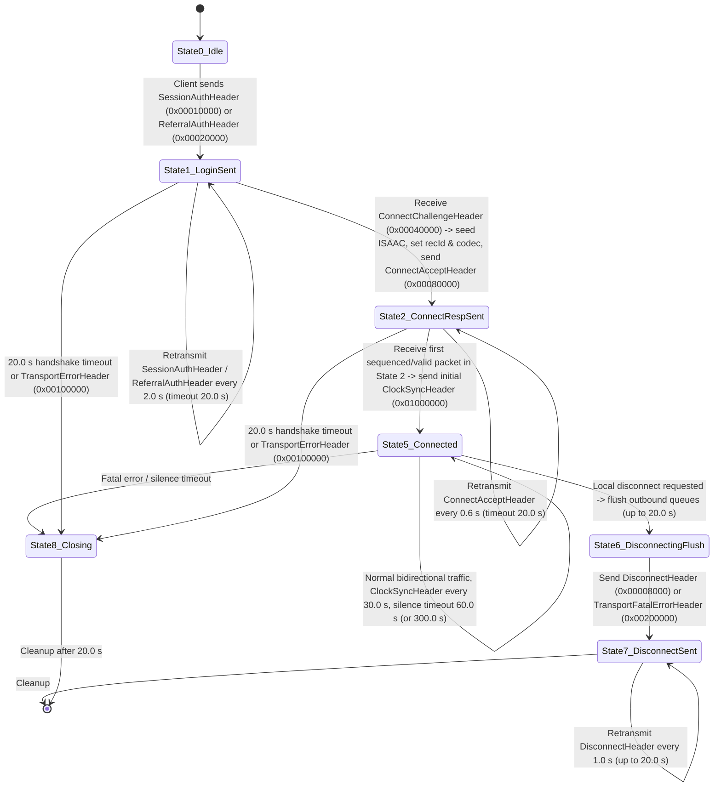

<!-- SPDX-License-Identifier: GPL-3.0-or-later -->

# Official Server Session and Transport Layer

| Field | Value |
|---|---|
| **Status** | **Accepted** (re-accepted on independent Stage 1 core pass 7 review, 2026-10-25; acceptance gated by decision 0042 items 4 & 8; 5 OPEN) |
| **Last updated** | 2026-10-25 |
| **Author role** | Spec writer (dirty room) |
| **Reviewer** | `2ceefe8a-7d00-4de4-90e1-d2d03716cbd9` (independent session, Stage 1 core pass 7, 2026-10-25; `CLEAN_ROOM.md` §5.3 **Pass** — review only, zero body edits) |
| **Implements into** | `crates/compat` (`tessera-compat::session`) |
| **Companion specs** | [`docs/specs/official-login.md`](official-login.md), [`docs/specs/official-messages-world.md`](official-messages-world.md), [`docs/specs/official-messages-play.md`](official-messages-play.md) |

---

## 1. Purpose 

This specification defines the UDP session and transport layer used by the official *The Lord of the Rings Online* (LOTRO) 64-bit client (`lotroclient64.exe`) when communicating with official login, world, and chat servers under Milestone M8 ([decision 0034](../decisions/0034-official-server-compatibility.md)).

It covers:

1. **UDP transport and socket lifecycle** — socket creation, non-blocking configuration, send-buffer sizing, deterministic local port computation, runtime endpoint resolution, single-socket connection multiplexing, and datagram/fragment size limits.
2. **Datagram wire framing and `DatagramHeader` layout** — the 2-byte wire prefix, `.dat`-backed `BitTreeTable` Huffman wire compression (`0x0E010000` / `0x0E010001`), the 20-byte big-endian `DatagramHeader`, header/payload checksum calculation (`compute_datagram_checksum`), and the ordered optional header sections.
3. **Reliability, fragmentation, and flow control** — cumulative acknowledgements (`CumulativeAckHeader`), negative acknowledgements (`SequenceNakHeader`), retransmit rejections (`OutOfOrderAckHeader`), sequence windows, variable-length `FragmentedBlob` fragment headers, fragment reassembly, delivery queues, and flow-control headers (`FlowControlHeader`).
4. **Session handshake and server referral** — the complete state machine from initial `SessionAuthHeader` through `ConnectChallengeHeader` and `ConnectAcceptHeader` to the established session, login-to-world server `WorldReferralHeader` and `ReferralAuthHeader`, server redirection (`ServerRedirectHeader`), and error/refusal reporting (`TransportErrorHeader` / `TransportFatalErrorHeader`).
5. **Encryption, obfuscation, and integrity** — `SessionAuthHeader` authentication-block framing, per-blob payload encryption, directional ISAAC PRNG payload-checksum masking on sequenced packets, and runtime `BitTreeTable` codec UUID negotiation.
6. **Keep-alive, time synchronization, and disconnect** — periodic `ClockSyncHeader`, silence timeouts, and graceful (`DisconnectHeader`) versus error (`TransportFatalErrorHeader`) disconnects.
7. **Upper-layer message envelope (`MessageEnvelope`)** — how reassembled `FragmentedBlob` payloads frame post-handshake session/version messages (`0x0000012C`..`0x00000130`), individual world/play events (`0x6C`, `0x6F`, `0x40`, `0x52`, `0x89`, `0xCE`, `0x24`, `0x30`, etc., starting with `u8 base_flags = 0x00` at inner offset `0`), entity batch containers (`0x0000000D` / `0x0000004C`), and envelope batch containers (`0x00000186` / `0x00000179`).
8. **Testable invariants, hostile-input rules, and synthetic test vectors** — receiver validation rules and self-contained test vectors constructed purely from synthetic inputs.

Pre-session launcher authentication (HTTPS SOAP credentials exchange, GLS ticket acquisition, world queue polling, and command-line hand-off to the client) is specified in [`docs/specs/official-login.md`](official-login.md).

---

## 2. Provenance 

| ID | Method | Source | Question Answered | Why M1–M2 Were Insufficient | Confidence |
|---|---|---|---|---|---|
| `OBS-01` | M1 (Observation) | Local read-only Steam install of LOTRO (`lotroclient64.exe`, file version `4906.0071.1794.4035`, `UserPreferences.ini` keys) | Client build version, presence of `Net.BindInterface` and `Net.ComputeUniquePort` configuration keys in `UserPreferences.ini` | N/A (M1 primary observation) | Confirmed |
| `OBS-02` | M1 (Observation) | Local read-only `client_general.dat` (`0x28000000` root directory map key `0x00000003` -> `0x28000010` bit-tree dictionary sub-map -> `0x0E010000` outgoing dictionary, `0x0E010001` incoming dictionary, `0x0E010002` incoming dictionary redirect) | Exact on-disk byte layout, UUIDs, redirect DID links, node counts (`32,743` and `32,249`), and full binary-tree round-trip verification of all `16,372` and `16,125` leaves in `0x0E010000` and `0x0E010001` | N/A (M1 primary observation of `.dat` records paired with `BIN-02`) | Confirmed |
| `PUB-01` | M2 (Published research) | Related engine transport documentation (Asheron's Call 1 UDP datagram header, fragmented payload blob, and ISAAC checksum-XOR architecture in public emulator documentation) | High-level conceptual model of the UDP transport (bitmask optional headers, 436-byte fragment payloads, ISAAC checksum masking, four delivery queues) | Related-engine analogue only; LOTRO differs in header endianness, wire prefixing, compact variable-length fragment headers, and handshake layouts | Confirmed (where verified by `BIN-01..08`) |
| `BIN-01` | M4 (Static RE) | `lotroclient64.exe` (build `4906.0071.1794.4035`, SHA-256 `d22363eb9aff0fb599fd04b3efa9a1769d08da8af9d8f9b73121c12bfd7e21ee`), Ghidra `12.1.3_DEV` headless decompiler | UDP socket setup, non-blocking I/O, `SO_SNDBUF` binary search, local port formula, single-socket connection demultiplexing, and separate primary game vs. secondary chat UDP transport instances | No public LOTRO specification documents socket buffer negotiation, port derivation, or connection demultiplexing | Confirmed |
| `BIN-02` | M4 (Static RE) | `lotroclient64.exe` (same binary and SHA-256 as `BIN-01`), Ghidra `12.1.3_DEV` headless decompiler | 2-byte datagram wire prefix (`0x0000` vs non-zero recipient ID), runtime loading and bit-stream encoding/decoding of `BitTreeTable` `.dat` records (`0x10000002 -> 0x0E010000` and `0x10000001 -> 0x0E010002 -> 0x0E010001`), 20-byte big-endian `DatagramHeader` layout, valid optional-header flags mask `0x0F7FFB00` (with low-byte bits `0x02` and `0x04` marked `OPEN-SESSION-3`), and `0xBADD70DD` `compute_datagram_checksum` algorithm | LOTRO's wire prefix, `.dat`-backed bit-tree codec, big-endian `DatagramHeader`, and bitmask validation are not documented in M1–M2 sources and differ from AC1 | Confirmed |
| `BIN-03` | M4 (Static RE) | `lotroclient64.exe` (same binary and SHA-256 as `BIN-01`), Ghidra `12.1.3_DEV` headless decompiler | Exact byte layouts and bit ordering of all 18 defined optional headers (`0x00000100` through `0x08000000`), including `SessionAuthHeader` (literal wire magic `"180804\0"`), `ConnectChallengeHeader` (44 B), `ConnectAcceptHeader` (28 B, and its deterministic `checkValue` `u64` LE derivation at `+0x00..+0x07`: the `ConnectChallengeHeader` `0x00040000` handler reads the 8 wire bytes at challenge offset `+0x08..+0x0F` — `u16` LE `assignedClientRecId`, `u16` LE `serverRecId`, and `u32` BE `outgoingSeed` — as a 64-bit big-endian integer and the `ConnectAcceptHeader` `0x00080000` serializer writes that 64-bit integer in little-endian byte order, i.e. byte-reversed `[b7..b0]`, at offset `+0x00..+0x07`), `WorldReferralHeader` (18 B), and `ReferralAuthHeader` (8 B) | No public LOTRO documentation gives the exact byte layouts, endianness, or `ConnectChallengeHeader`-to-`ConnectAcceptHeader` `checkValue` derivation of optional headers | Confirmed |
| `BIN-04` | M4 (Static RE) | `lotroclient64.exe` (same binary and SHA-256 as `BIN-01`), Ghidra `12.1.3_DEV` headless decompiler | Reliability mechanics: `CumulativeAckHeader` (`0x00004000`), `SequenceNakHeader` (`0x00001000`, max 114 entries), `OutOfOrderAckHeader` (`0x00002000`, max 114 entries), sequence window limits (`0x7FFF` and `160,000`), and `FlowControlHeader` (`0x08000000`) | Window thresholds, NAK batching limits, and per-field endianness within reliability headers are only present in binary logic | Confirmed |
| `BIN-05` | M4 (Static RE) | `lotroclient64.exe` (same binary and SHA-256 as `BIN-01`), Ghidra `12.1.3_DEV` headless decompiler | Compact variable-length `FragmentedBlob` fragment header encoding, 2-byte alignment padding, `VariableU32` variable-length integer encoding, 436-byte fragment chunking, max 20 fragments per packet, and 28,566,720-byte max blob size | LOTRO replaced AC1's fixed 16-byte fragment header with a variable-length prefix-coded header not documented in public sources | Confirmed |
| `BIN-06` | M4 (Static RE) | `lotroclient64.exe` (same binary and SHA-256 as `BIN-01`), Ghidra `12.1.3_DEV` headless decompiler | Session state machine (`0..8`), retransmission intervals (`0.6 s`, `1.0 s`, `2.0 s`), connection/disconnect timeouts (`20.0 s`, `60.0 s`, `300.0 s`), `ClockSyncHeader` (`30.0 s`), and `TransportErrorHeader` wire fields | Exact state numbers, timer constants, and wire error header fields require binary inspection | Confirmed |
| `BIN-07` | M4 (Static RE) | `lotroclient64.exe` (same binary and SHA-256 as `BIN-01`), Ghidra `12.1.3_DEV` headless decompiler | `SessionAuthHeader` (`0x00010000`) wire layout (`authFlags` bit `0` = `0` unencrypted credentials payload, `authType = 0x40000002` ticket-blob mode and `authType = 0x00000001` modes), per-blob encryption flag (`0x08`), and directional ISAAC checksum PRNG seeding and consumption | Wire `authType`/`authFlags` modes, per-blob encryption rules, and ISAAC seed assignment (`aa = bb = cc = seed`) are not in M1–M2 | Confirmed |
| `BIN-08` | M4 (Static RE) | `lotroclient64.exe` (same binary and SHA-256 as `BIN-01`), Ghidra `12.1.3_DEV` headless decompiler | Reassembled `FragmentedBlob` to `MessageEnvelope` boundary (`envelopeFlags` bits `0x01` zlib and `0x02` routing header), direct-payload vs. `u8 base_flags = 0x00` inner message formats, post-handshake `ClientVersionMessage` (`0x0000012C`..`0x00000130`, literal `"netver:<netver_string>; didver:<didver_string>"`), world entity batches (`0x0000000D` / `0x0000004C`), and envelope batch containers (`0x00000186` / `0x00000179`) | Envelope framing, routing headers, post-handshake version negotiation, and the exact boundary into `official-messages-world.md` are not documented in public LOTRO sources | Confirmed |

---

## 3. Transport and Socket Layer 

### 3.1 Socket Creation and Options 

Each UDP transport instance creates a single IPv4 datagram socket with the following parameters (`BIN-01`):

| Parameter | Value | Meaning |
|---|---|---|
| Address family | `2` (`AF_INET`) | IPv4 internet protocols |
| Socket type | `2` (`SOCK_DGRAM`) | Connectionless, unreliable datagrams |
| Protocol | `0` (default for `SOCK_DGRAM`, i.e. `IPPROTO_UDP = 17`) | UDP |
| Non-blocking mode | Enabled (`true`) | Non-blocking socket I/O; receive loops poll until no datagram is ready (`WouldBlock` / `EAGAIN`) |
| Send buffer (`SO_SNDBUF`) | Target `131,072` bytes (`0x20000`) | Queried via `getsockopt(SOL_SOCKET, SO_SNDBUF)`. If the current buffer size is less than `131,072` bytes, the transport performs a binary search with `setsockopt(SOL_SOCKET, SO_SNDBUF)` over the range `[current_size, 131072]` (halving the step until the interval width is `<= 1`) to configure the largest send buffer the operating system accepts up to `131,072` bytes |

### 3.2 Local Bind Address and Port Selection 

Before binding the UDP socket, the transport resolves the local IPv4 interface and UDP port (`OBS-01`, `BIN-01`) from the `--outport` launch parameter (or the two-colon `localHost:remoteHost:port` form of `-h` / `--host` documented in [`docs/specs/official-login.md`](official-login.md) §4.1–§4.2, where `-h` / `--host` accepts a colon-delimited string with zero colons `remoteHost`, one colon `remoteHost:port`, or two colons `localHost:remoteHost:port`, and any `<` `>` angle brackets in `<localHost:remoteHost:port>` help text are metasyntactic placeholders rather than literal command-line characters) and the `Net.BindInterface` and `Net.ComputeUniquePort` keys in `UserPreferences.ini` (`OBS-01`):

1. **Local IPv4 address**:
   - The transport checks the first segment (`localHost`, before the first `:`) when `-h` / `--host` is supplied in the two-colon `localHost:remoteHost:port` form ([`docs/specs/official-login.md`](official-login.md) §4.1–§4.2; in the zero-colon `remoteHost` and one-colon `remoteHost:port` forms, no `localHost` segment is present) and the `UserPreferences.ini` setting `Net.BindInterface`.
   - If a non-empty interface specification is provided (either an IPv4 prefix or `address/mask` CIDR notation), the transport enumerates local host IPv4 addresses and selects the first non-loopback address whose bitwise AND with `mask` equals the bitwise AND of the configured address with `mask`.
   - If no interface specification is configured, the transport selects the first non-loopback local IPv4 address (i.e. not `127.0.0.1` / `0x0100007F` in network byte order), or `0.0.0.0` (`INADDR_ANY`) if enumeration fails.
2. **Local UDP port**:
   - The transport checks the `--outport` launch parameter (default `0`, [`docs/specs/official-login.md`](official-login.md) §4.1–§4.2) and the boolean preference `Net.ComputeUniquePort` (default `true` / `1`) in `UserPreferences.ini`.
   - **Case A — Explicit base port (non-zero `--outport`)**: The transport attempts to `bind()` to `outport + k` for `k = 0, 1, ..., 11` (up to `12` consecutive ports) on the selected local IPv4 address, stopping at the first successful `bind()`.
   - **Case B — Computed unique port (`--outport` equal to `0`, `Net.ComputeUniquePort` equal to `true`, and local IPv4 address not equal to `0.0.0.0`)**: Let `ip_be` be the 32-bit local IPv4 address in network byte order interpreted as a 32-bit unsigned integer on the host. For attempt index `k` starting at `0` (while `k < 12`), the candidate port is:
     `candidate_port = (ip_be mod 0xFA07) + (256 * k)`
     If `candidate_port <= 0x03FF` (`1023`), `k` is incremented by `1` so the port lies above the privileged port range (`>= 1024`). The transport attempts `bind()` with `candidate_port` (in big-endian `sin_port`), incrementing `k` on failure for up to `12` attempts.
   - **Case C — Wildcard fallback**: If neither Case A nor Case B succeeds (or if `Net.ComputeUniquePort` is `false`), the transport calls `bind()` with port `0` (allowing the OS to assign an ephemeral port), falling back to `INADDR_ANY` (`0.0.0.0:0`) if interface-specific binding fails.

### 3.3 Runtime Resolution of Remote Endpoints 

No official server hostname, IPv4 address, or port is hardcoded in the session protocol (`BIN-01`, `BIN-03`):

- **Initial login/world server endpoint**: Resolved from the `-h` / `--host` (`remoteHost`, `remoteHost:port`, or `localHost:remoteHost:port`) and `-p` / `--port` launch parameters ([`docs/specs/official-login.md`](official-login.md) §4.1–§4.2).
- **World server hand-off (`WorldReferralHeader`, `0x00000800`)**: During an active login-server session, the server sends a `WorldReferralHeader` optional header containing an 8-byte IPv4 socket address structure (`sin_family`, `sin_port`, `sin_addr`) and an 8-byte referral cookie for the target world server (see [Section 6.5](#referral-flow)).
- **Authentication server address update (`AuthServerAddressHeader`, `0x00000200`)**: A server packet may carry an 8-byte IPv4 socket address structure updating the stored login server address.
- **Chat server endpoint (`ChatSession`)**: Secondary chat UDP transport whose endpoint address and UDP port are supplied via the `--chatserver <host:port>` launch parameter (falling back to the primary `-h` / `--host` value when `--usechat` is active; see [`docs/specs/official-login.md`](official-login.md) §4.1 and [`docs/specs/official-messages-play.md`](official-messages-play.md) §6.1.1 & §6.6.1).

### 3.4 Single-Socket Multiplexing and Transport Instances 

The client runs separate UDP session multiplexers (`SessionMultiplexer`) for primary login/world game traffic and secondary chat traffic (`BIN-01`). Within each multiplexer instance, a **single non-blocking UDP socket** multiplexes all active and pending `SessionConnection` sessions (for example, when transitioning from a login server connection to a referred world server connection):

- **Local recipient ID (`localRecId`)**: Each session connection uses a distinct 16-bit local recipient ID in the range `0x0100 .. 0xFEFF` (`256 .. 65,279`), carried in `DatagramHeader.recId` on incoming datagrams to identify the target session.
- **Incoming datagram demultiplexing**:
  1. When a UDP datagram arrives via `recvfrom()`, the receiver first extracts the 16-bit `recId` from the packet header (`wirePrefix` when non-zero, or `DatagramHeader.recId` at bytes `2..4` when `wirePrefix` equals `0x0000`).
  2. If `recId` lies in `0x0100 .. 0xFEFF` (`256 .. 65,279`), the receiver matches the active `SessionConnection` whose `localRecId` equals `recId`. If found, it also verifies that the packet's source IPv4 address and UDP port match the connection's remote peer address.
  3. If `recId < 0x0100` (e.g., `0x0000` during the initial `ConnectChallengeHeader` before the server knows the client's `localRecId`) or if the ID lookup misses, the receiver iterates over the active connections to find one whose remote `(IPv4, port)` matches the datagram's source address.
  4. If no matching connection exists, the datagram is rejected and discarded.

### 3.5 Datagram, Fragment, and Reassembly Size Constants 

| Constant | Hex | Decimal | Scope and Meaning | Provenance |
|---|---|---|---|---|
| `MAX_DATAGRAM_BUF` | `0xFF7C` | `65,404` B | Maximum total wire datagram size (`2`-byte `wirePrefix` + `20`-byte `DatagramHeader` + `pakSize` payload). The header validator accepts `pakSize` in `0 .. 65,403` (`0x0000 .. 0xFF7B`, rejecting `pakSize > 0xFF7B`), while within the maximum `65,404`-byte (`0xFF7C`) UDP datagram (`2`-byte `wirePrefix` + `20`-byte `DatagramHeader` + `pakSize` payload) `pakSize` is at most `65,382` (`0xFF66`) | `BIN-01` |
| `MIN_DATAGRAM_BYTES` | `0x0016` | `22` B | Minimum valid UDP datagram length (`2` B wire prefix + `20` B `DatagramHeader`) | `BIN-02` |
| `DATAGRAM_HEADER_BYTES` | `0x0014` | `20` B | Fixed size of `DatagramHeader` | `BIN-02` |
| `MAX_PACKET_BLOB_BUDGET` | `0x01D0` | `464` B | Maximum byte budget for `FragmentedBlob` fragments (headers + payloads) assembled into a single outgoing packet, and maximum single fragment payload accepted by the receiver (`< 0x01D1`) | `BIN-05` |
| `MAX_BLOB_FRAG_PAYLOAD` | `0x01B4` | `436` B | Maximum payload slice placed in a single `FragmentedBlob` fragment when splitting an outgoing `FragmentedBlob`; also the stride (`fragIndex * 436`) used during reassembly | `BIN-05` |
| `MAX_FRAGS_PER_PACKET` | `0x0014` | `20` | Maximum number of `FragmentedBlob` fragments permitted in a single UDP packet | `BIN-05` |
| `MAX_BLOB_BYTES` | `0x01B3E4C0` | `28,566,720` B | Architectural ceiling on a reassembled `FragmentedBlob` payload size (`65,520 * 436` bytes) | `BIN-05` |
| `MAX_ZLIB_UNCOMPRESSED_BYTES` | `0x02000000` | `33,554,432` B | Hard ceiling (`32 MiB`) enforced by the `MessageEnvelope` zlib unpacker | `BIN-08` |
| `MAX_NAK_ENTRIES` | `0x0072` | `114` | Maximum number of sequence numbers carried in a single `SequenceNakHeader` (`0x00001000`) or `OutOfOrderAckHeader` (`0x00002000`) optional header (`4 + 114 * 4 = 460` bytes) | `BIN-04` |
| `DEFAULT_MAX_CONCURRENT_BLOBS` | `0x0040` | `64` | Default upper bound on concurrent incomplete multi-fragment `FragmentedBlob` reassembly entries per connection in `tessera_compat::session` | Normative defensive bound |
| `DEFAULT_MAX_REASSEMBLY_BLOB_BYTES` | `0x00100000` | `1,048,576` B | Default per-blob reassembly memory limit (`1 MiB`, configurable up to `MAX_BLOB_BYTES`) in `tessera_compat::session` | Normative defensive bound |
| `DEFAULT_MAX_DECOMPRESSED_MESSAGE_BYTES` | `0x00400000` | `4,194,304` B | Default decompressed `MessageEnvelope` size limit (`4 MiB`, configurable up to `MAX_ZLIB_UNCOMPRESSED_BYTES`) in `tessera_compat::session` | Normative defensive bound |
| `DEFAULT_MAX_CONTAINER_DEPTH` | `0x0008` | `8` | Default maximum recursion depth when unpacking nested batch containers (`0x00000186` / `0x00000179` or `0x0000000D` / `0x0000004C`) | Normative defensive bound |

---

## 4. Packet Framing and Checksum 

### 4.1 Two-Byte Datagram Wire Prefix and `.dat`-Backed Bit-Tree Compression 

Every UDP datagram transmitted or received on the wire begins with a 2-byte big-endian unsigned integer prefix (`wirePrefix`) ahead of the packet body (`BIN-02`):

| Offset | Size | Type | Byte Order | Field | Meaning |
|---|---|---|---|---|---|
| `0x00` | `2` | `u16` | Big-endian | `wirePrefix` | `0x0000` if the remainder of the datagram is unencoded; non-zero (`0x0001..0xFFFF`) if the datagram was compressed using the connection's negotiated `BitTreeTable` Huffman table, in which case `wirePrefix` is the big-endian `recId` field of `DatagramHeader` (`remoteRecId` on send, `localRecId` on receive) |
| `0x02` | `N - 2` | `u8[]` | Byte stream | `wireBody` | Either the raw 20-byte `DatagramHeader` + `pakSize` payload (when `wirePrefix` equals `0x0000`), or the `BitTreeTable`-encoded representation of bytes `0x02..end` of `[DatagramHeader \| Payload]` (when `wirePrefix` is non-zero) |

#### 4.1.1 Unencoded Mode (`wirePrefix` Equal to `0x0000`)

When `wirePrefix` equals `0x0000`:
- All out-of-band / unsequenced control packets (`SessionAuthHeader`, `ReferralAuthHeader`, `ConnectAcceptHeader`, `DisconnectHeader`, `TransportFatalErrorHeader`, `ClockSyncHeader`, `CumulativeAckHeader`, `SequenceNakHeader`, `OutOfOrderAckHeader`), as well as any packet sent on a connection where no `BitTreeTable` codec was negotiated (`codecUuid` all zeros in `ConnectChallengeHeader`) or while `remoteRecId` is `0`, use `wirePrefix = 0x0000` (`BIN-02`, `BIN-03`).
- On receive, if bytes `0..1` are `0x0000`, the receiver copies bytes `2..N` directly as the decoded packet (`DatagramHeader` + payload) without bit-tree decompression (`BIN-02`).

#### 4.1.2 `BitTreeTable`-Encoded Mode (Non-Zero `wirePrefix`) 

When a connection has negotiated a `BitTreeTable` codec (attached during `ConnectChallengeHeader` `0x00040000` when `codecUuid` matches a `.dat` bit-tree dictionary; see [Section 7.3](#per-connection-codec)):
- **On send (`BIN-02`)**: For normal sequenced data packets (once `remoteRecId` is non-zero and no handshake/system-only header flags are present), the sender places `remoteRecId` in big-endian byte order into bytes `0..1` of the UDP datagram (`wirePrefix`) and compresses the remainder of the packet starting at byte `2` of `DatagramHeader` (i.e. `DatagramHeader.pakSize` onward, length `18 + pakSize`) using the outgoing `BitTreeTable`, writing the encoded output into datagram bytes `2..end`.
- **On receive (`BIN-02`)**: When a UDP datagram arrives with a non-zero `wirePrefix`, `wirePrefix` (`u16` BE) is the target connection's `localRecId`. The receiver looks up the active `SessionConnection` whose `localRecId` equals `wirePrefix` (falling back to source address matching if needed). If the connection has an active `BitTreeTable` codec, the receiver decompresses datagram bytes `2..N` (`wireBody`) and prepends the 2-byte big-endian `wirePrefix` as bytes `0..1` (`DatagramHeader.recId`) of the reconstructed packet (`[wirePrefix | decompressedBytes]`). If decompression fails, the datagram is rejected and discarded.

#### 4.1.3 Runtime Loading and Binary Layout of `BitTreeTable` `.dat` Records (`0x0E010000`–`0x0E010002`)

There are **no** static bit-tree wire compression tables in `lotroclient64.exe`. Instead, the session transport uses two `BitTreeTable` dictionary records resolved at runtime from **`client_general.dat`** (`OBS-02`, `BIN-02`):

1. **Runtime discovery via directory map `0x28000000` -> `0x28000010` (`OBS-02`, `BIN-02`)**:
   - In `client_general.dat`, the Master DID Map file ID at superblock offset `0x170..0x173` (`u32 LE`) is **`0x28000000`** (see [`docs/specs/dat-container.md`](dat-container.md) §3.2 and [`docs/specs/records.md`](records.md) §8.2). Looking up root subsystem key `0x00000003` (`"COMPRESSIONDICTIONARY"`) in `0x28000000` resolves to `DataIdMap` sub-map record **`0x28000010`** (`116` bytes in `client_general.dat`).
   - Sub-map record `0x28000010` contains four `(enum_key: u32 LE, target_did: u32 LE)` entries (`0x00000000` `"Undef"` -> `0x00000000`, plus three non-zero dictionary entries; the ASCII strings `"COMPRESSIONDICTIONARY"`, `"Undef"`, `"Server2ClientDeferred"`, `"Client2Server"`, and `"Server2Client"` are stored literally in `0x28000000` and `0x28000010` on disk and are stated here for `.dat` archive interoperability) (`OBS-02`, `BIN-02`):

| `0x28000010` Sub-Entry Key | On-Disk Label in `0x28000010` | Target DID | `redirectDid` at `+0x20` | Effective Dictionary Record | Record Contents and Protocol Role (`OBS-02`, `BIN-02`) |
|---|---|---|---|---|---|
| `0x10000001` | `"Server2ClientDeferred"` | `0x0E010002` | `0x0E010001` | `0x0E010001` (`214,953` B) | Incoming (server-to-client decompress) deferred redirect stub (`44` B, `version = 0`, `bodyLen = 0`) that redirects via `redirectDid = 0x0E010001` to `0x0E010001` |
| `0x10000002` | `"Client2Server"` | `0x0E010000` | `0x00000000` | `0x0E010000` (`218,247` B) | Outgoing (client-to-server compress) dictionary (`version = 1`, `bodyLen = 218,203`); its 16-byte `codecUuid` at `+0x10..+0x1F` identifies the client-to-server compression dictionary |
| `0x10000003` | `"Server2Client"` | `0x0E010001` | `0x0E010001` | `0x0E010001` (`214,953` B) | Direct incoming (server-to-client decompress) dictionary (`version = 1`, `bodyLen = 214,909`); target of `0x0E010002`'s redirect link |

   - **Redirect resolution rule (`0x0E010000`–`0x0E010002`, `OBS-02`, `BIN-02`)**: Record `0x0E010001` stores its own DID (`0x0E010001`) at offset `+0x20` (`redirectDid`). A loader therefore follows `redirectDid` at `+0x20` **only when `redirectDid` is non-zero and not equal to the record's own DID** (as in the 44-byte stub `0x0E010002`, where `redirectDid` is `0x0E010001`, `version` is `0`, and `bodyLen` is `0`). When `redirectDid` equals the record's own DID (as in `0x0E010001`) or is zero (as in `0x0E010000`), the payload at `+0x24` (`version = 1`, `bodyLen`, and the inline bit-tree dictionary body at `+0x2C`) is the literal dictionary.

2. **Exact binary layout of `0x0E010000`–`0x0E010002` in `client_general.dat` (`OBS-02`, `BIN-02`)**:
   Each `0x0E0100xx` record has a 44-byte (`0x2C`) header (with no leading DID prologue; see [`docs/specs/misc-records.md`](misc-records.md) §11) followed by an `m`-byte body:

| Offset | Size | Type | Byte Order | Field | Meaning and Observed Values (`OBS-02`, `BIN-02`) |
|---|---|---|---|---|---|
| `0x00` | `16` | `u8[16]` | Mixed-endian GUID | `formatUuid` | Dictionary format UUID: `8d 87 95 e7 33 c6 1c 47 83 15 c3 db be ad 2f aa` (`{E795878D-C633-471C-8315-C3DBBEAD2FAA}`) in all three records. The loader rejects any record whose `formatUuid` does not match this 16-byte constant. |
| `0x10` | `16` | `u8[16]` | Mixed-endian GUID | `codecUuid` | Per-dictionary wire codec UUID matched against `ConnectChallengeHeader.codecUuid` (`0x0E010000` has one UUID; `0x0E010001` and `0x0E010002` share a second UUID). |
| `0x20` | `4` | `u32` | Little-endian | `redirectDid` | `0x00000000` in `0x0E010000`; `0x0E010001` in both `0x0E010001` (its own DID) and `0x0E010002`. A loader follows `redirectDid` to another `.dat` record only when `redirectDid` is non-zero and not equal to the record's own DID; when `redirectDid` equals the record's own DID or is zero, the payload at `+0x24` is the literal dictionary. |
| `0x24` | `4` | `u32` | Little-endian | `version` | Format version: `1` in `0x0E010000` and `0x0E010001`; `0` in stub record `0x0E010002`. The parser requires `version` to equal `1`. |
| `0x28` | `4` | `u32` | Little-endian | `bodyLen` (`m`) | Byte length of the serialized dictionary body that follows (`218,203` in `0x0E010000`; `214,909` in `0x0E010001`; `0` in `0x0E010002`). |
| `0x2C` | `m` | `u8[m]` | Byte stream | `body` | Serialized bit-tree node table (layout below), consumed with `0` leftover bytes in both `0x0E010000` and `0x0E010001`. |

3. **Bit-tree `body` layout (`offset 0x2C .. 0x2C + m`, `OBS-02`, `BIN-02`)**:
   - Begins with `nodeCount` (`u32 LE`): `32,743` in `0x0E010000` (`16,372` leaves + `16,371` internal branch nodes) and `32,249` in `0x0E010001` (`16,125` leaves + `16,124` internal branch nodes).
   - Followed immediately by `nodeCount` sequential node definitions (`index = 0 .. nodeCount - 1`). **Invariant (`OBS-02`, `BIN-02`)**: all leaf nodes (non-zero `isLeaf`) precede all internal branch nodes (`isLeaf` equal to `0`), and the **first internal branch node** (`index = 16,372` in `0x0E010000`, `index = 16,125` in `0x0E010001`) is the root of the decoding binary tree (`rootNodeIndex`):
     - Each node begins with `isLeaf` (`u8`, `1` = leaf node, `0` = internal branch node).
     - **When `isLeaf` is non-zero (leaf node)**:
       1. `symbolLen` (`u8`): number of uncompressed bytes represented by this leaf (`1 .. 4` in both dictionaries; all `256` single-byte symbols `0x00..0xFF` are present as leaves, plus multi-byte sequences of length `2..4` whose `(symbolLen - 1)`-byte prefix is already a leaf node).
       2. `symbolBytes` (`u8[symbolLen]`): the raw `symbolLen` uncompressed byte sequence emitted when decoding reaches this leaf.
       3. `codeBitLen` (`u8`): bit length of the leaf's Huffman codeword (`1 .. 27` in `0x0E010000`; `1 .. 26` in `0x0E010001`).
       4. `codewordBytes` (`floor(codeBitLen / 8) + 1` bytes): the leaf's codeword stored in little-endian byte order (zero-extended to a 32-bit unsigned integer `codeword`, consumed least-significant-bit first from bit `0` to bit `codeBitLen - 1`).
     - **When `isLeaf` equals `0` (internal branch node)**:
       1. `child0Index1Based` (`u16 LE`): **1-based** node index (`0` = null; `k` in `1 .. nodeCount` points to `node[k - 1]`) taken when the next input bit is `0`.
       2. `child1Index1Based` (`u16 LE`): **1-based** node index (`0` = null; `k` in `1 .. nodeCount` points to `node[k - 1]`) taken when the next input bit is `1`.

4. **Exact bit-stream compression and decompression algorithm on `wireBody` (`BIN-02`)**:
   - **4-bit header at the start of `wireBody` (bits `0..3` of byte `0` of `wireBody`, i.e. byte `2` of the UDP datagram)**:
     - Bit `0` (least significant bit of byte `0` of `wireBody`): `isCompressed` (`0` = literal uncompressed fallback; `1` = Huffman bit-tree compressed).
     - Bits `1..3` (the next three bits of byte `0` of `wireBody`): `unusedTrailingBits` (`0 .. 7`), giving the count of unused high-order bits in the final byte of `wireBody`.
   - **Decompression (`BIN-02`)**:
     1. **Literal fallback (`isCompressed` equal to `0`)**: When `isCompressed` is `0`, the encoder used literal fallback; the decoder verifies that `wireBody` contains at least `1` byte and that `unusedTrailingBits` equals `0`, then copies all bytes of `wireBody` after byte `0` verbatim as the `18 + pakSize` decompressed packet bytes.
     2. **Bit-tree decoding (`isCompressed` equal to `1`)**:
        - Compute the total number of valid bits in `wireBody` as `8` times the byte length of `wireBody` minus `unusedTrailingBits`, and initialize the bit cursor to bit index `4` (immediately after the 4-bit header). Within each byte of `wireBody`, bits are ordered from least significant bit (bit `0`) to most significant bit (bit `7`), so bit index `b` selects bit `(b mod 8)` of byte `floor(b / 8)`.
        - Repeat the following traversal while the bit cursor is strictly less than the valid bit end:
          1. Start at the root of the decoding tree (`rootNodeIndex`, the first internal branch node).
          2. While the current node is an internal branch node (`isLeaf` equal to `0`):
             - If the bit cursor has reached or exceeded the valid bit end, reject the datagram as a truncated bit stream.
             - Read the bit (`0` or `1`) at the current bit cursor and advance the bit cursor by `1`.
             - Transition to the node at zero-based index `child0Index1Based - 1` when the bit is `0`, or `child1Index1Based - 1` when the bit is `1` (rejecting the datagram if the selected 1-based child index is `0` or out of bounds).
          3. Once a leaf node (non-zero `isLeaf`) is reached, append its `symbolLen` uncompressed bytes (`symbolBytes`) to the decompressed output buffer.
   - **Compression (`BIN-02`)**:
     1. Reserve the low `4` bits of byte `0` of `wireBody` for the 4-bit header and start writing encoded bits at bit index `4`.
     2. Starting at uncompressed byte offset `0` and repeating until all `inputLen` uncompressed bytes have been consumed, match the longest byte prefix of length `1` to `4` bytes (bounded by the remaining uncompressed bytes) that corresponds to a leaf node in the dictionary, append the low `codeBitLen` bits of that leaf's `codeword` in least-significant-bit-first order to the output bit stream, and advance the uncompressed byte offset by the matched leaf's `symbolLen`.
     3. Pad the final partial byte of the output bit stream with zero bits; the resulting compressed byte length is `ceil(bitCursor / 8)` and `unusedTrailingBits` is `(8 * compressedByteLen) - bitCursor`.
     4. If `compressedByteLen` is at most `inputLen + 1`, set bit `0` (`isCompressed = 1`) and bits `1..3` (`unusedTrailingBits`) in byte `0` of `wireBody` and emit the compressed bytes. Otherwise (when bit-tree encoding does not reduce the length below `inputLen + 2`), emit a single header byte `0x00` (`isCompressed = 0`, `unusedTrailingBits = 0`) followed by the `inputLen` uncompressed bytes verbatim (`BIN-02`).

### 4.2 Twenty-Byte `DatagramHeader` Layout 

After wire decompression (so that bytes `0..19` form the full header), every packet begins with a 20-byte (`0x14`) `DatagramHeader`. **All multi-byte integer fields in `DatagramHeader` are stored in big-endian (network) byte order on the wire** (`BIN-02`):

| Offset | Size | Type | Byte Order | Field | Meaning |
|---|---|---|---|---|---|
| `0x00` | `2` | `u16` | Big-endian | `recId` | Recipient session/connection ID (`0x0000` before session ID assignment; `>= 0x0100` once assigned) |
| `0x02` | `2` | `u16` | Big-endian | `pakSize` | Byte length of the packet payload immediately following this 20-byte header. The header validator accepts `pakSize` in `0 .. 65,403` (`0x0000 .. 0xFF7B`, rejecting `pakSize > 0xFF7B`), while within the maximum `65,404`-byte (`0xFF7C`) UDP datagram (`2`-byte `wirePrefix` + `20`-byte `DatagramHeader` + `pakSize` payload) `pakSize` is at most `65,382` (`0xFF66`). Must equal `decoded_packet_len - 20` |
| `0x04` | `4` | `u32` | Big-endian | `flags` | Bitmask of optional headers and packet flags. Wire bits outside `0x0F7FFB00` are undefined and cause immediate packet rejection (whether low-byte bits `0x02` and `0x04` are accepted or masked on live packets is `OPEN`; see `OPEN-SESSION-3`) |
| `0x08` | `4` | `u32` | Big-endian | `seqNum` | Packet sequence number (`0` for unsequenced handshake packets prior to `ConnectChallengeHeader`; `>= 2` for sequenced packets; for unsequenced packets sent after session setup, carries the last assigned outgoing `seqNum` without setting `0x02000000`) |
| `0x0C` | `4` | `u32` | Big-endian | `checksum` | 32-bit packet checksum (`headerChecksum + payloadChecksum`, with `payloadChecksum` XOR-masked by the directional ISAAC PRNG when bit `25` `0x02000000` of `flags` is set) |
| `0x10` | `1` | `u8` | Byte | `iteration` | Routing / referral iteration byte (high byte of the big-endian `u16` at `0x10`) |
| `0x11` | `1` | `u8` | Byte | `table` | Server routing table index (low byte of the big-endian `u16` at `0x10`) |
| `0x12` | `2` | `u16` | Big-endian | `time` | 16-bit millisecond tick delta (`elapsed_ms mod 65536`) |

### 4.3 `DatagramHeader` Flags Bitmask (`0x0F7FFB00`) 

Exactly **18** header flag bits in bits `8..27` (`0x00000100`, `0x00000200`, `0x00000800`, `0x00001000`, `0x00002000`, `0x00004000`, `0x00008000`, `0x00010000`, `0x00020000`, `0x00040000`, `0x00080000`, `0x00100000`, `0x00200000`, `0x00400000`, `0x01000000`, `0x02000000`, `0x04000000`, and `0x08000000`) are defined on the wire, whose union is **`0x0F7FFB00`** (`BIN-02`, `BIN-03`). On all standard datagrams, bits `0..7` are cleared (`0x00`, `VALID_DATAGRAM_FLAGS_MASK = 0x0F7FFB00`): if any bit in the disallowed mask `0xF08004FF` is set in `flags` on the wire or the 16-bit `pakSize` field in `DatagramHeader` exceeds `0xFF7B` (`65,403` bytes; the header validator accepts `pakSize` in `0 .. 65,403` (`0x0000 .. 0xFF7B`), while within the maximum `65,404`-byte (`0xFF7C`, `MAX_DATAGRAM_BUF`) UDP datagram of `2`-byte `wirePrefix` + `20`-byte `DatagramHeader` + `pakSize` payload, `pakSize` is at most `65,382` (`0xFF66`)), the packet is immediately rejected (`BIN-02`). In particular, bits `10` (`0x00000400`), `23` (`0x00800000`), and `28..31` (`0xF0000000`) are undefined and rejected, whereas bit `15` (`0x00008000`, `DisconnectHeader`) **is** a valid flag bit (`BIN-02`, `BIN-03`).

When multiple optional header bits are set in `flags`, their corresponding header structures appear consecutively at the start of the packet payload (offset `0x14`) in **strict ascending bit order** (`0x00000100` first, `0x08000000` last), followed by `FragmentedBlob` fragments if and only if `0x04000000` (`HasFragmentedBlobsFlag`) is set (`BIN-02`, `BIN-03`):

| Flag Bit (Host `u32`) | Bit Index | Neutral Wire Name | Direction | Payload Size (Bytes) | Description |
|---|---|---|---|---|---|
| `0x00000100` | `8` | `ServerRedirectHeader` | Server -> Client | `8` | Notification of server switch/redirect (`u32` LE sequence/ID, `u32` LE switch type) |
| `0x00000200` | `9` | `AuthServerAddressHeader` | Server -> Client | `8` | IPv4 socket address (`sin_family` LE, `sin_port` BE, `sin_addr` BE) of authentication/login server |
| `0x00000800` | `11` | `WorldReferralHeader` | Server -> Client | `18` | World-server hand-off (`u64` LE cookie, 8-byte IPv4 socket address, `u16` LE server ID) |
| `0x00001000` | `12` | `SequenceNakHeader` | Bidirectional | `4 + 4 * N` | Negative acknowledgement / retransmission request (`u32` LE count `N <= 114`, then `N` `u32` LE sequence numbers) |
| `0x00002000` | `13` | `OutOfOrderAckHeader` | Bidirectional | `4 + 4 * N` | Reject retransmit / dropped sequence numbers (`u32` LE count `N <= 114`, then `N` `u32` LE sequence numbers) |
| `0x00004000` | `14` | `CumulativeAckHeader` | Bidirectional | `4` | Cumulative sequence acknowledgement (`u32` **big-endian** highest contiguous sequence number) |
| `0x00008000` | `15` | `DisconnectHeader` | Bidirectional | `0` | Graceful disconnect notification (no optional header payload bytes) |
| `0x00010000` | `16` | `SessionAuthHeader` | Client -> Server | Variable | Initial login handshake (`"180804\0"` literal wire magic string + length-prefixed authentication block) |
| `0x00020000` | `17` | `ReferralAuthHeader` | Client -> Server | `8` | Initial world-server handshake carrying the 8-byte `u64` LE referral cookie |
| `0x00040000` | `18` | `ConnectChallengeHeader` | Server -> Client | `44` (`0x2C`) | Server session parameters, ISAAC seeds, connection IDs, and 16-byte codec UUID |
| `0x00080000` | `19` | `ConnectAcceptHeader` | Client -> Server | `28` (`0x1C`) | Client confirmation of session parameters and 16-byte codec UUID |
| `0x00100000` | `20` | `TransportErrorHeader` | Server -> Client | `8` | Non-fatal or handshake transport error (`u32` LE error ID, `u32` LE error parameter) |
| `0x00200000` | `21` | `TransportFatalErrorHeader` | Bidirectional | `8` | Fatal disconnect with error reason (`u32` LE error ID, `u32` LE error parameter) |
| `0x00400000` | `22` | `ClientControlHeader` | Client -> Server only | `4` (`u32` LE) | 4-byte `u32` LE control header, valid only client-to-server and rejected if received from a server |
| `0x01000000` | `24` | `ClockSyncHeader` | Bidirectional | `8` | Network clock synchronization (`f64` IEEE-754 LE timestamp in seconds) |
| `0x02000000` | `25` | `MaskedChecksumFlag` | Bidirectional | `0` | Carries `0` optional header bytes on the wire; indicates that `seqNum` is an active sequenced packet whose payload checksum is XOR-masked with the directional ISAAC PRNG. |
| `0x04000000` | `26` | `HasFragmentedBlobsFlag` | Bidirectional | `0` | Carries `0` optional header bytes on the wire; indicates that one or more `FragmentedBlob` fragments follow the optional headers. |
| `0x08000000` | `27` | `FlowControlHeader` | Bidirectional | `6` | Flow-control rate report (`u32` LE bytes received delta, `u16` LE interval in milliseconds) |

> **Wire behavior of bits `25` (`0x02000000`) and `26` (`0x04000000`)** (`BIN-02`, `BIN-03`):
> On the wire, bit `25` (`0x02000000`, `MaskedChecksumFlag`) and bit `26` (`0x04000000`, `HasFragmentedBlobsFlag`) carry `0` optional header bytes: bit `25` (`0x02000000`) is set whenever the packet is a sequenced packet whose payload checksum is XOR-masked by the directional ISAAC PRNG, and bit `26` (`0x04000000`) is set whenever the packet carries at least one `FragmentedBlob` fragment after the optional headers.

> **OPEN (`OPEN-SESSION-3`):** While the high-byte defined wire flags mask `0x0F7FFB00` is confirmed (`BIN-02`, `BIN-03`), whether low-byte bits `0x02` and `0x04` of `flags` (`protoFlags`, `0x06`) are accepted or masked before the disallowed-bit mask check on live packets is `OPEN`. A clean-room sender clears bits `0..7` (`0x00`) on all standard datagrams.

### 4.4 Checksum Calculation Algorithm (`compute_datagram_checksum`) 

Packet integrity is verified using a 32-bit word-summing checksum primitive (`compute_datagram_checksum`, `BIN-02`):

#### 4.4.1 `compute_datagram_checksum` Primitive

Given a byte slice of length `len` (`u32`) bytes:

1. **Initialize accumulator**: Start with a 32-bit unsigned accumulator set to `0`. All additions below wrap modulo $2^{32}$.
2. **Sum complete 4-byte little-endian words**: Partition the first `4 * floor(len / 4)` bytes into `floor(len / 4)` consecutive 4-byte words, interpret each 4-byte word as a 32-bit **little-endian** unsigned integer, and add each word to the accumulator modulo $2^{32}$.
3. **Fold trailing bytes (`rem = len mod 4`)**:
   - When `rem` is `0` (the byte length is an exact multiple of `4`), the checksum is the accumulator value from Step 2.
   - When `rem` is `1`, `2`, or `3`, pack the remaining `rem` trailing bytes into the **most significant bytes** of a 32-bit unsigned integer `tail` (with the unused low-order bytes set to `0x00`), add `tail` to the accumulator modulo $2^{32}$, and then add `(len * 65536) mod 2^32` (i.e., `len` multiplied by $2^{16}$) to the accumulator modulo $2^{32}$:

| Trailing Byte Count (`rem = len mod 4`) | `tail` Word Constructed from Trailing Bytes `t[0 .. rem - 1]` | Length Term Added to Accumulator |
|---|---|---|
| `0` | `0x00000000` (Step 3 skipped) | `0x00000000` (not added when `rem` is `0`) |
| `1` | Big-endian `[t[0], 0x00, 0x00, 0x00]` (`t[0] * 2^24`) | `(len * 2^16) mod 2^32` |
| `2` | Big-endian `[t[0], t[1], 0x00, 0x00]` (`t[0] * 2^24 + t[1] * 2^16`) | `(len * 2^16) mod 2^32` |
| `3` | Big-endian `[t[0], t[1], t[2], 0x00]` (`t[0] * 2^24 + t[1] * 2^16 + t[2] * 2^8`) | `(len * 2^16) mod 2^32` |

*Note on trailing byte order in Step 3 (`BIN-02`)*: Whereas complete 4-byte words in Step 2 are interpreted as **little-endian** 32-bit unsigned integers, trailing bytes (`rem = 1, 2, 3`) in Step 3 are placed into `tail` starting from the **most significant byte** (bits `24..31` first, then `16..23`, then `8..15`), and the length term `(len * 2^16) mod 2^32` is added if and only if `rem` is non-zero.

#### 4.4.2 Header Checksum and Payload Checksum

To compute or verify the 32-bit `DatagramHeader.checksum` field (`BIN-02`):

1. **Header checksum (`hdrSum`)**:
   - Form the 20-byte wire `DatagramHeader` (with all fields in big-endian wire byte order), and set bytes `0x0C..0x0F` (`checksum`) to the 4-byte sequence `BA DD 70 DD` (big-endian `0xBADD70DD`, which equals `0xDD70DDBA` when read as a little-endian `u32`).
   - Apply `compute_datagram_checksum` to those `20` header bytes to obtain `hdrSum`. Because `20` is a multiple of `4`, `hdrSum` is the modulo-$2^{32}$ sum of the five little-endian `u32` words of the seeded header.
2. **Payload checksum (`payloadSum`)**:
   - On **receive**: Apply `compute_datagram_checksum` to the `pakSize` payload bytes immediately following the 20-byte `DatagramHeader`.
   - On **send**: Accumulate `payloadSum` modulo $2^{32}$ by summing `compute_datagram_checksum` over each attached optional header buffer plus `compute_datagram_checksum` over the fragment header and fragment payload of each attached `FragmentedBlob` fragment.
3. **Combining and ISAAC XOR masking**:
   - **Unsequenced packet (`MaskedChecksumFlag` `0x02000000` clear in `flags`)**: Compute `totalSum = (hdrSum + payloadSum) mod 2^32` and write `totalSum` into `DatagramHeader.checksum` (`0x0C..0x0F`) in **big-endian** byte order.
   - **Sequenced packet (`MaskedChecksumFlag` `0x02000000` set in `flags`)**: Let `xorMask` (`u32`) be the 32-bit word drawn from the connection's directional ISAAC PRNG for this packet's `seqNum` (outgoing PRNG on send, incoming PRNG on receive; see [Section 7.2](#isaac-checksum)). Compute `maskedPayloadSum` as the 32-bit bitwise XOR of `payloadSum` and `xorMask`, compute `totalSum = (hdrSum + maskedPayloadSum) mod 2^32`, and write `totalSum` into `DatagramHeader.checksum` (`0x0C..0x0F`) in **big-endian** byte order.
   - **Receiver verification**: On receiving a packet with `MaskedChecksumFlag` (`0x02000000`) set, the receiver reads the big-endian `u32` `wireTotalSum` from `DatagramHeader.checksum` (`0x0C..0x0F`), computes `hdrSum` (with `BA DD 70 DD` at `0x0C..0x0F`), subtracts `hdrSum` from `wireTotalSum` modulo $2^{32}$ to obtain `maskedPayloadSum`, bitwise-XORs `maskedPayloadSum` with `xorMask` to recover `unmaskedPayloadSum`, and verifies that `(hdrSum + unmaskedPayloadSum) mod 2^32` equals `(hdrSum + payloadSum) mod 2^32`. If they differ, the packet is rejected and dropped (`BIN-02`).

---

## 5. Reliability, Fragmentation, and Flow Control 

### 5.1 Sequence Numbers and Windows 

Each `SessionConnection` maintains two 32-bit sequence counters (`BIN-04`):

- **Outgoing sequence number (`sendSeqNum`)**:
   - Initialized to `1` before the first sequenced packet is sent.
   - Pre-incremented (`sendSeqNum + 1`) when assigning a sequence number to each new outgoing sequenced packet (bit `25` `0x02000000` of `flags` set), so the first sequenced packet transmitted on a connection has `seqNum = 2`.
   - If incrementing wraps to `0`, it advances to `1` (or `2`) so `seqNum` is never `0` for a sequenced packet.
   - Unsequenced packets (bit `25` `0x02000000` of `flags` clear) do not increment `sendSeqNum`; their `DatagramHeader.seqNum` field is set to `0` (for initial handshake packets) or the current value of `sendSeqNum` without setting `0x02000000`.
- **Incoming expected sequence number (`recvSeqExpected`)**:
   - Initialized to `1` when the `SessionConnection` is constructed (`BIN-01`).
   - When a packet arrives with `seqNum`, the receiver enforces two window checks (`BIN-04`):
     1. `seqNum <= recvSeqExpected + 0x7FFF` (maximum lookahead window of `32,767` packets).
     2. The count of tracked missing sequence numbers must not exceed `160,000`.
     If either check fails, the packet is rejected immediately before checksum unmasking.
   - On the sender side, if the count of unacknowledged sent packets in the retransmit table exceeds `129,988` (`0x1FBC4`) or the sequence span exceeds `0x7FFFFFFF`, the connection closes locally (`BIN-04`).

### 5.2 Cumulative Acknowledgements (`CumulativeAckHeader`, `0x00004000`) 

| Offset | Size | Type | Byte Order | Field | Meaning |
|---|---|---|---|---|---|
| `0x00` | `4` | `u32` | **Big-endian** | `ackSeqNum` | Highest contiguous `seqNum` received by the sender of this `CumulativeAckHeader` |

- **Generation (`BIN-04`)**: During each connection maintenance tick, if the connection has no missing sequence numbers in its gap table (`missingCount` equal to `0`) and at least `2.0` seconds have elapsed since the last `CumulativeAckHeader` / `SequenceNakHeader` transmission, the receiver sends an unsequenced packet with `flags = 0x00004000` carrying `recvSeqExpected` in **big-endian** byte order.
- **Processing (`BIN-04`)**: When a peer receives `CumulativeAckHeader(ackSeqNum)`, it converts `ackSeqNum` from big-endian to host order and removes all sent packets with `seqNum <= ackSeqNum` (modulo 32-bit signed sequence comparison) from its outbound retransmission table.

### 5.3 Negative Acknowledgements (`SequenceNakHeader`, `0x00001000`) 

| Offset | Size | Type | Byte Order | Field | Meaning |
|---|---|---|---|---|---|
| `0x00` | `4` | `u32` | Little-endian | `count` | Number of missing sequence numbers `N` (`1 <= N <= 114`) |
| `0x04` | `4 * N` | `u32[N]` | Little-endian | `seqNums` | Array of `N` missing sequence numbers requested for retransmission |

- **Gap detection (`BIN-04`)**: When a sequenced packet arrives with `seqNum > recvSeqExpected + 1`, for every skipped sequence number `s` in `(recvSeqExpected + 1) .. (seqNum - 1)`:
  1. The receiver advances the incoming ISAAC checksum PRNG once for `s` and records an entry `(seqNum = s, savedPrngMask)` in its missing-sequence gap table.
  2. When `s` later arrives out of order, the receiver looks up `s` in the gap table, uses `savedPrngMask` to unmask `s`'s payload checksum, and removes `s` from the gap table.
- **Transmission (`BIN-04`)**: While `missingCount > 0`, every `0.6` seconds the receiver traverses up to `114` (`0x72`) entries in ascending sequence order from its gap table and sends a `SequenceNakHeader` (`0x00001000`) optional header listing their sequence numbers.
- **Processing (`BIN-04`)**: When a peer receives `SequenceNakHeader(count, seqNums[])`:
  - If `count` equals `0` or `count > 114` (`0x72`), the packet is rejected as malformed.
  - For each requested `s` in `seqNums`:
    - First, all sent packets in the retransmit table with sequence number strictly less than the first NAKed sequence number (`seqNums[0]`) are implicitly acknowledged and freed (`BIN-04`).
    - If `s` is still present in the sender's retransmit table and still holds at least one deliverable fragment/header, `s` is queued for retransmission (reusing its originally assigned `seqNum` and saved outgoing ISAAC mask `xorMask`, with an updated header checksum).
    - If `s` is no longer present or its unreliable fragments have expired, `s` is appended to the sender's outbound `OutOfOrderAckHeader` (`0x00002000`) queue (`BIN-04`).

### 5.4 Retransmit Rejection (`OutOfOrderAckHeader`, `0x00002000`) 

| Offset | Size | Type | Byte Order | Field | Meaning |
|---|---|---|---|---|---|
| `0x00` | `4` | `u32` | Little-endian | `count` | Number of unrecoverable sequence numbers `N` (`1 <= N <= 114`) |
| `0x04` | `4 * N` | `u32[N]` | Little-endian | `seqNums` | Array of `N` sequence numbers that the sender will not retransmit |

- **Generation (`BIN-04`)**: On each connection tick, up to `114` (`0x72`) sequence numbers accumulated in the connection's dropped-sequence queue are packed into an `OutOfOrderAckHeader` (`0x00002000`) optional header and transmitted.
- **Processing (`BIN-04`)**: When a receiver gets `OutOfOrderAckHeader(count, seqNums[])` (with `1 <= count <= 114`), it removes each listed sequence number `s` from its missing-packet gap table and advances `recvSeqExpected` across any newly contiguous prefix so the gap no longer stalls acknowledgements.

### 5.5 Flow Control (`FlowControlHeader`, `0x08000000`) 

| Offset | Size | Type | Byte Order | Field | Meaning |
|---|---|---|---|---|---|
| `0x00` | `4` | `u32` | Little-endian | `bytesReceivedDelta` | Number of raw wire bytes received by the sender of this header since its previous `FlowControlHeader` |
| `0x04` | `2` | `u16` | Little-endian | `intervalMs` | Elapsed time in milliseconds (`floor(elapsed_sec * 1000.0)` truncated to `u16`) over which `bytesReceivedDelta` was measured |

- **Generation (`BIN-03`, `BIN-04`)**: Attached to an outgoing packet when at least `1/3` second (`0.3333333333333333` s) has elapsed since the last `FlowControlHeader` was sent and at least `1,400` bytes (`0x578`) have been received in that window.

### 5.6 `FragmentedBlob` Fragmentation, Delivery Queues, and Reassembly 

All upper-layer game messages are encapsulated in `FragmentedBlob` payloads, sliced into fragments of at most `436` (`0x1B4`) payload bytes, and carried after the optional headers in packets that have bit `26` (`0x04000000`, `HasFragmentedBlobsFlag`) of `DatagramHeader.flags` set (`BIN-05`).

#### 5.6.1 `VariableU32` Variable-Length Integer Encoding

Both `FragmentedBlob` fragment headers and upper-layer game messages use a single uniform 4-tier prefix-coded unsigned 32-bit integer format (`VariableU32`, `1`, `2`, `4`, or `5` bytes, `BIN-05`, `BIN-08`):

| Value Range | Encoded Size | First Byte Prefix | Wire Layout |
|---|---|---|---|
| `0x00000000 .. 0x0000007F` | `1` byte | `0xxxxxxx` (bit `7` of `b0` is `0`) | `b0`: low `7` bits of `val` (`0x00 .. 0x7F`) |
| `0x00000080 .. 0x00003FFF` | `2` bytes | `10xxxxxx` (bits `6..7` of `b0` are `10` binary, `0x80 .. 0xBF`) | `b0`: `0x80` plus bits `8..13` of `val` `b1`: bits `0..7` of `val` |
| `0x00004000 .. 0x1FFFFFFF` | `4` bytes | `110xxxxx` (bits `5..7` of `b0` are `110` binary, `0xC0 .. 0xDF`) | `b0`: `0xC0` plus bits `24..28` of `val` `b1`: bits `16..23` of `val` `b2..b3`: bits `0..15` of `val` as a 16-bit **little-endian** unsigned integer (`b2` = bits `0..7`, `b3` = bits `8..15`) |
| `0x20000000 .. 0xFFFFFFFF` | `5` bytes | `11100000` (`b0` equals `0xE0`) | `b0`: `0xE0` `b1..b4`: full 32-bit `val` as a 32-bit **little-endian** unsigned integer (`b1` = bits `0..7`, ..., `b4` = bits `24..31`) |

*Implementer caution (`BIN-05`, `BIN-08`)*: Notice the hybrid endianness of `VariableU32` in the 4-byte tier: the high `13` bits are placed in `b0` (bits `24..28` plus `0xC0`) and `b1` (bits `16..23`), whereas the low `16` bits (bits `0..15`) are read and written as a single 16-bit **little-endian** word (`b2` holds bits `0..7`, `b3` holds bits `8..15`). All `VariableU32` fields across both `FragmentedBlob` fragment headers (`seqGroup`, `fragIndex`, `numFrags`, `blobHeaderWord`, `fragDataLen`) and upper-layer `MessageEnvelope` containers (`0x00000186`, `0x00000179`) use this uniform 4-tier (`1`-, `2`-, `4`-, or `5`-byte) definition; values in `0x20000000 .. 0xFFFFFFFF` (such as `blobHeaderWord` opcodes `0x3000001B`–`0x30000043` and `0x40000001`–`0x40000002`) use the 5-byte `0xE0` prefix followed by the 32-bit little-endian integer. Any first byte `b0` in `0xE1 .. 0xFF` is invalid and rejected.

#### 5.6.2 Delivery Queues (`queueId`)

Every `FragmentedBlob` belongs to one of four delivery queues (`queueId` in `1..4`, stored in bits `0..6` of the first byte of the fragment header) (`BIN-05`):

| `queueId` | Name | Wire `orderNum` Behavior | Reliability and Ordering Semantics |
|---|---|---|---|
| `1` | `Unreliable` (Ephemeral) | Omitted on wire (defaults to `0xFFFF`) | Unreliable, unordered. Unfragmented blobs have `blobId = 0`; fragmented unreliable blobs (`numFrags > 1`) assign a non-zero 16-bit `blobId` from a rotating counter so fragments can be reassembled (`BIN-05`). |
| `2` | `ReliableOrdered` | Carries per-queue `u16` LE `orderNum` on wire | Reliable and delivered in strict `orderNum` sequence. |
| `3` | `Sequenced` (Latest-only) | Carries `seqGroup` (`VariableU32`) and `orderNum` (`u16` LE) | Unreliable / latest-only within a sequence group `seqGroup`; older `orderNum` blobs in the same `seqGroup` are superseded. |
| `4` | `ReliableUnordered` | Carries `orderNum` (`u16` LE) and `blobId` (`u16` LE) | Reliable retransmission at the fragment/packet level; delivered as soon as reassembly completes. |

#### 5.6.3 Compact Variable-Length `FragmentedBlob` Fragment Header Layout

Unlike Asheron's Call 1 (which used a fixed 16-byte header), LOTRO serializes each `FragmentedBlob` fragment header using a compact variable-length format padded to an **even number of bytes** (`BIN-05`):

| Order | Condition | Size | Type | Field | Meaning |
|---|---|---|---|---|---|
| 1 | Always | `1` | `u8` | `queueAndOpt` | Bits `0..6` (low 7 bits): `queueId` (`1..4`). Bit `7` (`0x80`): `hasTotalSizeWord` — if set, field 6 (`extWord`, `u16` LE) is present |
| 2 | Always | `1` | `u8` | `blobFlags` | Bit `0` (`0x01`): `HasAttachment` (if set, a 28-byte attachment header follows the fragment header; see below). Bit `3` (`0x08`): `EncryptedFragmentedBlob` (payload is 3DES-CBC encrypted with the session cipher; see [Section 7.1](#per-blob-encryption)). Bit `4` (`0x10`): `IsFragmented` (`numFrags > 1`; if clear, `fragIndex = 0` and `numFrags = 1`). Bit `6` (`0x40`): `DefaultRecipient` (if set, `recipientId` is the default `0x0000000000000002` and field 7 is omitted). Bit `7` (`0x80`): `OmitChunkInfo` (if clear, fields 8a and 8b are present) |
| 3a | `queueId` equals `3` | `1, 2, 4, or 5` | `VariableU32` | `seqGroup` | 16-bit sequence group ID (if `queueId` is not `3`, defaults to `0`) |
| 3b | `queueId` in `{2, 3, 4}` | `2` | `u16` LE | `orderNum` | Per-queue ordering number (if `queueId` equals `1`, defaults to `0xFFFF`) |
| 4 | `queueId` in `{2, 4}` OR (`queueId` equals `1` and `IsFragmented` `0x10` set) | `2` | `u16` LE | `blobId` | 16-bit blob identifier used to key the reassembly table (otherwise defaults to `0`) |
| 5a | `IsFragmented` (`0x10`) set in `blobFlags` | `1, 2, 4, or 5` | `VariableU32` | `fragIndex` | Zero-based fragment index (`0 .. numFrags - 1`). When `IsFragmented` (`0x10`) is clear, `fragIndex = 0` |
| 5b | `IsFragmented` (`0x10`) set in `blobFlags` | `1, 2, 4, or 5` | `VariableU32` | `numFrags` | Total number of fragments in this `FragmentedBlob` (`>= 2`). Receiver **must reject** the packet if `numFrags <= fragIndex`! When `IsFragmented` (`0x10`) is clear, `numFrags = 1` |
| 6 | `hasTotalSizeWord` (`0x80`) set in `queueAndOpt` | `2` | `u16` LE | `extWord` | Optional 16-bit extension word (defaults to `0` when bit 7 of `queueAndOpt` is clear) |
| 7 | `DefaultRecipient` (`0x40`) clear in `blobFlags` | `8` | `u64` LE | `recipientId` | Explicit 64-bit recipient ID (when `DefaultRecipient` `0x40` is set, defaults to `0x0000000000000002`) |
| 8a | `OmitChunkInfo` (`0x80`) clear in `blobFlags` AND `fragIndex` equals `0` | `1, 2, 4, or 5` | `VariableU32` | `blobHeaderWord` | 32-bit upper-layer message opcode / header word, transmitted only in fragment `0` (values in `0x20000000 .. 0xFFFFFFFF`, such as `0x3000001B`–`0x30000043` and `0x40000001`–`0x40000002`, use the 5-byte `0xE0` prefix form of [Section 5.6.1](#fragmented-blobs)) |
| 8b | `OmitChunkInfo` (`0x80`) clear in `blobFlags` | `1, 2, 4, or 5` | `VariableU32` | `fragDataLen` | Byte length of this fragment's payload slice (`0 .. 436`, or up to `464`). Receiver **must reject** if `fragDataLen >= 0x01D1` (`465`) |
| 9 | Byte length of fields 1–8b is odd | `1` | `u8` | `alignPad` | Zero pad byte (`0x00`) appended whenever the serialized length of fields 1–8b is odd, ensuring the fragment header is always an **even number of bytes**. On receive, if `alignPad` is non-zero, the receiver **must reject** the packet |
| 10 | `HasAttachment` (`0x01`) set in `blobFlags` | `28` | Tuple | `attachment` | Present only when the fragment attachment bit is set: three `u64` LE words (`24` B) followed by one `u32` LE word (`4` B) (`BIN-05`) |

Immediately following the padded fragment header (and optional 28-byte attachment), the packet contains `fragDataLen` bytes of fragment payload (`BIN-05`). If `DatagramHeader.pakSize` has remaining bytes after `fragDataLen`, the next `FragmentedBlob` fragment header begins immediately at the next byte, up to a maximum of `20` (`0x14`) fragments per packet (`BIN-05`).

#### 5.6.4 Fragmentation and Reassembly Rules

- **Splitting (`BIN-05`)**:
  - Given a `FragmentedBlob` payload of `L` bytes:
    - If `L` equals `0`, `numFrags = 1` with `fragDataLen = 0`.
    - If `L > 0`, `numFrags = ceil(L / 436)`. Fragment `i` (`0 <= i < numFrags - 1`) carries `436` (`0x1B4`) bytes from offset `i * 436`; the final fragment `numFrags - 1` carries the remaining `L - (numFrags - 1) * 436` bytes (`1 .. 436`).
- **Reassembly (`BIN-05`)**:
  - When a fragment arrives on a connection, the receiver validates:
    1. `(numFrags - 1) * 436 + fragDataLen <= 0x01B3E4C0` (`28,566,720` bytes, `MAX_BLOB_BYTES`), and `<= max_reassembly_blob_bytes` (normative implementation default `DEFAULT_MAX_REASSEMBLY_BLOB_BYTES = 1,048,576` bytes = `1 MiB`, configurable up to `MAX_BLOB_BYTES`); if larger, the fragment is dropped.
    2. If `numFrags` equals `1` (`fragIndex` equals `0`), no reassembly state is needed; the single fragment's `blobHeaderWord` and `fragDataLen` bytes form the completed `FragmentedBlob` immediately.
    3. If `numFrags > 1`, the receiver looks up or allocates a reassembly entry keyed by `(senderId, queueId, blobId)` in its incomplete-blob table (with a `30.0`-second reassembly expiration timer and a normative implementation cap of `DEFAULT_MAX_CONCURRENT_BLOBS = 64` concurrent incomplete blobs per connection).
    4. The reassembly buffer is sized to `numFrags * 436` bytes, and a bitmask array of `ceil(numFrags / 32)` 32-bit words tracks received fragment indices (setting bit `(fragIndex mod 32)` in word `floor(fragIndex / 32)`).
    5. Fragment `fragIndex`'s payload (`fragDataLen` bytes) is copied into the reassembly buffer at byte offset `fragIndex * 436`. If `fragIndex` equals `0`, `blobHeaderWord` is also stored on the reassembled `FragmentedBlob`. If `fragIndex` equals `numFrags - 1`, the total reassembled payload length is trimmed to `(numFrags - 1) * 436 + fragDataLen`.
    6. Once all `numFrags` bits in the bitmask are set, the completed `FragmentedBlob` is removed from the incomplete-blob table and passed to the upper-layer `MessageEnvelope` decoder (`BIN-05`).

---

## 6. Session Set-Up Handshake, Referral, and State Machine 

### 6.1 Connection State Machine (`0..8`) 

Each `SessionConnection` tracks its lifecycle state in a 32-bit integer (`0..8`) (`BIN-06`):

| State Value | Name | Retransmit / Periodic Action | Timeout | Transition Conditions |
|---|---|---|---|---|
| `0` | `Idle` / `Uninitialized` | None | `20.0` s | Transitions to `1` when `SessionAuthHeader` (`0x00010000`) or `ReferralAuthHeader` (`0x00020000`) is queued |
| `1` | `SessionAuthSent` | Retransmits stored `SessionAuthHeader` (`0x00010000`) or `ReferralAuthHeader` (`0x00020000`) every `2.0` s | `20.0` s | On receiving `ConnectChallengeHeader` (`0x00040000`), initializes ISAAC PRNGs and codec, sends `ConnectAcceptHeader` (`0x00080000`), and enters State `2`. If the handshake times out (`20.0` s) before `ConnectChallengeHeader` arrives, the connection closes locally |
| `2` | `ChallengeAcceptSent` | Retransmits `ConnectAcceptHeader` (`0x00080000`) every `0.6` s | `20.0` s | Upon receiving the next valid server packet while in State `2` (or completing `ConnectChallengeHeader` when already in State `2`), transitions to State `5` (`Connected`) and immediately sends an initial `ClockSyncHeader` (`0x01000000`). If the handshake times out (`20.0` s), the connection closes locally |
| `3` | `ServerListening` (unused on client) | None | `20.0` s | Server-side accept state; if ever entered on client, times out after `20.0` s |
| `4` | `ServerConnectSent` (unused on client) | None | `20.0` s | Server-side handshake state; if ever entered on client, times out after `20.0` s |
| `5` | `Connected` (Established) | Sends `ClockSyncHeader` (`0x01000000`) every `30.0` s; sends `CumulativeAckHeader` every `2.0` s or `SequenceNakHeader` every `0.6` s | `60.0` s normal silence timeout, or `300.0` s if the extended timeout flag is set; also `140.0` s hard ceiling on `ConnectChallengeHeader` | Normal established state for `FragmentedBlob` traffic. Transitions to `6` on local disconnect request, or closes locally on silence timeout / `DisconnectHeader` (`0x00008000`) / `TransportFatalErrorHeader` (`0x00200000`) |
| `6` | `DisconnectingFlush` | Waits for pending reliable outbound packets to be acknowledged (up to `20.0` s) | `20.0` s | Once outbound retransmit table drains or `20.0` s elapses, sends `TransportFatalErrorHeader` (`0x00200000`) or `DisconnectHeader` (`0x00008000`) and transitions to State `7` |
| `7` | `DisconnectSent` | Retransmits `DisconnectHeader` (`0x00008000`) every `1.0` s | `20.0` s | Closes and removes the connection once `20.0` s elapses |
| `8` | `Closing` | None | `20.0` s | Terminal state before connection cleanup |

### 6.2 Step 1: Client `SessionAuthHeader` (`0x00010000`, Client -> Login / World / Chat Server) 

To initiate a session with a login, world, or chat server, the client constructs a `SessionConnection` in State `1` (`localRecId` in `0x0100 .. 0xFEFF` (`256 .. 65,279`), `remoteRecId = 0`) and sends an unencoded (`wirePrefix = 0x0000`), unsequenced (`seqNum = 0`) packet with `DatagramHeader.flags = 0x00010000` (`BIN-03`, `BIN-07`):

| Offset | Size | Type | Byte Order | Field | Meaning |
|---|---|---|---|---|---|
| `0x00` | `7` | `u8[7]` | Literal ASCII + NUL | `netVersion` | **Literal wire magic string required on the UDP wire (`BIN-03`)**: `"180804\0"` (`31 38 30 38 30 34 00`). Written byte-for-byte up to and including the `0x00` terminator |
| `0x07` | `4` | `u32` | Little-endian | `authBlockPaddedLen` | Byte length of the following `authBlock` padded up to the next multiple of `4` bytes |
| `0x0B` | `authBlockPaddedLen` | `u8[]` | Byte stream | `authBlock` | Serialized authentication block (see [Section 6.2.1](#auth-block-layout)), zero-padded at the end to `authBlockPaddedLen` bytes |

#### 6.2.1 `SessionAuthHeader` Authentication Block Layout 

This section is the single canonical wire specification of `SessionAuthHeader` (`0x00010000`) for both the primary login/world UDP connection and the secondary `ChatSession` (`--chatserver`, [`docs/specs/official-messages-play.md`](official-messages-play.md) §6.6.2) UDP connection (`BIN-07`).

An `AccountString` in `authBlock` is a length-prefixed UTF-16LE string consisting of a 4-tier `VariableU32` ([Section 5.6.1](#fragmented-blobs)) UTF-16 code-unit count `N` followed immediately by `2 * N` bytes of UTF-16LE character data (with no trailing NUL code unit). *(Note: session/transport UTF-16LE strings — `AccountString` in `SessionAuthHeader` and the UTF-16LE strings in `0x0000012E` and `0x00000130` [Section 9.3](#post-handshake-negotiation) — use this 4-tier `VariableU32` ([Section 5.6.1](#fragmented-blobs)) code-unit count prefix, whereas world/play event and property UTF-16LE strings (`Prefixed UTF-16LE string`) use the 3-tier VLE code-unit count prefix specified in [`docs/specs/official-messages-world.md`](official-messages-world.md) §2.3.)* The `authBlock` serialized inside `SessionAuthHeader` (`BIN-07`) has a 12-byte prefix followed by `credentialsPayload`:

| Offset | Size | Type | Byte Order | Field | Meaning |
|---|---|---|---|---|---|
| `0x00` | `4` | `u32` | Little-endian | `authType` | Authentication mode identifier (`0x40000002` or `0x00000001`; see the deterministic `authType` selection rule below) |
| `0x04` | `4` | `u32` | Little-endian | `authFlags` | Bitmask of optional conditional fields (`0x00 .. 0x800`; bits above `0x800` are invalid and rejected): - Bit `0` (`0x01`): `0` on the wire (unencrypted credentials payload, `BIN-07`) - Bit `1` (`0x02`): `HasSecondString` (`secondStr` `AccountString` is present) - Bit `2` (`0x04`): `HasExtraBlob` (`extraBlob` `u32` LE byte length `blobLen` followed by `blobLen` raw bytes is present) - Bits `3..11` (`0x08 .. 0x800`): additional optional conditional fields in the wire parser (`0` on all client connections) |
| `0x08` | `4` | `u32` | Little-endian | `clientTimestamp` | 32-bit Unix timestamp in seconds since 1970-01-01T00:00:00Z recorded when the transport was initialized |
| `0x0C` | Variable | Struct | Little-endian | `credentialsPayload` | Unencrypted credentials payload (`authFlags` bit `0` `0x01` is `0` on the wire): `accountOrTicketStr` (`AccountString`), followed by optional `secondStr` (`AccountString`, when bit `1` `0x02` is set) and optional `extraBlob` (`u32` LE `blobLen` + `blobLen` raw bytes, when bit `2` `0x04` is set) |

On the wire, `authFlags` bit `0` (`0x01`) is `0` (unencrypted credentials payload) (`BIN-07`).

**Deterministic `authType` and `authFlags` Selection Rule (`BIN-07`)**:
1. **Ticket-authenticated mode (`authType = 0x40000002`, `authFlags = 0x00000004` `HasExtraBlob`):** Sent whenever a GLS ticket is present (`--glsticketdirect` or `--glsticket`), on both the primary login/world connection and the secondary `ChatSession` connection ([`docs/specs/official-messages-play.md`](official-messages-play.md) §6.6.2). `accountOrTicketStr` carries the UTF-16LE account/subscription identifier (`--account`), and `extraBlob` carries `u32` LE `blobLen` followed by the `blobLen` raw bytes obtained by Base64-decoding the ASCII GLS ticket string (`blobLen` equals the decoded byte length of the Base64 ticket string, e.g. up to `108` bytes (`0x0000006C`, or `106..108` bytes depending on `'='` padding) for a 144-character Base64 ticket or up to `135..192` bytes (`133..192` bytes depending on `'='` padding) for a `180..256`-character Base64 ticket as in [`docs/specs/official-login.md`](official-login.md) §3.4). (A clean-room receiver also accepts the alternate wire encoding `authType = 0x00000001` with `authFlags = 0x00000002` `HasSecondString`, where the ticket string is carried in `secondStr`.)
2. **Account-only mode (`authType = 0x00000001`, `authFlags = 0x00000000`):** Sent only when no GLS ticket is supplied, carrying `accountOrTicketStr` with no optional fields (`0` trailing bytes).

**Wire `credentialsPayload` Field Order (`authFlags` bit `0` = `0`, `BIN-07`)**:
1. `accountOrTicketStr` (`AccountString`): `VariableU32` UTF-16 code-unit count followed by UTF-16LE characters, carrying the account/subscription identifier (`--account`, [`docs/specs/official-login.md`](official-login.md)).
2. If bit `1` (`0x02`, `HasSecondString`) of `authFlags` is set: `secondStr` (`AccountString`): `VariableU32` UTF-16 code-unit count followed by UTF-16LE characters.
3. If bit `2` (`0x04`, `HasExtraBlob`) of `authFlags` is set: `extraBlob`: `u32` LE byte length `blobLen` (the decoded byte count of the Base64 GLS ticket, e.g. up to `108` bytes (`0x0000006C`, or `106..108` bytes depending on `'='` padding) for a 144-character Base64 ticket or up to `135..192` bytes (`133..192` bytes depending on `'='` padding) for a `180..256`-character Base64 ticket) followed by `blobLen` raw bytes.

### 6.3 Step 2: Server `ConnectChallengeHeader` (`0x00040000`, Server -> Client) 

When the server accepts `SessionAuthHeader` (or `ReferralAuthHeader`), it responds with an optional header `0x00040000` (`ConnectChallengeHeader`) of exactly **44 bytes (`0x2C`)** (`BIN-03`):

| Offset | Size | Type | Byte Order | Field | Meaning |
|---|---|---|---|---|---|
| `0x00` | `8` | `f64` | Little-endian (IEEE-754) | `serverTime` | Server's current network clock in seconds |
| `0x08` | `2` | `u16` | Little-endian | `assignedClientRecId` | The 16-bit connection ID assigned to the client, or `0` if keeping existing ID |
| `0x0A` | `2` | `u16` | Little-endian | `serverRecId` | The server's 16-bit recipient connection ID (`remoteRecId`), which the client must place in `DatagramHeader.recId` (and `wirePrefix`) on subsequent packets to this server |
| `0x0C` | `4` | `u32` | **Big-endian** on wire | `outgoingSeed` | 32-bit seed for the client's **outgoing** (client -> server) ISAAC checksum XOR generator |
| `0x10` | `4` | `u32` | **Big-endian** on wire | `incomingSeed` | 32-bit seed for the client's **incoming** (server -> client) ISAAC checksum XOR generator |
| `0x14` | `4` | `u32` | Little-endian | `reserved_dword_14` | 32-bit reserved word (server-side meaning `OPEN`; ignored by client) |
| `0x18` | `2` | `u16` | Little-endian | `clientConnIdx` | 16-bit connection index, echoed back in `ConnectAcceptHeader` |
| `0x1A` | `2` | `u16` | Little-endian | `reserved_word_1a` | 16-bit reserved word (server-side meaning `OPEN`; ignored by client) |
| `0x1C` | `16` | `u8[16]` | Mixed-endian GUID (`u32` LE, `u16` LE, `u16` LE, `u8[8]`) | `codecUuid` | 16-byte GUID selecting the per-connection packet codec (all zeros `00..00` if none; echoed back in `ConnectAcceptHeader`) |

> **OPEN (`OPEN-SESSION-1`):** While the 44-byte (`0x2C`) size of `ConnectChallengeHeader` (`0x00040000`) and the positions and byte order of `serverTime` (`+0x00..+0x07`), `assignedClientRecId` (`+0x08..+0x09`), `serverRecId` (`+0x0A..+0x0B`), `outgoingSeed` (`+0x0C..+0x0F` BE), `incomingSeed` (`+0x10..+0x13` BE), `clientConnIdx` (`+0x18..+0x19`), and `codecUuid` (`+0x1C..+0x2B`) are confirmed (`BIN-03`), the server-side meaning of the 32-bit word `reserved_dword_14` at `+0x14..+0x17` (`u32` LE) and the 16-bit word `reserved_word_1a` at `+0x1A..+0x1B` (`u16` LE) is `OPEN`. A clean-room receiver reads and ignores both fields; a synthetic test/sender sets them to `0`.

### 6.4 Step 3: Client `ConnectAcceptHeader` (`0x00080000`, Client -> Server) 

Upon processing `ConnectChallengeHeader` (`0x00040000`) while in State `1` (or State `2`), the client (`BIN-03`, `BIN-06`):
1. Updates its connection IDs (`serverRecId`, `clientConnIdx`) and synchronizes its clock with `serverTime`.
2. Constructs and seeds its incoming (seeded with `incomingSeed`) and outgoing (seeded with `outgoingSeed`) ISAAC checksum generators.
3. Matches `codecUuid` against the 16-byte `codecUuid` fields (`+0x10..+0x1F`) of the loaded `BitTreeTable` dictionaries from `client_general.dat` (if `codecUuid` is not all-zeros and does not match a loaded dictionary, the connection closes locally).
4. Constructs and sends `ConnectAcceptHeader` (`0x00080000`, **28 bytes = `0x1C`**), transitioning from State `1` to State `2` (or from State `2` to State `5` if already in State `2`):

| Offset | Size | Type | Byte Order | Field | Meaning |
|---|---|---|---|---|---|
| `0x00` | `8` | `u64` | Little-endian | `checkValue` | 64-bit challenge response value derived deterministically from wire bytes `+0x08..+0x0F` (`assignedClientRecId` at `+0x08..+0x09`, `serverRecId` at `+0x0A..+0x0B`, and `outgoingSeed` at `+0x0C..+0x0F`) of the received 44-byte `ConnectChallengeHeader` (`0x00040000`) payload (`BIN-03`; see derivation rule below) |
| `0x08` | `2` | `u16` | Little-endian | `localRecId` | Client's 16-bit local connection ID |
| `0x0A` | `2` | `u16` | Little-endian | `clientConnIdx` | Echo of `clientConnIdx` from `ConnectChallengeHeader` |
| `0x0C` | `16` | `u8[16]` | Mixed-endian GUID (`u32` LE, `u16` LE, `u16` LE, `u8[8]`) | `codecUuid` | Echo of the 16-byte `codecUuid` selected from `ConnectChallengeHeader` |

**Deterministic `checkValue` Derivation Rule (`BIN-03`)**: Let $[b_0, b_1, b_2, b_3, b_4, b_5, b_6, b_7]$ be the 8 wire bytes at offset `+0x08..+0x0F` of the received 44-byte `ConnectChallengeHeader` (`0x00040000`) payload ([Section 6.3](#connect-challenge)): `assignedClientRecId` (`u16` LE at `+0x08..+0x09`, bytes $b_0, b_1$), `serverRecId` (`u16` LE at `+0x0A..+0x0B`, bytes $b_2, b_3$), and `outgoingSeed` (`u32` BE at `+0x0C..+0x0F`, bytes $b_4, b_5, b_6, b_7$). The client interprets those 8 wire bytes as a 64-bit big-endian unsigned integer ($\sum_{i=0}^{7} b_i \cdot 256^{7 - i}$) and writes that 64-bit unsigned integer in little-endian byte order at offset `+0x00..+0x07` (`checkValue`) of `ConnectAcceptHeader` (`0x00080000`) — equivalently, the 8 wire bytes written at `ConnectAcceptHeader` offset `+0x00..+0x07` are the byte-reversed sequence $[b_7, b_6, b_5, b_4, b_3, b_2, b_1, b_0]$, where bytes `+0x00..+0x03` ($[b_7, b_6, b_5, b_4]$) are the 4 wire bytes of `outgoingSeed` reversed (i.e. `outgoingSeed` in little-endian byte order), bytes `+0x04..+0x05` ($[b_3, b_2]$) are the 2 wire bytes of `serverRecId` reversed, and bytes `+0x06..+0x07` ($[b_1, b_0]$) are the 2 wire bytes of `assignedClientRecId` reversed.

In State `2`, the client retransmits `ConnectAcceptHeader` every `0.6` seconds until the first subsequent valid packet arrives from the server, at which point the connection transitions to **State `5` (`Connected`)** and immediately queues an initial `ClockSyncHeader` (`0x01000000`) packet (`BIN-03`, `BIN-06`).

### 6.5 Login-to-World Hand-Off: `WorldReferralHeader` (`0x00000800`) and `ReferralAuthHeader` (`0x00020000`) 

When transferring the client from the login server to a world server (`BIN-03`):

1. **Server sends `WorldReferralHeader` (`0x00000800`, 18 bytes = `0x12`)**:

| Offset | Size | Type | Byte Order | Field | Meaning |
|---|---|---|---|---|---|
| `0x00` | `8` | `u64` | Little-endian | `referralCookie` | 64-bit one-time authentication cookie for the target world server |
| `0x08` | `2` | `u16` | Little-endian | `sin_family` | Address family (`2` = `AF_INET`) |
| `0x0A` | `2` | `u16` | Big-endian | `sin_port` | Target world server UDP port in network byte order |
| `0x0C` | `4` | `u32` | Big-endian | `sin_addr` | Target world server IPv4 address in network byte order (if `0.0.0.0`, the client substitutes the current login server's IPv4 address) |
| `0x10` | `2` | `u16` | Little-endian | `reserved_word_10` (`worldServerId`) | Trailing 16-bit server/referral word (server-side meaning `OPEN`; not echoed in `ReferralAuthHeader`) |

> **OPEN (`OPEN-SESSION-2`):** While the 18-byte (`0x12`) size of `WorldReferralHeader` (`0x00000800`) and the positions of the 64-bit `referralCookie` (`+0x00..+0x07`) and the 8-byte socket address structure (`+0x08..+0x0F`: `u16` LE `sin_family = 2` at `+0x08..+0x09`, `u16` BE `sin_port` at `+0x0A..+0x0B`, and `u8[4]` `sin_addr` at `+0x0C..+0x0F`) are confirmed (`BIN-03`, `BIN-06`), the server-side meaning of the trailing 16-bit word at `+0x10..+0x11` (`reserved_word_10` / `worldServerId`, `u16` LE) is `OPEN` (a clean-room receiver reads and ignores it for connection setup; a synthetic test/sender sets it to `0x0000`).

2. **Client opens world connection and sends `ReferralAuthHeader` (`0x00020000`, 8 bytes)**:
   - Using the **same UDP socket**, the session multiplexer creates a new `SessionConnection` to `(sin_addr, sin_port)` in State `1`, starts a `20.0`-second referral timer, and sends an unsequenced packet with `DatagramHeader.flags = 0x00020000` (`ReferralAuthHeader`):

| Offset | Size | Type | Byte Order | Field | Meaning |
|---|---|---|---|---|---|
| `0x00` | `8` | `u64` | Little-endian | `referralCookie` | Echo of the 64-bit `referralCookie` received in `WorldReferralHeader` (`0x00000800`) |

3. **Handshake completion on world server**:
   - While in State `1`, the new world connection retransmits `ReferralAuthHeader` (`0x00020000`) every `2.0` seconds.
   - The world server replies with `ConnectChallengeHeader` (`0x00040000`, 44 bytes), the client replies with `ConnectAcceptHeader` (`0x00080000`, 28 bytes), and the world connection enters State `5` (`Connected`) exactly as in [Sections 6.3–6.4](#connect-challenge) (`BIN-03`, `BIN-06`). If the world referral fails or times out (`20.0` s), the connection closes locally.

### 6.6 `ServerRedirectHeader` (`0x00000100`) and `AuthServerAddressHeader` (`0x00000200`) 

- **`ServerRedirectHeader` (`0x00000100`, 8 bytes, Server -> Client)** (`BIN-03`):

| Offset | Size | Type | Byte Order | Field | Meaning |
|---|---|---|---|---|---|
| `0x00` | `4` | `u32` | Little-endian | `switchSeq` | Monotonic server-redirect sequence number (processed only if `> lastSwitchSeq`) |
| `0x04` | `4` | `u32` | Little-endian | `switchType` | 32-bit server redirect reason/mode code |

- **`AuthServerAddressHeader` (`0x00000200`, 8 bytes, Server -> Client)** (`BIN-03`):

| Offset | Size | Type | Byte Order | Field | Meaning |
|---|---|---|---|---|---|
| `0x00` | `2` | `u16` | Little-endian | `sin_family` | `AF_INET` (`2`) |
| `0x02` | `2` | `u16` | Big-endian | `sin_port` | Authentication/login server UDP port |
| `0x04` | `4` | `u32` | Big-endian | `sin_addr` | Authentication/login server IPv4 address |

### 6.7 Error and Refusal Reporting (`TransportErrorHeader` `0x00100000`, `TransportFatalErrorHeader` `0x00200000`) 

Both `TransportErrorHeader` (`0x00100000`) and `TransportFatalErrorHeader` (`0x00200000`) carry an 8-byte wire payload (`BIN-03`, `BIN-06`):

| Offset | Size | Type | Byte Order | Field | Meaning |
|---|---|---|---|---|---|
| `0x00` | `4` | `u32` | Little-endian | `errorCode` | 32-bit wire transport/authentication error identifier |
| `0x04` | `4` | `u32` | Little-endian | `errorSubcode` | 32-bit auxiliary wire error parameter or zero (`0`) |

Confirmed wire `errorCode` values carried in `TransportErrorHeader` (`0x00100000`) / `TransportFatalErrorHeader` (`0x00200000`) (`BIN-06`):

| Wire `errorCode` (Hex) | Meaning on the Wire |
|---|---|
| `0x00000000` | Normal / no error |
| `0x00A7E948` | Connection refused / authentication rejected during login |
| `0x7DC41B4A` | Connection refused / authentication rejected during login |

> **OPEN (`OPEN-SESSION-4`):** While the 8-byte wire payload layout (`u32` LE `errorCode` at `+0x00..+0x03`, `u32` LE `errorSubcode` at `+0x04..+0x07`) and the login-refusal wire `errorCode` values `0x00A7E948` and `0x7DC41B4A` are confirmed (`BIN-03`, `BIN-06`), the complete enumeration of server-sent wire `errorCode` values in `TransportErrorHeader` (`0x00100000`) and `TransportFatalErrorHeader` (`0x00200000`) is `OPEN`. A clean-room receiver logs the numeric `errorCode` and `errorSubcode` and terminates the session.

---

## 7. Encryption, Obfuscation, and Integrity 

### 7.1 Per-`FragmentedBlob` Payload Encryption (`blobFlags` Bit `3` `0x08`) 

If a 24-byte 3DES-CBC session cipher key is configured on a `SessionConnection`, individual `FragmentedBlob` payloads on that connection can be encrypted using 3-key Triple DES (EDE3) in Cipher Block Chaining (`CBC`) mode (`8`-byte block size, `24`-byte = `192`-bit key, `8`-byte all-zero IV `00 00 00 00 00 00 00 00`, and standard PKCS#7 padding of `padLen = 8 - (P mod 8)` bytes in `1..8`, where each trailing pad byte equals `padLen`) (`BIN-07`):

- **Outgoing (`BIN-07`)**: Before a `FragmentedBlob` is fragmented, if bit `3` (`0x08`, `EncryptedFragmentedBlob`) of `blobFlags` is set on the wire, the connection encrypts the `FragmentedBlob` payload buffer using the connection's 24-byte 3DES-CBC key (zero IV, PKCS#7 padding) and resets the CBC IV to all zeros.
- **Incoming (`BIN-07`)**: After all fragments of a `FragmentedBlob` are reassembled, if bit `3` (`0x08`, `EncryptedFragmentedBlob`) of `blobFlags` is set on the wire, the connection decrypts the reassembled payload using the connection's 24-byte 3DES-CBC key (zero IV), verifies and strips the PKCS#7 padding (`1 <= padLen < len`, all trailing `padLen` bytes equal `padLen`), and resets the CBC IV to all zeros before passing the decrypted payload to the `MessageEnvelope` unpacker. If decryption fails or no session cipher key is present, the `FragmentedBlob` is rejected.

> **OPEN (`OPEN-SESSION-6` — `FragmentedBlob` 3DES-CBC key provisioning):** While the 3DES-CBC decryption path for `blobFlags` bit `3` (`0x08`, `EncryptedFragmentedBlob`) is present in the binary (`BIN-07`), how a 24-byte 3DES key would be provisioned on a session is `OPEN`. Because bit `3` (`0x08`) is always clear (`0`) on standard traffic and no key is provisioned, a clean-room sender never sets bit `3` (`0x08`) and a clean-room receiver rejects any `FragmentedBlob` with bit `3` (`0x08`) set.

### 7.2 Directional ISAAC Checksum Masking (`MaskedChecksumFlag` `0x02000000`) 

Sequenced packets (`MaskedChecksumFlag` `0x02000000` set in `DatagramHeader.flags`) do **not** encrypt their headers or `FragmentedBlob` fragments at the packet layer; instead, they XOR-mask the 32-bit `payloadChecksum` component of `DatagramHeader.checksum` using a directional **ISAAC** (Indirection, Shift, Accumulate, Add, and Count) 32-bit stream generator (`BIN-07`):

1. **Two independent generators per connection**:
   - **Outgoing generator**: Seeded with `outgoingSeed` (`u32`, read from `ConnectChallengeHeader` offset `0x0C` in big-endian byte order). Used by the client when sending sequenced packets to the server.
   - **Incoming generator**: Seeded with `incomingSeed` (`u32`, read from `ConnectChallengeHeader` offset `0x10` in big-endian byte order). Used by the client when verifying sequenced packets received from the server.
2. **Exact ISAAC seeding procedure (`BIN-07`)**:
   Each generator maintains a 256-word result array `R[0..255]`, a 256-word state array `M[0..255]`, three 32-bit accumulators `(aa, bb, cc)`, and a remaining-word counter `count`. Given a 32-bit unsigned `seed`:
   - Set all 256 words of the result array `R[0..255] = 0`.
   - Set the three accumulators `aa = seed`, `bb = seed`, and `cc = seed`. *(Crucial LOTRO detail: unlike standard ISAAC initialization which zeroes `aa`, `bb`, and `cc` and places the seed in `R`, LOTRO sets `aa = bb = cc = seed` while leaving `R[0..255] = 0`.)*
   - Initialize eight 32-bit mixing variables `a`, `b`, `c`, `d`, `e`, `f`, `g`, and `h` each to the golden-ratio constant `0x9E3779B9`.
   - Apply the standard ISAAC 8-word mixing bijection `mix(a, b, c, d, e, f, g, h)` `4` consecutive times. Each application of `mix` executes the eight sequential sub-steps in the table below (where all additions wrap modulo $2^{32}$ and shifts are unsigned 32-bit logical shifts):

| Sub-step | Bitwise XOR and Shift Update | First Modular Addition ($\bmod 2^{32}$) | Second Modular Addition ($\bmod 2^{32}$) |
|---|---|---|---|
| 1 | Replace `a` with `a` XOR (`b` shifted left by `11` bits) | Add `a` into `d` | Add `c` into `b` |
| 2 | Replace `b` with `b` XOR (`c` shifted right by `2` bits) | Add `b` into `e` | Add `d` into `c` |
| 3 | Replace `c` with `c` XOR (`d` shifted left by `8` bits) | Add `c` into `f` | Add `e` into `d` |
| 4 | Replace `d` with `d` XOR (`e` shifted right by `16` bits) | Add `d` into `g` | Add `f` into `e` |
| 5 | Replace `e` with `e` XOR (`f` shifted left by `10` bits) | Add `e` into `h` | Add `g` into `f` |
| 6 | Replace `f` with `f` XOR (`g` shifted right by `4` bits) | Add `f` into `a` | Add `h` into `g` |
| 7 | Replace `g` with `g` XOR (`h` shifted left by `8` bits) | Add `g` into `b` | Add `a` into `h` |
| 8 | Replace `h` with `h` XOR (`a` shifted right by `9` bits) | Add `h` into `c` | Add `b` into `a` |

   - **Pass 1**: For each 8-word block `i = 0, 8, 16, ..., 248`, add `R[i..i+7]` (which are `0`) modulo $2^{32}$ into `a..h`, apply `mix(a..h)`, and store the resulting `a..h` into `M[i..i+7]`.
   - **Pass 2**: For each 8-word block `i = 0, 8, 16, ..., 248`, add `M[i..i+7]` modulo $2^{32}$ into `a..h`, apply `mix(a..h)`, and store the resulting `a..h` back into `M[i..i+7]`.
   - Execute one initial 256-word ISAAC block generation step (using `aa = seed`, `bb = seed`, `cc = seed` as initialized above) to populate `R[0..255]`, and set `count = 256` (`0x100`).
3. **Exact 256-word ISAAC block generation step (`BIN-07`)**:
   - First, increment `cc` by `1` modulo $2^{32}$, and add the updated `cc` into `bb` modulo $2^{32}$.
   - Next, iterate over all `256` state slots in two halves: first `i = 0 .. 127` paired with partner index `m2 = i + 128`, and then `i = 128 .. 255` paired with partner index `m2 = i - 128`. At each slot `i`, execute the six operations in the table below in order (all additions wrap modulo $2^{32}$):

| Operation Order | State / Result Target | Exact Update Rule |
|---|---|---|
| 1 | Accumulator `aa` (shift-XOR) | Depending on `i mod 4`, bitwise-XOR `aa` with: • `aa` shifted left by `13` bits when `i mod 4` equals `0` • `aa` shifted right by `6` bits when `i mod 4` equals `1` • `aa` shifted left by `2` bits when `i mod 4` equals `2` • `aa` shifted right by `16` bits when `i mod 4` equals `3` |
| 2 | Accumulator `aa` (partner add) | Add state word `M[m2]` into `aa` modulo $2^{32}$. |
| 3 | Previous state word `x` | Read `x` as the current value of `M[i]`. |
| 4 | New state word `y` and `M[i]` | Let table index `idx1` be bits `2..9` of `x` (an unsigned integer in `0..255`). Compute `y` as `(M[idx1] + aa + bb) mod 2^32`, and store `y` into `M[i]`. |
| 5 | Accumulator `bb` | Let table index `idx2` be bits `10..17` of `y` (an unsigned integer in `0..255`). Compute the updated `bb` as `(M[idx2] + x) mod 2^32`. |
| 6 | Result word `R[i]` | Store the updated `bb` into `R[i]`. |

4. **Word consumption order (`BIN-07`)**:
   - Each new sequenced packet (`seqNum = 2, 3, 4, ...`) decrements `count` by `1`:
     - When `count` transitions from `256` down to `1`, it returns `R[count]` (i.e. `R[255]` for `seqNum = 2`, `R[254]` for `seqNum = 3`, ..., `R[0]` for `seqNum = 257`).
     - When `count` is `0` prior to decrementing (i.e. for `seqNum = 258`), it runs the 256-word block generation step to refill `R[0..255]`, sets `count = 255` (`0xFF`), and returns `R[255]`.
   - Retransmissions of a packet with a given `seqNum` reuse the exact `xorMask` word originally drawn for that `seqNum`.

### 7.3 Per-Connection Codec UUID Negotiation 

In `ConnectChallengeHeader` (`0x00040000`), bytes `0x1C..0x2B` carry a 16-byte `codecUuid` serialized in mixed-endian GUID wire order (`u32` LE, `u16` LE, `u16` LE, `u8[8]`) (`OBS-02`, `BIN-02`, `BIN-03`, `BIN-07`):
- If `codecUuid` is the null UUID (`00000000-0000-0000-0000-000000000000`), no per-connection bit-tree codec is attached (`wirePrefix = 0x0000`).
- Two `.dat`-backed `BitTreeTable` Huffman dictionaries are resolved from `client_general.dat` via root directory map `0x28000000` (entry `0x00000003` -> sub-map `0x28000010`; see [Section 4.1.3](#wire-compression)):
  - Sub-map key `0x10000002` -> `0x0E010000` (outgoing client-to-server compression dictionary).
  - Sub-map key `0x10000001` -> `0x0E010002` -> `0x0E010001` and sub-map key `0x10000003` -> `0x0E010001` (incoming server-to-client decompression dictionary).
- When `ConnectChallengeHeader` arrives with a non-null `codecUuid`, the client matches `codecUuid` against the 16-byte `codecUuid` fields (`+0x10..+0x1F`) of the loaded dictionaries (`BIN-03`, `BIN-07`); if `codecUuid` is non-null and does not match a loaded dictionary, the connection closes locally.

---

## 8. Keep-Alive, Time Sync, and Disconnect 

### 8.1 Periodic `ClockSyncHeader` (`0x01000000`) 

| Offset | Size | Type | Byte Order | Field | Meaning |
|---|---|---|---|---|---|
| `0x00` | `8` | `f64` | Little-endian (IEEE-754) | `netTimeSec` | Sender's current network clock in seconds |

- **Client transmission (`BIN-06`)**: Sent immediately when a `SessionConnection` transitions to State `5` (`Connected`), and every `30.0` seconds thereafter while in State `5`.
- **Client reception (`BIN-03`, `BIN-06`)**: Updates the client's synchronized network clock offset.

### 8.2 Silence Timeouts and Graceful vs. Error Disconnects 

- **Silence timeout (`BIN-06`)**: In State `5` (`Connected`), every received valid packet updates `lastRecvTime`. If `now - lastRecvTime > 60.0` s (or `300.0` s when the extended timeout flag is active), the connection closes locally.
- **Graceful `DisconnectHeader` (`0x00008000`)**: Carries `0` optional header bytes. When received from the server in State `5`, the connection closes locally. When initiated locally, the client drains pending outbound packets in State `6` (up to `20.0` s), then enters State `7` and transmits `DisconnectHeader` (`0x00008000`) every `1.0` s or `TransportFatalErrorHeader` (`0x00200000`, 8 bytes) (`BIN-06`).

---

## 9. Message Envelope Above Transport (`MessageEnvelope`) and Boundary to Game Events 

Once all fragments of a `FragmentedBlob` have been reassembled (and decrypted if bit `3` `0x08` of `blobFlags` was set), the reassembled payload buffer is parsed as a `MessageEnvelope` containing either a session control message or a world/play event (`BIN-05`, `BIN-08`). This section specifies the exact byte-by-byte boundary between `FragmentedBlob` reassembly ([Section 5.6](#fragmented-blobs)) and the inner message payload offsets (`0x00`, `0x01`, ...) in [`docs/specs/official-messages-world.md`](official-messages-world.md) §1.1.

### 9.1 Envelope Header, Optional Zlib Decompression, and Optional Routing Header 

Every reassembled `FragmentedBlob` on delivery queues `1..4` ([Section 5.6.2](#fragmented-blobs)) provides two metadata fields from its fragment header ([Section 5.6.3](#fragmented-blobs)) plus an in-band envelope prefix at the start of the reassembled `FragmentedBlob` payload buffer (`payloadBuf`, length `L` bytes) (`BIN-05`, `BIN-08`):

1. **Message Opcode (`blobHeaderWord`, `u32`)**:
   - The 32-bit `blobHeaderWord` decoded from fragment `0`'s `FragmentedBlob` header (field 8a in [Section 5.6.3](#fragmented-blobs)) is the upper-layer `MessageEnvelope` opcode used to identify the message.
2. **Target Entity / Recipient ID (`recipientId`, `u64`)**:
   - Derived from the `FragmentedBlob` fragment header (field 2 bit `6` `0x40` `DefaultRecipient` and field 7 `recipientId` in [Section 5.6.3](#fragmented-blobs)):
     - If bit `6` (`0x40`, `DefaultRecipient`) of `blobFlags` is set, the wire fragment header omits `recipientId` and `recipientId` defaults to `0x0000000000000002` (`2`) (matching [Section 5.6.3](#fragmented-blobs) field 7 and [`docs/specs/official-messages-world.md`](official-messages-world.md) §1.1.1).
     - If bit `6` (`0x40`, `DefaultRecipient`) of `blobFlags` is clear, `recipientId` is the explicit 8-byte little-endian `u64` read from field 7 of the fragment header (for example, `0x01xxxxxxxxxxxxxx` for a world dynamic entity/avatar ID in [`docs/specs/official-messages-world.md`](official-messages-world.md) §1.2.3).
3. **Envelope Flags Byte (`envelopeFlags`, `u8` at byte `0` of `payloadBuf`) (`BIN-08`)**:
   - The receiver reads byte `0` of `payloadBuf` (`envelopeFlags`) from the start of the reassembled `FragmentedBlob` payload:
     - **Bit `0` (`0x01`, `IsZlibCompressed`)**:
       - If bit `0` (`0x01`) of `envelopeFlags` is clear: the remaining `L - 1` bytes (bytes `1 .. L - 1` of `payloadBuf`) are uncompressed.
       - If bit `0` (`0x01`) of `envelopeFlags` is set: the remaining bytes are **zlib-compressed** and begin with a 4-byte little-endian `u32` `uncompressedLen` at bytes `1..4` of `payloadBuf`, followed by `L - 5` bytes of standard RFC 1950 zlib stream data at bytes `5 .. L - 1` of `payloadBuf`.
         - The receiver rejects any message where `uncompressedLen > 0x02000000` (`33,554,432` bytes = `32 MiB` hard architectural ceiling, `BIN-08`); a clean-room implementation enforces a configurable default cap of `DEFAULT_MAX_DECOMPRESSED_MESSAGE_BYTES = 4,194,304` bytes (`4 MiB`).
         - The RFC 1950 zlib stream is decompressed into a buffer whose byte `0` holds `envelopeFlags` with bit `0` (`0x01`) cleared, followed by the `uncompressedLen` decompressed bytes starting at byte `1` (`BIN-08`).
     - **Bit `1` (`0x02`, `HasRoutingHeader`)**:
       - If bit `1` (`0x02`) of `envelopeFlags` is set, immediately after `envelopeFlags` (at byte offset `1` of the uncompressed or decompressed envelope buffer), the parser reads an optional routing header (`BIN-08`):
         1. `routingFlags` (`u16` LE): bitmask of present routing fields:
            - If bit `0` (`0x0001`) of `routingFlags` is set: read `u32` LE `routingField0`.
            - If bit `1` (`0x0002`) of `routingFlags` is set: read `u32` LE `routingField1`.
            - If bit `2` (`0x0004`) of `routingFlags` is set: read `u64` LE `routingField2`.
            - If bit `3` (`0x0008`) of `routingFlags` is set: read `u32` LE `routingField3`.
         2. **Mandatory 2-byte alignment pad**: Because `routingFlags` is `2` bytes (`u16`) and every optional field (`u32` or `u64`) is a multiple of `4` bytes, the byte offset relative to the start of `routingFlags` always leaves remainder `2` modulo `4`; the parser rounds the relative byte offset up to the next multiple of `4` bytes relative to the start of `routingFlags`, skipping `2` zero padding bytes (`00 00`) (`BIN-08`).
       - On all standard client-to-server and server-to-client session and world messages, bit `1` (`0x02`) of `envelopeFlags` is clear (so `envelopeFlags` is `0x00` when uncompressed or `0x01` when zlib-compressed, and no routing header is present).
4. **Inner Message Payload Start (`Offset 0x00` in `official-messages-world.md`)**:
   - The byte immediately following `envelopeFlags` (and the optional routing header when bit `1` `0x02` of `envelopeFlags` is set) is **Offset `0x00` of the inner message payload** passed to the opcode's deserializer (`BIN-08`).

### 9.2 Direct-Payload Control Messages vs. `u8 base_flags = 0x00` Gameplay Events at Wire Offset `0x00` 

On the wire, upper-layer opcodes on the primary login/world connection divide into two framing families according to whether a leading `u8 base_flags` byte is present at inner **Offset `0x00`** (immediately after `envelopeFlags` and any optional routing header) (`BIN-08`):

- **Direct-payload transport/version/queue control and `MessageEnvelope` container opcodes** (`0x0000012C`..`0x00000130`, `0x00000186`, `0x00000179`): On the primary login/world connection, **only** the transport/version/queue control messages (`0x0000012C`..`0x00000130`, [Section 9.3](#post-handshake-negotiation)) and the `MessageEnvelope` batch/context containers (`0x00000186` and `0x00000179`, [Section 9.4.2](#batch-message)) are direct-payload messages whose fields start immediately at inner **Offset `0x00`** after `envelopeFlags` (with no `u8 base_flags` byte).
- **Character-screen, world, and play event opcodes** (`0x0000006C`, `0x0000006F`, `0x0000019E`, `0x0000000D`, `0x0000004C`, `0x00000030`, `0x000000CE`, `0x00000024`, etc., and all other character-screen, world, and play events specified in [`docs/specs/official-messages-world.md`](official-messages-world.md) and [`docs/specs/official-messages-play.md`](official-messages-play.md) §5.2): Begin at inner **Offset `0x00`** with a mandatory **1-byte** `u8 base_flags = 0x00`, and their event-specific payload fields begin at **Offset `0x01`** (matching [`docs/specs/official-messages-world.md`](official-messages-world.md) §1.1.3 and §1.3).

### 9.3 Post-Handshake Session/Version Negotiation (`0x0000012C`..`0x00000130`) and Transition to Character Selection (`0x0000006C`) 

Immediately after `ConnectAcceptHeader` (`0x00080000`) completes the transport handshake and the connection enters State `5` (`Connected`), the session layer (`BIN-08`) exchanges the following `MessageEnvelope` opcodes (all using direct-payload framing, so their fields begin directly at Offset `0x00` after `envelopeFlags`; see [`docs/specs/official-login.md`](official-login.md) §2.4.1–§2.4.2 for the canonical runtime version-stamp construction and state machine):

| Opcode (`blobHeaderWord`) | Direction | Neutral Wire Name | Wire Payload Layout (starting at Offset `0x00` after `envelopeFlags`) | Purpose and Transition (`BIN-08`) |
|---|---|---|---|---|
| `0x0000012F` (`303`) | Server -> Client | `VersionRequestMessage` | Empty (`0` bytes after `envelopeFlags`) | Prompts the client to construct and send `ClientVersionMessage` (`0x0000012C`) if not already sent |
| `0x0000012C` (`300`) | Client -> Server | `ClientVersionMessage` | `versionString` (`VariableU32` byte length $L$ followed by $L$ raw ASCII bytes with no trailing NUL) | Sends the client's network and `.dat` archive version stamp string formatted with the literal wire keys `"netver:<netver_string>; didver:<didver_string>"`. The exact runtime construction of `<netver_string>` and `<didver_string>` from the loaded `.dat` archives is canonically specified in [`docs/specs/official-login.md`](official-login.md) §2.4.1–§2.4.2 |
| `0x0000012D` (`301`) | Server -> Client | `VersionStatusMessage` | 1. `status` (`u32` LE): `1` = accepted, `0` = rejected 2. `serverVersionInfo` (`VariableU32` byte length + ASCII bytes) | If `status` equals `1`, the session version check succeeds. If `status` equals `0`, the connection closes locally |
| `0x00000130` (`304`) | Server -> Client | `LoginQueueStatusMessage` | 1. `logonResult` (`u32` LE) 2. `detailText` (4-tier `VariableU32` [Section 5.6.1](#fragmented-blobs) UTF-16 code-unit count + UTF-16LE bytes) 3. `queuePosition` (`u32` LE) 4. `queueTotal` (`u32` LE) | Reports login-server queue progress or logon acceptance/rejection status (see [`docs/specs/official-login.md`](official-login.md) §2.4.2 and §4.2) |
| `0x0000012E` (`302`) | Server -> Client | `SystemNotificationMessage` | `notificationText` (4-tier `VariableU32` [Section 5.6.1](#fragmented-blobs) UTF-16 code-unit count + UTF-16LE bytes) | Server-to-client system text notification (for example, a server shutdown warning). Per [`docs/decisions/0042-m8-remediation-decisions.md`](../decisions/0042-m8-remediation-decisions.md) item 2, Tessera decodes `0x0000012E` and displays `notificationText` as a system line (acting on nothing) and never encodes or sends `0x0000012E` |

*(Note: session/transport UTF-16LE strings — `detailText` in `0x00000130`, `notificationText` in `0x0000012E`, and `AccountString` in `SessionAuthHeader` [Section 6.2.1](#auth-block-layout) — use this 4-tier `VariableU32` ([Section 5.6.1](#fragmented-blobs)) code-unit count prefix, whereas world/play event and property UTF-16LE strings (`Prefixed UTF-16LE string`) use the 3-tier VLE code-unit count prefix specified in [`docs/specs/official-messages-world.md`](official-messages-world.md) §2.3.)*

Once `VersionStatusMessage` (`0x0000012D`, `status = 1`) succeeds on the login connection — followed optionally by zero or more `LoginQueueStatusMessage` (`0x00000130`) messages while the account is in a login queue (`0x00000130` is omitted when no login queue is active, as specified in [`docs/specs/official-login.md`](official-login.md) §2.4.2 and [`docs/specs/official-messages-world.md`](official-messages-world.md) §1.1.4) — the server sends **`0x0000006C` (`CharacterListMessage`)** and the client sends **`0x0000019E` (`ClientPlatformIdMessage`)** and **`0x0000006F` (`CharacterSelectMessage`)** (each beginning at inner Offset `0x00` with `u8 base_flags = 0x00` per [Section 9.2](#message-flags-vs-wire) and [`docs/specs/official-messages-world.md`](official-messages-world.md) §1.3), triggering the `WorldReferralHeader` (`0x00000800`) and `ReferralAuthHeader` (`0x00020000`) world hand-off ([Section 6.5](#referral-flow)) and the in-world message flow specified in [`docs/specs/official-messages-world.md`](official-messages-world.md) §2–§6.

### 9.4 Compound and Batch Message Containers (`0x0000000D`, `0x0000004C`, `0x00000186`, `0x00000179`) 

LOTRO uses two distinct container formats depending on whether the batch is a world entity event batch (`0x0000000D`, `0x0000004C`) or a general `MessageEnvelope` container (`0x00000186`, `0x00000179`) (`BIN-08`):

#### 9.4.1 World Entity Batch Messages (`0x0000000D` `EntityEntryBatchMessage` and `0x0000004C` `EntityBatchUpdateMessage`, Server -> Client)

Opcodes `0x0000000D` (`EntityEntryBatchMessage`, `13`) and `0x0000004C` (`EntityBatchUpdateMessage`, `76`) batch an ordered sequence of gameplay sub-events targeting the **same world entity ID** (inherited from the outer `FragmentedBlob`'s `recipientId`) (`BIN-08`). At the session framing boundary ([Section 9.2](#message-flags-vs-wire)), both opcodes begin with `u8 base_flags = 0x00` at Offset `0x00` after the outer `envelopeFlags`, whereas each embedded sub-event payload carries its own leading `u8 base_flags = 0x00` without an inner `envelopeFlags` byte. The complete wire byte layout, sub-event header table, and trailing-byte rule distinguishing `0x0000000D` from `0x0000004C` are canonically specified in [`docs/specs/official-messages-world.md`](official-messages-world.md) §5.1.

#### 9.4.2 `MessageEnvelope` Containers (`0x00000186` `EnvelopeBatchContainer` and `0x00000179` `EnvelopeContextWrapper`)

> **Separate upper-layer opcode spaces (`BIN-01`, `BIN-08`):** The primary login/world UDP connection and the secondary Chat Server (`--chatserver`, `ChatSession`, [`docs/specs/official-messages-play.md`](official-messages-play.md) §6.6) UDP connection have **separate upper-layer opcode spaces**: on the primary login/world connection, `0x00000186` (`EnvelopeBatchContainer`) and `0x00000179` (`EnvelopeContextWrapper`) are direct-payload `MessageEnvelope` containers, whereas on the secondary `ChatSession` connection ([`docs/specs/official-messages-play.md`](official-messages-play.md) §6.6), `0x00000179` (`chat_recv_data_from_room`) and `0x00000186` (`chat_recv_data_from_entity`) are chat-server application events beginning with `u8 base_flags = 0x00`.

On the primary login/world connection, opcode `0x00000186` (`390`, `EnvelopeBatchContainer`) is a recursive `MessageEnvelope` container (`BIN-08`) that packs multiple complete `MessageEnvelope` payloads into a single `FragmentedBlob` (starting directly at Offset `0x00` after the outer `envelopeFlags`, with **no** `base_flags` byte):

| Order | Size | Type | Byte Order | Field | Meaning |
|---|---|---|---|---|---|
| 1 | `1..5` | `VariableU32` | Hybrid (see [Section 5.6.1](#fragmented-blobs)) | `subMessageCount` | Number of sub-messages `M` packed in this container |
| 2 (repeated `M` times) | `1..5` | `VariableU32` | Hybrid | `subOpcode` | 32-bit message opcode of sub-message `i` |
| 3 (repeated `M` times) | `4` | `u32` | Little-endian | `subPayloadLen` | Byte length of sub-message `i`'s serialized `MessageEnvelope` (must not exceed the remaining bytes in the buffer, otherwise rejected) |
| 4 (repeated `M` times) | `subPayloadLen` | `u8[]` | Byte stream | `subPayload` | Complete serialized `MessageEnvelope` of sub-message `i` (beginning with its own `u8 envelopeFlags` byte), recursively unpacked via [Section 9.1](#envelope-zlib) up to a normative recursion limit of `DEFAULT_MAX_CONTAINER_DEPTH = 8` |

On the primary login/world connection, opcode `0x00000179` (`377`, `EnvelopeContextWrapper`) is the single-message wrapper counterpart (`BIN-08`), consisting of:
1. `innerOpcode` (`VariableU32`, `1..5` B)
2. `innerPayloadLen` (`u32` LE, `4` B)
3. `innerPayload` (`innerPayloadLen` B, complete `MessageEnvelope` beginning with `u8 envelopeFlags`)
4. `contextId` (`u64` LE, `8` B)
5. `resultCode` (`u32` LE, `4` B)

---

## 10. Invariants, Hostile-Input Rules, and Synthetic Test Vectors 

### 10.1 Receiver Validation and Hostile-Input Rejection Rules 

A conformant receiver **must** enforce the following bounds and reject any violating UDP datagram or message envelope immediately without mutating session state (`BIN-02`, `BIN-04`, `BIN-05`, `BIN-08`):

1. **Minimum and maximum datagram length**: Reject any datagram shorter than `22` bytes (`0x16`), any datagram exceeding `MAX_DATAGRAM_BUF` (`65,404` bytes = `0xFF7C`), or any packet whose header `pakSize` exceeds `0xFF7B` (`65,403` bytes; the header validator accepts `pakSize` in `0 .. 65,403` (`0x0000 .. 0xFF7B`), while within the maximum `65,404`-byte (`0xFF7C`) UDP datagram of `2`-byte `wirePrefix` + `20`-byte `DatagramHeader` + `pakSize` payload, `pakSize` is at most `65,382` (`0xFF66`)) or does not equal `decoded_len - 20`.
2. **Wire decompression integrity**: If `wirePrefix` is non-zero (not equal to `0x0000`), reject the datagram if the `.dat`-backed `BitTreeTable` Huffman decoder ([Section 4.1.3](#wire-compression)) encounters a corrupted node index, fails to terminate cleanly on the final byte, or exceeds `MAX_DATAGRAM_BUF` (`65,404` bytes).
3. **Allowed `DatagramHeader.flags` mask**: Reject any wire packet that has any bit set in the forbidden mask `0xF08004FF` (i.e. any bit outside the allowed wire mask `0x0F7FFB00`; see [Section 4.3](#datagram-flags) and `OPEN-SESSION-3`).
4. **Source address binding**: If `recId >= 0x0100` maps to an existing `SessionConnection`, reject the packet if its source `(IPv4, port)` does not match the connection's remote peer address.
5. **Sequence window and gap cap**: Reject any packet where `seqNum > recvSeqExpected + 0x7FFF` (`32,767`) or when the connection's missing-sequence gap count exceeds `160,000`.
6. **Checksum verification**: Reject any packet whose computed `headerChecksum + payloadChecksum` modulo $2^{32}$ (after unmasking `payloadChecksum` by bitwise XOR with the sequence number's ISAAC word when bit `25` `0x02000000` of `flags` is set) does not match the 32-bit big-endian integer in `DatagramHeader.checksum`.
7. **Optional header bounds**:
   - Reject `SequenceNakHeader` (`0x00001000`) or `OutOfOrderAckHeader` (`0x00002000`) if `count` equals `0` or `count > 114` (`0x72`) or if the buffer has fewer than `4 + 4 * count` bytes.
   - Reject `0x00400000` (`ClientControlHeader`) if received from a server (bits `0x00000400` and `0x00800000` are already rejected by rule 3).
   - Reject any packet where optional headers overrun `pakSize`.
8. **`FragmentedBlob` fragment and reassembly bounds**:
   - Reject any packet containing more than `20` (`0x14`) `FragmentedBlob` fragments.
   - Reject any fragment where `numFrags` equals `0` or `numFrags <= fragIndex`.
   - Reject any fragment whose alignment pad byte (present when the preceding fragment header length is odd) is non-zero (not equal to `0x00`).
   - Reject any fragment with `fragDataLen >= 0x01D1` (`465` bytes) or whose total reassembled blob size `(numFrags - 1) * 436 + fragDataLen` exceeds `max_reassembly_blob_bytes` (normative default `DEFAULT_MAX_REASSEMBLY_BLOB_BYTES = 1,048,576` B = `1 MiB`, hard architectural ceiling `MAX_BLOB_BYTES = 0x01B3E4C0` = `28,566,720` B).
   - Reject or evict new multi-fragment reassembly entries when a connection already tracks `DEFAULT_MAX_CONCURRENT_BLOBS = 64` incomplete blobs.
9. **`MessageEnvelope` decompression and container bounds**:
   - Reject any zlib-compressed `MessageEnvelope` (bit `0` `0x01` of `envelopeFlags` set) whose declared `uncompressedLen` exceeds `max_decompressed_message_bytes` (normative default `DEFAULT_MAX_DECOMPRESSED_MESSAGE_BYTES = 4,194,304` B = `4 MiB`, hard architectural ceiling `MAX_ZLIB_UNCOMPRESSED_BYTES = 0x02000000` = `33,554,432` B) or whose zlib stream fails to decompress to exactly `uncompressedLen` bytes.
   - Reject any batch or wrapper container (`0x0000000D`, `0x0000004C`, `0x00000186`, `0x00000179`) whose sub-message `subPayloadLen` exceeds the remaining bytes in the parent buffer or whose nesting depth exceeds `DEFAULT_MAX_CONTAINER_DEPTH = 8`.

### 10.2 Synthetic Test Vectors 

All test vectors below are constructed purely from synthetic inputs and the algorithms in Sections 4–9 (no captured traffic, no vendor keys).

#### Vector 1: `compute_datagram_checksum` Primitive (`BIN-02`)

- **Case 1A — 4-byte aligned buffer (`len = 8`)**:
  - Input bytes: `01 02 03 04 05 06 07 08`
  - Little-endian words: `w0 = 0x04030201`, `w1 = 0x08070605`
  - Remainder `len mod 4 = 0` -> `acc = (0x04030201 + 0x08070605) mod 2^32 = 0x0C0A0806`.
- **Case 1B — Unaligned buffer with 2 trailing bytes (`len = 6`)**:
  - Input bytes: `01 02 03 04 AA BB`
  - Complete word: `w0 = 0x04030201`
  - Trailing bytes (`rem = 2`): `tail = 0xAA * 2^24 + 0xBB * 2^16 = 0xAABB0000`
  - Length term (`len * 2^16`): `6 * 2^16 = 0x00060000`
  - `acc = (0x04030201 + 0xAABB0000 + 0x00060000) mod 2^32 = 0xAEC40201`.

#### Vector 2: Unencoded `CumulativeAckHeader` (`0x00004000`) Datagram (`BIN-02`, `BIN-04`)

Suppose a client connection with `remoteRecId = 0x0102`, `pakSize = 4`, `flags = 0x00004000` (`CumulativeAckHeader`), `seqNum = 0x00000005`, `iteration = 0x00`, `table = 0x00`, `time = 0x03E8` (`1000` ms) sends a cumulative acknowledgement for `ackSeqNum = 0x0000000A`:

1. **Wire prefix (`2` B)**: `00 00` (unencoded).
2. **`DatagramHeader` with placeholder `BA DD 70 DD` at `0x0C..0x0F` (`20` B)**:
   - `0x00..0x03`: `01 02 00 04` (`recId = 0x0102`, `pakSize = 0x0004`) -> LE `u32` `0x04000201`
   - `0x04..0x07`: `00 00 40 00` (`flags = 0x00004000`) -> LE `u32` `0x00400000`
   - `0x08..0x0B`: `00 00 00 05` (`seqNum = 5`) -> LE `u32` `0x05000000`
   - `0x0C..0x0F`: `BA DD 70 DD` (placeholder) -> LE `u32` `0xDD70DDBA`
   - `0x10..0x13`: `00 00 03 E8` (`iter/table = 0`, `time = 0x03E8`) -> LE `u32` `0xE8030000`
   - `hdrSum = (0x04000201 + 0x00400000 + 0x05000000 + 0xDD70DDBA + 0xE8030000) mod 2^32 = 0xCEB3DFBB`.
3. **Payload (`4` B)**:
   - `CumulativeAckHeader` payload: `00 00 00 0A` (big-endian `ackSeqNum = 10`) -> LE `u32` `0x0A000000`
   - `payloadSum = 0x0A000000`.
4. **Final wire `checksum` field**:
   - Bit `25` (`0x02000000`) of `flags` is clear -> `totalSum = (0xCEB3DFBB + 0x0A000000) mod 2^32 = 0xD8B3DFBB`.
   - Big-endian wire bytes at `0x0C..0x0F`: `D8 B3 DF BB`.
5. **Complete 26-byte UDP datagram**:
   `00 00 01 02 00 04 00 00 40 00 00 00 00 05 D8 B3 DF BB 00 00 03 E8 00 00 00 0A`

#### Vector 3: `VariableU32` Variable-Length Integers (`BIN-05`, `BIN-08`)

| Input Value (`u32`) | Encoded Byte Length | Exact Wire Bytes (Hex) |
|---|---|---|
| `0x00000000` (`0`) | `1` | `00` |
| `0x0000007F` (`127`) | `1` | `7F` |
| `0x00000080` (`128`) | `2` | `80 80` |
| `0x00000186` (`390`) | `2` | `81 86` |
| `0x00003FFF` (`16,383`) | `2` | `BF FF` |
| `0x00004000` (`16,384`) | `4` | `C0 00 00 40` (note low 16 bits `0x4000` in LE: `00 40`) |
| `0x01020304` (`16,909,060`) | `4` | `C1 02 04 03` (`b0 = 0xC0 + 0x01 = 0xC1`, `b1 = 0x02`, low 16 bits `0x0304` in LE: `04 03`) |
| `0x3000001B` (`805,306,395`) | `5` | `E0 1B 00 00 30` (`b0 = 0xE0` followed by `0x3000001B` in LE: `1B 00 00 30`) |

#### Vector 4: Compact `FragmentedBlob` Fragment Header (`BIN-05`)

Suppose a single-fragment (`numFrags = 1`, `fragIndex = 0`) reliable-ordered (`queueId = 2`) `FragmentedBlob` has:
- `hasTotalSizeWord = 0` (`queueAndOpt = 0x02`)
- `blobFlags = 0x40` (`DefaultRecipient` set, `IsFragmented` clear, `OmitChunkInfo` clear, `EncryptedFragmentedBlob` clear)
- `orderNum = 0x0007` (`u16` LE: `07 00`)
- `blobId = 0x002A` (`u16` LE: `2A 00`)
- `blobHeaderWord = 0x00000186` (`VariableU32`: `81 86`, 2 bytes)
- `fragDataLen = 0x0010` (`16` bytes, `VariableU32`: `10`, 1 byte)

Serialized fields before alignment padding:
- Field 1 (`queueAndOpt`): `02` (1 B)
- Field 2 (`blobFlags`): `40` (1 B)
- Field 3b (`orderNum`): `07 00` (2 B)
- Field 4 (`blobId`): `2A 00` (2 B)
- Field 8a (`blobHeaderWord`): `81 86` (2 B)
- Field 8b (`fragDataLen`): `10` (1 B)
- Subtotal length = `9` bytes (odd) -> append Field 9 (`alignPad` = `00`, 1 B) for a `10`-byte (`0x0A`) even-aligned fragment header:
  `02 40 07 00 2A 00 81 86 10 00`
  followed immediately by the `16` bytes of fragment payload.

#### Vector 5: `ConnectChallengeHeader` (`0x00040000`) to `ConnectAcceptHeader` (`0x00080000`) Handshake Derivation (`BIN-03`)

Suppose the client receives a 44-byte (`0x2C`) `ConnectChallengeHeader` (`0x00040000`, [Section 6.3](#connect-challenge)) payload with:
- `+0x00..+0x07` (`serverTime`, `f64` LE): `1000.0` (`0x408F400000000000` -> wire bytes `00 00 00 00 00 40 8F 40`)
- `+0x08..+0x09` (`assignedClientRecId`, `u16` LE): `0x0102` -> wire bytes $[b_0, b_1] = \text{\texttt{02 01}}$
- `+0x0A..+0x0B` (`serverRecId`, `u16` LE): `0x0304` -> wire bytes $[b_2, b_3] = \text{\texttt{04 03}}$
- `+0x0C..+0x0F` (`outgoingSeed`, `u32` BE): `0x11223344` -> wire bytes $[b_4, b_5, b_6, b_7] = \text{\texttt{11 22 33 44}}$
- `+0x10..+0x13` (`incomingSeed`, `u32` BE): `0x55667788` -> wire bytes `55 66 77 88`
- `+0x14..+0x17` (`reserved_dword_14`, `u32` LE): `0x00000000` -> `00 00 00 00`
- `+0x18..+0x19` (`clientConnIdx`, `u16` LE): `0x0005` -> `05 00`
- `+0x1A..+0x1B` (`reserved_word_1a`, `u16` LE): `0x0000` -> `00 00`
- `+0x1C..+0x2B` (`codecUuid`, 16 B): all-zeros `00 00 00 00 00 00 00 00 00 00 00 00 00 00 00 00`
- **Complete 44-byte `ConnectChallengeHeader` payload**:
  `00 00 00 00 00 40 8F 40 02 01 04 03 11 22 33 44 55 66 77 88 00 00 00 00 05 00 00 00 00 00 00 00 00 00 00 00 00 00 00 00 00 00 00 00`

Resulting 28-byte (`0x1C`) `ConnectAcceptHeader` (`0x00080000`, [Section 6.4](#connect-accept)) payload:
- Challenge bytes `+0x08..+0x0F` are $[b_0..b_7] = \text{\texttt{02 01 04 03 11 22 33 44}}$ (`u64` BE value `0x0201040311223344`).
- `+0x00..+0x07` (`checkValue`, `u64` LE): `0x0201040311223344` in little-endian byte order ($[b_7..b_0]$) = `44 33 22 11 03 04 01 02`.
- `+0x08..+0x09` (`localRecId`, `u16` LE): `0x0102` -> `02 01`
- `+0x0A..+0x0B` (`clientConnIdx`, `u16` LE): `0x0005` -> `05 00`
- `+0x0C..+0x1B` (`codecUuid`, 16 B): `00 00 00 00 00 00 00 00 00 00 00 00 00 00 00 00`
- **Complete 28-byte `ConnectAcceptHeader` payload**:
  `44 33 22 11 03 04 01 02 02 01 05 00 00 00 00 00 00 00 00 00 00 00 00 00 00 00 00 00`

---

## 11. Implementer Notes 

1. **Runtime Endpoint and Dictionary Loading**: Per `CLAUDE.md` and `docs/CLEAN_ROOM.md`, the clean-room transport layer resolves all server addresses, ports, and `BitTreeTable` records at runtime from the user's local installation and session hand-off parameters, with no official endpoints or keys embedded in source code or tests.
2. **Endianness Contrasts with Asheron's Call 1**: Implementers familiar with AC1 must note three critical LOTRO differences confirmed in `lotroclient64.exe`:
   - `DatagramHeader` is **big-endian** on the wire in LOTRO (and prefixed by the 2-byte `wirePrefix`), whereas AC1 used a little-endian datagram header with no wire prefix.
   - `CumulativeAckHeader` (`0x00004000`) is **big-endian** (`u32` BE), whereas `SequenceNakHeader` (`0x00001000`) and `OutOfOrderAckHeader` (`0x00002000`) use **little-endian** counts and sequence numbers.
   - `ConnectChallengeHeader` (`0x00040000`) stores `outgoingSeed` (`+0x0C`) and `incomingSeed` (`+0x10`) in **big-endian** byte order, and LOTRO's ISAAC initialization sets `aa = bb = cc = seed` with `R[0..255] = 0` before running the two-pass state mix and initial block step.
3. **No Anti-Cheat / Access-Control Circumvention**: Static analysis of the UDP session and transport layer in `lotroclient64.exe` (`BIN-01..08`) found standard protocol framing, checksums, and cryptographic primitives; no anti-cheat, anti-tamper, or code-signing check is embedded in the UDP transport framing itself.
4. **Normative Memory Bounds for Reassembly, Zlib Envelopes, and Containers**:
   Alongside the binary's hard architectural ceilings (`MAX_BLOB_BYTES = 0x01B3E4C0` = `28,566,720` B in [Section 5.6.4](#fragmented-blobs) and `MAX_ZLIB_UNCOMPRESSED_BYTES = 0x02000000` = `33,554,432` B in [Section 9.1](#envelope-zlib)), `tessera_compat::session` enforces the configurable conservative defaults specified in [Section 3.5](#size-constants) and [Section 10.1](#hostile-input) (`DEFAULT_MAX_CONCURRENT_BLOBS = 64`, `DEFAULT_MAX_REASSEMBLY_BLOB_BYTES = 1 MiB`, `DEFAULT_MAX_DECOMPRESSED_MESSAGE_BYTES = 4 MiB`, `DEFAULT_MAX_CONTAINER_DEPTH = 8`) to bound memory allocation against hostile UDP inputs.
5. **Reconciled `DatagramHeader.flags` Validator Mask (`0x0F7FFB00`)**:
   As documented in [Section 4.2](#datagram-header), [Section 4.3](#datagram-flags), and [Section 10.1](#hostile-input) rule 3, the packet validator (`BIN-03`) permits all defined optional-header and packet-control bits in `0x0F7FFB00` (including bit `15` `0x00008000` `DisconnectHeader` and bits `16..27`), rejecting any wire packet that has any bit set in the forbidden mask `0xF08004FF` (which rejects bit `10` `0x00000400` and bit `23` `0x00800000`; see `OPEN-SESSION-3` regarding low-byte bits `0x02` and `0x04`), and additionally rejecting bit `22` (`0x00400000` `ClientControlHeader`) when received from a server ([Section 10.1](#hostile-input) rule 7).

---

## 12. Open Questions 

- **`OPEN-SESSION-1`** ([Section 6.3](#connect-challenge)): In `ConnectChallengeHeader` (`0x00040000`), the server-side meaning of the 4-byte reserved field `reserved_dword_14` (`+0x14..+0x17`, `u32` LE) and the trailing 2-byte reserved field `reserved_word_1a` (`+0x1A..+0x1B`, `u16` LE) is not determinable from static analysis alone and remains `OPEN` (`BIN-03`, `BIN-04`). A clean-room receiver reads and ignores both fields; a synthetic test/sender sets them to `0`.
- **`OPEN-SESSION-2`** ([Section 6.5](#referral-flow)): In `WorldReferralHeader` (`0x00000800`), the server-side meaning of the trailing 2-byte reserved field `reserved_word_10` (`worldServerId`, `+0x10..+0x11`, `u16` LE) is not determinable from static analysis alone and remains `OPEN` (`BIN-03`, `BIN-06`). A clean-room receiver reads and ignores it for connection setup; a synthetic test/sender sets it to `0x0000`.
- **`OPEN-SESSION-3`** ([Section 4.3](#datagram-flags)): While the high-byte defined wire flags mask `0x0F7FFB00` is confirmed (`BIN-02`, `BIN-03`), whether low-byte bits `0x02` and `0x04` of `flags` (`protoFlags`, `0x06`) are accepted or masked before the disallowed-bit mask check on live packets is `OPEN` (a clean-room sender clears bits `0..7` (`0x00`) on all standard datagrams).
- **`OPEN-SESSION-4`** ([Section 6.7](#session-errors)): While the 8-byte wire payload layout (`u32` LE `errorCode` at `+0x00..+0x03`, `u32` LE `errorSubcode` at `+0x04..+0x07`) and the login-refusal wire `errorCode` values `0x00A7E948` and `0x7DC41B4A` in `TransportErrorHeader` (`0x00100000`) and `TransportFatalErrorHeader` (`0x00200000`) are confirmed (`BIN-03`, `BIN-06`), the complete enumeration of server-sent wire `errorCode` values is `OPEN` (a clean-room receiver logs the numeric `errorCode` and `errorSubcode` and terminates the session).
- **`OPEN-SESSION-6`** ([Section 7.1](#per-blob-encryption)): While the 3DES-CBC decryption path for `blobFlags` bit `3` (`0x08`, `EncryptedFragmentedBlob`) is present in the binary (`BIN-07`), how a 24-byte 3DES key would be provisioned on a session is `OPEN`. Because bit `3` (`0x08`) is always clear (`0`) on standard traffic and no key is provisioned, a clean-room sender never sets bit `3` (`0x08`) and a clean-room receiver rejects any `FragmentedBlob` with bit `3` (`0x08`) set.

---

## 13. Change Log 

| Date | Author | Summary |
|---|---|---|
| `2026-10-20` | Spec writer (dirty room) | Initial draft of `docs/specs/official-session.md` covering transport, framing, reliability, handshake, encryption/ISAAC, keep-alive, message envelope, and synthetic test vectors from M1/M2/M4 analysis of `lotroclient64.exe` (`4906.0071.1794.4035`). |
| `2026-10-20` | Clean-room reviewer | Independent review against `CLEAN_ROOM.md` §5.3: added SPDX header and target crate `crates/compat`, verified all 9 checklist items, and marked status `Accepted`. |
| `2026-10-20` | Spec writer (dirty room) | Resolved all four prior open items via M1 (`client_general.dat`, `OBS-02`) and M4 (`lotroclient64.exe`, `BIN-02..08`): documented `.dat`-backed `BitTreeTable` Huffman codecs (`0x0E010000` / `0x0E010001`), confirmed `SessionAuthHeader` uses an unencrypted credentials payload (`authFlags` bit `0` = `0`) on the wire, reconciled `DatagramHeader.flags` mask (`0x0F7FFB00`), made conservative reassembly/zlib/container bounds normative, and expanded §9 to bridge `MessageEnvelope` payloads and `official-messages-world.md`. |
| `2026-10-23` | Spec writer (dirty room) | Cleaned under incident 0041 (`docs/m8-remediation.md` W2): stripped all client-internal C++ identifiers, optional-header struct names, and in-memory struct/object descriptions, replacing them with neutral wire and file terms (`SessionConnection`, `DatagramHeader`, `compute_datagram_checksum`, `FragmentedBlob`, `BitTreeTable`, `MessageEnvelope`, `VariableU32`, and neutral optional-header and control-message wire names) and marking literal wire strings (`"180804\0"`, `"netver:<netver_string>; didver:<didver_string>"`) and configuration keys explicitly as interoperability values. |
| `2026-10-23` | `Reviewer: 29b19850-a364-4f43-938b-df926dea4769` (independent session) | Independent W4 review (`docs/m8-remediation.md` §4 item 4, `CLEAN_ROOM.md` §5.3): result **Pass** (`Status: Accepted`). Verified zero Ghidra symbols/addresses, zero register names, zero stack/vtable offsets, zero client-internal C++ class/struct/function names or memory layouts, zero secrets/endpoints/captures, and explicit interoperability markings on all wire literals and configuration keys. Spot-checked `client_general.dat` `BitTreeTable` records (`0x0E010000`, `0x0E010001`, `0x0E010002`, format UUID `{E795878D-C633-471C-8315-C3DBBEAD2FAA}`, node counts `32,743` and `32,249`), `x64/lotroclient64.exe` (SHA-256 `d22363eb...7e21ee`) `0xBADD70DD` checksum seed and `compute_datagram_checksum`, `"180804\0"` / `"netver:"` / `"didver:"` wire literals, `0x0F7FFB00` / `[value removed under §11]` datagram optional-header flag masks, `436`-byte (`0x01B4`) fragment payload stride, `0x01D1` (`465`) fragment payload bound, `0x01B3E4C0` (`28,566,720`) max blob ceiling, `0x7FFF` / `160,000` (`0x27100`) sequence window bounds, `0x9E3779B9` ISAAC golden ratio constant, and all four synthetic test vectors in §10.2. |
| `2026-10-23` | `Writer: 737386f0-70e7-4347-9d02-ae041ef73558` (Spec writer, dirty room, remediation pass 2) | Remediation Pass 2 (`docs/m8-remediation.md` §7): updated status to `Review (remediation pass 2; awaiting independent review)` (`B1`); unified default `recipientId` (`0x0000000000000002`) across §5.6.3, §9.1, and `official-messages-world.md` §1.1.1 (`B4` item 1); replaced duplicate `0x0000000D` / `0x0000004C` batch layout table in §9.4.1 with a canonical cross-reference to `official-messages-world.md` §5.1 (`B4` item 5); aligned `0x0000012C` (`ClientVersionMessage`) wire format (`"netver:<netver_string>; didver:<didver_string>"`) with canonical cross-reference to `official-login.md` §2.4.1–§2.4.2 (`B4` item 6); recorded `0x0000012E` (`SystemNotificationMessage`) receive-only system-line scope per decision 0042 item 2; replaced all pseudo-code and C/Rust bit-shift/cast expressions in §§4.1.3, 4.4, 5.6, 7.1–7.2, and 9–10 with prose steps and mathematical tables (`N2`); and added explicit `> **OPEN:**` callouts (`OPEN-SESSION-1`, `OPEN-SESSION-2`) in §§6.3, 6.5, and 12 (`N3`). |
| `2026-10-23` | `Reviewer: b36f699d-1eff-4747-a2ae-744dfebfaf48` (independent session, remediation pass 2) | Independent Remediation Pass 2 review (`docs/m8-remediation.md` §7, `docs/decisions/0042-m8-remediation-decisions.md` item 7, `CLEAN_ROOM.md` §5.3): result **Pass** (`Status: Accepted`, review only, zero body edits; 2 OPEN). Verified all `CLEAN_ROOM.md` §5.3 items and `docs/m8-remediation.md` §7 requirements (`B1`, `B4` items 1/5/6, `N2`, `N3`, decision 0042 item 2 `0x0000012E` receive-only system-line scope, zero code/pseudo-code blocks, zero decompiler addresses/symbols/variables/registers/frame offsets, zero client-internal C++ identifiers or in-memory layouts, zero `file:///` links or `docs/LEGAL.md` references). Spot-checked `client_general.dat` records `0x28000000` (`570` B), `0x28000010` (`116` B), `0x0E010000` (`218,247` B, `32,743` nodes, `16,372/16,372` leaf binary-tree round-trip, `0` leftover bytes), `0x0E010001` (`214,953` B, `32,249` nodes, `16,125/16,125` leaf binary-tree round-trip, `0` leftover bytes), and `0x0E010002` (`44` B stub -> `0x0E010001`, format UUID `{E795878D-C633-471C-8315-C3DBBEAD2FAA}`), `x64/lotroclient64.exe` (SHA-256 `d22363eb9aff0fb599fd04b3efa9a1769d08da8af9d8f9b73121c12bfd7e21ee`) checksum seed `0xBADD70DD`, `"180804\0"` / `"netver:"` / `"didver:"` wire literals, `0x0F7FFB00` flag mask, `436`-byte (`0x01B4`) fragment payload stride, `0x9E3779B9` ISAAC constant, and all four synthetic test vectors in §10.2. |
| `2026-10-24` | `Writer: ba457993-a4b9-4887-a1d3-8b63ac36ed4d` (Spec writer, dirty room, remediation pass 3) | Remediation Pass 3 (`docs/m8-remediation.md` §8): moved status to `Review (remediation pass 3; awaiting independent review; acceptance gated by decision 0042 item 4)`; unified `VariableU32` to a single 4-tier (`1`-, `2`-, `4`-, or `5`-byte) definition across both `FragmentedBlob` fragment headers and `MessageEnvelope` containers, noting that `blobHeaderWord` opcodes in `0x20000000..0xFFFFFFFF` (`0x3000001B`–`0x30000043`, `0x40000001`–`0x40000002`) use the 5-byte `0xE0` prefix (§5.6.1, §5.6.3, §10.2 Vector 3); corrected §9.2 and §9.3 so only transport/version/queue control messages (`0x0000012C`..`0x00000130`) and `MessageEnvelope` containers (`0x00000186`, `0x00000179`) are direct-payload messages on the primary login/world connection while character-screen (`0x0000006C`, `0x0000006F`, `0x0000019E`), world, and play events begin with `u8 base_flags = 0x00`; explicitly stated in §9.4.2 that the primary login/world connection and secondary `ChatSession` connection (`official-messages-play.md` §6.6) have separate upper-layer opcode spaces for `0x00000179` and `0x00000186`; removed the in-memory arrived-encrypted flag residue from §7.1; aligned the `8`-byte socket address structure (`+0x08..+0x0F`) description in §12 (`OPEN-SESSION-2`) with §6.5; replaced remaining C-style operators in prose/tables with plain English and mathematical expressions (`N2`); and replaced the `"if tolerated"` guess on low-byte datagram flags `0x06` (`0x02`, `0x04`) with `OPEN-SESSION-3` (§4.3, §12). |
| `2026-10-24` | `Writer: f305d416-179b-4abd-8b1b-3b6427182a58` (Spec writer, dirty room, remediation pass 3 pre-review fixes) | Remediation Pass 3 pre-review audit fixes (`docs/m8-remediation.md` §9): in §4.1.3 and §7.3, documented all three `0x28000010` sub-entry keys (`0x10000001` -> `0x0E010002`, `0x10000002` -> `0x0E010000`, `0x10000003` -> `0x0E010001`), removed client-internal startup/registry residue, and fixed the `redirectDid` rule (`+0x20`) so a loader follows `redirectDid` only when non-zero and not equal to the record's own DID (`0x0E010001`); in §4.2, aligned `pakSize` range (`0 .. 65,403`, `0x0000 .. 0xFF7B`) with §4.3 and §10.1; in §4.3, stated consistently that under the `[value removed under §11]` optional-header parser mask bit `25` (`0x02000000`) is `MaskedChecksumFlag` and bit `26` (`0x04000000`) is `HasFragmentedBlobsFlag`; in §§5.1, 6.1, 6.4, 6.5, 6.7, 7.3, 8.2, and 9.3, removed all client-internal local reason and mapped status codes, keeping only wire `errorCode` values (`0x00A7E948`, `0x7DC41B4A`) and adding `OPEN-SESSION-4` (§6.7, §12); in §6.2.1, removed key-slot residue and reconciled `SessionAuthHeader` (`0x00010000`) `authType` (`0x40000002` ticket-blob mode with 108-byte Base64-decoded GLS ticket in `extraBlob` vs `0x00000001` modes) with `official-messages-play.md` §6.6.2; and in §9.2, removed non-canonical/property IDs and listed only canonical verified opcodes with links to `official-messages-world.md` and `official-messages-play.md`. |
| `2026-10-24` | `Reviewer: 738ede78-985d-4b43-9068-9e92f990df9c` (independent session, remediation pass 3) | Independent Remediation Pass 3 review (`docs/m8-remediation.md` §8–§9, `docs/decisions/0042-m8-remediation-decisions.md` item 7, `CLEAN_ROOM.md` §5.3): result **Pass** (`Status: Accepted`, review only, zero body edits; 4 OPEN). Verified all `CLEAN_ROOM.md` §5.3 items and `docs/m8-remediation.md` §8–§9 requirements (redirect rule on `0x0E010001`, consistent `pakSize` `0..65,403` / `0x0000..0xFF7B` range, consistent `[value removed under §11]` optional-header parser mask clearing bits 25 and 26, uniform 4-tier `1`/`2`/`4`/`5`-byte `VariableU32` with `b0 == 0xE0` and `fragDataLen` Field 8b, `SessionAuthHeader` `authType = 0x40000002` / `0x00000001`, direct-payload vs `u8 base_flags = 0x00` framing in §9.2, separate `ChatSession` opcode space in §9.4.2, 4 explicit `OPEN` callouts `OPEN-SESSION-1`..`OPEN-SESSION-4`, zero Ghidra addresses/symbols/variables/registers/frame offsets, zero client-internal C++ identifiers or status/error codes, zero code/pseudo-code blocks or C operators in prose, zero `file:///` links). Spot-checked `client_general.dat` superblock Master DID (`0x28000000` at `+0x170`), `0x28000010` directory labels (`"COMPRESSIONDICTIONARY"`, `"Server2ClientDeferred"`, `"Client2Server"`, `"Server2Client"`), `BitTreeTable` records `0x0E010000` (`bodyLen = 218,203`, `32,743` nodes, `redirectDid = 0x00000000`), `0x0E010001` (`bodyLen = 214,909`, `32,249` nodes, `redirectDid = 0x0E010001`), and `0x0E010002` (`version = 0`, `bodyLen = 0` stub -> `0x0E010001`, format UUID `{E795878D-C633-471C-8315-C3DBBEAD2FAA}`), `x64/lotroclient64.exe` (SHA-256 `d22363eb9aff0fb599fd04b3efa9a1769d08da8af9d8f9b73121c12bfd7e21ee`) checksum seed `0xBADD70DD` (LE `0xDD70DDBA`), `"180804\0"` / `"netver:"` / `"didver:"` wire literals, `[value removed under §11]` flag mask, `436`-byte (`0x01B4`) fragment payload stride, and all four synthetic test vectors in §10.2. |
| `2026-10-24` | `Writer: 4010c46b-4d10-45e2-8f45-857bee54a524` (Spec writer, dirty room, remediation pass 4 — Stage 1 core) | Remediation Pass 4 Stage 1 core fixes (`docs/m8-remediation.md` §10, `docs/decisions/0042-m8-remediation-decisions.md` items 8–9): updated status to `Review (remediation pass 4 — Stage 1 core; awaiting independent review; acceptance gated by decision 0042 items 4 & 8)`; removed all links and references to held Stage 2 spec in the header, §9.2, and §13 (linking instead to `official-messages-world.md` and `official-messages-play.md` §5.2 for `0x00000030`); replaced client-internal table and staging-buffer wording in §3.4, §3.5 (`MAX_DATAGRAM_BUF`), §4.1.1, §4.3, and §10.1 with wire-only `localRecId` (`0x0100 .. 0xFEEE`, or up to `0xFEFF`) and `pakSize` (`0xFF7B = 65,403` B vs `MAX_DATAGRAM_BUF = 0xFF7C = 65,404` B) definitions; removed dormant optional-header and `SessionAuthHeader` dead-code branch prose in §1, §2, §4.3, §6.2.1, §7, and §8 (renumbering §7.1–§7.3 and §8.1–§8.2 and updating internal cross-references); updated the `0x00000130` (`LoginQueueStatusMessage`) cross-reference in §9.3 to `official-login.md` §2.4.2 and §4.2; and replaced client-structure prose in §12 (`OPEN-SESSION-1`, `OPEN-SESSION-2`) with wire-only statements. |
| `2026-10-24` | `Reviewer: 7acae139-aa07-49c1-97fa-33fa0073a3d3` (independent session, remediation pass 4 — Stage 1 core) | Independent Remediation Pass 4 Stage 1 core review (`docs/m8-remediation.md` §10, `docs/decisions/0042-m8-remediation-decisions.md` items 7–9, `CLEAN_ROOM.md` §5.3): result **Pass** (`Status: Accepted`, review only, zero body edits; 4 OPEN). Verified all `CLEAN_ROOM.md` §5.3 items and `docs/m8-remediation.md` §10 requirements (zero links or references to the held Stage 2 spec; wire-only `localRecId` `0x0100..0xFEEE` / `0xFEFF`, `MAX_DATAGRAM_BUF` `0xFF7C = 65,404` B, and `pakSize` `0x0000..0xFF7B = 65,403` B; `[value removed under §11]` optional-header parser mask clearing bits 25 `MaskedChecksumFlag` and 26 `HasFragmentedBlobsFlag`; `SessionAuthHeader` `0x00010000` `authType` modes `0x40000002` `HasExtraBlob` 108-byte Base64-decoded GLS ticket vs `0x00000001`; `LoginQueueStatusMessage` `0x00000130` cross-references to `official-login.md` §2.4.2 and §4.2; and `OPEN-SESSION-1`..`OPEN-SESSION-4` with zero client-structure or dormant-branch prose). Spot-checked `client_general.dat` (`0x28000000` at superblock `+0x170` -> `0x28000010` 116 B sub-map -> `0x0E010000` 218,247 B / `bodyLen = 218,203` / `32,743` nodes / `redirectDid = 0x00000000`, `0x0E010001` 214,953 B / `bodyLen = 214,909` / `32,249` nodes / `redirectDid = 0x0E010001`, and `0x0E010002` 44 B stub -> `0x0E010001`, format UUID `{E795878D-C633-471C-8315-C3DBBEAD2FAA}`), `x64/lotroclient64.exe` (SHA-256 `d22363eb9aff0fb599fd04b3efa9a1769d08da8af9d8f9b73121c12bfd7e21ee`) `0xBADD70DD` checksum seed, `"180804\0"` / `"netver:"` / `"didver:"` wire literals, `436`-byte (`0x01B4`) fragment payload stride, `0x01B3E4C0` (`28,566,720` B) max blob size, `0x9E3779B9` ISAAC constant, 4-tier `VariableU32` encoding, and all four synthetic test vectors in §10.2. |
| `2026-10-25` | `Writer: ce0d1358-3438-49bb-b91b-4fa0142af25f` (Spec writer, dirty room, remediation pass 5 — Stage 1 core) | Remediation Pass 5 Stage 1 core fixes (`docs/m8-remediation.md` §11): updated status to `Review (remediation pass 5 — Stage 1 core; awaiting independent review; acceptance gated by decision 0042 items 4 & 8)`; linked secondary `ChatSession` endpoint resolution in §3.3 to `--chatserver <host:port>` and `-h` / `--host` fallback (`official-login.md` §4.1, `official-messages-play.md` §6.1.1 & §6.6.1, `B1`); aligned local bind and remote endpoint launch parameters in §3.2 and §3.3 to `--outport`, `-h` / `--host`, and `-p` / `--port` (`official-login.md` §4.1–§4.2, `B2`); specified one deterministic `SessionAuthHeader` (`0x00010000`) `authType` selection rule and variable Base64-decoded `blobLen` (`108` B or `135..192` B) in §6.2.1 (`B3`), and noted the 4-tier `VariableU32` vs 3-tier VLE UTF-16LE length-prefix distinction in §6.2.1 and §9.3; added `OPEN-SESSION-5` on the `ConnectAcceptHeader` (`0x00080000`) `checkValue` formula and clean-room fallback in §6.4 and §12 (`B4`); fixed the decimal value of `0x1FBC4` to `129,988` in §5.1 (`B5`); unified `localRecId` (`0x0100 .. 0xFEFF`, `256 .. 65,279`) and `pakSize` (`0 .. 65,403` validator ceiling vs `65,382` max payload in a `65,404`-byte datagram) across §§3.4, 3.5, 4.2, 4.3, 6.2, 10.1, and 13; removed internal parser-mask and low-byte flag names from §4.3, §12 (`OPEN-SESSION-3`), and §13; added `OPEN-SESSION-6` on `FragmentedBlob` 3DES-CBC key provisioning in §7.1 and §12; and refined `MessageEnvelope` parsing wording in §9 and §9.1. |
| `2026-10-25` | `Reviewer: e44bf1f4-ee55-4439-a768-153e6903f8f2` (independent session, Stage 1 core pass 5) | Independent Remediation Pass 5 Stage 1 core review (`docs/m8-remediation.md` §11, `docs/decisions/0042-m8-remediation-decisions.md` items 7–9, `CLEAN_ROOM.md` §5.3): result **Pass** (`Status: Accepted`, review only, zero body edits; 6 OPEN). Verified all `CLEAN_ROOM.md` §5.3 checklist items and `docs/m8-remediation.md` §11 points (`B1` `--chatserver` in §3.3; `B2` `-h`/`--host`, `-p`/`--port`, `--outport` in §3.2–§3.3; `B3` deterministic `SessionAuthHeader` `0x00010000` `authType = 0x40000002` / `0x00000001` selection rule and variable `blobLen` in §6.2.1; `B4` `OPEN-SESSION-5` on `ConnectAcceptHeader` `checkValue` in §6.4 & §12; `B5` `129,988` = `0x1FBC4` in §5.1; `localRecId` `0x0100..0xFEFF` and `pakSize` `0..65,403` / `0..65,382`; `OPEN-SESSION-6` on 3DES key provisioning in §7.1 & §12; 4-tier `VariableU32` vs 3-tier VLE UTF-16LE string note in §6.2.1 & §9.3; 6 `OPEN` callouts `OPEN-SESSION-1`..`OPEN-SESSION-6`; zero Ghidra addresses/symbols/variables/registers/frame offsets, zero client-internal C++ identifiers or memory layouts, zero code/pseudo-code blocks or C/Rust operators in prose). Spot-checked `client_general.dat` (`0x28000000` at superblock `+0x170` -> `0x28000010` directory labels `"COMPRESSIONDICTIONARY"`, `"Server2ClientDeferred"`, `"Client2Server"`, `"Server2Client"` -> `0x0E010000` `bodyLen = 218,203` / `32,743` nodes / `redirectDid = 0x00000000`, `0x0E010001` `bodyLen = 214,909` / `32,249` nodes / `redirectDid = 0x0E010001`, and `0x0E010002` `version = 0` / `bodyLen = 0` stub -> `0x0E010001`, format UUID `{E795878D-C633-471C-8315-C3DBBEAD2FAA}`), `x64/lotroclient64.exe` (SHA-256 `d22363eb9aff0fb599fd04b3efa9a1769d08da8af9d8f9b73121c12bfd7e21ee`) `0xBADD70DD` checksum seed (`dd 70 dd ba` LE), `"180804\0"` / `"netver:"` / `"didver:"` wire literals, `436`-byte (`0x01B4`) fragment payload stride, `0x01B3E4C0` (`28,566,720` B) max blob size, `0x1FBC4` (`129,988`) retransmit cap, `0x27100` (`160,000`) gap cap, `0x9E3779B9` ISAAC constant, and synthetic test vectors 1–4 in §10.2. |
| `2026-10-25` | `Writer: 06a67769-d71f-4771-be1f-af1c7d781ddf` (Spec writer, dirty room, remediation pass 6 — Stage 1 core) | Remediation Pass 6 Stage 1 core fixes (`docs/m8-remediation.md` §12, `docs/decisions/0042-m8-remediation-decisions.md` items 4, 8 & 9): updated status to `Review (remediation pass 6 — Stage 1 core; awaiting independent review; acceptance gated by decision 0042 items 4 & 8)`; clarified in §3.2 and §3.3 that `-h` / `--host` accepts a colon-delimited string with zero colons (`remoteHost`), one colon (`remoteHost:port`), or two colons (`localHost:remoteHost:port`, where the first segment specifies the local bind address/interface `localHost`, and any `<` `>` angle brackets in help text are metasyntactic placeholders rather than literal command-line characters, matching `official-login.md` §4.1–§4.2); documented the deterministic `checkValue` (`u64` LE at `+0x00..+0x07`) derivation in `ConnectAcceptHeader` (`0x00080000`, §6.4) from wire bytes `+0x08..+0x0F` of `ConnectChallengeHeader` (`0x00040000`, `BIN-03`) and removed `OPEN-SESSION-5` (§6.4, §12; `5` OPEN callouts remain: `OPEN-SESSION-1`..`OPEN-SESSION-4` and `OPEN-SESSION-6`); stated explicitly in §9.3 that `LoginQueueStatusMessage` (`0x00000130`) is optional and omitted when no login queue is active (matching `official-login.md` §2.4.2 and `official-messages-world.md` §1.1.4); and restored the `2026-10-23` and `2026-10-24` Change Log rows in §13 to their `9b31155` text (with the removed internal parser mask redacted as `[value removed under §11]`). |
| `2026-10-25` | `Reviewer: 77a385bd-dab3-47b7-b8d1-82afe29e2737` (independent session, Stage 1 core pass 6) | Independent Remediation Pass 6 Stage 1 core review (`docs/m8-remediation.md` §12, `docs/decisions/0042-m8-remediation-decisions.md` items 7–9, `CLEAN_ROOM.md` §5.3): result **Pass** (`Status: Accepted`, review only, zero body edits; 5 OPEN). Verified all `CLEAN_ROOM.md` §5.3 checklist items and `docs/m8-remediation.md` §12 points (deterministic `checkValue` `u64` LE derivation at `+0x00..+0x07` of `ConnectAcceptHeader` `0x00080000` in §6.4 from wire bytes `+0x08..+0x0F` of `ConnectChallengeHeader` `0x00040000`, resolving `OPEN-SESSION-5` and leaving 5 OPEN callouts `OPEN-SESSION-1`..`OPEN-SESSION-4` and `OPEN-SESSION-6`; 0/1/2-colon `remoteHost` / `remoteHost:port` / `localHost:remoteHost:port` and metasyntactic angle-bracket definition in §3.2–§3.3; optionality of `LoginQueueStatusMessage` `0x00000130` in §9.3; restoration of the `2026-10-23` and `2026-10-24` Change Log rows in §13 to `9b31155` with `[value removed under §11]`; zero Ghidra addresses/symbols/variables/registers/frame offsets, zero client-internal C++ identifiers or memory layouts, zero code/pseudo-code blocks or C/Rust operators in prose). Spot-checked `client_general.dat` (`0x28000000` at superblock `+0x170` -> `0x28000010` directory labels `"COMPRESSIONDICTIONARY"`, `"Server2ClientDeferred"`, `"Client2Server"`, `"Server2Client"` -> `0x0E010000` `bodyLen = 218,203` / `32,743` nodes / `redirectDid = 0x00000000`, `0x0E010001` `bodyLen = 214,909` / `32,249` nodes / `redirectDid = 0x0E010001`, and `0x0E010002` `version = 0` / `bodyLen = 0` stub -> `0x0E010001`, format UUID `{E795878D-C633-471C-8315-C3DBBEAD2FAA}`), `x64/lotroclient64.exe` (SHA-256 `d22363eb9aff0fb599fd04b3efa9a1769d08da8af9d8f9b73121c12bfd7e21ee`) `ConnectChallengeHeader` `+0x08..+0x0F` big-endian `u64` byte-reversal to `ConnectAcceptHeader` `+0x00..+0x07` little-endian `checkValue`, `0xBADD70DD` checksum seed (`dd 70 dd ba` LE), `"180804\0"` / `"netver:"` / `"didver:"` wire literals, `436`-byte (`0x01B4`) fragment payload stride, `0x01B3E4C0` (`28,566,720` B) max blob size, `0x1FBC4` (`129,988`) retransmit cap, `0x27100` (`160,000`) gap cap, `0x9E3779B9` ISAAC constant, and synthetic test vectors 1–4 in §10.2. |
| `2026-10-25` | `Writer: 678162f3-afcd-42f0-ba8e-010bb9398c5c` (Spec writer, dirty room, remediation pass 7 — Stage 1 core) | Remediation Pass 7 Stage 1 core fixes (`docs/m8-remediation.md` §13): updated status to `Review (remediation pass 7 — Stage 1 core; awaiting independent review; acceptance gated by decision 0042 items 4 & 8; 5 OPEN)`; expanded provenance row `BIN-03` (§2) to record the observation supporting the `ConnectAcceptHeader` (`0x00080000`) `checkValue` (`+0x00..+0x07`, `u64` LE) derivation from `ConnectChallengeHeader` (`0x00040000`) wire bytes `+0x08..+0x0F`; explicitly named the three §6.3 `ConnectChallengeHeader` fields at `+0x08..+0x0F` (`assignedClientRecId` at `+0x08..+0x09`, `serverRecId` at `+0x0A..+0x0B`, and `outgoingSeed` at `+0x0C..+0x0F`) and their byte-reversed positions in `ConnectAcceptHeader.checkValue` in §6.4; added synthetic test Vector 5 (`ConnectChallengeHeader` to `ConnectAcceptHeader` handshake derivation) in §10.2; and refined the Base64-decoded GLS ticket byte-length examples in §6.2.1 (`up to 108 bytes` / `106..108 bytes` and `up to 135..192 bytes` / `133..192 bytes` depending on `'='` padding, matching `official-login.md` §3.4). |
| `2026-10-25` | `Reviewer: 2ceefe8a-7d00-4de4-90e1-d2d03716cbd9` (independent session, Stage 1 core pass 7) | Independent Remediation Pass 7 Stage 1 core review (`docs/m8-remediation.md` §13, `docs/decisions/0042-m8-remediation-decisions.md` items 7–9, `CLEAN_ROOM.md` §5.3): result **Pass** (`Status: Accepted`, review only, zero body edits; 5 OPEN). Verified all `CLEAN_ROOM.md` §5.3 checklist items and `docs/m8-remediation.md` §13 points (`BIN-03` in §2 documenting the `ConnectAcceptHeader` `0x00080000` `checkValue` derivation from `ConnectChallengeHeader` `0x00040000` wire bytes `+0x08..+0x0F`; §6.4 naming `assignedClientRecId`, `serverRecId`, and `outgoingSeed` at `+0x08..+0x0F` and their byte-reversed positions in `checkValue`; §10.2 Vector 5 synthetic `ConnectChallengeHeader`-to-`ConnectAcceptHeader` derivation `[b0..b7] = 02 01 04 03 11 22 33 44` -> `checkValue` `44 33 22 11 03 04 01 02`; §6.2.1 `"up to"` Base64-decoded GLS ticket byte lengths `106..108` / `133..192` B with `'='` padding; 5 `OPEN` callouts `OPEN-SESSION-1`..`OPEN-SESSION-4` and `OPEN-SESSION-6`; zero Ghidra addresses/symbols/variables/registers/frame offsets, zero client-internal C++ identifiers or memory layouts, zero code/pseudo-code blocks or C/Rust operators in prose). Spot-checked `client_general.dat` (`0x28000000` at superblock `+0x170` `570` B -> `0x28000010` `116` B directory labels `"COMPRESSIONDICTIONARY"`, `"Undef"`, `"Server2ClientDeferred"`, `"Client2Server"`, `"Server2Client"` -> `0x0E010000` `218,247` B / `bodyLen = 218,203` / `32,743` nodes / `16,372` leaves / `redirectDid = 0x00000000`, `0x0E010001` `214,953` B / `bodyLen = 214,909` / `32,249` nodes / `16,125` leaves / `redirectDid = 0x0E010001`, and `0x0E010002` `44` B `version = 0` / `bodyLen = 0` stub -> `0x0E010001`, format UUID `{E795878D-C633-471C-8315-C3DBBEAD2FAA}`), `x64/lotroclient64.exe` (SHA-256 `d22363eb9aff0fb599fd04b3efa9a1769d08da8af9d8f9b73121c12bfd7e21ee`) `0xBADD70DD` checksum seed (`dd 70 dd ba` LE), `"180804\0"` / `"netver:"` / `"didver:"` wire literals, `436`-byte (`0x01B4`) fragment payload stride, `0x01B3E4C0` (`28,566,720` B) max blob size, `0x1FBC4` (`129,988`) retransmit cap, `0x27100` (`160,000`) gap cap, `0x9E3779B9` ISAAC constant, and synthetic test vectors 1–5 in §10.2. |
