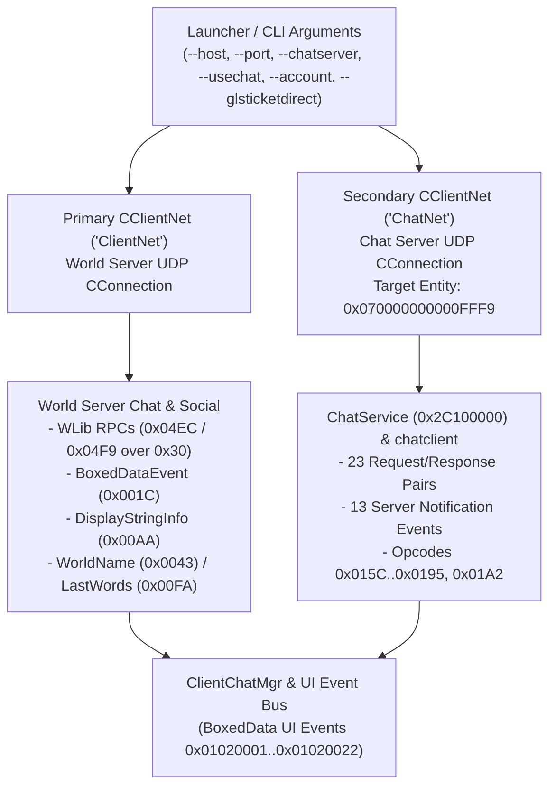
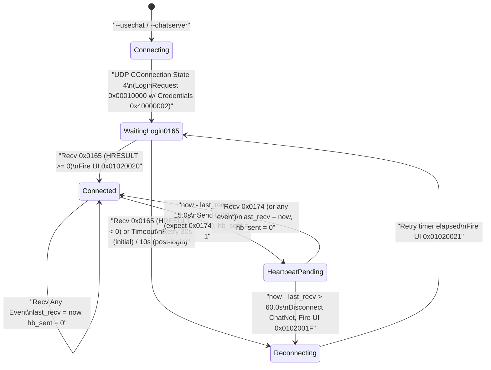

<!-- SPDX-License-Identifier: GPL-3.0-or-later -->

# LOTRO Official Chat Server Protocol (`--chatserver` / `ChatNet`) and Dual-Path Chat Routing

| Field | Value |
|---|---|
| **Status** | Draft |
| **Last updated** | 2026-10-20 |
| **Author role** | Spec writer (dirty room) |
| **Reviewer** | pending |

---

## Purpose

This specification note defines the network transport, session authentication, keepalive state machine, wire primitives, and complete 59-event protocol (`0x0000015C`–`0x00000195` and `0x000001A2`) used by the official 64-bit Lord of the Rings Online (LOTRO) client (`x64/lotroclient64.exe`) when communicating with the dedicated Chat Server specified by `--chatserver <host:port>` (`"ChatNet"`). It also specifies how the client partitions chat functionality between the primary World Server connection (`"ClientNet"`, documented in [`docs/specs/official-messages-play.md`](file:///home/solarbaron/git/lotro-reimplementation/docs/specs/official-messages-play.md)) and the secondary Chat Server connection (`"ChatNet"`), provides exact reconciliation rules to update [`docs/specs/official-messages-play.md`](file:///home/solarbaron/git/lotro-reimplementation/docs/specs/official-messages-play.md) §6.6, and documents all chat-related `EnumMapper` records (`0x23XXXXXX`) extracted from `client_general.dat`.

All facts in this document are expressed as functional specifications, byte-layout tables, state machines, invariants, and synthetic test vectors containing no vendor source code, no decompiler listings, no cryptographic secrets, and no live server endpoints or account data.

---

## Provenance

| Tag | Confidence | Method | Source | Scope / Notes |
|---|---|---|---|---|
| `OBS-DAT-EM` | Confirmed | M1 (Static data observation) | Local install `client_general.dat`, `EnumMapper` DataIDs `0x23000026`, `0x23000027`, `0x2300003B`, `0x2300003C`, `0x230001A0`, `0x230001D2`, `0x230001E2`, `0x230002A8`, `0x230002A9`, `0x2300032A` | Complete key-to-string tables for `ChatFont`, `ChatFontColor`, `ChatChannelType` (180 regional/world channels), `SecondaryChatChannelType`, `LogType` base, `WhoUIDisplayType`, `GuildReasonCode`, `ChatTextType` (`0x00`–`0x2F`), and `GuildEvent`. |
| `BIN-CLI-CHAT` | Confirmed | M4 (Static binary analysis) | `x64/lotroclient64.exe`, version `4906.0071.1794.4035`, SHA-256 `d22363eb9aff0fb599fd04b3efa9a1769d08da8af9d8f9b73121c12bfd7e21ee`; Ghidra 11.3.2 / GNU binutils `objdump` 2.44 (`0x1403085A0`–`0x14031AB20`, `0x140762970`, `0x140BD2610`–`0x140BD2FD0`) | **Question:** How are `--chatserver`, `--usechat`, `--account`, `--glsticketdirect`, `--glsticket`, and `--authserverurl` parsed, stored on `CClient`, and used for GLS ticket refresh and Chat Server startup? **Why M1–M2 were insufficient:** Command-line switch semantics, fallback rules (`--chatserver` defaulting to `--host` when `--usechat` is active), and `CClient` field offsets are compiled into the client executable and do not exist in `.dat` files or public documentation. |
| `BIN-CHATNET` | Confirmed | M4 (Static binary analysis) | `x64/lotroclient64.exe`, version `4906.0071.1794.4035`, SHA-256 `d22363eb9aff0fb599fd04b3efa9a1769d08da8af9d8f9b73121c12bfd7e21ee`; Ghidra 11.3.2 / GNU binutils `objdump` 2.44 (`0x1406D8330`–`0x1406E4500`, `0x140A0EB00`–`0x140A22500`, `0x140B5B320`–`0x140B5CF70`, `0x140BD3300`–`0x140BD6000`) | **Question:** How does `ClientChatMgr` / `chatclient` / `ChatService` configure `"ChatNet"`, authenticate via `Credentials` type `0x40000002`, complete handshake on event `0x00000165`, maintain keepalive via `0x0000017E` / `0x00000174`, and serialize all 59 Chat Server events (`0x0000015C`–`0x00000195`, `0x000001A2`)? **Why M1–M2 were insufficient:** No public specification or `.dat` resource describes the `"ChatNet"` `CClientNet` instance, service/entity IDs, credential type `0x40000002`, or the exact field layouts and request-response pairings of the 59 Chat Server opcodes. |
| `BIN-WORLD-CHAT` | Confirmed | M4 (Static binary analysis) | `x64/lotroclient64.exe`, version `4906.0071.1794.4035`, SHA-256 `d22363eb9aff0fb599fd04b3efa9a1769d08da8af9d8f9b73121c12bfd7e21ee`; Ghidra 11.3.2 / GNU binutils `objdump` 2.44 (`0x1406313E0`, `0x140759020`, `0x1407978E0`, `0x1407BB0B0`–`0x1407BDF00`, `0x140A5A000`–`0x140A5EA00`, `0x140AEC000`–`0x140AF7000`) | **Question:** Which chat actions and incoming messages travel over the World Server (`"ClientNet"`) versus the Chat Server (`"ChatNet"`), and how do they bridge to the UI? **Why M1–M2 were insufficient:** The split between WLib RPCs (`0x04EC` / `0x04F9`), `BoxedDataEvent` (`0x0000001C`), top-level World Server events (`0x0043`, `0x00AA`, `0x00B3`, `0x00FA`, `0x00FE`, `0x30000045`), and `"ChatNet"` room/entity events exists only in the executable dispatchers. |

---

## 1. Overview and Dual-Path Architecture 

LOTRO uses a dual-connection architecture during active gameplay (`BIN-CHATNET`, `BIN-WORLD-CHAT`):

1. **World Server Connection (`"ClientNet"`):** The primary UDP `CConnection` session (`CClient + 0x18`, target address from `--host` / `-h` and `--port` / `-p`). It carries all simulation state, spatial chat (`/say`, `/emote`, NPC overhead dialogue), server broadcasts, localized string notifications (`0x000000AA`), `BoxedDataEvent` (`0x0000001C`) property bags, and WLib RPC calls over message `0x00000030` (`InterfaceId = 0x03`, `ServiceType = 0x0E`). Importantly, the World Server is also responsible for **authorizing and orchestrating** membership in server-managed chat rooms (Regional channels, World, Trade, LFF, Advice, OOC, Fellowship, Raid, Kinship, and Officer chat).
2. **Chat Server Connection (`"ChatNet"`):** A second, independent UDP `CConnection` session (`CClientNet` instance named `"ChatNet"`, target address from `--chatserver <host:port>`) managed by `ClientChatMgr` (`CClient + 0x1D0`, global pointer `DAT_141E57990`), `chatclient` (`ClientChatMgr + 0xE8`), and `ChatService` (`chatclient + 0x28`). It carries multi-room text/data broadcasting (`0x0000016A` / `0x00000179`), direct entity-to-entity chat/data (`0x0000018A` / `0x00000186`), custom user chat rooms (`/join`, `/leave`, `/chatwho`, `/invite`, `/kick`, `/leader`, `/passwd`), room membership notifications (`0x00000162`, `0x0000018B`, `0x00000187`, `0x00000181`, `0x00000191`, `0x00000192`), and voice-chat signaling metadata.

---

## 2. Command-Line Arguments and Ticket Refresh Flow 

### 2.1 Command-Line Arguments and `CClient` Storage

During startup (`FUN_1403151D0`, `FUN_1403186A0`, `FUN_14031AB20`), the client parses the following command-line switches from the launcher and stores them on the `CClient` instance (`BIN-CLI-CHAT`):

| CLI Switch | Short Alias | `CClient` Offset | Type | Default | Description & Post-Parse Rules |
|---|---|---|---|---|---|
| `--account <name>` | `-a` | `+0xD8` | `PString` (ASCII) | `""` | Account/subscription name passed by the launcher. Converted to UTF-16LE (`WString`) when constructing `Credentials`. |
| `--franchise <name>` | `-f` | `+0xE0` | `PString` (ASCII) | `"LotRO"` | Franchise identifier string. |
| `--glsticketdirect <b64>` | `-z` | `+0xE8` | `PString` (ASCII) | `""` | Base64-encoded GLS session ticket passed directly on the command line. |
| `--glsticket <regkey>` | — | `+0x110` | `PString` (ASCII) | `""` | Windows registry value name under `HKCU\Software\Turbine\LotRO` from which to load the Base64-encoded GLS ticket into `+0xE8` (and delete the registry value afterward) if `--glsticketdirect` was not used. |
| `--authserverurl <url>` | — | `+0xF0` | `PString` (ASCII) | `""` | GLS AuthServer SOAP endpoint URL used by the background ticket refresher. |
| `--host <host>` | `-h` | `+0x100` | `PString` (ASCII) | `""` | Primary World Server hostname or IPv4 address. |
| `--chatserver <host:port>` | — | `+0x108` | `PString` (ASCII) | `""` | Chat Server `<host:port>` string. Setting `--chatserver` also forces `CClient + 0x1F8` (`use_chat`) to `1`. |
| `--usechat` | — | `+0x1F8` | `u8` (bool) | `0` | Enables the Chat Server subsystem (`ClientChatMgr`). In `FUN_14031AB20`, if `use_chat != 0` and `--chatserver` (`+0x108`) is empty, the client copies `--host` (`+0x100`) into `--chatserver` (`+0x108`). |
| `--voiceoff` | — | `+0x1E0` | `u8` (bool) | `1` (`voice_on`) | Default value at `+0x1E0` is `1` (voice enabled). Passing `--voiceoff` sets `+0x1E0` to `0`, disabling `TurbineVoice` (`CClient + 0x1D8`). |
| `--language <lang>` | — | `+0xF8` | `PString` (ASCII) | `"English"` | Client localization language. |

### 2.2 GLS Ticket Refresher (`--authserverurl`)

When both `CClient + 0xE8` (`glsticket`) and `CClient + 0xF0` (`authserverurl`) are non-empty during `CClient` initialization (`FUN_1403145A0`), the client allocates a ticket-refresh manager (`0x40` bytes, `FUN_140762970`) at `CClient + 0x1A8` (`BIN-CLI-CHAT`):

1. **SOAP Request (`FUN_140BD2610`):** Sends an HTTP POST request to the URL in `--authserverurl` with `Content-Type: text/xml; charset=utf-8` and `SOAPAction: "http://www.turbine.com/SE/GLS/AccountHasUpdatedTickets"`. The SOAP body invokes `<tur:AccountHasUpdatedTickets>` with `<tur:ticket>` containing the current Base64 GLS ticket string.
2. **SOAP Response (`FUN_140BD2FD0`):** Parses the XML response for `<AccountHasUpdatedTicketsResult>` (`true`/`false`) and, if updated, extracts the replacement Base64 ticket string from `<NewTicketResult>`.
3. **Ticket Retrieval (`FUN_140319940`):** Whenever `CClient` needs the current GLS ticket (including when passing credentials to `ClientChatMgr`), `FUN_140319940` queries `CClient + 0x1A8` if present, or falls back to `CClient + 0xE8`.

---

## 3. `ChatNet` Transport, Authentication, Retry Policy, and Heartbeat State Machine 

### 3.1 Subsystem Hierarchy and Service / Entity IDs

When `CClient + 0x1F8` (`use_chat`) is non-zero, `CClient::Init` allocates `ClientChatMgr` (`0x190` bytes, constructor `FUN_140BD3300`, stored at `CClient + 0x1D0` and global `DAT_141E57990`). Its internal hierarchy is (`BIN-CHATNET`):

| Component | Allocation Size | Parent Offset | Constructor | Role |
|---|---|---|---|---|
| `ClientChatMgr` | `0x190` (`400`) bytes | `CClient + 0x1D0` | `FUN_140BD3300` | Bridges LOTRO client state, UI events (`0x01020001`–`0x01020022`), and `chatclient`. |
| `chatclient` | `0x528` (`1320`) bytes | `*(ClientChatMgr + 0xE8)` | `FUN_1406D8580` | Manages connection retry policies, room directory caches, heartbeat/drop timers, and request callbacks. |
| `ChatService` | `0x450` (`1104`) bytes | `chatclient + 0x28` (embedded) | `FUN_140A0EBC0` | WLib service (`ServiceType = 0x2C100000`) that owns `"ChatNet"`, registers all 59 ChatEvent factories, and serializes/dispatches Chat Server messages. |
| `CNetDataPlugin` | `0xC8` (`200`) bytes | `*(ChatService + 0x3A8)` | `FUN_1411885A0` | Network plugin wrapper around the `"ChatNet"` `CClientNet` instance. |
| `CClientNet` (`"ChatNet"`) | `0x15D0` (`5584`) bytes | Owned by `CNetDataPlugin` | `FUN_140A0EED0` | Secondary UDP `CConnection` transport instance named `"ChatNet"`. |

`ChatService` uses three fixed 64-bit identifiers (`BIN-CHATNET`):

| Constant Name | 64-Bit Value (Hex) | Binary Global | Meaning |
|---|---|---|---|
| `CHAT_SERVER_ENTITY_ID` | `0x070000000000FFF9` | `DAT_141A12880` | Destination entity ID stamped into every outgoing `NetMessage` header (`event + 0x20`) sent over `"ChatNet"`, and registered in the global network router (`DAT_141E5A0F8`) so messages destined for `0x070000000000FFF9` route through `"ChatNet"`. |
| `CHAT_CLIENT_SERVICE_ID` | `0x0600000000000418` | `DAT_141A12888` | Local client service ID registered by `ChatService` (`FUN_140A10E40`). |
| `CHAT_SERVER_SERVICE_ID` | `0x0600000000000419` | `DAT_141A12890` | Server-side counterpart service ID in the shared `ChatService` library (`FUN_140A11190`). |

### 3.2 Transport Configuration (`"ChatNet"`)

`"ChatNet"` uses the exact same UDP `CConnection` framing, checksums, sequence numbers, and fragmentation layer as the primary World Server connection (specified in [`docs/specs/official-session.md`](file:///home/solarbaron/git/lotro-reimplementation/docs/specs/official-session.md)), configured with the following parameters (`FUN_140A0EED0`, `FUN_140A10E40`, `BIN-CHATNET`):

- **Instance Name:** `"ChatNet"` (ASCII string passed to `CClientNet` initialization).
- **Target Address:** Parsed from `--chatserver <host:port>` (`ClientChatMgr + 0x120`).
- **Session Type (`session_type`):** `0x00000005` (`5`, matching the World Server's `NetMessage` stream).
- **Outgoing `NetMessage` Header Fields (`FUN_140A13470` / `FUN_1411A3740`):**
  - `event_id` (`+0x10`): Chat Event opcode (`0x0000015C`–`0x00000195` or `0x000001A2`).
  - `event_flags` (`+0x14`): `0x00300400` (bits `0x00000400 | 0x00100000 | 0x00200000`).
  - `source_id` (`+0x18`): `0x0000000000000000` (populated by transport/server).
  - `target_id` (`+0x20`): `0x070000000000FFF9` (`CHAT_SERVER_ENTITY_ID`).
  - `priority / channel`: `5`.

### 3.3 Authentication (`Credentials` Type `0x40000002`) and Login Handshake (`0x00000165`)

Unlike the World Server connection—which authenticates using `Credentials` type `0x00000001` (`AccountName` + ticket/hash layout for the world login)—the Chat Server connection authenticates during the `CConnection` `LoginRequest` (`0x00010000`) handshake using **`Credentials` type `0x40000002`** (`FUN_1403085A0` -> `FUN_1406DB100` -> `FUN_1406E2EC0`, `BIN-CHATNET`):

1. **Credential Construction (`FUN_1406E2EC0`):**
   - Converts the `--account` ASCII string to a UTF-16LE `WString` (`account_wstr`).
   - Allocates a `0x48`-byte `Credentials` object (`FUN_14118EC30`).
   - If the GLS ticket string (`glsticket`) is non-empty:
     - Sets credential type to **`0x40000002`** and stores `account_wstr` (`FUN_14119D190(cred, 0x40000002, &account_wstr)`).
     - Base64-decodes the ASCII `glsticket` string into a raw byte buffer (`FUN_14030E9B0`, typically 108 raw bytes from a 144-character Base64 GLS ticket).
     - Attaches the raw decoded ticket byte array to the `Credentials` object (`FUN_14119CE80`).
   - If the GLS ticket string is empty (development/local fallback):
     - Sets credential type to **`0x00000001`** with `account_wstr` only.
2. **Transport Connect (`FUN_140A0FB20`):**
   - Passes the `Credentials` object (`ChatService + 0x1D8`) and the `--chatserver` address (`ChatService + 0x1B8`) to `"ChatNet"`, which transmits the UDP `CConnection` `LoginRequest` (`0x00010000`) containing those credentials.
3. **Application-Layer Login Status Event (`0x00000165` / `357`, S->C):**
   - When the UDP `CConnection` reaches transport state `4` (connected), `ChatService` (`FUN_140A12180`) does **not** immediately consider the chat session logged in; it waits for the Chat Server to send Chat Event **`0x00000165`** (`357`, `S->C`).
   - `FUN_140A11F40` intercepts incoming event `0x00000165`, reads the 32-bit signed `HRESULT` at `event + 0x28` (wire offset `0x01` after the 1-byte `ChatEvent` base flag), and completes the pending connection task (`FUN_140A118C0` -> `FUN_1406DFA10` -> `FUN_1406DF930`).
   - If `HRESULT >= 0`:
     - Enables active traffic on `"ChatNet"` (`FUN_14118BDA0(plugin, 1)`).
     - Sets `chatclient + 0x498 = 1` (`is_connected`) and `chatclient + 0x4C0 = 1` (`is_ready`).
     - Initializes `last_recv_time` (`chatclient + 0x4D0` / `+0x4F8`) to the current clock (`DAT_141E706B0`) and clears `heartbeat_sent` (`chatclient + 0x4E0` / `+0x508 = 0`).
     - Switches the active retry policy to the post-login reconnect policy (`ClientChatMgr + 0x54`).
     - Fires UI event **`0x01020020`** (`ChatConnected`, `FUN_140BD4DF0` -> `FUN_140B5C610`).

### 3.4 Connection Retry Policies

`ClientChatMgr` configures two distinct retry policies on `chatclient` (`FUN_140BD3300`, `FUN_1406D89E0`, `FUN_1406DF930`, `BIN-CHATNET`):

| Policy | `ClientChatMgr` Offset | `chatclient` Offset | Initial Delay | Max Retries | Retry Interval | When Active |
|---|---|---|---|---|---|---|
| **Initial Connect Policy** | `+0x44` | `+0x4B0` (copied to `+0x49C`) | `1000` ms (`1` s) | `0xFFFFFFFF` (unlimited) | `30000` ms (`30` s) | From client startup until the first successful `0x00000165` login (`chatclient + 0x4AC == 0`). |
| **Reconnect Policy** | `+0x54` | `+0x4BC` (copied to `+0x49C`) | `1000` ms (`1` s) | `0xFFFFFFFF` (unlimited) | `10000` ms (`10` s) | After at least one successful `0x00000165` login (`chatclient + 0x4AC == 1`). |

While reconnecting, `ClientChatMgr` (`FUN_140BD4E10` -> `FUN_140B5C3F0`) fires UI event **`0x01020021`** (`ChatReconnecting`) with the retry interval in seconds (`u32`, `retry_interval_ms / 1000`, key `0x10000909`).

### 3.5 Heartbeat (`0x0000017E` / `0x00000174`) and Drop-Timeout State Machine

Once connected (`chatclient + 0x4C0 == 1`), `chatclient::Tick` (`FUN_1406E4040`) runs every frame and enforces a two-threshold keepalive state machine (`BIN-CHATNET`):

| Parameter | Registry / Config Key | `chatclient` Offset | Default Value | Meaning |
|---|---|---|---|---|
| `ChatHeartbeatTimeMS` | `"ChatHeartbeatTimeMS"` | `+0x518` (`f64` seconds) | `15000` ms (`15.0` s) | Idle duration without receiving any Chat Server event before sending a heartbeat request (`0x0000017E`). |
| `ChatDropTimeoutMS` | `"ChatDropTimeoutMS"` | `+0x520` (`f64` seconds) | `60000` ms (`60.0` s) | Total idle duration (with a heartbeat already in flight) before declaring the Chat Server connection dead. |

**State Machine Transitions (`FUN_1406DF9E0`, `FUN_1406E4040`):**

1. **On Any Received Chat Event (`FUN_1406DF9E0`):**
   - Updates `last_recv_time` (`chatclient + 0x4F8`) to `now` (`DAT_141E706B0`).
   - Resets `heartbeat_sent` (`chatclient + 0x508`) to `0`.
2. **Idle >= 15.0 s (`now - last_recv_time > ChatHeartbeatTimeMS`) and `heartbeat_sent == 0`:**
   - Allocates and sends Chat Event **`0x0000017E`** (`382`, `ChatHeartbeatRequestEvent`, `C->S`).
   - Registers response handler `client + 0x4E8` (`FUN_1406DF9E0`) awaiting paired response **`0x00000174`** (`372`, `ChatHeartbeatResponseEvent`, `S->C`).
   - Sets `heartbeat_sent` (`chatclient + 0x508`) to `1`.
3. **Idle >= 60.0 s (`now - last_recv_time > ChatDropTimeoutMS`) and `heartbeat_sent == 1`:**
   - Sets `heartbeat_sent = 0` (`+0x508`) and `is_ready = 0` (`+0x4C0`).
   - Calls `ChatService::Disconnect` (`FUN_140A0FF80`) to tear down `"ChatNet"`.
   - Invokes the connection-lost notification (`FUN_140BD4E70` -> `FUN_140B5C520`), firing UI event **`0x0102001F`** (`ChatDisconnected`), and schedules reconnection under the active retry policy.

---

## 4. Dual-Path Routing: World Server vs. Chat Server 

### 4.1 How the Player's Character Is Bound to Chat Rooms

A critical architectural fact confirmed in `lotroclient64.exe` (`BIN-CHATNET`, `BIN-WORLD-CHAT`) is how the Chat Server learns which character the client is playing and which regional/social rooms that character belongs to:

1. **Account-Level Authentication on `"ChatNet"`:** The client authenticates to `"ChatNet"` using `--account` and `--glsticketdirect` (`Credentials` type `0x40000002`). The client does **not** send an explicit "bind character ID" packet over `"ChatNet"`.
2. **Server-Backend Provisioning (`0x0000018B` / `0x00000162`):** When the player enters the world on the World Server (`"ClientNet"`), or changes regions, fellowships, or kinships, the World Server communicates with the Chat Server on the backend (or in response to World Server WLib RPCs in class `0x04EC`). The Chat Server then pushes **`0x0000018B`** (`395`, `ChatAddRoomNoticeEvent`, `S->C`) and **`0x00000162`** (`354`, `ChatRemoveRoomNoticeEvent`, `S->C`) to the client over `"ChatNet"`, containing a `ChatServerRoomDescriptor` (`desc_type = 3`) or `ChatRoomDescriptor` (`desc_type = 2`).
3. **Client Room Directory:** Upon receiving `0x0000018B` (`395`), `chatclient` (`FUN_1406DF5E0`) adds the room descriptor to its active room table (`chatclient + 0x468`) and notifies `ClientChatMgr` (`FUN_140BD4CE0`), which maps the room's `ChatChannelType` (`0x2300003B`) and `SecondaryChatChannelType` (`0x2300003C`) to the appropriate `ChatTextType` (`0x230002A8`).

### 4.2 Routing Split by Feature and Slash Command

The client command-line and chat input processor (`FUN_140AEBC00`–`FUN_140AF7000`, `FUN_140A5A000`–`FUN_140A5EA00`, `FUN_1407BB0B0`–`FUN_1407BDF00`) routes chat actions across the two connections as follows (`BIN-WORLD-CHAT`, `BIN-CHATNET`):

| Feature / Slash Command | Transport | Outgoing Wire Mechanism | Incoming Wire Mechanism | Notes |
|---|---|---|---|---|
| **Spatial Say (`/say`)** | World Server (`"ClientNet"`) | WLib RPC `0x00000030` (`Interface = 0x03`, `Service = 0x0E`, class `0x04EC` / `0x04F9` method `0x03` via `FUN_1407BDF00`) | `BoxedDataEvent` (`0x0000001C`) / `DisplayStringInfo` (`0x000000AA`) | Spatial range-limited chat handled entirely by the World Server simulation. |
| **Emotes (`/emote`, `/<mood>`)** | World Server (`"ClientNet"`) | WLib RPC `0x00000030` (class `0x04EC` method `0x0C` via `FUN_1407BB520`) | `BoxedDataEvent` (`0x0000001C`) / `DisplayStringInfo` (`0x000000AA`) | Triggers both avatar animation and spatial emote text on the World Server. |
| **Direct Tell (`/tell <target> <msg>`)** | Dual (`"ClientNet"` + `"ChatNet"`) | World Server WLib RPC (`0x04EC` method `0x09` via `FUN_1407BB410`) **or** `"ChatNet"` `0x0000015C` (`SendMessageToName`) / `0x0000018A` (`SendDataToEntity`) | `"ChatNet"` `0x00000186` (`RecvDataFromEntity`) **or** World Server `0x0000001C` (`BoxedData` UI `0x0102000D`) | Both paths converge in `FUN_140B5B790` / `FUN_140B56DA0` (`ChatTextType = 0x06 Tell`). |
| **Regional, World, Trade, LFF, Advice, OOC, RP Channels** | Chat Server (`"ChatNet"`) for messages; World Server (`"ClientNet"`) for channel opt-in/out | `"ChatNet"` **`0x0000016A`** (`SendDataToRoom`, `msg_type = 0x08020000` or `0x08040000`); World Server WLib RPC `0x04EC` (`0x11`/`0x12`/`0x14`) for channel subscription | `"ChatNet"` **`0x0000018B`** (`AddRoomNotice`) / **`0x00000162`** (`RemoveRoomNotice`) for membership; **`0x00000179`** (`RecvDataFromRoom`) for messages | Room descriptor has `desc_type = 3` (`ChatServerRoomDescriptor`). |
| **Fellowship (`/f`), Raid (`/ra`), Kinship (`/k`), Officer (`/o`) Chat** | Dual (`"ChatNet"` room data or World Server `0x0000001C`) | `"ChatNet"` **`0x0000016A`** (`SendDataToRoom`) or World Server WLib RPC (`0x04EC`) | `"ChatNet"` **`0x00000179`** (`RecvDataFromRoom`) or World Server `0x0000001C` (`BoxedData`) | Fellowship/Kinship rooms use `desc_type = 3` (`ChatServerRoomDescriptor`) when routed via `"ChatNet"`. |
| **User Chat Channels (`/join`, `/leave`, `/1`–`/8`, `/chatwho`, `/invite`, `/kick`, `/leader`, `/passwd`)** | Chat Server (`"ChatNet"`) | `"ChatNet"` **`0x0000016E`** (`CreateRoom`), **`0x0000016F`** (`DestroyRoom`), **`0x00000177`** (`RoomEnter`), **`0x0000018E`** (`RoomLeave`), **`0x00000188`** (`SetLeader`), **`0x00000183`** (`ChangePassword`), **`0x0000017F`** (`QueryRoom`), **`0x0000016D`** (`Invite`), **`0x00000189`** (`Kick`), **`0x0000016A`** (`SendDataToRoom`) | `"ChatNet"` responses (`0x0195`, `0x0166`, `0x017C`, `0x0160`, `0x018C`, `0x0180`, `0x016C`, `0x0190`, `0x0175`, `0x017A`) and notifications (`0x0173`, `0x0179`, `0x0181`, `0x0187`, `0x0191`, `0x0192`) | Room descriptor has `desc_type = 2` (`ChatRoomDescriptor`). Mapped to `UserChat1`–`UserChat8` (`ChatTextType` `0x1C`–`0x1F`, `0x27`–`0x2A`). |
| **Social Filter (`/anon`, `/LFG`) & `/who` Queries** | World Server (`"ClientNet"`) | WLib RPC `0x00000030` (class `0x04EC` methods `0x02` `SendWhoQuery`, `0x07` `SetAnon`, `0x10` `SetLFG` in `FUN_1407BB0B0`–`0x1407BB500`) | `BoxedDataEvent` (`0x0000001C`) -> UI `0x01020001`–`0x01020015` | Handled by the World Server social directory. |
| **Server Broadcasts, MOTD, Shutdown Warnings, Combat/Loot Logs** | World Server (`"ClientNet"`) | None (`S->C` only) | `0x0000001C` (`BoxedDataEvent`), `0x000000AA` (`DisplayStringInfo`), `0x000000FA` (`ServerLastWords`), `0x00000043` (`WorldName`), `0x30000045` (`AdminBroadcastText`) | Handled directly on `"ClientNet"`. |

### 4.3 World Server `BoxedData` Chat UI Dispatchers (`0x140B5B320`–`0x140B5CF70`)

Both World Server `BoxedDataEvent` (`0x0000001C`) payloads and `ClientChatMgr` callbacks feed into the UI event bus (`0x01020001`–`0x01020022`). The binary-verified `BoxedData` property keys and UI event IDs in `0x140B5B320`–`0x140B5CF70` are (`BIN-WORLD-CHAT`, `BIN-CHATNET`):

| UI Event ID | Handler VA | `ClientChatMgr` Caller | `BoxedData` Property Keys | Meaning |
|---|---|---|---|---|
| `0x0102000C` | `0x140B56B30` | `0x140BD5790` / `0x140543410` | `0x100000B1` (`ChatTextType` `u32`), `0x100015D7` (`WString` text), `0x10000914` (`WString` sender), `0x1000215A` (`u64` sender ID), `0x100039C7` (extra blob) | Standard chat text line delivered to the chat window. |
| `0x0102000D` | `0x140B56DA0` | `0x140BD5790` / `0x140B5B790` | `0x100000B1` (`ChatTextType` `u32`, `0x06` = Tell), `0x100015D7` (`WString` text), `0x1000090E` / `0x10000915` (`WString` target/sender name), `0x1000133D` (`u8` is_outgoing) | Direct `/tell` message (incoming or outgoing echo). |
| `0x01020016` | `0x140B5B320` | `0x140BD3810` | `0x100012F8` (`WString` room_name), `0x10000A35` (`u32` hresult) | User chat room creation / join result (`CreateRoom` / `RoomEnter`). |
| `0x01020017` | `0x140B5B5F0` | `0x140BD3B80` | `0x100012F8` (`WString` room_name), `0x10000A35` (`u32` hresult) | User chat room destroy result (`DestroyRoom`). |
| `0x01020018` | `0x140B5B8E0` | `0x140BD3D10` | `0x100012F8` (`WString` room_name), `0x10000A35` (`u32` hresult) | User chat room leave result (`RoomLeave`). |
| `0x01020019` | `0x140B5BA30` | `0x140BD3E00` | `0x100012F8` (`WString` room_name), `0x10000915` (`WString` player_name), `0x10000A35` (`u32` hresult) | User chat room invite result (`InviteToRoom`). |
| `0x0102001A` | `0x140B5BD00` | `0x140BD3EE0` / `0x140BD4560` / `0x140BD4920` | `0x100012F8` (`WString` room_name), `0x10000915` (`WString` leader_name), `0x100012FF` (array of `0x10000915` member `WString`s), `0x10000A35` (`u32` hresult) | User chat room `/chatwho` roster query result (`QueryRoom`). |
| `0x0102001B` | `0x140B5C700` | `0x140BD51B0` | `0x100012F8` (`WString` room_name), `0x10000915` (`WString` target_name), `0x10000A35` (`u32` hresult) | User chat room `/kick` result (`KickFromRoom`). |
| `0x0102001C` | `0x140B5C880` | `0x140BD5270` / `0x140BD53B0` | `0x100012F8` (`WString` room_name), `0x10000915` (`WString` player_name), `0x10002803` (`u32` reason_code) | Notification that a player entered (`0x140B5C880`) or left (`0x140B5C9D0`) a user chat room. |
| `0x0102001D` | `0x140B5CE40` | `0x140BD5740` | `0x100012F8` (`WString` room_name), `0x10000A35` (`u32` hresult) | User chat room `/passwd` change result (`ChangeRoomPassword`). |
| `0x0102001E` | `0x140B5CD00` | `0x140BD56D0` | `0x100012F8` (`WString` room_name), `0x10000915` (`WString` new_leader), `0x10000A35` (`u32` hresult) | User chat room `/leader` change result (`SetRoomLeader`). |
| `0x0102001F` | `0x140B5C520` | `0x140BD4E10` | *(empty `BoxedData`)* | Chat Server connection lost (`ChatDisconnected`). |
| `0x01020020` | `0x140B5C610` | `0x140BD4DF0` | *(empty `BoxedData`)* | Chat Server connection established (`ChatConnected`). |
| `0x01020021` | `0x140B5C3F0` | `0x140BD4E10` | `0x10000909` (`u32` retry_seconds) | Chat Server reconnecting (`ChatReconnecting`). |
| `0x01020022` | `0x140B5CB40` | `0x140BD55F0` | `0x100012F8` (`WString` room_name), `0x10000915` (`WString` new_leader) | Notification that room leadership changed (`RoomLeaderChanged`). |

---

## 5. `ChatNet` Wire Primitives and Complete 59-Event Catalogue (`0x015C`–`0x0195`, `0x01A2`) 

### 5.1 Common Wire Primitives

Every Chat Server event payload (following the standard `NetMessage` envelope header where `event_id` is in `0x0000015C`–`0x00000195` or `0x000001A2`) is serialized using the following composite primitives (`BIN-CHATNET`):

#### 5.1.1 `ChatEvent` Base Header (`FUN_1411A3840`)

Every event in `ChatService` derives from `ChatEvent` and begins its payload with a 1-byte base flag:

| Offset | Size | Type | Field | Value / Description |
|---|---|---|---|---|
| `0x00` | `1` | `u8` | `base_flags` | Always `0x00` on the wire (`BYTE PTR [event + 0x14] & 1`, where `event + 0x14` is initialized to `0x00300400`). |

#### 5.1.2 `ChatRequestEvent` Base (`FUN_1406D8E00`)

All 23 client-to-server (`C->S`) request events (except `0x00000171` and `0x0000017E`, which omit `context_id` on the wire) serialize a 32-bit request context ID immediately after `base_flags`:

| Offset | Size | Type | Byte Order | Field | Description |
|---|---|---|---|---|---|
| `0x00` | `1` | `u8` | — | `base_flags` | `0x00` (`ChatEvent` base). |
| `0x01` | `4` | `u32` | LE | `context_id` | Client-assigned request correlation ID (`event + 0x28`), echoed back in the paired `ChatResponseEvent`. |

#### 5.1.3 `ChatResponseEvent` Base (`FUN_1406D8960` / `FUN_1406E2690`)

All 23 server-to-client (`S->C`) response events derive from `ChatResponseEvent` and begin with:

| Offset | Size | Type | Byte Order | Field | Description |
|---|---|---|---|---|---|
| `0x00` | `1` | `u8` | — | `base_flags` | `0x00` (`ChatEvent` base). |
| `0x01` | `4` | `u32` | LE | `context_id` | Request correlation ID (`event + 0x28`) matching the originating `ChatRequestEvent`. |
| `0x05` | `4` | `i32` (`HRESULT`) | LE | `hresult` | Operation status code (`event + 0x30`, initialized to `0x8000FFFF` `E_UNEXPECTED`; `>= 0` indicates success). |

#### 5.1.4 `ChatDescriptor` (`FUN_1406D83C0` / `FUN_140A1D280` / `FUN_140A1DE10`)

`ChatDescriptor` is a polymorphic handle (`0x20` bytes in memory) identifying a player entity, a custom user chat room, or a server-managed chat room. On the wire, `FUN_1406D83C0` / `FUN_140A1D280` serializes it as:

| Offset | Size | Type | Byte Order | Field | Description |
|---|---|---|---|---|---|
| `0x00` | `4` | `u32` | LE | `presence_tag` | `0x00000000` if the descriptor pointer is null/empty; **`0x00000018`** (`24`) if non-null. If `0x00000000`, no further bytes follow. |
| `0x04` | `4` | `u32` | LE | `desc_type` | Present only when `presence_tag == 0x00000018`. Polymorphic type tag (`FUN_140A1DE10`): - `1` = `ChatEntityDescriptor` (vtable `0x14158EDC0`, player/entity) - `2` = `ChatRoomDescriptor` (vtable `0x14158EDD0`, user-created chat room) - `3` = `ChatServerRoomDescriptor` (vtable `0x14158EE30`, server-managed room) |
| `0x08` | `8` | `u64` | LE | `descriptor_id` | Present only when `presence_tag == 0x00000018` (`FUN_140A1DA60` / `FUN_140A1DC40` / `FUN_140A1DD10`): - For `desc_type == 1`: 64-bit entity/avatar ID (`+0x08`). - For `desc_type == 2`: 64-bit room ID (`+0x08`). - For `desc_type == 3`: 64-bit composite server-room ID (`+0x18`), where bits `0..47` (`id & 0x0000FFFFFFFFFFFF`) hold the 48-bit room/channel identifier and bits `48..63` hold the high tag; in memory, `FUN_140A1DD10` splits this into `u32 channel_type` (`+0x20`, mapped via `0x2300003B`) and `u32 secondary_type` (`+0x24`, mapped via `0x2300003C`). |
| `0x10` | var | `WString` | LE | `name` | Present only when `presence_tag == 0x00000018`. `PackedDWORD` UTF-16 code-unit count followed by `count * 2` bytes of UTF-16LE characters (`entity_name` or `room_name`). |

#### 5.1.5 Container Encodings (`List`, `HashSet`, `HashTable`, `SmartBuffer`)

- **`WString` (`FUN_140A1E4F0` / `FUN_141199140`):** `PackedDWORD` UTF-16 code-unit count, followed by `count` `u16 LE` code units.
- **`SmartBuffer` (`FUN_140A1DF09` / `FUN_1411680D0`):** `u32 LE` byte length `N`, followed by `N` raw bytes (`u8[N]`).
- **`List<ChatDescriptor>` (`FUN_140A1E5D0` / `FUN_140A1E8F0`):** `u32 LE` element count `N`, followed by `N` serialized `ChatDescriptor` structures.
- **`HashSet<ChatDescriptor>` (`FUN_140A1E770` / `FUN_140A1EC60`):** `u16 LE` bucket count (`num_buckets`), `u32 LE` element count `N`, followed by `N` serialized `ChatDescriptor` structures.
- **`List<u64>` (`FUN_1404DC130` / `FUN_140A1EFB0`):** `u32 LE` element count `N`, followed by `N` `u64 LE` values.
- **`ChatObj` (`FUN_140A21B50`, used inside `raw_data` of `0x016A`/`0x0179`/`0x0186`/`0x018A` when `msg_type == 0x08020000`):**
  1. `ChatDescriptor sender` (`+0x10`)
  2. `WString text` (`+0x18`, UTF-16LE chat text)
  3. `SmartBuffer metadata_blob` (`+0x20`, `u32 LE` byte count + `u8[]` item links / formatting metadata)
  4. `u32 LE extra_type` (`+0x2C`):
     - `0`: no extra data.
     - `1`: `HashTable<u64, (ChatDescriptor, u32)>` (`FUN_140A1F2E0`: `u16 LE` buckets, `u32 LE` count, then entries of `u64 LE key`, `ChatDescriptor`, `u32 LE flags`).
     - `2`: `PropertyCollection` (`FUN_1411A6530`) + `u8 has_table` + optional `HashTable<u64, ChatDescriptor>` (`FUN_140A1F7B0`).
  5. `u32 LE msg_flags` (`+0x48`)
  6. `u32 LE msg_subflags` (`+0x4C`)
  *(Note: When `msg_type == 0x08040000`, `ClientChatMgr` `FUN_140BD4EA0` / `FUN_140BD5790` treats `raw_data` as a direct string buffer—converting UTF-8 codepage `0xFDE9` via `FUN_14031C640` when `extra_type == 2` or reading UTF-16LE directly when `extra_type == 1`.)*

---

### 5.2 Complete 59-Event Catalogue (`0x0000015C`–`0x00000195` and `0x000001A2`)

In `ChatService::Init` (`FUN_140A10E40`), the client registers exactly **59** event factories (`0x0000015C` through `0x00000195` inclusive, plus `0x000001A2`). They partition into **23 Request/Response pairs (46 opcodes)** and **13 Unpaired/Notification events** (`BIN-CHATNET`):

| Opcode (Hex) | Dec | Dir | Event Name | Paired Opcode | Factory VA | Serializer VA | Wire Payload After `u8 base_flags (0x00)` |
|---|---|---|---|---|---|---|---|
| `0x0000015C` | 348 | C->S | `ChatSendDataToNameRequestEvent` | `0x0194` (404) | `0x140A16A00` | `0x140A1DED0` | `u32 ctx_id`, `ChatDescriptor sender`, `ChatDescriptor target_name`, `u32 msg_type`, `SmartBuffer raw_data`, `u8 bool_flag` |
| `0x0000015D` | 349 | S->C | `ChatEntityDescriptorEvent` | — | `0x140A16AC0` | `0x140A1CD10` | `u32 field_28`, `ChatDescriptor desc` |
| `0x0000015E` | 350 | S->C | `ChatQueryTrackerResponseEvent` | `0x0193` (403) | `0x140A16BB0` | `0x140A1D660` | `u32 ctx_id`, `i32 hresult`, `u64 id_48`, `HashTable<u64,u32> map_50`, `HashTable<u64,u32> map_60`, `HashTable<u64,u32> map_70`, `u32 count_40`, `u64[count_40] array_48` |
| `0x0000015F` | 351 | S->C | `ChatAdminMoveRoomResponseEvent` | `0x017D` (381) | `0x140A16C00` | `0x140A1CAD0` | `u32 ctx_id`, `i32 hresult` |
| `0x00000160` | 352 | S->C | `ChatRoomLeaveResponseEvent` | `0x018E` (398) | `0x140A16C60` | `0x140A1D480` | `u32 ctx_id`, `i32 hresult`, `u32 field_48`, `u32 field_4C` |
| `0x00000161` | 353 | C->S | `ChatUpdateRoomFlagsRequestEvent` | `0x0163` (355) | `0x140A16CC0` | `0x140A1E340` | `u32 ctx_id`, `ChatDescriptor desc_30`, `ChatDescriptor desc_50`, `u64 flags_70` |
| `0x00000162` | 354 | S->C | `ChatRemoveRoomNoticeEvent` | — | `0x140A16D80` | `0x140A1CD10` | `u32 flags_28`, `ChatDescriptor room` (calls listener `vtable[+0x28]`) |
| `0x00000163` | 355 | S->C | `ChatUpdateRoomFlagsResponseEvent` | `0x0161` (353) | `0x140A16E70` | `0x140A1CAD0` | `u32 ctx_id`, `i32 hresult` |
| `0x00000164` | 356 | S->C | `ChatRoomActionResponseEvent` | `0x0168` (360) | `0x140A16ED0` | `0x1406E2690` | `u32 ctx_id`, `i32 hresult` |
| `0x00000165` | 357 | S->C | `ChatLoginStatusEvent` | — | `0x140A16F30` | `0x140354480` | `i32 hresult` (`+0x28`, completes `"ChatNet"` login in `FUN_140A11F40`) |
| `0x00000166` | 358 | S->C | `ChatDestroyRoomResponseEvent` | `0x016F` (367) | `0x140A16FC0` | `0x1406E2690` | `u32 ctx_id`, `i32 hresult` |
| `0x00000167` | 359 | C->S | `ChatSetRoomParamRequestEvent` | `0x018F` (399) | `0x140A17020` | `0x140A1E460` | `u32 ctx_id`, `ChatDescriptor desc_30`, `ChatDescriptor desc_50`, `u32 param_70` |
| `0x00000168` | 360 | C->S | `ChatRoomActionRequestEvent` | `0x0164` (356) | `0x140A170D0` | `0x140A1CC60` | `u32 ctx_id`, `ChatDescriptor desc_30`, `ChatDescriptor desc_50` |
| `0x00000169` | 361 | S->C | `ChatGetRoomListResponseEvent` | `0x0171` (369) | `0x140A17180` | `0x140A1D7F0` | `u32 ctx_id`, `i32 hresult`, `u32 field_58`, `u32 field_5C`, `HashSet<ChatDescriptor> rooms` |
| `0x0000016A` | 362 | C->S | `ChatSendDataToRoomRequestEvent` | `0x017A` (378) | `0x140A171F0` | `0x140A1CC60` | `u32 ctx_id`, `ChatDescriptor sender`, `ChatDescriptor room` (in `ChatService`; in `chatclient` `0x1406DD00B` sends room payload) |
| `0x0000016B` | 363 | S->C | `ChatQueryRoomInfoResponseEvent` | `0x0182` (386) | `0x140A172A0` | `0x140A1D360` | `u32 ctx_id`, `i32 hresult`, `u32 field_68`, `List<ChatDescriptor> list_48`, `List<ChatDescriptor> list_58` |
| `0x0000016C` | 364 | S->C | `ChatQueryRoomStatusResponseEvent` | `0x017F` (383) | `0x140A172F0` | `0x140A1D480` | `u32 ctx_id`, `i32 hresult`, `u32 field_48`, `u32 field_4C` |
| `0x0000016D` | 365 | C->S | `ChatInviteToRoomRequestEvent` | `0x0190` (400) | `0x140A17350` | `0x140A1CC60` | `u32 ctx_id`, `ChatDescriptor sender`, `ChatDescriptor target` |
| `0x0000016E` | 366 | C->S | `ChatCreateRoomRequestEvent` | `0x0195` (405) | `0x140A17400` | `0x140A1CAE0` | `u32 ctx_id`, `ChatDescriptor creator`, `ChatDescriptor room`, `ChatDescriptor extra`, `u32 flags_90`, `u32 flags_94` |
| `0x0000016F` | 367 | C->S | `ChatDestroyRoomRequestEvent` | `0x0166` (358) | `0x140A17530` | `0x140A1CC60` | `u32 ctx_id`, `ChatDescriptor actor`, `ChatDescriptor room` |
| `0x00000170` | 368 | C->S | `ChatQueryBuddyListRequestEvent` | `0x018D` (397) | `0x140A175E0` | `0x140A1CD10` | `u32 ctx_id`, `ChatDescriptor entity` |
| `0x00000171` | 369 | C->S | `ChatGetRoomListRequestEvent` | `0x0169` (361) | `0x140A17640` | `0x1406E2680` | *(empty after `u8 base_flags = 0x00`)* |
| `0x00000172` | 370 | S->C | `ChatRoomNameResolveEvent` | — | `0x140A176A0` | `0x140A1E0C0` | `u32 field_28`, `WString name`, `u32 field_38` (calls listener `vtable[+0x18]`) |
| `0x00000173` | 371 | S->C | `ChatRoomClosedNoticeEvent` | — | `0x140A17740` | `0x140A1D220` | `u32 field_28`, `WString room_name` (calls listener `vtable[+0x30]`) |
| `0x00000174` | 372 | S->C | `ChatHeartbeatResponseEvent` | `0x017E` (382) | `0x140A177E0` | `0x1406E2690` | `u32 ctx_id`, `i32 hresult` |
| `0x00000175` | 373 | S->C | `ChatKickFromRoomResponseEvent` | `0x0189` (393) | `0x140A17840` | `0x140A1DC00` | `u32 ctx_id`, `i32 hresult`, `u32 count`, `ChatDescriptor[count] descriptors` |
| `0x00000176` | 374 | C->S | `ChatBatchRoomOpRequestEvent` | `0x017B` (379) | `0x140A17890` | `0x140A1CF90` | `u32 ctx_id`, `ChatDescriptor desc_30`, `ChatDescriptor desc_50`, `u32 count`, `u32[count] values` |
| `0x00000177` | 375 | C->S | `ChatRoomEnterRequestEvent` | `0x017C` (380) | `0x140A17990` | `0x140A1CBB0` | `u32 ctx_id`, `ChatDescriptor entity`, `ChatDescriptor room`, `u32 flags_70`, `u32 flags_74` |
| `0x00000178` | 376 | C->S | `ChatModifySubscriptionRequestEvent` | `0x0185` (389) | `0x140A17A50` | `0x140A1CC60` | `u32 ctx_id`, `ChatDescriptor desc_30`, `ChatDescriptor desc_50` |
| `0x00000179` | 377 | S->C | `ChatRecvDataFromRoomEvent` | — | `0x140A17B00` | `0x140A1DED0` | `u32 flags_28`, `ChatDescriptor sender`, `ChatDescriptor target_room`, `u32 msg_type`, `SmartBuffer raw_data`, `u8 bool_flag` |
| `0x0000017A` | 378 | S->C | `ChatSendDataToRoomResponseEvent` | `0x016A` (362) | `0x140A17C60` | `0x140A1D500` | `u32 ctx_id`, `i32 hresult`, `u32 count`, `WString[count] names`, `HashSet<ChatDescriptor> set_48` |
| `0x0000017B` | 379 | S->C | `ChatBatchRoomOpResponseEvent` | `0x0176` (374) | `0x140A17CD0` | `0x1406E2690` | `u32 ctx_id`, `i32 hresult` |
| `0x0000017C` | 380 | S->C | `ChatRoomEnterResponseEvent` | `0x0177` (375) | `0x140A17D30` | `0x140A1D270` | `u32 ctx_id`, `i32 hresult`, `WString room_name`, `ChatDescriptor room_desc` |
| `0x0000017D` | 381 | C->S | `ChatAdminMoveRoomRequestEvent` | `0x015F` (351) | `0x140A17D80` | `0x140A1CED0` | `u32 ctx_id`, `ChatDescriptor d1`, `ChatDescriptor d2`, `ChatDescriptor d3`, `ChatDescriptor d4`, `u32 field_B0` |
| `0x0000017E` | 382 | C->S | `ChatHeartbeatRequestEvent` | `0x0174` (372) | `0x140A17DD0` | `0x1406E2680` | *(empty after `u8 base_flags = 0x00`)* |
| `0x0000017F` | 383 | C->S | `ChatQueryRoomRequestEvent` | `0x016C` (364) | `0x140A17E30` | `0x140A1E250` | `u32 ctx_id`, `ChatDescriptor room`, `u32 flags_50`, `u32 flags_54` |
| `0x00000180` | 384 | S->C | `ChatChangePasswordResponseEvent` | `0x0183` (387) | `0x140A17E90` | `0x140A1D480` | `u32 ctx_id`, `i32 hresult`, `u32 field_48`, `u32 field_4C` |
| `0x00000181` | 385 | S->C | `ChatRoomMemberJoinedNoticeEvent` | — | `0x140A17EF0` | `0x140A1DF60` | `u32 field_28`, `WString room_name`, `WString player_name` (calls listener `vtable[+0x48]`) |
| `0x00000182` | 386 | C->S | `ChatQueryRoomInfoRequestEvent` | `0x016B` (363) | `0x140A17F90` | `0x140A1CD10` | `u32 ctx_id`, `ChatDescriptor room` |
| `0x00000183` | 387 | C->S | `ChatChangePasswordRequestEvent` | `0x0180` (384) | `0x140A17FF0` | `0x140A1E3B0` | `u32 ctx_id`, `ChatDescriptor actor`, `ChatDescriptor room`, `u32 flags_70`, `u32 flags_74` |
| `0x00000184` | 388 | S->C | `ChatSendDataToEntityResponseEvent` | `0x018A` (394) | `0x140A180A0` | `0x1406E2690` | `u32 ctx_id`, `i32 hresult` |
| `0x00000185` | 389 | S->C | `ChatModifySubscriptionResponseEvent` | `0x0178` (376) | `0x140A18100` | `0x140A1CAD0` | `u32 ctx_id`, `i32 hresult` |
| `0x00000186` | 390 | S->C | `ChatRecvDataFromEntityEvent` | — | `0x140A18160` | `0x140A1E140` | `u32 flags_28`, `ChatDescriptor sender`, `ChatDescriptor target`, `ChatDescriptor extra`, `u32 msg_type`, `SmartBuffer raw_data` |
| `0x00000187` | 391 | S->C | `ChatRoomStatusChangedNoticeEvent` | — | `0x140A181B0` | `0x140A1D2B0` | `u32 field_28`, `ChatDescriptor room`, `u32 status_50`, `u32 flags_54` (calls listener `vtable[+0x38]`) |
| `0x00000188` | 392 | C->S | `ChatSetRoomLeaderRequestEvent` | `0x018C` (396) | `0x140A182A0` | `0x140A1E3B0` | `u32 ctx_id`, `ChatDescriptor room`, `ChatDescriptor new_leader`, `u32 flags_70`, `u32 flags_74` |
| `0x00000189` | 393 | C->S | `ChatKickFromRoomRequestEvent` | `0x0175` (373) | `0x140A18350` | `0x140A1CE40` | `u32 ctx_id`, `ChatDescriptor room`, `u32 flags_50`, `ChatDescriptor target` |
| `0x0000018A` | 394 | C->S | `ChatSendDataToEntityRequestEvent` | `0x0184` (388) | `0x140A18400` | `0x140A1E1E0` | `u32 ctx_id`, `ChatDescriptor sender`, `ChatDescriptor target`, `ChatDescriptor extra` |
| `0x0000018B` | 395 | S->C | `ChatAddRoomNoticeEvent` | — | `0x140A18510` | `0x140A1CD10` | `u32 flags_28`, `ChatDescriptor room` (calls listener `vtable[+0x20]`) |
| `0x0000018C` | 396 | S->C | `ChatSetRoomLeaderResponseEvent` | `0x0188` (392) | `0x140A18600` | `0x140A1D480` | `u32 ctx_id`, `i32 hresult`, `u32 field_48`, `u32 field_4C` |
| `0x0000018D` | 397 | S->C | `ChatQueryBuddyListResponseEvent` | `0x0170` (368) | `0x140A18660` | `0x140A1DB20` | `u32 ctx_id`, `i32 hresult`, `List<ChatDescriptor> buddies`, `List<u64> ids` |
| `0x0000018E` | 398 | C->S | `ChatRoomLeaveRequestEvent` | `0x0160` (352) | `0x140A186B0` | `0x140A1CC60` | `u32 ctx_id`, `ChatDescriptor entity`, `ChatDescriptor room` |
| `0x0000018F` | 399 | S->C | `ChatSetRoomParamResponseEvent` | `0x0167` (359) | `0x140A18760` | `0x140A1CAD0` | `u32 ctx_id`, `i32 hresult` |
| `0x00000190` | 400 | S->C | `ChatInviteToRoomResponseEvent` | `0x016D` (365) | `0x140A187C0` | `0x140A1D9A0` | `u32 ctx_id`, `i32 hresult`, `u32 count`, `ChatDescriptor[count] descriptors`, `u32 flags_58` |
| `0x00000191` | 401 | S->C | `ChatRoomLeaderChangedNoticeEvent` | — | `0x140A18830` | `0x140A1D220` | `u32 field_28`, `WString new_leader` (calls listener `vtable[+0x40]`) |
| `0x00000192` | 402 | S->C | `ChatRoomMemberLeftNoticeEvent` | — | `0x140A188D0` | `0x140A1DFC0` | `u32 field_28`, `WString room_name`, `WString player_name`, `u32 reason_40` (calls listener `vtable[+0x50]`) |
| `0x00000193` | 403 | C->S | `ChatQueryTrackerRequestEvent` | `0x015E` (350) | `0x140A18970` | `0x140A1CD60` | `u32 ctx_id`, `ChatDescriptor entity`, `List<u64> tracked_ids` |
| `0x00000194` | 404 | S->C | `ChatSendDataToNameResponseEvent` | `0x015C` (348) | `0x140A189E0` | `0x140A1E050` | `u32 ctx_id`, `i32 hresult`, `ChatDescriptor sender`, `ChatDescriptor target`, `u32 flags_88` |
| `0x00000195` | 405 | S->C | `ChatCreateRoomResponseEvent` | `0x016E` (366) | `0x140A18A30` | `0x140A1D1F0` | `u32 ctx_id`, `i32 hresult`, `WString room_name` |
| `0x000001A2` | 418 | S->C | `ChatEntityOfflineNoticeEvent` | — | `0x140A18A90` | `0x140A1CCC0` | `u32 field_28`, `u64 entity_id` (calls listener `vtable[+0x30]`) |

### 5.3 Reconciliation with `docs/specs/official-messages-play.md` §6.6

When merging this research note into [`docs/specs/official-messages-play.md`](file:///home/solarbaron/git/lotro-reimplementation/docs/specs/official-messages-play.md) §6.6, apply the following corrections (`BIN-CHATNET`):

1. **Transport Attribution:** Clarify that opcodes `0x0000015C`–`0x00000195` and `0x000001A2` travel over the secondary `"ChatNet"` UDP `CConnection` (`--chatserver <host:port>`, destination entity ID `0x070000000000FFF9`, `ServiceType = 0x2C100000`), not the primary World Server `"ClientNet"` connection.
2. **Exact Opcode Count (59 Events):** Replace the preliminary 58-entry table (`0x015C`–`0x0195`) with the complete 59-entry table in §5.2 above (adding `0x000001A2` `ChatEntityOfflineNoticeEvent`).
3. **Direction and Pairing Corrections:**
   - `0x00000165` (`357`) is `S->C` (`ChatLoginStatusEvent`, carrying `i32 hresult` that completes the `"ChatNet"` login handshake in `FUN_140A11F40`).
   - `0x0000017E` (`382`, `C->S`) and `0x00000174` (`372`, `S->C`) are the `"ChatNet"` heartbeat request and response pair (`15.0` s idle trigger, `60.0` s drop timeout).
   - `0x00000179` (`377`, `S->C`) and `0x00000186` (`390`, `S->C`) are the incoming room-data and entity-data delivery events handled directly in `ChatService::OnReceiveData` (`FUN_140A11FE0`).
   - `0x0000018B` (`395`, `S->C`) and `0x00000162` (`354`, `S->C`) are the server-pushed room addition and removal notices (`ChatAddRoomNoticeEvent` / `ChatRemoveRoomNoticeEvent`).

---

## 6. Chat Enum Mappers in `client_general.dat` 

All chat channel types, text types, font sizes, font colors, kinship reason codes, and `/who` display types are defined in `EnumMapper` records (`0x23XXXXXX`) inside `client_general.dat` (`OBS-DAT-EM`). Each `EnumMapper` record starts with `u32 LE data_id`, `u8 flag`, `u32 LE base_enum_mapper_did`, `PackedDWORD entry_count`, and `entry_count` pairs of `(u32 LE enum_value, PString8 name)`.

### 6.1 `ChatTextType` (`0x230002A8`, Base `0x230002A9`)

`0x230002A8` inherits 9 base entries (`0x00`–`0x08`) from `0x230002A9` and defines 39 derived entries (`0x09`–`0x2F`), totaling **48** values (`OBS-DAT-EM`, referenced in `BoxedData` key `0x100000B1` / property `0xA3`):

| Value (Hex) | Dec | Source DID | Symbolic Name | Value (Hex) | Dec | Source DID | Symbolic Name |
|---|---|---|---|---|---|---|---|
| `0x0000` | 0 | `0x230002A9` | `Undef` | `0x0018` | 24 | `0x230002A8` | `Global` |
| `0x0001` | 1 | `0x230002A9` | `Error` | `0x0019` | 25 | `0x230002A8` | `Unfiltered` |
| `0x0002` | 2 | `0x230002A9` | `Combat` | `0x001A` | 26 | `0x230002A8` | `ServerMessage` |
| `0x0003` | 3 | `0x230002A9` | `Admin` | `0x001B` | 27 | `0x230002A8` | `RP` |
| `0x0004` | 4 | `0x230002A9` | `Standard` | `0x001C` | 28 | `0x230002A8` | `UserChat1` |
| `0x0005` | 5 | `0x230002A9` | `Say` | `0x001D` | 29 | `0x230002A8` | `UserChat2` |
| `0x0006` | 6 | `0x230002A9` | `Tell` | `0x001E` | 30 | `0x230002A8` | `UserChat3` |
| `0x0007` | 7 | `0x230002A9` | `Emote` | `0x001F` | 31 | `0x230002A8` | `UserChat4` |
| `0x0008` | 8 | `0x230002A9` | `Log` | `0x0020` | 32 | `0x230002A8` | `GuildMP` |
| `0x0009` | 9 | `0x230002A8` | `Localized1` | `0x0021` | 33 | `0x230002A8` | `EventBroadcast` |
| `0x000A` | 10 | `0x230002A8` | `Localized2` | `0x0022` | 34 | `0x230002A8` | `CombatPlayer` |
| `0x000B` | 11 | `0x230002A8` | `Fellowship` | `0x0023` | 35 | `0x230002A8` | `CombatEnemy` |
| `0x000C` | 12 | `0x230002A8` | `Guild` | `0x0024` | 36 | `0x230002A8` | `Loot` |
| `0x000D` | 13 | `0x230002A8` | `Officer` | `0x0025` | 37 | `0x230002A8` | `FellowLoot` |
| `0x000E` | 14 | `0x230002A8` | `Advancement` | `0x0026` | 38 | `0x230002A8` | `World` |
| `0x000F` | 15 | `0x230002A8` | `Auction` | `0x0027` | 39 | `0x230002A8` | `UserChat5` |
| `0x0010` | 16 | `0x230002A8` | `LFG` | `0x0028` | 40 | `0x230002A8` | `UserChat6` |
| `0x0011` | 17 | `0x230002A8` | `Advice` | `0x0029` | 41 | `0x230002A8` | `UserChat7` |
| `0x0012` | 18 | `0x230002A8` | `OOC` | `0x002A` | 42 | `0x230002A8` | `UserChat8` |
| `0x0013` | 19 | `0x230002A8` | `General` | `0x002B` | 43 | `0x230002A8` | `Leaderboard` |
| `0x0014` | 20 | `0x230002A8` | `Death` | `0x002C` | 44 | `0x230002A8` | `DEWorld` |
| `0x0015` | 21 | `0x230002A8` | `Quest` | `0x002D` | 45 | `0x230002A8` | `FRWorld` |
| `0x0016` | 22 | `0x230002A8` | `Narration` | `0x002E` | 46 | `0x230002A8` | `DEAuction` |
| `0x0017` | 23 | `0x230002A8` | `Raid` | `0x002F` | 47 | `0x230002A8` | `FRAuction` |

### 6.2 `SecondaryChatChannelType` (`0x2300003C`), `ChatFont` (`0x23000026`), `ChatFontColor` (`0x23000027`), and Social Enum Mappers

| EnumMapper DID | Property Key | Count | Complete Entries (`Hex (Dec): Name`) |
|---|---|---|---|
| `0x2300003C` (`SecondaryChatChannelType`) | `0x1000002F` | 4 | `0x0000 (0): Undef`, `0x0001 (1): MonsterPlayer`, `0x0002 (2): NormalPlayer`, `0x0003 (3): Neutral` |
| `0x23000026` (`ChatFont`) | `0x10000053` | 6 | `0x0000 (0): Small`, `0x0001 (1): Medium`, `0x0002 (2): Large`, `0x0003 (3): XLarge`, `0x0004 (4): XXLarge`, `0x0005 (5): XXXLarge` |
| `0x23000027` (`ChatFontColor`) | `0x10000078` | 9 | `0x0000 (0): White`, `0x0001 (1): Pink`, `0x0002 (2): Yellow`, `0x0003 (3): Grey`, `0x0004 (4): Green`, `0x0005 (5): Purple`, `0x0006 (6): Blue`, `0x0007 (7): Red`, `0x0008 (8): Brown` |
| `0x230001D2` (`WhoUIDisplayType`) | — | 4 | `0x0000 (0): Undef`, `0x0001 (1): Guild`, `0x0002 (2): Area`, `0x0003 (3): Quest` |
| `0x2300032A` (`GuildEvent`) | — | 2 | `0x0000 (0): Undef`, `0x0001 (1): LevelUp` |
| `0x230001A0` (`LogType` base) | — | 10 | `0x0000 (0): Undef`, `0x0001 (1): Heavy`, `0x0002 (2): Error`, `0x0003 (3): Admin`, `0x0004 (4): Collision`, `0x0006 (6): Housekeep`, `0x0007 (7): Critical`, `0x0008 (8): CSM`, `0x0009 (9): Verify`, `0x000A (10): Warning` |
| `0x230001E2` (`GuildReasonCode`) | — | 22 | `0x0000 (0): None`, `0x0001 (1): Updated_Name`, `0x0002 (2): LifespanRankUpdated`, `0x0003 (3): Removed_Expelled`, `0x0004 (4): Updated_Classes`, `0x0005 (5): Removed_Deleted`, `0x0006 (6): TimeExpired`, `0x0007 (7): Added`, `0x0008 (8): Created`, `0x0009 (9): Promoted`, `0x000A (10): Demoted`, `0x000B (11): NameChanged`, `0x000C (12): Updated_Fellowship`, `0x000D (13): Updated_Level`, `0x000E (14): Updated_Area`, `0x000F (15): LoggedOn`, `0x0010 (16): Disbanded`, `0x0011 (17): Removed_Quit`, `0x0012 (18): Disbanded_LowMemberCount`, `0x0013 (19): Updated_AFK`, `0x0014 (20): Updated_PlayerNote`, `0x0015 (21): Updated_PrimaryResidence` |

### 6.3 `ChatChannelType` (`0x2300003B`, Property Key `0x1000000F`)

`0x2300003B` contains **180** entries (`OBS-DAT-EM`) mapping the server-room channel number (`ChatServerRoomDescriptor + 0x20`) to global and regional channel identifiers. Global/cross-region entries and representative regional triplets (`_General`, `_OOC`, `_RP`) are:

- **Global / Cross-Region Channels:** `0x0000 (0): Undef`, `0x01FA (506): PVPLobby`, `0x020D (525): World`, `0x0238 (568): LFG`, `0x0239 (569): Trade`, `0x027A (634): FR_Trade`, `0x027B (635): DE_World`, `0x027C (636): FR_World`, `0x027D (637): DE_Trade`.
- **Regional Triplets (`_General`, `_OOC`, `_RP`):** Every region defines up to three channel IDs (`0x0002`–`0x0283`), from `Forochel` (`0x0002`, `0x0018`, `0x01CF`), `Angmar` (`0x000C`, `0x012A`, `0x01BF`), `Breeland` (`0x0095`, `0x0041`, `0x01B6`), `Shire` (`0x0094`, `0x00CE`, `0x01CD`), `EredLuin` (`0x01A1`, `0x010E`, `0x01C7`), and `Moria` (`0x01B7`, `0x01C9`, `0x01CA`) through `Umbar` (`0x0263`, `0x0262`, `0x025F`), `Ikorban` (`0x0267`, `0x0266`, `0x0265`), and `Draugargh` (`0x0283`, `0x0282`, `0x0281`). In `ClientChatMgr` (`FUN_140BD4410`), the suffix (`_General`, `_OOC`, `_RP`) or global channel ID selects the corresponding `ChatTextType` (`0x13 General`, `0x12 OOC`, `0x1B RP`, `0x26 World`, `0x0F Auction`/`Trade`, `0x10 LFG`, `0x2C DEWorld`, `0x2D FRWorld`, `0x2E DEAuction`, `0x2F FRAuction`).

---

## 7. Hostile-Input Validation, Testable Invariants, and Synthetic Test Vectors 

### 7.1 Hostile-Input Validation Rules

A clean-room parser for `"ChatNet"` packets must treat all incoming network bytes as untrusted:

1. **`ChatDescriptor` Presence and Type Bounds:** Reject any `ChatDescriptor` whose `presence_tag` is neither `0x00000000` nor `0x00000018`, or whose `desc_type` (when `presence_tag == 0x00000018`) is outside `1..=3`.
2. **Length-Prefixed Buffers (`WString`, `SmartBuffer`, `List`, `HashSet`, `HashTable`):** Before allocating or slicing memory for any `PackedDWORD` or `u32 LE` count, verify that the remaining unread byte count in the `NetMessage` payload is at least `count * min_element_wire_size` (e.g., `2` bytes per UTF-16 code unit for `WString`, `1` byte per element for `SmartBuffer`, `4` bytes per `ChatDescriptor` or `u32`, `8` bytes per `u64`). Never pre-allocate `HashSet` or `HashTable` buckets directly from an untrusted `u16` bucket count without capping to the validated element count.
3. **Opcode Range Check:** Reject any `"ChatNet"` event whose `event_id` is outside `{0x0000015C..=0x00000195, 0x000001A2}`.

### 7.2 Testable Invariants

1. **CLI Fallback Invariant:** If `--usechat` is set (or `--chatserver` is provided) and `--chatserver` is empty after argument parsing, the effective Chat Server endpoint string equals `--host`.
2. **Credential Type Invariant:** When a non-empty Base64 GLS ticket is provided, `"ChatNet"` `Credentials` use type `0x40000002` with the UTF-16LE account string and the raw Base64-decoded ticket bytes; only when the ticket string is empty does it fall back to `0x00000001`.
3. **Handshake Gate Invariant:** `"ChatNet"` does not set `is_ready = 1` or fire UI event `0x01020020` upon UDP `CConnection` transport state `4` alone; it waits for event `0x00000165` (`ChatLoginStatusEvent`) with `hresult >= 0`.
4. **Heartbeat & Drop Invariant:** With default timers, `"ChatNet"` transmits `0x0000017E` after `15.0` s of receive silence and disconnects with UI event `0x0102001F` after `60.0` s of receive silence while `heartbeat_sent == 1`.

### 7.3 Synthetic Test Vectors

#### Vector 1: `ChatLoginStatusEvent` (`0x00000165`, S->C, Success)

| Offset | Hex Bytes | Field | Decoded Value |
|---|---|---|---|
| `0x00` | `00` | `base_flags` (`u8`) | `0x00` |
| `0x01` | `00 00 00 00` | `hresult` (`i32 LE`) | `0x00000000` (`S_OK`) |

#### Vector 2: `ChatHeartbeatRequestEvent` (`0x0000017E`, C->S) and `ChatHeartbeatResponseEvent` (`0x00000174`, S->C)

- **Request (`0x0000017E`, 1 byte payload):** `00` (`base_flags = 0x00`).
- **Response (`0x00000174`, 9 bytes payload for `context_id = 0x0000002A`, `hresult = S_OK`):**
  `00 2A 00 00 00 00 00 00 00`

#### Vector 3: `ChatAddRoomNoticeEvent` (`0x0000018B`, S->C) with `ChatServerRoomDescriptor` (`desc_type = 3`)

Synthetic room `"World"` (`channel_type = 0x020D` / `525`, `secondary_type = 0x0002` `NormalPlayer`, composite ID `0x000200000000020D`, `flags_28 = 0`):

| Offset | Hex Bytes | Field | Decoded Value |
|---|---|---|---|
| `0x00` | `00` | `base_flags` (`u8`) | `0x00` |
| `0x01` | `00 00 00 00` | `flags_28` (`u32 LE`) | `0` |
| `0x05` | `18 00 00 00` | `room.presence_tag` (`u32 LE`) | `0x00000018` (present) |
| `0x09` | `03 00 00 00` | `room.desc_type` (`u32 LE`) | `3` (`ChatServerRoomDescriptor`) |
| `0x0D` | `0D 02 00 00 00 00 02 00` | `room.descriptor_id` (`u64 LE`) | `0x000200000000020D` |
| `0x15` | `05 57 00 6F 00 72 00 6C 00 64 00` | `room.name` (`WString`) | Length `5`, `"World"` (UTF-16LE) |

---

## 8. Implementer Notes (Including G4 Warning Gate) 

1. **Mandatory G4 Ban-Risk Warning Gate ([`docs/decisions/0034-official-server-compatibility.md`](file:///home/solarbaron/git/lotro-reimplementation/docs/decisions/0034-official-server-compatibility.md)):** Before opening either the primary World Server UDP socket (`"ClientNet"`) or the secondary Chat Server UDP socket (`"ChatNet"`), the clean-room client **must** display the explicit third-party client ban-risk warning in its own user interface and require explicit user confirmation. Neither `"ClientNet"` nor `"ChatNet"` (nor the GLS ticket-refresh SOAP client) may transmit any network packet until the user has accepted that warning.
2. **Independent UDP Transport Lifecycle:** `"ChatNet"` must be implemented as an independent session instance so that a Chat Server timeout, disconnect (`0x0102001F`), or `10`-second reconnect cycle never disrupts the active World Server session (`"ClientNet"`).
3. **Runtime Endpoint Discovery Only:** Never hardcode official Chat Server hostnames, IP addresses, or ports in source code, tests, or documentation. Always obtain the `<host:port>` endpoint at runtime from `--chatserver` (discovered by the login flow from the WorldQueue / GLS datacenter configuration in the user's environment) or fall back to `--host` when `--usechat` is active.

---

## 9. Open Questions 

None (`0` OPEN callouts). All command-line switches, credential structures, transport parameters, heartbeat timers, dual-path routing rules, 59 Chat Server event opcodes, and `client_general.dat` chat enum mappers were confirmed directly from the local installation (`OBS-DAT-EM`) and client executable (`BIN-CLI-CHAT`, `BIN-CHATNET`, `BIN-WORLD-CHAT`), and no anti-cheat, anti-tamper, or access-control circumvention stop condition was encountered.

---

## 10. Change Log 

| Date | Author Role | Summary |
|---|---|---|
| 2026-10-20 | Spec writer (dirty room) | Initial draft specifying `"ChatNet"` (`--chatserver` / `--usechat`) transport, `Credentials` type `0x40000002`, `0x00000165` login handshake, `0x0000017E`/`0x00000174` heartbeat state machine, dual-path World Server vs. Chat Server routing, complete 59-event wire catalogue (`0x015C`–`0x0195`, `0x01A2`), and `client_general.dat` chat enum mappers. |
